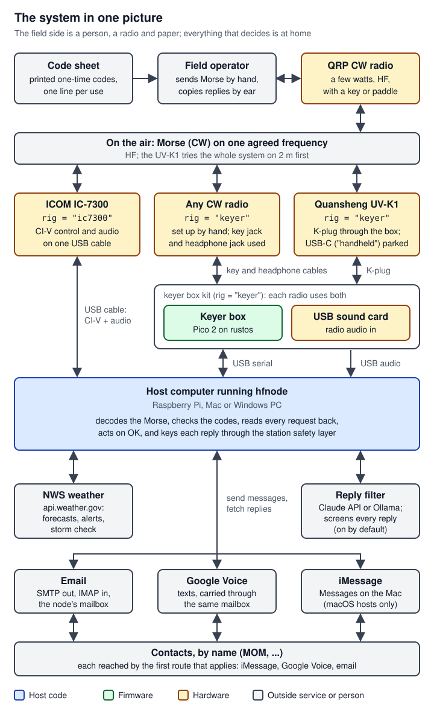
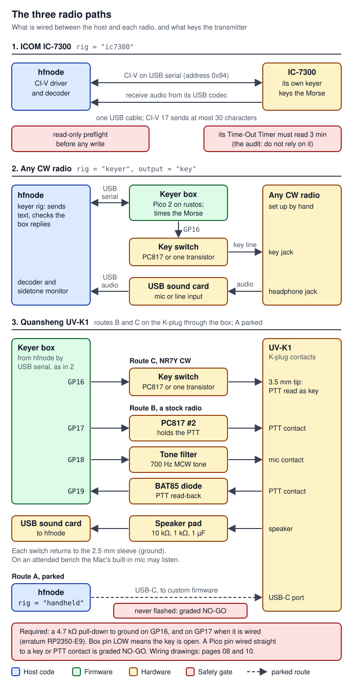
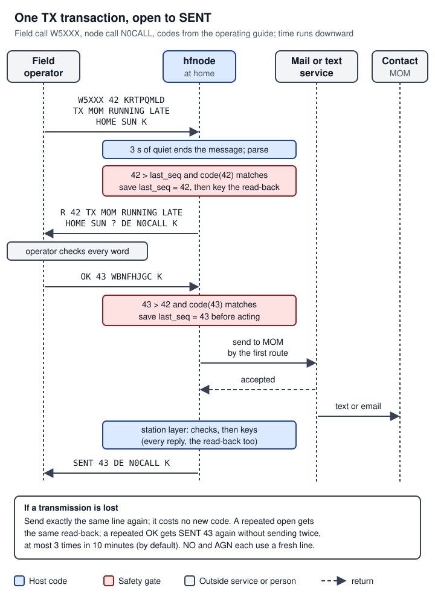

# 01 System overview

> `cw-message-gateway` is a home-station node, the program `hfnode`, that lets a person in the field with a small Morse-code radio and a printed sheet of one-time codes send texts and email, hear the replies, and get a weather forecast, all over one agreed radio frequency. The node runs on a Raspberry Pi, a Mac or a Windows PC at home, listens to a radio (an ICOM IC-7300 over its USB cable, any CW radio through a small USB "keyer box", or a Quansheng UV-K1 handheld), decodes the Morse, checks the codes, reads every request back, and acts only after a second code confirms it. It exists because remote places often have no phone signal, while a low-power Morse signal can still reach home. All of it lives in this repository, except the design spec, the safety audit and the bench notes, which are project files. **Nothing has transmitted on a real radio yet**, and a separate safety audit gates every flash and every keyed test.

This is an overview page, not a subsystem page. It keeps the standard headings, adds two of its own ("Design decisions" and "Subsystem map"), and keeps each subject to a few paragraphs with a link to the page that covers it in depth. For which page owns which crate and file, see the [Subsystem map](#subsystem-map) near the end of this page. Code is cited at `main` (`44185fa`) unless an open pull request is named. Radio and embedded terms are explained on first use here and collected in [17 Glossary](17-glossary.md).

## Where it lives

The repository is a Rust workspace (the six crates listed in [`Cargo.toml:3`](https://github.com/robinonsay/cw-message-gateway/blob/44185fa9a00369c379d9d8af40ca307e3867e860/Cargo.toml#L3)) plus two firmware trees that build on their own, deployment scripts and documentation.

| Path | What it holds | Size at `main` |
|---|---|---|
| `crates/auth` | One-time codes (HMAC-SHA256 turned into 8 letters), the verifier, the durable `last_seq` store: [`lib.rs:1-13`](https://github.com/robinonsay/cw-message-gateway/blob/44185fa9a00369c379d9d8af40ca307e3867e860/crates/auth/src/lib.rs#L1-L13) | 490 lines of Rust |
| `crates/protocol` | The over-the-air grammar, fuzzy snapping, the node's replies, chunking, text sanitizing: [`lib.rs:1-21`](https://github.com/robinonsay/cw-message-gateway/blob/44185fa9a00369c379d9d8af40ca307e3867e860/crates/protocol/src/lib.rs#L1-L21) | 1,145 |
| `crates/cw` | Morse table, audio CW decoder (builds without `std` or a heap), test-signal synthesizer: [`lib.rs:1-10`](https://github.com/robinonsay/cw-message-gateway/blob/44185fa9a00369c379d9d8af40ca307e3867e860/crates/cw/src/lib.rs#L1-L10) | 1,923 |
| `crates/civ` | The `Rig` trait, ICOM CI-V framing, the IC-7300 driver, read-only preflight, a byte-level mock IC-7300: [`lib.rs:1-10`](https://github.com/robinonsay/cw-message-gateway/blob/44185fa9a00369c379d9d8af40ca307e3867e860/crates/civ/src/lib.rs#L1-L10) | 5,634 |
| `crates/keyer-core` | The keyer box's rules (line protocol, Morse timing, every limit), `no_std`, built into both the box firmware and hfnode's mock box: [`lib.rs:1-15`](https://github.com/robinonsay/cw-message-gateway/blob/44185fa9a00369c379d9d8af40ca307e3867e860/crates/keyer-core/src/lib.rs#L1-L15) | 4,476 |
| `crates/hfnode` | The node: config, session, station safety layer, gateways, node loop, keyer and handheld rigs, self-test, CLI: [`lib.rs:1-17`](https://github.com/robinonsay/cw-message-gateway/blob/44185fa9a00369c379d9d8af40ca307e3867e860/crates/hfnode/src/lib.rs#L1-L17) | 42,164 (tests included) |
| `firmware/pico2-keyer` | The keyer box firmware for a Raspberry Pi Pico 2, on `rustos`, the bare-metal runtime of Robin (the project owner): [`src/main.rs:1-41`](https://github.com/robinonsay/cw-message-gateway/blob/44185fa9a00369c379d9d8af40ca307e3867e860/firmware/pico2-keyer/src/main.rs#L1-L41) | 294 lines of Rust (`src/main.rs` is 288), plus the build and check scripts |
| `firmware/uv-k1` | C firmware for the UV-K1 handheld's parked USB-C route (route A on page 10; a patch to NR7Y's CW firmware); parked, not to be flashed ([docs/handheld.md](../handheld.md), "Parked"): [`README.md:1-13`](https://github.com/robinonsay/cw-message-gateway/blob/44185fa9a00369c379d9d8af40ca307e3867e860/firmware/uv-k1/README.md#L1-L13) | 2,403 lines (C, the patch, scripts, the host test) |
| `hardware/keyer-box` | OpenSCAD enclosure for the keyer box (PR #29, merged) | 928 lines (OpenSCAD, script, README), plus rendered PNGs |
| `deploy/` | Start-up: systemd unit and supervise script (Linux), launchd and Terminal (Mac), Task Scheduler (Windows) | 618 |
| `docs/` | The existing guides: [operating](../operating.md), [keyer box](../keyer.md), [keyer protocol](../keyer-protocol.md), [handheld](../handheld.md), [handheld protocol](../handheld-protocol.md), [texting](../texting.md), [reply filter](../reply-filter.md), [hardware test plan](../hardware-test-plan.md), [CI-V audit](../civ-audit.md), and the set-up guides for the [Raspberry Pi](../raspberry-pi-setup.md), [Mac](../macos-setup.md) and [Windows](../windows-setup.md) | 5,779 (12 guides) |
| `hfnode.example.toml` | Every config key, annotated | |
| `.github/workflows/ci.yml` | CI on Linux, macOS and Windows, the reproducible firmware builds | |

Sizes are line counts at `main`: the Rust crates count their `.rs` files, as [02 Codebase, build and CI](02-codebase-build-ci.md) does; the other rows count every tracked text file.

On open pull requests, not on `main`: `crates/decoder-core` and `firmware/pico2-decoder`, a receive-only "decoder box" (PR #30, [`docs/decoder.md:1-20`](https://github.com/robinonsay/cw-message-gateway/blob/3efaf842e1aab75354e5e19d0384a703d4d786be/docs/decoder.md#L1-L20)); the same decoder on the keyer box's second processor core (draft PR #31, [`firmware/pico2-keyer/src/core1.rs:1-8`](https://github.com/robinonsay/cw-message-gateway/blob/bc5062ae4f56ae1f9949b3b067218c7e675d88f8/firmware/pico2-keyer/src/core1.rs#L1-L8)); and seven more read-only IC-7300 checks (PR #27, [`crates/civ/src/preflight.rs:9-13`](https://github.com/robinonsay/cw-message-gateway/blob/3c97427bcf59fcb8223af7a3676eeebdec529f52/crates/civ/src/preflight.rs#L9-L13)).

Outside the repository (project files, not public): the design spec `design/spec.md` and its additions `design/spec-any-radio.md`, `design/spec-handheld.md`, `design/spec-always-listening.md`, `design/spec-pico-decoder.md`; the safety audit under `audit/`; the bench notes under `bench/`; the IC-7300 manual as text under `reference/`.

## How it works

### What the gateway does, and why

The design spec's Purpose section puts it in one sentence: when operating portable in remote areas there is no cell signal, but a QRP HF CW signal can reach home. **CW** is Morse code sent by switching a carrier on and off; **QRP** means low power, a few watts; **HF** is the 3-30 MHz shortwave range, where signals can travel hundreds of kilometres. The home node listens on a fixed frequency, decodes the field operator's Morse, authenticates it, and acts on three commands: send a text or email (`TX`), read back replies that have arrived (`RX`), and read a short US National Weather Service forecast (`WX`) ([`README.md:3-16`](https://github.com/robinonsay/cw-message-gateway/blob/44185fa9a00369c379d9d8af40ca307e3867e860/README.md#L3-L16)).

The spec borrows from things that already work in amateur radio: APRS gateways and Winlink for the relay idea, AMTOR and PACTOR for stop-and-wait retransmission, and ordinary read-back practice for error checking. The link is lopsided. The weak direction is the field station's few watts arriving at home, so the home receiver and antenna decide whether anything works at all; the home station transmits at more power and the field side hears it easily (spec, "Architecture").



*Figure: the whole system from top to bottom. The field side is a person, a radio and paper; everything that decides is at home. Only one home radio path is used at a time.*

### The field side

The field operator carries a small CW radio, a key, and a printed **code sheet** made at home with `hfnode codes` ([`crates/hfnode/src/main.rs:552-597`](https://github.com/robinonsay/cw-message-gateway/blob/44185fa9a00369c379d9d8af40ca307e3867e860/crates/hfnode/src/main.rs#L552-L597)). Each line of the sheet is a sequence number and an 8-letter code, printed in two groups of four. The operator uses each line once, in order, and crosses it off; skipping lines is fine, going back is not. Every transaction takes two lines (open, then `OK`), and one more for each `NO` or `AGN` (the rules printed on the sheet, [`main.rs:626-629`](https://github.com/robinonsay/cw-message-gateway/blob/44185fa9a00369c379d9d8af40ca307e3867e860/crates/hfnode/src/main.rs#L626-L629)). The sheet also lists the weather presets and how each contact will be reached.

The sheet is a password: anyone holding it can send as the operator until its codes are used. The field side needs no computer and no software. The operator's guide, [docs/operating.md](../operating.md), is the reference for what to send and what comes back; its exchange formats are exactly the ones in "One transaction, end to end" below.

### The home side

The home side is one program, `hfnode`, on a Raspberry Pi (a Pi 4 or Pi 5 with 64-bit Raspberry Pi OS, [`README.md:107`](https://github.com/robinonsay/cw-message-gateway/blob/44185fa9a00369c379d9d8af40ca307e3867e860/README.md#L107)), a Mac (Apple Silicon or Intel) or a Windows PC. CI builds and tests it on all three; it has not yet run with a radio on any of them ([`README.md:86-89`](https://github.com/robinonsay/cw-message-gateway/blob/44185fa9a00369c379d9d8af40ca307e3867e860/README.md#L86-L89)). Set-up guides: [Raspberry Pi](../raspberry-pi-setup.md), [Mac](../macos-setup.md), [Windows](../windows-setup.md). `hfnode run` reads a TOML config, opens the radio, starts audio capture, and runs the node loop until it is stopped ([`main.rs:1219-1333`](https://github.com/robinonsay/cw-message-gateway/blob/44185fa9a00369c379d9d8af40ca307e3867e860/crates/hfnode/src/main.rs#L1219-L1333)). Inside it:

- the **CW decoder** turns the radio's audio into text (`crates/cw`, [04 CW decoder and audio](04-cw-decoder-audio.md));
- the **session** parses that text, checks the codes, reads requests back and acts on commits (`session.rs`, `crates/protocol`, `crates/auth`, [03 Field protocol, codes and sessions](03-field-protocol-auth-session.md));
- the **station safety layer** is the only code that keys the radio, and wraps every transmission in checks ([`station.rs:1-73`](https://github.com/robinonsay/cw-message-gateway/blob/44185fa9a00369c379d9d8af40ca307e3867e860/crates/hfnode/src/station.rs#L1-L73), [05 Node loop and station safety](05-node-loop-station-safety.md));
- the **gateways** send and receive email, texts and iMessages, fetch forecasts and screen replies ([06 Gateways and messages](06-gateways-messages.md));
- a **rig** drives the radio behind the `Rig` trait: the IC-7300 over CI-V ([07](07-civ-ic7300.md)), the keyer box ([08](08-keyer-box-firmware.md), [09](09-keyer-host-side.md)), or the parked handheld firmware ([10](10-uv-k1-handheld.md)).

`run` refuses to start until the radio's **bring-up stages** are recorded as passed on the bench. A bring-up stage is a step of the bench test plan, passed in order on the real radio, and the config names the last one passed: `station.commissioned` for the IC-7300 (`none`, `link`, `setup`, `tune`, `keying`, `done`; `run` needs `done`, and more than 10 W needs `keying`), `[keyer] commissioned` for the keyer box (`none`, `listen`, `keying`, `done`) and `[handheld] commissioned` for the parked handheld ([`commissioning.rs:24-45`](https://github.com/robinonsay/cw-message-gateway/blob/44185fa9a00369c379d9d8af40ca307e3867e860/crates/hfnode/src/commissioning.rs#L24-L45), [`commissioning.rs:72-119`](https://github.com/robinonsay/cw-message-gateway/blob/44185fa9a00369c379d9d8af40ca307e3867e860/crates/hfnode/src/commissioning.rs#L72-L119), [`keyer.rs:121-138`](https://github.com/robinonsay/cw-message-gateway/blob/44185fa9a00369c379d9d8af40ca307e3867e860/crates/hfnode/src/keyer.rs#L121-L138), [`main.rs:1353`](https://github.com/robinonsay/cw-message-gateway/blob/44185fa9a00369c379d9d8af40ca307e3867e860/crates/hfnode/src/main.rs#L1353)). The stages themselves are in [docs/hardware-test-plan.md](../hardware-test-plan.md) ("Bring-up stages") and [docs/keyer.md](../keyer.md) ("Bring-up"); [13 Safety rules](13-safety-rules.md) lists every gate.

A running node owns the radio: it puts its settings back while idle and before every transmission, so the owner stops it before using the radio by hand ([`README.md:407-409`](https://github.com/robinonsay/cw-message-gateway/blob/44185fa9a00369c379d9d8af40ca307e3867e860/README.md#L407-L409)).

### Where the data lives

The spec's "Data flow" table, brought up to date with the code. Formats are on [05 Node loop and station safety](05-node-loop-station-safety.md) and [15 Config, CLI and deployment](15-config-cli-deployment.md).

| Item | Where | Lifetime | Code |
|---|---|---|---|
| Secret key | The file `[auth] key_file`, on the node only: 32 random bytes from `hfnode keygen`, which refuses to overwrite a key and sets mode 0600 on Linux and macOS. The node refuses a key shorter than 16 bytes | Persistent | [`main.rs:526-550`](https://github.com/robinonsay/cw-message-gateway/blob/44185fa9a00369c379d9d8af40ca307e3867e860/crates/hfnode/src/main.rs#L526-L550), [`node.rs:36-46`](https://github.com/robinonsay/cw-message-gateway/blob/44185fa9a00369c379d9d8af40ca307e3867e860/crates/hfnode/src/node.rs#L36-L46) |
| Code sheet | Paper, printed by `hfnode codes`; one line per use, in order | Persistent, used up line by line | [`main.rs:552-597`](https://github.com/robinonsay/cw-message-gateway/blob/44185fa9a00369c379d9d8af40ca307e3867e860/crates/hfnode/src/main.rs#L552-L597) |
| `last_seq` | `state_dir/last_seq`, a decimal number, replaced atomically and synced | Persistent; never moves backwards | [`auth/src/store.rs:28-54`](https://github.com/robinonsay/cw-message-gateway/blob/44185fa9a00369c379d9d8af40ca307e3867e860/crates/auth/src/store.rs#L28-L54) |
| Pending transaction (and the last result, for repeats) | Memory only | Until its `OK` or `NO`, `pending_timeout_secs` (default 600 s), or a restart. A node restarted between the read-back and the `OK` has forgotten the request: the `OK` gets silence, and the operator opens again on fresh lines | [`session.rs:221-239`](https://github.com/robinonsay/cw-message-gateway/blob/44185fa9a00369c379d9d8af40ca307e3867e860/crates/hfnode/src/session.rs#L221-L239), [`session.rs:389-391`](https://github.com/robinonsay/cw-message-gateway/blob/44185fa9a00369c379d9d8af40ca307e3867e860/crates/hfnode/src/session.rs#L389-L391), [`config.rs:17-19`](https://github.com/robinonsay/cw-message-gateway/blob/44185fa9a00369c379d9d8af40ca307e3867e860/crates/hfnode/src/config.rs#L17-L19) |
| Inbound replies | `state_dir/inbox.json`, each message `Unscreened`, then `Ready`, then `Read` | Persistent until read over the air | [`inbox.rs:12-20`](https://github.com/robinonsay/cw-message-gateway/blob/44185fa9a00369c379d9d8af40ca307e3867e860/crates/hfnode/src/inbox.rs#L12-L20), [`node.rs:91-95`](https://github.com/robinonsay/cw-message-gateway/blob/44185fa9a00369c379d9d8af40ca307e3867e860/crates/hfnode/src/node.rs#L91-L95) |
| Other node state | `state_dir`: `wx_last.json` (the last weather place each field callsign confirmed), `rx.log` (every decoded transmission), `health.csv` (tunes, SWR readings, faults), `key-down` (the carrier keyed lately, so a restart does not forget the duty budget), `tx-inhibited` (while transmitting is inhibited), and the texting files of [docs/texting.md](../texting.md) ("Files in `state_dir`") | Persistent | [`README.md:411-416`](https://github.com/robinonsay/cw-message-gateway/blob/44185fa9a00369c379d9d8af40ca307e3867e860/README.md#L411-L416), [`station.rs:729-732`](https://github.com/robinonsay/cw-message-gateway/blob/44185fa9a00369c379d9d8af40ca307e3867e860/crates/hfnode/src/station.rs#L729-L732), [`station.rs:528-532`](https://github.com/robinonsay/cw-message-gateway/blob/44185fa9a00369c379d9d8af40ca307e3867e860/crates/hfnode/src/station.rs#L528-L532) |

### The three radio paths

`station.rig` in the config picks the radio: `ic7300` (the default), `keyer` or `handheld` ([`crates/hfnode/src/config.rs:85-93`](https://github.com/robinonsay/cw-message-gateway/blob/44185fa9a00369c379d9d8af40ca307e3867e860/crates/hfnode/src/config.rs#L85-L93)). `run` builds the same session and gateways for each and hands the rig to the same station layer and node loop ([`main.rs:1248-1265`](https://github.com/robinonsay/cw-message-gateway/blob/44185fa9a00369c379d9d8af40ca307e3867e860/crates/hfnode/src/main.rs#L1248-L1265)).

**1. ICOM IC-7300 over CI-V (`rig = "ic7300"`).** One USB cable carries both control and audio: the radio's USB serial port speaks **CI-V**, ICOM's byte protocol for computer control (frames `FE FE 94 E0 <cmd> <sub> <data> FD`), and its built-in USB sound device carries the receive audio ([`crates/civ/src/ic7300.rs:11-21`](https://github.com/robinonsay/cw-message-gateway/blob/44185fa9a00369c379d9d8af40ca307e3867e860/crates/civ/src/ic7300.rs#L11-L21); the default audio device is "USB Audio CODEC" on macOS and Windows and `plughw:CARD=CODEC,DEV=0` on Linux, [`config.rs:758-765`](https://github.com/robinonsay/cw-message-gateway/blob/44185fa9a00369c379d9d8af40ca307e3867e860/crates/hfnode/src/config.rs#L758-L765)). The node sets the frequency, CW mode, power, keyer speed and **semi break-in** (the radio switches itself to transmit when keyed and back to receive after a short pause), runs the radio's antenna **tuner**, reads its **SWR** meter (standing-wave ratio, how well the antenna takes the power) and power meter, and keys Morse through the radio's own keyer with CI-V command `17`. The only frames the driver can send that transmit are `17` and the tuner start `1C 01 02`; it never sends `1C 00 01` (transmit on) ([`ic7300.rs:22-33`](https://github.com/robinonsay/cw-message-gateway/blob/44185fa9a00369c379d9d8af40ca307e3867e860/crates/civ/src/ic7300.rs#L22-L33)). `radio tune`, `radio cw` and `run` also require the radio's own **Time-Out Timer** (TOT, a radio setting meant to end a transmission after a set time) at its shortest setting, 3 minutes ([`crates/civ/src/preflight.rs:210-218`](https://github.com/robinonsay/cw-message-gateway/blob/44185fa9a00369c379d9d8af40ca307e3867e860/crates/civ/src/preflight.rs#L210-L218), [`preflight.rs:346-367`](https://github.com/robinonsay/cw-message-gateway/blob/44185fa9a00369c379d9d8af40ca307e3867e860/crates/civ/src/preflight.rs#L346-L367), [`station.rs:350-353`](https://github.com/robinonsay/cw-message-gateway/blob/44185fa9a00369c379d9d8af40ca307e3867e860/crates/hfnode/src/station.rs#L350-L353)); whether it ends CW keyed with `17` is unproven, and the audit says not to rely on it (`audit/report.md` §4, H11, project files). **Status:** complete on `main`, every command cited to the manual, and exercised by the self-test and the mock-radio tests against the byte-level mock ([`README.md:22-29`](https://github.com/robinonsay/cw-message-gateway/blob/44185fa9a00369c379d9d8af40ca307e3867e860/README.md#L22-L29)), but it has never been connected to a real IC-7300. PR #27 (open, ready, audit-cleared) adds the front-key preflight. Unattended use also needs the external hardware transmit timer, which is not built. Page [07 CI-V and the IC-7300](07-civ-ic7300.md).

**2. Any CW radio through the keyer box (`rig = "keyer"`, `[keyer] output = "key"`).** The node does not control the radio at all: the owner sets frequency, mode, power and break-in by hand. The radio's headphone jack goes into a USB sound card, which the node decodes and also uses as a **sidetone monitor** (the sidetone is the tone a radio plays in its own headphones while it sends, so the node can hear whether the radio really keyed). The radio's key jack is closed by the **keyer box**: a Raspberry Pi Pico 2 (an RP2350 microcontroller board) running firmware on `rustos`, which takes text from the node over USB serial and keys it as a **straight key** would (a straight key is a plain on/off contact: closed is key down), with its own Morse timing and its own limits ([`crates/hfnode/src/keyer.rs:1-12`](https://github.com/robinonsay/cw-message-gateway/blob/44185fa9a00369c379d9d8af40ca307e3867e860/crates/hfnode/src/keyer.rs#L1-L12), [docs/keyer.md](../keyer.md)). The box's key pin drives a switch (a PC817 optocoupler, or one transistor) that closes the radio's key line; the pin LOW means the key is open. **Status:** on `main`. The independent safety audit grades every action on real hardware (flash, connect, key on the bench, run unattended): **GO WITH STEPS** means safe only if Robin does the listed steps, in order, herself, at the radio; **NO-GO** means not allowed (`audit/final-grades.md`, project files; [14 Audit, bench and flashing](14-audit-bench-flashing.md)). The box firmware build `eef8c126` is graded GO WITH STEPS to flash, connect with no RF, and key on the bench with Robin at the radio; nothing has been keyed on a radio. Pages [08 Keyer box: firmware and protocol](08-keyer-box-firmware.md) and [09 Keyer box: host side](09-keyer-host-side.md).

**3. Quansheng UV-K1 handheld, three routes.** The UV-K1 is a 2 m (VHF) FM handheld, used to try the whole system across a room before going on HF. [10 Quansheng UV-K1 handheld](10-uv-k1-handheld.md) names its routes A, B and C, with a table of each; this page uses the same letters.

- *Route A, parked* (`rig = "handheld"`): hfnode's commands patched into NR7Y's CW firmware (`firmware/uv-k1`), which keys a carrier on commands over the radio's USB-C port ([`crates/hfnode/src/handheld.rs:1-6`](https://github.com/robinonsay/cw-message-gateway/blob/44185fa9a00369c379d9d8af40ca307e3867e860/crates/hfnode/src/handheld.rs#L1-L6)). It was merged in PR #10 and is tested against simulations, but Robin parked it, the audit graded flashing it NO-GO, and it has never been flashed: "nothing here is to be flashed onto a radio" ([docs/handheld.md](../handheld.md)).
- *Route B, a stock radio by MCW* (`rig = "keyer"`, `[keyer] output = "ptt"`, PR #15): through the radio's two-pin headset jack (the "K-plug"), the keyer box holds the radio's push-to-talk (**PTT**) on GP17 and keys a 700 Hz tone from GP18 into its microphone. **MCW** is an FM carrier with a keyed audio tone. It is GO WITH STEPS for an attended bench on a stock radio, but it cannot key Robin's radios: NR7Y's paddle rework cuts the contact this cable holds as the PTT ([`docs/keyer.md:435-449`](https://github.com/robinonsay/cw-message-gateway/blob/44185fa9a00369c379d9d8af40ca307e3867e860/docs/keyer.md#L435-L449)).
- *Route C, Robin's route: NR7Y CW keyed as a straight key* (`rig = "keyer"`, `[keyer] output = "key"`, no code change): her radios run NR7Y's CW firmware v1.3 or v1.3.1 with its paddle rework, and in CW mode with `CWkin` set to `PTT HandKey` the radio reads its PTT line as a straight key. The box's key output, GP16, closes that line through one transistor or a PC817, with the same required pull-down as any radio ([docs/keyer.md](../keyer.md), "A UV-K1 on NR7Y in CW mode (paddle-reworked)"). It is GO WITH STEPS for an attended bench on the radio's own antenna at its lowest power (LOW 1), never on coax; unattended use is not cleared on any route.



*Figure: what is wired between the host and each radio, and what keys the transmitter. A block diagram only: the wiring drawings, part by part and pin by pin, are on [08](08-keyer-box-firmware.md) and [10](10-uv-k1-handheld.md).*

The keyer box route is the main path forward (project memory notes); `design/spec-any-radio.md`, "What Robin asked for", keeps the IC-7300 CI-V route supported.

### One transaction, end to end

Every exchange has the same shape: the field **opens** with a callsign, a sheet line and a request; the node **reads it back** ending with `?`; the field **commits** with `OK` on a later line, or aborts with `NO`; the node **acts** and replies. Nothing is sent, read out or looked up until the commit ([docs/operating.md](../operating.md), "How an exchange works"). Every field transmission ends with an **over**, the prosign `K` or `KN` that means "your turn"; the node treats a transmission as finished after 3 s of silence (`audio.end_of_message_ms`, [`config.rs:772-774`](https://github.com/robinonsay/cw-message-gateway/blob/44185fa9a00369c379d9d8af40ca307e3867e860/crates/hfnode/src/config.rs#L772-L774)) or an over followed by quiet ([`crates/hfnode/src/node.rs:700-723`](https://github.com/robinonsay/cw-message-gateway/blob/44185fa9a00369c379d9d8af40ca307e3867e860/crates/hfnode/src/node.rs#L700-L723)). Every node reply ends `DE <node call> K`, its station identification ([`crates/protocol/src/reply.rs:68`](https://github.com/robinonsay/cw-message-gateway/blob/44185fa9a00369c379d9d8af40ca307e3867e860/crates/protocol/src/reply.rs#L68)). The examples use field call `W5XXX`, node call `N0CALL` and the codes from the operating guide.



*Figure: a TX from open to SENT. Each code is checked, and `last_seq` saved to disk, before the node acts on it: the open's before the read-back is keyed, the commit's before the message is sent. Red boxes are those safety gates.*

**TX, send a text or email.**

```text
Field:  W5XXX 42 KRTPQMLD TX MOM RUNNING LATE HOME SUN K
Node:   R 42 TX MOM RUNNING LATE HOME SUN ? DE N0CALL K
Field:  OK 43 WBNFHJGC K
Node:   SENT 43 DE N0CALL K
```

1. The node parses the open. Callsign, `TX` and the contact name may be slightly garbled and are snapped to the nearest legal word; the sequence number and code must decode exactly ([`protocol/src/lib.rs:18-21`](https://github.com/robinonsay/cw-message-gateway/blob/44185fa9a00369c379d9d8af40ca307e3867e860/crates/protocol/src/lib.rs#L18-L21)).
2. It checks that 42 is greater than `last_seq` and that the code is the one for 42 ([`crates/auth/src/lib.rs:187-195`](https://github.com/robinonsay/cw-message-gateway/blob/44185fa9a00369c379d9d8af40ca307e3867e860/crates/auth/src/lib.rs#L187-L195)), then writes `last_seq = 42` to disk **before** it replies, and stays silent if that write fails ([`crates/hfnode/src/session.rs:331-342`](https://github.com/robinonsay/cw-message-gateway/blob/44185fa9a00369c379d9d8af40ca307e3867e860/crates/hfnode/src/session.rs#L331-L342)). The open code is used up whatever happens next.
3. It keys the read-back `R 42 TX MOM ... ?` ([`reply.rs:44-46`](https://github.com/robinonsay/cw-message-gateway/blob/44185fa9a00369c379d9d8af40ca307e3867e860/crates/protocol/src/reply.rs#L44-L46)) and holds the request as **pending** for 10 minutes (`pending_timeout_secs`, default 600, [`config.rs:731-733`](https://github.com/robinonsay/cw-message-gateway/blob/44185fa9a00369c379d9d8af40ca307e3867e860/crates/hfnode/src/config.rs#L731-L733)).
4. The field checks the read-back word by word and commits with `OK 43 <code 43> K`. The node checks 43 against the open (must be later) and the code, writes `last_seq = 43` before acting ([`session.rs:389-403`](https://github.com/robinonsay/cw-message-gateway/blob/44185fa9a00369c379d9d8af40ca307e3867e860/crates/hfnode/src/session.rs#L389-L403)), and calls `Services::send_message` ([`session.rs:412-431`](https://github.com/robinonsay/cw-message-gateway/blob/44185fa9a00369c379d9d8af40ca307e3867e860/crates/hfnode/src/session.rs#L412-L431)).
5. The gateway reaches the contact by iMessage, a Google Voice text, or email, the first that applies ([`gateway/route.rs:1-12`](https://github.com/robinonsay/cw-message-gateway/blob/44185fa9a00369c379d9d8af40ca307e3867e860/crates/hfnode/src/gateway/route.rs#L1-L12)). Success keys `SENT 43`; a failure keys `FAIL 43 GATEWAY` or `FAIL 43 NO ROUTE`. Either way both codes are used up.

**On disk, in order.** What the TX above writes to `state_dir`, and which function writes it:

1. `rx.log` gets the decoded open, before the session sees it ([`node.rs:723`](https://github.com/robinonsay/cw-message-gateway/blob/44185fa9a00369c379d9d8af40ca307e3867e860/crates/hfnode/src/node.rs#L723)).
2. `last_seq` becomes 42 ([`session.rs:337-341`](https://github.com/robinonsay/cw-message-gateway/blob/44185fa9a00369c379d9d8af40ca307e3867e860/crates/hfnode/src/session.rs#L337-L341)).
3. The read-back is keyed by `Station::transmit` ([`node.rs:753`](https://github.com/robinonsay/cw-message-gateway/blob/44185fa9a00369c379d9d8af40ca307e3867e860/crates/hfnode/src/node.rs#L753)). After each piece the station counts its carrier toward the duty budget and rewrites `key-down` ([`station.rs:2065`](https://github.com/robinonsay/cw-message-gateway/blob/44185fa9a00369c379d9d8af40ca307e3867e860/crates/hfnode/src/station.rs#L2065), [`station.rs:799-822`](https://github.com/robinonsay/cw-message-gateway/blob/44185fa9a00369c379d9d8af40ca307e3867e860/crates/hfnode/src/station.rs#L799-L822)). `health.csv` gets a line for a tune (one runs first if the last is older than `schedule.retune_minutes`, [`node.rs:734-749`](https://github.com/robinonsay/cw-message-gateway/blob/44185fa9a00369c379d9d8af40ca307e3867e860/crates/hfnode/src/node.rs#L734-L749)), for the transmission's worst SWR on the IC-7300, and for a failure ([`station.rs:1252-1257`](https://github.com/robinonsay/cw-message-gateway/blob/44185fa9a00369c379d9d8af40ca307e3867e860/crates/hfnode/src/station.rs#L1252-L1257), [`station.rs:1726-1733`](https://github.com/robinonsay/cw-message-gateway/blob/44185fa9a00369c379d9d8af40ca307e3867e860/crates/hfnode/src/station.rs#L1726-L1733)).
4. `rx.log` gets the `OK` (the same line, [`node.rs:723`](https://github.com/robinonsay/cw-message-gateway/blob/44185fa9a00369c379d9d8af40ca307e3867e860/crates/hfnode/src/node.rs#L723)).
5. `last_seq` becomes 43 ([`session.rs:398-402`](https://github.com/robinonsay/cw-message-gateway/blob/44185fa9a00369c379d9d8af40ca307e3867e860/crates/hfnode/src/session.rs#L398-L402)).
6. `Services::send_message` ([`session.rs:414`](https://github.com/robinonsay/cw-message-gateway/blob/44185fa9a00369c379d9d8af40ca307e3867e860/crates/hfnode/src/session.rs#L414)) runs `LiveServices::deliver` ([`gateway/mod.rs:227-230`](https://github.com/robinonsay/cw-message-gateway/blob/44185fa9a00369c379d9d8af40ca307e3867e860/crates/hfnode/src/gateway/mod.rs#L227-L230), [`gateway/mod.rs:150-224`](https://github.com/robinonsay/cw-message-gateway/blob/44185fa9a00369c379d9d8af40ca307e3867e860/crates/hfnode/src/gateway/mod.rs#L150-L224)). By email that is `Mailer::send_as`, then the `lettre` crate's `transport.send` ([`gateway/email.rs:53-63`](https://github.com/robinonsay/cw-message-gateway/blob/44185fa9a00369c379d9d8af40ca307e3867e860/crates/hfnode/src/gateway/email.rs#L53-L63), [`gateway/email.rs:73-81`](https://github.com/robinonsay/cw-message-gateway/blob/44185fa9a00369c379d9d8af40ca307e3867e860/crates/hfnode/src/gateway/email.rs#L73-L81)). By Google Voice the send is also recorded in `google_voice.json` ([`gateway/mod.rs:203`](https://github.com/robinonsay/cw-message-gateway/blob/44185fa9a00369c379d9d8af40ca307e3867e860/crates/hfnode/src/gateway/mod.rs#L203)); by iMessage, in `imessage_windows.json` ([`gateway/imessage.rs:663`](https://github.com/robinonsay/cw-message-gateway/blob/44185fa9a00369c379d9d8af40ca307e3867e860/crates/hfnode/src/gateway/imessage.rs#L663)). The send runs on the node-loop thread, inside `Session::handle`, and the mailer sets no SMTP timeout of its own, so `lettre`'s default applies ([`gateway/email.rs:32-46`](https://github.com/robinonsay/cw-message-gateway/blob/44185fa9a00369c379d9d8af40ca307e3867e860/crates/hfnode/src/gateway/email.rs#L32-L46); [06 Gateways and messages](06-gateways-messages.md)). That is why a reply that took more than 90 s to prepare is not keyed (`LATE_REPLY`, [`node.rs:528-531`](https://github.com/robinonsay/cw-message-gateway/blob/44185fa9a00369c379d9d8af40ca307e3867e860/crates/hfnode/src/node.rs#L528-L531)).
7. `SENT 43` is keyed through `Station::transmit` in the same way, and `key-down` is rewritten again.

Each file's format is in the state-directory table on [15 Config, CLI and deployment](15-config-cli-deployment.md) ("The state directory").

**RX, read replies.** The open `W5XXX 44 <code> RX K` reads back how many screened messages are waiting (`R 44 2 MSGS ?`, [`reply.rs:47-52`](https://github.com/robinonsay/cw-message-gateway/blob/44185fa9a00369c379d9d8af40ca307e3867e860/crates/protocol/src/reply.rs#L47-L52)). After `OK 45`, the node keys up to 5 messages, oldest first, each as `NR <n> FM <contact> <text>`, in **chunks** of up to `station.chunk_chars` characters of text (default 60), each followed by `= A`, `= B` and so on, with a `station.chunk_pause_ms` pause between them (default 2 s, [`config.rs:752-757`](https://github.com/robinonsay/cw-message-gateway/blob/44185fa9a00369c379d9d8af40ca307e3867e860/crates/hfnode/src/config.rs#L752-L757), [`reply.rs:80-85`](https://github.com/robinonsay/cw-message-gateway/blob/44185fa9a00369c379d9d8af40ca307e3867e860/crates/protocol/src/reply.rs#L80-L85)); at most 26 chunks per readout, with `<n> MORE` if more wait ([`session.rs:433-448`](https://github.com/robinonsay/cw-message-gateway/blob/44185fa9a00369c379d9d8af40ca307e3867e860/crates/hfnode/src/session.rs#L433-L448), [`session.rs:528-581`](https://github.com/robinonsay/cw-message-gateway/blob/44185fa9a00369c379d9d8af40ca307e3867e860/crates/hfnode/src/session.rs#L528-L581)). Messages are marked read only once the transmission carrying them was keyed ([`node.rs:753-756`](https://github.com/robinonsay/cw-message-gateway/blob/44185fa9a00369c379d9d8af40ca307e3867e860/crates/hfnode/src/node.rs#L753-L756)). With nothing waiting the result is `R 45 NIL`.

**WX, weather.** The open names a place: a 4- or 6-character **Maidenhead grid square** (a standard amateur-radio location code such as `DL89IG`), a numbered preset from the config, or nothing (the last place this callsign confirmed, else `weather.default_grid`). The read-back names the grid square the forecast will be for (after the preset number, if one was sent), `R 46 WX DL89IG ?`, so the operator hears which place it is; if the node knows no place at all, the read-back has no grid and the commit gets `FAIL 47 WX` ([`reply.rs:53-62`](https://github.com/robinonsay/cw-message-gateway/blob/44185fa9a00369c379d9d8af40ca307e3867e860/crates/protocol/src/reply.rs#L53-L62)). After `OK 47` the node fetches the forecast from api.weather.gov and keys it chunked like an RX readout: `WX <grid>`, then `ALERT <event>` for each active NWS alert there (or `ALERTS UNAVBL` if the alerts could not be fetched, so that is never mistaken for none), then `weather.periods` forecast periods (default 2, each about half a day), abbreviated ([`gateway/weather.rs:128-177`](https://github.com/robinonsay/cw-message-gateway/blob/44185fa9a00369c379d9d8af40ca307e3867e860/crates/hfnode/src/gateway/weather.rs#L128-L177)); `FAIL 47 WX NO COVERAGE` means the NWS has no forecast there, `FAIL 47 WX` that it could not be fetched ([`session.rs:449-484`](https://github.com/robinonsay/cw-message-gateway/blob/44185fa9a00369c379d9d8af40ca307e3867e860/crates/hfnode/src/session.rs#L449-L484)).

**Silence, retries, `NO` and `AGN`.** The node never answers anything it cannot decode or authenticate: silence is the only "error" ([`session.rs:24`](https://github.com/robinonsay/cw-message-gateway/blob/44185fa9a00369c379d9d8af40ca307e3867e860/crates/hfnode/src/session.rs#L24)). The field operator retries by sending exactly the same transmission on the same line, which costs no new codes:

- a repeated open that is still pending gets the same read-back ([`session.rs:315-319`](https://github.com/robinonsay/cw-message-gateway/blob/44185fa9a00369c379d9d8af40ca307e3867e860/crates/hfnode/src/session.rs#L315-L319));
- a repeated `OK` the node already acted on gets the same result again, without acting twice, at most 3 times and within `again_window` (10 minutes by default, never less: [`node.rs:54`](https://github.com/robinonsay/cw-message-gateway/blob/44185fa9a00369c379d9d8af40ca307e3867e860/crates/hfnode/src/node.rs#L54)), and only until a newer transaction opens ([`session.rs:379-388`](https://github.com/robinonsay/cw-message-gateway/blob/44185fa9a00369c379d9d8af40ca307e3867e860/crates/hfnode/src/session.rs#L379-L388), [`session.rs:148`](https://github.com/robinonsay/cw-message-gateway/blob/44185fa9a00369c379d9d8af40ca307e3867e860/crates/hfnode/src/session.rs#L148));
- `NO <seq> <code> K` on the next fresh line drops the pending request and is answered `R NO` ([`session.rs:641-664`](https://github.com/robinonsay/cw-message-gateway/blob/44185fa9a00369c379d9d8af40ca307e3867e860/crates/hfnode/src/session.rs#L641-L664));
- `AGN <seq> <code> [letter] K` on the next fresh line repeats the node's last transmission, or one chunk of it, within `again_window` of it ([`session.rs:666-705`](https://github.com/robinonsay/cw-message-gateway/blob/44185fa9a00369c379d9d8af40ca307e3867e860/crates/hfnode/src/session.rs#L666-L705));
- a bare `NO` or `AGN` without a line and code gets silence, so a stranger who heard the exchange cannot cancel it or make the node key a long readout again;
- a pending request is forgotten after `pending_timeout_secs` (10 minutes by default, [`session.rs:268-273`](https://github.com/robinonsay/cw-message-gateway/blob/44185fa9a00369c379d9d8af40ca307e3867e860/crates/hfnode/src/session.rs#L268-L273)), or replaced by a valid open on fresh lines ([`session.rs:327-336`](https://github.com/robinonsay/cw-message-gateway/blob/44185fa9a00369c379d9d8af40ca307e3867e860/crates/hfnode/src/session.rs#L327-L336)).

A reply that took more than 90 s to prepare (a hung mail server) is not keyed, because the operator has stopped waiting; a repeated `OK` keys it ([`node.rs:528-531`](https://github.com/robinonsay/cw-message-gateway/blob/44185fa9a00369c379d9d8af40ca307e3867e860/crates/hfnode/src/node.rs#L528-L531)). The full protocol, the session state machine and every edge case are on [03 Field protocol, codes and sessions](03-field-protocol-auth-session.md).

## How it connects

### Outside services

| Service | Used for | Where in code | Notes |
|---|---|---|---|
| Email server, SMTP out and IMAP in | TX by email; replies by email; the owner's alert email | [`gateway/mod.rs:211-220`](https://github.com/robinonsay/cw-message-gateway/blob/44185fa9a00369c379d9d8af40ca307e3867e860/crates/hfnode/src/gateway/mod.rs#L211-L220), [`node.rs:165-190`](https://github.com/robinonsay/cw-message-gateway/blob/44185fa9a00369c379d9d8af40ca307e3867e860/crates/hfnode/src/node.rs#L165-L190), [`alert.rs:1-13`](https://github.com/robinonsay/cw-message-gateway/blob/44185fa9a00369c379d9d8af40ca307e3867e860/crates/hfnode/src/alert.rs#L1-L13) | Defaults: SMTP port 465, IMAP 993, password from `HFNODE_EMAIL_PASSWORD`, mailbox polled every 300 s ([`config.rs:811-822`](https://github.com/robinonsay/cw-message-gateway/blob/44185fa9a00369c379d9d8af40ca307e3867e860/crates/hfnode/src/config.rs#L811-L822)). |
| Google Voice | TX as a text from the node's Google Voice number; text replies | [`gateway/mod.rs:196-210`](https://github.com/robinonsay/cw-message-gateway/blob/44185fa9a00369c379d9d8af40ca307e3867e860/crates/hfnode/src/gateway/mod.rs#L196-L210), [`node.rs:176-183`](https://github.com/robinonsay/cw-message-gateway/blob/44185fa9a00369c379d9d8af40ca307e3867e860/crates/hfnode/src/node.rs#L176-L183) | Goes through the same mailbox. A contact can be texted only after they have texted the node's number once, so the node knows the reply address ([`route.rs:6-7`](https://github.com/robinonsay/cw-message-gateway/blob/44185fa9a00369c379d9d8af40ca307e3867e860/crates/hfnode/src/gateway/route.rs#L6-L7)). |
| iMessage (Messages on a Mac) | TX by iMessage from the signed-in Apple ID; iMessage replies | [`gateway/mod.rs:166-195`](https://github.com/robinonsay/cw-message-gateway/blob/44185fa9a00369c379d9d8af40ca307e3867e860/crates/hfnode/src/gateway/mod.rs#L166-L195), [`node.rs:191-231`](https://github.com/robinonsay/cw-message-gateway/blob/44185fa9a00369c379d9d8af40ca307e3867e860/crates/hfnode/src/node.rs#L191-L231) | macOS only. Sends through AppleScript, reads Messages' database, polls every 60 s (`imessage.poll_secs`), reads replies only within 48 h (`imessage.reply_hours`) of an iMessage the node sent that contact by TX ([`config.rs:463-480`](https://github.com/robinonsay/cw-message-gateway/blob/44185fa9a00369c379d9d8af40ca307e3867e860/crates/hfnode/src/config.rs#L463-L480), defaults at [`config.rs:835-840`](https://github.com/robinonsay/cw-message-gateway/blob/44185fa9a00369c379d9d8af40ca307e3867e860/crates/hfnode/src/config.rs#L835-L840)). |
| US National Weather Service, api.weather.gov | `WX` forecasts; the storm stand-down | [`gateway/weather.rs:1-22`](https://github.com/robinonsay/cw-message-gateway/blob/44185fa9a00369c379d9d8af40ca307e3867e860/crates/hfnode/src/gateway/weather.rs#L1-L22), [`storm.rs:1-26`](https://github.com/robinonsay/cw-message-gateway/blob/44185fa9a00369c379d9d8af40ca307e3867e860/crates/hfnode/src/storm.rs#L1-L26) | US states and territories only. The NWS asks for a contact in the User-Agent (`weather.user_agent`). |
| Reply filter: the Claude API, or a local model through Ollama | Screens every inbound reply before it can be keyed, while `[filter] enabled` is true (the default) | [`gateway/filter.rs:1-21`](https://github.com/robinonsay/cw-message-gateway/blob/44185fa9a00369c379d9d8af40ca307e3867e860/crates/hfnode/src/gateway/filter.rs#L1-L21), [`node.rs:104-152`](https://github.com/robinonsay/cw-message-gateway/blob/44185fa9a00369c379d9d8af40ca307e3867e860/crates/hfnode/src/node.rs#L104-L152) | `[filter] provider = "claude"` (default model `claude-opus-5-5`, key from the environment variable `ANTHROPIC_API_KEY`) or `"ollama"` (default `http://localhost:11434`, and `model` required) ([`config.rs:539-623`](https://github.com/robinonsay/cw-message-gateway/blob/44185fa9a00369c379d9d8af40ca307e3867e860/crates/hfnode/src/config.rs#L539-L623), [`config.rs:826-828`](https://github.com/robinonsay/cw-message-gateway/blob/44185fa9a00369c379d9d8af40ca307e3867e860/crates/hfnode/src/config.rs#L826-L828)). With Claude, reply text is sent to Anthropic's API; with Ollama it stays on the machine that runs the model. The filter is on by default. `[filter] enabled = false` makes the node key third-party text after only `sanitize`, unscreened, and it logs a warning when it does ([`config.rs:542-545`](https://github.com/robinonsay/cw-message-gateway/blob/44185fa9a00369c379d9d8af40ca307e3867e860/crates/hfnode/src/config.rs#L542-L545), [`node.rs:113-114`](https://github.com/robinonsay/cw-message-gateway/blob/44185fa9a00369c379d9d8af40ca307e3867e860/crates/hfnode/src/node.rs#L113-L114), [`node.rs:323-327`](https://github.com/robinonsay/cw-message-gateway/blob/44185fa9a00369c379d9d8af40ca307e3867e860/crates/hfnode/src/node.rs#L323-L327)); the design and the config's own comment advise against it. |

The mail, text and weather sections are optional in the config. `[storm]` is not: `run` refuses to start without it (it may say `enabled = false`, so that turning the stand-down off is a recorded choice, [`main.rs:1110-1121`](https://github.com/robinonsay/cw-message-gateway/blob/44185fa9a00369c379d9d8af40ca307e3867e860/crates/hfnode/src/main.rs#L1110-L1121)). Nor is the filter optional in effect: leaving `[filter]` out gives the default, enabled with Claude ([`config.rs:587-611`](https://github.com/robinonsay/cw-message-gateway/blob/44185fa9a00369c379d9d8af40ca307e3867e860/crates/hfnode/src/config.rs#L587-L611)), so without `ANTHROPIC_API_KEY` set, or with Ollama and no `model`, the filter cannot start and every reply is held, never keyed ([`node.rs:310-322`](https://github.com/robinonsay/cw-message-gateway/blob/44185fa9a00369c379d9d8af40ca307e3867e860/crates/hfnode/src/node.rs#L310-L322), [`filter.rs:284-286`](https://github.com/robinonsay/cw-message-gateway/blob/44185fa9a00369c379d9d8af40ca307e3867e860/crates/hfnode/src/gateway/filter.rs#L284-L286), [`filter.rs:373-376`](https://github.com/robinonsay/cw-message-gateway/blob/44185fa9a00369c379d9d8af40ca307e3867e860/crates/hfnode/src/gateway/filter.rs#L373-L376)). Details, setup and failure handling: [06 Gateways and messages](06-gateways-messages.md), [docs/texting.md](../texting.md), [docs/reply-filter.md](../reply-filter.md).

### Threads inside `hfnode run`

`hfnode` is a plain multi-threaded program with no async runtime. The threads and what they share:

| Thread | Started at | Does | Shares |
|---|---|---|---|
| main (node loop) | [`main.rs:1332`](https://github.com/robinonsay/cw-message-gateway/blob/44185fa9a00369c379d9d8af40ca307e3867e860/crates/hfnode/src/main.rs#L1332) | Reads audio blocks, decodes, runs the session, keys replies through the station | the `Station`, the inbox |
| audio capture | `Capture::start` ([`audio.rs:174-188`](https://github.com/robinonsay/cw-message-gateway/blob/44185fa9a00369c379d9d8af40ca307e3867e860/crates/hfnode/src/audio.rs#L174-L188)) starts it: [`audio/alsa.rs:36`](https://github.com/robinonsay/cw-message-gateway/blob/44185fa9a00369c379d9d8af40ca307e3867e860/crates/hfnode/src/audio/alsa.rs#L36) on Linux, [`audio/native.rs:45`](https://github.com/robinonsay/cw-message-gateway/blob/44185fa9a00369c379d9d8af40ca307e3867e860/crates/hfnode/src/audio/native.rs#L45) on macOS and Windows | `arecord` on Linux, Core Audio or WASAPI elsewhere; delivers mono blocks of about 50 ms, each time-stamped | a channel of blocks |
| `imap` | [`node.rs:165-190`](https://github.com/robinonsay/cw-message-gateway/blob/44185fa9a00369c379d9d8af40ca307e3867e860/crates/hfnode/src/node.rs#L165-L190) | Polls the mailbox, learns Google Voice reply addresses, adds messages to the inbox | the inbox, a wake-up channel |
| `imessage` | [`node.rs:191-231`](https://github.com/robinonsay/cw-message-gateway/blob/44185fa9a00369c379d9d8af40ca307e3867e860/crates/hfnode/src/node.rs#L191-L231) | Polls Messages' database (Mac only) | the inbox, iMessage readiness |
| `screen` | [`node.rs:305-341`](https://github.com/robinonsay/cw-message-gateway/blob/44185fa9a00369c379d9d8af40ca307e3867e860/crates/hfnode/src/node.rs#L305-L341) | Runs the reply filter on each new message, and every minute on held ones | the inbox |
| `storm` | [`storm.rs:345-356`](https://github.com/robinonsay/cw-message-gateway/blob/44185fa9a00369c379d9d8af40ca307e3867e860/crates/hfnode/src/storm.rs#L345-L356) | Asks the NWS every `check_minutes` whether thunder is near the station | the `StormHold` the station reads |
| station watchdog | [`station.rs:1088-1102`](https://github.com/robinonsay/cw-message-gateway/blob/44185fa9a00369c379d9d8af40ca307e3867e860/crates/hfnode/src/station.rs#L1088-L1102) | Every 250 ms (`WATCHDOG_TICK`, [`station.rs:332`](https://github.com/robinonsay/cw-message-gateway/blob/44185fa9a00369c379d9d8af40ca307e3867e860/crates/hfnode/src/station.rs#L332)): forces receive if a keying run outlasts `max_key_seconds`, and looks for a transmission nobody started | the radio, the inhibit latch |
| alert | [`alert.rs:143-150`](https://github.com/robinonsay/cw-message-gateway/blob/44185fa9a00369c379d9d8af40ca307e3867e860/crates/hfnode/src/alert.rs#L143-L150) | Emails the owner once when transmitting is inhibited | a channel of notices |
| keyer keep-alive (keyer rig only) | [`keyer/rig.rs:268`](https://github.com/robinonsay/cw-message-gateway/blob/44185fa9a00369c379d9d8af40ca307e3867e860/crates/hfnode/src/keyer/rig.rs#L268) | Sends `STATUS` to the box while a run lasts, and no longer, so the box's link timeout ends a run if the node dies | the box's serial link |
| handheld link (handheld rig only, parked) | [`handheld.rs:558-560`](https://github.com/robinonsay/cw-message-gateway/blob/44185fa9a00369c379d9d8af40ca307e3867e860/crates/hfnode/src/handheld.rs#L558-L560) | Sends keep-alives to the handheld firmware, several per link timeout | the handheld's serial link |
| stop handler | `ctrlc::set_handler` ([`main.rs:353`](https://github.com/robinonsay/cw-message-gateway/blob/44185fa9a00369c379d9d8af40ca307e3867e860/crates/hfnode/src/main.rs#L353)); runs `stop_guarded` ([`main.rs:464-475`](https://github.com/robinonsay/cw-message-gateway/blob/44185fa9a00369c379d9d8af40ca307e3867e860/crates/hfnode/src/main.rs#L464-L475)) | On Ctrl-C or a stop from systemd or launchd: takes the radio, stops its keyer, confirms receive, and latches the transmit inhibit if it cannot | the guarded radio, the alert queue |

The stop handler's path is the same for every command that can key a radio ([`main.rs:457-524`](https://github.com/robinonsay/cw-message-gateway/blob/44185fa9a00369c379d9d8af40ca307e3867e860/crates/hfnode/src/main.rs#L457-L524)). [05 Node loop and station safety](05-node-loop-station-safety.md) describes each thread in full.

### The wires to each radio

| Path | Control link | Audio | Who keys the transmitter |
|---|---|---|---|
| IC-7300 | CI-V frames on the radio's USB serial port, at `station.baud` (default 115200) and address `0x94` ([`config.rs:734-739`](https://github.com/robinonsay/cw-message-gateway/blob/44185fa9a00369c379d9d8af40ca307e3867e860/crates/hfnode/src/config.rs#L734-L739)) | The radio's USB audio codec | The radio's internal keyer, on text from CI-V `17`, at most 30 characters per command ([`crates/civ/src/lib.rs:23-24`](https://github.com/robinonsay/cw-message-gateway/blob/44185fa9a00369c379d9d8af40ca307e3867e860/crates/civ/src/lib.rs#L23-L24)) |
| Keyer box (any radio; UV-K1 routes B and C) | Text lines `<id> <body>*<cs>` over USB serial (CDC-ACM), XOR checksum, at most 96 characters (`MAX_LINE`, [`crates/keyer-core/src/lib.rs:32`](https://github.com/robinonsay/cw-message-gateway/blob/44185fa9a00369c379d9d8af40ca307e3867e860/crates/keyer-core/src/lib.rs#L32); framing [`crates/keyer-core/src/frame.rs:1-12`](https://github.com/robinonsay/cw-message-gateway/blob/44185fa9a00369c379d9d8af40ca307e3867e860/crates/keyer-core/src/frame.rs#L1-L12), [docs/keyer-protocol.md](../keyer-protocol.md)) | A USB sound card on the radio's headphone or speaker output (on an attended UV-K1 bench, the Mac's built-in microphone may stand in) | The box, from its own Morse timing, at most 30 characters per `CW` or `MCW` run ([`keyer-core/src/lib.rs:34-36`](https://github.com/robinonsay/cw-message-gateway/blob/44185fa9a00369c379d9d8af40ca307e3867e860/crates/keyer-core/src/lib.rs#L34-L36)) |
| UV-K1 route A (parked) | Lines of the same `<id> <body>*<cs>` form, at most 80 characters, over the radio's USB-C port ([docs/handheld-protocol.md](../handheld-protocol.md)) | A sound card on the speaker output | The patched firmware's keyer |

## Interfaces and APIs

This section lists the seams that tie the subsystems together: the places where a new engineer plugs in a new radio, a new message service, or a test double. Each type's full reference is on the page named in the last column.

### The two traits everything turns on

| Item | Signature | Implemented by | Detail |
|---|---|---|---|
| `civ::Rig` | `pub trait Rig: Send`: `frequency`, `set_frequency`, `set_mode_cw`, `set_rf_power_watts`, `set_key_speed`, `set_break_in`, `set_break_in_delay`, `dot_duration`, `start_tune`, `tuner_busy`, `read_swr`, `read_po`, `send_cw(&str)` (at most 30 characters), `stop_cw`, `is_transmitting`, `set_transmit(bool)` (only ever called with `false`), plus defaulted methods that a rig without a tuner or meters overrides: `tuner_matched` (83), `transmit_frequency` (89) and `split_or_delta_tx` (94), which the station checks before keying, `has_tuner` (112), `has_meters` (118), `rest_needed` (126), `keying_confirmed` (135), `transmit_detail` (141), `receive_settle` (148), `held_key` (155), `polls_status_while_idle` (162), `time_out_timer` (168), `rf_power_watts` (174) and `inhibit_transmit` (183), line numbers in `lib.rs`. Errors: `RigError::{Io, Timeout, Rejected, Protocol}` ([`lib.rs:26-34`](https://github.com/robinonsay/cw-message-gateway/blob/44185fa9a00369c379d9d8af40ca307e3867e860/crates/civ/src/lib.rs#L26-L34)) | `Ic7300<P>` ([`ic7300.rs:671`](https://github.com/robinonsay/cw-message-gateway/blob/44185fa9a00369c379d9d8af40ca307e3867e860/crates/civ/src/ic7300.rs#L671)), `SimRig` ([`sim.rs:167`](https://github.com/robinonsay/cw-message-gateway/blob/44185fa9a00369c379d9d8af40ca307e3867e860/crates/civ/src/sim.rs#L167)), `KeyerRig` ([`keyer/rig.rs:552`](https://github.com/robinonsay/cw-message-gateway/blob/44185fa9a00369c379d9d8af40ca307e3867e860/crates/hfnode/src/keyer/rig.rs#L552)), `Handheld` ([`handheld.rs:863`](https://github.com/robinonsay/cw-message-gateway/blob/44185fa9a00369c379d9d8af40ca307e3867e860/crates/hfnode/src/handheld.rs#L863)); also the self-test's time-scaling wrapper `TimeScaled<R>` ([`selftest.rs:589`](https://github.com/robinonsay/cw-message-gateway/blob/44185fa9a00369c379d9d8af40ca307e3867e860/crates/hfnode/src/selftest.rs#L589)) | [`crates/civ/src/lib.rs:26-186`](https://github.com/robinonsay/cw-message-gateway/blob/44185fa9a00369c379d9d8af40ca307e3867e860/crates/civ/src/lib.rs#L26-L186); [07](07-civ-ic7300.md) |
| `hfnode::session::Services` | `send_message(&mut self, dest: &str, from_call: &str, text: &str) -> Result<(), SendError>`, which returns once the route has handed the message on; `ready_messages(&mut self) -> Vec<Message>`, the inbox's `Ready` messages; `mark_read(&mut self, ids: &[u64])`; `weather(&mut self, grid: &str) -> Result<String, WxError>`, the forecast text starting with the grid square, as `Nws` and `OfflineServices` both return it ([`gateway/weather.rs:132-138`](https://github.com/robinonsay/cw-message-gateway/blob/44185fa9a00369c379d9d8af40ca307e3867e860/crates/hfnode/src/gateway/weather.rs#L132-L138), [`gateway/mod.rs:275-277`](https://github.com/robinonsay/cw-message-gateway/blob/44185fa9a00369c379d9d8af40ca307e3867e860/crates/hfnode/src/gateway/mod.rs#L275-L277)); the session keys `WX <text>` ([`session.rs:465`](https://github.com/robinonsay/cw-message-gateway/blob/44185fa9a00369c379d9d8af40ca307e3867e860/crates/hfnode/src/session.rs#L465)) | `LiveServices` ([`gateway/mod.rs:227-251`](https://github.com/robinonsay/cw-message-gateway/blob/44185fa9a00369c379d9d8af40ca307e3867e860/crates/hfnode/src/gateway/mod.rs#L227-L251)), `OfflineServices` for `sim --offline` ([`gateway/mod.rs:255-278`](https://github.com/robinonsay/cw-message-gateway/blob/44185fa9a00369c379d9d8af40ca307e3867e860/crates/hfnode/src/gateway/mod.rs#L255-L278)), test fakes | [`session.rs:40-51`](https://github.com/robinonsay/cw-message-gateway/blob/44185fa9a00369c379d9d8af40ca307e3867e860/crates/hfnode/src/session.rs#L40-L51); [03](03-field-protocol-auth-session.md), [06](06-gateways-messages.md) |

`SendError::NoRoute(String)` is keyed as `FAIL <seq> NO ROUTE` and `SendError::Gateway(String)` as `FAIL <seq> GATEWAY` ([`session.rs:53-63`](https://github.com/robinonsay/cw-message-gateway/blob/44185fa9a00369c379d9d8af40ca307e3867e860/crates/hfnode/src/session.rs#L53-L63)); `WxError::NoCoverage` as `FAIL <seq> WX NO COVERAGE` and `WxError::Unavailable(String)` as `FAIL <seq> WX` ([`session.rs:73-82`](https://github.com/robinonsay/cw-message-gateway/blob/44185fa9a00369c379d9d8af40ca307e3867e860/crates/hfnode/src/session.rs#L73-L82)). Two items beside the trait: `pub const MAX_CW_CHARS: usize = 30`, the most text in one `send_cw` ([`lib.rs:24`](https://github.com/robinonsay/cw-message-gateway/blob/44185fa9a00369c379d9d8af40ca307e3867e860/crates/civ/src/lib.rs#L24)), and `pub fn split_for_keyer(text: &str) -> Vec<String>`, which splits text into pieces of at most that, on word boundaries where possible ([`lib.rs:188-189`](https://github.com/robinonsay/cw-message-gateway/blob/44185fa9a00369c379d9d8af40ca307e3867e860/crates/civ/src/lib.rs#L188-L189)).

### Audio in and the decoder

The receive side: audio capture hands blocks to the node loop, which drives the decoder directly. The full reference is [04 CW decoder and audio](04-cw-decoder-audio.md).

| Item | Definition | Meaning |
|---|---|---|
| `audio::Capture::start(device: &str, sample_rate: u32) -> Result<Capture>` and `start_with_tap(device, sample_rate, tap: Option<Tap>)` | [`audio.rs:171-188`](https://github.com/robinonsay/cw-message-gateway/blob/44185fa9a00369c379d9d8af40ca307e3867e860/crates/hfnode/src/audio.rs#L171-L188) | Starts the capture thread. `audio.device` names the input; the tap sees every block as it is cut (the keyer rig's sidetone monitor uses it). Blocks nobody reads are dropped beyond the newest 10 s. |
| `audio::Block { at: Instant, samples: Vec<f32> }` | [`audio.rs:40-43`](https://github.com/robinonsay/cw-message-gateway/blob/44185fa9a00369c379d9d8af40ca307e3867e860/crates/hfnode/src/audio.rs#L40-L43) | Mono samples at `audio.sample_rate` (default 8000, [`config.rs:766-768`](https://github.com/robinonsay/cw-message-gateway/blob/44185fa9a00369c379d9d8af40ca307e3867e860/crates/hfnode/src/config.rs#L766-L768)), about 50 ms a block, stamped when captured ([`audio.rs:15-16`](https://github.com/robinonsay/cw-message-gateway/blob/44185fa9a00369c379d9d8af40ca307e3867e860/crates/hfnode/src/audio.rs#L15-L16)). |
| `BlockReceiver::recv_timeout(&self, timeout: Duration) -> Result<Block, RecvTimeoutError>` | [`audio.rs:118`](https://github.com/robinonsay/cw-message-gateway/blob/44185fa9a00369c379d9d8af40ca307e3867e860/crates/hfnode/src/audio.rs#L118) | The oldest block; `Disconnected` once the capture has ended and the queue is empty. |
| `cw::DecoderConfig::new(sample_rate: u32, pitch_hz: f32) -> DecoderConfig`, field `bandwidth_hz` (default 150 Hz) | [`decoder.rs:46-65`](https://github.com/robinonsay/cw-message-gateway/blob/44185fa9a00369c379d9d8af40ca307e3867e860/crates/cw/src/decoder.rs#L46-L65) | The node sets the pitch and bandwidth from `[audio]`; the speed is learned. |
| `cw::Decoder::new(cfg)`; `push(&mut self, samples: &[f32]) -> Vec<DecodeEvent>`; `push_with(&mut self, samples, on_event)` (no `std`, callback per event); `flush(&mut self) -> Vec<DecodeEvent>` | [`decoder.rs:239`](https://github.com/robinonsay/cw-message-gateway/blob/44185fa9a00369c379d9d8af40ca307e3867e860/crates/cw/src/decoder.rs#L239), [`:348`](https://github.com/robinonsay/cw-message-gateway/blob/44185fa9a00369c379d9d8af40ca307e3867e860/crates/cw/src/decoder.rs#L348), [`:355`](https://github.com/robinonsay/cw-message-gateway/blob/44185fa9a00369c379d9d8af40ca307e3867e860/crates/cw/src/decoder.rs#L355), [`:386`](https://github.com/robinonsay/cw-message-gateway/blob/44185fa9a00369c379d9d8af40ca307e3867e860/crates/cw/src/decoder.rs#L386) | Feed samples, get characters, unknown patterns and word gaps. `flush` finishes the word in progress. |
| `Decoder::key_down`, `idle_ms`, `has_partial`, `wpm`, `reset_speed`, `reset_levels` | [`decoder.rs:342`](https://github.com/robinonsay/cw-message-gateway/blob/44185fa9a00369c379d9d8af40ca307e3867e860/crates/cw/src/decoder.rs#L342), [`:332`](https://github.com/robinonsay/cw-message-gateway/blob/44185fa9a00369c379d9d8af40ca307e3867e860/crates/cw/src/decoder.rs#L332), [`:322`](https://github.com/robinonsay/cw-message-gateway/blob/44185fa9a00369c379d9d8af40ca307e3867e860/crates/cw/src/decoder.rs#L322), [`:327`](https://github.com/robinonsay/cw-message-gateway/blob/44185fa9a00369c379d9d8af40ca307e3867e860/crates/cw/src/decoder.rs#L327), [`:311`](https://github.com/robinonsay/cw-message-gateway/blob/44185fa9a00369c379d9d8af40ca307e3867e860/crates/cw/src/decoder.rs#L311), [`:280`](https://github.com/robinonsay/cw-message-gateway/blob/44185fa9a00369c379d9d8af40ca307e3867e860/crates/cw/src/decoder.rs#L280) | What the node loop reads to find the end of a transmission, and the two resets it calls (a quiet minute; after the node transmits). |
| `cw::DecodeEvent::{Char(char), Unknown(String), WordGap}`; `events_to_text(&[DecodeEvent]) -> String` | [`decoder.rs:148-153`](https://github.com/robinonsay/cw-message-gateway/blob/44185fa9a00369c379d9d8af40ca307e3867e860/crates/cw/src/decoder.rs#L148-L153), [`decoder.rs:719`](https://github.com/robinonsay/cw-message-gateway/blob/44185fa9a00369c379d9d8af40ca307e3867e860/crates/cw/src/decoder.rs#L719) | The decoder's output, and the text handed to the session. |
| `protocol::OVERS: [&str; 6] = ["K", "KN", "(", "+", "AR", "SK"]`, `is_over(&str) -> bool` | [`protocol/src/lib.rs:131-138`](https://github.com/robinonsay/cw-message-gateway/blob/44185fa9a00369c379d9d8af40ca307e3867e860/crates/protocol/src/lib.rs#L131-L138) | The over prosigns as decoded (`KN` run together decodes as `(`, `AR` as `+`). The parser and the node's end-of-message check use the same set ([`node.rs:436`](https://github.com/robinonsay/cw-message-gateway/blob/44185fa9a00369c379d9d8af40ca307e3867e860/crates/hfnode/src/node.rs#L436)). |

### The session and the protocol types

| Item | Definition | Meaning |
|---|---|---|
| `Session::new(cfg: SessionConfig, vocab: Vocabulary, verifier: Verifier, store: SeqStore, places: LastPlaces) -> Session` | [`session.rs:221-239`](https://github.com/robinonsay/cw-message-gateway/blob/44185fa9a00369c379d9d8af40ca307e3867e860/crates/hfnode/src/session.rs#L221-L239) | The transaction state machine. Pure apart from `Services` and the `last_seq` file, so it runs on typed text in tests and `hfnode sim`. |
| `Session::handle(&mut self, decoded: &str, now: Instant, svc: &mut dyn Services) -> Outcome` | [`session.rs:267-299`](https://github.com/robinonsay/cw-message-gateway/blob/44185fa9a00369c379d9d8af40ca307e3867e860/crates/hfnode/src/session.rs#L267-L299) | One decoded field transmission in, one decision out. |
| `Session::last_seq(&self) -> u64`, `has_pending(&self, now: Instant) -> bool`, `result_repeatable(&self, now: Instant) -> bool` | [`session.rs:241-264`](https://github.com/robinonsay/cw-message-gateway/blob/44185fa9a00369c379d9d8af40ca307e3867e860/crates/hfnode/src/session.rs#L241-L264) | What the node loop asks to decide whether to keep listening past the end of a scheduled window ([`node.rs:467-483`](https://github.com/robinonsay/cw-message-gateway/blob/44185fa9a00369c379d9d8af40ca307e3867e860/crates/hfnode/src/node.rs#L467-L483)). |
| `Outcome::{Transmit(Transmission), Silent(String)}` | [`session.rs:116-120`](https://github.com/robinonsay/cw-message-gateway/blob/44185fa9a00369c379d9d8af40ca307e3867e860/crates/hfnode/src/session.rs#L116-L120) | What to key, or why not (the string is for the log only). |
| `Transmission { segments: Vec<String>, read_ids: Vec<u64> }` | [`session.rs:95-100`](https://github.com/robinonsay/cw-message-gateway/blob/44185fa9a00369c379d9d8af40ca307e3867e860/crates/hfnode/src/session.rs#L95-L100) | One reply: its chunks, keyed with a pause between each, and the inbox messages it carries in full. |
| `SessionConfig { node_call, pending_timeout, chunk_chars, max_rx_messages, again_window, wx_default_grid, wx_presets }` | [`session.rs:123-136`](https://github.com/robinonsay/cw-message-gateway/blob/44185fa9a00369c379d9d8af40ca307e3867e860/crates/hfnode/src/session.rs#L123-L136) | Built from the config by [`node.rs:48-61`](https://github.com/robinonsay/cw-message-gateway/blob/44185fa9a00369c379d9d8af40ca307e3867e860/crates/hfnode/src/node.rs#L48-L61): 5 RX messages, `again_window` at least 600 s. |
| `protocol::parse(decoded: &str, vocab: &Vocabulary) -> Result<FieldMsg, ParseError>` | [`protocol/src/lib.rs:147`](https://github.com/robinonsay/cw-message-gateway/blob/44185fa9a00369c379d9d8af40ca307e3867e860/crates/protocol/src/lib.rs#L147) | `FieldMsg::{Open{call, seq, code, cmd}, Commit{seq, code}, Abort{seq, code}, Again{seq, code, chunk}}` ([`lib.rs:56-76`](https://github.com/robinonsay/cw-message-gateway/blob/44185fa9a00369c379d9d8af40ca307e3867e860/crates/protocol/src/lib.rs#L56-L76)); `Command::{Tx{dest, text}, Rx, Wx{place}}` ([`lib.rs:34-44`](https://github.com/robinonsay/cw-message-gateway/blob/44185fa9a00369c379d9d8af40ca307e3867e860/crates/protocol/src/lib.rs#L34-L44)). |
| `protocol::Reply` and `Reply::render(&self, node_call: &str) -> String` | [`reply.rs:7-69`](https://github.com/robinonsay/cw-message-gateway/blob/44185fa9a00369c379d9d8af40ca307e3867e860/crates/protocol/src/reply.rs#L7-L69) | Every reply's exact wording, always ending `DE <call> K`. |
| `auth::CodeBook::new(key: &[u8]) -> CodeBook`; `with_alphabet(key: &[u8], alphabet: &str) -> Result<CodeBook, AlphabetError>` | [`auth/src/lib.rs:75-99`](https://github.com/robinonsay/cw-message-gateway/blob/44185fa9a00369c379d9d8af40ca307e3867e860/crates/auth/src/lib.rs#L75-L99) | The default alphabet is A-Z. A custom one must be distinct uppercase letters, at least 16 (`MIN_ALPHABET_LEN`, [`auth/src/lib.rs:33`](https://github.com/robinonsay/cw-message-gateway/blob/44185fa9a00369c379d9d8af40ca307e3867e860/crates/auth/src/lib.rs#L33)); `AlphabetError::{NotUppercaseLetter, Duplicate, TooShort}`. |
| `auth::CodeBook::code(&self, seq: u64) -> String` | [`auth/src/lib.rs:105-120`](https://github.com/robinonsay/cw-message-gateway/blob/44185fa9a00369c379d9d8af40ca307e3867e860/crates/auth/src/lib.rs#L105-L120) | HMAC-SHA256 of the 8-byte big-endian `seq`, first 128 bits written as 8 letters. |
| `auth::Verifier::new(book: CodeBook, last_seq: u64) -> Verifier`, `last_seq(&self) -> u64` | [`auth/src/lib.rs:177-185`](https://github.com/robinonsay/cw-message-gateway/blob/44185fa9a00369c379d9d8af40ca307e3867e860/crates/auth/src/lib.rs#L177-L185) | Holds the code book and the last sequence number used. |
| `auth::Verifier::{check, check_code_only, commit}` | [`auth/src/lib.rs:186-210`](https://github.com/robinonsay/cw-message-gateway/blob/44185fa9a00369c379d9d8af40ca307e3867e860/crates/auth/src/lib.rs#L186-L210) | `check` rejects `seq <= last_seq` (`Reject::Stale`) and a wrong code (`Reject::BadCode`); `commit` never moves `last_seq` backwards. |
| `auth::SeqStore::{load, save}` | [`auth/src/store.rs:28-54`](https://github.com/robinonsay/cw-message-gateway/blob/44185fa9a00369c379d9d8af40ca307e3867e860/crates/auth/src/store.rs#L28-L54) | `last_seq` as a decimal text file, written to a temporary file, synced, then renamed into place durably. |
| `auth::format_for_print(code: &str) -> String` | [`auth/src/lib.rs:214`](https://github.com/robinonsay/cw-message-gateway/blob/44185fa9a00369c379d9d8af40ca307e3867e860/crates/auth/src/lib.rs#L214) | A code as printed on the sheet, two groups of four letters. |

### Assembling a node

`hfnode run` and `hfnode sim` build a node from the same functions in `node.rs`; a test double can use them too.

| Item | Definition | Meaning |
|---|---|---|
| `load_codebook(cfg: &Config) -> Result<CodeBook>` | [`node.rs:36-46`](https://github.com/robinonsay/cw-message-gateway/blob/44185fa9a00369c379d9d8af40ca307e3867e860/crates/hfnode/src/node.rs#L36-L46) | Reads `[auth] key_file`; refuses a key shorter than 16 bytes; uses `[auth] alphabet` if set. |
| `session_config(cfg: &Config) -> SessionConfig` | [`node.rs:48-61`](https://github.com/robinonsay/cw-message-gateway/blob/44185fa9a00369c379d9d8af40ca307e3867e860/crates/hfnode/src/node.rs#L48-L61) | 5 RX messages per readout; `again_window` is `max(pending_timeout_secs, 600)` s. |
| `build_session(cfg: &Config) -> Result<Session>`; `build_session_with(cfg, sc: SessionConfig)` | [`node.rs:63-89`](https://github.com/robinonsay/cw-message-gateway/blob/44185fa9a00369c379d9d8af40ca307e3867e860/crates/hfnode/src/node.rs#L63-L89) | Loads `last_seq` and `wx_last.json` from `state_dir`. The `_with` form takes the settings given, for time-scaled tests. |
| `open_inbox(cfg: &Config) -> Result<Arc<Mutex<Inbox>>>` | [`node.rs:91-95`](https://github.com/robinonsay/cw-message-gateway/blob/44185fa9a00369c379d9d8af40ca307e3867e860/crates/hfnode/src/node.rs#L91-L95) | `state_dir/inbox.json`. |
| `screen_inbox(cfg, inbox, filter: Option<&Screener>, timeouts)` | [`node.rs:104-152`](https://github.com/robinonsay/cw-message-gateway/blob/44185fa9a00369c379d9d8af40ca307e3867e860/crates/hfnode/src/node.rs#L104-L152) | Screens every unscreened message; holds it if the filter cannot be reached, withholds it after 3 timeouts. |
| `spawn_inbound(cfg: Config, inbox, im: Option<Arc<ImShared>>)` | [`node.rs:157-232`](https://github.com/robinonsay/cw-message-gateway/blob/44185fa9a00369c379d9d8af40ca307e3867e860/crates/hfnode/src/node.rs#L157-L232) | Starts the `imap`, `imessage` and `screen` threads. |
| `live_services(cfg, inbox, im) -> Result<LiveServices>` | [`node.rs:343-365`](https://github.com/robinonsay/cw-message-gateway/blob/44185fa9a00369c379d9d8af40ca307e3867e860/crates/hfnode/src/node.rs#L343-L365) | The real `Services`: mail, Google Voice, iMessage, NWS. |

### The node and the station

The full reference for these is on [05 Node loop and station safety](05-node-loop-station-safety.md).

| Item | Definition | Meaning |
|---|---|---|
| `node::run(cfg: &Config, station: &mut Station<R>, audio: &BlockReceiver, session: &mut Session, svc: &mut dyn Services) -> Result<()>` | [`node.rs:517-526`](https://github.com/robinonsay/cw-message-gateway/blob/44185fa9a00369c379d9d8af40ca307e3867e860/crates/hfnode/src/node.rs#L517-L526) | The main loop. Returns only on a fatal error or when the audio source ends. `run_with_clock` takes a clock for time-scaled tests ([`node.rs:533-544`](https://github.com/robinonsay/cw-message-gateway/blob/44185fa9a00369c379d9d8af40ca307e3867e860/crates/hfnode/src/node.rs#L533-L544)). |
| `Station::new(rig: R, cfg: StationConfig, health_log: Option<PathBuf>) -> Station<R>` | [`station.rs:974-1008`](https://github.com/robinonsay/cw-message-gateway/blob/44185fa9a00369c379d9d8af40ca307e3867e860/crates/hfnode/src/station.rs#L974-L1008) | Wraps a rig; starts the watchdog thread; reads `tx-inhibited` and `key-down` beside the health log. |
| `Station::transmit(&mut self, tx: &Transmission) -> Result<(), TxError>` | [`station.rs:1667-1735`](https://github.com/robinonsay/cw-message-gateway/blob/44185fa9a00369c379d9d8af40ca307e3867e860/crates/hfnode/src/station.rs#L1667-L1735) | The only way anything is keyed. Refuses while inhibited, locked out or held for a storm. |
| `TxError::{SwrLockout, HighSwr(f32), NoOutput, NotHeard, HighPower(f32), Stuck, Inhibited, NotReady(String), Storm(String), TooLong { keying, limit }, Rig(String)}` | [`station.rs:224-264`](https://github.com/robinonsay/cw-message-gateway/blob/44185fa9a00369c379d9d8af40ca307e3867e860/crates/hfnode/src/station.rs#L224-L264) | Why a transmission was refused or cut off. `NotHeard` is the keyer box rig's: no sidetone followed a piece. |
| `Station::open_window(&mut self) -> Result<(), String>` | [`station.rs:1648-1665`](https://github.com/robinonsay/cw-message-gateway/blob/44185fa9a00369c379d9d8af40ca307e3867e860/crates/hfnode/src/station.rs#L1648-L1665) | When listening starts: tune, then key `DE <call>` if the rig has a tuner. |
| `Station::start_window(&mut self) -> civ::Result<()>` | [`station.rs:1407`](https://github.com/robinonsay/cw-message-gateway/blob/44185fa9a00369c379d9d8af40ca307e3867e860/crates/hfnode/src/station.rs#L1407) | Set the radio up again and tune; clears an SWR lockout once the tune runs. |
| `Station::check(&self) -> civ::Result<()>` | [`station.rs:1384`](https://github.com/robinonsay/cw-message-gateway/blob/44185fa9a00369c379d9d8af40ca307e3867e860/crates/hfnode/src/station.rs#L1384) | Set the radio up again and check it, without keying. |
| `Station::configure(&self) -> civ::Result<()>` | [`station.rs:1260`](https://github.com/robinonsay/cw-message-gateway/blob/44185fa9a00369c379d9d8af40ca307e3867e860/crates/hfnode/src/station.rs#L1260) | Receive, then every setting. |
| `Station::can_transmit`, `set_storm_hold(Arc<StormHold>)`, `notify_inhibit(Sender<InhibitNotice>)`, `inhibit_latch() -> InhibitLatch` | [`station.rs:1054`](https://github.com/robinonsay/cw-message-gateway/blob/44185fa9a00369c379d9d8af40ca307e3867e860/crates/hfnode/src/station.rs#L1054), [`:1020`](https://github.com/robinonsay/cw-message-gateway/blob/44185fa9a00369c379d9d8af40ca307e3867e860/crates/hfnode/src/station.rs#L1020), [`:1062`](https://github.com/robinonsay/cw-message-gateway/blob/44185fa9a00369c379d9d8af40ca307e3867e860/crates/hfnode/src/station.rs#L1062), [`:1015`](https://github.com/robinonsay/cw-message-gateway/blob/44185fa9a00369c379d9d8af40ca307e3867e860/crates/hfnode/src/station.rs#L1015) | What `main` and the node loop wire up: the storm thread's hold, the alert thread's channel, the stop handler's latch. |
| `InhibitLatch` (`in_dir`, `in_memory`, `latch`, `is_set`); `INHIBIT_FILE = "tx-inhibited"` | [`station.rs:448-472`](https://github.com/robinonsay/cw-message-gateway/blob/44185fa9a00369c379d9d8af40ca307e3867e860/crates/hfnode/src/station.rs#L448-L472), [`station.rs:532`](https://github.com/robinonsay/cw-message-gateway/blob/44185fa9a00369c379d9d8af40ca307e3867e860/crates/hfnode/src/station.rs#L532) | The transmit inhibit that survives restarts; only removing the file, once the radio has been checked, clears it ([`station.rs:11-20`](https://github.com/robinonsay/cw-message-gateway/blob/44185fa9a00369c379d9d8af40ca307e3867e860/crates/hfnode/src/station.rs#L11-L20)). |
| `DUTY_FILE = "key-down"` | [`station.rs:732`](https://github.com/robinonsay/cw-message-gateway/blob/44185fa9a00369c379d9d8af40ca307e3867e860/crates/hfnode/src/station.rs#L732) | The carrier keyed lately, one `<end ms> <carrier ms>` line each, so a restart does not refill the duty budget. |
| `check_state_dir(dir: &Path) -> anyhow::Result<()>` | [`station.rs:609`](https://github.com/robinonsay/cw-message-gateway/blob/44185fa9a00369c379d9d8af40ca307e3867e860/crates/hfnode/src/station.rs#L609) | Every command that can key calls it before opening a port: refuses unless the inhibit file could be written there. |
| `StationConfig::from_config(&config::Station)` | [`station.rs:149-178`](https://github.com/robinonsay/cw-message-gateway/blob/44185fa9a00369c379d9d8af40ca307e3867e860/crates/hfnode/src/station.rs#L149-L178) | Power, speed, watchdog, SWR limit, chunk pause, ID interval, duty share. |

### Commands and configuration

The CLI is one `clap` enum, `Cmd`, with 17 subcommands ([`main.rs:29-221`](https://github.com/robinonsay/cw-message-gateway/blob/44185fa9a00369c379d9d8af40ca307e3867e860/crates/hfnode/src/main.rs#L29-L221)): `keygen`, `codes`, `sim`, `decode`, `synth`, `listen`, `record`, `devices`, `radio`, `keyer`, `handheld`, `run`, `storm`, `messages`, `filter`, `selftest` and `testvectors`. Only four can key a radio: `radio` (its `tune` and `cw` actions), `keyer` (`key`, `sidetone`, `hangtest`, `stucktest`, `linktest`), `handheld` (`key`, `linktest`, `hangtest`) and `run`. The README's command table marks each action ([`README.md:355-391`](https://github.com/robinonsay/cw-message-gateway/blob/44185fa9a00369c379d9d8af40ca307e3867e860/README.md#L355-L391)).

The config is one TOML file deserialized into `Config` with unknown keys refused ([`config.rs:7-36`](https://github.com/robinonsay/cw-message-gateway/blob/44185fa9a00369c379d9d8af40ca307e3867e860/crates/hfnode/src/config.rs#L7-L36)). Its top-level keys are `state_dir` (required) and `pending_timeout_secs` (default 600); its sections are `[station]`, `[audio]`, `[auth]`, `[schedule]`, `[email]`, `[google_voice]`, `[imessage]`, `[[contacts]]`, `[weather]` with `[[weather.presets]]`, `[storm]`, `[filter]`, `[keyer]` and `[handheld]`, all annotated in `hfnode.example.toml`. Both are documented key by key on [15 Config, CLI and deployment](15-config-cli-deployment.md).

## Algorithms and processing

### The node loop, one audio block at a time

`node::run_with` ([`node.rs:546-769`](https://github.com/robinonsay/cw-message-gateway/blob/44185fa9a00369c379d9d8af40ca307e3867e860/crates/hfnode/src/node.rs#L546-L769)) is a single loop over audio blocks of about 50 ms. It drops audio captured while the node was transmitting or tuning, plus 250 ms of receiver recovery counted in samples, so the node never decodes itself ([`node.rs:373-412`](https://github.com/robinonsay/cw-message-gateway/blob/44185fa9a00369c379d9d8af40ca307e3867e860/crates/hfnode/src/node.rs#L373-L412)). When listening starts (at start-up, or at the top of a scheduled window) it tunes and identifies (`Station::open_window`); while idle it sets the radio up again and checks it every `schedule.check_minutes` (default 10) without keying, and after a quiet minute it resets the decoder's speed estimate ([`node.rs:661-678`](https://github.com/robinonsay/cw-message-gateway/blob/44185fa9a00369c379d9d8af40ca307e3867e860/crates/hfnode/src/node.rs#L661-L678)). A field transmission ends after `audio.end_of_message_ms` of quiet (3 s), or after an over prosign followed by quiet; the text goes to `rx.log` and to `Session::handle` ([`node.rs:700-725`](https://github.com/robinonsay/cw-message-gateway/blob/44185fa9a00369c379d9d8af40ca307e3867e860/crates/hfnode/src/node.rs#L700-L725)). A reply is keyed through `Station::transmit`, after a fresh tune if the last one is older than `schedule.retune_minutes` (default 60), and RX messages are marked read only if it went out ([`node.rs:733-766`](https://github.com/robinonsay/cw-message-gateway/blob/44185fa9a00369c379d9d8af40ca307e3867e860/crates/hfnode/src/node.rs#L733-L766)). The loop step by step, with its timing, is on [05 Node loop and station safety](05-node-loop-station-safety.md).

### How the decoder works

The decoder ([`crates/cw/src/decoder.rs:1-27`](https://github.com/robinonsay/cw-message-gateway/blob/44185fa9a00369c379d9d8af40ca307e3867e860/crates/cw/src/decoder.rs#L1-L27)) runs on every sample and decides once a millisecond. It mixes the audio down by `pitch_hz` to complex baseband and low-pass filters it, which makes a narrow filter of `bandwidth_hz` around the expected tone, so noise outside it never reaches the detector. It tracks the noise floor while the key is up and the signal peak while it is down, and decides key up or down with hysteresis between them; a squelch keeps pure noise from decoding. Flips shorter than a fraction of a dit are absorbed. Each word's marks are sorted into dits and dahs by 2-means clustering of recent mark lengths, so the sender's speed is learned rather than configured, and gaps are classified against the learned dit into element, character and word gaps before each pattern is looked up in the Morse table. A mark whose envelope varies like noise, or a key that has not been up for a real gap in longer than any character lasts (a steady carrier), makes it drop what it heard since the last real gap and learn the levels afresh. The full algorithm, its constants and its measured limits are on [04 CW decoder and audio](04-cw-decoder-audio.md).

### What happens when the node keys

`Station::transmit` refuses at once if transmitting is inhibited, locked out after a fault, or held for a storm ([`station.rs:1668-1675`](https://github.com/robinonsay/cw-message-gateway/blob/44185fa9a00369c379d9d8af40ca307e3867e860/crates/hfnode/src/station.rs#L1668-L1675)). Otherwise it waits for receive, sets the radio up again and checks it ([`station.rs:1742-1745`](https://github.com/robinonsay/cw-message-gateway/blob/44185fa9a00369c379d9d8af40ca307e3867e860/crates/hfnode/src/station.rs#L1742-L1745)), refuses a transmission longer than 30 minutes of keying at the radio's real speed ([`station.rs:218-222`](https://github.com/robinonsay/cw-message-gateway/blob/44185fa9a00369c379d9d8af40ca307e3867e860/crates/hfnode/src/station.rs#L218-L222), [`station.rs:1746-1754`](https://github.com/robinonsay/cw-message-gateway/blob/44185fa9a00369c379d9d8af40ca307e3867e860/crates/hfnode/src/station.rs#L1746-L1754)), and keys each chunk in pieces of at most 30 characters, confirming receive after each piece and inserting `DE <call>` so that no more than 8 minutes pass between the node's identifications ([`station.rs:143-147`](https://github.com/robinonsay/cw-message-gateway/blob/44185fa9a00369c379d9d8af40ca307e3867e860/crates/hfnode/src/station.rs#L143-L147), [`station.rs:1757-1800`](https://github.com/robinonsay/cw-message-gateway/blob/44185fa9a00369c379d9d8af40ca307e3867e860/crates/hfnode/src/station.rs#L1757-L1800)). On any failure it forces receive; if receive cannot be confirmed it latches the transmit inhibit. The IC-7300 also has its SWR and power output sampled all through every piece; the keyer box rig listens for the sidetone instead.

### How the codes work

`code(seq)` is HMAC-SHA256 over `seq` as 8 big-endian bytes, under a 256-bit key that never leaves the node; the first 16 bytes of the result, as a 128-bit number, are written in base 26 (or the configured alphabet's size) as 8 letters ([`auth/src/lib.rs:105-120`](https://github.com/robinonsay/cw-message-gateway/blob/44185fa9a00369c379d9d8af40ca307e3867e860/crates/auth/src/lib.rs#L105-L120)). That is HOTP (RFC 4226) with SHA-256 and a letter encoding in place of the 31-bit decimal truncation ([`lib.rs:7-11`](https://github.com/robinonsay/cw-message-gateway/blob/44185fa9a00369c379d9d8af40ca307e3867e860/crates/auth/src/lib.rs#L7-L11)). 26^8 is about 2×10^11 codes, about 38 bits, against a guesser who can try a few per minute by Morse (spec, "Authentication"). The comparison runs in constant time ([`lib.rs:127-139`](https://github.com/robinonsay/cw-message-gateway/blob/44185fa9a00369c379d9d8af40ca307e3867e860/crates/auth/src/lib.rs#L127-L139)).

## Design decisions

Each decision below is in the design spec or a spec addition, and each is enforced in code. The "why" is the spec's own reasoning unless marked otherwise.

**Authentication, not encryption.** Message content travels in the clear; the codes only prove who is sending (spec, "Authentication"; [`auth/src/lib.rs:13`](https://github.com/robinonsay/cw-message-gateway/blob/44185fa9a00369c379d9d8af40ca307e3867e860/crates/auth/src/lib.rs#L13)). A real HMAC cannot be computed by hand, so the codes are precomputed and printed. The amateur rules the reply filter quotes forbid messages "encoded or written in a cipher to obscure their meaning" ([`gateway/filter.rs:37-48`](https://github.com/robinonsay/cw-message-gateway/blob/44185fa9a00369c379d9d8af40ca307e3867e860/crates/hfnode/src/gateway/filter.rs#L37-L48)), and the operator's guide tells contacts that their replies go out unencrypted over amateur radio ([docs/operating.md](../operating.md), "Tell your contacts").

**Accept only `seq > last_seq`, saved before acting.** A captured code dies as soon as a later one is used, and a skipped line on paper does no harm; strict N+1 would be tighter but brittle in the field (spec, "Authentication"). `last_seq` is written to disk before the node replies or acts, so a crash cannot let a used code be replayed ([`session.rs:25-26`](https://github.com/robinonsay/cw-message-gateway/blob/44185fa9a00369c379d9d8af40ca307e3867e860/crates/hfnode/src/session.rs#L25-L26), [`auth/src/store.rs:7-13`](https://github.com/robinonsay/cw-message-gateway/blob/44185fa9a00369c379d9d8af40ca307e3867e860/crates/auth/src/store.rs#L7-L13)).

**Read-back before commit, two codes per transaction.** The node keys nothing but a read-back until a second code commits, so one code captured off the air gains an attacker nothing, and the read-back doubles as the error check: the operator hears what the node understood before anything happens (spec, "Authentication", "Reliability"). That is also why parsing can be forgiving where the read-back protects the operator (callsigns, keywords, contact names are snapped to the nearest legal word by Morse-pattern distance) and strict where it does not (sequence numbers and codes) ([`protocol/src/lib.rs:18-21`](https://github.com/robinonsay/cw-message-gateway/blob/44185fa9a00369c379d9d8af40ca307e3867e860/crates/protocol/src/lib.rs#L18-L21)).

**Stop-and-wait ARQ, silence as the NACK.** ARQ (automatic repeat request) means the sender repeats until it hears an answer. The field sends, waits, and repeats on silence. There is no explicit "error" reply because it would have to cross the same lossy channel that just lost the data; retries are idempotent and cost no codes (spec, "Reliability"). Keying nothing in answer to an unauthenticated transmission also gives a stranger no airtime ([`session.rs:310-314`](https://github.com/robinonsay/cw-message-gateway/blob/44185fa9a00369c379d9d8af40ca307e3867e860/crates/hfnode/src/session.rs#L310-L314)).

**The reply filter redacts or drops, never paraphrases.** Replies are written by people who are not licensed, but the licensee is responsible for what the node transmits, as with an APRS gateway (spec, "Inbound compliance filter"). A word list is easy to defeat and over-blocks, so a language model judges, under two constraints: it may only name exact spans to replace with the visible word `REDACTED`, or drop the whole message (`MSG WITHHELD BY FILTER`); and the threshold is stated to it so ordinary messages pass. Any answer the node cannot apply exactly withholds the message, and while the filter is enabled a message it could not screen is never keyed ([`filter.rs:1-21`](https://github.com/robinonsay/cw-message-gateway/blob/44185fa9a00369c379d9d8af40ca307e3867e860/crates/hfnode/src/gateway/filter.rs#L1-L21), [`filter.rs:81-107`](https://github.com/robinonsay/cw-message-gateway/blob/44185fa9a00369c379d9d8af40ca307e3867e860/crates/hfnode/src/gateway/filter.rs#L81-L107), [`inbox.rs:1-4`](https://github.com/robinonsay/cw-message-gateway/blob/44185fa9a00369c379d9d8af40ca307e3867e860/crates/hfnode/src/inbox.rs#L1-L4)). The exception is `[filter] enabled = false`, which keys replies after only `sanitize`, with a warning in the log ([`node.rs:113`](https://github.com/robinonsay/cw-message-gateway/blob/44185fa9a00369c379d9d8af40ca307e3867e860/crates/hfnode/src/node.rs#L113), [`node.rs:325`](https://github.com/robinonsay/cw-message-gateway/blob/44185fa9a00369c379d9d8af40ca307e3867e860/crates/hfnode/src/node.rs#L325)); the config's own comment warns that third-party text is then transmitted unreviewed, and `inbox.rs`'s "never keyed" holds only while the filter is on.

**Safety in layers, each independent of the next.** Receiving is harmless; the risk is on transmit, and a stuck key is what destroys radios (spec, "Station safety for unattended operation"). So the limits sit in several places that do not depend on each other: the bring-up stage gates, which keep `run` and higher power off until each stage has passed on the bench; the keyer box's firmware (which works with the host dead); the station layer's checks and watchdog; the sidetone monitor; and a persistent transmit inhibit that only a person clears. The IC-7300's own Time-Out Timer must read 3 minutes before anything transmits, but it is not counted as a layer: the audit says it is unproven for CW keyed with CI-V `17` and does not cover the KEY jack (`audit/report.md` §4 H11 and §1 B8, project files). The external hardware transmit timer the spec asks for is not built yet. The numbers this page mentions are in the table below; the canonical list is [13 Safety rules](13-safety-rules.md).

**Listening all the time, with the owner stopping the node to use the radio.** Robin asked for continuous listening (spec-always-listening.md). An idle node puts out no carrier of its own: it tunes only when it starts and just before a reply once the last tune is over an hour old, and it re-sends its settings every 10 minutes so a front-panel change cannot leave it deaf ([`node.rs:1-12`](https://github.com/robinonsay/cw-message-gateway/blob/44185fa9a00369c379d9d8af40ca307e3867e860/crates/hfnode/src/node.rs#L1-L12)). Scheduled windows remain an option ([`config.rs:203-229`](https://github.com/robinonsay/cw-message-gateway/blob/44185fa9a00369c379d9d8af40ca307e3867e860/crates/hfnode/src/config.rs#L203-L229)). The consequence is the operating rule: stop `hfnode` before using the radio by hand.

**Storm stand-down, failing closed.** Unattended, nobody is home to switch off in a thunderstorm, so a thread asks the NWS about the station's own location; while thunder is forecast or warned, or whenever no fresh answer is available, the station neither tunes nor keys, and a transmission under way stops. It keeps listening ([`storm.rs:1-26`](https://github.com/robinonsay/cw-message-gateway/blob/44185fa9a00369c379d9d8af40ca307e3867e860/crates/hfnode/src/storm.rs#L1-L26)).

**One copy of the box's rules.** The keyer box's limits and protocol are a `no_std` crate that both the firmware and hfnode's mock box run, so the rules tested on a computer are the rules on the box ([`keyer-core/src/lib.rs:7-15`](https://github.com/robinonsay/cw-message-gateway/blob/44185fa9a00369c379d9d8af40ca307e3867e860/crates/keyer-core/src/lib.rs#L7-L15)).

### The limits named on this page (never loosen)

These values are safety limits. They are quoted exactly as the code states them; never loosen any of them, widen a timeout, or lower the 20x CI time scale. [13 Safety rules](13-safety-rules.md) is the complete, canonical table.

| Limit | Value | Where |
|---|---|---|
| Box key-down limit (a longer key-down opens the key and trips the box until it is power-cycled) | 1 s (`KEY_DOWN_MS = 1_000`) | [`keyer-core/src/lib.rs:48`](https://github.com/robinonsay/cw-message-gateway/blob/44185fa9a00369c379d9d8af40ca307e3867e860/crates/keyer-core/src/lib.rs#L48) |
| Box run limit | 60 s (`RUN_MS`) | [`keyer-core/src/lib.rs:51`](https://github.com/robinonsay/cw-message-gateway/blob/44185fa9a00369c379d9d8af40ca307e3867e860/crates/keyer-core/src/lib.rs#L51) |
| Box PTT limit | 60 s (`PTT_MS`) | [`keyer-core/src/lib.rs:57`](https://github.com/robinonsay/cw-message-gateway/blob/44185fa9a00369c379d9d8af40ca307e3867e860/crates/keyer-core/src/lib.rs#L57) |
| Box link timeout (no valid line from the host) | 2 s (`LINK_TIMEOUT_MS`) | [`keyer-core/src/lib.rs:60`](https://github.com/robinonsay/cw-message-gateway/blob/44185fa9a00369c379d9d8af40ca307e3867e860/crates/keyer-core/src/lib.rs#L60) |
| Box hardware watchdog | 0.5 s (`WATCHDOG_MS`) | [`keyer-core/src/lib.rs:62`](https://github.com/robinonsay/cw-message-gateway/blob/44185fa9a00369c379d9d8af40ca307e3867e860/crates/keyer-core/src/lib.rs#L62) |
| Box rest after every run | 1 s (`REST_MS`) | [`keyer-core/src/lib.rs:66`](https://github.com/robinonsay/cw-message-gateway/blob/44185fa9a00369c379d9d8af40ca307e3867e860/crates/keyer-core/src/lib.rs#L66) |
| Box minimum gap (a shorter key-up does not reset the key-down timer) | 24 ms (`1200 / MAX_WPM`, `MAX_WPM = 50`) | [`keyer-core/src/lib.rs:69`](https://github.com/robinonsay/cw-message-gateway/blob/44185fa9a00369c379d9d8af40ca307e3867e860/crates/keyer-core/src/lib.rs#L69) |
| Box duty budget (1 ms spent per ms keyed, 1 earned back per ms not; at most 55% of any 10 minutes, 50% in the long run) | 60 s (`DUTY_BUDGET_MS`) | [`keyer-core/src/lib.rs:70-78`](https://github.com/robinonsay/cw-message-gateway/blob/44185fa9a00369c379d9d8af40ca307e3867e860/crates/keyer-core/src/lib.rs#L70-L78) |
| Box key and PTT open at power-up (before clocks and USB), on watchdog reset, when USB goes away, and in every fault handler | | [`firmware/pico2-keyer/src/main.rs:15-41`](https://github.com/robinonsay/cw-message-gateway/blob/44185fa9a00369c379d9d8af40ca307e3867e860/firmware/pico2-keyer/src/main.rs#L15-L41) |
| 4.7 kΩ pull-down from the key pin (GP16), and from the PTT pin (GP17) on a box built for PTT, to ground, **required** (RP2350 erratum E9 can leave an undriven pin near 2 V) | | [`firmware/pico2-keyer/src/main.rs:15-18`](https://github.com/robinonsay/cw-message-gateway/blob/44185fa9a00369c379d9d8af40ca307e3867e860/firmware/pico2-keyer/src/main.rs#L15-L18); [docs/keyer.md](../keyer.md), "Wiring the box" and "The box" |
| The key switch inverts: box pin LOW means key open. A bare Pico pin must never drive a radio whose key line keys when pulled low (audit grade NO-GO) | | [docs/keyer.md](../keyer.md), "Wiring for NR7Y CW" |
| IC-7300: nothing written until the read-only preflight passes, USB SEND and USB Keying read OFF among its checks | | [`civ/src/preflight.rs:1-12`](https://github.com/robinonsay/cw-message-gateway/blob/44185fa9a00369c379d9d8af40ca307e3867e860/crates/civ/src/preflight.rs#L1-L12), [`preflight.rs:262-269`](https://github.com/robinonsay/cw-message-gateway/blob/44185fa9a00369c379d9d8af40ca307e3867e860/crates/civ/src/preflight.rs#L262-L269) |
| IC-7300: the radio's own Time-Out Timer must read its shortest setting before `radio tune`, `radio cw` or `run` (a gate on the setting; the audit says not to rely on the timer to end CW keyed with `17`, report §4 H11) | 3 min (`REQUIRED_TOT`) | [`civ/src/preflight.rs:346-367`](https://github.com/robinonsay/cw-message-gateway/blob/44185fa9a00369c379d9d8af40ca307e3867e860/crates/civ/src/preflight.rs#L346-L367), [`station.rs:350-353`](https://github.com/robinonsay/cw-message-gateway/blob/44185fa9a00369c379d9d8af40ca307e3867e860/crates/hfnode/src/station.rs#L350-L353) |
| IC-7300: power cap until the `keying` bring-up stage | 10 W (`BENCH_MAX_WATTS`) | [`commissioning.rs:60-61`](https://github.com/robinonsay/cw-message-gateway/blob/44185fa9a00369c379d9d8af40ca307e3867e860/crates/hfnode/src/commissioning.rs#L60-L61) |
| Software keying watchdog, `station.max_key_seconds` (never loosen: neither the 45 s default nor the 55 s cap for `run`; the audit's "Loosen no existing gate: ... the 45 s watchdog", `audit/req-ic7300-fixes.md`, project files). On the keyer route the setting must also cover the longest piece plus 2 s; raising it for that is the code's own requirement, not a loosening | default 45 s; `run` refuses more than 55 s (`RUN_MAX_KEY_SECONDS`, below the hardware transmit timer's 60 s), or less than one character at the configured speed; with the keyer box, at least the longest 30-character piece plus 2 s (`KEY_SECONDS_SPARE`), plus 1.5 s more on the PTT output (`RX_BACK`) | [`config.rs:746-748`](https://github.com/robinonsay/cw-message-gateway/blob/44185fa9a00369c379d9d8af40ca307e3867e860/crates/hfnode/src/config.rs#L746-L748), [`commissioning.rs:121-152`](https://github.com/robinonsay/cw-message-gateway/blob/44185fa9a00369c379d9d8af40ca307e3867e860/crates/hfnode/src/commissioning.rs#L121-L152), [`keyer.rs:209-211`](https://github.com/robinonsay/cw-message-gateway/blob/44185fa9a00369c379d9d8af40ca307e3867e860/crates/hfnode/src/keyer.rs#L209-L211), [`keyer.rs:288-304`](https://github.com/robinonsay/cw-message-gateway/blob/44185fa9a00369c379d9d8af40ca307e3867e860/crates/hfnode/src/keyer.rs#L288-L304), [`keyer/monitor.rs:140`](https://github.com/robinonsay/cw-message-gateway/blob/44185fa9a00369c379d9d8af40ca307e3867e860/crates/hfnode/src/keyer/monitor.rs#L140) |
| SWR stop, `station.swr_limit` | default 2.0 | [`config.rs:749-751`](https://github.com/robinonsay/cw-message-gateway/blob/44185fa9a00369c379d9d8af40ca307e3867e860/crates/hfnode/src/config.rs#L749-L751) |
| Longest single transmission, in keying time | 30 min (`MAX_TRANSMISSION`) | [`station.rs:218-222`](https://github.com/robinonsay/cw-message-gateway/blob/44185fa9a00369c379d9d8af40ca307e3867e860/crates/hfnode/src/station.rs#L218-L222) |
| Station ID interval | 8 min (`ID_INTERVAL`) | [`station.rs:147`](https://github.com/robinonsay/cw-message-gateway/blob/44185fa9a00369c379d9d8af40ca307e3867e860/crates/hfnode/src/station.rs#L147) |
| CI runs the mock-radio tests and self-test at 20x real time, not faster | 20 | [`.github/workflows/ci.yml:14-16`](https://github.com/robinonsay/cw-message-gateway/blob/44185fa9a00369c379d9d8af40ca307e3867e860/.github/workflows/ci.yml#L14-L16), [`ci.yml:59-67`](https://github.com/robinonsay/cw-message-gateway/blob/44185fa9a00369c379d9d8af40ca307e3867e860/.github/workflows/ci.yml#L59-L67) |

## Programming against it

### Run the whole system with no radio

Everything except the radio runs on any machine. From the repository root, in a Unix shell (Linux or macOS):

```sh
cargo build --release -p hfnode
HF=$PWD/target/release/hfnode
mkdir -p /tmp/hf && cp hfnode.example.toml /tmp/hf/hfnode.toml
# edit /tmp/hf/hfnode.toml: state_dir = "/tmp/hf/state", [auth] key_file = "/tmp/hf/node.key"
$HF keygen --out /tmp/hf/node.key                  # refuses to overwrite a key
$HF codes --config /tmp/hf/hfnode.toml --count 30  # the paper sheet
$HF sim --config /tmp/hf/hfnode.toml --offline     # type field transmissions
```

On Windows the binary is `target\release\hfnode.exe`; use a full Windows path such as `C:\hf` in place of `/tmp/hf`, in the commands and in the config. `cargo run --release -p hfnode -- <command>` works everywhere. `codes` prints from one after the saved `last_seq` unless `--from` is given ([`main.rs:552-555`](https://github.com/robinonsay/cw-message-gateway/blob/44185fa9a00369c379d9d8af40ca307e3867e860/crates/hfnode/src/main.rs#L552-L555)), so a fresh state directory starts at line 1.

In `sim`, type an open with a code from your sheet (`/code N` prints line N's code), read the reply, then type the `OK`. `/msg MOM HELLO` adds a screened reply from MOM, so that `RX` has something to read, and `/quit` exits ([`main.rs:660-716`](https://github.com/robinonsay/cw-message-gateway/blob/44185fa9a00369c379d9d8af40ca307e3867e860/crates/hfnode/src/main.rs#L660-L716)). `sim` runs the real session and writes `last_seq`, so use a scratch key and state directory. Without `--offline` it really sends email and calls web services ([`README.md:156-182`](https://github.com/robinonsay/cw-message-gateway/blob/44185fa9a00369c379d9d8af40ca307e3867e860/README.md#L156-L182)).

To see the whole node, decoder and IC-7300 driver included, answer a scripted field operator over a byte-level mock radio:

```sh
$HF selftest                           # every scenario; exit 1 on any failure
$HF selftest --scenario rx-several -v  # one scenario, every check and its transcript
$HF selftest --scale 20                # slower, for a busy machine (CI uses 20)
```

([`README.md:197-216`](https://github.com/robinonsay/cw-message-gateway/blob/44185fa9a00369c379d9d8af40ca307e3867e860/README.md#L197-L216); [12 Testing](12-testing.md).)

### Drive the session from Rust

The session needs only a `Services` implementation, so a test can drive a whole transaction in a few lines. It is meant as an integration test in `crates/hfnode/tests/`, where the crate's dependencies `auth` and `protocol` and the dev-dependency `tempfile` are available. Written against the signatures at `44185fa`; not compiled for this page.

```rust
use auth::{CodeBook, SeqStore, Verifier};
use hfnode::inbox::Message;
use hfnode::places::LastPlaces;
use hfnode::session::{Outcome, SendError, Services, Session, SessionConfig, WxError};
use protocol::Vocabulary;
use std::time::{Duration, Instant};

#[derive(Default)]
struct Sent(Vec<(String, String)>);

impl Services for Sent {
    fn send_message(&mut self, dest: &str, _from: &str, text: &str) -> Result<(), SendError> {
        self.0.push((dest.into(), text.into()));
        Ok(())
    }
    fn ready_messages(&mut self) -> Vec<Message> { Vec::new() }
    fn mark_read(&mut self, _ids: &[u64]) {}
    fn weather(&mut self, _grid: &str) -> Result<String, WxError> { Ok("SUNNY".into()) }
}

#[test]
fn one_tx_transaction() {
    let dir = tempfile::tempdir().unwrap();
    let book = CodeBook::new(b"scratch key, never on the air");
    let store = SeqStore::new(dir.path().join("last_seq"));
    let mut session = Session::new(
        SessionConfig {
            node_call: "N0CALL".into(),
            pending_timeout: Duration::from_secs(600),
            chunk_chars: 60,
            max_rx_messages: 5,
            again_window: Duration::from_secs(600),
            wx_default_grid: None,
            wx_presets: Vec::new(),
        },
        Vocabulary {
            field_calls: vec!["W5XXX".into()],
            contacts: vec!["MOM".into()],
            presets: Vec::new(),
        },
        Verifier::new(book.clone(), store.load().unwrap()),
        store.clone(),
        LastPlaces::in_memory(),
    );
    let mut svc = Sent::default();

    let open = format!("W5XXX 1 {} TX MOM RUNNING LATE K", book.code(1));
    let Outcome::Transmit(t) = session.handle(&open, Instant::now(), &mut svc) else { panic!() };
    assert_eq!(t.text(), "R 1 TX MOM RUNNING LATE ? DE N0CALL K");
    assert_eq!(store.load().unwrap(), 1); // the open code is used up already

    let ok = format!("OK 2 {} K", book.code(2));
    let Outcome::Transmit(t) = session.handle(&ok, Instant::now(), &mut svc) else { panic!() };
    assert_eq!(t.text(), "SENT 2 DE N0CALL K");
    assert_eq!(svc.0, [("MOM".to_string(), "RUNNING LATE".to_string())]);
}
```

The same pattern, with `SimRig` and a `Station`, drives the node loop: see the `run_node_with` helper in `node.rs`'s tests ([`node.rs:852-900`](https://github.com/robinonsay/cw-message-gateway/blob/44185fa9a00369c379d9d8af40ca307e3867e860/crates/hfnode/src/node.rs#L852-L900)).

### Follow one request through the code

To trace a TX on a running node, set `RUST_LOG=info,civ=trace` (every CI-V frame, [`README.md:393-400`](https://github.com/robinonsay/cw-message-gateway/blob/44185fa9a00369c379d9d8af40ca307e3867e860/README.md#L393-L400)) and read the log alongside this path: `node::run_with` logs `heard: <text>` ([`node.rs:722`](https://github.com/robinonsay/cw-message-gateway/blob/44185fa9a00369c379d9d8af40ca307e3867e860/crates/hfnode/src/node.rs#L722)), `Session::handle` logs `opened transaction` or `committed transaction` ([`session.rs:363`](https://github.com/robinonsay/cw-message-gateway/blob/44185fa9a00369c379d9d8af40ca307e3867e860/crates/hfnode/src/session.rs#L363), [`session.rs:405-409`](https://github.com/robinonsay/cw-message-gateway/blob/44185fa9a00369c379d9d8af40ca307e3867e860/crates/hfnode/src/session.rs#L405-L409)), the gateway logs `sent to <name> by <route>`, and the loop logs `sending: <reply>` before `Station::transmit` ([`node.rs:750`](https://github.com/robinonsay/cw-message-gateway/blob/44185fa9a00369c379d9d8af40ca307e3867e860/crates/hfnode/src/node.rs#L750)). Silence is logged as `no reply: <why>` ([`node.rs:726`](https://github.com/robinonsay/cw-message-gateway/blob/44185fa9a00369c379d9d8af40ca307e3867e860/crates/hfnode/src/node.rs#L726)). What each step writes to disk is listed under "On disk, in order" above. For the gateway's functions see [06 Gateways and messages](06-gateways-messages.md); for every file the node keeps, the state-directory table on [15 Config, CLI and deployment](15-config-cli-deployment.md).

## Changing it

Which page to read first depends on what you change; each subsystem page has its own "Changing it" section. Rules that cut across all of them:

- **Anything that can key a radio goes through the safety audit.** Every PR that touches keying, the CI-V driver, the keyer box, the station layer or the box firmware is reviewed by the independent safety audit before Robin merges it. A firmware change makes a new head, which needs a fresh audit and a new SHA-256 for the file to flash; the file flashed must be byte-identical to the audited one, and nothing is flashed or keyed until the audit has posted the hash and Robin says go. [14 Audit, bench and flashing](14-audit-bench-flashing.md) describes the path.
- **Shared crates are firmware too.** `crates/keyer-core` is built into the keyer box ([`firmware/pico2-keyer/Cargo.toml:19-20`](https://github.com/robinonsay/cw-message-gateway/blob/44185fa9a00369c379d9d8af40ca307e3867e860/firmware/pico2-keyer/Cargo.toml#L19-L20)). With PRs #30 and #31 (open, not on main), `crates/decoder-core`, and through it `crates/cw` ([`crates/decoder-core/Cargo.toml:11-12`](https://github.com/robinonsay/cw-message-gateway/blob/3efaf842e1aab75354e5e19d0384a703d4d786be/crates/decoder-core/Cargo.toml#L11-L12)), are built into the decoder box ([`firmware/pico2-decoder/Cargo.toml:19-20`](https://github.com/robinonsay/cw-message-gateway/blob/3efaf842e1aab75354e5e19d0384a703d4d786be/firmware/pico2-decoder/Cargo.toml#L19-L20)) and the one-Pico image ([`firmware/pico2-keyer/Cargo.toml:21-23`](https://github.com/robinonsay/cw-message-gateway/blob/bc5062ae4f56ae1f9949b3b067218c7e675d88f8/firmware/pico2-keyer/Cargo.toml#L21-L23)). The rustos `rev` pins are part of every image ([`firmware/pico2-keyer/Cargo.toml:21-31`](https://github.com/robinonsay/cw-message-gateway/blob/44185fa9a00369c379d9d8af40ca307e3867e860/firmware/pico2-keyer/Cargo.toml#L21-L31)). A change to any of them, or to a pin, is a firmware change even when it looks like host code (a decoder tweak in `crates/cw`, a protocol tweak in `keyer-core`): a new UF2, a new SHA-256 and a fresh audit before anything is flashed ([14](14-audit-bench-flashing.md)).
- **Never loosen a limit or gate, widen a timeout, or lower the 20x CI scale** to make a test pass. A timing failure on a CI runner is usually a runner pause; the self-test already reruns a run it measured as paused, and the project's rule for a lone macOS keyer-test failure is one manual re-run (project memory notes; [12 Testing](12-testing.md), [16 Work left and known bugs](16-work-left-known-bugs.md)).
- **A change to what goes over the air changes what the field operator must know.** Wording lives in [`reply.rs:42-69`](https://github.com/robinonsay/cw-message-gateway/blob/44185fa9a00369c379d9d8af40ca307e3867e860/crates/protocol/src/reply.rs#L42-L69) and the grammar in [`protocol/src/lib.rs:147-278`](https://github.com/robinonsay/cw-message-gateway/blob/44185fa9a00369c379d9d8af40ca307e3867e860/crates/protocol/src/lib.rs#L147-L278); update their tests, the self-test's expected texts, [docs/operating.md](../operating.md), and, if the sheet rules change, the lines printed on the code sheet ([`main.rs:626-629`](https://github.com/robinonsay/cw-message-gateway/blob/44185fa9a00369c379d9d8af40ca307e3867e860/crates/hfnode/src/main.rs#L626-L629)). The operator then needs a freshly printed sheet.
- **Never act before `last_seq` is saved**, and never act if the save fails ([`store.rs:7-13`](https://github.com/robinonsay/cw-message-gateway/blob/44185fa9a00369c379d9d8af40ca307e3867e860/crates/auth/src/store.rs#L7-L13)).
- **Never key without the station layer.** New transmit paths go through `Station::transmit`; the IC-7300 driver must never gain a way to send `1C 00 01` or an arbitrary frame ([`ic7300.rs:22-33`](https://github.com/robinonsay/cw-message-gateway/blob/44185fa9a00369c379d9d8af40ca307e3867e860/crates/civ/src/ic7300.rs#L22-L33)).
- **Adding a radio** means a new `Rig` implementation (four radio implementations exist, listed under Interfaces, plus the self-test's `TimeScaled` wrapper), a `RigKind` variant ([`config.rs:85-93`](https://github.com/robinonsay/cw-message-gateway/blob/44185fa9a00369c379d9d8af40ca307e3867e860/crates/hfnode/src/config.rs#L85-L93)), a branch in `run_node` ([`main.rs:1248-1265`](https://github.com/robinonsay/cw-message-gateway/blob/44185fa9a00369c379d9d8af40ca307e3867e860/crates/hfnode/src/main.rs#L1248-L1265)), bring-up stages, self-test scenarios, and an audit review.
- **Adding a message service** means a new route in `gateway/route.rs` and `LiveServices::deliver` ([`gateway/mod.rs:150-224`](https://github.com/robinonsay/cw-message-gateway/blob/44185fa9a00369c379d9d8af40ca307e3867e860/crates/hfnode/src/gateway/mod.rs#L150-L224)), and, for replies, an inbound thread in `spawn_inbound` that adds to the inbox unscreened ([`node.rs:157-232`](https://github.com/robinonsay/cw-message-gateway/blob/44185fa9a00369c379d9d8af40ca307e3867e860/crates/hfnode/src/node.rs#L157-L232)). Replies must never reach the air without passing the filter while it is enabled; never change the default `enabled = true`, and never ship a change that bypasses the filter.
- **Tests to run before a PR.** CI's Linux job runs `cargo fmt --all --check`, `cargo clippy --all-targets -- -D warnings` and `cargo test --all` with `HFNODE_E2E_SCALE=20`, then builds the `cw` decoder without `std` for the RP2350 (`thumbv8m.main-none-eabihf`) and tests it with libm's arithmetic and without `std` ([`ci.yml:11-47`](https://github.com/robinonsay/cw-message-gateway/blob/44185fa9a00369c379d9d8af40ca307e3867e860/.github/workflows/ci.yml#L11-L47)). Its macOS and Windows job runs the same clippy and `cargo test --all` at 20x, then `hfnode selftest --scale 20` and `hfnode devices` ([`ci.yml:53-104`](https://github.com/robinonsay/cw-message-gateway/blob/44185fa9a00369c379d9d8af40ca307e3867e860/.github/workflows/ci.yml#L53-L104)). `cargo test --all` runs every self-test scenario as a test: `tests/mock_radio_e2e.rs` one per IC-7300 scenario, `tests/keyer_e2e.rs` one per `keyer-` scenario, those at most 5x real time ([`README.md:200-203`](https://github.com/robinonsay/cw-message-gateway/blob/44185fa9a00369c379d9d8af40ca307e3867e860/README.md#L200-L203)). Other jobs `cargo check` the Pi's aarch64 target and build and check the keyer firmware: `cargo fmt --check`, `cargo clippy --release --locked`, the UF2 and its SHA-256, `check_faults.py`, and a second build from another path that must give the same file ([`ci.yml:106-217`](https://github.com/robinonsay/cw-message-gateway/blob/44185fa9a00369c379d9d8af40ca307e3867e860/.github/workflows/ci.yml#L106-L217)). Locally, run at least `cargo fmt --all --check`, `cargo clippy --all-targets -- -D warnings`, `HFNODE_E2E_SCALE=20 cargo test --all` and `hfnode selftest --scale 20`. Build and CI: [02 Codebase, build and CI](02-codebase-build-ci.md); tests: [12 Testing](12-testing.md).

## Known bugs, limits and flakes

The full list, with causes and status, is on [16 Work left and known bugs](16-work-left-known-bugs.md). The ones a newcomer meets first:

- **Untested on hardware.** No radio has been keyed by `hfnode`. The mock IC-7300 is written from the same manual as the driver, so it cannot catch a place where the real radio differs from the manual or a misreading both share; there is no RF in any test, the noise is white and the CW synthetic ([`README.md:267-279`](https://github.com/robinonsay/cw-message-gateway/blob/44185fa9a00369c379d9d8af40ca307e3867e860/README.md#L267-L279)).
- **Timing flakes on CI runners.** The mock box, mock radio and node run on the wall clock, time-scaled, so a runner that pauses the test process can break a scenario's timing; the self-test reruns a run it measured as paused, at most twice ([`README.md:200-208`](https://github.com/robinonsay/cw-message-gateway/blob/44185fa9a00369c379d9d8af40ca307e3867e860/README.md#L200-L208)). The project memory notes add the rule for a lone macOS keyer-test failure: one manual re-run.
- **Decoder edges.** The measured sweep passes machine-keyed 8-35 wpm down to -3 dB and fails almost everything at -6 dB; with any noise only about half of the field operator's transmissions decode exactly, which is why read-backs and retries matter ([`README.md:321-343`](https://github.com/robinonsay/cw-message-gateway/blob/44185fa9a00369c379d9d8af40ca307e3867e860/README.md#L321-L343), [`README.md:335-339`](https://github.com/robinonsay/cw-message-gateway/blob/44185fa9a00369c379d9d8af40ca307e3867e860/README.md#L335-L339)).
- **A lost result can be sent twice.** If the operator gives up on a lost `SENT` and opens again on fresh lines, the message goes out a second time; the guide says so ([docs/operating.md](../operating.md), "Silence").
- **Unverified services.** Texting by Google Voice and iMessage has not been tried on a real account: "None of this has been tried on a real Google Voice account or a real Mac yet" ([docs/texting.md](../texting.md)).
- **Stale wording.** The CLI's `about` line still says "for the IC-7300" ([`main.rs:23`](https://github.com/robinonsay/cw-message-gateway/blob/44185fa9a00369c379d9d8af40ca307e3867e860/crates/hfnode/src/main.rs#L23)) although the node drives any radio through the keyer box; so does the crate's `description` ([`crates/hfnode/Cargo.toml:4`](https://github.com/robinonsay/cw-message-gateway/blob/44185fa9a00369c379d9d8af40ca307e3867e860/crates/hfnode/Cargo.toml#L4)).
- **The reply filter redacts inside longer words.** `apply` finds each span the model names with a plain substring search ([`gateway/filter.rs:103`](https://github.com/robinonsay/cw-message-gateway/blob/44185fa9a00369c379d9d8af40ca307e3867e860/crates/hfnode/src/gateway/filter.rs#L103)), so a span inside a longer word is redacted there too (`ASS` in `CLASS` gives `CLREDACTED`). It errs towards over-redaction; BG2 on [16 Work left and known bugs](16-work-left-known-bugs.md).
- **An `OK` is acted on even when the node cannot key the result.** With transmitting inhibited or locked out, a committed `TX` is still sent (and an RX readout prepared), but `Station::transmit` refuses, so no `SENT` is keyed and the operator hears silence ([`node.rs:467-483`](https://github.com/robinonsay/cw-message-gateway/blob/44185fa9a00369c379d9d8af40ca307e3867e860/crates/hfnode/src/node.rs#L467-L483), [`node.rs:753-757`](https://github.com/robinonsay/cw-message-gateway/blob/44185fa9a00369c379d9d8af40ca307e3867e860/crates/hfnode/src/node.rs#L753-L757)); see [03 Field protocol, codes and sessions](03-field-protocol-auth-session.md).

## Work left

### Where the project stands

At the commits these pages cite: `main` holds PRs #1 to #26, #28 and #29. Open are PR #27 (front-key preflight, ready, audit-cleared), PR #30 (decoder box, audit-cleared) and draft PR #31 (one-Pico keyer image, keyer on core 0 and decoder on core 1, stacked on #30, cleared to flash at head `bc5062a` once it merges; any new head needs a fresh audit); on `rustos`, PR #6 (multicore and `Rp2350Usb::room()`) is open. Nothing has transmitted. The audit's verdict (`audit/final-grades.md`, project files) is GO WITH STEPS to flash the keyer box, to connect with no RF, and to key on the bench with Robin at the radio, for the box, the UV-K1 and the IC-7300; unattended operation is not cleared on any route until Robin's own bench results exist. According to the project notes, the benches are at their first stages: the UV-K1 at its no-RF measurements and the IC-7300 at menus and photos, with the USB cable still out.

### What remains, in order

1. Robin merges #27, #30 and rustos #6. The keyer-image thread then re-pins rustos at master's merge and retargets #31 to `main`. That gives #31 a new head, which needs a fresh audit and a new SHA-256. Once the audit posts that hash and #31 merges, hfnode is rebuilt from `main`, and the CI artifact matching the posted hash is flashed on Robin's go, followed by `hfnode keyer check` twice before any keying (`audit/final-grades.md`, project files; [11 Decoder box and the one-Pico image](11-decoder-box-one-pico.md)). #31 stays a draft while it changes; the canonical steps are "The merge order" on [16 Work left and known bugs](16-work-left-known-bugs.md).
2. PR 4 (hfnode takes decoded text from the box, `source = "box"`) and PR 5 (the sidetone monitor fed by the box), not yet opened ([11](11-decoder-box-one-pico.md)).
3. The bench stages for each radio, each on Robin's go, results to the audit ([14 Audit, bench and flashing](14-audit-bench-flashing.md)).
4. An external hardware transmit timer, required before unattended use ([docs/hardware-test-plan.md](../hardware-test-plan.md), "Step 10: hardware PTT timer").
5. The open questions in the spec: the Morse-friendly letter subset for codes, and whether to add a wideband receiver (spec, "Open items").

Details, order and dependencies: [16 Work left and known bugs](16-work-left-known-bugs.md).

## Subsystem map


*Figure: where to read next. Dashed purple boxes are on open pull requests, not on `main`. The number on each box is its handover page.*

| Subsystem | Code | Page |
|---|---|---|
| Field protocol, codes, sessions | `crates/auth`, `crates/protocol`, `crates/hfnode/src/session.rs` | [03](03-field-protocol-auth-session.md) |
| CW decoder and audio capture | `crates/cw`, `crates/hfnode/src/audio.rs`, `audio/` | [04](04-cw-decoder-audio.md) |
| Node loop, station safety, storm stand-down, alerts | `node.rs`, `station.rs`, `storm.rs`, `alert.rs` | [05](05-node-loop-station-safety.md) |
| Gateways, reply filter, inbox | `gateway/`, `inbox.rs`, `places.rs`, `messages.rs` | [06](06-gateways-messages.md) |
| CI-V and the IC-7300, bring-up stages | `crates/civ`, `commissioning.rs` | [07](07-civ-ic7300.md) |
| Keyer box firmware, protocol and hardware | `crates/keyer-core`, `firmware/pico2-keyer`, `hardware/keyer-box` | [08](08-keyer-box-firmware.md) |
| Keyer box, host side | `crates/hfnode/src/keyer/` | [09](09-keyer-host-side.md) |
| UV-K1 handheld, all routes | `handheld.rs`, `handheld/`, `firmware/uv-k1` | [10](10-uv-k1-handheld.md) |
| Decoder box and one-Pico image (open PRs) | `crates/decoder-core`, `firmware/pico2-decoder` (#30); `core1.rs`, `keyer-core/src/cores.rs` (#31) | [11](11-decoder-box-one-pico.md) |
| Workspace, build, CI, firmware builds | `Cargo.toml`, `.github/workflows/ci.yml`, `build.sh` | [02](02-codebase-build-ci.md) |
| Testing: self-test, mocks, sweeps | `selftest.rs`, `selftest/`, `crates/civ/src/mock.rs`, `keyer/mock.rs`, `tests/` | [12](12-testing.md) |
| Safety rules (never loosen) | everywhere | [13](13-safety-rules.md) |
| Audit, bench and flashing | project files `audit/`, `bench/` | [14](14-audit-bench-flashing.md) |
| Config, CLI and deployment | `config.rs`, `main.rs`, `deploy/`, `hfnode.example.toml` | [15](15-config-cli-deployment.md) |
| Work left and known bugs | | [16](16-work-left-known-bugs.md) |
| Glossary | | [17](17-glossary.md) |
| `rustos`, the Pico 2 runtime and drivers | `github.com/robinonsay/rustos` | the rustos handover set, linked below |

`rustos` is a separate repository with its own handover set. The keyer box firmware on `main` pins rustos by git `rev` at `8c91507`, the merge of rustos #4 ([`firmware/pico2-keyer/Cargo.toml:21-31`](https://github.com/robinonsay/cw-message-gateway/blob/44185fa9a00369c379d9d8af40ca307e3867e860/firmware/pico2-keyer/Cargo.toml#L21-L31)), and uses its clocks, timer, SysTick, watchdog, USB serial (CDC-ACM) and PWM drivers ([`firmware/pico2-keyer/src/main.rs:46-58`](https://github.com/robinonsay/cw-message-gateway/blob/44185fa9a00369c379d9d8af40ca307e3867e860/firmware/pico2-keyer/src/main.rs#L46-L58)), which this project added in rustos PRs #1 to #3. The ADC and DMA drivers (rustos PR #5, merged, [`firmware/pico2/src/`](https://github.com/robinonsay/rustos/tree/80bf5998a60a41b3741041062ff7e9c59caf95b2/firmware/pico2/src)) serve the decoder box (PR #30) and the one-Pico image (PR #31, pinned at rustos #6's head `410dffa`, which adds the multicore driver: [`multicore.rs`](https://github.com/robinonsay/rustos/blob/410dffa091e247e6e7546c7f2ff465f0af499d5a/firmware/pico2/src/multicore.rs)). Moving a pin can change the flashed file with no source change, so it needs a fresh audit. The pins and every change this project made to rustos are on rustos page 08, "Changes for cw-gateway". Start at the rustos handover set: <https://github.com/robinonsay/rustos/blob/master/docs/handover/README.md>.

## Sources

- Code at `main` `44185fa9a00369c379d9d8af40ca307e3867e860`: `README.md`; `Cargo.toml`; `crates/hfnode/Cargo.toml`; `crates/hfnode/src/lib.rs`, `main.rs`, `node.rs`, `session.rs`, `station.rs`, `config.rs`, `commissioning.rs`, `storm.rs`, `alert.rs`, `inbox.rs`, `places.rs`, `keyer.rs`, `keyer/rig.rs`, `handheld.rs`, `audio.rs`, `audio/alsa.rs`, `audio/native.rs`, `selftest.rs`, `gateway/mod.rs`, `gateway/route.rs`, `gateway/filter.rs`, `gateway/weather.rs`; `crates/protocol/src/lib.rs`, `reply.rs`; `crates/auth/src/lib.rs`, `store.rs`; `crates/civ/src/lib.rs`, `ic7300.rs`, `preflight.rs`, `sim.rs`; `crates/keyer-core/src/lib.rs`, `frame.rs`; `crates/cw/src/lib.rs`, `decoder.rs`; `firmware/pico2-keyer/src/main.rs`, `README.md`, `Cargo.toml`; `firmware/uv-k1/README.md`; `.github/workflows/ci.yml`; `docs/operating.md`, `docs/keyer.md`, `docs/keyer-protocol.md`, `docs/handheld.md`, `docs/handheld-protocol.md`, `docs/texting.md`, `docs/reply-filter.md`, `docs/civ-audit.md`, `docs/hardware-test-plan.md` and the three set-up guides.
- PR #27 at `3c97427bcf59fcb8223af7a3676eeebdec529f52` (`crates/civ/src/preflight.rs`), PR #30 at `3efaf842e1aab75354e5e19d0384a703d4d786be` (`docs/decoder.md`, `crates/decoder-core/src/lib.rs`, `crates/decoder-core/Cargo.toml`, `firmware/pico2-decoder/Cargo.toml`), PR #31 at `bc5062ae4f56ae1f9949b3b067218c7e675d88f8` (`firmware/pico2-keyer/src/core1.rs`, `firmware/pico2-keyer/Cargo.toml`, `crates/keyer-core/src/lib.rs`, `crates/keyer-core/src/cores.rs`).
- rustos at `80bf5998a60a41b3741041062ff7e9c59caf95b2` (`firmware/pico2/src/`) and PR #6 at `410dffa091e247e6e7546c7f2ff465f0af499d5a` (`firmware/pico2/src/multicore.rs`).
- Project files: `design/spec.md` (Purpose, Architecture, Data flow, Authentication, Protocol grammar, Reliability, Inbound compliance filter, Station safety, Open items), `design/spec-any-radio.md`, `design/spec-handheld.md`, `design/spec-always-listening.md`, `audit/final-grades.md`, `handover/outline.md`.
- Project memory notes (`MEMORY.md` and its detail files, among them the flashing and one-Pico audit notes), point-in-time, used only for status and checked against the code where the code says anything.
- Other handover pages for consistency of route names and counts: [02](02-codebase-build-ci.md), [05](05-node-loop-station-safety.md), [10](10-uv-k1-handheld.md), [14](14-audit-bench-flashing.md), [16](16-work-left-known-bugs.md).
