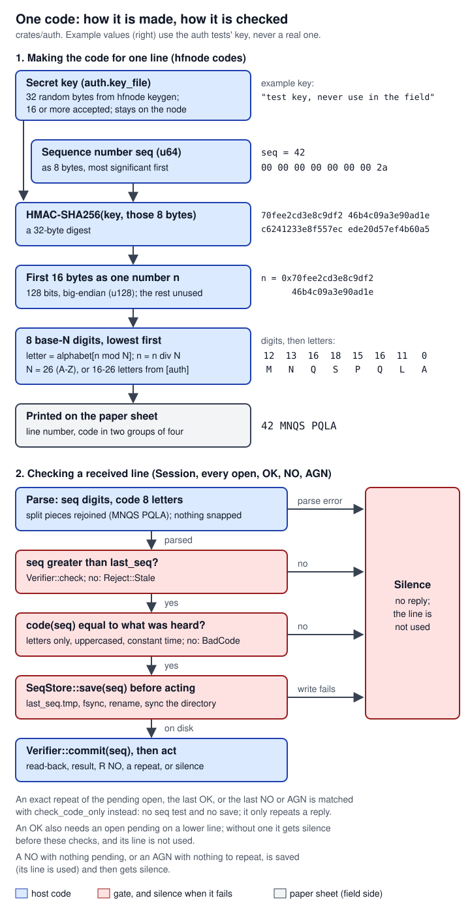
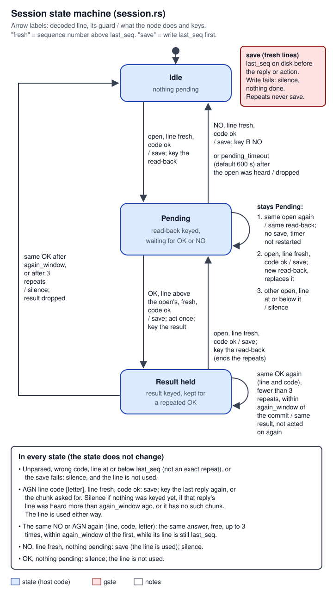
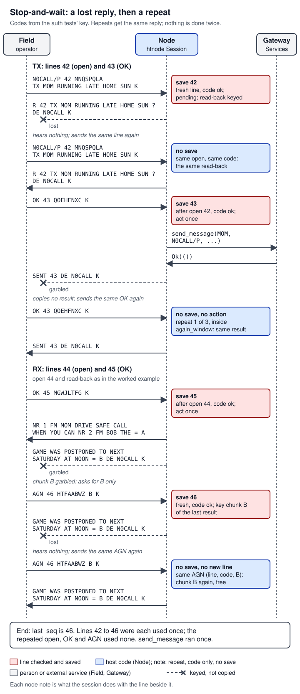
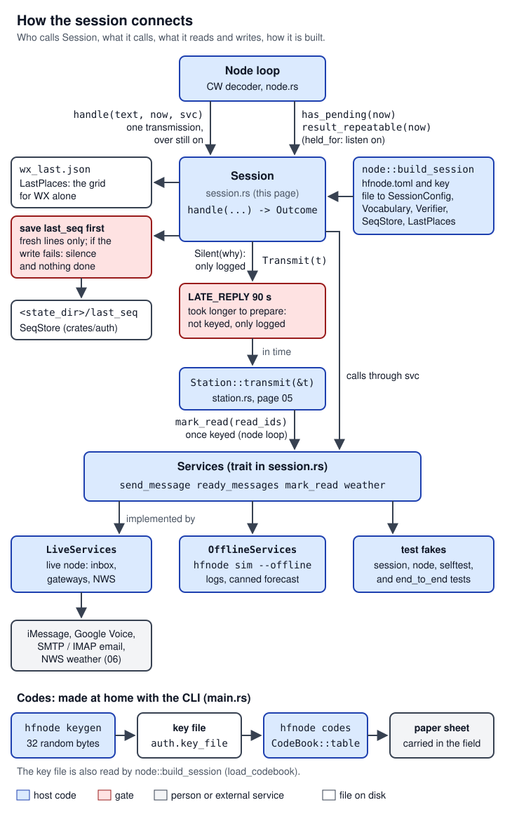

# 03 Field protocol, codes and sessions

> This page covers everything between a line of decoded Morse text and an action. `crates/auth` makes and checks the one-time letter codes that prove the sender holds the paper code sheet, and keeps the highest used line number on disk. `crates/protocol` parses what the field operator keys and words what the node keys back. `crates/hfnode/src/session.rs` is the transaction state machine: it reads every request back and acts only on a second code. The CLI commands `hfnode keygen` and `hfnode codes` make the key and print the sheet. All of it is plain Rust with no radio or audio, so it runs the same in unit tests, in `hfnode sim` and in the live node. Everything is cited at main `44185fa`. None of the open PRs (#27, #30, #31) changes this code: #31 edits `main.rs`, but only its keyer commands, which moves the `main.rs` line numbers on that branch. None of it has been used on a real radio yet: it has run only in unit tests, `hfnode sim` and the mock-radio self-tests.

**Words used on this page.** CW is Morse code keyed as an on/off carrier; each dot or dash is an *element*. A *callsign* is a station's licence identifier: the examples use `N0CALL/P` for the field operator and `N0CALL` for the node, as in `hfnode.example.toml`. An *over* is the prosign that hands the frequency to the other side: `K` ("go ahead"), `KN` ("go ahead, only you"), `AR` (end of message), `SK` (end of contact). Keyed as one run-together character, `KN` decodes as `(` and `AR` as `+`. `BT`, written `=`, is a break between parts of a message. `DE` means "from" and `R` means "received". A *line* is one row of the paper code sheet: a sequence number and its 8-letter code. A line is *fresh* when its sequence number is greater than `last_seq`, the highest line the node has used. A *grid square* (Maidenhead locator) is the standard amateur radio location code, such as `DL89` or `DL89IG`: 4 characters name an area of about 110 by 190 km, 6 characters narrow it to a few kilometres. In the node's replies `NR` means number and `FM` means from (`NR 1 FM MOM`), `MSG`/`MSGS` mean message(s) and `NIL` means nothing; the forecast text uses `TDA` (today), `TNGT` (tonight) and `HI`/`LO` (temperatures). An *ID* is the station identification the licence requires at least every 10 minutes during a contact and at its end (47 CFR 97.119); the node's is `DE N0CALL`. A *tune* is a carrier of a few seconds that lets the radio's antenna tuner match the antenna before the node transmits ([05](05-node-loop-station-safety.md)). A *Morse unit* is the length of one dot, and wpm is words per minute. NWS is the US National Weather Service (api.weather.gov). HOTP (RFC 4226) is the counter-based one-time-password scheme that authenticator apps use. A *screened* message is one the reply filter (Claude or Ollama, `[filter]`) has passed; it may have replaced words with `REDACTED` or the whole message with `MSG WITHHELD BY FILTER` ([06 Gateways and messages](06-gateways-messages.md); [`crates/hfnode/src/gateway/filter.rs:29-32`](https://github.com/robinonsay/cw-message-gateway/blob/44185fa9a00369c379d9d8af40ca307e3867e860/crates/hfnode/src/gateway/filter.rs#L29-L32)). Every term is also in [17 Glossary](17-glossary.md).

## Where it lives

| Path | What it holds | Size |
|---|---|---|
| [`crates/auth/src/lib.rs`](https://github.com/robinonsay/cw-message-gateway/blob/44185fa9a00369c379d9d8af40ca307e3867e860/crates/auth/src/lib.rs) | `CodeBook` (key + alphabet, code generation and matching), `Verifier` (the `seq > last_seq` rule), `Reject`, `AlphabetError`, `format_for_print` | 312 lines, tests from line 219 |
| [`crates/auth/src/store.rs`](https://github.com/robinonsay/cw-message-gateway/blob/44185fa9a00369c379d9d8af40ca307e3867e860/crates/auth/src/store.rs) | `SeqStore` (the on-disk `last_seq`), `replace_file` (a rename that is on disk when it returns) | 178 lines, tests from line 126 |
| [`crates/auth/Cargo.toml`](https://github.com/robinonsay/cw-message-gateway/blob/44185fa9a00369c379d9d8af40ca307e3867e860/crates/auth/Cargo.toml) | `hmac 0.12`, `sha2 0.10`; `windows-sys` on Windows only | 18 lines |
| [`crates/protocol/src/lib.rs`](https://github.com/robinonsay/cw-message-gateway/blob/44185fa9a00369c379d9d8af40ca307e3867e860/crates/protocol/src/lib.rs) | the grammar types, `parse`, `OVERS`, `is_over`, `is_grid`, `Vocabulary` | 805 lines, tests from line 381 |
| [`crates/protocol/src/fuzzy.rs`](https://github.com/robinonsay/cw-message-gateway/blob/44185fa9a00369c379d9d8af40ca307e3867e860/crates/protocol/src/fuzzy.rs) | `morse_distance`, `snap` | 92 lines |
| [`crates/protocol/src/text.rs`](https://github.com/robinonsay/cw-message-gateway/blob/44185fa9a00369c379d9d8af40ca307e3867e860/crates/protocol/src/text.rs) | `sanitize` | 47 lines |
| [`crates/protocol/src/reply.rs`](https://github.com/robinonsay/cw-message-gateway/blob/44185fa9a00369c379d9d8af40ca307e3867e860/crates/protocol/src/reply.rs) | `Reply` and its exact wording, `Chunk`, `chunk`, `chunk_count`, `MAX_CHUNKS` | 201 lines |
| [`crates/protocol/Cargo.toml`](https://github.com/robinonsay/cw-message-gateway/blob/44185fa9a00369c379d9d8af40ca307e3867e860/crates/protocol/Cargo.toml) | depends only on `crates/cw` (the Morse table) | 9 lines |
| [`crates/hfnode/src/session.rs`](https://github.com/robinonsay/cw-message-gateway/blob/44185fa9a00369c379d9d8af40ca307e3867e860/crates/hfnode/src/session.rs) | `Session`, `Services`, `Transmission`, `Outcome`, `SessionConfig`, `SendError`, `WxError` | 1472 lines, tests from line 708 |
| [`crates/hfnode/src/node.rs:36-89`](https://github.com/robinonsay/cw-message-gateway/blob/44185fa9a00369c379d9d8af40ca307e3867e860/crates/hfnode/src/node.rs#L36-L89) | builds the `CodeBook` and the `Session` from the config | |
| [`crates/hfnode/src/node.rs:467-483`](https://github.com/robinonsay/cw-message-gateway/blob/44185fa9a00369c379d9d8af40ca307e3867e860/crates/hfnode/src/node.rs#L467-L483), [`crates/hfnode/src/node.rs:707-766`](https://github.com/robinonsay/cw-message-gateway/blob/44185fa9a00369c379d9d8af40ca307e3867e860/crates/hfnode/src/node.rs#L707-L766) | the node loop's use of the session: holding the listening window open, handing decoded text in, keying the reply | |
| [`crates/hfnode/src/main.rs:526-597`](https://github.com/robinonsay/cw-message-gateway/blob/44185fa9a00369c379d9d8af40ca307e3867e860/crates/hfnode/src/main.rs#L526-L597), [`crates/hfnode/src/main.rs:625-716`](https://github.com/robinonsay/cw-message-gateway/blob/44185fa9a00369c379d9d8af40ca307e3867e860/crates/hfnode/src/main.rs#L625-L716) | `hfnode keygen`, `hfnode codes`, the sheet rules, `hfnode sim` | |
| [`crates/hfnode/src/places.rs`](https://github.com/robinonsay/cw-message-gateway/blob/44185fa9a00369c379d9d8af40ca307e3867e860/crates/hfnode/src/places.rs) | `LastPlaces`: the grid each field callsign last confirmed, for `WX` alone | 134 lines |
| [docs/operating.md](../operating.md) | the field operator's guide: the sheet, every format, retries, timing | 438 lines |

## How it works

### One transaction

The field operator carries a printed sheet of numbered lines. Every request takes two lines:

1. The operator **opens**: callsign, sequence number, code, and a request (`TX`, `RX` or `WX`).
2. The node checks that the line is fresh and the code is right, **writes the line number to disk**, and keys a **read-back** of what it understood, ending in `?`. Nothing else happens yet.
3. If the read-back is right, the operator **commits** with `OK` on a later line. If it is wrong, `NO` on a later line drops it.
4. On `OK` the node writes that line number to disk, then acts once (sends the text, reads out messages, fetches the forecast) and keys the result.

Anything the node cannot parse or authenticate gets no reply at all. Silence is the only "no": an error reply would have to cross the same noisy channel that just lost the request, and keying replies to strangers would give them airtime (design spec, "Reliability"; [`crates/hfnode/src/session.rs:310-314`](https://github.com/robinonsay/cw-message-gateway/blob/44185fa9a00369c379d9d8af40ca307e3867e860/crates/hfnode/src/session.rs#L310-L314)). The field side recovers by repeating exactly what it sent, which costs no new line, or by asking `AGN` on a fresh line.

### Codes and the sheet

A real HMAC cannot be computed by hand, so the codes are computed in advance from a secret key that stays on the node, and printed ([`crates/auth/src/lib.rs:3-11`](https://github.com/robinonsay/cw-message-gateway/blob/44185fa9a00369c379d9d8af40ca307e3867e860/crates/auth/src/lib.rs#L3-L11)). The code for line `seq` is HMAC-SHA256 over `seq` as 8 big-endian bytes; the first 128 bits of the digest are written as 8 letters in base N, where N is the alphabet's length (26 by default). The node recomputes the code for whatever line it is shown. It accepts a line only if its number is greater than `last_seq`, which kills a heard code as soon as a later line is used while letting the operator skip lines. It saves the new `last_seq` before it replies or acts, so a crash or power cut can never bring a used line back.



*Figure: the top half runs when the sheet is printed, the bottom half on every received line except an exact repeat, which only checks the code. Every check that fails ends in silence and leaves the line unused. Example values use the auth crate's test key.*

### The grammar

The field operator keys one of six forms, ended by an over ([`crates/protocol/src/lib.rs:3-21`](https://github.com/robinonsay/cw-message-gateway/blob/44185fa9a00369c379d9d8af40ca307e3867e860/crates/protocol/src/lib.rs#L3-L21)):

| Form | Meaning |
|---|---|
| `CALL seq code TX dest text` | open: send `text` to contact `dest` |
| `CALL seq code RX` | open: read waiting messages |
| `CALL seq code WX [grid or n]` | open: forecast for a grid square, preset `n`, or (alone) the last place confirmed |
| `OK seq code` | commit the pending transaction |
| `NO seq code` | abort the pending transaction |
| `AGN seq code [letter]` | repeat the node's last reply, or one chunk of it |

`CALL` is the operator's own callsign, not a keyword. Contact names and `TX`/`RX`/`WX` are snapped to the nearest legal word by Morse distance, and the read-back shows the result (command and contact are in it, [`crates/protocol/src/reply.rs:44-62`](https://github.com/robinonsay/cw-message-gateway/blob/44185fa9a00369c379d9d8af40ca307e3867e860/crates/protocol/src/reply.rs#L44-L62)). Field callsigns are snapped too (distance 2, [`crates/protocol/src/lib.rs:238-240`](https://github.com/robinonsay/cw-message-gateway/blob/44185fa9a00369c379d9d8af40ca307e3867e860/crates/protocol/src/lib.rs#L238-L240)), but the read-back does not repeat the callsign, so a miscopy there is not shown to the operator; the code check still has to pass. Sequence numbers and codes must decode exactly, and `OK`, `NO` and `AGN` must too.

### The session

`Session` holds at most one pending transaction (the open that was read back), the last commit's result (for a repeated `OK`), the last reply keyed (for `AGN`) and the last `NO` or `AGN` answered (for a free exact repeat) ([`crates/hfnode/src/session.rs:206-218`](https://github.com/robinonsay/cw-message-gateway/blob/44185fa9a00369c379d9d8af40ca307e3867e860/crates/hfnode/src/session.rs#L206-L218)). Its rules are listed at the top of the file ([`crates/hfnode/src/session.rs:8-26`](https://github.com/robinonsay/cw-message-gateway/blob/44185fa9a00369c379d9d8af40ca307e3867e860/crates/hfnode/src/session.rs#L8-L26)). The diagram shows the three states the operator can tell apart.



*Figure: "save" means `last_seq` is written to disk before anything is keyed or done; only fresh lines are saved, never a repeat. `AGN`, the free repeat of a `NO` or `AGN`, and every failure never change the state; the panel at the bottom lists them.*

The three states are a view of four optional records in `Session` ([`crates/hfnode/src/session.rs:206-218`](https://github.com/robinonsay/cw-message-gateway/blob/44185fa9a00369c379d9d8af40ca307e3867e860/crates/hfnode/src/session.rs#L206-L218)). This is the whole state space:

| Field | Set by | Cleared by | Enables |
|---|---|---|---|
| `pending: Option<Pending>` | a valid open ([`session.rs:364-372`](https://github.com/robinonsay/cw-message-gateway/blob/44185fa9a00369c379d9d8af40ca307e3867e860/crates/hfnode/src/session.rs#L364-L372)); a valid open on a fresher line replaces it | `OK` ([`session.rs:404`](https://github.com/robinonsay/cw-message-gateway/blob/44185fa9a00369c379d9d8af40ca307e3867e860/crates/hfnode/src/session.rs#L404)), `NO` ([`session.rs:653`](https://github.com/robinonsay/cw-message-gateway/blob/44185fa9a00369c379d9d8af40ca307e3867e860/crates/hfnode/src/session.rs#L653)), `pending_timeout`, checked at the start of `handle` ([`session.rs:268-273`](https://github.com/robinonsay/cw-message-gateway/blob/44185fa9a00369c379d9d8af40ca307e3867e860/crates/hfnode/src/session.rs#L268-L273)) | the free repeat of the read-back; `OK` and `NO`; `has_pending` (holds the listening window open) |
| `last_commit: Option<LastCommit>` | `OK` ([`session.rs:486-492`](https://github.com/robinonsay/cw-message-gateway/blob/44185fa9a00369c379d9d8af40ca307e3867e860/crates/hfnode/src/session.rs#L486-L492)) | a new valid open ([`session.rs:344`](https://github.com/robinonsay/cw-message-gateway/blob/44185fa9a00369c379d9d8af40ca307e3867e860/crates/hfnode/src/session.rs#L344)); a repeated `OK` that is refused ([`session.rs:381-383`](https://github.com/robinonsay/cw-message-gateway/blob/44185fa9a00369c379d9d8af40ca307e3867e860/crates/hfnode/src/session.rs#L381-L383)) | a repeated `OK` (at most 3, within `again_window`); `AGN <letter>` finds its chunks through `last_tx` |
| `last_tx: Option<LastTx>` | every `Transmit` from an open, `OK` or `NO` in `handle`, never from `AGN` ([`session.rs:289-297`](https://github.com/robinonsay/cw-message-gateway/blob/44185fa9a00369c379d9d8af40ca307e3867e860/crates/hfnode/src/session.rs#L289-L297)) | never | `AGN` and `AGN <letter>`; `result_repeatable` when it is the last commit's result |
| `last_ask: Option<LastAsk>` | an answered `NO` ([`session.rs:657-662`](https://github.com/robinonsay/cw-message-gateway/blob/44185fa9a00369c379d9d8af40ca307e3867e860/crates/hfnode/src/session.rs#L657-L662)) or an `AGN` that keyed something ([`session.rs:676-683`](https://github.com/robinonsay/cw-message-gateway/blob/44185fa9a00369c379d9d8af40ca307e3867e860/crates/hfnode/src/session.rs#L676-L683)) | a repeat that is refused ([`session.rs:621`](https://github.com/robinonsay/cw-message-gateway/blob/44185fa9a00369c379d9d8af40ca307e3867e860/crates/hfnode/src/session.rs#L621)); in effect also any later line, since a repeat is honoured only while its line is still `last_seq` | the free exact repeat of that `NO` or `AGN` |

### Recovering from a lost reply

The link is stop-and-wait: the operator sends, waits for the reply, and repeats if nothing comes back. Every repeat is idempotent. A repeated open gets the same read-back and a repeated `OK` gets the same result without acting twice; neither costs a line. `AGN` costs one fresh line, and an exact repeat of that `AGN` is free again.



*Figure: the gateway is called once even though the operator sent `OK 43` twice. Lines 42 to 46 are used; the repeats cost none.*

The self-tests `lost-read-back` and `lost-result` play the first two losses over the mock radio ([`crates/hfnode/src/selftest.rs:3037-3048`](https://github.com/robinonsay/cw-message-gateway/blob/44185fa9a00369c379d9d8af40ca307e3867e860/crates/hfnode/src/selftest.rs#L3037-L3048), [`crates/hfnode/src/selftest.rs:2935-2945`](https://github.com/robinonsay/cw-message-gateway/blob/44185fa9a00369c379d9d8af40ca307e3867e860/crates/hfnode/src/selftest.rs#L2935-L2945)). The session test `a_repeated_no_or_agn_is_answered_again_for_free` sends the same `AGN 46 ... B` twice and gets the same chunk ([`crates/hfnode/src/session.rs:1314-1340`](https://github.com/robinonsay/cw-message-gateway/blob/44185fa9a00369c379d9d8af40ca307e3867e860/crates/hfnode/src/session.rs#L1314-L1340)).

## How it connects



*Figure: everything the session touches. It is called with one decoded transmission at a time, reaches the outside world only through `Services`, writes only `last_seq` (always before acting) and `wx_last.json`, and hands its reply back to the node loop, which keys it through the station. `hfnode sim` and the tests call `handle` the same way.*

| Neighbour | Direction | What passes | Where |
|---|---|---|---|
| CW decoder and node loop ([04 CW decoder and audio](04-cw-decoder-audio.md), [05 Node loop, station and safety](05-node-loop-station-safety.md)) | in | One decoded transmission as text, uppercase letters, digits, punctuation, `*` for a pattern the decoder did not know, single spaces between words. The loop ends a transmission at an over from `protocol::OVERS` followed by quiet, or after `audio.end_of_message_ms` of silence, then calls `session.handle(&text, now, svc)`. With the planned decoder-box source (PR 4, not opened yet; `design/pico-decoder-pr4.patch` in the project files, `[receive] source = "box"`), the letters come from the box instead of the host decoder, but the patch does not touch `session.rs`: the text still reaches the session as one `handle` call per transmission ([11 Decoder box and the one-Pico image](11-decoder-box-one-pico.md)). | [`crates/hfnode/src/node.rs:427-451`](https://github.com/robinonsay/cw-message-gateway/blob/44185fa9a00369c379d9d8af40ca307e3867e860/crates/hfnode/src/node.rs#L427-L451), [`crates/hfnode/src/node.rs:707-725`](https://github.com/robinonsay/cw-message-gateway/blob/44185fa9a00369c379d9d8af40ca307e3867e860/crates/hfnode/src/node.rs#L707-L725), [`crates/cw/src/decoder.rs:717-724`](https://github.com/robinonsay/cw-message-gateway/blob/44185fa9a00369c379d9d8af40ca307e3867e860/crates/cw/src/decoder.rs#L717-L724) |
| Node loop | out | `Outcome::Silent(why)` is logged as `no reply: <why>`. `Outcome::Transmit(t)` is keyed with `Station::transmit(&t)`, unless preparing it took longer than `LATE_REPLY` (90 s). | [`crates/hfnode/src/node.rs:725-758`](https://github.com/robinonsay/cw-message-gateway/blob/44185fa9a00369c379d9d8af40ca307e3867e860/crates/hfnode/src/node.rs#L725-L758), [`crates/hfnode/src/node.rs:528-531`](https://github.com/robinonsay/cw-message-gateway/blob/44185fa9a00369c379d9d8af40ca307e3867e860/crates/hfnode/src/node.rs#L528-L531) |
| Station ([05](05-node-loop-station-safety.md)) | out | A `Transmission`: one or more segments. The station pauses `station.chunk_pause_ms` (default 2000 ms) between segments, splits each into keyer-sized pieces, inserts `DE <call>` so no more than `ID_INTERVAL` (8 min) passes between IDs, and refuses anything that would key longer than `MAX_TRANSMISSION` (30 min). Both are station limits: never raise them; see [13 Safety rules](13-safety-rules.md). | [`crates/hfnode/src/station.rs:1737-1803`](https://github.com/robinonsay/cw-message-gateway/blob/44185fa9a00369c379d9d8af40ca307e3867e860/crates/hfnode/src/station.rs#L1737-L1803), [`crates/hfnode/src/station.rs:147`](https://github.com/robinonsay/cw-message-gateway/blob/44185fa9a00369c379d9d8af40ca307e3867e860/crates/hfnode/src/station.rs#L147), [`crates/hfnode/src/station.rs:222`](https://github.com/robinonsay/cw-message-gateway/blob/44185fa9a00369c379d9d8af40ca307e3867e860/crates/hfnode/src/station.rs#L222) |
| Inbox | out | After a keyed RX result, the node calls `Services::mark_read(&t.read_ids)`; only messages that actually went out are marked. | [`crates/hfnode/src/node.rs:753-758`](https://github.com/robinonsay/cw-message-gateway/blob/44185fa9a00369c379d9d8af40ca307e3867e860/crates/hfnode/src/node.rs#L753-L758) |
| Gateways ([06 Gateways and messages](06-gateways-messages.md)) | both | `Services::send_message`, `ready_messages`, `weather`. The live implementation is `LiveServices` (iMessage, Google Voice, SMTP, the screened inbox, NWS); `hfnode sim --offline` uses `OfflineServices`; tests use fakes. | [`crates/hfnode/src/gateway/mod.rs:227-251`](https://github.com/robinonsay/cw-message-gateway/blob/44185fa9a00369c379d9d8af40ca307e3867e860/crates/hfnode/src/gateway/mod.rs#L227-L251), [`crates/hfnode/src/gateway/mod.rs:253-278`](https://github.com/robinonsay/cw-message-gateway/blob/44185fa9a00369c379d9d8af40ca307e3867e860/crates/hfnode/src/gateway/mod.rs#L253-L278) |
| Listening schedule | out | `has_pending(now)` and `result_repeatable(now)` keep a listening window open past its end (only the second needs `Station::can_transmit()`). | [`crates/hfnode/src/node.rs:467-483`](https://github.com/robinonsay/cw-message-gateway/blob/44185fa9a00369c379d9d8af40ca307e3867e860/crates/hfnode/src/node.rs#L467-L483) |
| Disk | both | `<state_dir>/last_seq` through `SeqStore`; `<state_dir>/wx_last.json` through `LastPlaces`; the key file `auth.key_file`. | [`crates/hfnode/src/node.rs:68-89`](https://github.com/robinonsay/cw-message-gateway/blob/44185fa9a00369c379d9d8af40ca307e3867e860/crates/hfnode/src/node.rs#L68-L89) |
| Config ([15 Config, CLI and deployment](15-config-cli-deployment.md)) | in | `SessionConfig` and `Vocabulary` built from `hfnode.toml` by `node::build_session` (table below). | [`crates/hfnode/src/node.rs:48-61`](https://github.com/robinonsay/cw-message-gateway/blob/44185fa9a00369c379d9d8af40ca307e3867e860/crates/hfnode/src/node.rs#L48-L61), [`crates/hfnode/src/node.rs:75-84`](https://github.com/robinonsay/cw-message-gateway/blob/44185fa9a00369c379d9d8af40ca307e3867e860/crates/hfnode/src/node.rs#L75-L84) |
| Other users of these crates | | `protocol::is_grid` validates config grids and the weather gateway's input; `protocol::MAX_CHUNKS` sizes the `run` keying check; `protocol::sanitize` cleans outbound text in `hfnode messages`; `auth::replace_file` makes the inbox, `wx_last.json` and Google Voice state durable. | [`crates/hfnode/src/config.rs:1090-1117`](https://github.com/robinonsay/cw-message-gateway/blob/44185fa9a00369c379d9d8af40ca307e3867e860/crates/hfnode/src/config.rs#L1090-L1117), [`crates/hfnode/src/gateway/weather.rs:101`](https://github.com/robinonsay/cw-message-gateway/blob/44185fa9a00369c379d9d8af40ca307e3867e860/crates/hfnode/src/gateway/weather.rs#L101), [`crates/hfnode/src/commissioning.rs:153-166`](https://github.com/robinonsay/cw-message-gateway/blob/44185fa9a00369c379d9d8af40ca307e3867e860/crates/hfnode/src/commissioning.rs#L153-L166), [`crates/hfnode/src/messages.rs:339`](https://github.com/robinonsay/cw-message-gateway/blob/44185fa9a00369c379d9d8af40ca307e3867e860/crates/hfnode/src/messages.rs#L339), [`crates/hfnode/src/inbox.rs:90`](https://github.com/robinonsay/cw-message-gateway/blob/44185fa9a00369c379d9d8af40ca307e3867e860/crates/hfnode/src/inbox.rs#L90), [`crates/hfnode/src/places.rs:87`](https://github.com/robinonsay/cw-message-gateway/blob/44185fa9a00369c379d9d8af40ca307e3867e860/crates/hfnode/src/places.rs#L87), [`crates/hfnode/src/gateway/google_voice.rs:368`](https://github.com/robinonsay/cw-message-gateway/blob/44185fa9a00369c379d9d8af40ca307e3867e860/crates/hfnode/src/gateway/google_voice.rs#L368) |

The session never touches the radio, the clock or the network itself: time comes in as the `now` argument, the outside world through `Services`, and only `last_seq` and `wx_last.json` are written directly ([`crates/hfnode/src/session.rs:28-29`](https://github.com/robinonsay/cw-message-gateway/blob/44185fa9a00369c379d9d8af40ca307e3867e860/crates/hfnode/src/session.rs#L28-L29); `wx_last.json` through `self.places.set`, [`crates/hfnode/src/session.rs:457-463`](https://github.com/robinonsay/cw-message-gateway/blob/44185fa9a00369c379d9d8af40ca307e3867e860/crates/hfnode/src/session.rs#L457-L463)). That is why the same state machine runs under `hfnode sim`, the unit tests and the time-scaled self-tests. Page [01 System overview](01-system-overview.md) has the whole-system diagram.

## Interfaces and APIs

### `auth` crate

| Item | Signature or value | What it does, errors | Source |
|---|---|---|---|
| `CODE_LEN` | `pub const CODE_LEN: usize = 8` | Letters in every code. | [`crates/auth/src/lib.rs:24`](https://github.com/robinonsay/cw-message-gateway/blob/44185fa9a00369c379d9d8af40ca307e3867e860/crates/auth/src/lib.rs#L24) |
| `DEFAULT_ALPHABET` | `"ABCDEFGHIJKLMNOPQRSTUVWXYZ"` | All 26 letters. Which Morse-confusable letters to drop is still open, so the alphabet is configurable. | [`crates/auth/src/lib.rs:26-30`](https://github.com/robinonsay/cw-message-gateway/blob/44185fa9a00369c379d9d8af40ca307e3867e860/crates/auth/src/lib.rs#L26-L30) |
| `MIN_ALPHABET_LEN` | `16` | Smallest alphabet accepted; 16 letters still give 16^8 = 2^32 codes. | [`crates/auth/src/lib.rs:32-33`](https://github.com/robinonsay/cw-message-gateway/blob/44185fa9a00369c379d9d8af40ca307e3867e860/crates/auth/src/lib.rs#L32-L33) |
| `CodeBook` | `#[derive(Clone)] pub struct CodeBook { key: Vec<u8>, alphabet: Vec<u8> }` | The secret key plus alphabet. Its `Debug` never prints the key. | [`crates/auth/src/lib.rs:35-49`](https://github.com/robinonsay/cw-message-gateway/blob/44185fa9a00369c379d9d8af40ca307e3867e860/crates/auth/src/lib.rs#L35-L49) |
| `CodeBook::new` | `pub fn new(key: &[u8]) -> Self` | Default alphabet. Any key length is accepted here; the node refuses a key file under 16 bytes (`node::load_codebook`). | [`crates/auth/src/lib.rs:76-78`](https://github.com/robinonsay/cw-message-gateway/blob/44185fa9a00369c379d9d8af40ca307e3867e860/crates/auth/src/lib.rs#L76-L78), [`crates/hfnode/src/node.rs:36-46`](https://github.com/robinonsay/cw-message-gateway/blob/44185fa9a00369c379d9d8af40ca307e3867e860/crates/hfnode/src/node.rs#L36-L46) |
| `CodeBook::with_alphabet` | `pub fn with_alphabet(key: &[u8], alphabet: &str) -> Result<Self, AlphabetError>` | Checks each character is `A`-`Z` (`NotUppercaseLetter`), none repeats (`Duplicate`), then the length is at least 16 (`TooShort`). The order of the letters matters: it is the digit order. | [`crates/auth/src/lib.rs:80-99`](https://github.com/robinonsay/cw-message-gateway/blob/44185fa9a00369c379d9d8af40ca307e3867e860/crates/auth/src/lib.rs#L80-L99) |
| `CodeBook::alphabet` | `pub fn alphabet(&self) -> &str` | The alphabet in use. | [`crates/auth/src/lib.rs:101-103`](https://github.com/robinonsay/cw-message-gateway/blob/44185fa9a00369c379d9d8af40ca307e3867e860/crates/auth/src/lib.rs#L101-L103) |
| `CodeBook::code` | `pub fn code(&self, seq: u64) -> String` | The 8-letter code for line `seq` (algorithm below). Cannot fail. | [`crates/auth/src/lib.rs:105-120`](https://github.com/robinonsay/cw-message-gateway/blob/44185fa9a00369c379d9d8af40ca307e3867e860/crates/auth/src/lib.rs#L105-L120) |
| `CodeBook::table` | `pub fn table(&self, from: u64, count: u64) -> impl Iterator<Item = (u64, String)> + '_` | `(seq, code)` for `from..from+count` (saturating), for printing. | [`crates/auth/src/lib.rs:122-125`](https://github.com/robinonsay/cw-message-gateway/blob/44185fa9a00369c379d9d8af40ca307e3867e860/crates/auth/src/lib.rs#L122-L125) |
| `CodeBook::matches` | `pub fn matches(&self, seq: u64, code: &str) -> bool` | Drops everything but letters from `code`, uppercases it, and compares it with `code(seq)` in constant time (XOR fold); a length mismatch returns `false` at once. | [`crates/auth/src/lib.rs:127-148`](https://github.com/robinonsay/cw-message-gateway/blob/44185fa9a00369c379d9d8af40ca307e3867e860/crates/auth/src/lib.rs#L127-L148) |
| `AlphabetError` | `TooShort(usize)`, `NotUppercaseLetter(char)`, `Duplicate(char)`; `Display`, `Error` | Why an alphabet was refused. The node shows it as a config error at start-up: `alphabet has {n} letters, need at least 16`, `alphabet character {c:?} is not an uppercase letter A-Z`, `alphabet letter {c:?} appears more than once` ([`crates/auth/src/lib.rs:58-71`](https://github.com/robinonsay/cw-message-gateway/blob/44185fa9a00369c379d9d8af40ca307e3867e860/crates/auth/src/lib.rs#L58-L71)). | [`crates/auth/src/lib.rs:51-73`](https://github.com/robinonsay/cw-message-gateway/blob/44185fa9a00369c379d9d8af40ca307e3867e860/crates/auth/src/lib.rs#L51-L73) |
| `Reject` | `Stale { seq, last_seq }`, `BadCode { seq }`; `Display` | Why a line was refused: `sequence 41 is not after last used 41`, `wrong code for sequence 42`. | [`crates/auth/src/lib.rs:150-167`](https://github.com/robinonsay/cw-message-gateway/blob/44185fa9a00369c379d9d8af40ca307e3867e860/crates/auth/src/lib.rs#L150-L167) |
| `Verifier` | `pub struct Verifier { book: CodeBook, last_seq: u64 }` | Applies the acceptance rule. Holds `last_seq` in memory; the session saves it with `SeqStore`. | [`crates/auth/src/lib.rs:169-175`](https://github.com/robinonsay/cw-message-gateway/blob/44185fa9a00369c379d9d8af40ca307e3867e860/crates/auth/src/lib.rs#L169-L175) |
| `Verifier::new` | `pub fn new(book: CodeBook, last_seq: u64) -> Self` | Start from the stored `last_seq`. | [`crates/auth/src/lib.rs:178-180`](https://github.com/robinonsay/cw-message-gateway/blob/44185fa9a00369c379d9d8af40ca307e3867e860/crates/auth/src/lib.rs#L178-L180) |
| `Verifier::last_seq` | `pub fn last_seq(&self) -> u64` | | [`crates/auth/src/lib.rs:182-184`](https://github.com/robinonsay/cw-message-gateway/blob/44185fa9a00369c379d9d8af40ca307e3867e860/crates/auth/src/lib.rs#L182-L184) |
| `Verifier::check` | `pub fn check(&self, seq: u64, code: &str) -> Result<(), Reject>` | `Stale` if `seq <= last_seq` (no HMAC is computed then), else `check_code_only`. Does not consume the line. | [`crates/auth/src/lib.rs:186-195`](https://github.com/robinonsay/cw-message-gateway/blob/44185fa9a00369c379d9d8af40ca307e3867e860/crates/auth/src/lib.rs#L186-L195) |
| `Verifier::check_code_only` | `pub fn check_code_only(&self, seq: u64, code: &str) -> Result<(), Reject>` | Only the code, whatever `last_seq` is. Used to recognise an exact retry of a line already used. | [`crates/auth/src/lib.rs:197-205`](https://github.com/robinonsay/cw-message-gateway/blob/44185fa9a00369c379d9d8af40ca307e3867e860/crates/auth/src/lib.rs#L197-L205) |
| `Verifier::commit` | `pub fn commit(&mut self, seq: u64)` | `last_seq = max(last_seq, seq)`: never moves backwards. | [`crates/auth/src/lib.rs:207-210`](https://github.com/robinonsay/cw-message-gateway/blob/44185fa9a00369c379d9d8af40ca307e3867e860/crates/auth/src/lib.rs#L207-L210) |
| `format_for_print` | `pub fn format_for_print(code: &str) -> String` | Two groups split at the middle: `MNQS PQLA`. | [`crates/auth/src/lib.rs:213-217`](https://github.com/robinonsay/cw-message-gateway/blob/44185fa9a00369c379d9d8af40ca307e3867e860/crates/auth/src/lib.rs#L213-L217) |
| `SeqStore` | `#[derive(Debug, Clone)] pub struct SeqStore { path: PathBuf }` | `last_seq` as a decimal number and a newline in a text file. | [`crates/auth/src/store.rs:7-17`](https://github.com/robinonsay/cw-message-gateway/blob/44185fa9a00369c379d9d8af40ca307e3867e860/crates/auth/src/store.rs#L7-L17) |
| `SeqStore::new`, `path` | `pub fn new(path: impl Into<PathBuf>) -> Self`, `pub fn path(&self) -> &Path` | | [`crates/auth/src/store.rs:20-26`](https://github.com/robinonsay/cw-message-gateway/blob/44185fa9a00369c379d9d8af40ca307e3867e860/crates/auth/src/store.rs#L20-L26) |
| `SeqStore::load` | `pub fn load(&self) -> io::Result<u64>` | `0` if the file does not exist; `InvalidData` (with the path) if it does not parse; other I/O errors as they come. A corrupt file is an error, never 0. | [`crates/auth/src/store.rs:28-40`](https://github.com/robinonsay/cw-message-gateway/blob/44185fa9a00369c379d9d8af40ca307e3867e860/crates/auth/src/store.rs#L28-L40) |
| `SeqStore::save` | `pub fn save(&self, last_seq: u64) -> io::Result<()>` | Creates the directory, writes `<path>.tmp` (`path.with_extension("tmp")`), `sync_all`, then `replace_file`. On `Ok` the value is on disk; callers must not act if it fails. | [`crates/auth/src/store.rs:42-54`](https://github.com/robinonsay/cw-message-gateway/blob/44185fa9a00369c379d9d8af40ca307e3867e860/crates/auth/src/store.rs#L42-L54) |
| `replace_file` | `pub fn replace_file(tmp: &Path, path: &Path) -> io::Result<()>` | Unix: `rename`, then fsync the directory. Windows: `MoveFileExW(REPLACE_EXISTING \| WRITE_THROUGH)`, tried up to 10 times in all (at most 9 retries), 50 ms apart, on errors 5 (access denied) and 32 (sharing violation) ([`crates/auth/src/store.rs:100-104`](https://github.com/robinonsay/cw-message-gateway/blob/44185fa9a00369c379d9d8af40ca307e3867e860/crates/auth/src/store.rs#L100-L104)). Other platforms: rename without a directory sync. | [`crates/auth/src/store.rs:57-124`](https://github.com/robinonsay/cw-message-gateway/blob/44185fa9a00369c379d9d8af40ca307e3867e860/crates/auth/src/store.rs#L57-L124) |

Derives callers rely on: `Reject` is `Debug, Clone, Copy, PartialEq, Eq` with a `Display` but **no** `std::error::Error` impl, so wrap it before using `?` into a boxed error; `AlphabetError` is `Debug, Clone, PartialEq, Eq` plus `Display` and `Error`; `CodeBook` is `Clone` with a hand-written `Debug` that never prints the key; `Verifier` is `Debug`; `SeqStore` is `Debug, Clone` ([`crates/auth/src/lib.rs:36-51`](https://github.com/robinonsay/cw-message-gateway/blob/44185fa9a00369c379d9d8af40ca307e3867e860/crates/auth/src/lib.rs#L36-L51), [`crates/auth/src/lib.rs:150-171`](https://github.com/robinonsay/cw-message-gateway/blob/44185fa9a00369c379d9d8af40ca307e3867e860/crates/auth/src/lib.rs#L150-L171), [`crates/auth/src/store.rs:14`](https://github.com/robinonsay/cw-message-gateway/blob/44185fa9a00369c379d9d8af40ca307e3867e860/crates/auth/src/store.rs#L14)).

### `protocol` crate: types

| Item | Definition | Notes | Source |
|---|---|---|---|
| `FieldMsg` | `Open { call: String, seq: u64, code: String, cmd: Command }`, `Commit { seq, code }`, `Abort { seq, code }`, `Again { seq, code, chunk: Option<char> }` | One parsed transmission. `call` is the configured callsign it snapped to; `code` is the 8 letters as decoded, not yet checked. | [`crates/protocol/src/lib.rs:55-76`](https://github.com/robinonsay/cw-message-gateway/blob/44185fa9a00369c379d9d8af40ca307e3867e860/crates/protocol/src/lib.rs#L55-L76) |
| `Command` | `Tx { dest: String, text: String }`, `Rx`, `Wx { place: Option<Place> }` | `dest` is the configured contact name it snapped to; `text` is the words joined by single spaces, overs removed. `place: None` is `WX` alone. | [`crates/protocol/src/lib.rs:33-44`](https://github.com/robinonsay/cw-message-gateway/blob/44185fa9a00369c379d9d8af40ca307e3867e860/crates/protocol/src/lib.rs#L33-L44) |
| `Place` | `Grid(String)` (4 or 6 characters, uppercased), `Preset(u32)` | | [`crates/protocol/src/lib.rs:46-53`](https://github.com/robinonsay/cw-message-gateway/blob/44185fa9a00369c379d9d8af40ca307e3867e860/crates/protocol/src/lib.rs#L46-L53) |
| `Vocabulary` | `pub field_calls: Vec<String>`, `pub contacts: Vec<String>`, `pub presets: Vec<u32>`; `Default` | What the parser needs to know about this node. The node fills it from `station.field_calls` (uppercased), the contact names and the preset numbers. | [`crates/protocol/src/lib.rs:120-129`](https://github.com/robinonsay/cw-message-gateway/blob/44185fa9a00369c379d9d8af40ca307e3867e860/crates/protocol/src/lib.rs#L120-L129), [`crates/hfnode/src/node.rs:75-84`](https://github.com/robinonsay/cw-message-gateway/blob/44185fa9a00369c379d9d8af40ca307e3867e860/crates/hfnode/src/node.rs#L75-L84) |
| `ParseError` | see the next table; `Display`, `Error` | | [`crates/protocol/src/lib.rs:78-111`](https://github.com/robinonsay/cw-message-gateway/blob/44185fa9a00369c379d9d8af40ca307e3867e860/crates/protocol/src/lib.rs#L78-L111) |
| `Reply` | `ReadBackTx { seq, dest, text }`, `ReadBackRx { seq, count: usize }`, `ReadBackWx { seq, preset: Option<u32>, grid: Option<String> }`, `Sent { seq }`, `Failed { seq, reason: String }`, `Aborted`, `NoMessages { seq }` | Rendered by `Reply::render(node_call)`; wording in "Node-to-field replies" below. | [`crates/protocol/src/reply.rs:5-32`](https://github.com/robinonsay/cw-message-gateway/blob/44185fa9a00369c379d9d8af40ca307e3867e860/crates/protocol/src/reply.rs#L5-L32) |
| `Chunk` | `pub struct Chunk { pub letter: char, pub text: String }` | One lettered piece of a long reply. | [`crates/protocol/src/reply.rs:72-78`](https://github.com/robinonsay/cw-message-gateway/blob/44185fa9a00369c379d9d8af40ca307e3867e860/crates/protocol/src/reply.rs#L72-L78) |

### `protocol` crate: functions and constants

| Item | Signature or value | What it does | Source |
|---|---|---|---|
| `parse` | `pub fn parse(decoded: &str, vocab: &Vocabulary) -> Result<FieldMsg, ParseError>` | One decoded transmission to one message (algorithm below). Pure. | [`crates/protocol/src/lib.rs:146-278`](https://github.com/robinonsay/cw-message-gateway/blob/44185fa9a00369c379d9d8af40ca307e3867e860/crates/protocol/src/lib.rs#L146-L278) |
| `OVERS` | `["K", "KN", "(", "+", "AR", "SK"]` | The over prosigns as decoded. The node loop's end-of-message detection uses the same constant. | [`crates/protocol/src/lib.rs:131-133`](https://github.com/robinonsay/cw-message-gateway/blob/44185fa9a00369c379d9d8af40ca307e3867e860/crates/protocol/src/lib.rs#L131-L133) |
| `is_over` | `pub fn is_over(t: &str) -> bool` | `OVERS.contains(t)`. | [`crates/protocol/src/lib.rs:135-138`](https://github.com/robinonsay/cw-message-gateway/blob/44185fa9a00369c379d9d8af40ca307e3867e860/crates/protocol/src/lib.rs#L135-L138) |
| `CODE_LEN` | `8` | A second copy of `auth::CODE_LEN`; nothing ties the two together (see "Changing it"). | [`crates/protocol/src/lib.rs:113-114`](https://github.com/robinonsay/cw-message-gateway/blob/44185fa9a00369c379d9d8af40ca307e3867e860/crates/protocol/src/lib.rs#L113-L114) |
| `is_grid` | `pub fn is_grid(s: &str) -> bool` | 4 characters: field letters `A`-`R` (uppercase only), two digits; 6 characters: the same plus two subsquare letters `A`-`X` in either case. | [`crates/protocol/src/lib.rs:368-379`](https://github.com/robinonsay/cw-message-gateway/blob/44185fa9a00369c379d9d8af40ca307e3867e860/crates/protocol/src/lib.rs#L368-L379) |
| `morse_distance` | `pub fn morse_distance(a: &str, b: &str) -> usize` | Element-level edit distance between two words. | [`crates/protocol/src/fuzzy.rs:10-13`](https://github.com/robinonsay/cw-message-gateway/blob/44185fa9a00369c379d9d8af40ca307e3867e860/crates/protocol/src/fuzzy.rs#L10-L13) |
| `snap` | `pub fn snap<'v, S: AsRef<str>>(token: &str, vocab: &'v [S], tolerance: usize) -> Option<&'v str>` | The vocabulary entry strictly nearest to `token` within `tolerance`; `None` on a tie. | [`crates/protocol/src/fuzzy.rs:40-66`](https://github.com/robinonsay/cw-message-gateway/blob/44185fa9a00369c379d9d8af40ca307e3867e860/crates/protocol/src/fuzzy.rs#L40-L66) |
| `sanitize` | `pub fn sanitize(text: &str) -> String` | Uppercase, map a few characters, drop what Morse lacks, collapse spaces. | [`crates/protocol/src/text.rs:5-33`](https://github.com/robinonsay/cw-message-gateway/blob/44185fa9a00369c379d9d8af40ca307e3867e860/crates/protocol/src/text.rs#L5-L33) |
| `Reply::render` | `pub fn render(&self, node_call: &str) -> String` | The reply text, always ending `DE <node_call> K`. | [`crates/protocol/src/reply.rs:34-69`](https://github.com/robinonsay/cw-message-gateway/blob/44185fa9a00369c379d9d8af40ca307e3867e860/crates/protocol/src/reply.rs#L34-L69) |
| `Chunk::render` | `pub fn render(&self) -> String` | `<text> = <letter>`. | [`crates/protocol/src/reply.rs:80-85`](https://github.com/robinonsay/cw-message-gateway/blob/44185fa9a00369c379d9d8af40ca307e3867e860/crates/protocol/src/reply.rs#L80-L85) |
| `MAX_CHUNKS` | `26` | One chunk per letter `A`-`Z`. | [`crates/protocol/src/reply.rs:87-88`](https://github.com/robinonsay/cw-message-gateway/blob/44185fa9a00369c379d9d8af40ca307e3867e860/crates/protocol/src/reply.rs#L87-L88) |
| `chunk` | `pub fn chunk(text: &str, max_chars: usize) -> Vec<Chunk>` | Splits (after `sanitize`) into chunks of at most `max_chars` (at least 8) on word boundaries, lettered from `A`. Past 26 the rest is dropped and the 26th chunk gets ` MORE` appended. | [`crates/protocol/src/reply.rs:90-107`](https://github.com/robinonsay/cw-message-gateway/blob/44185fa9a00369c379d9d8af40ca307e3867e860/crates/protocol/src/reply.rs#L90-L107) |
| `chunk_count` | `pub fn chunk_count(text: &str, max_chars: usize) -> usize` | How many chunks `chunk` would need, without the cap. | [`crates/protocol/src/reply.rs:109-113`](https://github.com/robinonsay/cw-message-gateway/blob/44185fa9a00369c379d9d8af40ca307e3867e860/crates/protocol/src/reply.rs#L109-L113) |

`FieldMsg`, `Command`, `Place`, `ParseError`, `Reply` and `Chunk` derive `Debug, Clone, PartialEq, Eq`, so tests can compare whole values; `Vocabulary` derives `Debug, Clone, Default` ([`crates/protocol/src/lib.rs:33-129`](https://github.com/robinonsay/cw-message-gateway/blob/44185fa9a00369c379d9d8af40ca307e3867e860/crates/protocol/src/lib.rs#L33-L129), [`crates/protocol/src/reply.rs:6`](https://github.com/robinonsay/cw-message-gateway/blob/44185fa9a00369c379d9d8af40ca307e3867e860/crates/protocol/src/reply.rs#L6), [`crates/protocol/src/reply.rs:74`](https://github.com/robinonsay/cw-message-gateway/blob/44185fa9a00369c379d9d8af40ca307e3867e860/crates/protocol/src/reply.rs#L74)).

### Parse errors

Every error ends in silence; the session logs its `Display` text as `unparsed (<text>): "<decoded>"` ([`crates/hfnode/src/session.rs:274-277`](https://github.com/robinonsay/cw-message-gateway/blob/44185fa9a00369c379d9d8af40ca307e3867e860/crates/hfnode/src/session.rs#L274-L277)).

| Variant | When | `Display` |
|---|---|---|
| `Empty` | Nothing but over prosigns (or nothing) after dropping `*` tokens. | `empty transmission` |
| `NoStart` | No token snaps to a field callsign, and no exact `OK`/`NO`/`AGN` has only noise before it. | `no known callsign or command word` |
| `BadSeq(t)` | The token after the callsign or keyword is missing, has a non-digit, or overflows `u64`. | `sequence number "t" is not a number` |
| `BadCode` | The letters after the number do not add up to exactly 8 before a non-letter token or the end. | `code is not 8 letters` |
| `BadCommand(t)` | The word after the code is missing or does not snap to `TX`/`RX`/`WX` within distance 1. | `unrecognised command "t"` |
| `UnknownContact(t)` | The word after `TX` does not snap to a contact within distance 2. | `unknown contact "t"` |
| `EmptyMessage` | `TX` followed by a contact and then only the over (`TX MOM K`), or nothing at all after `TX`. `TX K` is `UnknownContact("K")`, because the over is put back before the arguments are read. | `TX without message text` |
| `BadGrid(t)` | One token after `WX` that is neither digits nor a grid. | `"t" is not a Maidenhead grid square` |
| `UnknownPreset(t)` | Digits after `WX` that are not a configured preset, have a leading zero, or overflow `u32`. | `no weather preset t` |
| `TrailingGarbage(t)` | Anything but overs after the last field; after `WX`, two tokens that do not join into a grid (`DL88 ZZ`), a whole 4-character grid followed by noise (`DL89 EE`), or three or more tokens. | `unexpected "t" after command` |

Source: [`crates/protocol/src/lib.rs:78-109`](https://github.com/robinonsay/cw-message-gateway/blob/44185fa9a00369c379d9d8af40ca307e3867e860/crates/protocol/src/lib.rs#L78-L109), with the cases exercised in [`crates/protocol/src/lib.rs:630-690`](https://github.com/robinonsay/cw-message-gateway/blob/44185fa9a00369c379d9d8af40ca307e3867e860/crates/protocol/src/lib.rs#L630-L690) (`Empty` to `TrailingGarbage`), [`crates/protocol/src/lib.rs:449-467`](https://github.com/robinonsay/cw-message-gateway/blob/44185fa9a00369c379d9d8af40ca307e3867e860/crates/protocol/src/lib.rs#L449-L467) (`BadGrid`, `TrailingGarbage` after `WX`) and [`crates/protocol/src/lib.rs:519-554`](https://github.com/robinonsay/cw-message-gateway/blob/44185fa9a00369c379d9d8af40ca307e3867e860/crates/protocol/src/lib.rs#L519-L554) (`UnknownPreset`).

### Field-to-node grammar (the wire format)

After the decoder, a transmission is a string of whitespace-separated tokens. The grammar, as `parse` implements it:

```text
transmission := junk* open over* | noise* ( commit | abort | again ) over*
junk         := any token (everything before the first token that snaps to a field callsign is dropped)
open         := CALLSIGN SEQ CODE ( "TX" CONTACT WORD+ | "RX" | "WX" [ GRID | PRESET ] )
commit       := "OK"  SEQ CODE
abort        := "NO"  SEQ CODE
again        := "AGN" SEQ CODE [ LETTER ]
over         := "K" | "KN" | "(" | "+" | "AR" | "SK"
SEQ          := one token of ASCII digits, a u64
CODE         := 8 letters, in one token or split over several ("MNQS PQLA")
GRID         := 4- or 6-character Maidenhead locator, possibly split in two tokens
PRESET       := digits naming a configured preset, no leading zero
LETTER       := one letter A-Z (the chunk)
noise        := a token of at most two of E T I A N M, or "DE" (only before OK, NO, AGN)
```

The start is the first token that either snaps to a field callsign, or is exactly `OK`, `NO` or `AGN` with only noise before it; whichever comes first wins ([`crates/protocol/src/lib.rs:200-210`](https://github.com/robinonsay/cw-message-gateway/blob/44185fa9a00369c379d9d8af40ca307e3867e860/crates/protocol/src/lib.rs#L200-L210)). So the usual calling format `N0CALL DE N0CALL/P 42 ...` parses, the node's own call and `DE` being dropped as junk; and `OK`, `NO` and `AGN` count as a start only after noise, so a message ending in the word `NO` is not an abort. Before the start is found, a short noise prefix glued to the first word is peeled off and one split callsign is rejoined (steps 3 and 4 under "Parsing a decoded transmission").

How each token is matched:

| Token | Matched how | Tolerance | Source |
|---|---|---|---|
| Field callsign | `snap` to `station.field_calls` | Morse distance 2 | [`crates/protocol/src/lib.rs:238-240`](https://github.com/robinonsay/cw-message-gateway/blob/44185fa9a00369c379d9d8af40ca307e3867e860/crates/protocol/src/lib.rs#L238-L240) |
| `TX`, `RX`, `WX` | `snap` to those three | 1 | [`crates/protocol/src/lib.rs:245`](https://github.com/robinonsay/cw-message-gateway/blob/44185fa9a00369c379d9d8af40ca307e3867e860/crates/protocol/src/lib.rs#L245) |
| Contact name after `TX` | `snap` to the contact names | 2 | [`crates/protocol/src/lib.rs:248-250`](https://github.com/robinonsay/cw-message-gateway/blob/44185fa9a00369c379d9d8af40ca307e3867e860/crates/protocol/src/lib.rs#L248-L250) |
| `OK`, `NO`, `AGN` | exact (`snap` with tolerance 0) | 0 | [`crates/protocol/src/lib.rs:213-223`](https://github.com/robinonsay/cw-message-gateway/blob/44185fa9a00369c379d9d8af40ca307e3867e860/crates/protocol/src/lib.rs#L213-L223) |
| Sequence number | all digits, parsed as `u64` | exact | [`crates/protocol/src/lib.rs:316-326`](https://github.com/robinonsay/cw-message-gateway/blob/44185fa9a00369c379d9d8af40ca307e3867e860/crates/protocol/src/lib.rs#L316-L326) |
| Code | letters only, exactly 8 in total | exact, then checked by `auth` | [`crates/protocol/src/lib.rs:327-340`](https://github.com/robinonsay/cw-message-gateway/blob/44185fa9a00369c379d9d8af40ca307e3867e860/crates/protocol/src/lib.rs#L327-L340) |
| Grid after `WX` | `is_grid`, not snapped; two tokens rejoined | exact | [`crates/protocol/src/lib.rs:289-306`](https://github.com/robinonsay/cw-message-gateway/blob/44185fa9a00369c379d9d8af40ca307e3867e860/crates/protocol/src/lib.rs#L289-L306) |
| Preset after `WX` | digits equal to a configured preset, written without leading zeros | exact | [`crates/protocol/src/lib.rs:293-299`](https://github.com/robinonsay/cw-message-gateway/blob/44185fa9a00369c379d9d8af40ca307e3867e860/crates/protocol/src/lib.rs#L293-L299) |
| `TX` text words | kept as decoded; only the final over (and one `AR` or `+` before it) removed | none | [`crates/protocol/src/lib.rs:353-366`](https://github.com/robinonsay/cw-message-gateway/blob/44185fa9a00369c379d9d8af40ca307e3867e860/crates/protocol/src/lib.rs#L353-L366) |
| Chunk letter after `AGN` | one letter; a lone `K` with nothing after it is the over, so `K K` asks for chunk `K` | exact | [`crates/protocol/src/lib.rs:225-235`](https://github.com/robinonsay/cw-message-gateway/blob/44185fa9a00369c379d9d8af40ca307e3867e860/crates/protocol/src/lib.rs#L225-L235) |

### Node-to-field replies (exact wording)

`Reply::render(node_call)` builds the text; `node_call` is `station.node_call` uppercased ([`crates/hfnode/src/node.rs:50`](https://github.com/robinonsay/cw-message-gateway/blob/44185fa9a00369c379d9d8af40ca307e3867e860/crates/hfnode/src/node.rs#L50)). Every reply ends `DE <node_call> K` ([`crates/protocol/src/reply.rs:68`](https://github.com/robinonsay/cw-message-gateway/blob/44185fa9a00369c379d9d8af40ca307e3867e860/crates/protocol/src/reply.rs#L68)). With `N0CALL` as the node:

| Reply | Text keyed | When | Source |
|---|---|---|---|
| `ReadBackTx` | `R 42 TX MOM RUNNING LATE HOME SUN ? DE N0CALL K` | after a valid `TX` open; the text is `sanitize`d | [`crates/protocol/src/reply.rs:44-46`](https://github.com/robinonsay/cw-message-gateway/blob/44185fa9a00369c379d9d8af40ca307e3867e860/crates/protocol/src/reply.rs#L44-L46) |
| `ReadBackRx` | `R 44 2 MSGS ? DE N0CALL K`, `R 44 1 MSG ? ...`, `R 44 0 MSGS ? ...` | after a valid `RX` open; counts every screened message waiting, which can be more than the 5 an `RX` reads | [`crates/protocol/src/reply.rs:47-52`](https://github.com/robinonsay/cw-message-gateway/blob/44185fa9a00369c379d9d8af40ca307e3867e860/crates/protocol/src/reply.rs#L47-L52) |
| `ReadBackWx` | `R 46 WX DL89IG ? ...`, `R 46 WX 1 DL89IG ? ...`, `R 46 WX ? ...` | after a valid `WX` open: the preset number if one was sent, then the grid the forecast will be for; no grid only when the node has none at all | [`crates/protocol/src/reply.rs:53-62`](https://github.com/robinonsay/cw-message-gateway/blob/44185fa9a00369c379d9d8af40ca307e3867e860/crates/protocol/src/reply.rs#L53-L62) |
| `Sent` | `SENT 43 DE N0CALL K` | the gateway accepted the text; the number is the commit's line | [`crates/protocol/src/reply.rs:63`](https://github.com/robinonsay/cw-message-gateway/blob/44185fa9a00369c379d9d8af40ca307e3867e860/crates/protocol/src/reply.rs#L63) |
| `Failed` | `FAIL 43 GATEWAY ...`, `FAIL 43 NO ROUTE ...`, `FAIL 47 WX ...`, `FAIL 47 WX NO COVERAGE ...` | the commit was accepted and its lines are used, but the action failed | [`crates/protocol/src/reply.rs:64`](https://github.com/robinonsay/cw-message-gateway/blob/44185fa9a00369c379d9d8af40ca307e3867e860/crates/protocol/src/reply.rs#L64), [`crates/hfnode/src/session.rs:414-430`](https://github.com/robinonsay/cw-message-gateway/blob/44185fa9a00369c379d9d8af40ca307e3867e860/crates/hfnode/src/session.rs#L414-L430), [`crates/hfnode/src/session.rs:466-482`](https://github.com/robinonsay/cw-message-gateway/blob/44185fa9a00369c379d9d8af40ca307e3867e860/crates/hfnode/src/session.rs#L466-L482) |
| `Aborted` | `R NO DE N0CALL K` | a `NO` dropped the pending transaction | [`crates/protocol/src/reply.rs:65`](https://github.com/robinonsay/cw-message-gateway/blob/44185fa9a00369c379d9d8af40ca307e3867e860/crates/protocol/src/reply.rs#L65) |
| `NoMessages` | `R 45 NIL DE N0CALL K` | `OK` on an `RX` with nothing waiting | [`crates/protocol/src/reply.rs:66`](https://github.com/robinonsay/cw-message-gateway/blob/44185fa9a00369c379d9d8af40ca307e3867e860/crates/protocol/src/reply.rs#L66) |
| RX or WX result | segments `<chunk text> = A`, `<chunk text> = B`, ..., the last one followed by ` DE N0CALL K` | a chunked result; the station pauses between segments | [`crates/hfnode/src/session.rs:583-601`](https://github.com/robinonsay/cw-message-gateway/blob/44185fa9a00369c379d9d8af40ca307e3867e860/crates/hfnode/src/session.rs#L583-L601) |
| Chunk repeat | `<chunk text> = B DE N0CALL K` | `AGN line code B` | [`crates/hfnode/src/session.rs:696-701`](https://github.com/robinonsay/cw-message-gateway/blob/44185fa9a00369c379d9d8af40ca307e3867e860/crates/hfnode/src/session.rs#L696-L701) |

An RX result's text is `NR 1 FM MOM <text> NR 2 FM BOB <text> ...`, then `<n> MORE` if messages were left waiting; a single message too long for 26 chunks is cut and ends `TRUNCATED` ([`crates/hfnode/src/session.rs:521-581`](https://github.com/robinonsay/cw-message-gateway/blob/44185fa9a00369c379d9d8af40ca307e3867e860/crates/hfnode/src/session.rs#L521-L581)). A WX result's text is `WX ` followed by the forecast text from the weather gateway, which starts with the grid ([06](06-gateways-messages.md); [`crates/hfnode/src/session.rs:465`](https://github.com/robinonsay/cw-message-gateway/blob/44185fa9a00369c379d9d8af40ca307e3867e860/crates/hfnode/src/session.rs#L465)).

The station also keys `DE <call>` on its own between chunks of a long reply and after a tune; that is not built here ([05](05-node-loop-station-safety.md); [`crates/protocol/src/reply.rs:35-41`](https://github.com/robinonsay/cw-message-gateway/blob/44185fa9a00369c379d9d8af40ca307e3867e860/crates/protocol/src/reply.rs#L35-L41)).

### `hfnode::session`

| Item | Signature | What it does | Source |
|---|---|---|---|
| `Services` | trait: `send_message(&mut self, dest: &str, from_call: &str, text: &str) -> Result<(), SendError>`; `ready_messages(&mut self) -> Vec<Message>`; `mark_read(&mut self, ids: &[u64])`; `weather(&mut self, grid: &str) -> Result<String, WxError>` | Everything the session needs from outside. `ready_messages` returns screened messages, oldest first, and each must have `screened` set: the session reads only `id`, `from` (keyed after `FM`) and `screened` (`m.screened.as_deref().unwrap_or_default()`, so a fake that leaves it `None` gets an empty body keyed), never `raw` or `state` ([`crates/hfnode/src/session.rs:539-546`](https://github.com/robinonsay/cw-message-gateway/blob/44185fa9a00369c379d9d8af40ca307e3867e860/crates/hfnode/src/session.rs#L539-L546); `inbox::Message` is tabulated on [06](06-gateways-messages.md)). `mark_read` is called by the node, never by the session. | [`crates/hfnode/src/session.rs:40-51`](https://github.com/robinonsay/cw-message-gateway/blob/44185fa9a00369c379d9d8af40ca307e3867e860/crates/hfnode/src/session.rs#L40-L51) |
| `SendError` | `NoRoute(String)` keyed as `FAIL <seq> NO ROUTE`; `Gateway(String)` keyed as `FAIL <seq> GATEWAY` | Why a message was not sent. `Display` prints the inner string; it is logged, never keyed. `Debug, Clone, PartialEq, Eq`. | [`crates/hfnode/src/session.rs:53-71`](https://github.com/robinonsay/cw-message-gateway/blob/44185fa9a00369c379d9d8af40ca307e3867e860/crates/hfnode/src/session.rs#L53-L71) |
| `WxError` | `NoCoverage` keyed as `FAIL <seq> WX NO COVERAGE`; `Unavailable(String)` keyed as `FAIL <seq> WX` | Why there is no forecast. `Display`: `no forecast for that place` for `NoCoverage`, the inner string for `Unavailable`; logged, never keyed. `Debug, Clone, PartialEq, Eq`. | [`crates/hfnode/src/session.rs:73-91`](https://github.com/robinonsay/cw-message-gateway/blob/44185fa9a00369c379d9d8af40ca307e3867e860/crates/hfnode/src/session.rs#L73-L91) |
| `Transmission` | `pub struct Transmission { pub segments: Vec<String>, pub read_ids: Vec<u64> }`; `pub fn text(&self) -> String` (segments joined by spaces) | One reply. `read_ids` are the inbox ids the readout carries: each whole message, plus a first message that was cut to fit and ends `TRUNCATED` ([`crates/hfnode/src/session.rs:549-575`](https://github.com/robinonsay/cw-message-gateway/blob/44185fa9a00369c379d9d8af40ca307e3867e860/crates/hfnode/src/session.rs#L549-L575)); empty except for an RX result. The struct's doc comment says "whole text" ([`session.rs:97-98`](https://github.com/robinonsay/cw-message-gateway/blob/44185fa9a00369c379d9d8af40ca307e3867e860/crates/hfnode/src/session.rs#L97-L98)) and is wrong in the same way. | [`crates/hfnode/src/session.rs:93-113`](https://github.com/robinonsay/cw-message-gateway/blob/44185fa9a00369c379d9d8af40ca307e3867e860/crates/hfnode/src/session.rs#L93-L113) |
| `Outcome` | `Transmit(Transmission)`, `Silent(String)` | What to do with one decoded transmission; the `Silent` string is for the log only. | [`crates/hfnode/src/session.rs:115-120`](https://github.com/robinonsay/cw-message-gateway/blob/44185fa9a00369c379d9d8af40ca307e3867e860/crates/hfnode/src/session.rs#L115-L120) |
| `SessionConfig` | `node_call: String`, `pending_timeout: Duration`, `chunk_chars: usize`, `max_rx_messages: usize`, `again_window: Duration`, `wx_default_grid: Option<String>`, `wx_presets: Vec<(u32, String)>` (all `pub`) | Settings; the node builds it from the config (next table). | [`crates/hfnode/src/session.rs:122-136`](https://github.com/robinonsay/cw-message-gateway/blob/44185fa9a00369c379d9d8af40ca307e3867e860/crates/hfnode/src/session.rs#L122-L136) |
| `Session::new` | `pub fn new(cfg: SessionConfig, vocab: Vocabulary, verifier: Verifier, store: SeqStore, places: LastPlaces) -> Self` | Starts with nothing pending. The `Verifier` must start from `store.load()`. | [`crates/hfnode/src/session.rs:220-239`](https://github.com/robinonsay/cw-message-gateway/blob/44185fa9a00369c379d9d8af40ca307e3867e860/crates/hfnode/src/session.rs#L220-L239) |
| `Session::last_seq` | `pub fn last_seq(&self) -> u64` | | [`crates/hfnode/src/session.rs:241-243`](https://github.com/robinonsay/cw-message-gateway/blob/44185fa9a00369c379d9d8af40ca307e3867e860/crates/hfnode/src/session.rs#L241-L243) |
| `Session::has_pending` | `pub fn has_pending(&self, now: Instant) -> bool` | A transaction is pending and younger than `pending_timeout`. | [`crates/hfnode/src/session.rs:245-249`](https://github.com/robinonsay/cw-message-gateway/blob/44185fa9a00369c379d9d8af40ca307e3867e860/crates/hfnode/src/session.rs#L245-L249) |
| `Session::result_repeatable` | `pub fn result_repeatable(&self, now: Instant) -> bool` | A repeated `OK` would still get the last result, or `AGN` would still repeat it. | [`crates/hfnode/src/session.rs:251-264`](https://github.com/robinonsay/cw-message-gateway/blob/44185fa9a00369c379d9d8af40ca307e3867e860/crates/hfnode/src/session.rs#L251-L264) |
| `Session::handle` | `pub fn handle(&mut self, decoded: &str, now: Instant, svc: &mut dyn Services) -> Outcome` | The whole state machine for one decoded transmission. | [`crates/hfnode/src/session.rs:266-299`](https://github.com/robinonsay/cw-message-gateway/blob/44185fa9a00369c379d9d8af40ca307e3867e860/crates/hfnode/src/session.rs#L266-L299) |
| `MAX_COMMIT_RETRIES` (private) | `3` | Free repeats of an `OK`, `NO` or `AGN`. | [`crates/hfnode/src/session.rs:147-148`](https://github.com/robinonsay/cw-message-gateway/blob/44185fa9a00369c379d9d8af40ca307e3867e860/crates/hfnode/src/session.rs#L147-L148) |
| `CUT_MARKER` (private) | `"TRUNCATED"` | Ends a cut inbound message. | [`crates/hfnode/src/session.rs:150-151`](https://github.com/robinonsay/cw-message-gateway/blob/44185fa9a00369c379d9d8af40ca307e3867e860/crates/hfnode/src/session.rs#L150-L151) |
| `node::load_codebook` | `pub fn load_codebook(cfg: &Config) -> Result<CodeBook>` | Reads `auth.key_file`, refuses a key under 16 bytes (`... is too short to be a key`), applies `auth.alphabet` if set. Tabulated on [05](05-node-loop-station-safety.md). | [`crates/hfnode/src/node.rs:36-46`](https://github.com/robinonsay/cw-message-gateway/blob/44185fa9a00369c379d9d8af40ca307e3867e860/crates/hfnode/src/node.rs#L36-L46) |
| `node::session_config` | `pub fn session_config(cfg: &Config) -> SessionConfig` | `node_call` uppercased, `pending_timeout = pending_timeout_secs`, `chunk_chars`, `max_rx_messages = 5`, `again_window = max(pending_timeout_secs, 600)` s, `wx_default_grid` uppercased, the presets. | [`crates/hfnode/src/node.rs:48-61`](https://github.com/robinonsay/cw-message-gateway/blob/44185fa9a00369c379d9d8af40ca307e3867e860/crates/hfnode/src/node.rs#L48-L61) |
| `node::build_session`, `node::build_session_with` | `pub fn build_session(cfg: &Config) -> Result<Session>`; `pub fn build_session_with(cfg: &Config, sc: SessionConfig) -> Result<Session>` | Loads the code book and `<state_dir>/last_seq` (a corrupt file is an error), uppercases the field callsigns, opens `<state_dir>/wx_last.json`. `_with` takes the settings ready-made; the self-tests pass time-scaled ones. `run`, `sim`, the self-tests and `tests/end_to_end.rs` use these; `codes` uses only `load_codebook`. | [`crates/hfnode/src/node.rs:63-89`](https://github.com/robinonsay/cw-message-gateway/blob/44185fa9a00369c379d9d8af40ca307e3867e860/crates/hfnode/src/node.rs#L63-L89) |
| `LastPlaces` | `#[derive(Debug, Clone, Default)] pub struct LastPlaces`; `open(path) -> Self` (an unreadable file is logged and treated as empty), `in_memory() -> Self`, `get(&self, call) -> Option<&str>`, `set(&mut self, call, grid) -> anyhow::Result<()>` (memory is updated even if the save fails) | The grid each field callsign last confirmed, for `WX` alone; a required argument of `Session::new`. Tabulated on [06](06-gateways-messages.md). | [`crates/hfnode/src/places.rs:15-72`](https://github.com/robinonsay/cw-message-gateway/blob/44185fa9a00369c379d9d8af40ca307e3867e860/crates/hfnode/src/places.rs#L15-L72) |

`Transmission` and `Outcome` derive `Debug, Clone, PartialEq, Eq`; `SessionConfig` derives `Debug, Clone`; `Session` derives `Debug`, which shows the code book only through its key-hiding `Debug` ([`crates/hfnode/src/session.rs:93-136`](https://github.com/robinonsay/cw-message-gateway/blob/44185fa9a00369c379d9d8af40ca307e3867e860/crates/hfnode/src/session.rs#L93-L136), [`crates/hfnode/src/session.rs:206`](https://github.com/robinonsay/cw-message-gateway/blob/44185fa9a00369c379d9d8af40ca307e3867e860/crates/hfnode/src/session.rs#L206)).

### Why the node stayed silent: the log reasons

The node logs each `Outcome::Silent` as `no reply: <reason>` ([`crates/hfnode/src/node.rs:726`](https://github.com/robinonsay/cw-message-gateway/blob/44185fa9a00369c379d9d8af40ca307e3867e860/crates/hfnode/src/node.rs#L726)). The reasons, in the order the session tests for them:

| Reason text | Meaning | Source |
|---|---|---|
| `unparsed (<parse error>): "<text>"` | `parse` failed | [`crates/hfnode/src/session.rs:276`](https://github.com/robinonsay/cw-message-gateway/blob/44185fa9a00369c379d9d8af40ca307e3867e860/crates/hfnode/src/session.rs#L276) |
| `open <seq> from <call> refused: transaction <n> is pending` | an open on the pending line or lower that is not an exact repeat | [`crates/hfnode/src/session.rs:320-325`](https://github.com/robinonsay/cw-message-gateway/blob/44185fa9a00369c379d9d8af40ca307e3867e860/crates/hfnode/src/session.rs#L320-L325) |
| `open from <call> rejected: <Reject>` | stale line or wrong code | [`crates/hfnode/src/session.rs:331-333`](https://github.com/robinonsay/cw-message-gateway/blob/44185fa9a00369c379d9d8af40ca307e3867e860/crates/hfnode/src/session.rs#L331-L333) |
| `state write failed: <io error>` | `SeqStore::save` failed; nothing was done (also logged at error level) | [`crates/hfnode/src/session.rs:338-341`](https://github.com/robinonsay/cw-message-gateway/blob/44185fa9a00369c379d9d8af40ca307e3867e860/crates/hfnode/src/session.rs#L338-L341), [`crates/hfnode/src/session.rs:399-402`](https://github.com/robinonsay/cw-message-gateway/blob/44185fa9a00369c379d9d8af40ca307e3867e860/crates/hfnode/src/session.rs#L399-L402), [`crates/hfnode/src/session.rs:633-636`](https://github.com/robinonsay/cw-message-gateway/blob/44185fa9a00369c379d9d8af40ca307e3867e860/crates/hfnode/src/session.rs#L633-L636) |
| `repeat of commit <seq> no longer honoured` | a repeated `OK` after `again_window` or after 3 repeats | [`crates/hfnode/src/session.rs:381-384`](https://github.com/robinonsay/cw-message-gateway/blob/44185fa9a00369c379d9d8af40ca307e3867e860/crates/hfnode/src/session.rs#L381-L384) |
| `OK <seq> with nothing pending` | `OK` on a line that is not the last commit's, with no transaction pending; the line is not used | [`crates/hfnode/src/session.rs:389-391`](https://github.com/robinonsay/cw-message-gateway/blob/44185fa9a00369c379d9d8af40ca307e3867e860/crates/hfnode/src/session.rs#L389-L391) |
| `OK <seq> is not after open <n>` | `OK` on the open's line or lower | [`crates/hfnode/src/session.rs:392-394`](https://github.com/robinonsay/cw-message-gateway/blob/44185fa9a00369c379d9d8af40ca307e3867e860/crates/hfnode/src/session.rs#L392-L394) |
| `commit rejected: <Reject>` | stale line or wrong code on the `OK` | [`crates/hfnode/src/session.rs:395-397`](https://github.com/robinonsay/cw-message-gateway/blob/44185fa9a00369c379d9d8af40ca307e3867e860/crates/hfnode/src/session.rs#L395-L397) |
| `repeat of line <seq> no longer honoured` | an exact repeat of a `NO` or `AGN` past its window, after 3 repeats, or after a later line was used | [`crates/hfnode/src/session.rs:617-623`](https://github.com/robinonsay/cw-message-gateway/blob/44185fa9a00369c379d9d8af40ca307e3867e860/crates/hfnode/src/session.rs#L617-L623) |
| `NO rejected: <Reject>`, `AGN rejected: <Reject>` | the `NO` or `AGN` line is stale or its code wrong | [`crates/hfnode/src/session.rs:629-632`](https://github.com/robinonsay/cw-message-gateway/blob/44185fa9a00369c379d9d8af40ca307e3867e860/crates/hfnode/src/session.rs#L629-L632) |
| `NO <seq> with nothing pending (line used)` | | [`crates/hfnode/src/session.rs:653-655`](https://github.com/robinonsay/cw-message-gateway/blob/44185fa9a00369c379d9d8af40ca307e3867e860/crates/hfnode/src/session.rs#L653-L655) |
| `AGN with nothing sent`, `AGN too long after last transmission`, `AGN <l>: no such chunk` | the `AGN` line is used, but there is nothing to repeat | [`crates/hfnode/src/session.rs:687-704`](https://github.com/robinonsay/cw-message-gateway/blob/44185fa9a00369c379d9d8af40ca307e3867e860/crates/hfnode/src/session.rs#L687-L704) |

### Config keys this page reads

| Key | Default | Range checked | Used for | Source |
|---|---|---|---|---|
| `station.node_call` | required | not empty; letters, digits, `/` | `DE <call>` on every reply (uppercased) | [`crates/hfnode/src/config.rs:46-47`](https://github.com/robinonsay/cw-message-gateway/blob/44185fa9a00369c379d9d8af40ca307e3867e860/crates/hfnode/src/config.rs#L46-L47), [`crates/hfnode/src/config.rs:926-938`](https://github.com/robinonsay/cw-message-gateway/blob/44185fa9a00369c379d9d8af40ca307e3867e860/crates/hfnode/src/config.rs#L926-L938) |
| `station.field_calls` | required | at least one; letters, digits, `/`; **duplicates not refused** | callsigns allowed to open (uppercased) | [`crates/hfnode/src/config.rs:48-49`](https://github.com/robinonsay/cw-message-gateway/blob/44185fa9a00369c379d9d8af40ca307e3867e860/crates/hfnode/src/config.rs#L48-L49), [`crates/hfnode/src/config.rs:929-938`](https://github.com/robinonsay/cw-message-gateway/blob/44185fa9a00369c379d9d8af40ca307e3867e860/crates/hfnode/src/config.rs#L929-L938) |
| `[[contacts]] name` | none | uppercase letters and digits; unique | `TX` destinations | [`crates/hfnode/src/config.rs:971-987`](https://github.com/robinonsay/cw-message-gateway/blob/44185fa9a00369c379d9d8af40ca307e3867e860/crates/hfnode/src/config.rs#L971-L987) |
| `[weather] default_grid` | none (no `[weather]`: `None`) | `is_grid` | the grid for `WX` alone until the callsign confirms one | [`crates/hfnode/src/config.rs:1089-1095`](https://github.com/robinonsay/cw-message-gateway/blob/44185fa9a00369c379d9d8af40ca307e3867e860/crates/hfnode/src/config.rs#L1089-L1095) |
| `[[weather.presets]] number`, `grid` | none | number 1-99, unique; `is_grid` | `WX <n>` | [`crates/hfnode/src/config.rs:1104-1117`](https://github.com/robinonsay/cw-message-gateway/blob/44185fa9a00369c379d9d8af40ca307e3867e860/crates/hfnode/src/config.rs#L1104-L1117), [`crates/hfnode/src/config.rs:1208-1215`](https://github.com/robinonsay/cw-message-gateway/blob/44185fa9a00369c379d9d8af40ca307e3867e860/crates/hfnode/src/config.rs#L1208-L1215) |
| `station.chunk_chars` | 60 | 10-60 | longest chunk, in characters | [`crates/hfnode/src/config.rs:77-79`](https://github.com/robinonsay/cw-message-gateway/blob/44185fa9a00369c379d9d8af40ca307e3867e860/crates/hfnode/src/config.rs#L77-L79), [`crates/hfnode/src/config.rs:948-952`](https://github.com/robinonsay/cw-message-gateway/blob/44185fa9a00369c379d9d8af40ca307e3867e860/crates/hfnode/src/config.rs#L948-L952) |
| `station.chunk_pause_ms` | 2000 | none | the station's pause between segments | [`crates/hfnode/src/config.rs:80-82`](https://github.com/robinonsay/cw-message-gateway/blob/44185fa9a00369c379d9d8af40ca307e3867e860/crates/hfnode/src/config.rs#L80-L82), [`crates/hfnode/src/station.rs:157`](https://github.com/robinonsay/cw-message-gateway/blob/44185fa9a00369c379d9d8af40ca307e3867e860/crates/hfnode/src/station.rs#L157) |
| `pending_timeout_secs` | 600 | **none** | `pending_timeout` | [`crates/hfnode/src/config.rs:17-19`](https://github.com/robinonsay/cw-message-gateway/blob/44185fa9a00369c379d9d8af40ca307e3867e860/crates/hfnode/src/config.rs#L17-L19), [`crates/hfnode/src/config.rs:731-733`](https://github.com/robinonsay/cw-message-gateway/blob/44185fa9a00369c379d9d8af40ca307e3867e860/crates/hfnode/src/config.rs#L731-L733) |
| (derived) `again_window` | `max(pending_timeout_secs, 600)` s | | `AGN` and free repeats | [`crates/hfnode/src/node.rs:54`](https://github.com/robinonsay/cw-message-gateway/blob/44185fa9a00369c379d9d8af40ca307e3867e860/crates/hfnode/src/node.rs#L54) |
| (fixed) `max_rx_messages` | 5 | | messages per `RX` | [`crates/hfnode/src/node.rs:53`](https://github.com/robinonsay/cw-message-gateway/blob/44185fa9a00369c379d9d8af40ca307e3867e860/crates/hfnode/src/node.rs#L53) |
| `[auth] key_file` | required | file must hold at least 16 bytes | the secret key | [`crates/hfnode/src/config.rs:194-201`](https://github.com/robinonsay/cw-message-gateway/blob/44185fa9a00369c379d9d8af40ca307e3867e860/crates/hfnode/src/config.rs#L194-L201), [`crates/hfnode/src/node.rs:36-41`](https://github.com/robinonsay/cw-message-gateway/blob/44185fa9a00369c379d9d8af40ca307e3867e860/crates/hfnode/src/node.rs#L36-L41) |
| `[auth] alphabet` | all 26 letters | `CodeBook::with_alphabet` | the code letters, in digit order | [`crates/hfnode/src/config.rs:199-200`](https://github.com/robinonsay/cw-message-gateway/blob/44185fa9a00369c379d9d8af40ca307e3867e860/crates/hfnode/src/config.rs#L199-L200), [`crates/hfnode/src/node.rs:42-45`](https://github.com/robinonsay/cw-message-gateway/blob/44185fa9a00369c379d9d8af40ca307e3867e860/crates/hfnode/src/node.rs#L42-L45), [`hfnode.example.toml:67-73`](https://github.com/robinonsay/cw-message-gateway/blob/44185fa9a00369c379d9d8af40ca307e3867e860/hfnode.example.toml#L67-L73) |
| `state_dir` | required | a full path, or one starting with `~`; a relative one is refused so that every command finds the same `tx-inhibited` (a safety-audit item, K6) | holds `last_seq` and `wx_last.json` | [`crates/hfnode/src/config.rs:15-16`](https://github.com/robinonsay/cw-message-gateway/blob/44185fa9a00369c379d9d8af40ca307e3867e860/crates/hfnode/src/config.rs#L15-L16), [`crates/hfnode/src/config.rs:911-924`](https://github.com/robinonsay/cw-message-gateway/blob/44185fa9a00369c379d9d8af40ca307e3867e860/crates/hfnode/src/config.rs#L911-L924) |

### CLI

| Command | What it does | Source |
|---|---|---|
| `hfnode keygen --out FILE` | Refuses if `FILE` exists. Otherwise creates its directory, creates the file (`create_new`), sets mode 0600 on Unix before writing, writes 32 random bytes from the OS (`getrandom`) as raw binary, and prints `wrote 256-bit key to FILE`. Nothing sets permissions on Windows. | [`crates/hfnode/src/main.rs:31-35`](https://github.com/robinonsay/cw-message-gateway/blob/44185fa9a00369c379d9d8af40ca307e3867e860/crates/hfnode/src/main.rs#L31-L35), [`crates/hfnode/src/main.rs:526-550`](https://github.com/robinonsay/cw-message-gateway/blob/44185fa9a00369c379d9d8af40ca307e3867e860/crates/hfnode/src/main.rs#L526-L550) |
| `hfnode codes --config C [--from N] [--count N]` | Loads the key, alphabet and `last_seq`; `--from` defaults to `last_seq + 1`, `--count` to 100. Prints the title, the two sheet rules, a blank line, then the lines in three columns read down (`{seq:>5}  XXXX XXXX`, columns 6 spaces apart), then the weather presets (sorted, `{n:>5}  {grid:<6}  {name}`) and the `WX` alone rule if there are any, then each contact's route. Read-only: it never changes `last_seq`. | [`crates/hfnode/src/main.rs:36-45`](https://github.com/robinonsay/cw-message-gateway/blob/44185fa9a00369c379d9d8af40ca307e3867e860/crates/hfnode/src/main.rs#L36-L45), [`crates/hfnode/src/main.rs:552-597`](https://github.com/robinonsay/cw-message-gateway/blob/44185fa9a00369c379d9d8af40ca307e3867e860/crates/hfnode/src/main.rs#L552-L597), [`crates/hfnode/src/main.rs:631-651`](https://github.com/robinonsay/cw-message-gateway/blob/44185fa9a00369c379d9d8af40ca307e3867e860/crates/hfnode/src/main.rs#L631-L651), [`crates/hfnode/src/messages.rs:404-432`](https://github.com/robinonsay/cw-message-gateway/blob/44185fa9a00369c379d9d8af40ca307e3867e860/crates/hfnode/src/messages.rs#L404-L432) |
| `hfnode sim --config C [--offline]` | Runs the real `Session` on lines typed at the terminal, with `/code N`, `/msg NAME TEXT` (adds a screened inbound message) and `/quit`. It uses the config's real `state_dir` and key, so lines used in `sim` are used up; without `--offline` it really sends and calls the weather service. | [`crates/hfnode/src/main.rs:46-53`](https://github.com/robinonsay/cw-message-gateway/blob/44185fa9a00369c379d9d8af40ca307e3867e860/crates/hfnode/src/main.rs#L46-L53), [`crates/hfnode/src/main.rs:660-716`](https://github.com/robinonsay/cw-message-gateway/blob/44185fa9a00369c379d9d8af40ca307e3867e860/crates/hfnode/src/main.rs#L660-L716) |

The sheet rules are one constant, printed under the title and checked by a test to appear word for word in [docs/operating.md](../operating.md):

```text
Use each line once, in order; skipping lines is fine.
Two lines per message (open, OK), and one more for each NO or AGN.
```

([`crates/hfnode/src/main.rs:625-629`](https://github.com/robinonsay/cw-message-gateway/blob/44185fa9a00369c379d9d8af40ca307e3867e860/crates/hfnode/src/main.rs#L625-L629), [`crates/hfnode/src/main.rs:2483-2492`](https://github.com/robinonsay/cw-message-gateway/blob/44185fa9a00369c379d9d8af40ca307e3867e860/crates/hfnode/src/main.rs#L2483-L2492).)

What `hfnode codes --config /tmp/hf/hfnode.toml --from 42 --count 9` prints with the auth tests' key, the example config and a fresh `state_dir` (worked out from [`crates/hfnode/src/main.rs:552-597`](https://github.com/robinonsay/cw-message-gateway/blob/44185fa9a00369c379d9d8af40ca307e3867e860/crates/hfnode/src/main.rs#L552-L597) and [`crates/hfnode/src/messages.rs:404-432`](https://github.com/robinonsay/cw-message-gateway/blob/44185fa9a00369c379d9d8af40ca307e3867e860/crates/hfnode/src/messages.rs#L404-L432); the codes were recomputed with Python's `hmac`, the layout was not run):

```text
N0CALL code table, sequence 42-50
Use each line once, in order; skipping lines is fine.
Two lines per message (open, OK), and one more for each NO or AGN.

   42  MNQS PQLA         45  MGWJ LTFG         48  LNFE QHGI
   43  QOEH FNXC         46  HTFA ABWZ         49  AHDC WCQC
   44  PAZZ KAQX         47  JQHC CXMQ         50  KIVG OZDM

Weather presets: send WX <number>.
    1  DL89IG  Chisos Basin
    2  DL89ME  Rio Grande Village
WX alone: the last place you confirmed, DL89 until then.

Contacts (TX route when printed):
  MOM  NO ROUTE: has not texted the node's Google Voice number yet
  BOB  email
```

The sheet is a password: anyone holding it can send as the field operator until its lines are used. If it is lost, stop the node, move the key aside, run `hfnode keygen` again (it refuses to overwrite a key), start the node and print a new sheet; every old code stops working ([docs/operating.md](../operating.md), "The code table").

### Files on disk

| File | Format | Written by |
|---|---|---|
| `auth.key_file` | the raw key bytes (32 from `keygen`); mode 0600 on Unix | `hfnode keygen` only |
| `<state_dir>/last_seq` | decimal `last_seq` and a newline. `last_seq.tmp` is written during a save and normally renamed over `last_seq`; one left behind by a crash or a failed rename is harmless, because `load` reads only `last_seq` ([`crates/auth/src/store.rs:42-54`](https://github.com/robinonsay/cw-message-gateway/blob/44185fa9a00369c379d9d8af40ca307e3867e860/crates/auth/src/store.rs#L42-L54)) | `SeqStore::save`, from the session |
| `<state_dir>/wx_last.json` | JSON object, field callsign to grid square; entries that are not grids are dropped on load | `LastPlaces::set` ([`crates/hfnode/src/places.rs:15-90`](https://github.com/robinonsay/cw-message-gateway/blob/44185fa9a00369c379d9d8af40ca307e3867e860/crates/hfnode/src/places.rs#L15-L90)) |

## Algorithms and processing

### Making a code

`CodeBook::code(seq)` ([`crates/auth/src/lib.rs:105-120`](https://github.com/robinonsay/cw-message-gateway/blob/44185fa9a00369c379d9d8af40ca307e3867e860/crates/auth/src/lib.rs#L105-L120)):

1. HMAC-SHA256 keyed with the secret key, over `seq.to_be_bytes()`: the sequence number as 8 bytes, most significant first, as in HOTP (RFC 4226).
2. Take the first 16 bytes of the 32-byte digest as one unsigned 128-bit number `n`, big-endian.
3. Eight times: append `alphabet[n % N]`, then `n = n / N`, where `N` is the alphabet length. The first letter is the least significant base-N digit.

Why this shape: HOTP's 31-bit decimal truncation would fill only a sliver of what 8 letters can carry (26^8 is about 2^37.6), so the code uses 128 bits and a letter encoding instead. With 128 bits against at most 26^8 values the modulo bias is below 2^-90 ([`crates/auth/src/lib.rs:7-11`](https://github.com/robinonsay/cw-message-gateway/blob/44185fa9a00369c379d9d8af40ca307e3867e860/crates/auth/src/lib.rs#L7-L11), [`crates/auth/src/lib.rs:111`](https://github.com/robinonsay/cw-message-gateway/blob/44185fa9a00369c379d9d8af40ca307e3867e860/crates/auth/src/lib.rs#L111)). Letters are used because they are quicker to key than digits, and about 38 bits is far more than a guesser limited to a few tries a minute on air can search (design spec, "Authentication").

Worked example, with the key the auth unit tests use (`b"test key, never use in the field"`, [`crates/auth/src/lib.rs:223`](https://github.com/robinonsay/cw-message-gateway/blob/44185fa9a00369c379d9d8af40ca307e3867e860/crates/auth/src/lib.rs#L223)) and the default alphabet. These numbers were computed by this page's writer with Python's `hmac` module following the steps above; no repo test pins them, so confirm with `/code 42` in `hfnode sim` (see "Programming against it") before relying on them:

```text
seq 42           -> 00 00 00 00 00 00 00 2a
HMAC-SHA256      -> 70fee2cd3e8c9df246b4c09a3e90ad1e c6241233e8f557ecede20d57ef4b60a5
first 16 bytes   -> n = 0x70fee2cd3e8c9df246b4c09a3e90ad1e
n mod 26, n /= 26, eight times -> 12 13 16 18 15 16 11 0
letters          -> M  N  Q  S  P  Q  L  A    code "MNQSPQLA", printed "MNQS PQLA"
lines 43-48      -> QOEHFNXC PAZZKAQX MGWJLTFG HTFAABWZ JQHCCXMQ LNFEQHGI
```

**Which alphabet, and why letters might be skipped.** The design spec proposes dropping letters that Morse confuses easily (it names the pair E/T and the chain S/H/5), so that one mis-decoded element cannot turn a valid code into a near miss of another (design spec, "Authentication" and "Open items"). The code has not made that choice: the default is all 26 letters, and `[auth] alphabet` takes any 16 to 26 distinct uppercase letters, whose order is the digit order ([`crates/auth/src/lib.rs:26-33`](https://github.com/robinonsay/cw-message-gateway/blob/44185fa9a00369c379d9d8af40ca307e3867e860/crates/auth/src/lib.rs#L26-L33)). No letter is skipped by default. A code that decodes wrong is not corrected in any case: it fails the comparison and gets silence. Changing the alphabet, even only its order, changes every code, so the old sheet must be destroyed and a new one printed ([`hfnode.example.toml:70-73`](https://github.com/robinonsay/cw-message-gateway/blob/44185fa9a00369c379d9d8af40ca307e3867e860/hfnode.example.toml#L70-L73)).

### Checking a line and burning it

For a fresh open, `OK`, `NO` or `AGN`, the session does, in this order ([`crates/hfnode/src/session.rs:331-342`](https://github.com/robinonsay/cw-message-gateway/blob/44185fa9a00369c379d9d8af40ca307e3867e860/crates/hfnode/src/session.rs#L331-L342), [`crates/hfnode/src/session.rs:395-403`](https://github.com/robinonsay/cw-message-gateway/blob/44185fa9a00369c379d9d8af40ca307e3867e860/crates/hfnode/src/session.rs#L395-L403), [`crates/hfnode/src/session.rs:629-638`](https://github.com/robinonsay/cw-message-gateway/blob/44185fa9a00369c379d9d8af40ca307e3867e860/crates/hfnode/src/session.rs#L629-L638)):

1. `Verifier::check(seq, code)`: `seq > last_seq`, else `Stale`; then `CodeBook::matches(seq, code)`, else `BadCode`. Either way: silence, nothing changes.
2. `SeqStore::save(seq)`. If it fails: silence, nothing changes, nothing is acted on.
3. `Verifier::commit(seq)` in memory.
4. Only now: build and return the read-back, act on the commit, abort, or repeat.

**Never loosen:** the line is written to disk before anything is keyed or done, and a failed write means no reply and no action ([`crates/auth/src/store.rs:9-13`](https://github.com/robinonsay/cw-message-gateway/blob/44185fa9a00369c379d9d8af40ca307e3867e860/crates/auth/src/store.rs#L9-L13), [`crates/hfnode/src/session.rs:25-26`](https://github.com/robinonsay/cw-message-gateway/blob/44185fa9a00369c379d9d8af40ca307e3867e860/crates/hfnode/src/session.rs#L25-L26)). Losing an update would let a used code be replayed. The open's line is burned when it is read back, so a heard open can never be reused, whether its transaction commits, aborts or times out ([`crates/hfnode/src/session.rs:10-12`](https://github.com/robinonsay/cw-message-gateway/blob/44185fa9a00369c379d9d8af40ca307e3867e860/crates/hfnode/src/session.rs#L10-L12)). Nothing beyond a read-back is keyed until a second code commits ([`crates/hfnode/src/session.rs:13`](https://github.com/robinonsay/cw-message-gateway/blob/44185fa9a00369c379d9d8af40ca307e3867e860/crates/hfnode/src/session.rs#L13)). These are the protocol's security rules, not radio limits; the radio limits are on [13 Safety rules](13-safety-rules.md).

The exact-repeat paths (the pending open, the last `OK`, the last `NO` or `AGN`) use `check_code_only` instead: the line is already used, so `seq > last_seq` cannot hold. They save nothing and only repeat a reply already decided.

### Saving `last_seq` durably

`SeqStore::save` ([`crates/auth/src/store.rs:42-54`](https://github.com/robinonsay/cw-message-gateway/blob/44185fa9a00369c379d9d8af40ca307e3867e860/crates/auth/src/store.rs#L42-L54), [`crates/auth/src/store.rs:57-124`](https://github.com/robinonsay/cw-message-gateway/blob/44185fa9a00369c379d9d8af40ca307e3867e860/crates/auth/src/store.rs#L57-L124)):

1. `create_dir_all(parent)`.
2. Write `<last_seq>\n` to `<path>.tmp` and `sync_all` it.
3. Unix: `rename(tmp, path)`, then open the directory and `sync_all` it, because a rename is only durable once the directory entry is. Windows: `MoveFileExW` with `MOVEFILE_REPLACE_EXISTING | MOVEFILE_WRITE_THROUGH`, which returns only once the move is on disk; on error 5 or 32 (a virus scanner or the indexer holding the file) it tries up to 10 times in all (at most 9 retries), 50 ms apart.

After a power cut the file holds the old value or the new one, never a torn file, and the new one if `save` returned `Ok`. A file that does not parse makes `load` fail, and the node then refuses to start (`build_session` returns the error, [`crates/hfnode/src/node.rs:70-71`](https://github.com/robinonsay/cw-message-gateway/blob/44185fa9a00369c379d9d8af40ca307e3867e860/crates/hfnode/src/node.rs#L70-L71)) rather than start from 0.

### Parsing a decoded transmission

`parse(decoded, vocab)` ([`crates/protocol/src/lib.rs:146-278`](https://github.com/robinonsay/cw-message-gateway/blob/44185fa9a00369c379d9d8af40ca307e3867e860/crates/protocol/src/lib.rs#L146-L278)), step by step:

1. **Tokenise.** Split on whitespace, uppercase, and drop every token containing `*` (a pattern the decoder could not read). A dropped token is not guessed at; if it was part of the code, the code comes up short and the line gets silence ([`crates/protocol/src/lib.rs:148-152`](https://github.com/robinonsay/cw-message-gateway/blob/44185fa9a00369c379d9d8af40ca307e3867e860/crates/protocol/src/lib.rs#L148-L152), test [`crates/protocol/src/lib.rs:656-657`](https://github.com/robinonsay/cw-message-gateway/blob/44185fa9a00369c379d9d8af40ca307e3867e860/crates/protocol/src/lib.rs#L656-L657)).
2. **Set the trailing overs aside.** Everything after the last token that is not in `OVERS` is the tail. If nothing is left: `Empty` ([`crates/protocol/src/lib.rs:153-162`](https://github.com/robinonsay/cw-message-gateway/blob/44185fa9a00369c379d9d8af40ca307e3867e860/crates/protocol/src/lib.rs#L153-L162)). Which of the tail really is the over depends on the command, so the tail is put back later.
3. **Peel noise glued to the first word.** A noise burst just before the first word often decodes as a short character stuck to it (`EOK`). Going through the tokens until one is a start word (exact `OK`, `NO`, `AGN`, or a field callsign within distance 2), if a token begins with one or two of `E T I A N M` and what remains is a start word, those characters are removed and the scan stops ([`crates/protocol/src/lib.rs:164-185`](https://github.com/robinonsay/cw-message-gateway/blob/44185fa9a00369c379d9d8af40ca307e3867e860/crates/protocol/src/lib.rs#L164-L185)).
4. **Rejoin a split callsign.** A long gap can split `W5XXX` into `W 5XXX`. The first pair of adjacent tokens that does not match a field callsign alone, but does when joined, is joined ([`crates/protocol/src/lib.rs:186-199`](https://github.com/robinonsay/cw-message-gateway/blob/44185fa9a00369c379d9d8af40ca307e3867e860/crates/protocol/src/lib.rs#L186-L199)).
5. **Find the start.** The first token that snaps to a field callsign, or an exact `OK`, `NO` or `AGN` with only noise before it (noise = at most two of `E T I A N M`, or `DE`). `OK`, `NO` and `AGN` are ordinary words too, so this stops a garbled callsign from turning a message ending in "NO" into an abort. None: `NoStart`. Everything before the start is dropped and the tail is appended again ([`crates/protocol/src/lib.rs:200-210`](https://github.com/robinonsay/cw-message-gateway/blob/44185fa9a00369c379d9d8af40ca307e3867e860/crates/protocol/src/lib.rs#L200-L210), [`crates/protocol/src/lib.rs:308-312`](https://github.com/robinonsay/cw-message-gateway/blob/44185fa9a00369c379d9d8af40ca307e3867e860/crates/protocol/src/lib.rs#L308-L312)).
6. **`OK` and `NO`:** a sequence number and code, then only overs, any number of them ([`crates/protocol/src/lib.rs:213-222`](https://github.com/robinonsay/cw-message-gateway/blob/44185fa9a00369c379d9d8af40ca307e3867e860/crates/protocol/src/lib.rs#L213-L222), [`crates/protocol/src/lib.rs:343-351`](https://github.com/robinonsay/cw-message-gateway/blob/44185fa9a00369c379d9d8af40ca307e3867e860/crates/protocol/src/lib.rs#L343-L351)).
7. **`AGN`:** a sequence number and code; then one letter is the chunk unless it is an over (`K`) with nothing after it, which is the over. So `AGN 46 code K` repeats everything and `AGN 46 code K K` asks for chunk `K` ([`crates/protocol/src/lib.rs:223-236`](https://github.com/robinonsay/cw-message-gateway/blob/44185fa9a00369c379d9d8af40ca307e3867e860/crates/protocol/src/lib.rs#L223-L236)).
8. **An open:** the callsign (snapped), the number and code, then the command word snapped to `TX`/`RX`/`WX` within distance 1:
   - `TX`: the next token snapped to a contact within distance 2; the rest is the text with only its final over removed, plus one `AR` or `+` right before that over. So `BRING VITAMIN K K` keeps `BRING VITAMIN K`, and to end on the word `AR` the operator sends `AR AR K` ([`crates/protocol/src/lib.rs:246-259`](https://github.com/robinonsay/cw-message-gateway/blob/44185fa9a00369c379d9d8af40ca307e3867e860/crates/protocol/src/lib.rs#L246-L259), [`crates/protocol/src/lib.rs:353-366`](https://github.com/robinonsay/cw-message-gateway/blob/44185fa9a00369c379d9d8af40ca307e3867e860/crates/protocol/src/lib.rs#L353-L366), test [`crates/protocol/src/lib.rs:710-741`](https://github.com/robinonsay/cw-message-gateway/blob/44185fa9a00369c379d9d8af40ca307e3867e860/crates/protocol/src/lib.rs#L710-L741)).
   - `RX`: only overs may follow ([`crates/protocol/src/lib.rs:260-263`](https://github.com/robinonsay/cw-message-gateway/blob/44185fa9a00369c379d9d8af40ca307e3867e860/crates/protocol/src/lib.rs#L260-L263)).
   - `WX`: trailing overs are removed and the rest goes to `wx_place`: nothing is `None`; one grid token is a grid; one all-digit token must equal a configured preset exactly and have no leading zero (`03` is not 3); two tokens that make a grid when joined are rejoined (`DL89 IG`), except a whole 4-character grid followed by a noise token (`DL89 EE`), which would invent a subsquare and gets `TrailingGarbage`; three or more tokens are `TrailingGarbage`. Neither grids nor presets are snapped: the read-back names them ([`crates/protocol/src/lib.rs:264-269`](https://github.com/robinonsay/cw-message-gateway/blob/44185fa9a00369c379d9d8af40ca307e3867e860/crates/protocol/src/lib.rs#L264-L269), [`crates/protocol/src/lib.rs:280-306`](https://github.com/robinonsay/cw-message-gateway/blob/44185fa9a00369c379d9d8af40ca307e3867e860/crates/protocol/src/lib.rs#L280-L306)).

`seq_and_code` reads one all-digit token as the number, then concatenates following all-letter tokens until exactly 8 letters (`MNQS PQLA`, or `ABC DE FGH`); more than 8 or a non-letter token first is `BadCode` ([`crates/protocol/src/lib.rs:314-341`](https://github.com/robinonsay/cw-message-gateway/blob/44185fa9a00369c379d9d8af40ca307e3867e860/crates/protocol/src/lib.rs#L314-L341)). A chunk letter glued to the code (`AGN 46 ABCDEFGHB`) cannot be told apart from it and is `BadCode` (test [`crates/protocol/src/lib.rs:669-670`](https://github.com/robinonsay/cw-message-gateway/blob/44185fa9a00369c379d9d8af40ca307e3867e860/crates/protocol/src/lib.rs#L669-L670)). Because the tail is put back before the code is read, a code whose last letter a long gap split off still works when the over follows (`OK 43 ABCDEFG K K` reads code `ABCDEFGK`, test [`crates/protocol/src/lib.rs:787-794`](https://github.com/robinonsay/cw-message-gateway/blob/44185fa9a00369c379d9d8af40ca307e3867e860/crates/protocol/src/lib.rs#L787-L794)).

### Fuzzy snapping

Plain letter edit distance is wrong for Morse: `E` and `T` are one element each and often confused, while `E` and `5` differ by four extra dits. `morse_distance` writes each word as its dot/dash pattern with a space between characters (a character Morse lacks becomes `?`) and takes the Levenshtein distance between the two patterns, so it counts how many elements the decoder got wrong ([`crates/protocol/src/fuzzy.rs:1-38`](https://github.com/robinonsay/cw-message-gateway/blob/44185fa9a00369c379d9d8af40ca307e3867e860/crates/protocol/src/fuzzy.rs#L1-L38)). Examples from the tests: `E`/`T` 1, `S`/`H` 1, `TX`/`RX` 2 ([`crates/protocol/src/fuzzy.rs:72-78`](https://github.com/robinonsay/cw-message-gateway/blob/44185fa9a00369c379d9d8af40ca307e3867e860/crates/protocol/src/fuzzy.rs#L72-L78)).

`snap(token, vocab, tolerance)` returns the entry with the smallest distance (0 for a case-insensitive exact match) if it is within `tolerance` and strictly nearer than every other entry. A tie returns `None`: guessing between two legal words is how a garbled decode would become the wrong action ([`crates/protocol/src/fuzzy.rs:40-66`](https://github.com/robinonsay/cw-message-gateway/blob/44185fa9a00369c379d9d8af40ca307e3867e860/crates/protocol/src/fuzzy.rs#L40-L66)). With `TX`, `RX`, `WX` at tolerance 1, `AX` is refused (one element from both `RX` and `WX`) and `EX` snaps to `TX` ([`crates/protocol/src/fuzzy.rs:80-91`](https://github.com/robinonsay/cw-message-gateway/blob/44185fa9a00369c379d9d8af40ca307e3867e860/crates/protocol/src/fuzzy.rs#L80-L91)).

Tolerances: callsigns and contact names 2, command words 1, `OK`/`NO`/`AGN` 0 ([`crates/protocol/src/lib.rs:143-144`](https://github.com/robinonsay/cw-message-gateway/blob/44185fa9a00369c379d9d8af40ca307e3867e860/crates/protocol/src/lib.rs#L143-L144), [`crates/protocol/src/lib.rs:167-171`](https://github.com/robinonsay/cw-message-gateway/blob/44185fa9a00369c379d9d8af40ca307e3867e860/crates/protocol/src/lib.rs#L167-L171), [`crates/protocol/src/lib.rs:245`](https://github.com/robinonsay/cw-message-gateway/blob/44185fa9a00369c379d9d8af40ca307e3867e860/crates/protocol/src/lib.rs#L245)). Command words and contact names are snapped because the read-back shows the result to the operator before anything happens; numbers, codes, grids and presets must decode exactly ([`crates/protocol/src/lib.rs:18-21`](https://github.com/robinonsay/cw-message-gateway/blob/44185fa9a00369c379d9d8af40ca307e3867e860/crates/protocol/src/lib.rs#L18-L21)). The callsign is the exception: no read-back names it ([`crates/protocol/src/reply.rs:44-62`](https://github.com/robinonsay/cw-message-gateway/blob/44185fa9a00369c379d9d8af40ca307e3867e860/crates/protocol/src/reply.rs#L44-L62)), yet the session sends a `TX` message as from that callsign and remembers `WX` places under it ([`crates/hfnode/src/session.rs:414`](https://github.com/robinonsay/cw-message-gateway/blob/44185fa9a00369c379d9d8af40ca307e3867e860/crates/hfnode/src/session.rs#L414), [`crates/hfnode/src/session.rs:459`](https://github.com/robinonsay/cw-message-gateway/blob/44185fa9a00369c379d9d8af40ca307e3867e860/crates/hfnode/src/session.rs#L459)). With one field callsign configured this changes nothing. With two or more, a miscopied callsign can snap to the wrong one, which is then credited with the message, and the operator is not told. The module comment at lib.rs:18-21 counts callsigns among what the read-back protects, which overstates it.

### Sanitizing text

`sanitize` makes any text keyable ([`crates/protocol/src/text.rs:5-33`](https://github.com/robinonsay/cw-message-gateway/blob/44185fa9a00369c379d9d8af40ca307e3867e860/crates/protocol/src/text.rs#L5-L33)):

| In | Out |
|---|---|
| `!` | `.` |
| `;` | `,` |
| `&` | ` AND ` |
| `%` | ` PCT ` |
| `#` | ` NR ` |
| curly single quotes | `'` |
| curly double quotes | `"` |
| en dash, em dash, `_` | `-` |
| newline, return, tab | space |
| an ASCII letter | uppercase; other letters, such as `é`, are dropped, not turned into plain ones ([`crates/protocol/src/text.rs:26-29`](https://github.com/robinonsay/cw-message-gateway/blob/44185fa9a00369c379d9d8af40ca307e3867e860/crates/protocol/src/text.rs#L26-L29)) |
| any other character in the Morse table (`A`-`Z`, `0`-`9`, `. , ? ' / ( ) : = + - " @`) | kept |
| anything else (emoji, `*`, `<`, ...) | dropped |

Then runs of whitespace become one space and the ends are trimmed. Example from the test: `Hi Robin!  Dinner @ 6 & bring 2% milk 😀\nok?` becomes `HI ROBIN. DINNER @ 6 AND BRING 2 PCT MILK OK?` ([`crates/protocol/src/text.rs:40-46`](https://github.com/robinonsay/cw-message-gateway/blob/44185fa9a00369c379d9d8af40ca307e3867e860/crates/protocol/src/text.rs#L40-L46); the Morse table is [`crates/cw/src/morse.rs:6-56`](https://github.com/robinonsay/cw-message-gateway/blob/44185fa9a00369c379d9d8af40ca307e3867e860/crates/cw/src/morse.rs#L6-L56)).

It is applied to the `TX` read-back text, `FAIL` reasons, every chunked result and every inbound message body ([`crates/protocol/src/reply.rs:45`](https://github.com/robinonsay/cw-message-gateway/blob/44185fa9a00369c379d9d8af40ca307e3867e860/crates/protocol/src/reply.rs#L45), [`crates/protocol/src/reply.rs:64`](https://github.com/robinonsay/cw-message-gateway/blob/44185fa9a00369c379d9d8af40ca307e3867e860/crates/protocol/src/reply.rs#L64), [`crates/protocol/src/reply.rs:117`](https://github.com/robinonsay/cw-message-gateway/blob/44185fa9a00369c379d9d8af40ca307e3867e860/crates/protocol/src/reply.rs#L117), [`crates/hfnode/src/session.rs:540`](https://github.com/robinonsay/cw-message-gateway/blob/44185fa9a00369c379d9d8af40ca307e3867e860/crates/hfnode/src/session.rs#L540)).

### Chunking and chunk letters

`pieces(text, max_chars)` ([`crates/protocol/src/reply.rs:115-142`](https://github.com/robinonsay/cw-message-gateway/blob/44185fa9a00369c379d9d8af40ca307e3867e860/crates/protocol/src/reply.rs#L115-L142)): `max_chars` is raised to at least 8; the text is sanitized and split on spaces; a word longer than `max_chars` is cut into `max_chars`-sized pieces; words are packed greedily, a new piece starting when the next word plus a space would pass `max_chars`. `chunk` letters the pieces `A`, `B`, ...; if there are more than 26 it keeps 26 and appends ` MORE` to the last (which can make it longer than `max_chars`) ([`crates/protocol/src/reply.rs:90-107`](https://github.com/robinonsay/cw-message-gateway/blob/44185fa9a00369c379d9d8af40ca307e3867e860/crates/protocol/src/reply.rs#L90-L107)).

The session's `chunked` renders each chunk as `<text> = <letter>` (`=` is the BT prosign), one segment per chunk, and appends ` DE <call> K` to the last segment (or sends `DE <call> K` alone if there are no chunks) ([`crates/hfnode/src/session.rs:583-601`](https://github.com/robinonsay/cw-message-gateway/blob/44185fa9a00369c379d9d8af40ca307e3867e860/crates/hfnode/src/session.rs#L583-L601)). It keeps the chunks with the last commit so `AGN <letter>` can find them. Example with the default 60 characters:

```text
NR 1 FM MOM DRIVE SAFE CALL WHEN YOU CAN NR 2 FM BOB THE = A
GAME WAS POSTPONED TO NEXT SATURDAY AT NOON = B DE N0CALL K
```

`station.chunk_chars` is checked to be 10-60 ([`crates/hfnode/src/config.rs:948-952`](https://github.com/robinonsay/cw-message-gateway/blob/44185fa9a00369c379d9d8af40ca307e3867e860/crates/hfnode/src/config.rs#L948-L952)), and `hfnode run` refuses a `chunk_chars` and `key_speed_wpm` at which 26 full chunks would key longer than `MAX_TRANSMISSION` (30 min, [`crates/hfnode/src/station.rs:222`](https://github.com/robinonsay/cw-message-gateway/blob/44185fa9a00369c379d9d8af40ca307e3867e860/crates/hfnode/src/station.rs#L222)), counting 10 Morse units a character ([`crates/hfnode/src/commissioning.rs:127-166`](https://github.com/robinonsay/cw-message-gateway/blob/44185fa9a00369c379d9d8af40ca307e3867e860/crates/hfnode/src/commissioning.rs#L127-L166)). The upper bound of 60 is two of the radio's 30-character keyer commands, as the comment at the range check says. Both are station limits ([13 Safety rules](13-safety-rules.md)): never raise `MAX_TRANSMISSION` or widen the 10-60 range to fit a longer reply.

### Building an RX readout

`rx_batch` ([`crates/hfnode/src/session.rs:521-581`](https://github.com/robinonsay/cw-message-gateway/blob/44185fa9a00369c379d9d8af40ca307e3867e860/crates/hfnode/src/session.rs#L521-L581)) takes up to `max_rx_messages` (5) ready messages, oldest first:

1. For message `i`, the entry is `NR <i+1> FM <contact> <sanitized screened text> `.
2. If the text so far, plus this entry, plus `<n> MORE` for the messages still behind it, fits in 26 chunks (`chunk_count <= MAX_CHUNKS`), it is added and its id recorded.
3. If the first message does not fit on its own, it is cut: a binary search finds the longest prefix that fits with ` TRUNCATED ` and the `MORE` tail, preferring to end on a whole word, and the message is counted as read (it can never go out whole, and left waiting it would block every later `RX`).
4. Any later message that does not fit stops the batch; it stays waiting.
5. `<n> MORE` is appended for every message not carried.

The result is chunked as above, and its `read_ids` are the ids carried. The session never marks them read: the node does, after the station keyed the whole transmission ([`crates/hfnode/src/session.rs:440-446`](https://github.com/robinonsay/cw-message-gateway/blob/44185fa9a00369c379d9d8af40ca307e3867e860/crates/hfnode/src/session.rs#L440-L446), [`crates/hfnode/src/node.rs:753-756`](https://github.com/robinonsay/cw-message-gateway/blob/44185fa9a00369c379d9d8af40ca307e3867e860/crates/hfnode/src/node.rs#L753-L756)). If keying fails, the next `RX` reads them again (test [`crates/hfnode/src/session.rs:1408-1433`](https://github.com/robinonsay/cw-message-gateway/blob/44185fa9a00369c379d9d8af40ca307e3867e860/crates/hfnode/src/session.rs#L1408-L1433)).

### The session, one decoded line at a time

`Session::handle(decoded, now, svc)` ([`crates/hfnode/src/session.rs:266-299`](https://github.com/robinonsay/cw-message-gateway/blob/44185fa9a00369c379d9d8af40ca307e3867e860/crates/hfnode/src/session.rs#L266-L299)):

1. If a transaction is pending and `now - opened_at >= pending_timeout`, drop it (logged `pending transaction <n> timed out`).
2. `parse`; on error, silence.
3. Dispatch to `open`, `commit`, `abort` or `again`.
4. If `open`, `commit` or `abort` returned a transmission, remember it as `last_tx` with the time `now`. It counts as a *result* (repeatable by `AGN` and holding the window open) only if it equals the last commit's transmission, and then keeps that commit's chunks. `again` returns before this step, so an `AGN` repeat is never itself what the next `AGN` repeats and never moves the `AGN` window ([`crates/hfnode/src/session.rs:287-297`](https://github.com/robinonsay/cw-message-gateway/blob/44185fa9a00369c379d9d8af40ca307e3867e860/crates/hfnode/src/session.rs#L287-L297)).

**Open** (`CALL seq code cmd`, [`crates/hfnode/src/session.rs:301-374`](https://github.com/robinonsay/cw-message-gateway/blob/44185fa9a00369c379d9d8af40ca307e3867e860/crates/hfnode/src/session.rs#L301-L374)):

1. If a transaction is pending:
   - same line, same command (same contact and text, or same place) and the code matches: key the stored read-back again. No save, and the pending timer is not restarted.
   - otherwise, if `seq <= open_seq`: silence. A heard code can never swap a different command in for the field's `OK` to commit.
2. `Verifier::check`: silence on `Stale` or `BadCode`.
3. Save `seq`; silence if that fails. `Verifier::commit(seq)`.
4. Forget the last commit: a newer transaction ends the repeats of the old result.
5. Build the read-back: `TX` with the snapped contact and text; `RX` with `svc.ready_messages().len()` at this moment; `WX` with `wx_place`: a grid as sent, a preset's number and its configured grid, or for `WX` alone the grid this callsign last confirmed, else `weather.default_grid`, else none ([`crates/hfnode/src/session.rs:496-519`](https://github.com/robinonsay/cw-message-gateway/blob/44185fa9a00369c379d9d8af40ca307e3867e860/crates/hfnode/src/session.rs#L496-L519)).
6. Store the pending transaction (callsign, line, code, command, the `WX` grid named in the read-back, `opened_at = now`, the read-back) and key the read-back. A valid open on a fresh line while another is pending replaces it (logged `open <n> from <call> replaces transaction <m>`): the field may have missed the read-back and moved on.

**OK** (`OK seq code`, [`crates/hfnode/src/session.rs:376-494`](https://github.com/robinonsay/cw-message-gateway/blob/44185fa9a00369c379d9d8af40ca307e3867e860/crates/hfnode/src/session.rs#L376-L494)):

1. If there is a last commit on this line and the code matches: if more than `again_window` has passed since it was acted on, or it was already repeated 3 times, forget it and stay silent; else count one repeat and key the same transmission. Nothing is acted on again.
2. Nothing pending: silence, and the line is **not** used.
3. `seq <= open_seq`: silence.
4. `Verifier::check`: silence on failure.
5. Save `seq`; silence if that fails. `Verifier::commit(seq)`; the transaction is no longer pending.
6. Act once:
   - `TX`: `svc.send_message(dest, call, text)` with the opening callsign. `Ok` keys `SENT <seq>`; `NoRoute` keys `FAIL <seq> NO ROUTE`; `Gateway` keys `FAIL <seq> GATEWAY`.
   - `RX`: `svc.ready_messages()` again; none keys `R <seq> NIL`; otherwise `rx_batch` and `chunked`, with `read_ids` set.
   - `WX`: `svc.weather(grid)` for the grid the read-back named (no grid: `Unavailable` without calling it). If a place was named (a grid or a preset) and the result is not `NoCoverage`, remember it for this callsign; a failed save is only logged. `Ok(text)` is chunked as `WX <text>`; `NoCoverage` keys `FAIL <seq> WX NO COVERAGE`; `Unavailable` keys `FAIL <seq> WX`.
7. Store the result as the last commit (line, `at = now`, 0 repeats, transmission, chunks) and key it.

The lines stay used whatever the outcome; a `FAIL` costs the operator two lines like a success (tests [`crates/hfnode/src/session.rs:937-957`](https://github.com/robinonsay/cw-message-gateway/blob/44185fa9a00369c379d9d8af40ca307e3867e860/crates/hfnode/src/session.rs#L937-L957)).

**NO** (`NO seq code`, [`crates/hfnode/src/session.rs:641-664`](https://github.com/robinonsay/cw-message-gateway/blob/44185fa9a00369c379d9d8af40ca307e3867e860/crates/hfnode/src/session.rs#L641-L664)):

1. An exact repeat of the last `NO` answered (same line, code matches), while that line is still `last_seq`, within `again_window` of the first answer and fewer than 3 repeats: key `R NO` again for free. If the line matches but the window, the count or `last_seq` does not: forget it, silence ([`crates/hfnode/src/session.rs:603-626`](https://github.com/robinonsay/cw-message-gateway/blob/44185fa9a00369c379d9d8af40ca307e3867e860/crates/hfnode/src/session.rs#L603-L626)).
2. Otherwise check and save the line as for an `OK` (silence on failure).
3. Nothing pending: silence, but the line stays used.
4. Drop the pending transaction, remember this `NO` for free repeats, key `R NO`.

**AGN** (`AGN seq code [letter]`, [`crates/hfnode/src/session.rs:666-705`](https://github.com/robinonsay/cw-message-gateway/blob/44185fa9a00369c379d9d8af40ca307e3867e860/crates/hfnode/src/session.rs#L666-L705)):

1. An exact repeat of the last `AGN` answered (same line, code and letter), on the same terms as for `NO`: repeat again for free.
2. Otherwise check and save the line (silence on failure).
3. Repeat: nothing keyed yet, or the last reply was handled more than `again_window` ago: silence. No letter: key the last reply again, whole. A letter: key that chunk as `<text> = <letter> DE <call> K`, or silence if the last reply has no such chunk (a read-back has none).
4. If something was keyed, remember this `AGN` for free repeats. The line stays used either way.

`AGN` does not look at the pending transaction. After `AGN` repeats a read-back, the `OK` must go on a line above the `AGN`'s (open 42, `AGN 43`, `OK 44`) (test [`crates/hfnode/src/session.rs:1285-1312`](https://github.com/robinonsay/cw-message-gateway/blob/44185fa9a00369c379d9d8af40ca307e3867e860/crates/hfnode/src/session.rs#L1285-L1312)).

### Timers and counters

| Name | Value | Measured from | Effect | Source |
|---|---|---|---|---|
| `pending_timeout` | `pending_timeout_secs`, default 600 s | `opened_at`: when the open's decoded text was handed to `handle` ([`crates/hfnode/src/node.rs:724-725`](https://github.com/robinonsay/cw-message-gateway/blob/44185fa9a00369c379d9d8af40ca307e3867e860/crates/hfnode/src/node.rs#L724-L725)), before the read-back was keyed; an exact repeat of the open does not restart it | after it the transaction is gone; a late `OK` gets silence | [`crates/hfnode/src/session.rs:245-249`](https://github.com/robinonsay/cw-message-gateway/blob/44185fa9a00369c379d9d8af40ca307e3867e860/crates/hfnode/src/session.rs#L245-L249), [`crates/hfnode/src/session.rs:268-273`](https://github.com/robinonsay/cw-message-gateway/blob/44185fa9a00369c379d9d8af40ca307e3867e860/crates/hfnode/src/session.rs#L268-L273) |
| `again_window` | `max(pending_timeout_secs, 600)` s | repeated `OK`: when the commit was acted on (`LastCommit.at`; repeats do not move it); `AGN`: when the line the last reply answered was handled (`LastTx.at`; every reply moves it except an `AGN` repeat); repeated `NO` or `AGN`: its first answer | `AGN` and the free repeats work while `now - at <= again_window`, the last moment included | [`crates/hfnode/src/session.rs:138-145`](https://github.com/robinonsay/cw-message-gateway/blob/44185fa9a00369c379d9d8af40ca307e3867e860/crates/hfnode/src/session.rs#L138-L145), [`crates/hfnode/src/node.rs:54`](https://github.com/robinonsay/cw-message-gateway/blob/44185fa9a00369c379d9d8af40ca307e3867e860/crates/hfnode/src/node.rs#L54) |
| `MAX_COMMIT_RETRIES` | 3 | | free repeats of one `OK`, `NO` or `AGN` | [`crates/hfnode/src/session.rs:147-148`](https://github.com/robinonsay/cw-message-gateway/blob/44185fa9a00369c379d9d8af40ca307e3867e860/crates/hfnode/src/session.rs#L147-L148) |
| `LATE_REPLY` | 90 s | when `handle` was called | a reply that took longer to prepare (a send that hung) is not keyed; a repeated `OK` or `AGN` keys it | [`crates/hfnode/src/node.rs:528-531`](https://github.com/robinonsay/cw-message-gateway/blob/44185fa9a00369c379d9d8af40ca307e3867e860/crates/hfnode/src/node.rs#L528-L531), [`crates/hfnode/src/node.rs:727-732`](https://github.com/robinonsay/cw-message-gateway/blob/44185fa9a00369c379d9d8af40ca307e3867e860/crates/hfnode/src/node.rs#L727-L732) |

Both windows count from when the node *heard* the line, not from when it finished keying. A readout that takes longer than `again_window` to key cannot be repeated at all once it ends; [docs/operating.md](../operating.md) tells the operator so.

### Listening past the end of a window

With scheduled listening windows (`[schedule] always = false`), the node keeps listening after a window ends while `held_for` says the session still owes the operator something: while a transaction is pending (its `OK` or `NO` is acted on even if the station cannot key), or, if `Station::can_transmit()`, while `result_repeatable` is true, so a repeated `OK` or an `AGN` can still recover a lost result ([`crates/hfnode/src/node.rs:453-483`](https://github.com/robinonsay/cw-message-gateway/blob/44185fa9a00369c379d9d8af40ca307e3867e860/crates/hfnode/src/node.rs#L453-L483)). `result_repeatable` is true while the last commit has repeats left within `again_window`, or while the last reply is that result and is within `again_window` ([`crates/hfnode/src/session.rs:251-264`](https://github.com/robinonsay/cw-message-gateway/blob/44185fa9a00369c379d9d8af40ca307e3867e860/crates/hfnode/src/session.rs#L251-L264), test [`crates/hfnode/src/session.rs:1234-1273`](https://github.com/robinonsay/cw-message-gateway/blob/44185fa9a00369c379d9d8af40ca307e3867e860/crates/hfnode/src/session.rs#L1234-L1273)). The self-test `lost-result-after-window` plays this case: the window ends before the `OK`, its `SENT` is lost, the node listens on, and the repeated `OK` gets `SENT` again with the message sent once ([`crates/hfnode/src/selftest.rs:2958-2967`](https://github.com/robinonsay/cw-message-gateway/blob/44185fa9a00369c379d9d8af40ca307e3867e860/crates/hfnode/src/selftest.rs#L2958-L2967)). After `R NO` nothing holds the window. Meanwhile the node answers anything it would in a window, a new request included. With the default `always = true` there is one window that never ends. The loop itself is on [05](05-node-loop-station-safety.md).

## Programming against it

### Worked example: a TX, an RX and a WX, every line on air

The node is `N0CALL`, the field operator `N0CALL/P`, contacts `MOM` and `BOB`, preset 1 is `DL89IG` (all as in `hfnode.example.toml`). Codes are from the test key above, starting at line 42 (`last_seq` 41 or lower). The WX forecast text is the canned one `hfnode sim --offline` returns ([`crates/hfnode/src/gateway/mod.rs:275-277`](https://github.com/robinonsay/cw-message-gateway/blob/44185fa9a00369c379d9d8af40ca307e3867e860/crates/hfnode/src/gateway/mod.rs#L275-L277)); on air it comes from the NWS. On air the station may also key a tuning carrier before a reply, and `DE N0CALL` between chunks of a long one ([05](05-node-loop-station-safety.md)).

```text
                                                               last_seq on disk
-- TX: send a text -----------------------------------------------------------
Field: N0CALL/P 42 MNQSPQLA TX MOM RUNNING LATE HOME SUN K
       (42 > 41, code matches: 42 saved, then the read-back)            42
Node:  R 42 TX MOM RUNNING LATE HOME SUN ? DE N0CALL K
Field: OK 43 QOEHFNXC K
       (43 saved, then send_message(MOM, N0CALL/P, RUNNING LATE HOME SUN))  43
Node:  SENT 43 DE N0CALL K

-- RX: read two waiting messages --------------------------------------------
Field: N0CALL/P 44 PAZZKAQX RX K                                        44
Node:  R 44 2 MSGS ? DE N0CALL K
Field: OK 45 MGWJLTFG K                                                 45
Node:  NR 1 FM MOM DRIVE SAFE CALL WHEN YOU CAN NR 2 FM BOB THE = A
       (pause, station.chunk_pause_ms)
       GAME WAS POSTPONED TO NEXT SATURDAY AT NOON = B DE N0CALL K
       (keyed whole: both messages marked read)
Field: AGN 46 HTFAABWZ B K          (chunk B was garbled)               46
Node:  GAME WAS POSTPONED TO NEXT SATURDAY AT NOON = B DE N0CALL K

-- WX: forecast for preset 1 ------------------------------------------------
Field: N0CALL/P 47 JQHCCXMQ WX 1 K                                      47
Node:  R 47 WX 1 DL89IG ? DE N0CALL K
Field: OK 48 LNFEQHGI K                                                 48
       (DL89IG remembered for N0CALL/P: a later "WX" alone means DL89IG)
Node:  WX DL89IG TDA SUNNY HI 95 WIND W 10 TNGT CLEAR LO 60 = A DE N0CALL K
```

Seven lines for three requests: two each, and one for the `AGN`. Had the operator heard nothing after `OK 43`, sending `OK 43 QOEHFNXC K` again would key `SENT 43` again without sending the text twice, free, up to 3 times within 10 minutes of the commit.

### Reproducing it with `hfnode sim`

`sim` uses the real session, key and `state_dir`, so use scratch copies ([README.md](../../README.md) "Try the protocol by typing"). On Linux or a Mac:

```sh
cargo build --release -p hfnode
mkdir -p /tmp/hf && cp hfnode.example.toml /tmp/hf/hfnode.toml
# edit /tmp/hf/hfnode.toml: state_dir = "/tmp/hf/state", [auth] key_file = "/tmp/hf/test.key"
printf 'test key, never use in the field' > /tmp/hf/test.key   # the auth tests' key: TEST ONLY
target/release/hfnode sim --config /tmp/hf/hfnode.toml --offline
```

Then type `/code 42` (it should print `  code 42: MNQSPQLA`, [`crates/hfnode/src/main.rs:693-695`](https://github.com/robinonsay/cw-message-gateway/blob/44185fa9a00369c379d9d8af40ca307e3867e860/crates/hfnode/src/main.rs#L693-L695)), add the inbound messages with `/msg MOM DRIVE SAFE CALL WHEN YOU CAN` and `/msg BOB THE GAME WAS POSTPONED TO NEXT SATURDAY AT NOON`, and type the field lines above. `sim` prints each segment as `  NODE> ...` and each silence as `  (silence: <reason>)`. It shows no station IDs, tunes or listening windows. Never put a test key on a node that transmits.

### Driving the session from Rust

The session's unit tests show the pattern: a fake `Services`, a `SeqStore` in a temporary directory, and a clock you move by hand ([`crates/hfnode/src/session.rs:716-833`](https://github.com/robinonsay/cw-message-gateway/blob/44185fa9a00369c379d9d8af40ca307e3867e860/crates/hfnode/src/session.rs#L716-L833)). A minimal version, written as an integration test: put it in a file under `crates/hfnode/tests/` (`tempfile` is already a dev-dependency of `hfnode`, [`crates/hfnode/Cargo.toml:35-36`](https://github.com/robinonsay/cw-message-gateway/blob/44185fa9a00369c379d9d8af40ca307e3867e860/crates/hfnode/Cargo.toml#L35-L36)).

```rust
use auth::{CodeBook, SeqStore, Verifier};
use hfnode::inbox::Message;
use hfnode::places::LastPlaces;
use hfnode::session::{Outcome, SendError, Services, Session, SessionConfig, WxError};
use protocol::Vocabulary;
use std::time::{Duration, Instant};

struct Gate;
impl Services for Gate {
    fn send_message(&mut self, dest: &str, from: &str, text: &str) -> Result<(), SendError> {
        println!("to {dest} from {from}: {text}");
        Ok(())
    }
    fn ready_messages(&mut self) -> Vec<Message> { Vec::new() }
    fn mark_read(&mut self, _ids: &[u64]) {}
    fn weather(&mut self, grid: &str) -> Result<String, WxError> { Ok(format!("{grid} SUNNY")) }
}

#[test]
fn drive_session() -> Result<(), Box<dyn std::error::Error>> {
    let dir = tempfile::tempdir()?;
    let store = SeqStore::new(dir.path().join("last_seq"));
    let book = CodeBook::new(b"test key, never use in the field");
    let mut s = Session::new(
        SessionConfig {
            node_call: "N0CALL".into(),
            pending_timeout: Duration::from_secs(600),
            chunk_chars: 60,
            max_rx_messages: 5,
            again_window: Duration::from_secs(600),
            wx_default_grid: None,
            wx_presets: Vec::new(),
        },
        Vocabulary { field_calls: vec!["N0CALL/P".into()], contacts: vec!["MOM".into()], presets: vec![] },
        Verifier::new(book.clone(), store.load()?),
        store,
        LastPlaces::in_memory(),
    );
    let t0 = Instant::now();
    let open = format!("N0CALL/P 42 {} TX MOM HI K", book.code(42));
    assert!(matches!(s.handle(&open, t0, &mut Gate), Outcome::Transmit(_)));
    let ok = format!("OK 43 {} K", book.code(43));
    let Outcome::Transmit(t) = s.handle(&ok, t0 + Duration::from_secs(20), &mut Gate) else { panic!() };
    assert_eq!(t.text(), "SENT 43 DE N0CALL K");
    Ok(())
}
```

Rules for a caller: hand in one whole transmission per `handle` call, with the over still on it; pass a monotonic `now` (the session compares `Instant`s and never reads a clock); call `mark_read(&t.read_ids)` only after the transmission really went out; and build the `Verifier` from `store.load()` of the same file the session saves to. From a config file, `node::build_session(&cfg)?` does all of this: the key, `<state_dir>/last_seq`, the vocabulary and `<state_dir>/wx_last.json` ([`crates/hfnode/src/node.rs:63-89`](https://github.com/robinonsay/cw-message-gateway/blob/44185fa9a00369c379d9d8af40ca307e3867e860/crates/hfnode/src/node.rs#L63-L89)).

### Parsing on its own

```rust
use protocol::{parse, Command, FieldMsg, Vocabulary};

#[test]
fn parse_noisy() -> Result<(), Box<dyn std::error::Error>> {
    let v = Vocabulary { field_calls: vec!["W5XXX".into()], contacts: vec!["MOM".into()], presets: vec![1] };
    // leading noise, DE, a one-element callsign error, a split code, O decoded as P:
    let m = parse("E T DE W5XKX 42 KRTP QMLD TX MPM HI K", &v)?;
    assert_eq!(m, FieldMsg::Open { call: "W5XXX".into(), seq: 42, code: "KRTPQMLD".into(),
        cmd: Command::Tx { dest: "MOM".into(), text: "HI".into() } });
    Ok(())
}
```

Adapted from the test `tolerates_decode_noise` at [`crates/protocol/src/lib.rs:556-573`](https://github.com/robinonsay/cw-message-gateway/blob/44185fa9a00369c379d9d8af40ca307e3867e860/crates/protocol/src/lib.rs#L556-L573), which uses a larger vocabulary ([`crates/protocol/src/lib.rs:385-391`](https://github.com/robinonsay/cw-message-gateway/blob/44185fa9a00369c379d9d8af40ca307e3867e860/crates/protocol/src/lib.rs#L385-L391)); it runs as an integration test in the same way. `parse` does not check the code; that is the session's job.

## Changing it

**Where to change what.**

| To change | Touch | Also update |
|---|---|---|
| A field-side form (new command, new argument, new over) | A new command word such as `ST` touches six places: the `Command` enum ([`crates/protocol/src/lib.rs:33-44`](https://github.com/robinonsay/cw-message-gateway/blob/44185fa9a00369c379d9d8af40ca307e3867e860/crates/protocol/src/lib.rs#L33-L44)); the command-word snap list, a literal in `parse` ([`crates/protocol/src/lib.rs:245`](https://github.com/robinonsay/cw-message-gateway/blob/44185fa9a00369c379d9d8af40ca307e3867e860/crates/protocol/src/lib.rs#L245)), where snapping is at distance 1 and refuses ties, so first check the new word's `morse_distance` to `TX`, `RX` and `WX`: a word within two elements of one of them can turn one-element miscopies of either into ties, which get silence; extend the tie test, which repeats the list ([`crates/protocol/src/fuzzy.rs:80-91`](https://github.com/robinonsay/cw-message-gateway/blob/44185fa9a00369c379d9d8af40ca307e3867e860/crates/protocol/src/fuzzy.rs#L80-L91)); the word's arm and argument parsing in that `match` ([`crates/protocol/src/lib.rs:245-271`](https://github.com/robinonsay/cw-message-gateway/blob/44185fa9a00369c379d9d8af40ca307e3867e860/crates/protocol/src/lib.rs#L245-L271)); a read-back variant in `Reply`, and a result variant if `Sent`, `Failed` and `NoMessages` do not fit, each with its `render` arm ([`crates/protocol/src/reply.rs:7-69`](https://github.com/robinonsay/cw-message-gateway/blob/44185fa9a00369c379d9d8af40ca307e3867e860/crates/protocol/src/reply.rs#L7-L69)); the read-back arm in `Session::open` ([`crates/hfnode/src/session.rs:346-361`](https://github.com/robinonsay/cw-message-gateway/blob/44185fa9a00369c379d9d8af40ca307e3867e860/crates/hfnode/src/session.rs#L346-L361)); and the action arm in `Session::commit` ([`crates/hfnode/src/session.rs:412-485`](https://github.com/robinonsay/cw-message-gateway/blob/44185fa9a00369c379d9d8af40ca307e3867e860/crates/hfnode/src/session.rs#L412-L485)), with any new `Services` method (the `Services` row below). `Session::handle` dispatches on the start word (open, `OK`, `NO`, `AGN`; [`crates/hfnode/src/session.rs:278-288`](https://github.com/robinonsay/cw-message-gateway/blob/44185fa9a00369c379d9d8af40ca307e3867e860/crates/hfnode/src/session.rs#L278-L288)), not on the command; it and `FieldMsg` change only for a new start word. A new argument or over: `parse` and its helpers in [`crates/protocol/src/lib.rs`](https://github.com/robinonsay/cw-message-gateway/blob/44185fa9a00369c379d9d8af40ca307e3867e860/crates/protocol/src/lib.rs) | the protocol tests; the session tests; the self-test scenarios and test vectors (`selftest::vectors`, [`crates/hfnode/src/selftest.rs:4830`](https://github.com/robinonsay/cw-message-gateway/blob/44185fa9a00369c379d9d8af40ca307e3867e860/crates/hfnode/src/selftest.rs#L4830), and any bench WAVs made with `hfnode testvectors` must be made again); [docs/operating.md](../operating.md); the README grammar; the node's end-of-message test, `over_end` with `protocol::OVERS` ([`crates/hfnode/src/node.rs:425-451`](https://github.com/robinonsay/cw-message-gateway/blob/44185fa9a00369c379d9d8af40ca307e3867e860/crates/hfnode/src/node.rs#L425-L451), [`crates/protocol/src/lib.rs:133`](https://github.com/robinonsay/cw-message-gateway/blob/44185fa9a00369c379d9d8af40ca307e3867e860/crates/protocol/src/lib.rs#L133)), if the new form changes how a transmission ends, and its tests ([05](05-node-loop-station-safety.md)); **the printed code sheet** (below) |
| A reply's wording | `Reply::render` in [`crates/protocol/src/reply.rs`](https://github.com/robinonsay/cw-message-gateway/blob/44185fa9a00369c379d9d8af40ca307e3867e860/crates/protocol/src/reply.rs) | `reply.rs` tests, session tests, self-test expectations (`rb_tx`, `de`, [`crates/hfnode/src/selftest.rs:2356-2362`](https://github.com/robinonsay/cw-message-gateway/blob/44185fa9a00369c379d9d8af40ca307e3867e860/crates/hfnode/src/selftest.rs#L2356-L2362)), operating.md |
| Snapping tolerance | `KEYWORD_TOLERANCE` and the literal `1` for command words in [`crates/protocol/src/lib.rs`](https://github.com/robinonsay/cw-message-gateway/blob/44185fa9a00369c379d9d8af40ca307e3867e860/crates/protocol/src/lib.rs) | the tie and noise tests; run the self-test sweep to see the effect on noisy decodes ([12 Testing](12-testing.md)) |
| Code length | `auth::CODE_LEN` **and** `protocol::CODE_LEN` (two copies, no test ties them) | every printed sheet is void |
| Code algorithm or default alphabet | `CodeBook::code`, `DEFAULT_ALPHABET` | every printed sheet is void; the `# alphabet =` line in `hfnode.example.toml`, which a test compares with `DEFAULT_ALPHABET` ([`crates/hfnode/src/main.rs:2516-2526`](https://github.com/robinonsay/cw-message-gateway/blob/44185fa9a00369c379d9d8af40ca307e3867e860/crates/hfnode/src/main.rs#L2516-L2526)) |
| Chunk size or count | `MAX_CHUNKS`, `pieces` | the `reply.rs` and session tests. The change must still pass two checks, neither of them raised: the `run` keying check ([`crates/hfnode/src/commissioning.rs:127-166`](https://github.com/robinonsay/cw-message-gateway/blob/44185fa9a00369c379d9d8af40ca307e3867e860/crates/hfnode/src/commissioning.rs#L127-L166)), which needs `MAX_CHUNKS` (26) chunks of `chunk_chars` at the configured speed to fit within `MAX_TRANSMISSION` (30 min, [`crates/hfnode/src/station.rs:218-222`](https://github.com/robinonsay/cw-message-gateway/blob/44185fa9a00369c379d9d8af40ca307e3867e860/crates/hfnode/src/station.rs#L218-L222), a station limit on [13](13-safety-rules.md)), and the `chunk_chars` range 10-60 ([`crates/hfnode/src/config.rs:948-952`](https://github.com/robinonsay/cw-message-gateway/blob/44185fa9a00369c379d9d8af40ca307e3867e860/crates/hfnode/src/config.rs#L948-L952)). Never raise `MAX_TRANSMISSION` or widen that range to fit a longer reply. |
| Timers | `SessionConfig` fields, `node::session_config` | the session tests, which set 600 s and 900 s windows; the self-tests scale both windows by the run's time scale ([`crates/hfnode/src/selftest.rs:1839-1844`](https://github.com/robinonsay/cw-message-gateway/blob/44185fa9a00369c379d9d8af40ca307e3867e860/crates/hfnode/src/selftest.rs#L1839-L1844)); `default_pending_timeout` ([`crates/hfnode/src/config.rs:731-733`](https://github.com/robinonsay/cw-message-gateway/blob/44185fa9a00369c379d9d8af40ca307e3867e860/crates/hfnode/src/config.rs#L731-L733)); `hfnode.example.toml` ([`hfnode.example.toml:12`](https://github.com/robinonsay/cw-message-gateway/blob/44185fa9a00369c379d9d8af40ca307e3867e860/hfnode.example.toml#L12), [`hfnode.example.toml:85-88`](https://github.com/robinonsay/cw-message-gateway/blob/44185fa9a00369c379d9d8af40ca307e3867e860/hfnode.example.toml#L85-L88)); [docs/operating.md](../operating.md) "Timing" |
| The sheet's rules | `SHEET_RULES` in `main.rs` | operating.md must show them word for word, or `the_operating_guide_shows_the_code_sheet_as_printed` fails |
| The `keygen`, `codes` or `sim` command | `Cmd` ([`crates/hfnode/src/main.rs:30-53`](https://github.com/robinonsay/cw-message-gateway/blob/44185fa9a00369c379d9d8af40ca307e3867e860/crates/hfnode/src/main.rs#L30-L53)) and the function each calls, such as `codes` ([`crates/hfnode/src/main.rs:552-597`](https://github.com/robinonsay/cw-message-gateway/blob/44185fa9a00369c379d9d8af40ca307e3867e860/crates/hfnode/src/main.rs#L552-L597)) | the README "Commands" table, which `the_readme_lists_every_command` checks only for a row per subcommand name ([`crates/hfnode/src/main.rs:2494-2514`](https://github.com/robinonsay/cw-message-gateway/blob/44185fa9a00369c379d9d8af40ca307e3867e860/crates/hfnode/src/main.rs#L2494-L2514)); `presets_are_printed_in_order_under_the_code_table` ([`crates/hfnode/src/main.rs:2528-2539`](https://github.com/robinonsay/cw-message-gateway/blob/44185fa9a00369c379d9d8af40ca307e3867e860/crates/hfnode/src/main.rs#L2528-L2539)); operating.md "The code table"; the reprint rule (below) if the sheet changes |
| The `last_seq` file (its name, place or format) | `SeqStore` ([`crates/auth/src/store.rs:15-124`](https://github.com/robinonsay/cw-message-gateway/blob/44185fa9a00369c379d9d8af40ca307e3867e860/crates/auth/src/store.rs#L15-L124)) | every place that opens it by path: `codes` ([`crates/hfnode/src/main.rs:554`](https://github.com/robinonsay/cw-message-gateway/blob/44185fa9a00369c379d9d8af40ca307e3867e860/crates/hfnode/src/main.rs#L554)), `build_session_with` ([`crates/hfnode/src/node.rs:70-71`](https://github.com/robinonsay/cw-message-gateway/blob/44185fa9a00369c379d9d8af40ca307e3867e860/crates/hfnode/src/node.rs#L70-L71)), the self-test check ([`crates/hfnode/src/selftest.rs:1988`](https://github.com/robinonsay/cw-message-gateway/blob/44185fa9a00369c379d9d8af40ca307e3867e860/crates/hfnode/src/selftest.rs#L1988), [`crates/hfnode/src/selftest.rs:2012-2016`](https://github.com/robinonsay/cw-message-gateway/blob/44185fa9a00369c379d9d8af40ca307e3867e860/crates/hfnode/src/selftest.rs#L2012-L2016)); the files table above. Never weaken save-before-act or the temporary-file-then-replace write |
| The Morse table (a character added, removed or changed) | `TABLE` in [`crates/cw/src/morse.rs:6-56`](https://github.com/robinonsay/cw-message-gateway/blob/44185fa9a00369c379d9d8af40ca307e3867e860/crates/cw/src/morse.rs#L6-L56) | it is also what `sanitize` keeps, what `snap` measures, what the CI-V `send_cw` accepts ([`crates/civ/src/ic7300.rs:764-768`](https://github.com/robinonsay/cw-message-gateway/blob/44185fa9a00369c379d9d8af40ca307e3867e860/crates/civ/src/ic7300.rs#L764-L768)) and what the CW decoder decodes; the keyer's own `TABLE` in `crates/keyer-core`, held equal by `same_table_as_the_decoder` ([`crates/keyer-core/src/morse.rs:191-210`](https://github.com/robinonsay/cw-message-gateway/blob/44185fa9a00369c379d9d8af40ca307e3867e860/crates/keyer-core/src/morse.rs#L191-L210)) and built into the keyer firmware. That makes it a keying and firmware change: it needs the safety audit and a new audited flash hash ([14 Audit, bench and flashing](14-audit-bench-flashing.md)); never flash an image that differs from the audited hash |
| `Services`, `SendError` or `WxError` | the trait and enums ([`crates/hfnode/src/session.rs:40-91`](https://github.com/robinonsay/cw-message-gateway/blob/44185fa9a00369c379d9d8af40ca307e3867e860/crates/hfnode/src/session.rs#L40-L91)) | all six implementations: `LiveServices` ([`crates/hfnode/src/gateway/mod.rs:227`](https://github.com/robinonsay/cw-message-gateway/blob/44185fa9a00369c379d9d8af40ca307e3867e860/crates/hfnode/src/gateway/mod.rs#L227)), `OfflineServices` ([`crates/hfnode/src/gateway/mod.rs:259`](https://github.com/robinonsay/cw-message-gateway/blob/44185fa9a00369c379d9d8af40ca307e3867e860/crates/hfnode/src/gateway/mod.rs#L259)) and the test fakes ([`crates/hfnode/src/node.rs:789`](https://github.com/robinonsay/cw-message-gateway/blob/44185fa9a00369c379d9d8af40ca307e3867e860/crates/hfnode/src/node.rs#L789), [`crates/hfnode/src/selftest.rs:536`](https://github.com/robinonsay/cw-message-gateway/blob/44185fa9a00369c379d9d8af40ca307e3867e860/crates/hfnode/src/selftest.rs#L536), [`crates/hfnode/src/session.rs:727`](https://github.com/robinonsay/cw-message-gateway/blob/44185fa9a00369c379d9d8af40ca307e3867e860/crates/hfnode/src/session.rs#L727), [`crates/hfnode/tests/end_to_end.rs:21`](https://github.com/robinonsay/cw-message-gateway/blob/44185fa9a00369c379d9d8af40ca307e3867e860/crates/hfnode/tests/end_to_end.rs#L21)); the `FAIL` wording ([`crates/hfnode/src/session.rs:414-430`](https://github.com/robinonsay/cw-message-gateway/blob/44185fa9a00369c379d9d8af40ca307e3867e860/crates/hfnode/src/session.rs#L414-L430), [`crates/hfnode/src/session.rs:466-482`](https://github.com/robinonsay/cw-message-gateway/blob/44185fa9a00369c379d9d8af40ca307e3867e860/crates/hfnode/src/session.rs#L466-L482)) and the replies table; operating.md; the self-test expectations; [06 Gateways and messages](06-gateways-messages.md) |

**The reprint rule.** The printed sheet carries the rules, the presets and each contact's route as well as the codes. When a change alters what the field operator keys or how many lines a request takes (the on-air fixes of PR #8 made `NO` and `AGN` take a line, commit [`d8fbcbd`](https://github.com/robinonsay/cw-message-gateway/commit/d8fbcbdfd70ea4ff6b0cf7806613e29bc5d293e5)), the sheet in the field is out of date, and Robin (the project owner) must print a new one before she relies on it. A change to the key, the alphabet (even its order), `CODE_LEN` or the code algorithm invalidates every code: destroy the old sheet. The project notes record this rule ("on-air fixes mean she must REPRINT the code sheet"). Say so in the PR description of any such change.

**What must never change.** These are the protocol's security rules:

- `last_seq` is saved to disk before any reply or action, and a failed save means silence and no action ([`crates/hfnode/src/session.rs:337-341`](https://github.com/robinonsay/cw-message-gateway/blob/44185fa9a00369c379d9d8af40ca307e3867e860/crates/hfnode/src/session.rs#L337-L341), [`crates/hfnode/src/session.rs:398-402`](https://github.com/robinonsay/cw-message-gateway/blob/44185fa9a00369c379d9d8af40ca307e3867e860/crates/hfnode/src/session.rs#L398-L402), [`crates/hfnode/src/session.rs:633-636`](https://github.com/robinonsay/cw-message-gateway/blob/44185fa9a00369c379d9d8af40ca307e3867e860/crates/hfnode/src/session.rs#L633-L636)).
- A line is accepted only if `seq > last_seq`; `Verifier::commit` never moves backwards.
- Nothing beyond a read-back is keyed or done before a second code commits.
- `NO` and `AGN` need a fresh line and its code, so a listener cannot cancel a request or make the node key again.
- Anything that fails to parse or authenticate gets silence, never an error reply.
- Free repeats stay bounded (3 times, within `again_window`) so a heard `OK` cannot make the node key a long result again and again ([`crates/hfnode/src/session.rs:377-378`](https://github.com/robinonsay/cw-message-gateway/blob/44185fa9a00369c379d9d8af40ca307e3867e860/crates/hfnode/src/session.rs#L377-L378)).
- `snap` refuses ties, and codes, numbers, grids and presets are never snapped.

The radio-side limits a reply runs into (keying time, chunk pauses, ID interval, duty cycle) belong to the station and are listed on [13 Safety rules](13-safety-rules.md); never loosen them to fit a longer reply. A change confined to `crates/auth`, `crates/protocol` and `crates/hfnode/src/session.rs` does not key or touch CI-V by itself; the Morse table they rely on lives in `crates/cw` and changing it is a keying change (row above). But a change that makes replies longer or more frequent changes what the station keys: describe it in the PR so it can be checked against those limits ([14 Audit, bench and flashing](14-audit-bench-flashing.md)).

**Tests.** Unit tests sit at the bottom of each file: `auth` ([`crates/auth/src/lib.rs:219-312`](https://github.com/robinonsay/cw-message-gateway/blob/44185fa9a00369c379d9d8af40ca307e3867e860/crates/auth/src/lib.rs#L219-L312), [`crates/auth/src/store.rs:126-178`](https://github.com/robinonsay/cw-message-gateway/blob/44185fa9a00369c379d9d8af40ca307e3867e860/crates/auth/src/store.rs#L126-L178)), `protocol` ([`crates/protocol/src/lib.rs:381-805`](https://github.com/robinonsay/cw-message-gateway/blob/44185fa9a00369c379d9d8af40ca307e3867e860/crates/protocol/src/lib.rs#L381-L805), [`crates/protocol/src/fuzzy.rs:68-92`](https://github.com/robinonsay/cw-message-gateway/blob/44185fa9a00369c379d9d8af40ca307e3867e860/crates/protocol/src/fuzzy.rs#L68-L92), [`crates/protocol/src/reply.rs:144-201`](https://github.com/robinonsay/cw-message-gateway/blob/44185fa9a00369c379d9d8af40ca307e3867e860/crates/protocol/src/reply.rs#L144-L201)), the session ([`crates/hfnode/src/session.rs:708-1472`](https://github.com/robinonsay/cw-message-gateway/blob/44185fa9a00369c379d9d8af40ca307e3867e860/crates/hfnode/src/session.rs#L708-L1472)). Over the air, the self-tests run the whole exchange through the mock radio, including `agn-chunk-k`, `no-abort`, `agn`, `agn-window`, `lost-result`, `lost-result-after-window`, `lost-read-back`, `final-word-k`, `kn-over` and `agn-read-back` ([`crates/hfnode/src/selftest.rs:2586-2600`](https://github.com/robinonsay/cw-message-gateway/blob/44185fa9a00369c379d9d8af40ca307e3867e860/crates/hfnode/src/selftest.rs#L2586-L2600), [`crates/hfnode/src/selftest.rs:2836-2967`](https://github.com/robinonsay/cw-message-gateway/blob/44185fa9a00369c379d9d8af40ca307e3867e860/crates/hfnode/src/selftest.rs#L2836-L2967), [`crates/hfnode/src/selftest.rs:3037-3048`](https://github.com/robinonsay/cw-message-gateway/blob/44185fa9a00369c379d9d8af40ca307e3867e860/crates/hfnode/src/selftest.rs#L3037-L3048), [`crates/hfnode/src/selftest.rs:3125-3185`](https://github.com/robinonsay/cw-message-gateway/blob/44185fa9a00369c379d9d8af40ca307e3867e860/crates/hfnode/src/selftest.rs#L3125-L3185)). How to run them, and the 20x CI scale that must not be lowered, are on [12 Testing](12-testing.md).

## Known bugs, limits and flakes

Bugs found while writing this page (from reading the code; not fixed, no test covers them):

- **A duplicated field callsign disables it.** `station.field_calls` is not checked for duplicates ([`crates/hfnode/src/config.rs:929-938`](https://github.com/robinonsay/cw-message-gateway/blob/44185fa9a00369c379d9d8af40ca307e3867e860/crates/hfnode/src/config.rs#L929-L938)), and the node uppercases the list ([`crates/hfnode/src/node.rs:76-81`](https://github.com/robinonsay/cw-message-gateway/blob/44185fa9a00369c379d9d8af40ca307e3867e860/crates/hfnode/src/node.rs#L76-L81)). With `["W5XXX", "w5xxx"]` both entries are at distance 0, `snap` sees a tie and returns `None` ([`crates/protocol/src/fuzzy.rs:53-65`](https://github.com/robinonsay/cw-message-gateway/blob/44185fa9a00369c379d9d8af40ca307e3867e860/crates/protocol/src/fuzzy.rs#L53-L65)), so every open from that callsign gets `NoStart` and silence. Contact names are checked for duplicates; callsigns are not.
- **`pending_timeout_secs` has no range check** ([`crates/hfnode/src/config.rs:17-19`](https://github.com/robinonsay/cw-message-gateway/blob/44185fa9a00369c379d9d8af40ca307e3867e860/crates/hfnode/src/config.rs#L17-L19); no check found in `config.rs` at `44185fa`). At 0 every transaction is gone before its `OK` arrives, and every `OK` gets silence.
- **`hfnode codes` title arithmetic.** The title prints `from + count - 1` without a check ([`crates/hfnode/src/main.rs:556-560`](https://github.com/robinonsay/cw-message-gateway/blob/44185fa9a00369c379d9d8af40ca307e3867e860/crates/hfnode/src/main.rs#L556-L560)): `--count 0` prints a range that ends before it starts, and `--from 0 --count 0` underflows `u64` (a panic in a debug build).
- **README `sim` sample output.** README shows `[offline] would send to MOM: ...`; the code prints `[offline] would send to MOM as N0CALL/P: ...` ([`crates/hfnode/src/gateway/mod.rs:260-263`](https://github.com/robinonsay/cw-message-gateway/blob/44185fa9a00369c379d9d8af40ca307e3867e860/crates/hfnode/src/gateway/mod.rs#L260-L263)).
- **`sim` quits on a bad `/code`.** `/code x` ends `sim` with an error instead of printing a message, because the parse error is returned with `?` ([`crates/hfnode/src/main.rs:693-695`](https://github.com/robinonsay/cw-message-gateway/blob/44185fa9a00369c379d9d8af40ca307e3867e860/crates/hfnode/src/main.rs#L693-L695)).
- **`/msg NAME` with no text adds an empty message** to the scratch inbox, screened and ready, which `RX` then counts and reads out with no body ([`crates/hfnode/src/main.rs:696-700`](https://github.com/robinonsay/cw-message-gateway/blob/44185fa9a00369c379d9d8af40ca307e3867e860/crates/hfnode/src/main.rs#L696-L700), [`crates/hfnode/src/main.rs:719-734`](https://github.com/robinonsay/cw-message-gateway/blob/44185fa9a00369c379d9d8af40ca307e3867e860/crates/hfnode/src/main.rs#L719-L734)).
- **Two doc comments say more than the code does.** The `protocol` module comment counts callsigns among what the read-back protects ([`crates/protocol/src/lib.rs:18-21`](https://github.com/robinonsay/cw-message-gateway/blob/44185fa9a00369c379d9d8af40ca307e3867e860/crates/protocol/src/lib.rs#L18-L21)), but no read-back names the callsign ("Fuzzy snapping" above). `Transmission::read_ids` is documented as the messages whose whole text is in the reply ([`crates/hfnode/src/session.rs:97-98`](https://github.com/robinonsay/cw-message-gateway/blob/44185fa9a00369c379d9d8af40ca307e3867e860/crates/hfnode/src/session.rs#L97-L98)), but it also holds a first message that was cut and ends `TRUNCATED`.

Limits, by design or not yet handled:

- **Nothing here has run on a real radio.** The protocol has been exercised by unit tests, `hfnode sim` and the self-tests with a mock radio and synthesized CW, not on air.
- **The alphabet is still all 26 letters.** The spec's Morse-friendly subset is an open item ([`crates/auth/src/lib.rs:26-30`](https://github.com/robinonsay/cw-message-gateway/blob/44185fa9a00369c379d9d8af40ca307e3867e860/crates/auth/src/lib.rs#L26-L30)).
- **A readout longer than `again_window` cannot be repeated** once it ends, because both windows count from the `OK`. This was left open when PR #8 merged: the project notes list it among PR #8's follow-ups (`walkthrough-findings.md`), and [docs/operating.md](../operating.md), "RX: read messages", warns the operator.
- **The session acts even if the station cannot key.** An `OK` sends the text even when transmitting is inhibited, locked out or stood down for a storm; the operator hears no `SENT` and may send again on fresh lines, sending it twice. operating.md warns about this for the storm stand-down.
- **A noise letter after an `AGN` code becomes a chunk letter.** `AGN 46 <code> E K` asks for chunk `E`; if there is none the line is used and the node stays silent ([`crates/protocol/src/lib.rs:225-233`](https://github.com/robinonsay/cw-message-gateway/blob/44185fa9a00369c379d9d8af40ca307e3867e860/crates/protocol/src/lib.rs#L225-L233)).
- **The callsign rejoin looks at the whole transmission.** The first adjacent pair that joins into a field callsign is joined, even inside `TX` text (`... TX MOM W 5XXX K` sends `W5XXX`); the read-back shows it ([`crates/protocol/src/lib.rs:186-199`](https://github.com/robinonsay/cw-message-gateway/blob/44185fa9a00369c379d9d8af40ca307e3867e860/crates/protocol/src/lib.rs#L186-L199)).
- **`sanitize` keeps `=`, `+` and `(`,** which key as the prosigns BT, AR and KN. An inbound message containing them sounds like a chunk break or an over to the operator ([`crates/protocol/src/text.rs:26-29`](https://github.com/robinonsay/cw-message-gateway/blob/44185fa9a00369c379d9d8af40ca307e3867e860/crates/protocol/src/text.rs#L26-L29), [`crates/cw/src/morse.rs:48-52`](https://github.com/robinonsay/cw-message-gateway/blob/44185fa9a00369c379d9d8af40ca307e3867e860/crates/cw/src/morse.rs#L48-L52)).
- **Line 0 can never be used:** `last_seq` starts at 0 and only `seq > last_seq` is accepted, which is why `codes` starts at 1.
- **The sheet carries no key or alphabet identifier,** so a sheet printed from an old key looks like a current one; only the codes failing shows it ([`crates/hfnode/src/main.rs:552-597`](https://github.com/robinonsay/cw-message-gateway/blob/44185fa9a00369c379d9d8af40ca307e3867e860/crates/hfnode/src/main.rs#L552-L597)).
- **An `OK` with nothing pending does not use its line,** unlike `NO` and `AGN` ([`crates/hfnode/src/session.rs:389-391`](https://github.com/robinonsay/cw-message-gateway/blob/44185fa9a00369c379d9d8af40ca307e3867e860/crates/hfnode/src/session.rs#L389-L391)). The sheet tells the operator to cross off every line sent anyway.
- **The `RX` count and the readout are read at different times.** The read-back counts the waiting messages when the open is handled ([`crates/hfnode/src/session.rs:352-355`](https://github.com/robinonsay/cw-message-gateway/blob/44185fa9a00369c379d9d8af40ca307e3867e860/crates/hfnode/src/session.rs#L352-L355)); the readout reads them again at the `OK` ([`crates/hfnode/src/session.rs:434`](https://github.com/robinonsay/cw-message-gateway/blob/44185fa9a00369c379d9d8af40ca307e3867e860/crates/hfnode/src/session.rs#L434)), so a message screened in between is read out though the read-back did not count it.
- **Accented letters are dropped** by `sanitize`, not turned into plain ones: `CAFÉ` keys as `CAF` ([`crates/protocol/src/text.rs:26-29`](https://github.com/robinonsay/cw-message-gateway/blob/44185fa9a00369c379d9d8af40ca307e3867e860/crates/protocol/src/text.rs#L26-L29)).
- **The callsign snap is not shown in the read-back.** With more than one field callsign configured, a miscopied callsign can be credited to another one ("Fuzzy snapping" above).

Flakes: the keyer self-test `keyer-agn` has failed in CI when the decoder's stray `E` from band noise merged into the `AGN` (`E UGN ...`), or a CI runner paused, so the `AGN` got silence and `last_seq` came out one short. That is the decoder and the runner, not the session: a garbled `AGN` is meant to get silence. The scenario now brings its own band noise ([`crates/hfnode/src/selftest/any_radio.rs:616-625`](https://github.com/robinonsay/cw-message-gateway/blob/44185fa9a00369c379d9d8af40ca307e3867e860/crates/hfnode/src/selftest/any_radio.rs#L616-L625)); other keyer scenarios can still be hit the same way, and one re-run is the rule ([12 Testing](12-testing.md)).

## Work left

- **Choose the Morse-friendly letter subset for codes and tokens** (the spec's first open item). Robin (the project owner) decides which Morse-confusable letters to drop. Codes already take it as `[auth] alphabet`; the command words (`TX`, `RX`, `WX`, `OK`, `NO`, `AGN`) are fixed in `protocol`. Changing either means printing a new sheet.
- **Let a long readout be repeated** after it ends: count the `AGN` window from the end of keying, or otherwise cover readouts longer than `again_window` (a PR #8 follow-up in the project notes, `walkthrough-findings.md`).
- **Refuse duplicate `station.field_calls`** in config validation, and give `pending_timeout_secs` a range.
- **Fix the small CLI bugs** listed above: `codes --count 0`, the README `sim` sample, `sim` quitting on a bad `/code`, and `/msg` with no text.
- **Help from a language model for garbled decodes.** The spec's open item on choosing the CW decoder adds that an LLM may help snap garbled decodes onto the nearest legal token. Nothing like that has been started; snapping today is `protocol::snap` by Morse-pattern distance ("Fuzzy snapping" above).
- **On-air validation.** The protocol's first real exchanges come with the bench stages on the IC-7300, the keyer box and the UV-K1 ([14 Audit, bench and flashing](14-audit-bench-flashing.md)); each needs Robin's go.
- The whole list is on [16 Work left and known bugs](16-work-left-known-bugs.md).

## Sources

- Code at `44185fa`: `crates/auth/` (all), `crates/protocol/` (all), `crates/hfnode/src/session.rs` (all), and the parts of `node.rs`, `main.rs`, `config.rs`, `gateway/mod.rs`, `places.rs`, `inbox.rs`, `station.rs`, `commissioning.rs`, `messages.rs`, `selftest.rs`, `crates/cw/src/morse.rs` cited above; `hfnode.example.toml`; `README.md`.
- [docs/operating.md](../operating.md), the field operator's guide.
- Commits [`d8fbcbd`](https://github.com/robinonsay/cw-message-gateway/commit/d8fbcbdfd70ea4ff6b0cf7806613e29bc5d293e5) (codes on `NO` and `AGN`, `KN` as an over, the sheet rules) and [`13f762e`](https://github.com/robinonsay/cw-message-gateway/commit/13f762e18d9971d370f112d4ce1931e2350ae1ad) (listening on for a repeated `OK` or `AGN`).
- The design spec `design/spec.md` (project files): "Authentication", "Protocol grammar", "Reliability", "Open items", and "On-air fixes" under Robin's additions.
- The project's memory notes (`MEMORY.md`, `design-spec.md`, `walkthrough-findings.md`, `ci-keyer-e2e-pauses.md`, `decoder-stray-e-noise.md`), checked against the code.
