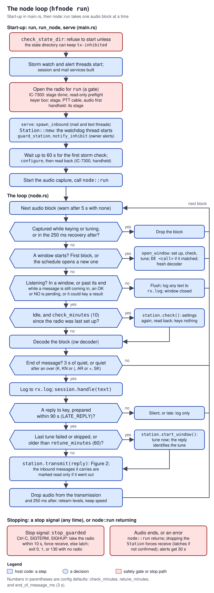

# 05 Node loop and station safety

> `hfnode run` is a loop that listens to the radio's audio one block at a time, decodes Morse code, hands each finished message to the session, and keys the session's reply. The loop lives in `crates/hfnode/src/node.rs`. Every transmission `hfnode run` makes goes through `Station<R: Rig>` in `crates/hfnode/src/station.rs`: `Station::transmit` is the only path the node keys through. (Four bench tests key through `Station::rig()` on purpose, to test the keyer box's and the handheld's own limits; see the `rig` row under [Interfaces and APIs](#interfaces-and-apis).) Before every transmission the station sets the radio up again and reads the settings back. It tunes when no tune has finished yet or the last one is older than `schedule.retune_minutes`, and it watches SWR and output on every piece. A software watchdog thread and a duty budget limit how long it keys. It identifies the station on time, and when it cannot be sure the radio is back on receive it latches a transmit inhibit that survives restarts. Around these sit the storm stand-down (`storm.rs`), the owner's alert email (`alert.rs`), the bring-up gates (`commissioning.rs`) and the stop paths in `main.rs`. The IC-7300, the keyer box and the UV-K1 handheld all use the same `Station`. **None of this has run on a real radio yet**: every behaviour on this page has only been shown against simulated and mock radios.

Words used on this page, in plain terms (the [17 Glossary](17-glossary.md) has more):

| Term | Meaning here |
|---|---|
| CW, Morse | On-off keying: the transmitter sends an unmodulated carrier while the key is down and nothing while it is up. |
| Key, keying, key-down | Turning the carrier on. "Key-down time" is the time the carrier is actually on. |
| Transmit, receive | The radio is either sending (transmit, TX) or listening (receive, RX). The node's main fear is a radio left on transmit (a "stuck" transmitter). |
| CI-V | ICOM's command protocol over the IC-7300's USB serial port ([07 CI-V and the IC-7300](07-civ-ic7300.md)). Commands are written as hex bytes, for example `1C 00` (read transmit status) and `17` (send CW text). |
| Keyer, piece | The radio's internal keyer turns text into Morse. CI-V `17` takes at most 30 characters, so the node sends text in pieces of 30 characters or less. |
| Semi break-in, break-in delay | With semi break-in on, the radio goes to transmit when keyed and back to receive a set time (the break-in delay, counted in dots) after the key stops. |
| Antenna tuner, tune | The IC-7300's automatic tuner matches the antenna. A tune transmits a carrier for a few seconds. |
| SWR | Standing-wave ratio: how well the antenna takes the power. 1.0 is perfect; high SWR means power comes back into the radio. |
| Po meter | The radio's output-power meter, read in percent of full output (100 W). |
| TOT | The radio's own Time-Out Timer: it ends a transmission after a set time, even with this software stopped. |
| Duty budget | The share of a time window the key may be down, so the transmitter does not overheat. |
| Station ID | The callsign sent as `DE <call>`. US rules (47 CFR 97.119(a)) require it at the end of each communication and at least every 10 minutes during one. |
| Prosign, over | A prosign is a group of letters sent run together as one signal. An over is a prosign that ends one side's turn: `K`, `KN` (decoded as `(` when run together), `AR` (run together: `+`) and `SK` ([`crates/protocol/src/lib.rs:133`](https://github.com/robinonsay/cw-message-gateway/blob/44185fa9a00369c379d9d8af40ca307e3867e860/crates/protocol/src/lib.rs#L133)). |
| Dot, unit, wpm | A dot (dit) is one Morse unit and a dash three. The gaps inside a character, between characters and between words are 1, 3 and 7 units. At a speed of *wpm* words per minute a dot lasts 1.2 s / wpm, 66.7 ms at 18 wpm. `cw::units` counts a text this way ([`crates/cw/src/morse.rs:98-118`](https://github.com/robinonsay/cw-message-gateway/blob/44185fa9a00369c379d9d8af40ca307e3867e860/crates/cw/src/morse.rs#L98-L118)). |
| Split, ∂TX | Two radio settings that make it transmit on a frequency other than the one it receives on. The node only checks that both are off. |
| AGC | The receiver's automatic gain control. It takes a moment to recover after the radio transmits, so the node throws that audio away. |
| VOX | Voice-operated transmit: the radio keys itself when it hears sound at its microphone. It is one way a radio can transmit with nothing from the node keying it. |
| TX Inhibit | The IC-7300's own "do not transmit" setting; CI-V `16 66 01` turns it on. On the IC-7300 the node turns it on when it latches its own inhibit, at once or when the watchdog next has the radio. |
| SSB/CW Synchronous Tuning | An IC-7300 menu setting. With it on, a mode change shifts the frequency, so the node sets the mode before the frequency. |
| PTT, sidetone | Push-to-talk line (a handheld transmits while it is held). The sidetone is the tone a radio plays in its own audio while it sends CW; the keyer box listens for it. |

## Where it lives

All paths are at `main` [`44185fa`](https://github.com/robinonsay/cw-message-gateway/tree/44185fa9a00369c379d9d8af40ca307e3867e860). Line counts include each file's tests.

| Path | What it holds | Lines (code, then tests) |
|---|---|---|
| [`crates/hfnode/src/node.rs:1-769`](https://github.com/robinonsay/cw-message-gateway/blob/44185fa9a00369c379d9d8af40ca307e3867e860/crates/hfnode/src/node.rs#L1-L769) | The node loop `run`, its listening windows, end-of-message detection, and the inbound-message threads it starts | 1-769, tests 771-1519 |
| [`crates/hfnode/src/station.rs:1-2284`](https://github.com/robinonsay/cw-message-gateway/blob/44185fa9a00369c379d9d8af40ca307e3867e860/crates/hfnode/src/station.rs#L1-L2284) | `Station`, `StationConfig`, `TxError`, the watchdog thread, forced receive, the inhibit latch, the duty log, the health log | 1-2284, tests 2286-5395 |
| [`crates/hfnode/src/storm.rs:1-385`](https://github.com/robinonsay/cw-message-gateway/blob/44185fa9a00369c379d9d8af40ca307e3867e860/crates/hfnode/src/storm.rs#L1-L385) | The storm stand-down: the NWS check thread and `StormHold` | 1-385, tests 387-700 |
| [`crates/hfnode/src/alert.rs:1-411`](https://github.com/robinonsay/cw-message-gateway/blob/44185fa9a00369c379d9d8af40ca307e3867e860/crates/hfnode/src/alert.rs#L1-L411) | `Alerts`: the thread that emails the owner when the inhibit latches | 1-411, tests 413-735 |
| [`crates/hfnode/src/commissioning.rs:1-225`](https://github.com/robinonsay/cw-message-gateway/blob/44185fa9a00369c379d9d8af40ca307e3867e860/crates/hfnode/src/commissioning.rs#L1-L225) | Bring-up stages and the gate in front of every IC-7300 command that writes or transmits | 1-225, tests 227-499 |
| [`crates/hfnode/src/main.rs:433-524`](https://github.com/robinonsay/cw-message-gateway/blob/44185fa9a00369c379d9d8af40ca307e3867e860/crates/hfnode/src/main.rs#L433-L524) | The stop-signal handler and the radio guard | in `main.rs` |
| [`crates/hfnode/src/main.rs:1219-1343`](https://github.com/robinonsay/cw-message-gateway/blob/44185fa9a00369c379d9d8af40ca307e3867e860/crates/hfnode/src/main.rs#L1219-L1343) | `run`, `run_node`, `serve`: how `hfnode run` starts | in `main.rs` |
| [`crates/civ/src/lib.rs:57-186`](https://github.com/robinonsay/cw-message-gateway/blob/44185fa9a00369c379d9d8af40ca307e3867e860/crates/civ/src/lib.rs#L57-L186) | The `Rig` trait: everything the station asks of a radio | in `crates/civ` |
| [`crates/hfnode/tests/stop_signal.rs:1-63`](https://github.com/robinonsay/cw-message-gateway/blob/44185fa9a00369c379d9d8af40ca307e3867e860/crates/hfnode/tests/stop_signal.rs#L1-L63) | Test that stop signals reach the handler (Unix only) | |

## How it works

### Threads

`hfnode run` runs these threads. The radio itself sits behind one `Arc<Mutex<R>>` that the main thread, the watchdog and the stop handler share ([`crates/hfnode/src/station.rs:887-890`](https://github.com/robinonsay/cw-message-gateway/blob/44185fa9a00369c379d9d8af40ca307e3867e860/crates/hfnode/src/station.rs#L887-L890), [`crates/hfnode/src/main.rs:438`](https://github.com/robinonsay/cw-message-gateway/blob/44185fa9a00369c379d9d8af40ca307e3867e860/crates/hfnode/src/main.rs#L438)).

| Thread | Started by | What it does |
|---|---|---|
| main | `main` | Runs `node::run`: reads audio, decodes, calls the session, and calls the station to tune and transmit. All keying happens on this thread. |
| watchdog | `Station::new` ([`crates/hfnode/src/station.rs:1006`](https://github.com/robinonsay/cw-message-gateway/blob/44185fa9a00369c379d9d8af40ca307e3867e860/crates/hfnode/src/station.rs#L1006)) | Every 250 ms: times the keying run or tune under way and forces receive when it is too long; while idle, looks for the radio transmitting with nothing keying it ([Algorithm 15](#15-the-watchdog-thread)). |
| keyer keep-alive (`station.rig = "keyer"` only) | `KeyerRig::open` ([`crates/hfnode/src/keyer/rig.rs:263-269`](https://github.com/robinonsay/cw-message-gateway/blob/44185fa9a00369c379d9d8af40ca307e3867e860/crates/hfnode/src/keyer/rig.rs#L263-L269)) | Sends `STATUS` to the box every 250 ms (`KEEP_ALIVE`, [`crates/hfnode/src/keyer/rig.rs:42`](https://github.com/robinonsay/cw-message-gateway/blob/44185fa9a00369c379d9d8af40ca307e3867e860/crates/hfnode/src/keyer/rig.rs#L42)) while a run lasts, and only then, so that the box's link timeout ends a run soon after the node dies. A run still going 1 s past its end (`RUN_SLACK`) gets one `STOP` and no more keep-alives ([`crates/hfnode/src/keyer/rig.rs:483-536`](https://github.com/robinonsay/cw-message-gateway/blob/44185fa9a00369c379d9d8af40ca307e3867e860/crates/hfnode/src/keyer/rig.rs#L483-L536); [09 Keyer box: host side](09-keyer-host-side.md)). |
| handheld link (`station.rig = "handheld"` only, a parked route) | `Handheld::new`, which `Handheld::open` calls ([`crates/hfnode/src/handheld.rs:552-561`](https://github.com/robinonsay/cw-message-gateway/blob/44185fa9a00369c379d9d8af40ca307e3867e860/crates/hfnode/src/handheld.rs#L552-L561)) | While a run lasts, sends `STATUS` to the handheld's firmware every link timeout / 4, clamped to 10-250 ms, so that one lost line does not let the firmware's link timeout expire. At the run's deadline it sends `STOP` and keeps the link alive no longer ([`crates/hfnode/src/handheld.rs:465-483`](https://github.com/robinonsay/cw-message-gateway/blob/44185fa9a00369c379d9d8af40ca307e3867e860/crates/hfnode/src/handheld.rs#L465-L483); [10 Quansheng UV-K1 handheld](10-uv-k1-handheld.md)). |
| storm | `storm::spawn` ([`crates/hfnode/src/storm.rs:345-385`](https://github.com/robinonsay/cw-message-gateway/blob/44185fa9a00369c379d9d8af40ca307e3867e860/crates/hfnode/src/storm.rs#L345-L385)) | Asks the US National Weather Service (NWS) about thunder every `storm.check_minutes` and sets the `StormHold`. |
| alert | `Alerts::with_deliver` ([`crates/hfnode/src/alert.rs:150-183`](https://github.com/robinonsay/cw-message-gateway/blob/44185fa9a00369c379d9d8af40ca307e3867e860/crates/hfnode/src/alert.rs#L150-L183)) | Turns each `InhibitNotice` into an email. |
| imap, imessage, screen | `node::spawn_inbound` ([`crates/hfnode/src/node.rs:157-232`](https://github.com/robinonsay/cw-message-gateway/blob/44185fa9a00369c379d9d8af40ca307e3867e860/crates/hfnode/src/node.rs#L157-L232)) | Fetch and screen inbound messages ([06 Gateways and messages](06-gateways-messages.md)). |
| stop handler | `ctrlc::set_handler` ([`crates/hfnode/src/main.rs:353`](https://github.com/robinonsay/cw-message-gateway/blob/44185fa9a00369c379d9d8af40ca307e3867e860/crates/hfnode/src/main.rs#L353)) | Runs `stop_guarded` on Ctrl-C, SIGTERM or SIGHUP. |
| audio | `audio::Capture::start` ([`crates/hfnode/src/audio.rs:174`](https://github.com/robinonsay/cw-message-gateway/blob/44185fa9a00369c379d9d8af40ca307e3867e860/crates/hfnode/src/audio.rs#L174)) | Captures sound-card blocks ([04 CW decoder and audio](04-cw-decoder-audio.md)). |

### Start-up and the loop



*Figure 1: the node loop. The start-up tune happens on the first audio block, inside the loop, not in `serve`. A tune before a reply has no ID of its own: the reply identifies it. Red boxes are safety gates and the stop paths.*

`run` ([`crates/hfnode/src/main.rs:1219-1231`](https://github.com/robinonsay/cw-message-gateway/blob/44185fa9a00369c379d9d8af40ca307e3867e860/crates/hfnode/src/main.rs#L1219-L1231)) first calls `check_state_dir`, which refuses to go on unless the state directory can hold the inhibit file ([The inhibit latch](#faults-lockout-and-the-inhibit-latch)). It then starts the storm watch (`start_storm_watch`, [`crates/hfnode/src/main.rs:1110-1132`](https://github.com/robinonsay/cw-message-gateway/blob/44185fa9a00369c379d9d8af40ca307e3867e860/crates/hfnode/src/main.rs#L1110-L1132): the `[storm]` section is required, and `enabled = false` is the only way to run without it) and the alert thread. `run_node` ([`crates/hfnode/src/main.rs:1233-1266`](https://github.com/robinonsay/cw-message-gateway/blob/44185fa9a00369c379d9d8af40ca307e3867e860/crates/hfnode/src/main.rs#L1233-L1266)) builds the session and the mail services, then opens the radio by its kind:

- IC-7300: `open_for(cfg, Action::Run)`, the bring-up gate and read-only preflight ([Commissioning](#commissioningrs-bring-up-gates)).
- keyer box: `open_keyer` ([`crates/hfnode/src/main.rs:1348-1367`](https://github.com/robinonsay/cw-message-gateway/blob/44185fa9a00369c379d9d8af40ca307e3867e860/crates/hfnode/src/main.rs#L1348-L1367)), which checks `keyer.commissioned` and the PTT cable record and starts listening to the radio's audio before the box is opened.
- handheld: `open_handheld` ([`crates/hfnode/src/main.rs:1526-1543`](https://github.com/robinonsay/cw-message-gateway/blob/44185fa9a00369c379d9d8af40ca307e3867e860/crates/hfnode/src/main.rs#L1526-L1543)), which checks `handheld.commissioned`.

`serve` ([`crates/hfnode/src/main.rs:1281-1333`](https://github.com/robinonsay/cw-message-gateway/blob/44185fa9a00369c379d9d8af40ca307e3867e860/crates/hfnode/src/main.rs#L1281-L1333)) first starts the inbound mail and text threads (`node::spawn_inbound`, [`crates/hfnode/src/main.rs:1296`](https://github.com/robinonsay/cw-message-gateway/blob/44185fa9a00369c379d9d8af40ca307e3867e860/crates/hfnode/src/main.rs#L1296)). Then it creates the `Station` (which starts the watchdog), registers it with `guard_station` so a stop signal can reach the radio, and registers the alert thread with `notify_inhibit`. With a storm hold it waits up to 60 s for the first NWS answer ([`crates/hfnode/src/main.rs:1313`](https://github.com/robinonsay/cw-message-gateway/blob/44185fa9a00369c379d9d8af40ca307e3867e860/crates/hfnode/src/main.rs#L1313)) so the start-up tune is not skipped while the first check is on its way. It calls `station.configure()` (receive, then all settings) and the rig's own read-back: `verify_setup` for the IC-7300 ([`crates/hfnode/src/main.rs:929-953`](https://github.com/robinonsay/cw-message-gateway/blob/44185fa9a00369c379d9d8af40ca307e3867e860/crates/hfnode/src/main.rs#L929-L953)), nothing more for the keyer box, `station.check()` for a handheld. Last it starts the audio capture (unless the keyer rig already did) and calls `node::run`.

`node::run` ([`crates/hfnode/src/node.rs:518-526`](https://github.com/robinonsay/cw-message-gateway/blob/44185fa9a00369c379d9d8af40ca307e3867e860/crates/hfnode/src/node.rs#L518-L526)) loops over audio blocks until the audio source ends. For each block it decides, in this order ([`crates/hfnode/src/node.rs:585-768`](https://github.com/robinonsay/cw-message-gateway/blob/44185fa9a00369c379d9d8af40ca307e3867e860/crates/hfnode/src/node.rs#L585-L768)):

1. Drop the block if it was captured while the node was transmitting or tuning, or in the 250 ms after (`TxGuard`, [`crates/hfnode/src/node.rs:386-412`](https://github.com/robinonsay/cw-message-gateway/blob/44185fa9a00369c379d9d8af40ca307e3867e860/crates/hfnode/src/node.rs#L386-L412)).
2. If a listening window starts, call `station.open_window()` (tune, then `DE <call>` if the tune matched), start a fresh decoder and take the next block. Listening all the time counts as one window, so this runs on the first block after start-up ([`crates/hfnode/src/node.rs:489-492`](https://github.com/robinonsay/cw-message-gateway/blob/44185fa9a00369c379d9d8af40ca307e3867e860/crates/hfnode/src/node.rs#L489-L492), [`crates/hfnode/src/node.rs:602`](https://github.com/robinonsay/cw-message-gateway/blob/44185fa9a00369c379d9d8af40ca307e3867e860/crates/hfnode/src/node.rs#L602)).
3. If the node is not listening (outside a window and nothing holds it open), flush and log anything decoded and take the next block.
4. If nothing is being received or waited for, and `schedule.check_minutes` have passed since the radio was last set up, call `station.check()`: the settings are sent again and read back, and nothing is transmitted ([`crates/hfnode/src/node.rs:665-674`](https://github.com/robinonsay/cw-message-gateway/blob/44185fa9a00369c379d9d8af40ca307e3867e860/crates/hfnode/src/node.rs#L665-L674)). Once 60 s of audio have passed since the last speed reset or transmission, the decoder goes back to its starting speed at the next idle block ([`crates/hfnode/src/node.rs:675-678`](https://github.com/robinonsay/cw-message-gateway/blob/44185fa9a00369c379d9d8af40ca307e3867e860/crates/hfnode/src/node.rs#L675-L678), [`crates/hfnode/src/node.rs:683`](https://github.com/robinonsay/cw-message-gateway/blob/44185fa9a00369c379d9d8af40ca307e3867e860/crates/hfnode/src/node.rs#L683)).
5. Decode the block. When a message has ended (3 s of quiet by default, or quiet after an over prosign), log it to `rx.log` and pass the text to `session.handle`.
6. If the session returns a reply prepared within 90 s, retune first if the last tune did not finish (it failed, never started, or was skipped for a storm) or finished more than `schedule.retune_minutes` ago ([`crates/hfnode/src/node.rs:734`](https://github.com/robinonsay/cw-message-gateway/blob/44185fa9a00369c379d9d8af40ca307e3867e860/crates/hfnode/src/node.rs#L734)), then call `station.transmit`. Inbound messages in the reply are marked read only if the transmission went out ([`crates/hfnode/src/node.rs:753-758`](https://github.com/robinonsay/cw-message-gateway/blob/44185fa9a00369c379d9d8af40ca307e3867e860/crates/hfnode/src/node.rs#L753-L758)).
7. Throw away audio from the transmission and its recovery, and reset the decoder's levels but not its speed: the field operator answers at once ([`crates/hfnode/src/node.rs:762-764`](https://github.com/robinonsay/cw-message-gateway/blob/44185fa9a00369c379d9d8af40ca307e3867e860/crates/hfnode/src/node.rs#L762-L764)).

### One transmission


*Figure 2: one reply through the station. Exits with a dashed red outline end in a lockout until the next tune. Each also counts a fault, except a set-up failure before a tune and the check that finds the station already locked out; a second fault in a row latches the inhibit. Exits with a solid red outline end with the inhibit latched: it latches there, or was already latched. Blue exits key nothing more and count no fault unless the box says so; the storm stand-down is one of them. The metered and the unmetered watch are alternatives, chosen by `has_meters`.*

`Station::transmit` ([`crates/hfnode/src/station.rs:1668-1735`](https://github.com/robinonsay/cw-message-gateway/blob/44185fa9a00369c379d9d8af40ca307e3867e860/crates/hfnode/src/station.rs#L1668-L1735)) refuses at once if the inhibit is latched, if a fault has locked transmitting out, or if the storm stand-down is on. Then `transmit_inner` ([`crates/hfnode/src/station.rs:1737-1803`](https://github.com/robinonsay/cw-message-gateway/blob/44185fa9a00369c379d9d8af40ca307e3867e860/crates/hfnode/src/station.rs#L1737-L1803)) waits up to 2 s for the radio to read receive, sends every setting again and reads the radio back (`apply_settings` and `check_ready`, [`crates/hfnode/src/station.rs:1270-1296`](https://github.com/robinonsay/cw-message-gateway/blob/44185fa9a00369c379d9d8af40ca307e3867e860/crates/hfnode/src/station.rs#L1270-L1296)), and refuses a reply that would key for more than 30 minutes. It then keys the reply segment by segment (one segment per chunk the session built), each segment split into keyer pieces, with a pause of `station.chunk_pause_ms` between segments. Before a piece it keys `DE <call>` on its own when an ID is due. For each piece, `key_piece` ([`crates/hfnode/src/station.rs:2021-2072`](https://github.com/robinonsay/cw-message-gateway/blob/44185fa9a00369c379d9d8af40ca307e3867e860/crates/hfnode/src/station.rs#L2021-L2072)) waits on receive for the duty budget and the rig's own rest, marks the start of keying for the watchdog, sends the piece, and watches it until the radio is back on receive.

On any error from `transmit_inner`, `transmit` forces the radio to receive before it does anything else ([`crates/hfnode/src/station.rs:1683-1685`](https://github.com/robinonsay/cw-message-gateway/blob/44185fa9a00369c379d9d8af40ca307e3867e860/crates/hfnode/src/station.rs#L1683-L1685)), and only then writes the health log, the duty file and any fault ([Algorithm 12](#12-deferred-writes-forced-receive-first)).

### Faults, lockout and the inhibit latch


*Figure 3: the transmit-inhibit latch. Nothing in the code ever clears it: only a person, with the node stopped, can. A `tx-inhibited` file found at start-up sets the flag without being written again. Step 2 uses the rig's own read-only check; the alert email gets that step wrong for the keyer box and the handheld ([Known bugs](#known-bugs-limits-and-flakes)).*

The station has two levels of "do not transmit":

- **Lockout** (`swr_lockout`, [`crates/hfnode/src/station.rs:896`](https://github.com/robinonsay/cw-message-gateway/blob/44185fa9a00369c379d9d8af40ca307e3867e860/crates/hfnode/src/station.rs#L896)): set by a fault (high SWR, no output, too much output, keying not heard, a radio stuck on transmit, a transmission that failed while keying, no tuner match, a failed tune) or by a radio that could not be set up before a tune. It lasts until the next `start_window`: the next tune, or on a rig without a tuner the set-up and check that take its place (at a window start, or before a reply when the last one did not finish or is older than `retune_minutes`). `TxError::SwrLockout` is its error.
- **Inhibit** (`tx_inhibit`, [`crates/hfnode/src/station.rs:894`](https://github.com/robinonsay/cw-message-gateway/blob/44185fa9a00369c379d9d8af40ca307e3867e860/crates/hfnode/src/station.rs#L894)): set when the radio cannot be confirmed back on receive, when its status cannot be trusted, when a failed tune will not stop, at the second fault in a row ([`crates/hfnode/src/station.rs:329`](https://github.com/robinonsay/cw-message-gateway/blob/44185fa9a00369c379d9d8af40ca307e3867e860/crates/hfnode/src/station.rs#L329)), when the watchdog cannot reach a radio that keys too long, when the radio transmits with nothing keying it, or by a stop that cannot confirm receive. It is written to `tx-inhibited` in the state directory, so it survives a restart: at start-up `Inhibit::new` sets the flag straight from that file and writes nothing ([`crates/hfnode/src/station.rs:650-657`](https://github.com/robinonsay/cw-message-gateway/blob/44185fa9a00369c379d9d8af40ca307e3867e860/crates/hfnode/src/station.rs#L650-L657)). Only a person removes it.

### Storm stand-down

The storm thread ([`crates/hfnode/src/storm.rs:343-385`](https://github.com/robinonsay/cw-message-gateway/blob/44185fa9a00369c379d9d8af40ca307e3867e860/crates/hfnode/src/storm.rs#L343-L385)) asks the NWS every `storm.check_minutes` (5 by default) whether thunder is forecast at the station's own location within `storm.lookahead_hours` (2), or an active alert there mentions thunder, lightning or a tornado. It fails closed: the hold is on until the first check succeeds, after any failed check, and when no check has finished for three check intervals or the look-ahead, whichever is shorter. After thunder the hold stays on for `storm.clear_minutes` (30). While the hold is on the station neither tunes nor keys, and a transmission under way stops and the radio is forced to receive. Listening goes on. `hfnode storm --config C` runs one check and prints the answer without touching the radio ([`crates/hfnode/src/main.rs:1134-1157`](https://github.com/robinonsay/cw-message-gateway/blob/44185fa9a00369c379d9d8af40ca307e3867e860/crates/hfnode/src/main.rs#L1134-L1157)).

### Owner alerts

When the inhibit latches, the station puts an `InhibitNotice` on a channel ([`crates/hfnode/src/station.rs:695-701`](https://github.com/robinonsay/cw-message-gateway/blob/44185fa9a00369c379d9d8af40ca307e3867e860/crates/hfnode/src/station.rs#L695-L701)). The alert thread ([`crates/hfnode/src/alert.rs:137-190`](https://github.com/robinonsay/cw-message-gateway/blob/44185fa9a00369c379d9d8af40ca307e3867e860/crates/hfnode/src/alert.rs#L137-L190)) emails it to `[email] alert_to` with the steps to clear it for that computer's system (Linux, macOS or Windows), trying again after 1, 5 and 15 minutes. If `tx-inhibited` is already there at start-up, the email goes out at once with the subject "`<call>`: node restarted, still not transmitting (tx-inhibited)" ([`crates/hfnode/src/alert.rs:271`](https://github.com/robinonsay/cw-message-gateway/blob/44185fa9a00369c379d9d8af40ca307e3867e860/crates/hfnode/src/alert.rs#L271)). Without `alert_to` the inhibit is only logged. The email never blocks the station: the station only sends on a channel.

### Stopping

A stop signal (Ctrl-C, SIGINT, SIGTERM, SIGHUP, or a Windows console Ctrl-C or Ctrl-Break) runs `stop_guarded` ([`crates/hfnode/src/main.rs:464-475`](https://github.com/robinonsay/cw-message-gateway/blob/44185fa9a00369c379d9d8af40ca307e3867e860/crates/hfnode/src/main.rs#L464-L475)) on the handler's thread. If a command has registered a radio with `guard_station`, it takes the radio's lock (waiting at most 10 s), stops the keyer, forces receive, latches the inhibit if receive is not confirmed, waits up to 5 s for alerts already queued, and exits while still holding the radio so nothing can key it in between. Exit codes: 0 when receive is confirmed, 1 when it is not or the radio could not be reached, 130 when no radio was in use. The systemd unit and the start-up scripts in `deploy/` then run `hfnode radio ... rx` after every stop ([`deploy/hfnode.service:29-33`](https://github.com/robinonsay/cw-message-gateway/blob/44185fa9a00369c379d9d8af40ca307e3867e860/deploy/hfnode.service#L29-L33)).

If `node::run` returns instead (the audio ended, or an error), `serve` returns and the `Station` is dropped: `Drop` stops the watchdog and forces receive, latching the inhibit if receive is not confirmed ([`crates/hfnode/src/station.rs:2279-2284`](https://github.com/robinonsay/cw-message-gateway/blob/44185fa9a00369c379d9d8af40ca307e3867e860/crates/hfnode/src/station.rs#L2279-L2284)). `OnAir` drops the station before the audio capture so the keyer rig can still hear the radio during that last check ([`crates/hfnode/src/main.rs:1335-1343`](https://github.com/robinonsay/cw-message-gateway/blob/44185fa9a00369c379d9d8af40ca307e3867e860/crates/hfnode/src/main.rs#L1335-L1343)). `run` then gives the alert thread up to 30 s to send ([`crates/hfnode/src/main.rs:1229`](https://github.com/robinonsay/cw-message-gateway/blob/44185fa9a00369c379d9d8af40ca307e3867e860/crates/hfnode/src/main.rs#L1229)).

### The keyer box and the handheld

The same `Station` drives all three radios. It asks the radio through the `Rig` trait, and each rig answers differently ([How it connects](#how-it-connects) has the table). In short:

- **IC-7300** ([`crates/civ/src/ic7300.rs:671-821`](https://github.com/robinonsay/cw-message-gateway/blob/44185fa9a00369c379d9d8af40ca307e3867e860/crates/civ/src/ic7300.rs#L671-L821)): has a tuner and meters, so the node tunes and checks SWR, Po and `1C 00` on every piece. Its status is polled every second while idle. It reports its TOT and power setting for the read-back, and `inhibit_transmit` turns break-in off and TX Inhibit on.
- **Keyer box** ([09 Keyer box: host side](09-keyer-host-side.md)): no tuner and no meters. A window start sets up and checks but keys nothing, so there is no ID after it. After each piece the rig confirms by the radio's sidetone that the radio keyed (`keying_confirmed`, [`crates/hfnode/src/keyer/rig.rs:967-986`](https://github.com/robinonsay/cw-message-gateway/blob/44185fa9a00369c379d9d8af40ca307e3867e860/crates/hfnode/src/keyer/rig.rs#L967-L986)); if not, `TxError::NotHeard`, a fault. It also reports a key held at the radio (`held_key`, [`crates/hfnode/src/keyer/rig.rs:889-897`](https://github.com/robinonsay/cw-message-gateway/blob/44185fa9a00369c379d9d8af40ca307e3867e860/crates/hfnode/src/keyer/rig.rs#L889-L897)), adds its own rest and duty budget (`rest_needed`, [`crates/hfnode/src/keyer/rig.rs:903-944`](https://github.com/robinonsay/cw-message-gateway/blob/44185fa9a00369c379d9d8af40ca307e3867e860/crates/hfnode/src/keyer/rig.rs#L903-L944)) and needs a settle time before receive can be confirmed (`receive_settle`, [`crates/hfnode/src/keyer/rig.rs:878-887`](https://github.com/robinonsay/cw-message-gateway/blob/44185fa9a00369c379d9d8af40ca307e3867e860/crates/hfnode/src/keyer/rig.rs#L878-L887)). The box firmware has its own hard limits ([08 Keyer box: firmware](08-keyer-box-firmware.md)). With `keyer.output = "ptt"` ([`crates/hfnode/src/config.rs:125-130`](https://github.com/robinonsay/cw-message-gateway/blob/44185fa9a00369c379d9d8af40ca307e3867e860/crates/hfnode/src/config.rs#L125-L130)) the box holds a handheld's PTT line instead of closing a key. The station times that hold with the same watchdog and `max_key_seconds`, and `receive_settle` is longer for PTT, which lengthens both the forced-receive deadline and the stuck deadline. The box's own PTT limit, 60 s ([`crates/keyer-core/src/lib.rs:57`](https://github.com/robinonsay/cw-message-gateway/blob/44185fa9a00369c379d9d8af40ca307e3867e860/crates/keyer-core/src/lib.rs#L57)), sits under both ([09 Keyer box: host side](09-keyer-host-side.md)).
- **Handheld** ([10 Quansheng UV-K1 handheld](10-uv-k1-handheld.md), a parked route): no tuner and no meters; settings are checked, not set; a duty cycle and a busy-channel wait come from `rest_needed` ([`crates/hfnode/src/handheld.rs:1066-1083`](https://github.com/robinonsay/cw-message-gateway/blob/44185fa9a00369c379d9d8af40ca307e3867e860/crates/hfnode/src/handheld.rs#L1066-L1083)). It does not confirm keying, so no `NotHeard`.

## How it connects


*Figure 4: what the node loop and the station connect to. Every call to the radio, the stop handler's too, goes through the `Rig` trait on the one shared `Arc<Mutex<R>>`. The storm thread and the alert thread reach the station only through `StormHold` and a channel.*

| Neighbour | Direction | Interface |
|---|---|---|
| Audio capture ([04](04-cw-decoder-audio.md)) | in | `BlockReceiver::recv_timeout` gives `audio::Block { at: Instant, samples: Vec<f32> }` ([`crates/hfnode/src/audio.rs:40-43`](https://github.com/robinonsay/cw-message-gateway/blob/44185fa9a00369c379d9d8af40ca307e3867e860/crates/hfnode/src/audio.rs#L40-L43)); `at` is when the block was read, which `TxGuard` compares with the end of a transmission. |
| CW decoder ([04](04-cw-decoder-audio.md)) | in | `Decoder::push`, `flush`, `key_down`, `has_partial`, `idle_ms`, `wpm`, `reset_speed`, `reset_levels` ([`crates/cw/src/decoder.rs:280-390`](https://github.com/robinonsay/cw-message-gateway/blob/44185fa9a00369c379d9d8af40ca307e3867e860/crates/cw/src/decoder.rs#L280-L390)). |
| Session ([03](03-field-protocol-auth-session.md)) | both | `Session::handle(text, now, svc) -> Outcome` ([`crates/hfnode/src/session.rs:267`](https://github.com/robinonsay/cw-message-gateway/blob/44185fa9a00369c379d9d8af40ca307e3867e860/crates/hfnode/src/session.rs#L267)); `Outcome::Transmit(Transmission)` or `Outcome::Silent(String)` ([`crates/hfnode/src/session.rs:116-120`](https://github.com/robinonsay/cw-message-gateway/blob/44185fa9a00369c379d9d8af40ca307e3867e860/crates/hfnode/src/session.rs#L116-L120)); `Transmission { segments, read_ids }` ([`crates/hfnode/src/session.rs:95-113`](https://github.com/robinonsay/cw-message-gateway/blob/44185fa9a00369c379d9d8af40ca307e3867e860/crates/hfnode/src/session.rs#L95-L113)); `has_pending` and `result_repeatable` decide listening past a window ([`crates/hfnode/src/session.rs:245-262`](https://github.com/robinonsay/cw-message-gateway/blob/44185fa9a00369c379d9d8af40ca307e3867e860/crates/hfnode/src/session.rs#L245-L262)). |
| Gateways ([06](06-gateways-messages.md)) | both | `Services::mark_read(&[u64])` after a transmission that went out ([`crates/hfnode/src/session.rs:48`](https://github.com/robinonsay/cw-message-gateway/blob/44185fa9a00369c379d9d8af40ca307e3867e860/crates/hfnode/src/session.rs#L48)); `node::spawn_inbound` and `live_services` start the mail and text routes. |
| Radio drivers ([07](07-civ-ic7300.md), [09](09-keyer-host-side.md), [10](10-uv-k1-handheld.md)) | out | The `Rig` trait ([`crates/civ/src/lib.rs:58-186`](https://github.com/robinonsay/cw-message-gateway/blob/44185fa9a00369c379d9d8af40ca307e3867e860/crates/civ/src/lib.rs#L58-L186)); the station is generic over it. |
| Config ([15](15-config-cli-deployment.md)) | in | `[station]`, `[schedule]`, `[storm]`, `[email] alert_to`, `state_dir`, `audio.end_of_message_ms`. |
| Safety rules ([13](13-safety-rules.md)) | | The canonical table of every limit; this page cites the code for each limit it uses. |
| NWS (`api.weather.gov`) | out | `GET /points/{lat},{lon}`, the hourly forecast URL it returns, `GET /alerts/active?point=...` ([`crates/hfnode/src/storm.rs:184-210`](https://github.com/robinonsay/cw-message-gateway/blob/44185fa9a00369c379d9d8af40ca307e3867e860/crates/hfnode/src/storm.rs#L184-L210)). |
| SMTP server | out | One plain-text email per notice ([`crates/hfnode/src/alert.rs:219-245`](https://github.com/robinonsay/cw-message-gateway/blob/44185fa9a00369c379d9d8af40ca307e3867e860/crates/hfnode/src/alert.rs#L219-L245)). |

What the station asks of the radio, and how each rig answers (defaults from [`crates/civ/src/lib.rs:58-186`](https://github.com/robinonsay/cw-message-gateway/blob/44185fa9a00369c379d9d8af40ca307e3867e860/crates/civ/src/lib.rs#L58-L186)):

| `Rig` method | Station use | IC-7300 | Keyer box | Handheld |
|---|---|---|---|---|
| `has_tuner` | tune at a window start or before a reply | `true` (default) | `false` ([`crates/hfnode/src/keyer/rig.rs:874`](https://github.com/robinonsay/cw-message-gateway/blob/44185fa9a00369c379d9d8af40ca307e3867e860/crates/hfnode/src/keyer/rig.rs#L874)) | `false` ([`crates/hfnode/src/handheld.rs:1057`](https://github.com/robinonsay/cw-message-gateway/blob/44185fa9a00369c379d9d8af40ca307e3867e860/crates/hfnode/src/handheld.rs#L1057)) |
| `has_meters` | `watch_piece` or `watch_unmetered` | `true` (default) | `false` ([`crates/hfnode/src/keyer/rig.rs:963`](https://github.com/robinonsay/cw-message-gateway/blob/44185fa9a00369c379d9d8af40ca307e3867e860/crates/hfnode/src/keyer/rig.rs#L963)) | `false` ([`crates/hfnode/src/handheld.rs:1060`](https://github.com/robinonsay/cw-message-gateway/blob/44185fa9a00369c379d9d8af40ca307e3867e860/crates/hfnode/src/handheld.rs#L1060)) |
| `is_transmitting` | every receive check | `1C 00` ([`crates/civ/src/ic7300.rs:775-779`](https://github.com/robinonsay/cw-message-gateway/blob/44185fa9a00369c379d9d8af40ca307e3867e860/crates/civ/src/ic7300.rs#L775-L779)) | box and sidetone state | firmware status |
| `set_transmit(false)` | forced receive | `1C 00 00`; `true` refused ([`crates/civ/src/ic7300.rs:783-790`](https://github.com/robinonsay/cw-message-gateway/blob/44185fa9a00369c379d9d8af40ca307e3867e860/crates/civ/src/ic7300.rs#L783-L790)) | stops the box | stops the firmware |
| `stop_cw` | forced receive | `17 FF` ([`crates/civ/src/ic7300.rs:771-773`](https://github.com/robinonsay/cw-message-gateway/blob/44185fa9a00369c379d9d8af40ca307e3867e860/crates/civ/src/ic7300.rs#L771-L773)) | box STOP | firmware STOP |
| `send_cw` | one piece | `17 <text>`, 30 chars max ([`crates/civ/src/ic7300.rs:764-769`](https://github.com/robinonsay/cw-message-gateway/blob/44185fa9a00369c379d9d8af40ca307e3867e860/crates/civ/src/ic7300.rs#L764-L769)) | box run | firmware keying |
| `dot_duration` | all timing | 1.2 s / wpm of the `14 0C` level last sent; read from the radio only if none has been sent ([`crates/civ/src/ic7300.rs:694-700`](https://github.com/robinonsay/cw-message-gateway/blob/44185fa9a00369c379d9d8af40ca307e3867e860/crates/civ/src/ic7300.rs#L694-L700), [`crates/civ/src/ic7300.rs:720-730`](https://github.com/robinonsay/cw-message-gateway/blob/44185fa9a00369c379d9d8af40ca307e3867e860/crates/civ/src/ic7300.rs#L720-L730)) | from `wpm` | from the firmware |
| `rest_needed` | wait before keying | zero (default) | box rest, duty, clear channel | duty cycle, busy channel |
| `keying_confirmed` | after an unmetered piece | `None` (default) | sidetone judged | `None` (default) |
| `held_key` | watchdog, while idle | `None` (default) | steady tone at sidetone pitch | `None` (default) |
| `receive_settle` | forced receive and stuck time | zero (default) | audio lag ([`crates/hfnode/src/keyer/rig.rs:878-887`](https://github.com/robinonsay/cw-message-gateway/blob/44185fa9a00369c379d9d8af40ca307e3867e860/crates/hfnode/src/keyer/rig.rs#L878-L887)) | zero (default) |
| `polls_status_while_idle` | watchdog's idle `1C 00` poll | `true` ([`crates/civ/src/ic7300.rs:793-795`](https://github.com/robinonsay/cw-message-gateway/blob/44185fa9a00369c379d9d8af40ca307e3867e860/crates/civ/src/ic7300.rs#L793-L795)) | `false` (default) | `false` (default) |
| `time_out_timer` | read-back before each transmission | `1A 05 00 29` ([`crates/civ/src/ic7300.rs:800-803`](https://github.com/robinonsay/cw-message-gateway/blob/44185fa9a00369c379d9d8af40ca307e3867e860/crates/civ/src/ic7300.rs#L800-L803)) | `None` (passes) | `None` (passes) |
| `rf_power_watts` | read-back before each transmission | `14 0A` ([`crates/civ/src/ic7300.rs:807-809`](https://github.com/robinonsay/cw-message-gateway/blob/44185fa9a00369c379d9d8af40ca307e3867e860/crates/civ/src/ic7300.rs#L807-L809)) | `None` (passes) | `None` (passes) |
| `split_or_delta_tx`, `transmit_frequency` | read-back | `0F`, `21 02`, `1C 03` ([`crates/civ/src/ic7300.rs:747-755`](https://github.com/robinonsay/cw-message-gateway/blob/44185fa9a00369c379d9d8af40ca307e3867e860/crates/civ/src/ic7300.rs#L747-L755)) | defaults | receive and transmit frequency must match ([`crates/hfnode/src/handheld.rs:867-875`](https://github.com/robinonsay/cw-message-gateway/blob/44185fa9a00369c379d9d8af40ca307e3867e860/crates/hfnode/src/handheld.rs#L867-L875)) |
| `transmit_detail` | the reason given when forced receive fails, and so in the inhibit ([`crates/hfnode/src/station.rs:418-423`](https://github.com/robinonsay/cw-message-gateway/blob/44185fa9a00369c379d9d8af40ca307e3867e860/crates/hfnode/src/station.rs#L418-L423)) | `None` (default, [`crates/civ/src/lib.rs:141-143`](https://github.com/robinonsay/cw-message-gateway/blob/44185fa9a00369c379d9d8af40ca307e3867e860/crates/civ/src/lib.rs#L141-L143)) | why it still reads transmitting: its PTT line reads low, a key is held at the radio, or the audio does not yet show the key open ([`crates/hfnode/src/keyer/rig.rs:946-961`](https://github.com/robinonsay/cw-message-gateway/blob/44185fa9a00369c379d9d8af40ca307e3867e860/crates/hfnode/src/keyer/rig.rs#L946-L961)) | `None` (default) |
| `inhibit_transmit` | when receive is not confirmed, and at every latch | `16 47 00`, `16 66 01` ([`crates/civ/src/ic7300.rs:815-819`](https://github.com/robinonsay/cw-message-gateway/blob/44185fa9a00369c379d9d8af40ca307e3867e860/crates/civ/src/ic7300.rs#L815-L819)) | nothing (default) | nothing (default) |
| The 16 required methods (no default) | settings in `apply_settings`: `set_mode_cw`, `set_frequency`, `set_rf_power_watts`, `set_key_speed`, `set_break_in_delay`, `set_break_in` ([`crates/hfnode/src/station.rs:1270-1286`](https://github.com/robinonsay/cw-message-gateway/blob/44185fa9a00369c379d9d8af40ca307e3867e860/crates/hfnode/src/station.rs#L1270-L1286)); the tune in `run_tuner`: `start_tune`, `tuner_busy` ([`crates/hfnode/src/station.rs:1586-1638`](https://github.com/robinonsay/cw-message-gateway/blob/44185fa9a00369c379d9d8af40ca307e3867e860/crates/hfnode/src/station.rs#L1586-L1638)); the meters in `watch_piece`: `read_po`, `read_swr` ([`crates/hfnode/src/station.rs:2099-2222`](https://github.com/robinonsay/cw-message-gateway/blob/44185fa9a00369c379d9d8af40ca307e3867e860/crates/hfnode/src/station.rs#L2099-L2222)); and `dot_duration`, `send_cw`, `stop_cw`, `is_transmitting`, `set_transmit` above. The station does not call `frequency`; `hfnode radio status` does ([`crates/hfnode/src/main.rs:987`](https://github.com/robinonsay/cw-message-gateway/blob/44185fa9a00369c379d9d8af40ca307e3867e860/crates/hfnode/src/main.rs#L987)). | CI-V commands ([07](07-civ-ic7300.md)) | box commands ([09](09-keyer-host-side.md)) | firmware commands; settings checked, not set ([10](10-uv-k1-handheld.md)) |

## Interfaces and APIs

### `node.rs`

| Item | Signature | What it does |
|---|---|---|
| `run` | `pub fn run<R: Rig + 'static>(cfg: &Config, station: &mut Station<R>, audio: &BlockReceiver, session: &mut Session, svc: &mut dyn Services) -> Result<()>` ([`crates/hfnode/src/node.rs:518-526`](https://github.com/robinonsay/cw-message-gateway/blob/44185fa9a00369c379d9d8af40ca307e3867e860/crates/hfnode/src/node.rs#L518-L526)) | The main loop on the system clock. Returns only on a fatal error or when the audio source ends (`"audio source ended"`). Creates `state_dir` if missing. |
| `run_with_clock` | as `run`, plus `clock: &dyn Fn() -> u64` ([`crates/hfnode/src/node.rs:535-544`](https://github.com/robinonsay/cw-message-gateway/blob/44185fa9a00369c379d9d8af40ca307e3867e860/crates/hfnode/src/node.rs#L535-L544)) | The schedule follows `clock` (Unix seconds), for time-scaled tests. |
| `load_codebook` | `pub fn load_codebook(cfg: &Config) -> Result<CodeBook>` ([`crates/hfnode/src/node.rs:36-46`](https://github.com/robinonsay/cw-message-gateway/blob/44185fa9a00369c379d9d8af40ca307e3867e860/crates/hfnode/src/node.rs#L36-L46)) | Reads `auth.key_file`; refuses a key shorter than 16 bytes. |
| `session_config`, `build_session`, `build_session_with` | ([`crates/hfnode/src/node.rs:48-89`](https://github.com/robinonsay/cw-message-gateway/blob/44185fa9a00369c379d9d8af40ca307e3867e860/crates/hfnode/src/node.rs#L48-L89)) | Build the session from the config; `max_rx_messages` is 5, `again_window` is `max(pending_timeout_secs, 600)` s. |
| `open_inbox` | ([`crates/hfnode/src/node.rs:91-95`](https://github.com/robinonsay/cw-message-gateway/blob/44185fa9a00369c379d9d8af40ca307e3867e860/crates/hfnode/src/node.rs#L91-L95)) | Opens `state_dir/inbox.json`. |
| `screen_inbox`, `spawn_inbound`, `live_services` | ([`crates/hfnode/src/node.rs:104-152`](https://github.com/robinonsay/cw-message-gateway/blob/44185fa9a00369c379d9d8af40ca307e3867e860/crates/hfnode/src/node.rs#L104-L152), [`crates/hfnode/src/node.rs:157-232`](https://github.com/robinonsay/cw-message-gateway/blob/44185fa9a00369c379d9d8af40ca307e3867e860/crates/hfnode/src/node.rs#L157-L232), [`crates/hfnode/src/node.rs:343-365`](https://github.com/robinonsay/cw-message-gateway/blob/44185fa9a00369c379d9d8af40ca307e3867e860/crates/hfnode/src/node.rs#L343-L365)) | Inbound message threads and services ([06](06-gateways-messages.md)). |

Private constants of the loop (all in `node.rs`):

| Constant | Value | Meaning |
|---|---|---|
| `RX_RECOVERY_MS` ([`crates/hfnode/src/node.rs:376`](https://github.com/robinonsay/cw-message-gateway/blob/44185fa9a00369c379d9d8af40ca307e3867e860/crates/hfnode/src/node.rs#L376)) | 250 ms | Audio dropped after transmitting or tuning, counted in samples, while the receiver and its AGC recover. |
| `SPEED_REFRESH_MS` ([`crates/hfnode/src/node.rs:382`](https://github.com/robinonsay/cw-message-gateway/blob/44185fa9a00369c379d9d8af40ca307e3867e860/crates/hfnode/src/node.rs#L382)) | 60 000 ms | Idle audio after which the decoder goes back to its starting speed. |
| `RHYTHM_DITS` ([`crates/hfnode/src/node.rs:417`](https://github.com/robinonsay/cw-message-gateway/blob/44185fa9a00369c379d9d8af40ca307e3867e860/crates/hfnode/src/node.rs#L417)) | 12 dits | Silence below which a word after an over prosign counts as more of the message. |
| `LATE_REPLY` ([`crates/hfnode/src/node.rs:531`](https://github.com/robinonsay/cw-message-gateway/blob/44185fa9a00369c379d9d8af40ca307e3867e860/crates/hfnode/src/node.rs#L531)) | 90 s | A reply that took longer to prepare is not keyed; a repeated `OK` or `AGN` keys it. |
| audio timeout ([`crates/hfnode/src/node.rs:586-591`](https://github.com/robinonsay/cw-message-gateway/blob/44185fa9a00369c379d9d8af40ca307e3867e860/crates/hfnode/src/node.rs#L586-L591)) | 5 s | Logs "no audio for 5 s" and keeps waiting. |
| `MAX_FILTER_TIMEOUTS` ([`crates/hfnode/src/node.rs:99`](https://github.com/robinonsay/cw-message-gateway/blob/44185fa9a00369c379d9d8af40ca307e3867e860/crates/hfnode/src/node.rs#L99)) | 3 | Filter timeouts before an inbound message is withheld ([06](06-gateways-messages.md)). |
| `REPROBE` ([`crates/hfnode/src/node.rs:235`](https://github.com/robinonsay/cw-message-gateway/blob/44185fa9a00369c379d9d8af40ca307e3867e860/crates/hfnode/src/node.rs#L235)) | 600 s | How often iMessage is probed again while unusable. |

### `station.rs`: `StationConfig`

Every field is `pub` and the struct derives `Clone` and `Debug` ([`crates/hfnode/src/station.rs:88-89`](https://github.com/robinonsay/cw-message-gateway/blob/44185fa9a00369c379d9d8af40ca307e3867e860/crates/hfnode/src/station.rs#L88-L89)), so a test can write one out by hand with short waits, as the station's own tests do ([`crates/hfnode/src/station.rs:2292-2315`](https://github.com/robinonsay/cw-message-gateway/blob/44185fa9a00369c379d9d8af40ca307e3867e860/crates/hfnode/src/station.rs#L2292-L2315)). Built by `StationConfig::from_config(&config::Station)` ([`crates/hfnode/src/station.rs:150-178`](https://github.com/robinonsay/cw-message-gateway/blob/44185fa9a00369c379d9d8af40ca307e3867e860/crates/hfnode/src/station.rs#L150-L178)). Fields ([`crates/hfnode/src/station.rs:88-141`](https://github.com/robinonsay/cw-message-gateway/blob/44185fa9a00369c379d9d8af40ca307e3867e860/crates/hfnode/src/station.rs#L88-L141)):

| Field | `from_config` value | Units, meaning |
|---|---|---|
| `frequency_hz` | `station.frequency_hz` | Hz; set and read back before every transmission. |
| `power_watts` | `station.power_watts` (1-100, default 40) | W; set, and read back within 1 W. |
| `key_speed_wpm` | `station.key_speed_wpm` (6-48, default 18) | wpm. Timing uses the speed the radio reports (`dot_duration`), not this. |
| `max_key` | `station.max_key_seconds` (1-120, default 45; `run` 55 at most) | Watchdog limit on one keying run. **Never loosen.** |
| `swr_limit` | `station.swr_limit` (1.1-3.0, default 2.0) | SWR above this stops the transmission. **Never loosen.** |
| `segment_pause` | `station.chunk_pause_ms` (default 2000) | Pause between segments and around an ID. |
| `swr_delay` | 50 ms | First SWR sample after the keyer accepts a piece. |
| `swr_window` | 1 s | Least time with no output, with `NO_OUTPUT_SAMPLES`, before `NoOutput`. |
| `swr_min_po` | `max(0.25 × power_watts, 2.0)` | Po percent that counts as key-down for an SWR sample. |
| `break_in_delay_dots` | `BREAK_IN_DELAY_DOTS` (10) | Semi break-in delay set on the radio. |
| `stuck_margin` | `STUCK_MARGIN` (3 s) | Extra time before a piece is "stuck". |
| `tune_timeout` | 20 s | Longest tune before it is abandoned (the manual's longest tune is 15 s). **Never loosen.** |
| `poll` | 100 ms | Polling interval for receive checks and SWR samples. |
| `station_id` | `"DE <NODE_CALL>"` | The ID text, upper case. |
| `id_interval` | `ID_INTERVAL` (8 min) | Most time from one ID to the end of the next. **Never loosen.** |
| `po_limit` | `po_limit(power_watts)` = 1.5 × W + 5 | Po percent above which a piece stops (`HighPower`). **Never loosen.** |
| `duty` | `duty_for_power(power_watts)` | Share of `duty_window` the key may be down. **Never loosen.** |
| `duty_window` | `DUTY_WINDOW` (10 min) | Window the duty share is measured over. **Never loosen.** |
| `max_transmission` | `MAX_TRANSMISSION` (30 min) | Longest keying time of one transmission. **Never loosen.** |
| `radio_wait` | 10 s | Longest the watchdog waits for a radio another call holds before it latches without it. **Never loosen.** |

### `station.rs`: constants

Every timing constant and threshold in the file. Only the `pub` ones can be imported from outside `station.rs`. The "never loosen" ones are safety limits: [13 Safety rules](13-safety-rules.md) is the canonical list.

| Constant | Visibility | Value | Where | Meaning |
|---|---|---|---|---|
| `ID_INTERVAL` | pub | 8 × 60 s | [`crates/hfnode/src/station.rs:143-147`](https://github.com/robinonsay/cw-message-gateway/blob/44185fa9a00369c379d9d8af40ca307e3867e860/crates/hfnode/src/station.rs#L143-L147) | Most time from the node's last ID to the end of its next, inside the 10 minutes of 47 CFR 97.119(a). **Never loosen.** |
| `BREAK_IN_DELAY_DOTS` | pub | 10.0 dots | [`crates/hfnode/src/station.rs:181-183`](https://github.com/robinonsay/cw-message-gateway/blob/44185fa9a00369c379d9d8af40ca307e3867e860/crates/hfnode/src/station.rs#L181-L183) | 3 dots more than a word gap, so the radio stays on transmit for a whole piece. |
| `STUCK_MARGIN` | pub | 3 s | [`crates/hfnode/src/station.rs:185-187`](https://github.com/robinonsay/cw-message-gateway/blob/44185fa9a00369c379d9d8af40ca307e3867e860/crates/hfnode/src/station.rs#L185-L187) | Allowed past a piece's keying time and break-in delay. **Never loosen.** |
| `DUTY_WINDOW` | pub | 10 × 60 s | [`crates/hfnode/src/station.rs:207-208`](https://github.com/robinonsay/cw-message-gateway/blob/44185fa9a00369c379d9d8af40ca307e3867e860/crates/hfnode/src/station.rs#L207-L208) | Window the duty share is measured over. **Never loosen.** |
| `MAX_TRANSMISSION` | pub | 30 × 60 s | [`crates/hfnode/src/station.rs:218-222`](https://github.com/robinonsay/cw-message-gateway/blob/44185fa9a00369c379d9d8af40ca307e3867e860/crates/hfnode/src/station.rs#L218-L222) | Longest keying time of one transmission. **Never loosen.** |
| `FORCE_RX_ATTEMPTS` | private | 3 | [`crates/hfnode/src/station.rs:315-316`](https://github.com/robinonsay/cw-message-gateway/blob/44185fa9a00369c379d9d8af40ca307e3867e860/crates/hfnode/src/station.rs#L315-L316) | Least tries before `force_receive` gives up. **Never loosen.** |
| `RX_READINGS` | private | 2 | [`crates/hfnode/src/station.rs:318-322`](https://github.com/robinonsay/cw-message-gateway/blob/44185fa9a00369c379d9d8af40ca307e3867e860/crates/hfnode/src/station.rs#L318-L322) | Receive (or "not tuning") readings in a row that confirm it: CI-V has no checksum. **Never loosen.** |
| `FAULTS_TO_LATCH` | pub | 2 | [`crates/hfnode/src/station.rs:324-329`](https://github.com/robinonsay/cw-message-gateway/blob/44185fa9a00369c379d9d8af40ca307e3867e860/crates/hfnode/src/station.rs#L324-L329) | Faults in a row that latch the inhibit. **Never loosen.** |
| `WATCHDOG_TICK` | private | 250 ms | [`crates/hfnode/src/station.rs:331-332`](https://github.com/robinonsay/cw-message-gateway/blob/44185fa9a00369c379d9d8af40ca307e3867e860/crates/hfnode/src/station.rs#L331-L332) | Watchdog period. **Never loosen.** |
| `IDLE_POLL_TICKS` | private | 4 ticks (1 s) | [`crates/hfnode/src/station.rs:334-336`](https://github.com/robinonsay/cw-message-gateway/blob/44185fa9a00369c379d9d8af40ca307e3867e860/crates/hfnode/src/station.rs#L334-L336) | Idle `1C 00` poll period on the IC-7300. **Never loosen.** |
| `IDLE_ERRORS` | private | 5 | [`crates/hfnode/src/station.rs:338-342`](https://github.com/robinonsay/cw-message-gateway/blob/44185fa9a00369c379d9d8af40ca307e3867e860/crates/hfnode/src/station.rs#L338-L342) | Failed idle status reads in a row before the watchdog forces receive. **Never loosen.** |
| `POWER_TOLERANCE_W` | private | 1.0 W | [`crates/hfnode/src/station.rs:344-348`](https://github.com/robinonsay/cw-message-gateway/blob/44185fa9a00369c379d9d8af40ca307e3867e860/crates/hfnode/src/station.rs#L344-L348) | How far the power read back may be from the power set. **Never loosen.** |
| `REQUIRED_TOT` | pub | 180 s | [`crates/hfnode/src/station.rs:350-353`](https://github.com/robinonsay/cw-message-gateway/blob/44185fa9a00369c379d9d8af40ca307e3867e860/crates/hfnode/src/station.rs#L350-L353) | The radio's Time-Out Timer must read exactly 3 min. **Never loosen.** |
| `MAX_BREAK_IN_DOTS` | private | 13.0 dots | [`crates/hfnode/src/station.rs:355-357`](https://github.com/robinonsay/cw-message-gateway/blob/44185fa9a00369c379d9d8af40ca307e3867e860/crates/hfnode/src/station.rs#L355-L357) | Longest break-in delay the radio allows; how long `force_receive` keeps trying. **Never loosen.** |
| `SLOWEST_DOT` | private | 200 ms | [`crates/hfnode/src/station.rs:359-361`](https://github.com/robinonsay/cw-message-gateway/blob/44185fa9a00369c379d9d8af40ca307e3867e860/crates/hfnode/src/station.rs#L359-L361) | A dot at 6 wpm, used when the speed cannot be read. |
| `NO_OUTPUT_SAMPLES` | pub | 40 | [`crates/hfnode/src/station.rs:363-373`](https://github.com/robinonsay/cw-message-gateway/blob/44185fa9a00369c379d9d8af40ca307e3867e860/crates/hfnode/src/station.rs#L363-L373) | Samples in a row with no output (and at least `swr_window`) that stop a piece. **Never loosen.** |
| `INHIBIT_FILE` | pub | `"tx-inhibited"` | [`crates/hfnode/src/station.rs:528-532`](https://github.com/robinonsay/cw-message-gateway/blob/44185fa9a00369c379d9d8af40ca307e3867e860/crates/hfnode/src/station.rs#L528-L532) | The inhibit file's name in the state directory. |
| `DUTY_FILE` | pub | `"key-down"` | [`crates/hfnode/src/station.rs:729-732`](https://github.com/robinonsay/cw-message-gateway/blob/44185fa9a00369c379d9d8af40ca307e3867e860/crates/hfnode/src/station.rs#L729-L732) | The duty log's file name. |
| forced-receive retry | not a named constant | 100 ms | [`crates/hfnode/src/station.rs:400-402`](https://github.com/robinonsay/cw-message-gateway/blob/44185fa9a00369c379d9d8af40ca307e3867e860/crates/hfnode/src/station.rs#L400-L402) | Sleep between `force_receive` attempts. |
| receive wait before keying | not a named constant | 2 s | [`crates/hfnode/src/station.rs:1742`](https://github.com/robinonsay/cw-message-gateway/blob/44185fa9a00369c379d9d8af40ca307e3867e860/crates/hfnode/src/station.rs#L1742), [`crates/hfnode/src/station.rs:2023`](https://github.com/robinonsay/cw-message-gateway/blob/44185fa9a00369c379d9d8af40ca307e3867e860/crates/hfnode/src/station.rs#L2023) | Deadline for the radio to read receive before a transmission and before each piece. **Never loosen.** |
| tune start wait | not a named constant | `tune_timeout / 20` (1 s) | [`crates/hfnode/src/station.rs:1591`](https://github.com/robinonsay/cw-message-gateway/blob/44185fa9a00369c379d9d8af40ca307e3867e860/crates/hfnode/src/station.rs#L1591) | Time allowed for `1C 01` to start reading 02. |
| watchdog tune limit | not a named constant | `tune_timeout + stuck_margin` (23 s) | [`crates/hfnode/src/station.rs:1099-1101`](https://github.com/robinonsay/cw-message-gateway/blob/44185fa9a00369c379d9d8af40ca307e3867e860/crates/hfnode/src/station.rs#L1099-L1101) | Limit applied to a tune instead of `max_key`. **Never loosen.** |
| `lock_within` poll | not a named constant | 10 ms | [`crates/hfnode/src/station.rs:519`](https://github.com/robinonsay/cw-message-gateway/blob/44185fa9a00369c379d9d8af40ca307e3867e860/crates/hfnode/src/station.rs#L519) | Retry interval while waiting for the radio's lock. |

And the derived functions, all three `pub`:

| Function | Formula | Where |
|---|---|---|
| `shortest_max_key(wpm) -> Duration` | `dot × (units("0") + 10) + 3 s`, dot = 1.2 s / wpm. 4.93 s at 18 wpm. | [`crates/hfnode/src/station.rs:189-196`](https://github.com/robinonsay/cw-message-gateway/blob/44185fa9a00369c379d9d8af40ca307e3867e860/crates/hfnode/src/station.rs#L189-L196) |
| `po_limit(watts) -> f32` | `1.5 × watts + 5` (65 % at 40 W, 20 % at 10 W) | [`crates/hfnode/src/station.rs:198-205`](https://github.com/robinonsay/cw-message-gateway/blob/44185fa9a00369c379d9d8af40ca307e3867e860/crates/hfnode/src/station.rs#L198-L205) |
| `duty_for_power(watts) -> f32` | `min(25 / watts, 0.5)`: half up to 50 W, a quarter at 100 W | [`crates/hfnode/src/station.rs:210-216`](https://github.com/robinonsay/cw-message-gateway/blob/44185fa9a00369c379d9d8af40ca307e3867e860/crates/hfnode/src/station.rs#L210-L216) |

### `station.rs`: errors

`TxError` ([`crates/hfnode/src/station.rs:224-265`](https://github.com/robinonsay/cw-message-gateway/blob/44185fa9a00369c379d9d8af40ca307e3867e860/crates/hfnode/src/station.rs#L224-L265)); its `Display` texts are at [`crates/hfnode/src/station.rs:267-307`](https://github.com/robinonsay/cw-message-gateway/blob/44185fa9a00369c379d9d8af40ca307e3867e860/crates/hfnode/src/station.rs#L267-L307). `From<civ::RigError>` maps any radio error to `TxError::Rig` ([`crates/hfnode/src/station.rs:309-313`](https://github.com/robinonsay/cw-message-gateway/blob/44185fa9a00369c379d9d8af40ca307e3867e860/crates/hfnode/src/station.rs#L309-L313)). `TxError` derives `Debug` and `PartialEq` (tests compare it with `assert_eq!`) and implements `Display`, but not `std::error::Error` ([`crates/hfnode/src/station.rs:224`](https://github.com/robinonsay/cw-message-gateway/blob/44185fa9a00369c379d9d8af40ca307e3867e860/crates/hfnode/src/station.rs#L224)). So `?` cannot turn it into an `anyhow::Error`: convert it first with `.map_err(|e| anyhow::anyhow!("{e}"))`, as `main.rs` does ([`crates/hfnode/src/main.rs:1040`](https://github.com/robinonsay/cw-message-gateway/blob/44185fa9a00369c379d9d8af40ca307e3867e860/crates/hfnode/src/main.rs#L1040)).

| Variant | When | What follows |
|---|---|---|
| `SwrLockout` | Locked out since a fault | Nothing keyed until the next `start_window` (the next tune, or its set-up and check on a rig without a tuner). |
| `HighSwr(f32)` | A sample above `swr_limit` | Forced receive, fault, lockout. |
| `NoOutput` | First piece with no sample showing output, or 40 dark samples over at least 1 s | Forced receive, fault, lockout. |
| `NotHeard` | Rig without meters says the radio did not key (keyer box: no sidetone) | Forced receive, fault, lockout. |
| `HighPower(f32)` | Po above `po_limit` | Forced receive, fault, lockout. |
| `Stuck` | Still on transmit past its time, the watchdog fired, or the radio read transmit for 2 s before the transmission or before a piece, with something else keying it ([`crates/hfnode/src/station.rs:1742`](https://github.com/robinonsay/cw-message-gateway/blob/44185fa9a00369c379d9d8af40ca307e3867e860/crates/hfnode/src/station.rs#L1742), [`crates/hfnode/src/station.rs:2023`](https://github.com/robinonsay/cw-message-gateway/blob/44185fa9a00369c379d9d8af40ca307e3867e860/crates/hfnode/src/station.rs#L2023)) | Forced receive, fault, lockout. It counts a fault even when the node keyed nothing ([`crates/hfnode/src/station.rs:1708-1711`](https://github.com/robinonsay/cw-message-gateway/blob/44185fa9a00369c379d9d8af40ca307e3867e860/crates/hfnode/src/station.rs#L1708-L1711)). |
| `Inhibited` | The inhibit is latched, or receive could not be confirmed | Nothing more keyed until cleared by hand. |
| `NotReady(String)` | Set-up or read-back failed, or a duty need that can never fit | Forced receive; nothing keyed. A fault only if a piece had already gone to the keyer. |
| `Storm(String)` | Storm stand-down | Nothing keyed, or the transmission stopped (then receive is forced); no fault. |
| `TooLong { keying, limit }` | Over `max_transmission` | Refused before keying; receive is still forced, as after every error from `transmit_inner` ([`crates/hfnode/src/station.rs:1683-1685`](https://github.com/robinonsay/cw-message-gateway/blob/44185fa9a00369c379d9d8af40ca307e3867e860/crates/hfnode/src/station.rs#L1683-L1685)). |
| `Rig(String)` | Any other radio error | Forced receive; a fault if a piece had gone to the keyer. |

### `station.rs`: `Station<R: Rig + 'static>`

| Method | Signature | Contract |
|---|---|---|
| `new` | `pub fn new(rig: R, cfg: StationConfig, health_log: Option<PathBuf>) -> Self` ([`crates/hfnode/src/station.rs:974-1008`](https://github.com/robinonsay/cw-message-gateway/blob/44185fa9a00369c379d9d8af40ca307e3867e860/crates/hfnode/src/station.rs#L974-L1008)) | The state directory is `health_log`'s parent: `tx-inhibited` and `key-down` live there. Reads the inhibit file (set if present or unreadable) and the duty file, and starts the watchdog thread. `None` keeps nothing on disk. |
| `rig` | `pub fn rig(&self) -> Arc<Mutex<R>>` ([`crates/hfnode/src/station.rs:1010-1012`](https://github.com/robinonsay/cw-message-gateway/blob/44185fa9a00369c379d9d8af40ca307e3867e860/crates/hfnode/src/station.rs#L1010-L1012)) | The shared radio. Hold its lock only briefly: the watchdog and the stop path need it. Anything keyed through it skips every check in `transmit`: the station's duty budget and duty file, ID timing, the SWR and Po watch, and the watchdog's keying timer (`keying_since` is not set). Only bench tests do this, on purpose, to test the box's and the handheld's own limits: `keyer linktest`, `hangtest` and `stucktest` ([`crates/hfnode/src/keyer/bench.rs:553`](https://github.com/robinonsay/cw-message-gateway/blob/44185fa9a00369c379d9d8af40ca307e3867e860/crates/hfnode/src/keyer/bench.rs#L553), [`crates/hfnode/src/keyer/bench.rs:577`](https://github.com/robinonsay/cw-message-gateway/blob/44185fa9a00369c379d9d8af40ca307e3867e860/crates/hfnode/src/keyer/bench.rs#L577), [`crates/hfnode/src/keyer/bench.rs:702`](https://github.com/robinonsay/cw-message-gateway/blob/44185fa9a00369c379d9d8af40ca307e3867e860/crates/hfnode/src/keyer/bench.rs#L702)) and `handheld linktest` ([`crates/hfnode/src/main.rs:1593`](https://github.com/robinonsay/cw-message-gateway/blob/44185fa9a00369c379d9d8af40ca307e3867e860/crates/hfnode/src/main.rs#L1593)). Never key through it outside a bench test reviewed by the safety audit. |
| `inhibit_latch` | `pub fn inhibit_latch(&self) -> InhibitLatch` ([`crates/hfnode/src/station.rs:1015-1017`](https://github.com/robinonsay/cw-message-gateway/blob/44185fa9a00369c379d9d8af40ca307e3867e860/crates/hfnode/src/station.rs#L1015-L1017)) | For a stop path outside the station. |
| `set_storm_hold` | `pub fn set_storm_hold(&mut self, hold: Arc<StormHold>)` ([`crates/hfnode/src/station.rs:1020-1022`](https://github.com/robinonsay/cw-message-gateway/blob/44185fa9a00369c379d9d8af40ca307e3867e860/crates/hfnode/src/station.rs#L1020-L1022)) | Stand down whenever `hold.reason()` is `Some`. |
| `tx_inhibited` | `pub fn tx_inhibited(&self) -> bool` ([`crates/hfnode/src/station.rs:1038-1040`](https://github.com/robinonsay/cw-message-gateway/blob/44185fa9a00369c379d9d8af40ca307e3867e860/crates/hfnode/src/station.rs#L1038-L1040)) | The inhibit is latched. |
| `can_transmit` | `pub fn can_transmit(&self) -> bool` ([`crates/hfnode/src/station.rs:1054-1056`](https://github.com/robinonsay/cw-message-gateway/blob/44185fa9a00369c379d9d8af40ca307e3867e860/crates/hfnode/src/station.rs#L1054-L1056)) | Not inhibited and not locked out. Reads no CI-V. |
| `notify_inhibit` | `pub fn notify_inhibit(&self, to: Sender<InhibitNotice>)` ([`crates/hfnode/src/station.rs:1062-1064`](https://github.com/robinonsay/cw-message-gateway/blob/44185fa9a00369c379d9d8af40ca307e3867e860/crates/hfnode/src/station.rs#L1062-L1064)) | One notice when the inhibit latches, or at once if it already has. Registering again replaces `to`. |
| `configure` | `pub fn configure(&self) -> civ::Result<()>` ([`crates/hfnode/src/station.rs:1260-1263`](https://github.com/robinonsay/cw-message-gateway/blob/44185fa9a00369c379d9d8af40ca307e3867e860/crates/hfnode/src/station.rs#L1260-L1263)) | Receive, then all settings. Transmits nothing. |
| `check` | `pub fn check(&self) -> civ::Result<()>` ([`crates/hfnode/src/station.rs:1384-1393`](https://github.com/robinonsay/cw-message-gateway/blob/44185fa9a00369c379d9d8af40ca307e3867e860/crates/hfnode/src/station.rs#L1384-L1393)) | Set up again and read back without transmitting. On failure: health line `check,failed`, forced receive (inhibit if not confirmed), error returned; no lockout. |
| `start_window` | `pub fn start_window(&mut self) -> civ::Result<()>` ([`crates/hfnode/src/station.rs:1407-1513`](https://github.com/robinonsay/cw-message-gateway/blob/44185fa9a00369c379d9d8af40ca307e3867e860/crates/hfnode/src/station.rs#L1407-L1513)) | Set up, read back, tune ([Algorithm 14](#14-the-tune)). Used by `hfnode radio tune` and before a stale reply. |
| `tuned` | `pub fn tuned(&self) -> bool` ([`crates/hfnode/src/station.rs:1522-1524`](https://github.com/robinonsay/cw-message-gateway/blob/44185fa9a00369c379d9d8af40ca307e3867e860/crates/hfnode/src/station.rs#L1522-L1524)) | The last `start_window` finished: matched, unable to match, or no tuner. `false` after inhibited, set-up failure, storm, or a failed tune. |
| `open_window` | `pub fn open_window(&mut self) -> Result<(), String>` ([`crates/hfnode/src/station.rs:1648-1665`](https://github.com/robinonsay/cw-message-gateway/blob/44185fa9a00369c379d9d8af40ca307e3867e860/crates/hfnode/src/station.rs#L1648-L1665)) | `start_window`, then `DE <call>` as a transmission of its own if the rig has a tuner and the tune matched. |
| `transmit` | `pub fn transmit(&mut self, tx: &Transmission) -> Result<(), TxError>` ([`crates/hfnode/src/station.rs:1668-1735`](https://github.com/robinonsay/cw-message-gateway/blob/44185fa9a00369c379d9d8af40ca307e3867e860/crates/hfnode/src/station.rs#L1668-L1735)) | Key a transmission with every check ([Algorithm 5](#5-a-transmission-step-by-step)). |
| `Drop` | ([`crates/hfnode/src/station.rs:2279-2284`](https://github.com/robinonsay/cw-message-gateway/blob/44185fa9a00369c379d9d8af40ca307e3867e860/crates/hfnode/src/station.rs#L2279-L2284)) | Stops the watchdog and forces receive (latching if not confirmed). |

### `station.rs`: free functions and the latch

| Item | Signature | Contract |
|---|---|---|
| `force_receive` | `pub fn force_receive<R: Rig + ?Sized>(r: &mut R) -> civ::Result<()>` ([`crates/hfnode/src/station.rs:375-437`](https://github.com/robinonsay/cw-message-gateway/blob/44185fa9a00369c379d9d8af40ca307e3867e860/crates/hfnode/src/station.rs#L375-L437)) | Stop the keyer and switch to receive until receive reads twice in a row ([Algorithm 10](#10-forced-receive)). Does not latch. Used by `hfnode handheld rx`. |
| `force_receive_or_latch` | `pub fn force_receive_or_latch<R: Rig + ?Sized>(r: &mut R, inhibit: &InhibitLatch) -> civ::Result<()>` ([`crates/hfnode/src/station.rs:474-483`](https://github.com/robinonsay/cw-message-gateway/blob/44185fa9a00369c379d9d8af40ca307e3867e860/crates/hfnode/src/station.rs#L474-L483)) | Same, latching `inhibit` on failure. Used by the stop handler, `radio rx` and `keyer rx`. |
| `lock_within` | `pub fn lock_within<T: ?Sized>(m: &Mutex<T>, wait: Duration) -> Option<MutexGuard<'_, T>>` ([`crates/hfnode/src/station.rs:506-522`](https://github.com/robinonsay/cw-message-gateway/blob/44185fa9a00369c379d9d8af40ca307e3867e860/crates/hfnode/src/station.rs#L506-L522)) | Try the lock for at most `wait`; a poisoned lock is taken anyway. |
| `check_state_dir` | `pub fn check_state_dir(dir: &Path) -> anyhow::Result<()>` ([`crates/hfnode/src/station.rs:600-633`](https://github.com/robinonsay/cw-message-gateway/blob/44185fa9a00369c379d9d8af40ca307e3867e860/crates/hfnode/src/station.rs#L600-L633)) | Creates `dir` if needed, then creates, writes, syncs and removes `.write-check-<pid>`. Every command that can key calls it before opening any port. |
| `append_health` | `pub(crate) fn append_health(path: &Path, event: &str, value: &str)` ([`crates/hfnode/src/station.rs:952-968`](https://github.com/robinonsay/cw-message-gateway/blob/44185fa9a00369c379d9d8af40ca307e3867e860/crates/hfnode/src/station.rs#L952-L968)) | Appends `<unix time>,<event>,<value>`; commas and control characters in `value` become spaces. |
| `InhibitLatch` | `#[derive(Clone)] pub struct InhibitLatch(Arc<Inhibit>)` ([`crates/hfnode/src/station.rs:439-472`](https://github.com/robinonsay/cw-message-gateway/blob/44185fa9a00369c379d9d8af40ca307e3867e860/crates/hfnode/src/station.rs#L439-L472)) | `in_dir(state_dir)` reads `tx-inhibited` (set if present or unreadable); `in_memory()` keeps nothing on disk; `latch(why)` latches once; `is_set()`. |
| `InhibitNotice` | `pub struct InhibitNotice { at: Option<u64>, reason: String, from_file: bool, file: Option<PathBuf> }` ([`crates/hfnode/src/station.rs:534-547`](https://github.com/robinonsay/cw-message-gateway/blob/44185fa9a00369c379d9d8af40ca307e3867e860/crates/hfnode/src/station.rs#L534-L547)) | `at` is Unix seconds (`None` for a file without a time); `from_file` is true if the file was there at start-up; `file` is `None` without a state directory or if it could not be written. |

### `storm.rs`

| Item | Signature | Contract |
|---|---|---|
| `StormHold` | `pub struct StormHold` ([`crates/hfnode/src/storm.rs:37-46`](https://github.com/robinonsay/cw-message-gateway/blob/44185fa9a00369c379d9d8af40ca307e3867e860/crates/hfnode/src/storm.rs#L37-L46)) | Shared between the storm thread and the station. |
| `StormHold::new` | `pub fn new(stale_after: Duration) -> Arc<Self>` ([`crates/hfnode/src/storm.rs:49-56`](https://github.com/robinonsay/cw-message-gateway/blob/44185fa9a00369c379d9d8af40ca307e3867e860/crates/hfnode/src/storm.rs#L49-L56)) | Starts on, with reason `"no storm check yet"`. |
| `StormHold::reason` | `pub fn reason(&self) -> Option<String>` ([`crates/hfnode/src/storm.rs:58-68`](https://github.com/robinonsay/cw-message-gateway/blob/44185fa9a00369c379d9d8af40ca307e3867e860/crates/hfnode/src/storm.rs#L58-L68)) | `None` means clear. A decision older than `stale_after` returns `"no storm check for N min"`. |
| `StormHold::set` | `pub fn set(&self, reason: Option<String>)` ([`crates/hfnode/src/storm.rs:70-74`](https://github.com/robinonsay/cw-message-gateway/blob/44185fa9a00369c379d9d8af40ca307e3867e860/crates/hfnode/src/storm.rs#L70-L74)) | Record a decision now. |
| `StormHold::wait_for_first_check` | `pub fn wait_for_first_check(&self, timeout: Duration) -> bool` ([`crates/hfnode/src/storm.rs:76-86`](https://github.com/robinonsay/cw-message-gateway/blob/44185fa9a00369c379d9d8af40ca307e3867e860/crates/hfnode/src/storm.rs#L76-L86)) | Polls every 100 ms. |
| `Watch` | `pub fn new(clear_after: Duration) -> Self`; `pub fn update(&mut self, now: Instant, found: Result<Option<String>, String>) -> Option<String>` ([`crates/hfnode/src/storm.rs:89-135`](https://github.com/robinonsay/cw-message-gateway/blob/44185fa9a00369c379d9d8af40ca307e3867e860/crates/hfnode/src/storm.rs#L89-L135)) | Turns each check result into the hold ([Algorithm 16](#16-the-storm-decision)). |
| `NwsStorm` | `pub fn new(cfg: &Storm, user_agent: &str) -> Result<Self>`, `with_base(..., base: &str)`, `pub fn check(&mut self, now: i64) -> Result<Option<String>>` ([`crates/hfnode/src/storm.rs:137-211`](https://github.com/robinonsay/cw-message-gateway/blob/44185fa9a00369c379d9d8af40ca307e3867e860/crates/hfnode/src/storm.rs#L137-L211)) | One check against `api.weather.gov` (or `base` in tests). 20 s limit per request ([`crates/hfnode/src/storm.rs:158-161`](https://github.com/robinonsay/cw-message-gateway/blob/44185fa9a00369c379d9d8af40ca307e3867e860/crates/hfnode/src/storm.rs#L158-L161)). |
| `MAX_FORECAST_AGE` | 12 h ([`crates/hfnode/src/storm.rs:213-215`](https://github.com/robinonsay/cw-message-gateway/blob/44185fa9a00369c379d9d8af40ca307e3867e860/crates/hfnode/src/storm.rs#L213-L215)) | An older forecast is an error, so the hold stays on. |
| `thunder_in_forecast` | `pub fn thunder_in_forecast(fc: &Value, now: i64, lookahead_hours: u32) -> Result<Option<String>>` ([`crates/hfnode/src/storm.rs:224-279`](https://github.com/robinonsay/cw-message-gateway/blob/44185fa9a00369c379d9d8af40ca307e3867e860/crates/hfnode/src/storm.rs#L224-L279)) | |
| `storm_alert` | `pub fn storm_alert(alerts: &Value) -> Result<Option<String>>` ([`crates/hfnode/src/storm.rs:281-301`](https://github.com/robinonsay/cw-message-gateway/blob/44185fa9a00369c379d9d8af40ca307e3867e860/crates/hfnode/src/storm.rs#L281-L301)) | |
| `spawn` | `pub fn spawn(cfg: &Storm, user_agent: &str, health_log: Option<PathBuf>) -> Result<Arc<StormHold>>` ([`crates/hfnode/src/storm.rs:343-385`](https://github.com/robinonsay/cw-message-gateway/blob/44185fa9a00369c379d9d8af40ca307e3867e860/crates/hfnode/src/storm.rs#L343-L385)) | Starts the thread; writes each change to the health log as `storm,hold: <why>` or `storm,clear`. |

### `alert.rs`

| Item | Signature | Contract |
|---|---|---|
| `EXIT_GRACE` (`pub`) | 30 s ([`crates/hfnode/src/alert.rs:27-28`](https://github.com/robinonsay/cw-message-gateway/blob/44185fa9a00369c379d9d8af40ca307e3867e860/crates/hfnode/src/alert.rs#L27-L28)) | How long `run` waits on its way out for an alert still being sent. |
| `SMTP_TIMEOUT` (private) | 20 s ([`crates/hfnode/src/alert.rs:30-31`](https://github.com/robinonsay/cw-message-gateway/blob/44185fa9a00369c379d9d8af40ca307e3867e860/crates/hfnode/src/alert.rs#L30-L31)) | Each SMTP connect, read and write. |
| `RETRY_AFTER` (private) | 60 s, 300 s, 900 s ([`crates/hfnode/src/alert.rs:33-38`](https://github.com/robinonsay/cw-message-gateway/blob/44185fa9a00369c379d9d8af40ca307e3867e860/crates/hfnode/src/alert.rs#L33-L38)) | Waits before trying a failed email again; then it is given up and logged. |
| `IDLE_CHECK` (private) | 100 ms ([`crates/hfnode/src/alert.rs:40-41`](https://github.com/robinonsay/cw-message-gateway/blob/44185fa9a00369c379d9d8af40ca307e3867e860/crates/hfnode/src/alert.rs#L40-L41)) | How often the idle alert thread reports it has nothing queued. |
| `Deliver` | `Box<dyn FnMut(&str, &str) -> Result<(), String> + Send>` ([`crates/hfnode/src/alert.rs:43-44`](https://github.com/robinonsay/cw-message-gateway/blob/44185fa9a00369c379d9d8af40ca307e3867e860/crates/hfnode/src/alert.rs#L43-L44)) | Sends one email: (subject, body). |
| `Alerts::start` | `pub fn start(cfg: &Config, config: &Path) -> Self` ([`crates/hfnode/src/alert.rs:102-134`](https://github.com/robinonsay/cw-message-gateway/blob/44185fa9a00369c379d9d8af40ca307e3867e860/crates/hfnode/src/alert.rs#L102-L134)) | Emails `[email] alert_to` over SMTP, or only logs without it. |
| `Alerts::with_deliver` | `pub fn with_deliver(node_call: &str, config: &Path, deliver: Option<Deliver>, retry_after: Vec<Duration>) -> Self` ([`crates/hfnode/src/alert.rs:136-190`](https://github.com/robinonsay/cw-message-gateway/blob/44185fa9a00369c379d9d8af40ca307e3867e860/crates/hfnode/src/alert.rs#L136-L190)) | Any sender, for tests. |
| `Alerts::sender` | `pub fn sender(&self) -> Sender<InhibitNotice>` ([`crates/hfnode/src/alert.rs:202-205`](https://github.com/robinonsay/cw-message-gateway/blob/44185fa9a00369c379d9d8af40ca307e3867e860/crates/hfnode/src/alert.rs#L202-L205)) | Give it to `Station::notify_inhibit`. |
| `Alerts::flush`, `Flush::wait` | `pub fn flush(&self) -> Flush`; `pub fn wait(&self, grace: Duration) -> bool` ([`crates/hfnode/src/alert.rs:192-195`](https://github.com/robinonsay/cw-message-gateway/blob/44185fa9a00369c379d9d8af40ca307e3867e860/crates/hfnode/src/alert.rs#L192-L195), [`crates/hfnode/src/alert.rs:61-71`](https://github.com/robinonsay/cw-message-gateway/blob/44185fa9a00369c379d9d8af40ca307e3867e860/crates/hfnode/src/alert.rs#L61-L71)) | Lets a stop signal wait for notices queued before it. |
| `Alerts::finish` | `pub fn finish(mut self, grace: Duration)` ([`crates/hfnode/src/alert.rs:207-215`](https://github.com/robinonsay/cw-message-gateway/blob/44185fa9a00369c379d9d8af40ca307e3867e860/crates/hfnode/src/alert.rs#L207-L215)) | Call after dropping the station. |
| `Alerts::emails` | `pub fn emails(&self) -> bool` ([`crates/hfnode/src/alert.rs:197-200`](https://github.com/robinonsay/cw-message-gateway/blob/44185fa9a00369c379d9d8af40ca307e3867e860/crates/hfnode/src/alert.rs#L197-L200)) | |
| `message` | `pub fn message(call: &str, config: &Path, n: &InhibitNotice, now: u64) -> (String, String)` ([`crates/hfnode/src/alert.rs:247-251`](https://github.com/robinonsay/cw-message-gateway/blob/44185fa9a00369c379d9d8af40ca307e3867e860/crates/hfnode/src/alert.rs#L247-L251)) | Subject and plain-text body with the steps for this OS ([`crates/hfnode/src/alert.rs:256-372`](https://github.com/robinonsay/cw-message-gateway/blob/44185fa9a00369c379d9d8af40ca307e3867e860/crates/hfnode/src/alert.rs#L256-L372)). |

### `commissioning.rs`: bring-up gates

Before an IC-7300 command opens its port, `open_for` refuses Setup, Tune, CW and Run (`hfnode radio setup`, `radio tune`, `radio cw` and `run`) until `station.commissioned` reaches the stage each needs ([`crates/hfnode/src/commissioning.rs:24-125`](https://github.com/robinonsay/cw-message-gateway/blob/44185fa9a00369c379d9d8af40ca307e3867e860/crates/hfnode/src/commissioning.rs#L24-L125)). Two of its limits are never loosen: no more than 10 W before stage `keying` (`BENCH_MAX_WATTS`, [`crates/hfnode/src/commissioning.rs:61`](https://github.com/robinonsay/cw-message-gateway/blob/44185fa9a00369c379d9d8af40ca307e3867e860/crates/hfnode/src/commissioning.rs#L61)), and `run` accepts `max_key_seconds` of 55 at most (`RUN_MAX_KEY_SECONDS`, [`crates/hfnode/src/commissioning.rs:125`](https://github.com/robinonsay/cw-message-gateway/blob/44185fa9a00369c379d9d8af40ca307e3867e860/crates/hfnode/src/commissioning.rs#L125)). The table and limits are on [07 CI-V and the IC-7300](07-civ-ic7300.md); [14 Audit, bench and flashing](14-audit-bench-flashing.md) covers the stages on the bench.

The keyer box and the handheld have their own stage gates (`keyer::check_stage`, [`crates/hfnode/src/keyer.rs:181`](https://github.com/robinonsay/cw-message-gateway/blob/44185fa9a00369c379d9d8af40ca307e3867e860/crates/hfnode/src/keyer.rs#L181); `handheld::check_stage`, [`crates/hfnode/src/handheld.rs:162`](https://github.com/robinonsay/cw-message-gateway/blob/44185fa9a00369c379d9d8af40ca307e3867e860/crates/hfnode/src/handheld.rs#L162)).

### `main.rs`: run and the stop paths

| Item | Signature or value | Contract |
|---|---|---|
| `RADIO` | `static RADIO: Mutex<Option<(Arc<Mutex<dyn Rig>>, InhibitLatch)>>` ([`crates/hfnode/src/main.rs:433-438`](https://github.com/robinonsay/cw-message-gateway/blob/44185fa9a00369c379d9d8af40ca307e3867e860/crates/hfnode/src/main.rs#L433-L438)) | The radio a stop signal must put on receive. |
| `ALERTS` | `static ALERTS: Mutex<Option<alert::Flush>>` ([`crates/hfnode/src/main.rs:440-441`](https://github.com/robinonsay/cw-message-gateway/blob/44185fa9a00369c379d9d8af40ca307e3867e860/crates/hfnode/src/main.rs#L440-L441)) | Set by `run` right after `Alerts::start` ([`crates/hfnode/src/main.rs:1224-1225`](https://github.com/robinonsay/cw-message-gateway/blob/44185fa9a00369c379d9d8af40ca307e3867e860/crates/hfnode/src/main.rs#L1224-L1225)); `stop_guarded` waits on it for up to `STOP_ALERT_WAIT`. `None` for every other command, where a stop does not wait for alerts. |
| `guard_station` | `fn guard_station<R: civ::Rig + 'static>(st: &Station<R>)` ([`crates/hfnode/src/main.rs:443-448`](https://github.com/robinonsay/cw-message-gateway/blob/44185fa9a00369c379d9d8af40ca307e3867e860/crates/hfnode/src/main.rs#L443-L448)) | Every command that may write to a radio calls it right after `Station::new`. |
| `on_stop_signal` | ([`crates/hfnode/src/main.rs:450-459`](https://github.com/robinonsay/cw-message-gateway/blob/44185fa9a00369c379d9d8af40ca307e3867e860/crates/hfnode/src/main.rs#L450-L459)) | The `ctrlc` handler. |
| `stop_guarded` | `fn stop_guarded<T>(exit: impl FnOnce(i32) -> T) -> T` ([`crates/hfnode/src/main.rs:461-475`](https://github.com/robinonsay/cw-message-gateway/blob/44185fa9a00369c379d9d8af40ca307e3867e860/crates/hfnode/src/main.rs#L461-L475)) | Exit 130 without a radio; otherwise `stop_radio`, then wait for alerts, then exit. |
| `STOP_WAIT` | 10 s ([`crates/hfnode/src/main.rs:477-480`](https://github.com/robinonsay/cw-message-gateway/blob/44185fa9a00369c379d9d8af40ca307e3867e860/crates/hfnode/src/main.rs#L477-L480)) | Longest wait for a radio another call is using. **Never loosen**: with the receive check and `STOP_ALERT_WAIT` it must fit inside the service's `TimeoutStopSec=20`. |
| `STOP_ALERT_WAIT` | 5 s ([`crates/hfnode/src/main.rs:482-487`](https://github.com/robinonsay/cw-message-gateway/blob/44185fa9a00369c379d9d8af40ca307e3867e860/crates/hfnode/src/main.rs#L482-L487)) | Longest wait for queued alerts. **Never loosen**: 10 s + the receive check + 5 s must fit inside the service's 20 s `TimeoutStopSec`. |
| `stop_radio` | `fn stop_radio<'a>(radio: &'a Mutex<DynRig>, inhibit: &InhibitLatch, wait: Duration) -> (Option<MutexGuard<'a, DynRig>>, i32)` ([`crates/hfnode/src/main.rs:489-524`](https://github.com/robinonsay/cw-message-gateway/blob/44185fa9a00369c379d9d8af40ca307e3867e860/crates/hfnode/src/main.rs#L489-L524)) | Returns the radio still held, and exit code 0 or 1. |
| `radio_rx` | ([`crates/hfnode/src/main.rs:891-897`](https://github.com/robinonsay/cw-message-gateway/blob/44185fa9a00369c379d9d8af40ca307e3867e860/crates/hfnode/src/main.rs#L891-L897)) | `hfnode radio rx`: forced receive, latching on failure. |
| `release_tx_inhibit` | ([`crates/hfnode/src/main.rs:1056-1069`](https://github.com/robinonsay/cw-message-gateway/blob/44185fa9a00369c379d9d8af40ca307e3867e860/crates/hfnode/src/main.rs#L1056-L1069), [`crates/hfnode/src/main.rs:1083-1106`](https://github.com/robinonsay/cw-message-gateway/blob/44185fa9a00369c379d9d8af40ca307e3867e860/crates/hfnode/src/main.rs#L1083-L1106)) | `hfnode radio setup`: turns the IC-7300's TX Inhibit (`16 66`) off, but only when no `tx-inhibited` is found in `state_dir` or any of `STANDARD_STATE_DIRS` ([`crates/hfnode/src/main.rs:1050-1054`](https://github.com/robinonsay/cw-message-gateway/blob/44185fa9a00369c379d9d8af40ca307e3867e860/crates/hfnode/src/main.rs#L1050-L1054)). |
| `run`, `run_node`, `serve` | ([`crates/hfnode/src/main.rs:1219-1333`](https://github.com/robinonsay/cw-message-gateway/blob/44185fa9a00369c379d9d8af40ca307e3867e860/crates/hfnode/src/main.rs#L1219-L1333)) | `hfnode run`. |

### Files in the state directory

| File | Format | Written by | Read by |
|---|---|---|---|
| `tx-inhibited` | one line, `<unix time> <reason>\n` ([`crates/hfnode/src/station.rs:676`](https://github.com/robinonsay/cw-message-gateway/blob/44185fa9a00369c379d9d8af40ca307e3867e860/crates/hfnode/src/station.rs#L676)); any other text is all reason ([`crates/hfnode/src/station.rs:549-557`](https://github.com/robinonsay/cw-message-gateway/blob/44185fa9a00369c379d9d8af40ca307e3867e860/crates/hfnode/src/station.rs#L549-L557)) | `Inhibit::latch` | `Inhibit::new` at start-up; anything at that name counts, a dangling link too, and a name that cannot be checked counts as present ([`crates/hfnode/src/station.rs:559-598`](https://github.com/robinonsay/cw-message-gateway/blob/44185fa9a00369c379d9d8af40ca307e3867e860/crates/hfnode/src/station.rs#L559-L598)) |
| `key-down` | one line per keying, `<unix ms when it ended> <ms of carrier>` ([`crates/hfnode/src/station.rs:729-732`](https://github.com/robinonsay/cw-message-gateway/blob/44185fa9a00369c379d9d8af40ca307e3867e860/crates/hfnode/src/station.rs#L729-L732)); written through `key-down.tmp` and a rename | `DutyLog::save` | `DutyLog::load` at start-up; entries older than 10 min dropped, future times count as now ([`crates/hfnode/src/station.rs:743-767`](https://github.com/robinonsay/cw-message-gateway/blob/44185fa9a00369c379d9d8af40ca307e3867e860/crates/hfnode/src/station.rs#L743-L767)) |
| `health.csv` | `<unix time>,<event>,<value>` ([`crates/hfnode/src/station.rs:952-968`](https://github.com/robinonsay/cw-message-gateway/blob/44185fa9a00369c379d9d8af40ca307e3867e860/crates/hfnode/src/station.rs#L952-L968)) | station and storm thread | people, and the bench steps |
| `rx.log` | `<unix time>,<text>` ([`crates/hfnode/src/node.rs:509-515`](https://github.com/robinonsay/cw-message-gateway/blob/44185fa9a00369c379d9d8af40ca307e3867e860/crates/hfnode/src/node.rs#L509-L515)) | the loop | people |

Health log events: `tune` with `<n>ms`, `no-match`, `timeout`, `not-stopped` or `storm`; `swr` with the worst SWR of a transmission or `no-output`; `po` with the percent; `tx-status,rx-with-output`; `keying,not-heard`; `tx-failed` with the error; `faults` with the count; `check,failed`; `storm` with `hold: <why>` or `clear`.

### Config keys

The full reference is [15 Config, CLI and deployment](15-config-cli-deployment.md). The keys this page uses:

| Key | Default, range | Where |
|---|---|---|
| `station.rig` | `ic7300` (default), `keyer`, `handheld`; picks the radio, its stage gate and its stop path | [`crates/hfnode/src/config.rs:41-45`](https://github.com/robinonsay/cw-message-gateway/blob/44185fa9a00369c379d9d8af40ca307e3867e860/crates/hfnode/src/config.rs#L41-L45), [`crates/hfnode/src/config.rs:85-93`](https://github.com/robinonsay/cw-message-gateway/blob/44185fa9a00369c379d9d8af40ca307e3867e860/crates/hfnode/src/config.rs#L85-L93), [`crates/hfnode/src/main.rs:1248-1265`](https://github.com/robinonsay/cw-message-gateway/blob/44185fa9a00369c379d9d8af40ca307e3867e860/crates/hfnode/src/main.rs#L1248-L1265) |
| `station.frequency_hz` | required; on the IC-7300 it must be inside the radio's amateur transmit coverage | [`crates/hfnode/src/config.rs:50-51`](https://github.com/robinonsay/cw-message-gateway/blob/44185fa9a00369c379d9d8af40ca307e3867e860/crates/hfnode/src/config.rs#L50-L51), [`crates/hfnode/src/config.rs:961-970`](https://github.com/robinonsay/cw-message-gateway/blob/44185fa9a00369c379d9d8af40ca307e3867e860/crates/hfnode/src/config.rs#L961-L970) |
| `station.node_call` | required; sent as `DE <call>` | [`crates/hfnode/src/config.rs:46-47`](https://github.com/robinonsay/cw-message-gateway/blob/44185fa9a00369c379d9d8af40ca307e3867e860/crates/hfnode/src/config.rs#L46-L47), [`crates/hfnode/src/config.rs:926-928`](https://github.com/robinonsay/cw-message-gateway/blob/44185fa9a00369c379d9d8af40ca307e3867e860/crates/hfnode/src/config.rs#L926-L928) |
| `station.commissioned`, `keyer.commissioned`, `handheld.commissioned` | `none` passed (default); the last bring-up stage passed on each rig, read by its stage gate | [`crates/hfnode/src/config.rs:59-63`](https://github.com/robinonsay/cw-message-gateway/blob/44185fa9a00369c379d9d8af40ca307e3867e860/crates/hfnode/src/config.rs#L59-L63), [`crates/hfnode/src/config.rs:110-113`](https://github.com/robinonsay/cw-message-gateway/blob/44185fa9a00369c379d9d8af40ca307e3867e860/crates/hfnode/src/config.rs#L110-L113), [`crates/hfnode/src/config.rs:167-170`](https://github.com/robinonsay/cw-message-gateway/blob/44185fa9a00369c379d9d8af40ca307e3867e860/crates/hfnode/src/config.rs#L167-L170) |
| `keyer.output` | `key` (default) or `ptt` | [`crates/hfnode/src/config.rs:125-130`](https://github.com/robinonsay/cw-message-gateway/blob/44185fa9a00369c379d9d8af40ca307e3867e860/crates/hfnode/src/config.rs#L125-L130) |
| `state_dir` | required, a full path; holds `tx-inhibited`, `key-down`, `health.csv` and `rx.log`, and must be writable (`check_state_dir`) | [`crates/hfnode/src/config.rs:15-16`](https://github.com/robinonsay/cw-message-gateway/blob/44185fa9a00369c379d9d8af40ca307e3867e860/crates/hfnode/src/config.rs#L15-L16), [`crates/hfnode/src/config.rs:910-924`](https://github.com/robinonsay/cw-message-gateway/blob/44185fa9a00369c379d9d8af40ca307e3867e860/crates/hfnode/src/config.rs#L910-L924) |
| `pending_timeout_secs` | 600; a pending transaction is forgotten after this long without `OK` or `NO`, which ends that hold on the window (`has_pending`, [`crates/hfnode/src/session.rs:245-249`](https://github.com/robinonsay/cw-message-gateway/blob/44185fa9a00369c379d9d8af40ca307e3867e860/crates/hfnode/src/session.rs#L245-L249)); `again_window` is `max(pending_timeout_secs, 600)` s | [`crates/hfnode/src/config.rs:17-19`](https://github.com/robinonsay/cw-message-gateway/blob/44185fa9a00369c379d9d8af40ca307e3867e860/crates/hfnode/src/config.rs#L17-L19), [`crates/hfnode/src/config.rs:731-733`](https://github.com/robinonsay/cw-message-gateway/blob/44185fa9a00369c379d9d8af40ca307e3867e860/crates/hfnode/src/config.rs#L731-L733) |
| `schedule.always` | `true` | [`crates/hfnode/src/config.rs:211`](https://github.com/robinonsay/cw-message-gateway/blob/44185fa9a00369c379d9d8af40ca307e3867e860/crates/hfnode/src/config.rs#L211) |
| `schedule.every_minutes`, `offset_minutes`, `window_minutes` | 60, 0, 10; window 1 to `every_minutes`, offset below `every_minutes` | [`crates/hfnode/src/config.rs:214-218`](https://github.com/robinonsay/cw-message-gateway/blob/44185fa9a00369c379d9d8af40ca307e3867e860/crates/hfnode/src/config.rs#L214-L218), [`crates/hfnode/src/config.rs:799-804`](https://github.com/robinonsay/cw-message-gateway/blob/44185fa9a00369c379d9d8af40ca307e3867e860/crates/hfnode/src/config.rs#L799-L804), [`crates/hfnode/src/config.rs:1154-1162`](https://github.com/robinonsay/cw-message-gateway/blob/44185fa9a00369c379d9d8af40ca307e3867e860/crates/hfnode/src/config.rs#L1154-L1162) |
| `schedule.check_minutes` | 10, 1-1440 | [`crates/hfnode/src/config.rs:223`](https://github.com/robinonsay/cw-message-gateway/blob/44185fa9a00369c379d9d8af40ca307e3867e860/crates/hfnode/src/config.rs#L223), [`crates/hfnode/src/config.rs:805-807`](https://github.com/robinonsay/cw-message-gateway/blob/44185fa9a00369c379d9d8af40ca307e3867e860/crates/hfnode/src/config.rs#L805-L807), [`crates/hfnode/src/config.rs:1163-1165`](https://github.com/robinonsay/cw-message-gateway/blob/44185fa9a00369c379d9d8af40ca307e3867e860/crates/hfnode/src/config.rs#L1163-L1165) |
| `schedule.retune_minutes` | 60, 10-1440 | [`crates/hfnode/src/config.rs:228`](https://github.com/robinonsay/cw-message-gateway/blob/44185fa9a00369c379d9d8af40ca307e3867e860/crates/hfnode/src/config.rs#L228), [`crates/hfnode/src/config.rs:808-810`](https://github.com/robinonsay/cw-message-gateway/blob/44185fa9a00369c379d9d8af40ca307e3867e860/crates/hfnode/src/config.rs#L808-L810), [`crates/hfnode/src/config.rs:1166-1170`](https://github.com/robinonsay/cw-message-gateway/blob/44185fa9a00369c379d9d8af40ca307e3867e860/crates/hfnode/src/config.rs#L1166-L1170) |
| `station.power_watts`, `key_speed_wpm`, `max_key_seconds`, `swr_limit`, `chunk_chars` | 40 (1-100), 18 (6-48), 45 (1-120), 2.0 (1.1-3.0), 60 (10-60) | [`crates/hfnode/src/config.rs:64-83`](https://github.com/robinonsay/cw-message-gateway/blob/44185fa9a00369c379d9d8af40ca307e3867e860/crates/hfnode/src/config.rs#L64-L83), [`crates/hfnode/src/config.rs:740-754`](https://github.com/robinonsay/cw-message-gateway/blob/44185fa9a00369c379d9d8af40ca307e3867e860/crates/hfnode/src/config.rs#L740-L754), [`crates/hfnode/src/config.rs:942-960`](https://github.com/robinonsay/cw-message-gateway/blob/44185fa9a00369c379d9d8af40ca307e3867e860/crates/hfnode/src/config.rs#L942-L960) |
| `station.chunk_pause_ms` | 2000; no range check found | [`crates/hfnode/src/config.rs:81-82`](https://github.com/robinonsay/cw-message-gateway/blob/44185fa9a00369c379d9d8af40ca307e3867e860/crates/hfnode/src/config.rs#L81-L82), [`crates/hfnode/src/config.rs:755-757`](https://github.com/robinonsay/cw-message-gateway/blob/44185fa9a00369c379d9d8af40ca307e3867e860/crates/hfnode/src/config.rs#L755-L757) |
| `storm.enabled`, `latitude`, `longitude` | `true`; latitude and longitude required when enabled | [`crates/hfnode/src/config.rs:519-525`](https://github.com/robinonsay/cw-message-gateway/blob/44185fa9a00369c379d9d8af40ca307e3867e860/crates/hfnode/src/config.rs#L519-L525), [`crates/hfnode/src/config.rs:1123-1135`](https://github.com/robinonsay/cw-message-gateway/blob/44185fa9a00369c379d9d8af40ca307e3867e860/crates/hfnode/src/config.rs#L1123-L1135) |
| `storm.lookahead_hours`, `check_minutes`, `clear_minutes` | 2 (1-12), 5 (1-30), 30 (0-240) | [`crates/hfnode/src/config.rs:528-534`](https://github.com/robinonsay/cw-message-gateway/blob/44185fa9a00369c379d9d8af40ca307e3867e860/crates/hfnode/src/config.rs#L528-L534), [`crates/hfnode/src/config.rs:722-730`](https://github.com/robinonsay/cw-message-gateway/blob/44185fa9a00369c379d9d8af40ca307e3867e860/crates/hfnode/src/config.rs#L722-L730), [`crates/hfnode/src/config.rs:1142-1150`](https://github.com/robinonsay/cw-message-gateway/blob/44185fa9a00369c379d9d8af40ca307e3867e860/crates/hfnode/src/config.rs#L1142-L1150) |
| `storm.user_agent` | falls back to `weather.user_agent`; one of them required | [`crates/hfnode/src/config.rs:535-536`](https://github.com/robinonsay/cw-message-gateway/blob/44185fa9a00369c379d9d8af40ca307e3867e860/crates/hfnode/src/config.rs#L535-L536), [`crates/hfnode/src/config.rs:1136-1141`](https://github.com/robinonsay/cw-message-gateway/blob/44185fa9a00369c379d9d8af40ca307e3867e860/crates/hfnode/src/config.rs#L1136-L1141) |
| `email.alert_to` | none (only logged) | [`crates/hfnode/src/config.rs:278-281`](https://github.com/robinonsay/cw-message-gateway/blob/44185fa9a00369c379d9d8af40ca307e3867e860/crates/hfnode/src/config.rs#L278-L281) |
| `audio.end_of_message_ms` | 3000 | [`crates/hfnode/src/config.rs:186-188`](https://github.com/robinonsay/cw-message-gateway/blob/44185fa9a00369c379d9d8af40ca307e3867e860/crates/hfnode/src/config.rs#L186-L188), [`crates/hfnode/src/config.rs:772-774`](https://github.com/robinonsay/cw-message-gateway/blob/44185fa9a00369c379d9d8af40ca307e3867e860/crates/hfnode/src/config.rs#L772-L774) |

### Commands

| Command | Station path |
|---|---|
| `hfnode run --config C` | The node: everything on this page. |
| `hfnode storm --config C` | One storm check; prints `storm: <why>` or `clear: ...`; never touches the radio. |
| `hfnode radio --config C rx` | `force_receive_or_latch` on the IC-7300; with `station.rig = "keyer"` it runs `keyer rx` instead ([`crates/hfnode/src/main.rs:963-977`](https://github.com/robinonsay/cw-message-gateway/blob/44185fa9a00369c379d9d8af40ca307e3867e860/crates/hfnode/src/main.rs#L963-L977)). |
| `hfnode radio --config C setup`, `tune`, `cw TEXT` | `check_state_dir`, `open_for`, then for `setup` only `release_tx_inhibit`, then `Station::new`, `guard_station`, `configure`, `verify_setup`; `tune` then calls `start_window`; `cw` calls `transmit` with the text as one segment and no ID added ([`crates/hfnode/src/main.rs:1007-1043`](https://github.com/robinonsay/cw-message-gateway/blob/44185fa9a00369c379d9d8af40ca307e3867e860/crates/hfnode/src/main.rs#L1007-L1043)). |
| `hfnode radio --config C check` | IC-7300 only: the read-only preflight; writes and keys nothing ([`crates/hfnode/src/main.rs:284-286`](https://github.com/robinonsay/cw-message-gateway/blob/44185fa9a00369c379d9d8af40ca307e3867e860/crates/hfnode/src/main.rs#L284-L286), [`crates/hfnode/src/main.rs:990-1002`](https://github.com/robinonsay/cw-message-gateway/blob/44185fa9a00369c379d9d8af40ca307e3867e860/crates/hfnode/src/main.rs#L990-L1002)). For `station.rig = "keyer"` or `"handheld"`, `radio_route` refuses it, as it refuses every `radio` action but `rx` on the keyer box and every one on the handheld ([`crates/hfnode/src/main.rs:963-977`](https://github.com/robinonsay/cw-message-gateway/blob/44185fa9a00369c379d9d8af40ca307e3867e860/crates/hfnode/src/main.rs#L963-L977)). |
| `hfnode keyer --config C check` | Greets the box (its limits, its key and PTT) and checks the radio's audio; keys nothing ([`crates/hfnode/src/main.rs:299-302`](https://github.com/robinonsay/cw-message-gateway/blob/44185fa9a00369c379d9d8af40ca307e3867e860/crates/hfnode/src/main.rs#L299-L302), [`crates/hfnode/src/main.rs:1419-1433`](https://github.com/robinonsay/cw-message-gateway/blob/44185fa9a00369c379d9d8af40ca307e3867e860/crates/hfnode/src/main.rs#L1419-L1433)). |
| `hfnode handheld --config C check` | Reads the handheld's status and checks its settings against the config; fails if any must be changed at the radio ([`crates/hfnode/src/main.rs:1548-1564`](https://github.com/robinonsay/cw-message-gateway/blob/44185fa9a00369c379d9d8af40ca307e3867e860/crates/hfnode/src/main.rs#L1548-L1564)). |
| `hfnode keyer --config C rx` | Forced receive and a sidetone check; latches on failure ([`crates/hfnode/src/keyer/bench.rs:289-304`](https://github.com/robinonsay/cw-message-gateway/blob/44185fa9a00369c379d9d8af40ca307e3867e860/crates/hfnode/src/keyer/bench.rs#L289-L304)). |
| `hfnode handheld --config C rx` | `force_receive` without the latch ([`crates/hfnode/src/main.rs:1566-1570`](https://github.com/robinonsay/cw-message-gateway/blob/44185fa9a00369c379d9d8af40ca307e3867e860/crates/hfnode/src/main.rs#L1566-L1570)). |

## Algorithms and processing

### 1. The loop, per block

`run_with` ([`crates/hfnode/src/node.rs:546-769`](https://github.com/robinonsay/cw-message-gateway/blob/44185fa9a00369c379d9d8af40ca307e3867e860/crates/hfnode/src/node.rs#L546-L769)) keeps this state: the decoder, the decoded `events`, an `over` tracker, `max_idle`, the `TxGuard`, `was_open`, `was_scheduled` (the window the last kept block was in), `overtime` (what holds the window open, as last logged), `tuned_at` and `checked_at` (clock times of the last finished tune and last set-up), and `speed_age_ms`.

For each block from `audio.recv_timeout(5 s)`:

1. `guard.keep(&block)`: drop it if `block.at` is before the end of the last transmission or tune, or while the recovery count (`sample_rate × 250 / 1000` samples) is not used up ([`crates/hfnode/src/node.rs:402-411`](https://github.com/robinonsay/cw-message-gateway/blob/44185fa9a00369c379d9d8af40ca307e3867e860/crates/hfnode/src/node.rs#L402-L411)).
2. `window = window_at(&cfg.schedule, clock())`; `scheduled = window.is_some()`; `hold = held_for(session, station, now)`; `open = listening(...)`; `starting = scheduled && window != was_scheduled` ([`crates/hfnode/src/node.rs:597-603`](https://github.com/robinonsay/cw-message-gateway/blob/44185fa9a00369c379d9d8af40ca307e3867e860/crates/hfnode/src/node.rs#L597-L603)).
3. If `open && !scheduled`, log once why it still listens: `"window over: still listening ..."` ([`crates/hfnode/src/node.rs:604-612`](https://github.com/robinonsay/cw-message-gateway/blob/44185fa9a00369c379d9d8af40ca307e3867e860/crates/hfnode/src/node.rs#L604-L612)).
4. If `starting`: flush and log anything decoded if the last window was still open, call `station.open_window()`, set `tuned_at` to now only if `station.tuned()`, set `checked_at`, start the guard's recovery, make a fresh decoder, and continue ([`crates/hfnode/src/node.rs:613-642`](https://github.com/robinonsay/cw-message-gateway/blob/44185fa9a00369c379d9d8af40ca307e3867e860/crates/hfnode/src/node.rs#L613-L642)).
5. If `!open`: on the edge from open, flush, log anything decoded as `"window closed, not handled"`, and continue ([`crates/hfnode/src/node.rs:643-659`](https://github.com/robinonsay/cw-message-gateway/blob/44185fa9a00369c379d9d8af40ca307e3867e860/crates/hfnode/src/node.rs#L643-L659)).
6. `idle = !key_down && !has_partial && events.is_empty() && !session.has_pending(now)`. If idle and `secs_since(checked_at, clock()) >= check_minutes × 60`, call `station.check()` and set `checked_at`. If idle and `speed_age_ms >= 60 000`, call `decoder.reset_speed()` ([`crates/hfnode/src/node.rs:665-678`](https://github.com/robinonsay/cw-message-gateway/blob/44185fa9a00369c379d9d8af40ca307e3867e860/crates/hfnode/src/node.rs#L665-L678)).
7. Decode, then the end-of-message test ([Algorithm 3](#3-the-end-of-a-message)).
8. On a message: `session.handle(&text, started, svc)`. `Silent` is logged. A `Transmit` that took over `LATE_REPLY` is logged and not keyed. Otherwise retune if due ([Algorithm 4](#4-when-to-tune)), set `checked_at` (the station sets the radio up again first), `station.transmit(&t)`, `svc.mark_read(&t.read_ids)` on `Ok` with read ids, and then `guard.ended(now, recovery)`, `decoder.reset_levels()`, `speed_age_ms = 0` ([`crates/hfnode/src/node.rs:724-765`](https://github.com/robinonsay/cw-message-gateway/blob/44185fa9a00369c379d9d8af40ca307e3867e860/crates/hfnode/src/node.rs#L724-L765)).

`secs_since(since, now)` returns `u64::MAX` when the clock went backwards, so a check or tune that is due is not put off by a time sync ([`crates/hfnode/src/node.rs:503-507`](https://github.com/robinonsay/cw-message-gateway/blob/44185fa9a00369c379d9d8af40ca307e3867e860/crates/hfnode/src/node.rs#L503-L507)).

### 2. Listening windows and holding them open

With `schedule.always` (the default) every time is in window 0. Otherwise `window_at` ([`crates/hfnode/src/node.rs:485-501`](https://github.com/robinonsay/cw-message-gateway/blob/44185fa9a00369c379d9d8af40ca307e3867e860/crates/hfnode/src/node.rs#L485-L501)) returns the Unix minute the current window opened, using the same arithmetic as `Schedule::is_open` ([`crates/hfnode/src/config.rs:244-256`](https://github.com/robinonsay/cw-message-gateway/blob/44185fa9a00369c379d9d8af40ca307e3867e860/crates/hfnode/src/config.rs#L244-L256)): `minute = (unix_secs / 60) mod 1440`, `into = (minute + period × 1440 − offset) mod period`, open while `into < window_minutes`, id = `unix_secs / 60 − into`. Because the id changes from one window to the next, a window that opened while the node was transmitting (when no blocks were kept) still starts on the next kept block.

`listening` ([`crates/hfnode/src/node.rs:453-465`](https://github.com/robinonsay/cw-message-gateway/blob/44185fa9a00369c379d9d8af40ca307e3867e860/crates/hfnode/src/node.rs#L453-L465)) is `scheduled || (was_open && (held || decoder.has_partial() || !events.is_empty()))`. Only the schedule opens a window; a hold only keeps one open. `held_for` ([`crates/hfnode/src/node.rs:467-483`](https://github.com/robinonsay/cw-message-gateway/blob/44185fa9a00369c379d9d8af40ca307e3867e860/crates/hfnode/src/node.rs#L467-L483)) holds for a pending transaction (until its `OK` or `NO`), or, if the station can transmit, for a result that can still be repeated. A locked-out or inhibited station does not listen on for a result it could not key.

### 3. The end of a message

After `decoder.push`, the loop tracks:

- `quiet = !decoder.key_down() && decoder.idle_ms() >= end_of_message_ms` (3000 ms by default).
- `over_end(&events)` ([`crates/hfnode/src/node.rs:425-451`](https://github.com/robinonsay/cw-message-gateway/blob/44185fa9a00369c379d9d8af40ca307e3867e860/crates/hfnode/src/node.rs#L425-L451)): the index just after the last over prosign (`K`, `KN`, `(`, `+`, `AR`, `SK`, [`crates/protocol/src/lib.rs:133`](https://github.com/robinonsay/cw-message-gateway/blob/44185fa9a00369c379d9d8af40ca307e3867e860/crates/protocol/src/lib.rs#L133)) followed by a word gap, skipping words that look like noise (one or two characters made only of `E T I A N M`, [`crates/hfnode/src/node.rs:419-423`](https://github.com/robinonsay/cw-message-gateway/blob/44185fa9a00369c379d9d8af40ca307e3867e860/crates/hfnode/src/node.rs#L419-L423)).
- `over = Some((n, ms, isolated))`: the audio since that over was decoded, and whether every word since came after a silence longer than `RHYTHM_DITS × 1200 / wpm` ms ([`crates/hfnode/src/node.rs:692-699`](https://github.com/robinonsay/cw-message-gateway/blob/44185fa9a00369c379d9d8af40ca307e3867e860/crates/hfnode/src/node.rs#L692-L699)).
- `over_quiet = !has_partial && isolated && ms >= end_of_message_ms` ([`crates/hfnode/src/node.rs:705-706`](https://github.com/robinonsay/cw-message-gateway/blob/44185fa9a00369c379d9d8af40ca307e3867e860/crates/hfnode/src/node.rs#L705-L706)).

When something was heard and `quiet || over_quiet`, the loop flushes the decoder, drops anything after the over as noise (logged as `ignored after over`), and hands the text to the session ([`crates/hfnode/src/node.rs:707-723`](https://github.com/robinonsay/cw-message-gateway/blob/44185fa9a00369c379d9d8af40ca307e3867e860/crates/hfnode/src/node.rs#L707-L723)). So noise bursts after `K` do not hold the message open, but short words after it in rhythm (`I AM`) still count as message.

### 4. When to tune

The node tunes when a window starts (`open_window`: tune, then `DE <call>` if it matched) and before a reply when `tuned_at` is `None` or older than `retune_minutes` ([`crates/hfnode/src/node.rs:734-749`](https://github.com/robinonsay/cw-message-gateway/blob/44185fa9a00369c379d9d8af40ca307e3867e860/crates/hfnode/src/node.rs#L734-L749)). That second tune uses `start_window` alone: the reply identifies it. Listening all the time, an idle node puts out no carrier after its start-up tune and ID. `tuned_at` is set only when `station.tuned()` is true, so a tune that never started or failed is tried again before the next reply. `retune_minutes` is at least 10 because each tune is a carrier that does not identify ([`crates/hfnode/src/config.rs:1166-1170`](https://github.com/robinonsay/cw-message-gateway/blob/44185fa9a00369c379d9d8af40ca307e3867e860/crates/hfnode/src/config.rs#L1166-L1170)).

### 5. A transmission, step by step

`transmit(tx)` ([`crates/hfnode/src/station.rs:1668-1735`](https://github.com/robinonsay/cw-message-gateway/blob/44185fa9a00369c379d9d8af40ca307e3867e860/crates/hfnode/src/station.rs#L1668-L1735)):

1. `Inhibited` if latched; `SwrLockout` if locked out; `Storm` if the hold is on. None of these forces receive or counts a fault.
2. Reset the per-transmission state: `swr_measured`, `swr_worst`, `dark`, `tx_keying`; remember the fault count.
3. `transmit_inner(tx)`; on `Err(e)`, `force_rx()` first: if receive is not confirmed the result becomes `Inhibited`.
4. Clear `keying_since` unless the result is `Inhibited`, in which case it stays set so the watchdog keeps forcing receive.
5. `report()`: write what was held back ([Algorithm 12](#12-deferred-writes-forced-receive-first)).
6. Fault accounting: `Ok` with `tx_keying >= fault_keying` clears the fault count; `Stuck` counts a fault; `Inhibited` and `Storm` count nothing; any other error once something went to the keyer counts a fault ("a transmission failed while keying"), unless a fault was already counted during this transmission ([`crates/hfnode/src/station.rs:1694-1722`](https://github.com/robinonsay/cw-message-gateway/blob/44185fa9a00369c379d9d8af40ca307e3867e860/crates/hfnode/src/station.rs#L1694-L1722)).
7. Health log: `swr` with the worst SWR measured (unless a high SWR already logged it), and `tx-failed` with any error.

`transmit_inner(tx)` ([`crates/hfnode/src/station.rs:1737-1803`](https://github.com/robinonsay/cw-message-gateway/blob/44185fa9a00369c379d9d8af40ca307e3867e860/crates/hfnode/src/station.rs#L1737-L1803)):

1. Clear `watchdog_fired`. `wait_for_receive(now + 2 s)`: two receive readings in a row, or `Stuck`.
2. `apply_settings()` then `check_ready()`, any error mapped to `NotReady`. `apply_settings` sends, in order: CW mode (first, because with "SSB/CW Synchronous Tuning" on, a mode change shifts the frequency), frequency, power, key speed, break-in delay, and last semi break-in, on only while not inhibited ([`crates/hfnode/src/station.rs:1270-1286`](https://github.com/robinonsay/cw-message-gateway/blob/44185fa9a00369c379d9d8af40ca307e3867e860/crates/hfnode/src/station.rs#L1270-L1286)). `check_ready` sleeps one poll, reads receive twice (a key held at the radio transmits once break-in is on), checks the TOT reads exactly 3 min, the power reads within 1 W, split and ∂TX are off and `1C 03` reads the set frequency ([`crates/hfnode/src/station.rs:1291-1361`](https://github.com/robinonsay/cw-message-gateway/blob/44185fa9a00369c379d9d8af40ca307e3867e860/crates/hfnode/src/station.rs#L1291-L1361)).
3. `dot = rig.dot_duration()`; `keying = dot × Σ units(segment)`; refuse with `TooLong` above `max_transmission`.
4. `id = pieces(station_id, dot)`; the ID planning in [Algorithm 7](#7-station-id-timing).
5. For each segment: sleep `segment_pause` before every segment but the first; split it into `pieces`; for each piece, key an ID first if due, then `key_piece(piece)`; if the last segment ends with the ID, remember the start of its last piece as `last_id`.

`key_piece(piece)` ([`crates/hfnode/src/station.rs:2021-2072`](https://github.com/robinonsay/cw-message-gateway/blob/44185fa9a00369c379d9d8af40ca307e3867e860/crates/hfnode/src/station.rs#L2021-L2072)):

1. Storm check; `wait_for_receive(now + 2 s)`.
2. `keying = dot × units(piece)`, `carrier = dot × mark_units(piece)` ([`crates/cw/src/morse.rs:98-128`](https://github.com/robinonsay/cw-message-gateway/blob/44185fa9a00369c379d9d8af40ca307e3867e860/crates/cw/src/morse.rs#L98-L128)), `hang = dot × break_in_delay_dots`.
3. `rest_before_keying(Run { keying, carrier })` ([Algorithm 13](#13-the-duty-budget-and-rests)).
4. Read `has_meters` and `receive_settle`; set `keying_since = now`; `send_cw(piece)`.
5. Count `keying` into `tx_keying` if the send returned `Ok`, `Timeout` or `Io` (a lost reply may still have keyed it); `Rejected` or `Protocol` mean nothing keyed ([`crates/hfnode/src/station.rs:2043-2048`](https://github.com/robinonsay/cw-message-gateway/blob/44185fa9a00369c379d9d8af40ca307e3867e860/crates/hfnode/src/station.rs#L2043-L2048)).
6. `stuck_at = sent + keying + hang + max(stuck_margin, settle)`; watch with `watch_piece` (meters) or `watch_unmetered`.
7. On `Ok`: clear `keying_since`, then record the carrier in the duty file. On error: add the carrier to `unrecorded`, written after the forced receive.

### 6. Splitting text into pieces

`pieces(text, dot)` ([`crates/hfnode/src/station.rs:1953-1968`](https://github.com/robinonsay/cw-message-gateway/blob/44185fa9a00369c379d9d8af40ca307e3867e860/crates/hfnode/src/station.rs#L1953-L1968)) first splits with `civ::split_for_keyer` ([`crates/civ/src/lib.rs:188-215`](https://github.com/robinonsay/cw-message-gateway/blob/44185fa9a00369c379d9d8af40ca307e3867e860/crates/civ/src/lib.rs#L188-L215)): words joined up to 30 characters (`MAX_CW_CHARS`, [`crates/civ/src/lib.rs:23-24`](https://github.com/robinonsay/cw-message-gateway/blob/44185fa9a00369c379d9d8af40ca307e3867e860/crates/civ/src/lib.rs#L23-L24)), a longer word cut into 30-character parts. Each part is then checked against the watchdog: `fits(p)` is `keying_bound([p], dot) <= max_key`, where `keying_bound` is `dot × units + hang + stuck_margin` per piece ([`crates/hfnode/src/station.rs:1989-1998`](https://github.com/robinonsay/cw-message-gateway/blob/44185fa9a00369c379d9d8af40ca307e3867e860/crates/hfnode/src/station.rs#L1989-L1998)). A part that does not fit is split again by `split_to_fit` ([`crates/hfnode/src/station.rs:849-885`](https://github.com/robinonsay/cw-message-gateway/blob/44185fa9a00369c379d9d8af40ca307e3867e860/crates/hfnode/src/station.rs#L849-L885)), between words where it can and inside a word only when a word alone does not fit. If one character alone does not fit, the part is left whole (the bench sets `max_key_seconds` that low on purpose) and the watchdog will cut it.

Worked example at 18 wpm (dot 66.7 ms), `max_key = 45 s`: thirty zeros are 30 × 19 units plus 29 × 3 units of character gaps = 657 units = 43.8 s. With the 0.67 s break-in hang and the 3 s margin the bound is 47.5 s, over 45 s, so the 30 zeros become two shorter pieces. `run` refuses `max_key_seconds` below `ceil(shortest_max_key(wpm))`, 5 s at 18 wpm and 9 s at 6 wpm, so that any single character fits ([`crates/hfnode/src/commissioning.rs:146-152`](https://github.com/robinonsay/cw-message-gateway/blob/44185fa9a00369c379d9d8af40ca307e3867e860/crates/hfnode/src/commissioning.rs#L146-L152)).

### 7. Station ID timing

The rule (47 CFR 97.119(a)) allows 10 minutes; the code keeps to `ID_INTERVAL` = 8 minutes from the start of one ID to the end of the next ([`crates/hfnode/src/station.rs:143-147`](https://github.com/robinonsay/cw-message-gateway/blob/44185fa9a00369c379d9d8af40ca307e3867e860/crates/hfnode/src/station.rs#L143-L147)). The session ends every transmission with `DE <call> K`, and the station adds IDs inside long ones:

- `carried = last_id` if it is younger than `id_carry()` = `id_interval × 5/4` (10 minutes at the default, [`crates/hfnode/src/station.rs:1970-1975`](https://github.com/robinonsay/cw-message-gateway/blob/44185fa9a00369c379d9d8af40ca307e3867e860/crates/hfnode/src/station.rs#L1970-L1975)); then `since_id` starts there, so a long read-back after a long over from the field may open with `DE <call>`. Otherwise `since_id` is the start of this transmission.
- Before every piece except the first piece of a transmission with no carried ID, `id_due_after_rest` decides ([`crates/hfnode/src/station.rs:1880-1907`](https://github.com/robinonsay/cw-message-gateway/blob/44185fa9a00369c379d9d8af40ca307e3867e860/crates/hfnode/src/station.rs#L1880-L1907)). At a chunk boundary it looks ahead over the whole chunk, so the ID falls between chunks; inside a chunk, over the next piece.
- `id_due(since, rest, ahead, ends_with_id, id)` ([`crates/hfnode/src/station.rs:2000-2018`](https://github.com/robinonsay/cw-message-gateway/blob/44185fa9a00369c379d9d8af40ca307e3867e860/crates/hfnode/src/station.rs#L2000-L2018)) is true when `since.elapsed() + rest + keying_bound(ahead)`, plus `segment_pause + keying_bound(id)` unless `ahead` ends with the ID, exceeds `id_interval`. Because `keying_bound` includes the hang and the 3 s margin per piece, the estimate is pessimistic.
- For a rig that must rest before keying (a handheld's duty cycle, a busy channel, the duty budget), `id_due_after_rest` rests for the ID alone first, then counts the rest the piece and an ID after it would need; a due ID goes first rather than waiting out a rest only the piece needs ([`crates/hfnode/src/station.rs:1888-1907`](https://github.com/robinonsay/cw-message-gateway/blob/44185fa9a00369c379d9d8af40ca307e3867e860/crates/hfnode/src/station.rs#L1888-L1907)). After an ID, `rest_for_piece_and_id` rests once for both ([`crates/hfnode/src/station.rs:1909-1914`](https://github.com/robinonsay/cw-message-gateway/blob/44185fa9a00369c379d9d8af40ca307e3867e860/crates/hfnode/src/station.rs#L1909-L1914)).
- An ID is keyed as its own pieces with `key_piece`, with `segment_pause` before it inside a chunk and after it. `last_id` is the start of the ID, or the start of the last piece of a transmission whose text ends with the full ID `DE <call>` as a whole word, optionally followed by `K`, `KN` or `SK` (`ends_with_id`, [`crates/hfnode/src/station.rs:1977-1987`](https://github.com/robinonsay/cw-message-gateway/blob/44185fa9a00369c379d9d8af40ca307e3867e860/crates/hfnode/src/station.rs#L1977-L1987)).

A failed tune, a tune that cannot match and a tune before a reply carry no ID of their own: the node keys nothing into a fault, and the reply identifies the last case.

### 8. Watching a piece on the IC-7300

`watch_piece(sent, keying, stuck_at)` ([`crates/hfnode/src/station.rs:2099-2222`](https://github.com/robinonsay/cw-message-gateway/blob/44185fa9a00369c379d9d8af40ca307e3867e860/crates/hfnode/src/station.rs#L2099-L2222)) sleeps until `sent + swr_delay` (50 ms), then samples until the radio is back on receive. Each sample:

1. Stops with `Stuck` if the watchdog fired, `Storm` if the hold came on.
2. Reads Po, `1C 00` transmit status, SWR, Po again, with the radio held.
3. `po = max(before, after)`. If `po > po_limit`: `HighPower`, fault.
4. If both Po readings are at least `swr_min_po`: the key is down. If `1C 00` reads receive now, the radio's status does not show keyer transmissions and no receive check can be trusted: `Inhibited`, latched once the radio is forced to receive. Otherwise the sample counts as measured, `swr_worst` is updated, and an SWR above `swr_limit` stops it: `HighSwr`, fault.
5. Dark samples: if neither Po reading shows output while the piece should still be keying (`at < sent + keying`), count them. 40 in a row (`NO_OUTPUT_SAMPLES`) over at least `swr_window` (1 s) stop it: `NoOutput`, fault. A radio protecting itself from a bad load cuts its output, so missing output is a fault sign.
6. Receive confirmation: a receive reading taken after `sent + keying` counts; two in a row end the piece (the second sample is taken at once). A transmit reading after `stuck_at` is `Stuck`. Otherwise sleep one poll (100 ms).

After the loop, if no sample in this transmission has yet shown output (`swr_measured` false), the result is `NoOutput`. In practice that tests the first piece, since `swr_measured` stays true for the rest of the transmission. The stuck test is timed from before the status read, so a thread held up during the other reads does not make a radio that was fine look stuck ([`crates/hfnode/src/station.rs:2208-2214`](https://github.com/robinonsay/cw-message-gateway/blob/44185fa9a00369c379d9d8af40ca307e3867e860/crates/hfnode/src/station.rs#L2208-L2214)).

Worked numbers at the default 40 W: `swr_min_po` 10 %, `po_limit` 65 %; at 10 W: 2.5 % and 20 %; at 5 W: 2 % and 12.5 %. Forty dark samples take at least 4 s at the 100 ms poll and, with four CI-V reads per sample, more like 6 to 8 s ([`crates/hfnode/src/station.rs:363-373`](https://github.com/robinonsay/cw-message-gateway/blob/44185fa9a00369c379d9d8af40ca307e3867e860/crates/hfnode/src/station.rs#L363-L373)).

### 9. Watching a piece without meters

`watch_unmetered(sent, keying, stuck_at)` ([`crates/hfnode/src/station.rs:2074-2097`](https://github.com/robinonsay/cw-message-gateway/blob/44185fa9a00369c379d9d8af40ca307e3867e860/crates/hfnode/src/station.rs#L2074-L2097)): the status says nothing until the piece has had time to go out, so it sleeps until `sent + keying`, waits for two receive readings in a row until `stuck_at` (`Stuck` after that), then asks `keying_confirmed()`. `Some(false)` is `NotHeard`, a fault; `None` passes.

### 10. Forced receive

`force_receive(r)` ([`crates/hfnode/src/station.rs:375-437`](https://github.com/robinonsay/cw-message-gateway/blob/44185fa9a00369c379d9d8af40ca307e3867e860/crates/hfnode/src/station.rs#L375-L437)) loops:

1. From the second attempt on, sleep 100 ms.
2. `stop_cw()` and `set_transmit(false)`, each sent even if the other failed (warnings only).
3. On the first attempt set `deadline = now + max(13 dots, receive_settle)`; a dot is `dot_duration()` or 200 ms if unreadable. The radio's semi break-in may hold transmit for up to its longest delay after the key stops, and the receive command may not cut that short.
4. Read `is_transmitting()`: receive counts toward 2 in a row and returns `Ok` at 2; transmit or an error resets the count.
5. Stop when at least 3 attempts are done, the last reading was not receive, and the deadline has passed.

On giving up it calls `r.inhibit_transmit()` (on the IC-7300: break-in off, TX Inhibit on) and returns the last error. At 18 wpm the deadline is 0.87 s; at 6 wpm, 2.6 s.

### 11. Faults, lockout and the latch

`fault(what)` ([`crates/hfnode/src/station.rs:1935-1951`](https://github.com/robinonsay/cw-message-gateway/blob/44185fa9a00369c379d9d8af40ca307e3867e860/crates/hfnode/src/station.rs#L1935-L1951)) sets the lockout, adds one to `faults`, and raises `fault_keying` to the longest keying of a transmission that faulted. At `FAULTS_TO_LATCH` (2) it writes `faults,<n>` to the health log and latches the inhibit "at the radio" (`latch_at_radio`: latch, then `inhibit_transmit`). A transmission that goes out whole and keys at least `fault_keying` clears the count ([`crates/hfnode/src/station.rs:1697-1699`](https://github.com/robinonsay/cw-message-gateway/blob/44185fa9a00369c379d9d8af40ca307e3867e860/crates/hfnode/src/station.rs#L1697-L1699)); a shorter one (the ID after a tune) does not, so a load that fails only when it heats up is still caught.

`Inhibit` ([`crates/hfnode/src/station.rs:635-727`](https://github.com/robinonsay/cw-message-gateway/blob/44185fa9a00369c379d9d8af40ca307e3867e860/crates/hfnode/src/station.rs#L635-L727)) keeps the latch:

- `new(file)` reads the file with `symlink_metadata`: not found means clear; found means set with the file's reason; any other error (a directory this user cannot search) means set, with a reason that says the file could not be checked ([`crates/hfnode/src/station.rs:567-598`](https://github.com/robinonsay/cw-message-gateway/blob/44185fa9a00369c379d9d8af40ca307e3867e860/crates/hfnode/src/station.rs#L567-L598)). This closed the safety audit's K6.
- `latch(why)` swaps the flag; only the first call does anything. It logs, creates the directory if needed and writes `<unix time> <why>\n`, sends an `InhibitNotice` to the registered sender, and records it for a later registration ([`crates/hfnode/src/station.rs:663-702`](https://github.com/robinonsay/cw-message-gateway/blob/44185fa9a00369c379d9d8af40ca307e3867e860/crates/hfnode/src/station.rs#L663-L702)).
- `alert(why)` sends a further notice without changing anything, used by the watchdog when the radio transmits while already inhibited ([`crates/hfnode/src/station.rs:704-718`](https://github.com/robinonsay/cw-message-gateway/blob/44185fa9a00369c379d9d8af40ca307e3867e860/crates/hfnode/src/station.rs#L704-L718)).
- `notify(to)` sends the recorded notice at once if latched, then keeps `to` ([`crates/hfnode/src/station.rs:720-726`](https://github.com/robinonsay/cw-message-gateway/blob/44185fa9a00369c379d9d8af40ca307e3867e860/crates/hfnode/src/station.rs#L720-L726)).

### 12. Deferred writes: forced receive first

Disk writes can be held up for longer than the radio may stay on transmit or than the watchdog's limit. So the station never writes a file between a fault and the forced receive (PR #21, PR #22, both merged):

- `watch_piece`, `watch_unmetered` and `run_tuner` push `Unreported` items (a health line, a fault, a latch) instead of writing ([`crates/hfnode/src/station.rs:940-950`](https://github.com/robinonsay/cw-message-gateway/blob/44185fa9a00369c379d9d8af40ca307e3867e860/crates/hfnode/src/station.rs#L940-L950), [`crates/hfnode/src/station.rs:1873-1878`](https://github.com/robinonsay/cw-message-gateway/blob/44185fa9a00369c379d9d8af40ca307e3867e860/crates/hfnode/src/station.rs#L1873-L1878)).
- A failed piece's carrier and a tune's whole time go into `unrecorded` ([`crates/hfnode/src/station.rs:2067-2069`](https://github.com/robinonsay/cw-message-gateway/blob/44185fa9a00369c379d9d8af40ca307e3867e860/crates/hfnode/src/station.rs#L2067-L2069), [`crates/hfnode/src/station.rs:1582`](https://github.com/robinonsay/cw-message-gateway/blob/44185fa9a00369c379d9d8af40ca307e3867e860/crates/hfnode/src/station.rs#L1582)).
- `report()` writes them all, after `transmit` or `start_window` has forced receive ([`crates/hfnode/src/station.rs:1855-1871`](https://github.com/robinonsay/cw-message-gateway/blob/44185fa9a00369c379d9d8af40ca307e3867e860/crates/hfnode/src/station.rs#L1855-L1871)).
- `key_piece` clears `keying_since` before it records a good piece's carrier, so a slow duty-file write is not timed as keying ([`crates/hfnode/src/station.rs:2059-2066`](https://github.com/robinonsay/cw-message-gateway/blob/44185fa9a00369c379d9d8af40ca307e3867e860/crates/hfnode/src/station.rs#L2059-L2066)).

### 13. The duty budget and rests

`rest_before_keying(run)` ([`crates/hfnode/src/station.rs:1805-1825`](https://github.com/robinonsay/cw-message-gateway/blob/44185fa9a00369c379d9d8af40ca307e3867e860/crates/hfnode/src/station.rs#L1805-L1825)) loops: check the storm and the inhibit, compute `rest_needed(run)` = max of the rig's `rest_needed(run.keying)` and `duty_rest(run.carrier)` ([`crates/hfnode/src/station.rs:1827-1832`](https://github.com/robinonsay/cw-message-gateway/blob/44185fa9a00369c379d9d8af40ca307e3867e860/crates/hfnode/src/station.rs#L1827-L1832)), return when it is zero, otherwise sleep that long (stopping early on the watchdog, a storm or an inhibit) and ask again.

`DutyLog` ([`crates/hfnode/src/station.rs:734-823`](https://github.com/robinonsay/cw-message-gateway/blob/44185fa9a00369c379d9d8af40ca307e3867e860/crates/hfnode/src/station.rs#L734-L823)) keeps `(when it ended, carrier)` for the last `duty_window`. `rest(carrier, budget, window)` returns `None` if `carrier > budget` (refused as `NotReady`); otherwise it walks the entries oldest first, taking each out of the total until the new carrier fits, and returns the time until that entry ages out of the window. The budget is `duty_window × duty`: 300 s of key-down in any 10 minutes up to 50 W, 150 s at 100 W. Keyed carrier counts the marks only (dots and dashes, [`crates/cw/src/morse.rs:120-128`](https://github.com/robinonsay/cw-message-gateway/blob/44185fa9a00369c379d9d8af40ca307e3867e860/crates/cw/src/morse.rs#L120-L128)); a tune counts its whole time. The keyer box adds its own budget on top ([09](09-keyer-host-side.md)).

### 14. The tune

`start_window()` ([`crates/hfnode/src/station.rs:1395-1513`](https://github.com/robinonsay/cw-message-gateway/blob/44185fa9a00369c379d9d8af40ca307e3867e860/crates/hfnode/src/station.rs#L1395-L1513)):

1. `tuned = false`. Inhibited: error, nothing sent.
2. `prepare()`: refuse if the radio reads transmit (nothing is written to a radio something else is keying), then `apply_settings` and `check_ready` ([`crates/hfnode/src/station.rs:1363-1375`](https://github.com/robinonsay/cw-message-gateway/blob/44185fa9a00369c379d9d8af40ca307e3867e860/crates/hfnode/src/station.rs#L1363-L1375)). On failure: lockout, forced receive, error.
3. Storm on: health `tune,storm`, error; the lockout is left as it was and `tuned` stays false, so the node tunes again before its first reply after the stand-down.
4. No tuner: clear the lockout, `tuned = true`, done.
5. `rest_before_keying` for a 20 s tune; clear the lockout; `tune(t0)`, then `tuner_matched()`.
6. If the tune failed: `force_rx()`, then `confirm_tuner_stopped(t0)` ([`crates/hfnode/src/station.rs:1526-1562`](https://github.com/robinonsay/cw-message-gateway/blob/44185fa9a00369c379d9d8af40ca307e3867e860/crates/hfnode/src/station.rs#L1526-L1562)): `1C 01` must read other than 02 twice in a row; still 02, or unreadable, at `t0 + tune_timeout` latches the inhibit (health `tune,not-stopped`).
7. Clear `keying_since` (unless inhibited) and `tuning` in one hold of `keying_since` ([`crates/hfnode/src/station.rs:1465-1476`](https://github.com/robinonsay/cw-message-gateway/blob/44185fa9a00369c379d9d8af40ca307e3867e860/crates/hfnode/src/station.rs#L1465-L1476); PR #19), then `report()`.
8. Matched: `tuned = true`, health `tune,<ms>ms`. Not matched: `tuned = true` (the tuner gave its answer), health `tune,no-match`, fault. Failed: lockout, and a fault unless the storm stopped it.

`tune(t0)` ([`crates/hfnode/src/station.rs:1564-1584`](https://github.com/robinonsay/cw-message-gateway/blob/44185fa9a00369c379d9d8af40ca307e3867e860/crates/hfnode/src/station.rs#L1564-L1584)) sets `tuning` and `keying_since` so the watchdog times it against 23 s, not `max_key`. `run_tuner` ([`crates/hfnode/src/station.rs:1586-1638`](https://github.com/robinonsay/cw-message-gateway/blob/44185fa9a00369c379d9d8af40ca307e3867e860/crates/hfnode/src/station.rs#L1586-L1638)) sends `1C 01 02`, then polls `1C 01` (and `1C 00`, logged at trace level only, for the bench): done after two "not tuning" readings once it has read "tuning", or after `tune_timeout / 20` if it never did; over 20 s is a timeout (health `tune,timeout`). Then the radio must read receive within the 3 s margin.

### 15. The watchdog thread

`spawn_watchdog` ([`crates/hfnode/src/station.rs:1066-1236`](https://github.com/robinonsay/cw-message-gateway/blob/44185fa9a00369c379d9d8af40ca307e3867e860/crates/hfnode/src/station.rs#L1066-L1236)) runs until the station is dropped. Every 250 ms:

1. Read `keying_since` and `tuning` together while holding `keying_since`, so a tick never sees the keying from before a tune ended with the flag from after (PR #19). The limit is 23 s during a tune, `max_key` otherwise.
2. **Keying too long**: set `watchdog_fired` (the main thread's waits see it and return `Stuck`). Take the radio within `radio_wait` (10 s); if another call still holds it, latch the inhibit without it and try again next tick. Otherwise `force_receive_latching`; on success clear `keying_since`, otherwise leave it set and try again next tick. With the keyer box on PTT (`keyer.output = "ptt"`) the same timer times the PTT hold, and the rig's longer `receive_settle` lengthens the forced receive.
3. **Not keying**: `try_lock` the radio, skipping the tick if it is busy, and skip if keying started meanwhile.
   - If the inhibit is latched and the radio has not been told yet, `inhibit_transmit()` until it succeeds. This reaches the radio for an inhibit latched without it (a stop signal, a call that did not return, a file from before).
   - `held_key()` returning a reason while not inhibited: forced receive, latching if not confirmed.
   - On a rig that `polls_status_while_idle` (the IC-7300), every 4 ticks read `1C 00`. Transmit twice in a row: forced receive and latch at the radio ("the radio transmitted with nothing from the node keying it"). Already inhibited: forced receive again, `inhibit_transmit` again, and one extra owner alert. Five failed reads in a row while not inhibited: forced receive, latching if not confirmed. A radio switched off or a pulled USB cable is found within seconds.

The watchdog backs up, and does not replace, the hardware transmit timer that test-plan step 10 calls for ([docs/hardware-test-plan.md](../hardware-test-plan.md)). The radio's TOT, which the station requires at 3 min, is not counted on to stop CI-V keying: the audit says it is not proven to cover CW keyed with CI-V `17`, and it does not cover the KEY jack (`audit/report.md` §4 H11 and §1 B8, project files; [13 Safety rules (never loosen)](13-safety-rules.md)).

### 16. The storm decision

Each check ([`crates/hfnode/src/storm.rs:183-210`](https://github.com/robinonsay/cw-message-gateway/blob/44185fa9a00369c379d9d8af40ca307e3867e860/crates/hfnode/src/storm.rs#L183-L210)): look up the point's hourly forecast URL once (`/points/{lat},{lon}` → `properties.forecastHourly`), fetch it and run `thunder_in_forecast`; on error forget the URL. Thunder there is enough; otherwise the alerts are fetched too.

`thunder_in_forecast` ([`crates/hfnode/src/storm.rs:224-279`](https://github.com/robinonsay/cw-message-gateway/blob/44185fa9a00369c379d9d8af40ca307e3867e860/crates/hfnode/src/storm.rs#L224-L279)) requires `properties.periods`, an `updateTime` or `generatedAt` no older than 12 h, periods covering the present hour and reaching the end of the look-ahead. A period that overlaps the span from now to now plus the look-ahead and mentions "thunder", "t-storm" or "tstorm" (any case) in `shortForecast` or `detailedForecast`, or has `tsra` in its icon URL, gives `thunder forecast HH:MM: <short>`. `storm_alert` ([`crates/hfnode/src/storm.rs:281-301`](https://github.com/robinonsay/cw-message-gateway/blob/44185fa9a00369c379d9d8af40ca307e3867e860/crates/hfnode/src/storm.rs#L281-L301)) holds for an alert whose event, headline or description mentions thunder, lightning or a tornado.

`Watch::update` ([`crates/hfnode/src/storm.rs:104-134`](https://github.com/robinonsay/cw-message-gateway/blob/44185fa9a00369c379d9d8af40ca307e3867e860/crates/hfnode/src/storm.rs#L104-L134)): thunder sets `last_thunder = now` and holds. A clear check holds while within `clear_after` of the last thunder (`"30 min clear wait after: ..."`), else clears. A failed check holds (`"storm check failed: ..."`) and, if a clear wait is running, restarts it from now. `StormHold::reason` also holds when the last decision is older than `min(3 × check interval, lookahead)`, 15 minutes at the defaults ([`crates/hfnode/src/storm.rs:346-350`](https://github.com/robinonsay/cw-message-gateway/blob/44185fa9a00369c379d9d8af40ca307e3867e860/crates/hfnode/src/storm.rs#L346-L350)).

### 17. Alert delivery

The alert thread loops on `Flush::next` ([`crates/hfnode/src/alert.rs:73-99`](https://github.com/robinonsay/cw-message-gateway/blob/44185fa9a00369c379d9d8af40ca307e3867e860/crates/hfnode/src/alert.rs#L73-L99)): each time it finds the queue empty it bumps a counter under the lock that `Flush::wait` reads, so a stop signal can wait for exactly the notices queued before it. For each notice it builds the message and tries `deliver`, then waits 60, 300 and 900 s between tries before giving up. The station side is only `Sender::send`, safe to call from the watchdog thread with the radio locked.

### 18. Stop timing

`stop_radio` ([`crates/hfnode/src/main.rs:499-524`](https://github.com/robinonsay/cw-message-gateway/blob/44185fa9a00369c379d9d8af40ca307e3867e860/crates/hfnode/src/main.rs#L499-L524)) takes the radio with `lock_within(radio, 10 s)` ([`crates/hfnode/src/station.rs:506-522`](https://github.com/robinonsay/cw-message-gateway/blob/44185fa9a00369c379d9d8af40ca307e3867e860/crates/hfnode/src/station.rs#L506-L522)); on timeout it latches ("the radio could not be reached ... to put it on receive") and returns exit 1 without the radio. Otherwise `force_receive_or_latch`: 0 if confirmed, 1 if not. Then `Flush::wait(5 s)`. The 10 s wait, the receive check and the 5 s alert wait must fit inside the 20 s after which systemd kills the node (`TimeoutStopSec=20`, [`deploy/hfnode.service:36`](https://github.com/robinonsay/cw-message-gateway/blob/44185fa9a00369c379d9d8af40ca307e3867e860/deploy/hfnode.service#L36); `HFNODE_STOP_TIMEOUT` defaults to 20 in [`deploy/hfnode-supervise.sh:32`](https://github.com/robinonsay/cw-message-gateway/blob/44185fa9a00369c379d9d8af40ca307e3867e860/deploy/hfnode-supervise.sh#L32)).

On a radio that answers, the receive check takes 13 dots or the rig's settle time, and the test `a_stop_ends_before_the_service_kills_the_node` reserves 3 s for it ([`crates/hfnode/src/main.rs:2447-2452`](https://github.com/robinonsay/cw-message-gateway/blob/44185fa9a00369c379d9d8af40ca307e3867e860/crates/hfnode/src/main.rs#L2447-L2452)). On a connected radio that does not reply, every CI-V command adds its 500 ms reply timeout ([`crates/civ/src/ic7300.rs:388`](https://github.com/robinonsay/cw-message-gateway/blob/44185fa9a00369c379d9d8af40ca307e3867e860/crates/civ/src/ic7300.rs#L388)), and the next command first waits for the link to stay quiet for one more timeout, up to four on a busy link ([`crates/civ/src/ic7300.rs:394-417`](https://github.com/robinonsay/cw-message-gateway/blob/44185fa9a00369c379d9d8af40ca307e3867e860/crates/civ/src/ic7300.rs#L394-L417)). `force_receive` sends at least three rounds of commands before it gives up, so on such a link the check can take several seconds longer; whether it then still fits is not covered by a test ([Known bugs](#known-bugs-limits-and-flakes)). The test reads both service files and fails if the waits no longer fit. **Never loosen** `STOP_WAIT`, `STOP_ALERT_WAIT` or the receive check's limits to make them fit.

## Programming against it

Build a station on the simulated radio and key a reply. The station's own tests do the same ([`crates/hfnode/src/station.rs:2292-2330`](https://github.com/robinonsay/cw-message-gateway/blob/44185fa9a00369c379d9d8af40ca307e3867e860/crates/hfnode/src/station.rs#L2292-L2330)), with a `StationConfig` written out by hand so that every wait is short; this example uses the real settings from a config file (`Config::load`, [`crates/hfnode/src/config.rs:889`](https://github.com/robinonsay/cw-message-gateway/blob/44185fa9a00369c379d9d8af40ca307e3867e860/crates/hfnode/src/config.rs#L889)). It is test code: `tempfile` is only a dev-dependency of `hfnode` ([`crates/hfnode/Cargo.toml:35-36`](https://github.com/robinonsay/cw-message-gateway/blob/44185fa9a00369c379d9d8af40ca307e3867e860/crates/hfnode/Cargo.toml#L35-L36)), and `?` needs a function that returns `anyhow::Result`:

```rust
use civ::sim::SimRig;
use hfnode::session::Transmission;
use hfnode::station::{Station, StationConfig, TxError};
use std::sync::mpsc;

let config = hfnode::config::Config::load(std::path::Path::new("hfnode.toml"))?;
let mut rig = SimRig::new();
rig.time_scale = 10.0; // keying takes a tenth of real time
let cfg = StationConfig::from_config(&config.station);
let dir = tempfile::tempdir()?;
let mut st = Station::new(rig, cfg, Some(dir.path().join("health.csv")));

let (to, notices) = mpsc::channel();
st.notify_inhibit(to);          // one InhibitNotice if the inhibit ever latches

st.configure()?;                // receive, then all settings
st.start_window()?;             // set up, read back, tune
let reply = Transmission {
    segments: vec!["R 42 TX MOM ON MY WAY DE N0CALL K".into()],
    read_ids: vec![],
};
match st.transmit(&reply) {
    Ok(()) => {}
    Err(TxError::SwrLockout) => { /* silent until the next start_window */ }
    Err(e) => eprintln!("{e}"),
}
```

Inject faults through `SimRig`'s public fields ([`crates/civ/src/sim.rs:13-53`](https://github.com/robinonsay/cw-message-gateway/blob/44185fa9a00369c379d9d8af40ca307e3867e860/crates/civ/src/sim.rs#L13-L53)): `swr`, `stuck_key`, `tx_jammed`, `stop_cw_fails`, `tuner_bypassed`, `split_tx_hz`, `keyed_elsewhere`, `time_out_timer`, `power_read_back`, `po_override`. For example `high_swr_locks_out_until_next_window` ([`crates/hfnode/src/station.rs:2421-2444`](https://github.com/robinonsay/cw-message-gateway/blob/44185fa9a00369c379d9d8af40ca307e3867e860/crates/hfnode/src/station.rs#L2421-L2444)) sets `swr = 3.5` and expects `HighSwr(3.5)`, then `SwrLockout`, then a good transmission after `start_window` with `swr = 1.2`.

Add a storm hold in a test:

```rust
use std::time::Duration;

let hold = hfnode::storm::StormHold::new(Duration::from_secs(60)); // on: "no storm check yet"
st.set_storm_hold(hold.clone());
assert!(matches!(st.transmit(&reply), Err(TxError::Storm(_))));
hold.set(None);                                                    // clear
// TxError is not a std::error::Error: convert it before `?`.
st.transmit(&reply).map_err(|e| anyhow::anyhow!("{e}"))?;
```

Watch the whole loop run, `node::run` and the station against a mock IC-7300 (the `keyer-` scenarios against a mock keyer box), with no radio or sound card ([`crates/hfnode/src/main.rs:143-162`](https://github.com/robinonsay/cw-message-gateway/blob/44185fa9a00369c379d9d8af40ca307e3867e860/crates/hfnode/src/main.rs#L143-L162)):

```sh
hfnode selftest --list                                          # every scenario and what it checks
hfnode selftest --scenario retune --scale 20 --verbose          # a second tune once the first is older than retune_minutes
hfnode selftest --scenario fault-high-swr --scale 20 --verbose  # SWR 3.5 after the tune: the read-back is cut off
```

`--verbose` prints every check and the transcript of each scenario (`retune`, [`crates/hfnode/src/selftest.rs:3743`](https://github.com/robinonsay/cw-message-gateway/blob/44185fa9a00369c379d9d8af40ca307e3867e860/crates/hfnode/src/selftest.rs#L3743); `fault-high-swr`, [`crates/hfnode/src/selftest.rs:3247`](https://github.com/robinonsay/cw-message-gateway/blob/44185fa9a00369c379d9d8af40ca307e3867e860/crates/hfnode/src/selftest.rs#L3247)). The examples use the scale CI runs at, 20 times real time ([`.github/workflows/ci.yml:60-70`](https://github.com/robinonsay/cw-message-gateway/blob/44185fa9a00369c379d9d8af40ca307e3867e860/.github/workflows/ci.yml#L60-L70), [`.github/workflows/ci.yml:90`](https://github.com/robinonsay/cw-message-gateway/blob/44185fa9a00369c379d9d8af40ca307e3867e860/.github/workflows/ci.yml#L90)); the default is 100. Never lower CI's scale to make a run pass ([12 Testing](12-testing.md)).

A new radio type implements `civ::Rig` ([`crates/civ/src/lib.rs:57-186`](https://github.com/robinonsay/cw-message-gateway/blob/44185fa9a00369c379d9d8af40ca307e3867e860/crates/civ/src/lib.rs#L57-L186)). Only the 16 methods without defaults are required: `frequency`, `set_frequency`, `set_mode_cw`, `set_rf_power_watts`, `set_key_speed`, `set_break_in`, `set_break_in_delay`, `dot_duration`, `start_tune`, `tuner_busy`, `read_swr`, `read_po`, `send_cw`, `stop_cw`, `is_transmitting` and `set_transmit` ([07 CI-V and the IC-7300](07-civ-ic7300.md) has the whole trait). For a radio with no tuner and no meters, answer `false` from `has_tuner` and `has_meters`, put the radio's own limits in `rest_needed`, and answer `keying_confirmed` if the rig can tell by its own means that the radio keyed. Make `set_transmit(true)` an error: the node only ever calls it with `false`. Then wire it into `run_node` ([`crates/hfnode/src/main.rs:1248-1265`](https://github.com/robinonsay/cw-message-gateway/blob/44185fa9a00369c379d9d8af40ca307e3867e860/crates/hfnode/src/main.rs#L1248-L1265)) with a stage gate of its own and a `verify` closure, and into the stop paths (`radio_route`, [`crates/hfnode/src/main.rs:963-977`](https://github.com/robinonsay/cw-message-gateway/blob/44185fa9a00369c379d9d8af40ca307e3867e860/crates/hfnode/src/main.rs#L963-L977)). The row "A new radio type" under [Changing it](#changing-it) lists every other file it touches.

Operating commands:

```sh
hfnode storm --config hfnode.toml          # would the stand-down hold now? never touches the radio
hfnode radio --config hfnode.toml rx       # stop the keyer, confirm receive, latch if not confirmed
cat "$STATE_DIR/tx-inhibited"              # why transmitting stopped
grep ',swr,' "$STATE_DIR/health.csv"       # SWR per transmission, for the trend
```

Clearing an inhibit, with the node stopped and the radio checked by a person:

1. Run the rig's own read-only check; it must pass. IC-7300: `hfnode radio --config C check`. Keyer box: `hfnode keyer --config C check` ([`crates/hfnode/src/main.rs:1419-1433`](https://github.com/robinonsay/cw-message-gateway/blob/44185fa9a00369c379d9d8af40ca307e3867e860/crates/hfnode/src/main.rs#L1419-L1433)). Handheld: `hfnode handheld --config C check` ([`crates/hfnode/src/main.rs:1548-1564`](https://github.com/robinonsay/cw-message-gateway/blob/44185fa9a00369c379d9d8af40ca307e3867e860/crates/hfnode/src/main.rs#L1548-L1564)). `hfnode radio` refuses every action but `rx` on the keyer box and every one on the handheld ([`crates/hfnode/src/main.rs:963-977`](https://github.com/robinonsay/cw-message-gateway/blob/44185fa9a00369c379d9d8af40ca307e3867e860/crates/hfnode/src/main.rs#L963-L977)).
2. Read `tx-inhibited`, then delete it.
3. On an IC-7300, run `hfnode radio --config C setup`, which turns its TX Inhibit off.
4. Start the node.

The alert email gives these steps with the commands for the computer's system ([`crates/hfnode/src/alert.rs:309-362`](https://github.com/robinonsay/cw-message-gateway/blob/44185fa9a00369c379d9d8af40ca307e3867e860/crates/hfnode/src/alert.rs#L309-L362)), but it always says `hfnode radio ... check`, which is wrong for the keyer box and the handheld ([Known bugs](#known-bugs-limits-and-flakes)).

## Changing it

Where to make a change:

| Change | Files | Tests to update or add |
|---|---|---|
| Loop behaviour (windows, end of message, retune, late replies) | `node.rs` | `node.rs` tests, for example `a_window_held_open_into_the_next_still_starts_with_a_tune` ([`crates/hfnode/src/node.rs:1230`](https://github.com/robinonsay/cw-message-gateway/blob/44185fa9a00369c379d9d8af40ca307e3867e860/crates/hfnode/src/node.rs#L1230)), `a_window_that_opens_while_the_node_transmits_still_starts` ([`crates/hfnode/src/node.rs:1253`](https://github.com/robinonsay/cw-message-gateway/blob/44185fa9a00369c379d9d8af40ca307e3867e860/crates/hfnode/src/node.rs#L1253)), `a_clock_set_back_makes_checks_due` ([`crates/hfnode/src/node.rs:1407`](https://github.com/robinonsay/cw-message-gateway/blob/44185fa9a00369c379d9d8af40ca307e3867e860/crates/hfnode/src/node.rs#L1407)); selftest scenarios `retune` ([`crates/hfnode/src/selftest.rs:3743`](https://github.com/robinonsay/cw-message-gateway/blob/44185fa9a00369c379d9d8af40ca307e3867e860/crates/hfnode/src/selftest.rs#L3743)), `agn-window` ([`crates/hfnode/src/selftest.rs:2916`](https://github.com/robinonsay/cw-message-gateway/blob/44185fa9a00369c379d9d8af40ca307e3867e860/crates/hfnode/src/selftest.rs#L2916)), `lost-result-after-window` ([`crates/hfnode/src/selftest.rs:2960`](https://github.com/robinonsay/cw-message-gateway/blob/44185fa9a00369c379d9d8af40ca307e3867e860/crates/hfnode/src/selftest.rs#L2960)), `front-panel-idle` ([`crates/hfnode/src/selftest.rs:3939`](https://github.com/robinonsay/cw-message-gateway/blob/44185fa9a00369c379d9d8af40ca307e3867e860/crates/hfnode/src/selftest.rs#L3939)) |
| A transmit check or a new fault | `station.rs`; `TxError` and its `Display`; the fault list in `fault` and in `TxError::SwrLockout`'s text | `station.rs` tests such as `a_second_fault_in_a_row_latches_the_inhibit` ([`crates/hfnode/src/station.rs:2994`](https://github.com/robinonsay/cw-message-gateway/blob/44185fa9a00369c379d9d8af40ca307e3867e860/crates/hfnode/src/station.rs#L2994)); selftest `fault-*` scenarios ([`crates/hfnode/src/selftest.rs:3247-3673`](https://github.com/robinonsay/cw-message-gateway/blob/44185fa9a00369c379d9d8af40ca307e3867e860/crates/hfnode/src/selftest.rs#L3247-L3673), [`crates/hfnode/src/selftest.rs:3781`](https://github.com/robinonsay/cw-message-gateway/blob/44185fa9a00369c379d9d8af40ca307e3867e860/crates/hfnode/src/selftest.rs#L3781), [`crates/hfnode/src/selftest.rs:3825`](https://github.com/robinonsay/cw-message-gateway/blob/44185fa9a00369c379d9d8af40ca307e3867e860/crates/hfnode/src/selftest.rs#L3825)) |
| A new `Rig` capability | `civ/src/lib.rs` (with a safe default), each rig, `station.rs` | the rig's tests and `station.rs` tests with a test `Rig` such as the `Radio` wrapper ([`crates/hfnode/src/station.rs:3164`](https://github.com/robinonsay/cw-message-gateway/blob/44185fa9a00369c379d9d8af40ca307e3867e860/crates/hfnode/src/station.rs#L3164)) |
| Inhibit file or alert text | `station.rs`, `alert.rs`, `main.rs` | `an_inhibit_survives_a_restart_until_its_file_is_removed` ([`crates/hfnode/src/station.rs:2876`](https://github.com/robinonsay/cw-message-gateway/blob/44185fa9a00369c379d9d8af40ca307e3867e860/crates/hfnode/src/station.rs#L2876)), `alert.rs` tests ([`crates/hfnode/src/alert.rs:461`](https://github.com/robinonsay/cw-message-gateway/blob/44185fa9a00369c379d9d8af40ca307e3867e860/crates/hfnode/src/alert.rs#L461)) |
| Storm logic | `storm.rs` | `checks_the_station_point_and_fails_closed` ([`crates/hfnode/src/storm.rs:652`](https://github.com/robinonsay/cw-message-gateway/blob/44185fa9a00369c379d9d8af40ca307e3867e860/crates/hfnode/src/storm.rs#L652)) and the parsing tests |
| A new radio type | `config.rs` (`RigKind`, `Config::validate`); `main.rs` (`run_node`, `radio_route`, a stage gate, `check_state_dir` before the port is opened, `guard_station` right after `Station::new`); `alert.rs` (the clearing steps); `deploy/` (the receive check after every stop) | `radio_rx_checks_the_keyer_box` ([`crates/hfnode/src/main.rs:2088`](https://github.com/robinonsay/cw-message-gateway/blob/44185fa9a00369c379d9d8af40ca307e3867e860/crates/hfnode/src/main.rs#L2088)) is the model for its stop path; the safety audit before merge |
| Stop paths | `main.rs`, `deploy/` | `a_stop_that_cannot_reach_the_radio_inhibits_transmitting` ([`crates/hfnode/src/main.rs:2286`](https://github.com/robinonsay/cw-message-gateway/blob/44185fa9a00369c379d9d8af40ca307e3867e860/crates/hfnode/src/main.rs#L2286)), `a_stop_ends_before_the_service_kills_the_node` ([`crates/hfnode/src/main.rs:2447`](https://github.com/robinonsay/cw-message-gateway/blob/44185fa9a00369c379d9d8af40ca307e3867e860/crates/hfnode/src/main.rs#L2447)), `tests/stop_signal.rs` |

Rules that apply to every change here:

- **Never loosen a limit or a gate**: `max_key_seconds` and `RUN_MAX_KEY_SECONDS`, `ID_INTERVAL`, `swr_limit`, `po_limit`, `NO_OUTPUT_SAMPLES` and `swr_window`, `RX_READINGS`, `FAULTS_TO_LATCH`, `REQUIRED_TOT`, `POWER_TOLERANCE_W`, `BENCH_MAX_WATTS`, the duty share and `DUTY_WINDOW`, `MAX_TRANSMISSION`, the stuck margin, the watchdog (`WATCHDOG_TICK`, `IDLE_POLL_TICKS`, `IDLE_ERRORS`, the 23 s tune limit, `tune_timeout`, `radio_wait`), forced receive (`FORCE_RX_ATTEMPTS`, `MAX_BREAK_IN_DOTS`, the 2 s receive waits), the stop waits (`STOP_WAIT`, `STOP_ALERT_WAIT`), the stage gates and the preflight. Do not widen a test's timing limit or lower the 20x scale CI runs the self-test at ([`.github/workflows/ci.yml:60-70`](https://github.com/robinonsay/cw-message-gateway/blob/44185fa9a00369c379d9d8af40ca307e3867e860/.github/workflows/ci.yml#L60-L70), [`.github/workflows/ci.yml:90`](https://github.com/robinonsay/cw-message-gateway/blob/44185fa9a00369c379d9d8af40ca307e3867e860/.github/workflows/ci.yml#L90)) to make a test pass. See [13 Safety rules](13-safety-rules.md).
- **Force receive before any write.** Do not add a file write (health log, duty file, inhibit file) between a fault and the forced receive; push an `Unreported` item instead ([Algorithm 12](#12-deferred-writes-forced-receive-first)).
- **Any new writer of `tuning` must hold `keying_since`**, and the watchdog must keep reading the two together (PR #19).
- **`keying_since` is set before `send_cw`** and cleared only once receive is confirmed, so the watchdog always times a piece the keyer may be sending.
- **Nothing clears the inhibit in code.** Do not add one.
- **Never key through `Station::rig()`** outside a bench test reviewed by the safety audit: it skips every check in `transmit`.
- **Count keying as a fault only on `Ok`, `Timeout` or `Io`** from `send_cw` (pre-review item B1 on PR #14, project notes `ic7300-unattended-pr.md`): `Protocol` and `Rejected` mean nothing keyed.
- **Every change to keying, the watchdog or the CI-V path goes to the safety audit** before Robin (the project owner) merges it, and a later head needs a fresh review ([14 Audit, bench and flashing](14-audit-bench-flashing.md)). Each fix should come with a test that fails when the fix is reverted.
- The station reads the wall clock directly (47 `Instant::now`, `sleep` and `elapsed` calls outside its tests) and has no clock seam. Tests speed it up through the simulated radio's `time_scale` and the self-test's `--scale`, so they can fail when a CI runner stalls a thread ([Known bugs](#known-bugs-limits-and-flakes)).

## Known bugs, limits and flakes

- **Never run on a real radio.** hfnode has not touched a real IC-7300, and nothing has keyed through the keyer box on air. The safety audit grades the radio-side behaviours BENCH until measured: whether `1C 00` shows keyer and tune transmit, whether `17 FF` ends a message the keyer is already sending, the Po meter against watts, and whether the TOT covers `17`-keyed CW. It grades the thermal duty limit (C3) RISK, because the manual gives the radio no duty rating (audit report §4, project files). Until `17 FF` is shown to work, a stop may let the radio finish the up to 30 characters already in its keyer: 30 zeros take 44 s at 18 wpm and 131 s at 6 wpm ([docs/hardware-test-plan.md](../hardware-test-plan.md), "How to stop").
- **No hardware transmit timer yet.** Test-plan step 10 requires one that cuts the radio's DC supply; a timer on the key or PTT line would not stop CI-V keying. Unattended operation is not cleared on any route until it exists and the bench results are in. The design spec still describes the timer as "in series with the keying line"; the test plan supersedes that.
- **The watchdog cannot stop a radio whose serial call never returns.** It then latches the inhibit without the radio and keeps trying ([`crates/hfnode/src/station.rs:1127-1136`](https://github.com/robinonsay/cw-message-gateway/blob/44185fa9a00369c379d9d8af40ca307e3867e860/crates/hfnode/src/station.rs#L1127-L1136)); the radio itself stops only at the end of the piece, its TOT (not proven for `17`-keyed CW), or the hardware timer.
- **`hfnode handheld rx` does not latch.** It calls `force_receive`, not `force_receive_or_latch` ([`crates/hfnode/src/main.rs:1566-1570`](https://github.com/robinonsay/cw-message-gateway/blob/44185fa9a00369c379d9d8af40ca307e3867e860/crates/hfnode/src/main.rs#L1566-L1570)), unlike `radio rx` and `keyer rx`, which the `InhibitLatch` documentation names as the stop paths ([`crates/hfnode/src/station.rs:439-446`](https://github.com/robinonsay/cw-message-gateway/blob/44185fa9a00369c379d9d8af40ca307e3867e860/crates/hfnode/src/station.rs#L439-L446)). And `hfnode radio ... rx`, which the systemd unit runs after every stop, refuses a handheld rig ([`crates/hfnode/src/main.rs:973-975`](https://github.com/robinonsay/cw-message-gateway/blob/44185fa9a00369c379d9d8af40ca307e3867e860/crates/hfnode/src/main.rs#L973-L975)), so the unit's after-stop receive check does nothing there. The handheld route is parked.
- **`Station::check` writes before it forces receive.** On a failed idle check it appends `check,failed` to the health log, then forces receive ([`crates/hfnode/src/station.rs:1385-1389`](https://github.com/robinonsay/cw-message-gateway/blob/44185fa9a00369c379d9d8af40ca307e3867e860/crates/hfnode/src/station.rs#L1385-L1389)). If `prepare` failed because the radio reads transmit, a slow disk delays that forced receive, against the rule that PRs #21 and #22 applied to faults and tunes. Not covered by a test; noticed while writing this page.
- **`Station::latch` holds the radio's lock while it writes the inhibit file** ([`crates/hfnode/src/station.rs:1247-1250`](https://github.com/robinonsay/cw-message-gateway/blob/44185fa9a00369c379d9d8af40ca307e3867e860/crates/hfnode/src/station.rs#L1247-L1250)); left that way on purpose in PR #22 (project notes), since the radio is already forced to receive by then.
- **Storm: the NWS reply's field names** (`updateTime`, `generatedAt`, `icon`) were written from memory, per the project notes; no source read for this page records a live `hfnode storm` run confirming them. If neither `updateTime` nor `generatedAt` is present, every check fails and the station is held (fail closed, [`crates/hfnode/src/storm.rs:232-235`](https://github.com/robinonsay/cw-message-gateway/blob/44185fa9a00369c379d9d8af40ca307e3867e860/crates/hfnode/src/storm.rs#L232-L235)). A wrong `icon` name fails open: the thunderstorm icon test quietly stops matching and only the forecast-text test is left ([`crates/hfnode/src/storm.rs:261-262`](https://github.com/robinonsay/cw-message-gateway/blob/44185fa9a00369c379d9d8af40ca307e3867e860/crates/hfnode/src/storm.rs#L261-L262)). Unverified until the first live `hfnode storm` run (project notes, `storm-fire-plan.md`).
- **Flakes.** Station tests run on the wall clock; a CI runner that stalls one thread for a few hundred milliseconds can fail them while a whole-process pause meter reads 0. Known cases: the handheld ID-timing tests ([`crates/hfnode/src/handheld/tests.rs:725-733`](https://github.com/robinonsay/cw-message-gateway/blob/44185fa9a00369c379d9d8af40ca307e3867e860/crates/hfnode/src/handheld/tests.rs#L725-L733); since PR #20 a run the machine held up is run again, up to twice, and the last run is judged either way, [`crates/hfnode/src/handheld/tests.rs:740-762`](https://github.com/robinonsay/cw-message-gateway/blob/44185fa9a00369c379d9d8af40ca307e3867e860/crates/hfnode/src/handheld/tests.rs#L740-L762)), Windows self-test cuts that were really a duty-file write timed as keying (fixed in PR #21), and the macOS keyer test `a_key_closed_at_the_radio_just_before_a_piece_inhibits` ([`crates/hfnode/src/keyer/rig/tests.rs:391`](https://github.com/robinonsay/cw-message-gateway/blob/44185fa9a00369c379d9d8af40ca307e3867e860/crates/hfnode/src/keyer/rig/tests.rs#L391)). That test once got `the band has not been heard long enough yet to key` ([`crates/hfnode/src/keyer/rig.rs:641`](https://github.com/robinonsay/cw-message-gateway/blob/44185fa9a00369c379d9d8af40ca307e3867e860/crates/hfnode/src/keyer/rig.rs#L641)) instead of `Inhibited`: the monitor needs 0.5 s of band audio free of the tone in the last 1 s ([`crates/hfnode/src/keyer/monitor.rs:124-127`](https://github.com/robinonsay/cw-message-gateway/blob/44185fa9a00369c379d9d8af40ca307e3867e860/crates/hfnode/src/keyer/monitor.rs#L124-L127)), and a stall of more than about 0.12 s real between closing the key and the transmission leaves too little. The test bench runs at 5 times real time ([`crates/hfnode/src/keyer/testbench.rs:20`](https://github.com/robinonsay/cw-message-gateway/blob/44185fa9a00369c379d9d8af40ca307e3867e860/crates/hfnode/src/keyer/testbench.rs#L20)) and waits a fixed 2.5 s of radio time, 0.5 s real, after set-up ([`crates/hfnode/src/keyer/testbench.rs:161`](https://github.com/robinonsay/cw-message-gateway/blob/44185fa9a00369c379d9d8af40ca307e3867e860/crates/hfnode/src/keyer/testbench.rs#L161)). It fails safe: the node still refuses to key, and only the inhibit file is not written (project notes `stuck-key-test-band-flake.md`, `station-thread-stall-watchdog.md`). Never widen a timeout or lower the scale to fix one ([12 Testing](12-testing.md)).
- **The inhibit email gives `hfnode radio ... check` for every rig** ([`crates/hfnode/src/alert.rs:309-349`](https://github.com/robinonsay/cw-message-gateway/blob/44185fa9a00369c379d9d8af40ca307e3867e860/crates/hfnode/src/alert.rs#L309-L349)). On the keyer box and the handheld `radio_route` refuses that command ([`crates/hfnode/src/main.rs:963-977`](https://github.com/robinonsay/cw-message-gateway/blob/44185fa9a00369c379d9d8af40ca307e3867e860/crates/hfnode/src/main.rs#L963-L977)), so the owner's step 2 fails there; the right commands are `hfnode keyer ... check` and `hfnode handheld ... check`. Not covered by a test: the alert test expects the `hfnode radio` lines, which the code gives for every rig. Found while reviewing this page.
- **Unexplained forced receives on CI.** The `wx_last` (macOS) and `lost_result` (Windows) self-test scenarios have each once forced receive at the start of a reply with no pause measured. Not reproduced locally; fail-safe (nothing keyed). The audit recorded them as unexplained (project notes `hardware-safety-audit.md`, `tune-flag-race-pr.md`, `station-thread-stall-watchdog.md`). Treat a repeat as a bug.
- **Carriers with no ID of their own.** A tune that fails or cannot match is a carrier the node never identifies ([Algorithm 7](#7-station-id-timing)). And a field over longer than `id_carry` (10 min) makes the next reply time its IDs from its own start. Both are follow-ups left from PR #8 (project notes `walkthrough-findings.md`).
- **Not verified: a stop on a silent or always-busy CI-V link.** Whether such a stop always latches inside `TimeoutStopSec=20` is not covered by a test ([Algorithm 18](#18-stop-timing)).
- **`station.chunk_pause_ms` has no range check** in `Config::validate`; a very long pause only delays a reply, and `max_transmission` counts keying, not pauses.
- **Code and documents that disagree.** The design spec says SWR is read "at the start of every transmission"; the code samples it through every piece (stricter, after the audit's K1). An early project note says not to use the radio's TX Inhibit (`16 66`); the audit's later K8 asked for it and the code sends `16 66 01` when it inhibits ([`crates/civ/src/ic7300.rs:811-819`](https://github.com/robinonsay/cw-message-gateway/blob/44185fa9a00369c379d9d8af40ca307e3867e860/crates/civ/src/ic7300.rs#L811-L819)). The code is what runs.

## Work left

- Bench work, each step on Robin's go: IC-7300 bench stages 2 to 13 (the bench checklist `bench/ic7300.md` in the project files). They walk test-plan steps 1 to 8, 12 and the first half of 10 ([docs/hardware-test-plan.md](../hardware-test-plan.md)), including step 7 (the watchdog, Ctrl-C and link-loss stops) and step 8 (the high-SWR lockout, which needs a 100 or 150 Ω load). Step 9 (power calibration) and the hardware DC-cut timer of step 10 (it does not exist yet) are off the current bench, and both are needed before stage `done`, which is what allows `run` ([docs/hardware-test-plan.md](../hardware-test-plan.md), "Bring-up stages"; in the code `Action::Run` needs `Stage::Done`, [`crates/hfnode/src/commissioning.rs:78`](https://github.com/robinonsay/cw-message-gateway/blob/44185fa9a00369c379d9d8af40ca307e3867e860/crates/hfnode/src/commissioning.rs#L78)). Steps 11 and 13 come after `done`, because they use `run`; they are off this bench too (the checklist's status table; audit ruling `audit/req-on-air-bench-ruling.md`, project files). Results go to the safety audit.
- The hardware transmit timer: designed and built, then tested at step 10. Required before unattended use on every route.
- `po_limit` and `swr_min_po` both assume the Po meter's 100 % means 100 W ([`crates/hfnode/src/station.rs:124-128`](https://github.com/robinonsay/cw-message-gateway/blob/44185fa9a00369c379d9d8af40ca307e3867e860/crates/hfnode/src/station.rs#L124-L128)). Step 9 power calibration would confirm this, but it is off the current bench: Robin decided to bench with no wattmeter (`bench/ic7300.md` status table). How it will be done is open. Until it is, the audit keeps C1, H7 and H8 at BENCH and does not clear more than 10 W (audit report §4), and `BENCH_MAX_WATTS` keeps power at 10 W or less before stage `keying`. Never loosen.
- Make the alert email's clearing steps follow `station.rig`, and update `latch_alert_says_what_happened_and_what_to_do` ([`crates/hfnode/src/alert.rs:461`](https://github.com/robinonsay/cw-message-gateway/blob/44185fa9a00369c379d9d8af40ca307e3867e860/crates/hfnode/src/alert.rs#L461)), which expects the `hfnode radio` lines ([`crates/hfnode/src/alert.rs:478-481`](https://github.com/robinonsay/cw-message-gateway/blob/44185fa9a00369c379d9d8af40ca307e3867e860/crates/hfnode/src/alert.rs#L478-L481)). This touches the latch path, so it goes through the safety audit.
- Decide whether `hfnode handheld rx` should latch like the other stop paths, if the handheld route is revived.
- Open pull requests that touch this area: PR #27 (open, ready for review, not on main; the project notes record it as cleared by the safety audit) adds seven read-only front-key reads to the preflight and changes `open_for`'s error text ([`crates/hfnode/src/commissioning.rs:191-232`](https://github.com/robinonsay/cw-message-gateway/blob/3c97427bcf59fcb8223af7a3676eeebdec529f52/crates/hfnode/src/commissioning.rs#L191-L232)); PR #31 (draft, not on main) adds `hfnode keyer core1test` ([`crates/hfnode/src/main.rs:322-331`](https://github.com/robinonsay/cw-message-gateway/blob/bc5062ae4f56ae1f9949b3b067218c7e675d88f8/crates/hfnode/src/main.rs#L322-L331)). The planned decoder-box PR 4 (a patch in the project files, `design/pico-decoder-pr4.patch`, not opened) puts the loop's audio and decoder behind an `Ears` trait in `node.rs`, with a HOLD before every tune and transmission ([11 Decoder box](11-decoder-box-one-pico.md)).
- The full list for the project is [16 Work left and known bugs](16-work-left-known-bugs.md).

## Sources

Code at `44185fa9a00369c379d9d8af40ca307e3867e860`: `crates/hfnode/src/node.rs`, `station.rs`, `storm.rs`, `alert.rs`, `commissioning.rs`, `main.rs` (run, run_node, serve, guard_station, stop_guarded, stop_radio, radio_rx, radio_route, release_tx_inhibit, the check commands), `config.rs`, `selftest.rs`, `keyer/rig.rs`, `keyer/bench.rs`, `keyer/monitor.rs`, `keyer/testbench.rs`, `keyer/rig/tests.rs`, `handheld.rs`, `session.rs`, `audio.rs`, `crates/hfnode/Cargo.toml`; `crates/keyer-core/src/lib.rs`; `crates/civ/src/lib.rs`, `ic7300.rs`, `sim.rs`; `crates/cw/src/decoder.rs`, `morse.rs`; `crates/protocol/src/lib.rs`, `reply.rs`; `deploy/hfnode.service`, `deploy/hfnode-supervise.sh`; `.github/workflows/ci.yml`; `hfnode.example.toml`. Open PRs read at `3c97427` (#27) and `bc5062a` (#31).

Repository documents: [docs/operating.md](../operating.md) ("Silence", "Storm stand-down", "Timing"), [docs/hardware-test-plan.md](../hardware-test-plan.md) ("Bring-up stages", "What the software enforces by itself", "Stop immediately if", steps 7 to 10).

Project files (not linkable): `design/spec.md` ("Station safety for unattended operation" and Robin's additions), `audit/report.md` §4 (IC-7300 CI-V driver and guards: K1 to K16, the grades of B1 and C3, "No wattmeter"), `bench/ic7300.md` (status table), `design/pico-decoder-pr4.patch` (header and `node.rs` part). Project memory notes: `ic7300-audit-fixes.md`, `ic7300-unattended-pr.md`, `force-rx-before-writes-pr.md`, `tune-flag-race-pr.md`, `station-thread-stall-watchdog.md`, `storm-fire-plan.md`, `handheld-id-test-flake-pr.md`, `stuck-key-test-band-flake.md`, `ci-keyer-e2e-pauses.md`, `walkthrough-findings.md`, `hardware-safety-audit.md`.
