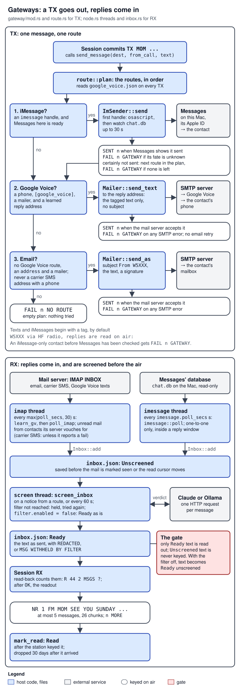
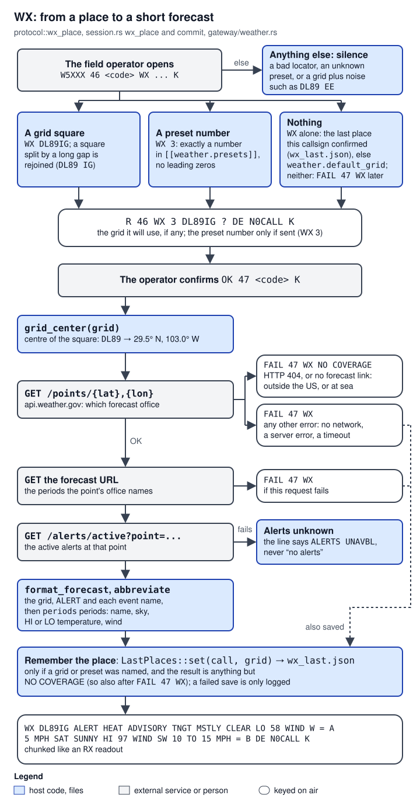

# 06 Gateways and messages

> The gateways are the parts of `hfnode` that talk to the world outside the radio. On `TX` they deliver the field operator's message to a contact by iMessage, by a text from the node's Google Voice number, or by email. Off the air, in threads of their own, they collect contacts' replies from the node's mailbox and from Messages on a Mac, have a language model screen each reply against the amateur-radio content rules (the **reply filter**), and keep the screened replies in an inbox file until the field operator asks for them with `RX`. On `WX` they turn a place into a short US National Weather Service forecast. The code lives in `crates/hfnode/src/gateway/`, plus `inbox.rs`, `places.rs` and `messages.rs`; the threads that run the inbound side are in `node.rs`. **Texting by Google Voice and by iMessage has not been tried on a real Google Voice account or a real Mac**: it is written from recalled formats and tested only against made-up copies ([docs/texting.md](../texting.md), "None of this has been tried").

Terms are explained where they first appear; the [17 Glossary](17-glossary.md) collects them. The on-air protocol (`TX`, `RX`, `WX`, read-backs, codes) is [03 Field protocol, codes and sessions](03-field-protocol-auth-session.md); the threads, the station layer and the owner alert email are [05 Node loop and station safety](05-node-loop-station-safety.md).

## Where it lives

| Path | What it holds | Lines |
|---|---|---|
| `crates/hfnode/src/gateway/mod.rs` | The module list; `LiveServices` (the real `Services`), `OfflineServices`, `RouteKind`, `Delivery`, `avail`, `imessage_state`, and the helpers `tagged`, `stamp`, `date`, `unix_now` | 303 |
| `crates/hfnode/src/gateway/route.rs` | Which route a `TX` takes: `Route`, `Avail`, `plan`, `plan_only`, `describe` | 341 |
| `crates/hfnode/src/gateway/email.rs` | SMTP `Mailer`; IMAP `poll_imap`; matching a mail to a contact (`contact_for`, the Authentication-Results parser); `accept_with`; reply cleaning; carrier SMS domains; phone reactions | 1,300 |
| `crates/hfnode/src/gateway/google_voice.rs` | Google Voice addresses, cutting Google's footer, learning reply addresses, `google_voice.json` | 791 |
| `crates/hfnode/src/gateway/imessage.rs` | Sending with `osascript`, reading Messages' database, reply windows, the read cursor, the iMessage part of `hfnode messages check` | 2,152 |
| `crates/hfnode/src/gateway/typedstream.rs` | Decoding the text out of a Messages `attributedBody` blob | 216 |
| `crates/hfnode/src/gateway/filter.rs` | The reply filter: policy prompts, the Claude and Ollama clients, verdict parsing, `apply`, the `filter test` samples | 930 |
| `crates/hfnode/src/gateway/weather.rs` | The NWS client, grid-square centres, forecast formatting and abbreviations | 345 |
| `crates/hfnode/src/inbox.rs` | `inbox.json`: inbound messages and their three states | 241 |
| `crates/hfnode/src/places.rs` | `wx_last.json`: the last place each field callsign confirmed for `WX` | 134 |
| `crates/hfnode/src/messages.rs` | `hfnode messages check` and `send`; the routes printed under the code table | 462 |
| `crates/hfnode/src/node.rs`, lines 91-365 | `open_inbox`, `screen_inbox`, `spawn_inbound` (the `imap`, `imessage` and `screen` threads), `live_services` | 1,519 in all |
| `crates/hfnode/src/session.rs`, lines 40-89 | The `Services` trait the session calls, `SendError`, `WxError` | 1,472 in all |
| `crates/hfnode/src/config.rs` | `[email]`, `[google_voice]`, `[imessage]`, `[[contacts]]`, `[weather]`, `[filter]` and their checks | 2,043 in all |
| `crates/hfnode/src/main.rs` | The `messages` and `filter` subcommands | |
| [docs/texting.md](../texting.md), [docs/reply-filter.md](../reply-filter.md), [docs/operating.md](../operating.md) | The owner's setup guides and what the field operator hears | |

## How it works

### Words used on this page

- **SMTP** is how a program hands mail to a mail server for delivery; **IMAP** is how it reads a mailbox kept on a server. The node uses one mail account (normally a Gmail account of its own) for both.
- **SPF, DKIM and DMARC** are the checks a receiving mail server makes on the sender's domain. The server writes the results into an `Authentication-Results` header at the top of the mail (RFC 8601), for example `mx.google.com; dkim=pass header.d=example.com`. The first word, `mx.google.com`, is the **authserv-id**: the name of the server that did the checking.
- **Google Voice** is Google's free US phone-number service. With "forward messages to email" on, a text to the number arrives in the Gmail account as a mail, and a mail sent back to that mail's sender address goes out as a text from the number.
- **iMessage** is Apple's messaging service; **Messages** is the Mac app for it. Messages keeps every conversation in a SQLite database, `~/Library/Messages/chat.db`. **typedstream** is the binary format of Apple's old object archiver, in which newer macOS versions often store a message's text.
- **NWS** is the US National Weather Service, whose public API is `api.weather.gov`. A **Maidenhead grid square** is the amateur-radio location code: 4 characters (`DL89`, about 110 by 190 km) or 6 (`DL89IG`, about 9 by 5 km).
- **Keyed** means transmitted in Morse code. **Part 97** is the US amateur radio rule book; 47 CFR 97.113 lists what a station must not transmit (obscenity, codes and ciphers meant to hide the meaning, advertising, and more). The licensee is responsible for everything the station transmits, including replies written by people who are not licensed.
- **Ollama** is a program that runs a language model on your own computer and answers over HTTP.
- **HF** is shortwave radio, 3 to 30 MHz, which can reach hundreds of kilometres or more; the node listens and transmits on one HF frequency.
- A **callsign** is a licensed station's identifier, for example `W5XXX`. The **field operator** is the licensed person away from home who sends requests to the node in Morse code; the **field callsign** is the callsign they send under, one of `station.field_calls`.
- **Read-back and commit**: the node repeats each request back (`R 42 TX MOM ... ?`) and acts only after the field operator answers `OK` with the next one-time code from the printed code sheet. That second step is the commit.
- A **chunk** is one lettered part of a long reply, at most 60 characters by default and at most 26 per transmission (`A` to `Z`), so the operator can ask for one part again.

The [17 Glossary](17-glossary.md) page has entries for HF, Callsign, Field operator, Read-back and Chunk.

### The three jobs and the one interface

The session ([03](03-field-protocol-auth-session.md)) reaches the outside world only through the four methods of the `Services` trait ([`crates/hfnode/src/session.rs:40-51`](https://github.com/robinonsay/cw-message-gateway/blob/44185fa9a00369c379d9d8af40ca307e3867e860/crates/hfnode/src/session.rs#L40-L51)), and only after the field operator's commit (`OK seq code`):

| Command | `Services` call | Implemented by |
|---|---|---|
| `TX MOM ...` | `send_message(dest, from_call, text)` | `LiveServices::deliver` ([`crates/hfnode/src/gateway/mod.rs:148-224`](https://github.com/robinonsay/cw-message-gateway/blob/44185fa9a00369c379d9d8af40ca307e3867e860/crates/hfnode/src/gateway/mod.rs#L148-L224)) |
| `RX` | `ready_messages()` for the read-back count and the readout; `mark_read(ids)` after the readout was keyed | the shared `Inbox` ([`crates/hfnode/src/gateway/mod.rs:232-242`](https://github.com/robinonsay/cw-message-gateway/blob/44185fa9a00369c379d9d8af40ca307e3867e860/crates/hfnode/src/gateway/mod.rs#L232-L242)) |
| `WX ...` | `weather(grid)` | `weather::Nws::forecast` ([`crates/hfnode/src/gateway/mod.rs:244-250`](https://github.com/robinonsay/cw-message-gateway/blob/44185fa9a00369c379d9d8af40ca307e3867e860/crates/hfnode/src/gateway/mod.rs#L244-L250)) |

Everything slow (polling mail, reading Messages, asking the model) happens in background threads, so `RX` never waits on a mail server or a model: it only reads `inbox.json`. `TX` and `WX` do run on the node's main thread, inside the session's commit ([Known bugs, limits and flakes](#known-bugs-limits-and-flakes) has what that means).



*Figure 1: TX tries one ordered list of routes and goes out at most once through the mail server; RX text passes the filter (unless it is turned off) before it can be read on air.*

### TX: one message, one route

When `OK` commits a `TX`, the session calls `send_message` and turns the result into `SENT n`, `FAIL n NO ROUTE` or `FAIL n GATEWAY` ([`crates/hfnode/src/session.rs:413-432`](https://github.com/robinonsay/cw-message-gateway/blob/44185fa9a00369c379d9d8af40ca307e3867e860/crates/hfnode/src/session.rs#L413-L432)). `LiveServices::deliver` ([`crates/hfnode/src/gateway/mod.rs:148-224`](https://github.com/robinonsay/cw-message-gateway/blob/44185fa9a00369c379d9d8af40ca307e3867e860/crates/hfnode/src/gateway/mod.rs#L148-L224)) first asks `route::plan` ([`crates/hfnode/src/gateway/route.rs:49-89`](https://github.com/robinonsay/cw-message-gateway/blob/44185fa9a00369c379d9d8af40ca307e3867e860/crates/hfnode/src/gateway/route.rs#L49-L89)) for the routes to that contact, in order:

1. **iMessage**, if the contact has an `imessage` handle and Messages on this Mac is ready to send. The first handle is used.
2. **Google Voice**, if the contact has a `phone`, `[google_voice]` is configured, there is a mailer, and the node has learned the contact's Google Voice reply address (which needs one text from the contact to the node's number first).
3. **Email** to `address`, only when there is no Google Voice route, and never to a carrier email-to-SMS address (such as `5551234567@vtext.com`) when `phone` is set: AT&T and T-Mobile have shut those gateways down and Verizon is shutting its down ([docs/texting.md](../texting.md), "How TX reaches a contact").

At most one of routes 2 and 3 is in any plan: both go out through the same SMTP server, and trying the other after an error could deliver the message twice ([`crates/hfnode/src/gateway/route.rs:10-12`](https://github.com/robinonsay/cw-message-gateway/blob/44185fa9a00369c379d9d8af40ca307e3867e860/crates/hfnode/src/gateway/route.rs#L10-L12)). `deliver` then walks the plan. An iMessage that Messages certainly did not send falls through to the next route; one whose fate is unknown ends the TX with `FAIL n GATEWAY`, because Messages may still send it later. Any SMTP error ends it with `FAIL n GATEWAY`. An empty plan is `FAIL n NO ROUTE`.

Every text and iMessage starts with a tag naming the field callsign and warning that replies go on the air, by default `W5XXX via HF radio, replies are read on air:` ([`crates/hfnode/src/config.rs:829-831`](https://github.com/robinonsay/cw-message-gateway/blob/44185fa9a00369c379d9d8af40ca307e3867e860/crates/hfnode/src/config.rs#L829-L831), [`crates/hfnode/src/gateway/mod.rs:52-56`](https://github.com/robinonsay/cw-message-gateway/blob/44185fa9a00369c379d9d8af40ca307e3867e860/crates/hfnode/src/gateway/mod.rs#L52-L56)). Google Voice gets the tagged text alone, with no subject or signature, because Google texts the mail body ([`crates/hfnode/src/gateway/email.rs:65-71`](https://github.com/robinonsay/cw-message-gateway/blob/44185fa9a00369c379d9d8af40ca307e3867e860/crates/hfnode/src/gateway/email.rs#L65-L71)). Email gets the subject `From W5XXX` and a two-line signature instead ([`crates/hfnode/src/gateway/email.rs:53-63`](https://github.com/robinonsay/cw-message-gateway/blob/44185fa9a00369c379d9d8af40ca307e3867e860/crates/hfnode/src/gateway/email.rs#L53-L63)).

### RX: from the mailbox and from Messages into the inbox

`spawn_inbound` starts the inbound threads when `hfnode run` starts ([`crates/hfnode/src/node.rs:154-232`](https://github.com/robinonsay/cw-message-gateway/blob/44185fa9a00369c379d9d8af40ca307e3867e860/crates/hfnode/src/node.rs#L154-L232)):

- **`imap`**, with `[email]`: every `max(email.poll_secs, 30)` seconds ([`crates/hfnode/src/node.rs:174`](https://github.com/robinonsay/cw-message-gateway/blob/44185fa9a00369c379d9d8af40ca307e3867e860/crates/hfnode/src/node.rs#L174)) it first looks for new Google Voice reply addresses (`learn_gv`, with `[google_voice]`), then fetches unread mail into the inbox (`poll_imap`) ([`crates/hfnode/src/node.rs:175-187`](https://github.com/robinonsay/cw-message-gateway/blob/44185fa9a00369c379d9d8af40ca307e3867e860/crates/hfnode/src/node.rs#L175-L187)). Only unread mail is looked at, and only mail from a contact is taken: from the contact's exact address with a pass from the node's own mail server, or, for a carrier SMS reply, from the contact's number unless that server reports a fail. Taken mail is marked read; everything else is tagged with a private IMAP keyword and left unread ([Algorithm 3](#3-matching-a-mail-to-a-contact), [Algorithm 4](#4-the-imap-poll)).
- **`imessage`**, with `[imessage]` on a Mac: it checks once that Messages can be used, then every `imessage.poll_secs` seconds reads contacts' new rows from Messages' database while it can be read, and checks Messages again every 10 minutes while it cannot be used ([`crates/hfnode/src/node.rs:191-231`](https://github.com/robinonsay/cw-message-gateway/blob/44185fa9a00369c379d9d8af40ca307e3867e860/crates/hfnode/src/node.rs#L191-L231), [`crates/hfnode/src/node.rs:234-235`](https://github.com/robinonsay/cw-message-gateway/blob/44185fa9a00369c379d9d8af40ca307e3867e860/crates/hfnode/src/node.rs#L234-L235)). It takes only one-to-one iMessages from a contact, sent inside a reply window that an iMessage `TX` to that contact opened ([Algorithm 6](#6-reading-messages-database)).
- **`screen`**: screens every unscreened message whenever a route added one, and every 60 seconds to retry those held while the filter was down ([`crates/hfnode/src/node.rs:302-341`](https://github.com/robinonsay/cw-message-gateway/blob/44185fa9a00369c379d9d8af40ca307e3867e860/crates/hfnode/src/node.rs#L302-L341)).

A message enters `inbox.json` as `Unscreened`, becomes `Ready` with its screened text, and becomes `Read` once the station has keyed the `RX` readout that carried it ([`crates/hfnode/src/inbox.rs:12-20`](https://github.com/robinonsay/cw-message-gateway/blob/44185fa9a00369c379d9d8af40ca307e3867e860/crates/hfnode/src/inbox.rs#L12-L20), [`crates/hfnode/src/node.rs:753-756`](https://github.com/robinonsay/cw-message-gateway/blob/44185fa9a00369c379d9d8af40ca307e3867e860/crates/hfnode/src/node.rs#L753-L756)). The session reads only `Ready` messages ([`crates/hfnode/src/inbox.rs:152-163`](https://github.com/robinonsay/cw-message-gateway/blob/44185fa9a00369c379d9d8af40ca307e3867e860/crates/hfnode/src/inbox.rs#L152-L163)). Text that has not passed the filter is never keyed, with one exception the owner has to choose: with `filter.enabled = false`, `screen_inbox` makes each message `Ready` with its sanitized text and asks no model ([`crates/hfnode/src/node.rs:113-114`](https://github.com/robinonsay/cw-message-gateway/blob/44185fa9a00369c379d9d8af40ca307e3867e860/crates/hfnode/src/node.rs#L113-L114)), and the node logs `inbound filter disabled: third-party text will be transmitted unscreened` ([`crates/hfnode/src/node.rs:323-327`](https://github.com/robinonsay/cw-message-gateway/blob/44185fa9a00369c379d9d8af40ca307e3867e860/crates/hfnode/src/node.rs#L323-L327)).

### Screening: the reply filter

Replies are written by people who are not licensed, and the licensee is responsible for what the node transmits. The design spec ("Inbound compliance filter") says why a model rather than a word list makes the call, and sets two constraints: redact or drop, never paraphrase, with a visible marker for every change; and an explicit threshold stated to the model so ordinary messages are not over-redacted. `filter.rs` implements exactly that ([`crates/hfnode/src/gateway/filter.rs:1-21`](https://github.com/robinonsay/cw-message-gateway/blob/44185fa9a00369c379d9d8af40ca307e3867e860/crates/hfnode/src/gateway/filter.rs#L1-L21)). The model (Claude through the Anthropic API, or a local model through Ollama) answers with a verdict: `keep`, `redact` with the exact words to remove, or `drop`. The node, not the model, applies it: each redacted span becomes the word `REDACTED`, a dropped message becomes `MSG WITHHELD BY FILTER` ([`crates/hfnode/src/gateway/filter.rs:29-32`](https://github.com/robinonsay/cw-message-gateway/blob/44185fa9a00369c379d9d8af40ca307e3867e860/crates/hfnode/src/gateway/filter.rs#L29-L32)). An answer that cannot be read as a verdict withholds the message, and a filter that cannot be reached holds it unscreened. While the filter is on, nothing unscreened is ever keyed.


*Figure 2: each white box is the text `set_screened` stores as `Ready`, which is what `RX` will key on air (the sanitized text, with `REDACTED` markers, or `MSG WITHHELD BY FILTER`); each red box leaves the message `Unscreened`, so `RX` neither counts nor keys it. The first two timeouts on a message hold it (red); the third withholds it (white).*

### WX: from a place to a short forecast

`WX` takes a grid square (`WX DL89IG`), a preset number from the config (`WX 3`), or nothing (`WX` alone: the last place this field callsign confirmed with `OK`, else `weather.default_grid`). The read-back names the grid square whenever the node has one; with no place named, no confirmed place and no `[weather]` section it has none, and the commit is `FAIL n WX` ([`crates/hfnode/src/session.rs:496-519`](https://github.com/robinonsay/cw-message-gateway/blob/44185fa9a00369c379d9d8af40ca307e3867e860/crates/hfnode/src/session.rs#L496-L519)). After `OK`, `Nws::forecast` turns the square into its centre point, asks the NWS for that point's forecast office, fetches the forecast and the active alerts, and abbreviates them into one line such as `DL89 ALERT Red Flag Warning TNGT MSTLY CLEAR LO 58 WIND W 5 MPH` ([`crates/hfnode/src/gateway/weather.rs:47-88`](https://github.com/robinonsay/cw-message-gateway/blob/44185fa9a00369c379d9d8af40ca307e3867e860/crates/hfnode/src/gateway/weather.rs#L47-L88), [`crates/hfnode/src/gateway/weather.rs:128-177`](https://github.com/robinonsay/cw-message-gateway/blob/44185fa9a00369c379d9d8af40ca307e3867e860/crates/hfnode/src/gateway/weather.rs#L128-L177)). The session keys it chunked, starting `WX` ([`crates/hfnode/src/session.rs:449-484`](https://github.com/robinonsay/cw-message-gateway/blob/44185fa9a00369c379d9d8af40ca307e3867e860/crates/hfnode/src/session.rs#L449-L484)). A point the NWS has no forecast for (outside the US, or at sea) is `FAIL n WX NO COVERAGE`; any other failure is `FAIL n WX` ([`crates/hfnode/src/session.rs:73-82`](https://github.com/robinonsay/cw-message-gateway/blob/44185fa9a00369c379d9d8af40ca307e3867e860/crates/hfnode/src/session.rs#L73-L82)).



*Figure 3: the read-back names the grid before anything is fetched; a place is remembered for `WX` alone only after `OK`, and never when the NWS has no coverage there.*

### What has and has not been tried

| Part | State at `44185fa` |
|---|---|
| Email out and in | Mail parsing, matching and authentication (`accept_with`, `contact_for`, `strip_reply`, `gv_text`, `learn_decision`) are unit-tested against fixture mails (the `email.rs` tests from [`crates/hfnode/src/gateway/email.rs:889-890`](https://github.com/robinonsay/cw-message-gateway/blob/44185fa9a00369c379d9d8af40ca307e3867e860/crates/hfnode/src/gateway/email.rs#L889-L890), and the `google_voice.rs` tests). The IMAP poll, the Google Voice mailbox scan and SMTP sending (`poll_imap`, `learn_gv`, `Mailer`) are not exercised by any test at `44185fa`. The only network test checks that the IMAP connect times out against a listener that accepts and never answers ([`crates/hfnode/src/gateway/email.rs:1277-1299`](https://github.com/robinonsay/cw-message-gateway/blob/44185fa9a00369c379d9d8af40ca307e3867e860/crates/hfnode/src/gateway/email.rs#L1277-L1299)). The owner's setup is documented. The Gmail settings (`authserv_id = "mx.google.com"`) are the owner's choice (project memory, `services-setup.md`). Not found in the code or docs: any record of an end-to-end run on the owner's account. |
| Google Voice | **Not verified on a real account.** The mail format is "recalled (not yet a real capture)" ([`crates/hfnode/src/gateway/google_voice.rs:534-536`](https://github.com/robinonsay/cw-message-gateway/blob/44185fa9a00369c379d9d8af40ca307e3867e860/crates/hfnode/src/gateway/google_voice.rs#L534-L536)); [docs/texting.md](../texting.md) lists the first-time checks. |
| iMessage | **Not verified on a real Mac.** The database layout and the AppleScript terms are recalled from other programs ([`crates/hfnode/src/gateway/imessage.rs:19-22`](https://github.com/robinonsay/cw-message-gateway/blob/44185fa9a00369c379d9d8af40ca307e3867e860/crates/hfnode/src/gateway/imessage.rs#L19-L22)); the test schema is "Recalled, not yet a dump of a real database" ([`crates/hfnode/src/gateway/imessage.rs:1492-1501`](https://github.com/robinonsay/cw-message-gateway/blob/44185fa9a00369c379d9d8af40ca307e3867e860/crates/hfnode/src/gateway/imessage.rs#L1492-L1501)). |
| Reply filter, Ollama | Tested by the owner on her Mac with `hfnode filter test` (project memory, `services-setup.md`: a 9B model passed all ten samples). [docs/reply-filter.md](../reply-filter.md) reports two 9B models at 10 of 10 without thinking and a third that let profanity through. |
| Reply filter, Claude | The request and an error answer are tested against a fake server ([`crates/hfnode/src/gateway/filter.rs:898-913`](https://github.com/robinonsay/cw-message-gateway/blob/44185fa9a00369c379d9d8af40ca307e3867e860/crates/hfnode/src/gateway/filter.rs#L898-L913)); successful, refused and cut-off answers are tested as canned JSON, with no server ([`crates/hfnode/src/gateway/filter.rs:637-656`](https://github.com/robinonsay/cw-message-gateway/blob/44185fa9a00369c379d9d8af40ca307e3867e860/crates/hfnode/src/gateway/filter.rs#L637-L656)). Not found: a record of a live run. |
| Weather | Unit-tested against a fake NWS. `api.weather.gov` is blocked from the cloud containers the project was built in (project memory, `wx-field-location.md`), so there has been no live NWS check from there; the hardware test plan covers it (step 13.4, per the same note). |

## How it connects

Figure 1 shows the TX and RX neighbours and Figure 3 the weather service; the table lists them all:

| Neighbour | Direction | What passes |
|---|---|---|
| Session ([03](03-field-protocol-auth-session.md)) | calls in | `Services::send_message`, `ready_messages`, `mark_read`, `weather` ([`crates/hfnode/src/session.rs:40-51`](https://github.com/robinonsay/cw-message-gateway/blob/44185fa9a00369c379d9d8af40ca307e3867e860/crates/hfnode/src/session.rs#L40-L51)); gets `SendError` and `WxError` back ([`crates/hfnode/src/session.rs:53-82`](https://github.com/robinonsay/cw-message-gateway/blob/44185fa9a00369c379d9d8af40ca307e3867e860/crates/hfnode/src/session.rs#L53-L82)). It also reads `LastPlaces` for `WX` alone ([`crates/hfnode/src/session.rs:500-519`](https://github.com/robinonsay/cw-message-gateway/blob/44185fa9a00369c379d9d8af40ca307e3867e860/crates/hfnode/src/session.rs#L500-L519)) and writes it after `OK` ([`crates/hfnode/src/session.rs:454-463`](https://github.com/robinonsay/cw-message-gateway/blob/44185fa9a00369c379d9d8af40ca307e3867e860/crates/hfnode/src/session.rs#L454-L463)). |
| Node loop ([05](05-node-loop-station-safety.md)) | starts and calls | `run` opens the inbox, builds the shared `ImShared` and `LiveServices`, and starts `spawn_inbound` ([`crates/hfnode/src/main.rs:1233-1247`](https://github.com/robinonsay/cw-message-gateway/blob/44185fa9a00369c379d9d8af40ca307e3867e860/crates/hfnode/src/main.rs#L1233-L1247), [`crates/hfnode/src/main.rs:1296`](https://github.com/robinonsay/cw-message-gateway/blob/44185fa9a00369c379d9d8af40ca307e3867e860/crates/hfnode/src/main.rs#L1296)); after the station keyed a readout it calls `mark_read(read_ids)` ([`crates/hfnode/src/node.rs:753-756`](https://github.com/robinonsay/cw-message-gateway/blob/44185fa9a00369c379d9d8af40ca307e3867e860/crates/hfnode/src/node.rs#L753-L756)). A reply that took more than 90 s to prepare is not keyed ([`crates/hfnode/src/node.rs:528-531`](https://github.com/robinonsay/cw-message-gateway/blob/44185fa9a00369c379d9d8af40ca307e3867e860/crates/hfnode/src/node.rs#L528-L531)). |
| `protocol` crate | used | `sanitize` makes any text sendable in Morse ([`crates/protocol/src/text.rs:5-33`](https://github.com/robinonsay/cw-message-gateway/blob/44185fa9a00369c379d9d8af40ca307e3867e860/crates/protocol/src/text.rs#L5-L33)); `is_grid` ([`crates/protocol/src/lib.rs:368-379`](https://github.com/robinonsay/cw-message-gateway/blob/44185fa9a00369c379d9d8af40ca307e3867e860/crates/protocol/src/lib.rs#L368-L379)); the `WX` place parser ([`crates/protocol/src/lib.rs:280-306`](https://github.com/robinonsay/cw-message-gateway/blob/44185fa9a00369c379d9d8af40ca307e3867e860/crates/protocol/src/lib.rs#L280-L306)). |
| `alert.rs` ([05](05-node-loop-station-safety.md)) | shares config | Builds its own SMTP sender from `[email]` (`smtp_host`, `smtp_port`, `username`, `password_env`, `from_address`) and mails `alert_to` when the node stops transmitting ([`crates/hfnode/src/alert.rs:217-245`](https://github.com/robinonsay/cw-message-gateway/blob/44185fa9a00369c379d9d8af40ca307e3867e860/crates/hfnode/src/alert.rs#L217-L245)). It does not use `Mailer`. |
| `hfnode codes` | calls | `messages::code_table_routes` prints each contact's route by kind under the code table ([`crates/hfnode/src/main.rs:589-594`](https://github.com/robinonsay/cw-message-gateway/blob/44185fa9a00369c379d9d8af40ca307e3867e860/crates/hfnode/src/main.rs#L589-L594), [`crates/hfnode/src/messages.rs:402-432`](https://github.com/robinonsay/cw-message-gateway/blob/44185fa9a00369c379d9d8af40ca307e3867e860/crates/hfnode/src/messages.rs#L402-L432)). |
| Mail server | network | SMTP out (port 465 implicit TLS, else STARTTLS), IMAP in (port 993 implicit TLS with timeouts, else STARTTLS without) ([`crates/hfnode/src/gateway/email.rs:32-46`](https://github.com/robinonsay/cw-message-gateway/blob/44185fa9a00369c379d9d8af40ca307e3867e860/crates/hfnode/src/gateway/email.rs#L32-L46), [`crates/hfnode/src/gateway/email.rs:715-735`](https://github.com/robinonsay/cw-message-gateway/blob/44185fa9a00369c379d9d8af40ca307e3867e860/crates/hfnode/src/gateway/email.rs#L715-L735)). |
| Google Voice | through the mailbox | Mail from `txt.voice.google.com` ([`crates/hfnode/src/config.rs:447-448`](https://github.com/robinonsay/cw-message-gateway/blob/44185fa9a00369c379d9d8af40ca307e3867e860/crates/hfnode/src/config.rs#L447-L448)). |
| Messages on the Mac | local | `/usr/bin/osascript` to send ([`crates/hfnode/src/gateway/imessage.rs:172-178`](https://github.com/robinonsay/cw-message-gateway/blob/44185fa9a00369c379d9d8af40ca307e3867e860/crates/hfnode/src/gateway/imessage.rs#L172-L178)); `chat.db` opened read-only ([`crates/hfnode/src/gateway/imessage.rs:314-363`](https://github.com/robinonsay/cw-message-gateway/blob/44185fa9a00369c379d9d8af40ca307e3867e860/crates/hfnode/src/gateway/imessage.rs#L314-L363)). |
| Anthropic API or Ollama | network | One HTTP request per message ([`crates/hfnode/src/gateway/filter.rs:296-334`](https://github.com/robinonsay/cw-message-gateway/blob/44185fa9a00369c379d9d8af40ca307e3867e860/crates/hfnode/src/gateway/filter.rs#L296-L334), [`crates/hfnode/src/gateway/filter.rs:419-442`](https://github.com/robinonsay/cw-message-gateway/blob/44185fa9a00369c379d9d8af40ca307e3867e860/crates/hfnode/src/gateway/filter.rs#L419-L442)). |
| `api.weather.gov` | network | Three GETs per forecast ([`crates/hfnode/src/gateway/weather.rs:47-88`](https://github.com/robinonsay/cw-message-gateway/blob/44185fa9a00369c379d9d8af40ca307e3867e860/crates/hfnode/src/gateway/weather.rs#L47-L88)). |
| `state_dir` | files | See the table below. |

### Threads

| Thread | Started by | Wakes | Work |
|---|---|---|---|
| main | `hfnode run` | each decoded over | The session's commit calls `send_message` or `weather` synchronously ([`crates/hfnode/src/node.rs:725`](https://github.com/robinonsay/cw-message-gateway/blob/44185fa9a00369c379d9d8af40ca307e3867e860/crates/hfnode/src/node.rs#L725)). |
| `imap` | `spawn_route("imap", ...)` ([`crates/hfnode/src/node.rs:172-189`](https://github.com/robinonsay/cw-message-gateway/blob/44185fa9a00369c379d9d8af40ca307e3867e860/crates/hfnode/src/node.rs#L172-L189), [`crates/hfnode/src/node.rs:277-300`](https://github.com/robinonsay/cw-message-gateway/blob/44185fa9a00369c379d9d8af40ca307e3867e860/crates/hfnode/src/node.rs#L277-L300)) | every `max(poll_secs, 30)` s | `learn_gv`, then `poll_imap`; a failure is logged and tried at the next poll. |
| `imessage` | `spawn_inbound` ([`crates/hfnode/src/node.rs:194-228`](https://github.com/robinonsay/cw-message-gateway/blob/44185fa9a00369c379d9d8af40ca307e3867e860/crates/hfnode/src/node.rs#L194-L228)) | every `imessage.poll_secs` s | `imessage::poll`; the same failure is logged at most once an hour ([`crates/hfnode/src/node.rs:260-275`](https://github.com/robinonsay/cw-message-gateway/blob/44185fa9a00369c379d9d8af40ca307e3867e860/crates/hfnode/src/node.rs#L260-L275)); `probe` again every 600 s while not ready. |
| `screen` | `start_screening` ([`crates/hfnode/src/node.rs:305-341`](https://github.com/robinonsay/cw-message-gateway/blob/44185fa9a00369c379d9d8af40ca307e3867e860/crates/hfnode/src/node.rs#L305-L341)) | on a notice from a route, or after 60 s | `screen_inbox` over every `Unscreened` message. |

All of them share one `Arc<Mutex<Inbox>>` ([`crates/hfnode/src/node.rs:91-95`](https://github.com/robinonsay/cw-message-gateway/blob/44185fa9a00369c379d9d8af40ca307e3867e860/crates/hfnode/src/node.rs#L91-L95)). `spawn_inbound` returns at once, starting nothing, when neither `[email]` nor `[imessage]` is configured ([`crates/hfnode/src/node.rs:158-160`](https://github.com/robinonsay/cw-message-gateway/blob/44185fa9a00369c379d9d8af40ca307e3867e860/crates/hfnode/src/node.rs#L158-L160)).

### Files in `state_dir`

| File | Type | Written by | Notes |
|---|---|---|---|
| `inbox.json` | `inbox::File` (`next_id`, `messages`) ([`crates/hfnode/src/inbox.rs:37-41`](https://github.com/robinonsay/cw-message-gateway/blob/44185fa9a00369c379d9d8af40ca307e3867e860/crates/hfnode/src/inbox.rs#L37-L41)) | `Inbox::add`, `set_screened`, `mark_read`, in `hfnode run` and in `hfnode sim` | No lock: each process rewrites the whole file from its own copy ([Algorithm 11](#11-locks-and-atomic-files)). Rewritten whole on every change ([`crates/hfnode/src/inbox.rs:75-92`](https://github.com/robinonsay/cw-message-gateway/blob/44185fa9a00369c379d9d8af40ca307e3867e860/crates/hfnode/src/inbox.rs#L75-L92)). A file that does not parse makes `Inbox::open` fail ([`crates/hfnode/src/inbox.rs:54-64`](https://github.com/robinonsay/cw-message-gateway/blob/44185fa9a00369c379d9d8af40ca307e3867e860/crates/hfnode/src/inbox.rs#L54-L64)), and `run` does not start ([`crates/hfnode/src/main.rs:1234`](https://github.com/robinonsay/cw-message-gateway/blob/44185fa9a00369c379d9d8af40ca307e3867e860/crates/hfnode/src/main.rs#L1234)). |
| `google_voice.json` | `GvStore` ([`crates/hfnode/src/gateway/google_voice.rs:230-247`](https://github.com/robinonsay/cw-message-gateway/blob/44185fa9a00369c379d9d8af40ca307e3867e860/crates/hfnode/src/gateway/google_voice.rs#L230-L247)) | `learn_gv`, `record_sent` | Unreadable reads as empty and is logged ([`crates/hfnode/src/gateway/google_voice.rs:260-275`](https://github.com/robinonsay/cw-message-gateway/blob/44185fa9a00369c379d9d8af40ca307e3867e860/crates/hfnode/src/gateway/google_voice.rs#L260-L275)). |
| `google_voice.lock` | lock file | `GvStore::save_merge` | Held while the file above is merged and written ([`crates/hfnode/src/gateway/google_voice.rs:323-335`](https://github.com/robinonsay/cw-message-gateway/blob/44185fa9a00369c379d9d8af40ca307e3867e860/crates/hfnode/src/gateway/google_voice.rs#L323-L335)). |
| `imessage.json` | `Cursor` ([`crates/hfnode/src/gateway/imessage.rs:884-901`](https://github.com/robinonsay/cw-message-gateway/blob/44185fa9a00369c379d9d8af40ca307e3867e860/crates/hfnode/src/gateway/imessage.rs#L884-L901)) | `imessage::poll` | One Mac's database position; a file that does not parse fails every poll ([`crates/hfnode/src/gateway/imessage.rs:903-914`](https://github.com/robinonsay/cw-message-gateway/blob/44185fa9a00369c379d9d8af40ca307e3867e860/crates/hfnode/src/gateway/imessage.rs#L903-L914)). |
| `imessage_windows.json` | `Windows` ([`crates/hfnode/src/gateway/imessage.rs:775-786`](https://github.com/robinonsay/cw-message-gateway/blob/44185fa9a00369c379d9d8af40ca307e3867e860/crates/hfnode/src/gateway/imessage.rs#L775-L786)) | `ImSender::send` | Reply windows and the last 50 sends. |
| `imessage_windows.lock` | lock file | `update_windows` ([`crates/hfnode/src/gateway/imessage.rs:822-832`](https://github.com/robinonsay/cw-message-gateway/blob/44185fa9a00369c379d9d8af40ca307e3867e860/crates/hfnode/src/gateway/imessage.rs#L822-L832)) | |
| `wx_last.json` | `{callsign: grid}` | `LastPlaces::set` | A bad file or a non-grid entry is ignored, never fatal ([`crates/hfnode/src/places.rs:24-49`](https://github.com/robinonsay/cw-message-gateway/blob/44185fa9a00369c379d9d8af40ca307e3867e860/crates/hfnode/src/places.rs#L24-L49)). |
| `*.tmp` | | each writer | The new contents, written and synced, then renamed over the old file and the directory synced (`auth::replace_file`, [`crates/auth/src/store.rs:56-65`](https://github.com/robinonsay/cw-message-gateway/blob/44185fa9a00369c379d9d8af40ca307e3867e860/crates/auth/src/store.rs#L56-L65)), so a power cut leaves the old file or the new one. |

## Interfaces and APIs

### `Services` and its errors (`session.rs`)

| Item | Signature | Contract |
|---|---|---|
| `Services` | `pub trait Services` ([`crates/hfnode/src/session.rs:41-51`](https://github.com/robinonsay/cw-message-gateway/blob/44185fa9a00369c379d9d8af40ca307e3867e860/crates/hfnode/src/session.rs#L41-L51)) | What the session needs from outside. Implemented by `LiveServices`, `OfflineServices`, the self-test's `FakeServices` ([`crates/hfnode/src/selftest.rs:536`](https://github.com/robinonsay/cw-message-gateway/blob/44185fa9a00369c379d9d8af40ca307e3867e860/crates/hfnode/src/selftest.rs#L536)), and the test fakes in the session tests ([`crates/hfnode/src/session.rs:727`](https://github.com/robinonsay/cw-message-gateway/blob/44185fa9a00369c379d9d8af40ca307e3867e860/crates/hfnode/src/session.rs#L727)), the node loop tests ([`crates/hfnode/src/node.rs:789`](https://github.com/robinonsay/cw-message-gateway/blob/44185fa9a00369c379d9d8af40ca307e3867e860/crates/hfnode/src/node.rs#L789)) and the end-to-end test ([`crates/hfnode/tests/end_to_end.rs:21`](https://github.com/robinonsay/cw-message-gateway/blob/44185fa9a00369c379d9d8af40ca307e3867e860/crates/hfnode/tests/end_to_end.rs#L21)). |
| `send_message` | `fn send_message(&mut self, dest: &str, from_call: &str, text: &str) -> Result<(), SendError>` | `dest` is a contact name from the config; `from_call` the field callsign that opened the transaction; `text` the decoded message. |
| `ready_messages` | `fn ready_messages(&mut self) -> Vec<Message>` | Screened, unread messages, oldest first. |
| `mark_read` | `fn mark_read(&mut self, ids: &[u64])` | Called only after the transmission carrying them was keyed. |
| `weather` | `fn weather(&mut self, grid: &str) -> Result<String, WxError>` | `grid` is a 4- or 6-character square; the result is the forecast line without the leading `WX`. |
| `SendError::NoRoute(String)` | ([`crates/hfnode/src/session.rs:56-59`](https://github.com/robinonsay/cw-message-gateway/blob/44185fa9a00369c379d9d8af40ca307e3867e860/crates/hfnode/src/session.rs#L56-L59)) | Nothing on this node can reach the contact now. Keyed `FAIL <seq> NO ROUTE`. |
| `SendError::Gateway(String)` | ([`crates/hfnode/src/session.rs:60-62`](https://github.com/robinonsay/cw-message-gateway/blob/44185fa9a00369c379d9d8af40ca307e3867e860/crates/hfnode/src/session.rs#L60-L62)) | A route was tried and failed, or its outcome is unknown. Keyed `FAIL <seq> GATEWAY`. |
| `WxError::NoCoverage` | ([`crates/hfnode/src/session.rs:76-78`](https://github.com/robinonsay/cw-message-gateway/blob/44185fa9a00369c379d9d8af40ca307e3867e860/crates/hfnode/src/session.rs#L76-L78)) | The NWS has nothing for that place. Keyed `FAIL <seq> WX NO COVERAGE`. |
| `WxError::Unavailable(String)` | ([`crates/hfnode/src/session.rs:79-81`](https://github.com/robinonsay/cw-message-gateway/blob/44185fa9a00369c379d9d8af40ca307e3867e860/crates/hfnode/src/session.rs#L79-L81)) | Anything else. Keyed `FAIL <seq> WX`. |

The `String` in each error goes to the log only, never on the air ([`crates/hfnode/src/session.rs:413-432`](https://github.com/robinonsay/cw-message-gateway/blob/44185fa9a00369c379d9d8af40ca307e3867e860/crates/hfnode/src/session.rs#L413-L432), [`crates/hfnode/src/session.rs:466-481`](https://github.com/robinonsay/cw-message-gateway/blob/44185fa9a00369c379d9d8af40ca307e3867e860/crates/hfnode/src/session.rs#L466-L481)).

### `gateway/mod.rs`

| Item | Signature | Contract |
|---|---|---|
| `unix_now` | `pub fn unix_now() -> u64` ([`crates/hfnode/src/gateway/mod.rs:21-26`](https://github.com/robinonsay/cw-message-gateway/blob/44185fa9a00369c379d9d8af40ca307e3867e860/crates/hfnode/src/gateway/mod.rs#L21-L26)) | Seconds since 1970; 0 if the clock is before 1970. |
| `stamp` | `pub fn stamp(source: Option<i64>, now: u64) -> u64` ([`crates/hfnode/src/gateway/mod.rs:28-35`](https://github.com/robinonsay/cw-message-gateway/blob/44185fa9a00369c379d9d8af40ca307e3867e860/crates/hfnode/src/gateway/mod.rs#L28-L35)) | The time a message was received, for the inbox: the source's own time (IMAP arrival, Messages' date) if positive, never later than `now`. |
| `date` | `pub fn date(unix: u64) -> String` ([`crates/hfnode/src/gateway/mod.rs:37-50`](https://github.com/robinonsay/cw-message-gateway/blob/44185fa9a00369c379d9d8af40ca307e3867e860/crates/hfnode/src/gateway/mod.rs#L37-L50)) | UTC date `YYYY-MM-DD` (Howard Hinnant's days-to-civil algorithm). |
| `tagged` | `pub fn tagged(tag: &str, call: &str, text: &str) -> String` ([`crates/hfnode/src/gateway/mod.rs:52-56`](https://github.com/robinonsay/cw-message-gateway/blob/44185fa9a00369c379d9d8af40ca307e3867e860/crates/hfnode/src/gateway/mod.rs#L52-L56)) | `tag` with every `{call}` replaced by `call`, a space, then `text`. |
| `RouteKind` | `pub enum RouteKind { IMessage, GoogleVoice, Email }` ([`crates/hfnode/src/gateway/mod.rs:58-64`](https://github.com/robinonsay/cw-message-gateway/blob/44185fa9a00369c379d9d8af40ca307e3867e860/crates/hfnode/src/gateway/mod.rs#L58-L64)) | For `hfnode messages send --via`. |
| `Delivery` | `pub struct Delivery { pub route: Route, pub detail: String }` ([`crates/hfnode/src/gateway/mod.rs:76-82`](https://github.com/robinonsay/cw-message-gateway/blob/44185fa9a00369c379d9d8af40ca307e3867e860/crates/hfnode/src/gateway/mod.rs#L76-L82)) | How a message went out; `detail` is Messages' record for iMessage, empty otherwise. |
| `LiveServices` | `pub struct LiveServices { pub cfg: Config, pub inbox: Arc<Mutex<Inbox>>, pub mailer: Option<email::Mailer>, pub weather: Option<weather::Nws>, pub imessage: Option<ImSender> }` ([`crates/hfnode/src/gateway/mod.rs:84-93`](https://github.com/robinonsay/cw-message-gateway/blob/44185fa9a00369c379d9d8af40ca307e3867e860/crates/hfnode/src/gateway/mod.rs#L84-L93)) | Built by `node::live_services` ([`crates/hfnode/src/node.rs:343-365`](https://github.com/robinonsay/cw-message-gateway/blob/44185fa9a00369c379d9d8af40ca307e3867e860/crates/hfnode/src/node.rs#L343-L365)): a `Mailer` with `[email]`, an `Nws` with `[weather]`, an `ImSender` with `[imessage]` and a shared `ImShared`. |
| `imessage_state` | `pub fn imessage_state(cfg: &Config, shared: Option<&ImShared>) -> Result<(), String>` ([`crates/hfnode/src/gateway/mod.rs:95-102`](https://github.com/robinonsay/cw-message-gateway/blob/44185fa9a00369c379d9d8af40ca307e3867e860/crates/hfnode/src/gateway/mod.rs#L95-L102)) | `Ok` only when `[imessage]` is set and Messages reported ready; else the reason. |
| `avail` | `pub fn avail<'a>(cfg: &'a Config, mailer: bool, imessage: &'a Result<(), String>) -> Avail<'a>` ([`crates/hfnode/src/gateway/mod.rs:104-115`](https://github.com/robinonsay/cw-message-gateway/blob/44185fa9a00369c379d9d8af40ca307e3867e860/crates/hfnode/src/gateway/mod.rs#L104-L115)) | What can send now; `gv_number` is set only with `[google_voice]` and a mailer. |
| `LiveServices::plan` | `pub fn plan(&self, dest: &str, only: Option<RouteKind>) -> Result<Vec<Route>, SendError>` ([`crates/hfnode/src/gateway/mod.rs:122-146`](https://github.com/robinonsay/cw-message-gateway/blob/44185fa9a00369c379d9d8af40ca307e3867e860/crates/hfnode/src/gateway/mod.rs#L122-L146)) | Reads `google_voice.json` on every call. If the plan is empty and the contact has an iMessage handle while Messages has not been checked yet (the first seconds after start-up), returns `Gateway("Messages is still being checked: ...")` rather than `NoRoute`, so the operator tries again ([`crates/hfnode/src/gateway/mod.rs:132-145`](https://github.com/robinonsay/cw-message-gateway/blob/44185fa9a00369c379d9d8af40ca307e3867e860/crates/hfnode/src/gateway/mod.rs#L132-L145)). |
| `LiveServices::deliver` | `pub fn deliver(&mut self, dest: &str, from_call: &str, text: &str, only: Option<RouteKind>) -> Result<Delivery, SendError>` ([`crates/hfnode/src/gateway/mod.rs:148-224`](https://github.com/robinonsay/cw-message-gateway/blob/44185fa9a00369c379d9d8af40ca307e3867e860/crates/hfnode/src/gateway/mod.rs#L148-L224)) | Tries the plan in order ([Algorithm 1](#1-planning-and-delivering-a-tx)). Records the send time in `google_voice.json` after a Google Voice send ([`crates/hfnode/src/gateway/mod.rs:203-205`](https://github.com/robinonsay/cw-message-gateway/blob/44185fa9a00369c379d9d8af40ca307e3867e860/crates/hfnode/src/gateway/mod.rs#L203-L205)). |
| `impl Services for LiveServices` | ([`crates/hfnode/src/gateway/mod.rs:227-251`](https://github.com/robinonsay/cw-message-gateway/blob/44185fa9a00369c379d9d8af40ca307e3867e860/crates/hfnode/src/gateway/mod.rs#L227-L251)) | `send_message` is `deliver(.., None)`; `ready_messages` and `mark_read` lock the inbox (a failed save is logged); `weather` is `Unavailable("weather is not configured")` without `[weather]`. |
| `OfflineServices` | `pub struct OfflineServices { pub inbox: Arc<Mutex<Inbox>> }` ([`crates/hfnode/src/gateway/mod.rs:253-278`](https://github.com/robinonsay/cw-message-gateway/blob/44185fa9a00369c379d9d8af40ca307e3867e860/crates/hfnode/src/gateway/mod.rs#L253-L278)) | For `hfnode sim --offline`: prints instead of sending; weather is a canned `"{grid} TDA SUNNY HI 95 WIND W 10 TNGT CLEAR LO 60"`. |

### `node.rs`: starting the inbound side

These are what `run` calls to wire the gateways up ([05](05-node-loop-station-safety.md) covers the rest of `node.rs`), and what a new inbound route or a reuse of the pipeline calls.

| Item | Signature | Contract |
|---|---|---|
| `open_inbox` | `pub fn open_inbox(cfg: &Config) -> Result<Arc<Mutex<Inbox>>>` ([`crates/hfnode/src/node.rs:91-95`](https://github.com/robinonsay/cw-message-gateway/blob/44185fa9a00369c379d9d8af40ca307e3867e860/crates/hfnode/src/node.rs#L91-L95)) | Opens `state_dir/inbox.json` with `Inbox::open`; a file that does not parse is an error. |
| `screen_inbox` | `pub fn screen_inbox(cfg: &Config, inbox: &Arc<Mutex<Inbox>>, filter: Option<&filter::Screener>, timeouts: &mut HashMap<u64, u32>)` ([`crates/hfnode/src/node.rs:101-152`](https://github.com/robinonsay/cw-message-gateway/blob/44185fa9a00369c379d9d8af40ca307e3867e860/crates/hfnode/src/node.rs#L101-L152)) | Screens every `Unscreened` message once ([Algorithm 8](#8-screening-a-message)). `filter = None` with the filter enabled holds them all. `timeouts` counts timeouts per message id and must live as long as the caller's loop. Only the `screen` thread calls it. |
| `spawn_inbound` | `pub fn spawn_inbound(cfg: Config, inbox: Arc<Mutex<Inbox>>, im: Option<Arc<ImShared>>)` ([`crates/hfnode/src/node.rs:154-232`](https://github.com/robinonsay/cw-message-gateway/blob/44185fa9a00369c379d9d8af40ca307e3867e860/crates/hfnode/src/node.rs#L154-L232)) | Returns at once. Does nothing without `[email]` and `[imessage]`. Otherwise logs every `Config::warnings` line, starts the `screen` thread, the `imap` thread with `[email]`, and the `imessage` thread with `[imessage]` and `im = Some`. With `[imessage]` but `im = None` it only logs the routes ([`crates/hfnode/src/node.rs:229-231`](https://github.com/robinonsay/cw-message-gateway/blob/44185fa9a00369c379d9d8af40ca307e3867e860/crates/hfnode/src/node.rs#L229-L231)). The threads never stop. |
| `live_services` | `pub fn live_services(cfg: &Config, inbox: Arc<Mutex<Inbox>>, im: Option<Arc<ImShared>>) -> Result<LiveServices>` ([`crates/hfnode/src/node.rs:343-365`](https://github.com/robinonsay/cw-message-gateway/blob/44185fa9a00369c379d9d8af40ca307e3867e860/crates/hfnode/src/node.rs#L343-L365)) | `Err` when `Mailer::new` fails: the variable `email.password_env` names is not set, `email.from_address` does not parse, or the SMTP relay cannot be set up ([`crates/hfnode/src/gateway/email.rs:33-46`](https://github.com/robinonsay/cw-message-gateway/blob/44185fa9a00369c379d9d8af40ca307e3867e860/crates/hfnode/src/gateway/email.rs#L33-L46)). The mailer's field callsign is the first of `station.field_calls`. |
| `MAX_FILTER_TIMEOUTS` | private `const`, 3 ([`crates/hfnode/src/node.rs:97-99`](https://github.com/robinonsay/cw-message-gateway/blob/44185fa9a00369c379d9d8af40ca307e3867e860/crates/hfnode/src/node.rs#L97-L99)) | The third timeout on one message withholds it. |
| `REPROBE` | private `const`, 600 s ([`crates/hfnode/src/node.rs:234-235`](https://github.com/robinonsay/cw-message-gateway/blob/44185fa9a00369c379d9d8af40ca307e3867e860/crates/hfnode/src/node.rs#L234-L235)) | How often the `imessage` thread probes Messages again while it cannot be used. |

### `gateway/route.rs`

| Item | Signature | Contract |
|---|---|---|
| `Route` | `pub enum Route { IMessage(Handle), GoogleVoice(String), Email(String) }` ([`crates/hfnode/src/gateway/route.rs:19-25`](https://github.com/robinonsay/cw-message-gateway/blob/44185fa9a00369c379d9d8af40ca307e3867e860/crates/hfnode/src/gateway/route.rs#L19-L25)) | `GoogleVoice` holds the contact's learned reply address. |
| `Route::kind` | `pub fn kind(&self) -> &'static str` ([`crates/hfnode/src/gateway/route.rs:27-35`](https://github.com/robinonsay/cw-message-gateway/blob/44185fa9a00369c379d9d8af40ca307e3867e860/crates/hfnode/src/gateway/route.rs#L27-L35)) | `"iMessage"`, `"Google Voice"`, `"email"`. |
| `Avail<'a>` | `pub struct Avail<'a> { pub imessage: Result<(), &'a str>, pub gv_number: Option<&'a Phone>, pub email: bool }` ([`crates/hfnode/src/gateway/route.rs:37-47`](https://github.com/robinonsay/cw-message-gateway/blob/44185fa9a00369c379d9d8af40ca307e3867e860/crates/hfnode/src/gateway/route.rs#L37-L47)) | What the node can send through now. |
| `plan` | `pub fn plan(c: &Contact, a: &Avail, gv: &GvStore) -> Result<Vec<Route>, String>` ([`crates/hfnode/src/gateway/route.rs:49-89`](https://github.com/robinonsay/cw-message-gateway/blob/44185fa9a00369c379d9d8af40ca307e3867e860/crates/hfnode/src/gateway/route.rs#L49-L89)) | The ordered routes, or every reason there is none joined with `"; "`. Never more than one non-iMessage route. |
| `plan_only` | `pub fn plan_only(c: &Contact, a: Avail, gv: &GvStore, only: Option<RouteKind>) -> Result<Vec<Route>, String>` ([`crates/hfnode/src/gateway/route.rs:91-115`](https://github.com/robinonsay/cw-message-gateway/blob/44185fa9a00369c379d9d8af40ca307e3867e860/crates/hfnode/src/gateway/route.rs#L91-L115)) | `plan`, keeping only routes of kind `only`. Asked for `Email`, it plans as if Google Voice were absent, so a contact normally texted can still be emailed by name. |
| `describe` | `pub fn describe(c: &Contact, a: &Avail, gv: &GvStore) -> String` ([`crates/hfnode/src/gateway/route.rs:117-140`](https://github.com/robinonsay/cw-message-gateway/blob/44185fa9a00369c379d9d8af40ca307e3867e860/crates/hfnode/src/gateway/route.rs#L117-L140)) | One line, e.g. `iMessage +15551234567, then Google Voice (learned 2026-09-21)` or `NO ROUTE: ...`; used in the start-up log ([`crates/hfnode/src/node.rs:245-258`](https://github.com/robinonsay/cw-message-gateway/blob/44185fa9a00369c379d9d8af40ca307e3867e860/crates/hfnode/src/node.rs#L245-L258)) and by `messages check`. |

### `gateway/email.rs`

Sending:

| Item | Signature | Contract |
|---|---|---|
| `Mailer` | `pub struct Mailer` ([`crates/hfnode/src/gateway/email.rs:26-30`](https://github.com/robinonsay/cw-message-gateway/blob/44185fa9a00369c379d9d8af40ca307e3867e860/crates/hfnode/src/gateway/email.rs#L26-L30)) | One SMTP transport, the `From` mailbox and the first field callsign. |
| `Mailer::new` | `pub fn new(cfg: &Email, field_call: &str) -> Result<Self>` ([`crates/hfnode/src/gateway/email.rs:32-46`](https://github.com/robinonsay/cw-message-gateway/blob/44185fa9a00369c379d9d8af40ca307e3867e860/crates/hfnode/src/gateway/email.rs#L32-L46)) | Port 465 is implicit TLS, any other STARTTLS. The password comes from the environment variable named by `password_env`; an unset variable is an error, and `run` stops ([`crates/hfnode/src/gateway/email.rs:21-24`](https://github.com/robinonsay/cw-message-gateway/blob/44185fa9a00369c379d9d8af40ca307e3867e860/crates/hfnode/src/gateway/email.rs#L21-L24), [`crates/hfnode/src/node.rs:349-352`](https://github.com/robinonsay/cw-message-gateway/blob/44185fa9a00369c379d9d8af40ca307e3867e860/crates/hfnode/src/node.rs#L349-L352)). No SMTP timeout is set here, so the `lettre` crate's default applies (60 s, according to the comment on `alert.rs`'s own `SMTP_TIMEOUT`, [`crates/hfnode/src/alert.rs:30-31`](https://github.com/robinonsay/cw-message-gateway/blob/44185fa9a00369c379d9d8af40ca307e3867e860/crates/hfnode/src/alert.rs#L30-L31)). |
| `Mailer::send` | `pub fn send(&self, to: &str, text: &str) -> Result<()>` ([`crates/hfnode/src/gateway/email.rs:48-51`](https://github.com/robinonsay/cw-message-gateway/blob/44185fa9a00369c379d9d8af40ca307e3867e860/crates/hfnode/src/gateway/email.rs#L48-L51)) | `send_as` with the first field callsign. |
| `Mailer::send_as` | `pub fn send_as(&self, to: &str, text: &str, call: &str) -> Result<()>` ([`crates/hfnode/src/gateway/email.rs:53-63`](https://github.com/robinonsay/cw-message-gateway/blob/44185fa9a00369c379d9d8af40ca307e3867e860/crates/hfnode/src/gateway/email.rs#L53-L63)) | Subject `From <call>`, body `text`, a blank line, `-- `, and `Sent by <call> over HF radio. Reply to this message; keep it short and plain.` Plain text. |
| `Mailer::send_text` | `pub fn send_text(&self, to: &str, text: &str) -> Result<()>` ([`crates/hfnode/src/gateway/email.rs:65-71`](https://github.com/robinonsay/cw-message-gateway/blob/44185fa9a00369c379d9d8af40ca307e3867e860/crates/hfnode/src/gateway/email.rs#L65-L71)) | No subject, no signature: for Google Voice. Logs nothing and keeps the address out of its errors, since a Google Voice reply address holds the conversation's token. |

Receiving and matching:

| Item | Signature | Contract |
|---|---|---|
| `SMS_GATEWAYS` | `pub const SMS_GATEWAYS: &[&[&str]]` ([`crates/hfnode/src/gateway/email.rs:84-105`](https://github.com/robinonsay/cw-message-gateway/blob/44185fa9a00369c379d9d8af40ca307e3867e860/crates/hfnode/src/gateway/email.rs#L84-L105)) | Carrier email-to-SMS domains, one group per carrier network (Verizon, AT&T, T-Mobile and Sprint, Google Fi, US Cellular, Cricket, Boost, Consumer Cellular). |
| `is_carrier_address` | `pub fn is_carrier_address(address: &str) -> bool` ([`crates/hfnode/src/gateway/email.rs:112-117`](https://github.com/robinonsay/cw-message-gateway/blob/44185fa9a00369c379d9d8af40ca307e3867e860/crates/hfnode/src/gateway/email.rs#L112-L117)) | The domain is in `SMS_GATEWAYS`. |
| `us_number` | `pub(crate) fn us_number(local: &str) -> Option<&str>` ([`crates/hfnode/src/gateway/email.rs:126-135`](https://github.com/robinonsay/cw-message-gateway/blob/44185fa9a00369c379d9d8af40ca307e3867e860/crates/hfnode/src/gateway/email.rs#L126-L135)) | Exactly 10 digits, optionally after `1` or `+1`. |
| `carrier_number` | `pub(crate) fn carrier_number(address: &str) -> Option<&str>` ([`crates/hfnode/src/gateway/email.rs:119-124`](https://github.com/robinonsay/cw-message-gateway/blob/44185fa9a00369c379d9d8af40ca307e3867e860/crates/hfnode/src/gateway/email.rs#L119-L124)) | The 10-digit number of a carrier email-to-SMS address (domain in `SMS_GATEWAYS`, local part per `us_number`); used by `Contact::keys` so a number belongs to one contact only. |
| `contact_for` | `pub fn contact_for<'c>(contacts: &'c [Contact], from_addr: &str, auth_results: &[&str], authserv_id: Option<&str>) -> Option<&'c Contact>` ([`crates/hfnode/src/gateway/email.rs:137-180`](https://github.com/robinonsay/cw-message-gateway/blob/44185fa9a00369c379d9d8af40ca307e3867e860/crates/hfnode/src/gateway/email.rs#L137-L180)) | Which contact sent a mail ([Algorithm 3](#3-matching-a-mail-to-a-contact)). |
| `authenticated` | `pub fn authenticated(auth_results: &[&str], from_addr: &str, authserv_id: Option<&str>) -> bool` ([`crates/hfnode/src/gateway/email.rs:182-197`](https://github.com/robinonsay/cw-message-gateway/blob/44185fa9a00369c379d9d8af40ca307e3867e860/crates/hfnode/src/gateway/email.rs#L182-L197)) | The believed header has `dkim=pass` or `spf=pass` for a domain aligned with the From domain. |
| `dkim_authenticated` | `pub(crate) fn dkim_authenticated(...) -> bool` ([`crates/hfnode/src/gateway/email.rs:199-208`](https://github.com/robinonsay/cw-message-gateway/blob/44185fa9a00369c379d9d8af40ca307e3867e860/crates/hfnode/src/gateway/email.rs#L199-L208)) | The same with DKIM only: used for Google Voice. |
| `failed` | `pub fn failed(auth_results: &[&str], from_addr: &str, authserv_id: Option<&str>) -> bool` ([`crates/hfnode/src/gateway/email.rs:231-245`](https://github.com/robinonsay/cw-message-gateway/blob/44185fa9a00369c379d9d8af40ca307e3867e860/crates/hfnode/src/gateway/email.rs#L231-L245)) | The believed header has an SPF, DKIM or DMARC `fail` for an aligned domain. |
| `strip_reply` | `pub fn strip_reply(body: &str) -> String` ([`crates/hfnode/src/gateway/email.rs:393-415`](https://github.com/robinonsay/cw-message-gateway/blob/44185fa9a00369c379d9d8af40ca307e3867e860/crates/hfnode/src/gateway/email.rs#L393-L415)) | Keeps the lines before the first quoted line, `On ... wrote:`, `-----Original Message`, `From:`, `--`, `Sent from my` or `Get Outlook for` line, joined with single spaces. |
| `IGNORED_KEYWORD` | `pub const IGNORED_KEYWORD: &str = "$HfnodeIgnored"` ([`crates/hfnode/src/gateway/email.rs:417-421`](https://github.com/robinonsay/cw-message-gateway/blob/44185fa9a00369c379d9d8af40ca307e3867e860/crates/hfnode/src/gateway/email.rs#L417-L421)) | IMAP keyword set on mail the node did not take. |
| `Via` | `pub enum Via { Email, Carrier, GoogleVoice }` ([`crates/hfnode/src/gateway/email.rs:430-437`](https://github.com/robinonsay/cw-message-gateway/blob/44185fa9a00369c379d9d8af40ca307e3867e860/crates/hfnode/src/gateway/email.rs#L430-L437)) | How a taken message arrived. |
| `Accepted<'c>` | `{ contact, source_id: String, text: String, via: Via }` ([`crates/hfnode/src/gateway/email.rs:439-446`](https://github.com/robinonsay/cw-message-gateway/blob/44185fa9a00369c379d9d8af40ca307e3867e860/crates/hfnode/src/gateway/email.rs#L439-L446)) | `source_id` is the `Message-ID`, else `uid:<n>`. |
| `Rejected<'c>` | `{ why: String, warn: bool, notice: Option<&'c Contact>, source_id: Option<String> }` ([`crates/hfnode/src/gateway/email.rs:448-459`](https://github.com/robinonsay/cw-message-gateway/blob/44185fa9a00369c379d9d8af40ca307e3867e860/crates/hfnode/src/gateway/email.rs#L448-L459)) | `warn` marks a likely setup problem; `notice` names a contact whose text could not be read and who gets a notice instead. |
| `accept` | `pub fn accept<'c>(raw: &[u8], uid: u32, contacts: &'c [Contact], authserv_id: Option<&str>) -> Result<Accepted<'c>, String>` ([`crates/hfnode/src/gateway/email.rs:479-487`](https://github.com/robinonsay/cw-message-gateway/blob/44185fa9a00369c379d9d8af40ca307e3867e860/crates/hfnode/src/gateway/email.rs#L479-L487)) | `accept_with` without Google Voice. |
| `accept_with` | `pub fn accept_with<'c>(raw: &[u8], uid: u32, contacts: &'c [Contact], authserv_id: Option<&str>, gv: Option<&Phone>) -> Result<Accepted<'c>, Rejected<'c>>` ([`crates/hfnode/src/gateway/email.rs:489-585`](https://github.com/robinonsay/cw-message-gateway/blob/44185fa9a00369c379d9d8af40ca307e3867e860/crates/hfnode/src/gateway/email.rs#L489-L585)) | Decides whether one fetched mail goes in the inbox ([Algorithm 4](#4-the-imap-poll)). |
| `auth_headers`, `from_address`, `auth_summary` | ([`crates/hfnode/src/gateway/email.rs:587-635`](https://github.com/robinonsay/cw-message-gateway/blob/44185fa9a00369c379d9d8af40ca307e3867e860/crates/hfnode/src/gateway/email.rs#L587-L635)) | The Authentication-Results values topmost first; the From address as written; a one-line DKIM summary for `messages check`. |
| `Reaction`, `sms_reaction` | `pub enum Reaction { Said(&'static str), Removed }`; `pub fn sms_reaction(text: &str) -> Option<Reaction>` ([`crates/hfnode/src/gateway/email.rs:654-698`](https://github.com/robinonsay/cw-message-gateway/blob/44185fa9a00369c379d9d8af40ca307e3867e860/crates/hfnode/src/gateway/email.rs#L654-L698)) | Recognises a phone's reaction sent as a text ([Algorithm 5](#5-google-voice-texts-and-reply-addresses)). |
| `connect_imap` | `pub(crate) fn connect_imap(cfg: &Email) -> Result<imap::Session<imap::Connection>>` ([`crates/hfnode/src/gateway/email.rs:715-735`](https://github.com/robinonsay/cw-message-gateway/blob/44185fa9a00369c379d9d8af40ca307e3867e860/crates/hfnode/src/gateway/email.rs#L715-L735)) | Port 993: implicit TLS with the system's root certificates, 30 s connect and 60 s read and write timeouts ([`crates/hfnode/src/gateway/email.rs:710-713`](https://github.com/robinonsay/cw-message-gateway/blob/44185fa9a00369c379d9d8af40ca307e3867e860/crates/hfnode/src/gateway/email.rs#L710-L713)). Other ports: the `imap` crate's STARTTLS, with no timeouts. |
| `connect_tls` | `pub(crate) fn connect_tls(host: &str, addrs: impl ToSocketAddrs, connect: Duration, io: Duration) -> Result<imap::Client<imap::Connection>>` ([`crates/hfnode/src/gateway/email.rs:737-771`](https://github.com/robinonsay/cw-message-gateway/blob/44185fa9a00369c379d9d8af40ca307e3867e860/crates/hfnode/src/gateway/email.rs#L737-L771)) | Tries each address with `connect` as the TCP connect timeout, sets `io` as the socket's read and write timeouts, then TLS (system roots, through `rustls`) and the IMAP greeting. The one network test calls it. |
| `poll_imap` | `pub fn poll_imap(cfg: &Email, contacts: &[Contact], inbox: &Arc<Mutex<Inbox>>, retry_ignored: bool, gv: Option<&Phone>) -> Result<usize>` ([`crates/hfnode/src/gateway/email.rs:790-883`](https://github.com/robinonsay/cw-message-gateway/blob/44185fa9a00369c379d9d8af40ca307e3867e860/crates/hfnode/src/gateway/email.rs#L790-L883)) | Fetches unseen mail into the inbox; returns how many were added. |
| `UNREADABLE` | `pub const UNREADABLE: &str = "TEXT NOT READABLE SEE NODE LOG"` ([`crates/hfnode/src/gateway/email.rs:885-887`](https://github.com/robinonsay/cw-message-gateway/blob/44185fa9a00369c379d9d8af40ca307e3867e860/crates/hfnode/src/gateway/email.rs#L885-L887)) | Put in the inbox in place of a contact's text the node could not read; the operator hears `FM MOM TEXT NOT READABLE SEE NODE LOG`. |

### `gateway/google_voice.rs`

| Item | Signature | Contract |
|---|---|---|
| `GvAddr` | `pub struct GvAddr { pub node: Phone, pub sender: Phone, pub token: String, pub address: String }` ([`crates/hfnode/src/gateway/google_voice.rs:30-40`](https://github.com/robinonsay/cw-message-gateway/blob/44185fa9a00369c379d9d8af40ca307e3867e860/crates/hfnode/src/gateway/google_voice.rs#L30-L40)) | A parsed Google Voice address; `address` keeps its case, since the token may be case-sensitive. |
| `parse_gv_from` | `pub fn parse_gv_from(addr: &str) -> Option<GvAddr>` ([`crates/hfnode/src/gateway/google_voice.rs:42-68`](https://github.com/robinonsay/cw-message-gateway/blob/44185fa9a00369c379d9d8af40ca307e3867e860/crates/hfnode/src/gateway/google_voice.rs#L42-L68)) | `<gv number>.<sender number>.<token>@txt.voice.google.com`; numbers 10 digits or 11 with a leading 1; token non-empty, ASCII letters, digits, `_` and `-`; domain in any case. |
| `GvBody` | `pub struct GvBody { pub text: String, pub cut_at: String }` ([`crates/hfnode/src/gateway/google_voice.rs:70-76`](https://github.com/robinonsay/cw-message-gateway/blob/44185fa9a00369c379d9d8af40ca307e3867e860/crates/hfnode/src/gateway/google_voice.rs#L70-L76)) | The sender's text and the footer line it was cut at. |
| `gv_text` | `pub fn gv_text(parsed: &mail_parser::Message) -> Result<GvBody, String>` ([`crates/hfnode/src/gateway/google_voice.rs:114-151`](https://github.com/robinonsay/cw-message-gateway/blob/44185fa9a00369c379d9d8af40ca307e3867e860/crates/hfnode/src/gateway/google_voice.rs#L114-L151)) | Cuts Google's footer, or refuses ([Algorithm 5](#5-google-voice-texts-and-reply-addresses)). |
| `one_to_one` | `pub fn one_to_one(parsed: &mail_parser::Message) -> bool` ([`crates/hfnode/src/gateway/google_voice.rs:153-161`](https://github.com/robinonsay/cw-message-gateway/blob/44185fa9a00369c379d9d8af40ca307e3867e860/crates/hfnode/src/gateway/google_voice.rs#L153-L161)) | Subject starts `New text message from ` and the plain-text part has the `To respond to this text message` line. |
| `Learn<'c>` | `Yes { contact, address }`, `NotContact`, `NotAuthenticated(&Contact)`, `NotOneToOne(&Contact)` ([`crates/hfnode/src/gateway/google_voice.rs:163-177`](https://github.com/robinonsay/cw-message-gateway/blob/44185fa9a00369c379d9d8af40ca307e3867e860/crates/hfnode/src/gateway/google_voice.rs#L163-L177)) | What one mail teaches about reply addresses. |
| `learn_decision` | `pub fn learn_decision<'c>(raw: &[u8], contacts: &'c [Contact], gv: &Phone, authserv_id: Option<&str>) -> Learn<'c>` ([`crates/hfnode/src/gateway/google_voice.rs:179-213`](https://github.com/robinonsay/cw-message-gateway/blob/44185fa9a00369c379d9d8af40ca307e3867e860/crates/hfnode/src/gateway/google_voice.rs#L179-L213)) | Read state and content do not matter: an opened or empty text teaches the address too. |
| `GvEntry` | `pub struct GvEntry { pub address: String, pub learned_unix: u64, pub uid: u32 }` ([`crates/hfnode/src/gateway/google_voice.rs:215-228`](https://github.com/robinonsay/cw-message-gateway/blob/44185fa9a00369c379d9d8af40ca307e3867e860/crates/hfnode/src/gateway/google_voice.rs#L215-L228)) | One contact's reply address; newer means a later `(learned_unix, uid)`. |
| `GvStore` | `{ version: u32, uidvalidity: Option<u32>, scanned_uid: u32, contacts: BTreeMap<String, GvEntry>, last_sent_unix: Option<u64> }` ([`crates/hfnode/src/gateway/google_voice.rs:230-247`](https://github.com/robinonsay/cw-message-gateway/blob/44185fa9a00369c379d9d8af40ca307e3867e860/crates/hfnode/src/gateway/google_voice.rs#L230-L247)) | `google_voice.json`; `contacts` is keyed by the contact's E.164 phone. |
| `GvStore::path` | `pub fn path(state_dir: &Path) -> PathBuf` ([`crates/hfnode/src/gateway/google_voice.rs:256-258`](https://github.com/robinonsay/cw-message-gateway/blob/44185fa9a00369c379d9d8af40ca307e3867e860/crates/hfnode/src/gateway/google_voice.rs#L256-L258)) | `state_dir/google_voice.json`. |
| `GvStore::read` | `pub fn read(state_dir: &Path) -> GvStore` ([`crates/hfnode/src/gateway/google_voice.rs:260-275`](https://github.com/robinonsay/cw-message-gateway/blob/44185fa9a00369c379d9d8af40ca307e3867e860/crates/hfnode/src/gateway/google_voice.rs#L260-L275)) | Missing or unreadable reads as empty. |
| `GvStore::reply_address` | `pub fn reply_address(&self, phone: &Phone, gv: &Phone) -> Option<String>` ([`crates/hfnode/src/gateway/google_voice.rs:277-299`](https://github.com/robinonsay/cw-message-gateway/blob/44185fa9a00369c379d9d8af40ca307e3867e860/crates/hfnode/src/gateway/google_voice.rs#L277-L299)) | The stored address only if it still parses and names both this node number and this phone; a mismatch is warned once per phone and ignored. |
| `GvStore::save_merge` | `pub fn save_merge(state_dir: &Path, delta: &GvStore) -> Result<GvStore>` ([`crates/hfnode/src/gateway/google_voice.rs:323-335`](https://github.com/robinonsay/cw-message-gateway/blob/44185fa9a00369c379d9d8af40ca307e3867e860/crates/hfnode/src/gateway/google_voice.rs#L323-L335)) | Under `google_voice.lock`: re-read, merge (newer address per contact, scan position, latest send), write atomically. |
| `GvStore::record_sent` | `pub fn record_sent(state_dir: &Path, now: u64) -> Result<()>` ([`crates/hfnode/src/gateway/google_voice.rs:337-344`](https://github.com/robinonsay/cw-message-gateway/blob/44185fa9a00369c379d9d8af40ca307e3867e860/crates/hfnode/src/gateway/google_voice.rs#L337-L344)) | Notes that the number sent a text (an unused number can be taken back by Google). |
| `lock` | `pub(crate) fn lock(path: &Path) -> Result<fs::File>` ([`crates/hfnode/src/gateway/google_voice.rs:347-358`](https://github.com/robinonsay/cw-message-gateway/blob/44185fa9a00369c379d9d8af40ca307e3867e860/crates/hfnode/src/gateway/google_voice.rs#L347-L358)) | Creates `path` if missing and takes an exclusive `File::lock` on it, held until the returned file is dropped. `imessage.rs` uses it for `imessage_windows.lock`. |
| `write_json` | `pub(crate) fn write_json(path: &Path, value: &impl Serialize) -> Result<()>` ([`crates/hfnode/src/gateway/google_voice.rs:360-370`](https://github.com/robinonsay/cw-message-gateway/blob/44185fa9a00369c379d9d8af40ca307e3867e860/crates/hfnode/src/gateway/google_voice.rs#L360-L370)) | Pretty JSON to `<path>.tmp`, synced, then `auth::replace_file` over `path`. `imessage.rs` uses it for both of its files. |
| `new_uids` | `pub fn new_uids(found: impl IntoIterator<Item = u32>, scanned: u32) -> Vec<u32>` ([`crates/hfnode/src/gateway/google_voice.rs:375-381`](https://github.com/robinonsay/cw-message-gateway/blob/44185fa9a00369c379d9d8af40ca307e3867e860/crates/hfnode/src/gateway/google_voice.rs#L375-L381)) | UIDs above `scanned`, sorted (an IMAP `UID n:*` search also returns the highest UID when it is below `n`). |
| `learn_gv` | `pub fn learn_gv(email: &Email, gv: &Phone, contacts: &[Contact], state_dir: &Path, full: bool) -> Result<usize>` ([`crates/hfnode/src/gateway/google_voice.rs:383-499`](https://github.com/robinonsay/cw-message-gateway/blob/44185fa9a00369c379d9d8af40ca307e3867e860/crates/hfnode/src/gateway/google_voice.rs#L383-L499)) | Learns reply addresses from the mailbox, opened read-only; returns how many changed. |
| `GV_FILE`, `FULL_SCAN_LIMIT` | `"google_voice.json"` ([`crates/hfnode/src/gateway/google_voice.rs:253`](https://github.com/robinonsay/cw-message-gateway/blob/44185fa9a00369c379d9d8af40ca307e3867e860/crates/hfnode/src/gateway/google_voice.rs#L253)); 300 mails ([`crates/hfnode/src/gateway/google_voice.rs:372-373`](https://github.com/robinonsay/cw-message-gateway/blob/44185fa9a00369c379d9d8af40ca307e3867e860/crates/hfnode/src/gateway/google_voice.rs#L372-L373)) | |

### `gateway/imessage.rs`

Readiness and sending:

| Item | Signature | Contract |
|---|---|---|
| `Readiness` | `pub enum Readiness { Unknown, Ready, NotReady(String) }` ([`crates/hfnode/src/gateway/imessage.rs:39-47`](https://github.com/robinonsay/cw-message-gateway/blob/44185fa9a00369c379d9d8af40ca307e3867e860/crates/hfnode/src/gateway/imessage.rs#L39-L47)) | `Unknown` (not checked yet) counts as not ready. |
| `ImShared` | `pub struct ImShared { pub db_ok: AtomicBool, send: Mutex<Readiness> }` ([`crates/hfnode/src/gateway/imessage.rs:49-91`](https://github.com/robinonsay/cw-message-gateway/blob/44185fa9a00369c379d9d8af40ca307e3867e860/crates/hfnode/src/gateway/imessage.rs#L49-L91)) | Shared by the `imessage` thread and the TX path. `new()` starts with `db_ok` false and `Unknown`; `readiness()` returns a copy, `set(r)` replaces it, `db_ok()` reads the flag; `send_ready()` is `Ok` only for `Ready`, else the reason (`Messages has not been checked yet` for `Unknown`) ([`crates/hfnode/src/gateway/imessage.rs:63-90`](https://github.com/robinonsay/cw-message-gateway/blob/44185fa9a00369c379d9d8af40ca307e3867e860/crates/hfnode/src/gateway/imessage.rs#L63-L90)). |
| `under_launchd` | `pub fn under_launchd() -> bool` ([`crates/hfnode/src/gateway/imessage.rs:96-99`](https://github.com/robinonsay/cw-message-gateway/blob/44185fa9a00369c379d9d8af40ca307e3867e860/crates/hfnode/src/gateway/imessage.rs#L96-L99)) | `HFNODE_LAUNCHD=1`, which the macOS launchd agent sets ([`deploy/macos/io.github.robinonsay.hfnode.plist:36-40`](https://github.com/robinonsay/cw-message-gateway/blob/44185fa9a00369c379d9d8af40ca307e3867e860/deploy/macos/io.github.robinonsay.hfnode.plist#L36-L40)): then iMessage is off. |
| `LAUNCHD_ADVICE` | `pub const LAUNCHD_ADVICE: &str` ([`crates/hfnode/src/gateway/imessage.rs:93-94`](https://github.com/robinonsay/cw-message-gateway/blob/44185fa9a00369c379d9d8af40ca307e3867e860/crates/hfnode/src/gateway/imessage.rs#L93-L94)) | The reason given when the node runs under launchd: start it with `hfnode.command` in Terminal. |
| `osa_send_args` | `pub fn osa_send_args(handle: &Handle, text: &str) -> Vec<OsString>` ([`crates/hfnode/src/gateway/imessage.rs:139-148`](https://github.com/robinonsay/cw-message-gateway/blob/44185fa9a00369c379d9d8af40ca307e3867e860/crates/hfnode/src/gateway/imessage.rs#L139-L148)) | The fixed script as `-e` lines, then the handle and the text as the script's own arguments. Neither is ever written into the script. |
| `OsaExit`, `OsaResult` | `Code(i32)` or `TimedOut`; `{ exit, stderr, err_num: Option<i32> }` ([`crates/hfnode/src/gateway/imessage.rs:150-162`](https://github.com/robinonsay/cw-message-gateway/blob/44185fa9a00369c379d9d8af40ca307e3867e860/crates/hfnode/src/gateway/imessage.rs#L150-L162)) | `err_num` is the last `(<number>)` in osascript's error output. |
| `OsaRunner` | `pub struct OsaRunner { pub program: PathBuf, pub deadline: Duration }` ([`crates/hfnode/src/gateway/imessage.rs:164-225`](https://github.com/robinonsay/cw-message-gateway/blob/44185fa9a00369c379d9d8af40ca307e3867e860/crates/hfnode/src/gateway/imessage.rs#L164-L225)) | `osascript()` is `/usr/bin/osascript` with a 20 s deadline; `run` kills it at the deadline. |
| `OutRow` | `{ rowid, guid, is_sent, is_delivered, error, service }` ([`crates/hfnode/src/gateway/imessage.rs:455-464`](https://github.com/robinonsay/cw-message-gateway/blob/44185fa9a00369c379d9d8af40ca307e3867e860/crates/hfnode/src/gateway/imessage.rs#L455-L464)) | The node's sent message as Messages recorded it. |
| `ImOutcome` | `Confirmed`, `Definite(String)`, `Uncertain(String)` ([`crates/hfnode/src/gateway/imessage.rs:466-474`](https://github.com/robinonsay/cw-message-gateway/blob/44185fa9a00369c379d9d8af40ca307e3867e860/crates/hfnode/src/gateway/imessage.rs#L466-L474)) | Sent; certainly not sent (another route may be tried); may still go out (no other route). |
| `classify` | `pub fn classify(exit: OsaExit, err: Option<&OsaResult>, row: Option<&OutRow>) -> ImOutcome` ([`crates/hfnode/src/gateway/imessage.rs:476-505`](https://github.com/robinonsay/cw-message-gateway/blob/44185fa9a00369c379d9d8af40ca307e3867e860/crates/hfnode/src/gateway/imessage.rs#L476-L505)) | [Algorithm 2](#2-sending-an-imessage). |
| `SendReport` | `{ outcome: ImOutcome, row: Option<OutRow>, elapsed: Duration }` ([`crates/hfnode/src/gateway/imessage.rs:518-524`](https://github.com/robinonsay/cw-message-gateway/blob/44185fa9a00369c379d9d8af40ca307e3867e860/crates/hfnode/src/gateway/imessage.rs#L518-L524)) | |
| `ImSender` | `{ db, state_dir, reply_hours, runner, shared, confirm_for, poll_every }` ([`crates/hfnode/src/gateway/imessage.rs:526-537`](https://github.com/robinonsay/cw-message-gateway/blob/44185fa9a00369c379d9d8af40ca307e3867e860/crates/hfnode/src/gateway/imessage.rs#L526-L537)) | `new` sets `confirm_for` 30 s and `poll_every` 500 ms ([`crates/hfnode/src/gateway/imessage.rs:540-550`](https://github.com/robinonsay/cw-message-gateway/blob/44185fa9a00369c379d9d8af40ca307e3867e860/crates/hfnode/src/gateway/imessage.rs#L540-L550)). |
| `ImSender::send` | `pub fn send(&self, contact: &Contact, handle: &Handle, text: &str) -> SendReport` ([`crates/hfnode/src/gateway/imessage.rs:552-668`](https://github.com/robinonsay/cw-message-gateway/blob/44185fa9a00369c379d9d8af40ca307e3867e860/crates/hfnode/src/gateway/imessage.rs#L552-L668)) | Sends one iMessage and opens or extends the reply window. |
| `probe` | `pub fn probe(cfg: &Imessage, runner: &OsaRunner, shared: &ImShared) -> Readiness` ([`crates/hfnode/src/gateway/imessage.rs:713-749`](https://github.com/robinonsay/cw-message-gateway/blob/44185fa9a00369c379d9d8af40ca307e3867e860/crates/hfnode/src/gateway/imessage.rs#L713-L749)) | Opens the database, runs a script that checks the iMessage account and sends nothing, and records the result in `shared`. Warns once when `TERM_PROGRAM` is not `Apple_Terminal`. |

The database and reading replies:

| Item | Signature | Contract |
|---|---|---|
| `apple_to_unix` | `pub fn apple_to_unix(d: i64) -> Option<u64>` ([`crates/hfnode/src/gateway/imessage.rs:269-280`](https://github.com/robinonsay/cw-message-gateway/blob/44185fa9a00369c379d9d8af40ca307e3867e860/crates/hfnode/src/gateway/imessage.rs#L269-L280)) | Messages' `date` (nanoseconds since 2001-01-01 on current macOS, seconds on old versions) as Unix seconds. |
| `Db`, `open_db` | `pub fn open_db(path: &Path) -> Result<Db>` ([`crates/hfnode/src/gateway/imessage.rs:300-363`](https://github.com/robinonsay/cw-message-gateway/blob/44185fa9a00369c379d9d8af40ca307e3867e860/crates/hfnode/src/gateway/imessage.rs#L300-L363)) | Read-only, `SQLITE_OPEN_NO_MUTEX`, 2 s busy timeout; never a copy, never `immutable` or `nolock`. Fails with advice when the file is missing or macOS refuses access (Full Disk Access), or when any of the 11 required `message` columns is missing ([`crates/hfnode/src/gateway/imessage.rs:286-298`](https://github.com/robinonsay/cw-message-gateway/blob/44185fa9a00369c379d9d8af40ca307e3867e860/crates/hfnode/src/gateway/imessage.rs#L286-L298)). Notes whether `date_retracted`, `balloon_bundle_id` and `expressive_send_style_id` exist. |
| `contact_handles` | `pub fn contact_handles(conn: &Connection, contacts: &[Contact]) -> Result<HashMap<i64, usize>>` ([`crates/hfnode/src/gateway/imessage.rs:381-396`](https://github.com/robinonsay/cw-message-gateway/blob/44185fa9a00369c379d9d8af40ca307e3867e860/crates/hfnode/src/gateway/imessage.rs#L381-L396)) | `handle.ROWID` to contact index, matched on the `handle` table only, by exact key ([`handle_key`](#configrs-types-the-gateways-use)). |
| `Window` | `{ opened_unix: u64, until_unix: u64 }`, `contains(t)` inclusive ([`crates/hfnode/src/gateway/imessage.rs:754-765`](https://github.com/robinonsay/cw-message-gateway/blob/44185fa9a00369c379d9d8af40ca307e3867e860/crates/hfnode/src/gateway/imessage.rs#L754-L765)) | A contact's reply window. |
| `SentRecord`, `Windows` | `imessage_windows.json`: `{ version, windows: BTreeMap<name, Window>, sent: Vec<SentRecord> }` ([`crates/hfnode/src/gateway/imessage.rs:767-786`](https://github.com/robinonsay/cw-message-gateway/blob/44185fa9a00369c379d9d8af40ca307e3867e860/crates/hfnode/src/gateway/imessage.rs#L767-L786)) | Windows closed more than 14 days ago are dropped; the last 50 sends are kept ([`crates/hfnode/src/gateway/imessage.rs:788-791`](https://github.com/robinonsay/cw-message-gateway/blob/44185fa9a00369c379d9d8af40ca307e3867e860/crates/hfnode/src/gateway/imessage.rs#L788-L791)). |
| `Windows::read`, `Windows::floor` | `pub fn read(state_dir: &Path) -> Windows`; `pub fn floor(&self) -> Option<u64>` ([`crates/hfnode/src/gateway/imessage.rs:793-813`](https://github.com/robinonsay/cw-message-gateway/blob/44185fa9a00369c379d9d8af40ca307e3867e860/crates/hfnode/src/gateway/imessage.rs#L793-L813)) | `read`: a missing file is empty; an unreadable one is logged and read as empty (so its windows are lost). `floor`: the earliest window start, which bounds the reply query. |
| `Opened` | `pub struct Opened { before: Option<Window>, after: Window }` ([`crates/hfnode/src/gateway/imessage.rs:815-820`](https://github.com/robinonsay/cw-message-gateway/blob/44185fa9a00369c379d9d8af40ca307e3867e860/crates/hfnode/src/gateway/imessage.rs#L815-L820)) | Returned by `open_window` and handed to `take_back_window`; its fields are private. |
| `open_window` | `pub fn open_window(state_dir: &Path, contact: &str, sent_unix: u64, now: u64, reply_hours: u64) -> Result<Opened>` ([`crates/hfnode/src/gateway/imessage.rs:834-857`](https://github.com/robinonsay/cw-message-gateway/blob/44185fa9a00369c379d9d8af40ca307e3867e860/crates/hfnode/src/gateway/imessage.rs#L834-L857)) | Opens a window from `sent_unix` to `now + reply_hours` h, or extends a still-open one (keeping its start). |
| `take_back_window` | `pub fn take_back_window(state_dir: &Path, contact: &str, opened: &Opened) -> Result<()>` ([`crates/hfnode/src/gateway/imessage.rs:859-870`](https://github.com/robinonsay/cw-message-gateway/blob/44185fa9a00369c379d9d8af40ca307e3867e860/crates/hfnode/src/gateway/imessage.rs#L859-L870)) | Undoes `open_window` after a send that certainly did not go out, unless the window changed since. |
| `record_send` | `pub fn record_send(state_dir: &Path, record: SentRecord) -> Result<()>` ([`crates/hfnode/src/gateway/imessage.rs:872-879`](https://github.com/robinonsay/cw-message-gateway/blob/44185fa9a00369c379d9d8af40ca307e3867e860/crates/hfnode/src/gateway/imessage.rs#L872-L879)) | |
| `Cursor` | `{ version, cursor: i64, anchor_guid: Option<String>, last_poll_unix, undecoded: Vec<i64> }` ([`crates/hfnode/src/gateway/imessage.rs:884-899`](https://github.com/robinonsay/cw-message-gateway/blob/44185fa9a00369c379d9d8af40ca307e3867e860/crates/hfnode/src/gateway/imessage.rs#L884-L899)) | `imessage.json`: the last row read, that row's guid (to notice a replaced database), the last 20 rows that could not be decoded. |
| `Cursor::read` | `pub fn read(state_dir: &Path) -> Result<Option<Cursor>>` ([`crates/hfnode/src/gateway/imessage.rs:903-914`](https://github.com/robinonsay/cw-message-gateway/blob/44185fa9a00369c379d9d8af40ca307e3867e860/crates/hfnode/src/gateway/imessage.rs#L903-L914)) | `Ok(None)`: no file, this database has not been read yet. A file that does not parse is `Err`, which fails every poll. |
| `Row` | `{ rowid, guid, date, text, body, service, handle_id, cache_roomnames, associated_message_type, item_type, balloon, send_style, retracted, handle, n_chats, chat_style, chat_identifier, n_members, member }`, one field per selected column ([`crates/hfnode/src/gateway/imessage.rs:922-944`](https://github.com/robinonsay/cw-message-gateway/blob/44185fa9a00369c379d9d8af40ca307e3867e860/crates/hfnode/src/gateway/imessage.rs#L922-L944)) | One incoming row from a contact with its chat details; the table below says where each comes from. |
| `Decision` | `Take(String)`, `Hold`, `Unreadable`, `Skip(String)` ([`crates/hfnode/src/gateway/imessage.rs:946-955`](https://github.com/robinonsay/cw-message-gateway/blob/44185fa9a00369c379d9d8af40ca307e3867e860/crates/hfnode/src/gateway/imessage.rs#L946-L955)) | |
| `decide` | `pub fn decide(row: &Row, window: Option<&Window>, when: Option<u64>, now: u64) -> Decision` ([`crates/hfnode/src/gateway/imessage.rs:968-1023`](https://github.com/robinonsay/cw-message-gateway/blob/44185fa9a00369c379d9d8af40ca307e3867e860/crates/hfnode/src/gateway/imessage.rs#L968-L1023)) | [Algorithm 6](#6-reading-messages-database). |
| `poll` | `pub fn poll(cfg: &Imessage, contacts: &[Contact], state_dir: &Path, inbox: &Arc<Mutex<Inbox>>, now: u64) -> Result<usize>` ([`crates/hfnode/src/gateway/imessage.rs:1137-1248`](https://github.com/robinonsay/cw-message-gateway/blob/44185fa9a00369c379d9d8af40ca307e3867e860/crates/hfnode/src/gateway/imessage.rs#L1137-L1248)) | Takes contacts' new iMessages into the inbox; returns how many were added. |
| `check_report` | `pub fn check_report(cfg, contacts, state_dir, readiness, since_hours, dump, now) -> Vec<String>` ([`crates/hfnode/src/gateway/imessage.rs:1253-1282`](https://github.com/robinonsay/cw-message-gateway/blob/44185fa9a00369c379d9d8af40ca307e3867e860/crates/hfnode/src/gateway/imessage.rs#L1253-L1282)) | The iMessage part of `messages check`; writes nothing; other people's rows are only counted. |
| Constants | `HOLD_SECS` 150 ([`crates/hfnode/src/gateway/imessage.rs:957-959`](https://github.com/robinonsay/cw-message-gateway/blob/44185fa9a00369c379d9d8af40ca307e3867e860/crates/hfnode/src/gateway/imessage.rs#L957-L959)); `MAX_REPLY_AGE` 28 days ([`crates/hfnode/src/gateway/imessage.rs:961-963`](https://github.com/robinonsay/cw-message-gateway/blob/44185fa9a00369c379d9d8af40ca307e3867e860/crates/hfnode/src/gateway/imessage.rs#L961-L963)); `APPLE_EPOCH` 978,307,200 s ([`crates/hfnode/src/gateway/imessage.rs:266-267`](https://github.com/robinonsay/cw-message-gateway/blob/44185fa9a00369c379d9d8af40ca307e3867e860/crates/hfnode/src/gateway/imessage.rs#L266-L267)); `LINK_PREVIEW` ([`crates/hfnode/src/gateway/imessage.rs:965-966`](https://github.com/robinonsay/cw-message-gateway/blob/44185fa9a00369c379d9d8af40ca307e3867e860/crates/hfnode/src/gateway/imessage.rs#L965-L966)); `CURSOR_FILE = "imessage.json"` ([`crates/hfnode/src/gateway/imessage.rs:901`](https://github.com/robinonsay/cw-message-gateway/blob/44185fa9a00369c379d9d8af40ca307e3867e860/crates/hfnode/src/gateway/imessage.rs#L901)); `WINDOWS_FILE = "imessage_windows.json"` ([`crates/hfnode/src/gateway/imessage.rs:786`](https://github.com/robinonsay/cw-message-gateway/blob/44185fa9a00369c379d9d8af40ca307e3867e860/crates/hfnode/src/gateway/imessage.rs#L786)) | |

What `hfnode` reads from `chat.db`. The layout is recalled from other programs, not from a dump of a real database, so this is the list to compare against a real Mac's schema (`sqlite3 ~/Library/Messages/chat.db .schema`) during the first-time checks. Nothing is ever written.

| Table | Columns read | Where, and what happens if one is missing |
|---|---|---|
| `message` | Required, checked when the database is opened: `ROWID`, `guid`, `text`, `attributedBody`, `handle_id`, `is_from_me`, `date`, `service`, `cache_roomnames`, `associated_message_type`, `item_type` (`REQUIRED_COLUMNS`, [`crates/hfnode/src/gateway/imessage.rs:286-298`](https://github.com/robinonsay/cw-message-gateway/blob/44185fa9a00369c379d9d8af40ca307e3867e860/crates/hfnode/src/gateway/imessage.rs#L286-L298)) | A missing one makes `open_db` fail: no iMessage at all. |
| `message` | Optional: `date_retracted`, `balloon_bundle_id`, `expressive_send_style_id` | Read as `0` or `NULL` when absent ([`crates/hfnode/src/gateway/imessage.rs:1040-1066`](https://github.com/robinonsay/cw-message-gateway/blob/44185fa9a00369c379d9d8af40ca307e3867e860/crates/hfnode/src/gateway/imessage.rs#L1040-L1066)). |
| `message` | `is_sent`, `is_delivered`, `error`: read by `find_sent` to confirm a send ([`crates/hfnode/src/gateway/imessage.rs:671-711`](https://github.com/robinonsay/cw-message-gateway/blob/44185fa9a00369c379d9d8af40ca307e3867e860/crates/hfnode/src/gateway/imessage.rs#L671-L711)) and by `messages check` | Not checked at open. If one is missing the query fails (logged), no send can be confirmed, and every iMessage TX ends `Uncertain` (`FAIL n GATEWAY`) unless osascript itself failed ([`crates/hfnode/src/gateway/imessage.rs:630-650`](https://github.com/robinonsay/cw-message-gateway/blob/44185fa9a00369c379d9d8af40ca307e3867e860/crates/hfnode/src/gateway/imessage.rs#L630-L650)). |
| `handle` | `ROWID`, `id` ([`crates/hfnode/src/gateway/imessage.rs:381-396`](https://github.com/robinonsay/cw-message-gateway/blob/44185fa9a00369c379d9d8af40ca307e3867e860/crates/hfnode/src/gateway/imessage.rs#L381-L396)); `service` by `messages check` only | |
| `chat` | `ROWID`, `chat_identifier` ([`crates/hfnode/src/gateway/imessage.rs:398-416`](https://github.com/robinonsay/cw-message-gateway/blob/44185fa9a00369c379d9d8af40ca307e3867e860/crates/hfnode/src/gateway/imessage.rs#L398-L416)), `style` (45 is one-to-one) | |
| `chat_message_join` | `message_id`, `chat_id` | Which chat a message is in, and how many. |
| `chat_handle_join` | `chat_id`, `handle_id` | A chat's member count and first member. |

The reply query ([`crates/hfnode/src/gateway/imessage.rs:1047-1066`](https://github.com/robinonsay/cw-message-gateway/blob/44185fa9a00369c379d9d8af40ca307e3867e860/crates/hfnode/src/gateway/imessage.rs#L1047-L1066)) fills `Row` in this order: `message` `ROWID`, `guid`, `date`, `text`, `attributedBody`, `service`, `handle_id`, `cache_roomnames`, `associated_message_type`, `item_type`, `balloon_bundle_id`, `expressive_send_style_id`, `date_retracted`; then `handle.id`; the number of `chat_message_join` rows for the message; `chat.style`, `chat.chat_identifier`; the number of `chat_handle_join` rows for the chat and the `handle.id` of its first member.

### `gateway/typedstream.rs`

| Item | Signature | Contract |
|---|---|---|
| `DecodeError` | `NoString`, `Layout`, `Length`, `Truncated`, `NotUtf8` ([`crates/hfnode/src/gateway/typedstream.rs:15-27`](https://github.com/robinonsay/cw-message-gateway/blob/44185fa9a00369c379d9d8af40ca307e3867e860/crates/hfnode/src/gateway/typedstream.rs#L15-L27)) | What was wrong with the blob. |
| `decode_attributed_body` | `pub fn decode_attributed_body(blob: &[u8]) -> Result<String, DecodeError>` ([`crates/hfnode/src/gateway/typedstream.rs:45-85`](https://github.com/robinonsay/cw-message-gateway/blob/44185fa9a00369c379d9d8af40ca307e3867e860/crates/hfnode/src/gateway/typedstream.rs#L45-L85)) | The text, without U+FFFC attachment placeholders, trimmed ([Algorithm 7](#7-decoding-attributedbody)). Bounds-checked: the module denies `clippy::indexing_slicing` ([`crates/hfnode/src/gateway/typedstream.rs:11`](https://github.com/robinonsay/cw-message-gateway/blob/44185fa9a00369c379d9d8af40ca307e3867e860/crates/hfnode/src/gateway/typedstream.rs#L11)), so a damaged blob is an error, never a panic. |

### `gateway/filter.rs`

| Item | Signature or value | Contract |
|---|---|---|
| `MARKER` | `"REDACTED"` ([`crates/hfnode/src/gateway/filter.rs:29-30`](https://github.com/robinonsay/cw-message-gateway/blob/44185fa9a00369c379d9d8af40ca307e3867e860/crates/hfnode/src/gateway/filter.rs#L29-L30)) | Replaces every redacted span. |
| `WITHHELD` | `"MSG WITHHELD BY FILTER"` ([`crates/hfnode/src/gateway/filter.rs:31-32`](https://github.com/robinonsay/cw-message-gateway/blob/44185fa9a00369c379d9d8af40ca307e3867e860/crates/hfnode/src/gateway/filter.rs#L31-L32)) | Keyed in place of a dropped message. |
| `Action` | `Keep`, `Redact`, `Drop`, deserialized from lowercase only ([`crates/hfnode/src/gateway/filter.rs:63-69`](https://github.com/robinonsay/cw-message-gateway/blob/44185fa9a00369c379d9d8af40ca307e3867e860/crates/hfnode/src/gateway/filter.rs#L63-L69)) | |
| `Verdict` | `{ action: Action, spans: Vec<String> (default empty), reason: String (default empty) }` ([`crates/hfnode/src/gateway/filter.rs:71-78`](https://github.com/robinonsay/cw-message-gateway/blob/44185fa9a00369c379d9d8af40ca307e3867e860/crates/hfnode/src/gateway/filter.rs#L71-L78)) | The model's answer. Only `action` is required when parsing: a missing `spans` or `reason` reads as empty, and fields it does not know are ignored (no `deny_unknown_fields`). |
| `apply` | `pub fn apply(text: &str, v: &Verdict) -> String` ([`crates/hfnode/src/gateway/filter.rs:80-129`](https://github.com/robinonsay/cw-message-gateway/blob/44185fa9a00369c379d9d8af40ca307e3867e860/crates/hfnode/src/gateway/filter.rs#L80-L129)) | The text to key ([Algorithm 8](#8-screening-a-message)). |
| `timed_out` | `pub fn timed_out(e: &anyhow::Error) -> bool` ([`crates/hfnode/src/gateway/filter.rs:212-222`](https://github.com/robinonsay/cw-message-gateway/blob/44185fa9a00369c379d9d8af40ca307e3867e860/crates/hfnode/src/gateway/filter.rs#L212-L222)) | A `ureq` timeout other than resolving or connecting: the model was too slow, not unreachable. |
| `Screener` | `pub enum Screener { Claude(ClaudeFilter), Ollama(OllamaFilter) }` ([`crates/hfnode/src/gateway/filter.rs:233-273`](https://github.com/robinonsay/cw-message-gateway/blob/44185fa9a00369c379d9d8af40ca307e3867e860/crates/hfnode/src/gateway/filter.rs#L233-L273)) | `new(cfg)` builds the configured one; `screen(from, text) -> Result<Verdict>`, where `Err` means hold; `describe()` for the log. |
| `ClaudeFilter::new` | ([`crates/hfnode/src/gateway/filter.rs:283-294`](https://github.com/robinonsay/cw-message-gateway/blob/44185fa9a00369c379d9d8af40ca307e3867e860/crates/hfnode/src/gateway/filter.rs#L283-L294)) | Fails if the variable `filter.api_key_env` names is not set. |
| `ClaudeFilter::screen` | ([`crates/hfnode/src/gateway/filter.rs:296-334`](https://github.com/robinonsay/cw-message-gateway/blob/44185fa9a00369c379d9d8af40ca307e3867e860/crates/hfnode/src/gateway/filter.rs#L296-L334)) | `POST {base}/v1/messages`; headers `x-api-key`, `anthropic-version: 2023-06-01`, `anthropic-beta: server-side-fallback-2026-07-01`; body `model`, `max_tokens` 16,000, `fallbacks: "default"`, the system prompt, `output_config.format` = the verdict JSON schema, one user message. A non-2xx status is `Err` with the API's message. |
| `OllamaFilter::new` | ([`crates/hfnode/src/gateway/filter.rs:372-385`](https://github.com/robinonsay/cw-message-gateway/blob/44185fa9a00369c379d9d8af40ca307e3867e860/crates/hfnode/src/gateway/filter.rs#L372-L385)) | Fails without `filter.model`. |
| `OllamaFilter::request` | `pub fn request(&self, from: &str, text: &str) -> Value` ([`crates/hfnode/src/gateway/filter.rs:387-417`](https://github.com/robinonsay/cw-message-gateway/blob/44185fa9a00369c379d9d8af40ca307e3867e860/crates/hfnode/src/gateway/filter.rs#L387-L417)) | `POST {base}/api/chat` body: `stream: false`, `format` = the schema, `options` `temperature` 0, `num_ctx` 12,288, `num_predict` 6,144, `num_thread` if set; `truncate: false`, `shift: false`; `think` only if set. |
| `OllamaFilter::screen` | ([`crates/hfnode/src/gateway/filter.rs:419-442`](https://github.com/robinonsay/cw-message-gateway/blob/44185fa9a00369c379d9d8af40ca307e3867e860/crates/hfnode/src/gateway/filter.rs#L419-L442)) | Withholds without asking when `from` and `text` together exceed `local_room`. |
| `parse_response`, `parse_ollama` | `pub fn parse_response(v: &Value) -> Result<Verdict>` ([`crates/hfnode/src/gateway/filter.rs:563-582`](https://github.com/robinonsay/cw-message-gateway/blob/44185fa9a00369c379d9d8af40ca307e3867e860/crates/hfnode/src/gateway/filter.rs#L563-L582)); `pub fn parse_ollama(v: &Value) -> Result<Verdict>` ([`crates/hfnode/src/gateway/filter.rs:444-477`](https://github.com/robinonsay/cw-message-gateway/blob/44185fa9a00369c379d9d8af40ca307e3867e860/crates/hfnode/src/gateway/filter.rs#L444-L477)) | `Err` (hold) only when the service reported an error or sent no message; any other answer that is not a verdict with a valid `action` is a `Drop` verdict. |
| `local_room` | `pub fn local_room(extra_policy: &str) -> usize` ([`crates/hfnode/src/gateway/filter.rs:349-359`](https://github.com/robinonsay/cw-message-gateway/blob/44185fa9a00369c379d9d8af40ca307e3867e860/crates/hfnode/src/gateway/filter.rs#L349-L359)) | Bytes of sender name plus message that fit one Ollama request: `NUM_CTX` minus the system prompt, the empty user prompt, `NUM_PREDICT` and `TEMPLATE_ROOM` (512). Each byte counts as a token. |
| `LOCAL_MIN_ROOM` | 1,600 ([`crates/hfnode/src/gateway/filter.rs:345-347`](https://github.com/robinonsay/cw-message-gateway/blob/44185fa9a00369c379d9d8af40ca307e3867e860/crates/hfnode/src/gateway/filter.rs#L345-L347)) | The room `extra_policy` must leave: one whole `RX` at the default chunk size (26 chunks of 60 characters) and a name. |
| `Expect`, `Sample`, `SAMPLES` | ([`crates/hfnode/src/gateway/filter.rs:479-561`](https://github.com/robinonsay/cw-message-gateway/blob/44185fa9a00369c379d9d8af40ca307e3867e860/crates/hfnode/src/gateway/filter.rs#L479-L561)) | The ten `hfnode filter test` messages: five that must pass unchanged, profanity that must not survive, two advertisements, a code group and a prompt injection that must be withheld. |
| `Expect::met` | `pub fn met(&self, original: &str, keyed: &str) -> bool` ([`crates/hfnode/src/gateway/filter.rs:490-499`](https://github.com/robinonsay/cw-message-gateway/blob/44185fa9a00369c379d9d8af40ca307e3867e860/crates/hfnode/src/gateway/filter.rs#L490-L499)) | `Keep`: the keyed text equals the original. `Withheld`: the keyed text is exactly `MSG WITHHELD BY FILTER`. `Without(w)`: no keyed word contains `w` (so withholding also passes). |
| `CONNECT_TIMEOUT` | 10 s ([`crates/hfnode/src/gateway/filter.rs:197-199`](https://github.com/robinonsay/cw-message-gateway/blob/44185fa9a00369c379d9d8af40ca307e3867e860/crates/hfnode/src/gateway/filter.rs#L197-L199)) | Longest wait for a connection; the overall request limit is `filter.timeout_secs` ([`crates/hfnode/src/gateway/filter.rs:201-210`](https://github.com/robinonsay/cw-message-gateway/blob/44185fa9a00369c379d9d8af40ca307e3867e860/crates/hfnode/src/gateway/filter.rs#L201-L210)). |

### `inbox.rs`

| Item | Signature | Contract |
|---|---|---|
| `State` | `Unscreened`, `Ready`, `Read` ([`crates/hfnode/src/inbox.rs:12-20`](https://github.com/robinonsay/cw-message-gateway/blob/44185fa9a00369c379d9d8af40ca307e3867e860/crates/hfnode/src/inbox.rs#L12-L20)) | Never transmitted while `Unscreened`. |
| `Message` | `{ id: u64, from: String, received_unix: u64, source_id: String, raw: String, screened: Option<String>, state: State }` ([`crates/hfnode/src/inbox.rs:22-35`](https://github.com/robinonsay/cw-message-gateway/blob/44185fa9a00369c379d9d8af40ca307e3867e860/crates/hfnode/src/inbox.rs#L22-L35)) | `from` is the contact name; `source_id` de-duplicates (`Message-ID`, `uid:<n>`, `imessage:<guid>`, `gv-unreadable:<id>`, `imessage-unreadable:<guid>`, and `sim:<unix>:<n>` from `hfnode sim`'s `/msg`, [`crates/hfnode/src/main.rs:724`](https://github.com/robinonsay/cw-message-gateway/blob/44185fa9a00369c379d9d8af40ca307e3867e860/crates/hfnode/src/main.rs#L724)). |
| `Inbox` | `pub struct Inbox { path: PathBuf, data: File }` ([`crates/hfnode/src/inbox.rs:43-48`](https://github.com/robinonsay/cw-message-gateway/blob/44185fa9a00369c379d9d8af40ca307e3867e860/crates/hfnode/src/inbox.rs#L43-L48)) | The file's contents in memory; fields private. The methods that change it take `&mut self`, so the node's threads share it as `Arc<Mutex<Inbox>>`. It holds no file lock. |
| `Inbox::path` | `pub fn path(&self) -> &Path` ([`crates/hfnode/src/inbox.rs:66-68`](https://github.com/robinonsay/cw-message-gateway/blob/44185fa9a00369c379d9d8af40ca307e3867e860/crates/hfnode/src/inbox.rs#L66-L68)) | |
| `Inbox::open` | `pub fn open(path: impl Into<PathBuf>) -> Result<Self>` ([`crates/hfnode/src/inbox.rs:54-64`](https://github.com/robinonsay/cw-message-gateway/blob/44185fa9a00369c379d9d8af40ca307e3867e860/crates/hfnode/src/inbox.rs#L54-L64)) | Missing file is empty; unreadable or unparseable is an error. |
| `Inbox::has_source` | `pub fn has_source(&self, source_id: &str) -> bool` ([`crates/hfnode/src/inbox.rs:70-73`](https://github.com/robinonsay/cw-message-gateway/blob/44185fa9a00369c379d9d8af40ca307e3867e860/crates/hfnode/src/inbox.rs#L70-L73)) | |
| `Inbox::add` | `pub fn add(&mut self, from: &str, source_id: &str, raw: &str, received_unix: u64) -> Result<bool>` ([`crates/hfnode/src/inbox.rs:94-126`](https://github.com/robinonsay/cw-message-gateway/blob/44185fa9a00369c379d9d8af40ca307e3867e860/crates/hfnode/src/inbox.rs#L94-L126)) | `Ok(false)` for a duplicate `source_id`. Saved before it counts; on a failed save memory is rolled back, so `Ok` means "on disk" and the caller may acknowledge the source. |
| `Inbox::unscreened` | `pub fn unscreened(&self) -> Vec<Message>` ([`crates/hfnode/src/inbox.rs:128-135`](https://github.com/robinonsay/cw-message-gateway/blob/44185fa9a00369c379d9d8af40ca307e3867e860/crates/hfnode/src/inbox.rs#L128-L135)) | |
| `Inbox::set_screened` | `pub fn set_screened(&mut self, id: u64, text: &str) -> Result<()>` ([`crates/hfnode/src/inbox.rs:137-150`](https://github.com/robinonsay/cw-message-gateway/blob/44185fa9a00369c379d9d8af40ca307e3867e860/crates/hfnode/src/inbox.rs#L137-L150)) | Stores the screened text and makes it `Ready`; rolled back on a failed save. |
| `Inbox::ready` | `pub fn ready(&self) -> Vec<Message>` ([`crates/hfnode/src/inbox.rs:152-163`](https://github.com/robinonsay/cw-message-gateway/blob/44185fa9a00369c379d9d8af40ca307e3867e860/crates/hfnode/src/inbox.rs#L152-L163)) | `Ready` messages sorted by `(received_unix, id)`. |
| `Inbox::mark_read` | `pub fn mark_read(&mut self, ids: &[u64], now_unix: u64) -> Result<()>` ([`crates/hfnode/src/inbox.rs:165-180`](https://github.com/robinonsay/cw-message-gateway/blob/44185fa9a00369c379d9d8af40ca307e3867e860/crates/hfnode/src/inbox.rs#L165-L180)) | Marks them `Read` and prunes `Read` messages received 30 days or more before `now_unix` (`KEEP_READ_SECS`, [`crates/hfnode/src/inbox.rs:50-51`](https://github.com/robinonsay/cw-message-gateway/blob/44185fa9a00369c379d9d8af40ca307e3867e860/crates/hfnode/src/inbox.rs#L50-L51)). |

### `gateway/weather.rs` and `places.rs`

| Item | Signature | Contract |
|---|---|---|
| `Nws::new`, `Nws::with_base` | `pub fn new(cfg: &Weather) -> Self`; `pub fn with_base(cfg: &Weather, base: &str) -> Self` ([`crates/hfnode/src/gateway/weather.rs:19-34`](https://github.com/robinonsay/cw-message-gateway/blob/44185fa9a00369c379d9d8af40ca307e3867e860/crates/hfnode/src/gateway/weather.rs#L19-L34)) | Base `https://api.weather.gov`; one `ureq` agent with a 20 s overall timeout per request. |
| `Nws::forecast` | `pub fn forecast(&self, grid: &str) -> Result<String, WxError>` ([`crates/hfnode/src/gateway/weather.rs:47-88`](https://github.com/robinonsay/cw-message-gateway/blob/44185fa9a00369c379d9d8af40ca307e3867e860/crates/hfnode/src/gateway/weather.rs#L47-L88)) | [Algorithm 10](#10-weather). Every request sends `User-Agent: <weather.user_agent>` and `Accept: application/geo+json` ([`crates/hfnode/src/gateway/weather.rs:36-45`](https://github.com/robinonsay/cw-message-gateway/blob/44185fa9a00369c379d9d8af40ca307e3867e860/crates/hfnode/src/gateway/weather.rs#L36-L45)). |
| `grid_center` | `pub fn grid_center(grid: &str) -> Option<(f64, f64)>` ([`crates/hfnode/src/gateway/weather.rs:99-115`](https://github.com/robinonsay/cw-message-gateway/blob/44185fa9a00369c379d9d8af40ca307e3867e860/crates/hfnode/src/gateway/weather.rs#L99-L115)) | `(latitude, longitude)` of the square's centre; `None` if not a grid. |
| `format_forecast` | `pub fn format_forecast(grid: &str, alerts: Option<&[String]>, fc: &Value, periods: usize) -> String` ([`crates/hfnode/src/gateway/weather.rs:128-177`](https://github.com/robinonsay/cw-message-gateway/blob/44185fa9a00369c379d9d8af40ca307e3867e860/crates/hfnode/src/gateway/weather.rs#L128-L177)) | `None` alerts is keyed `ALERTS UNAVBL`, never as "no alerts". |
| `abbreviate` | `pub fn abbreviate(text: &str) -> String` ([`crates/hfnode/src/gateway/weather.rs:179-213`](https://github.com/robinonsay/cw-message-gateway/blob/44185fa9a00369c379d9d8af40ca307e3867e860/crates/hfnode/src/gateway/weather.rs#L179-L213)) | Uppercases and shortens 25 common forecast words, teletype style. |
| `LastPlaces` | `pub struct LastPlaces` ([`crates/hfnode/src/places.rs:15-21`](https://github.com/robinonsay/cw-message-gateway/blob/44185fa9a00369c379d9d8af40ca307e3867e860/crates/hfnode/src/places.rs#L15-L21)) | Grid by field callsign; `open(path)`, `in_memory()`, `get(call)`, `set(call, grid) -> Result<()>` ([`crates/hfnode/src/places.rs:23-72`](https://github.com/robinonsay/cw-message-gateway/blob/44185fa9a00369c379d9d8af40ca307e3867e860/crates/hfnode/src/places.rs#L23-L72)). `set` updates memory even when the save fails. |

### `messages.rs` and the commands

| Item | Signature | Contract |
|---|---|---|
| `probe_imessage` | `pub fn probe_imessage(cfg: &Config) -> Option<(Arc<ImShared>, Readiness)>` ([`crates/hfnode/src/messages.rs:23-29`](https://github.com/robinonsay/cw-message-gateway/blob/44185fa9a00369c379d9d8af40ca307e3867e860/crates/hfnode/src/messages.rs#L23-L29)) | With `[imessage]`: probe now, as the node does at start-up. |
| `check` | `pub fn check(cfg: &Config, since_hours: u64, save_raw: Option<&Path>, dump: Option<i64>, out: &mut dyn Write) -> Result<()>` ([`crates/hfnode/src/messages.rs:31-115`](https://github.com/robinonsay/cw-message-gateway/blob/44185fa9a00369c379d9d8af40ca307e3867e860/crates/hfnode/src/messages.rs#L31-L115)) | Reads only: the mailbox is examined (never selected) and fetched with `BODY.PEEK`, so no flag changes, and nothing in `state_dir` is written. |
| `SendResult` | `Sent = 0`, `Gateway = 1`, `NoRoute = 2` ([`crates/hfnode/src/messages.rs:317-322`](https://github.com/robinonsay/cw-message-gateway/blob/44185fa9a00369c379d9d8af40ca307e3867e860/crates/hfnode/src/messages.rs#L317-L322)) | The exit code of `messages send`. |
| `send` | `pub fn send(cfg: &Config, via: Option<RouteKind>, call: Option<&str>, name: &str, text: &str, out: &mut dyn Write) -> Result<SendResult>` ([`crates/hfnode/src/messages.rs:324-378`](https://github.com/robinonsay/cw-message-gateway/blob/44185fa9a00369c379d9d8af40ca307e3867e860/crates/hfnode/src/messages.rs#L324-L378)) | Sanitizes the text, probes iMessage, looks once for the contact's Google Voice address if none is known ([`crates/hfnode/src/messages.rs:380-400`](https://github.com/robinonsay/cw-message-gateway/blob/44185fa9a00369c379d9d8af40ca307e3867e860/crates/hfnode/src/messages.rs#L380-L400)), then `deliver`s exactly as a TX would. An iMessage opens a reply window. |
| `code_table_routes` | `pub fn code_table_routes(cfg: &Config) -> Vec<String>` ([`crates/hfnode/src/messages.rs:402-432`](https://github.com/robinonsay/cw-message-gateway/blob/44185fa9a00369c379d9d8af40ca307e3867e860/crates/hfnode/src/messages.rs#L402-L432)) | Each contact's route by kind only, no numbers or addresses on paper. Treats a configured `[imessage]` as ready. |
| `GV_IDLE_WARN_DAYS` | 60 ([`crates/hfnode/src/messages.rs:20-21`](https://github.com/robinonsay/cw-message-gateway/blob/44185fa9a00369c379d9d8af40ca307e3867e860/crates/hfnode/src/messages.rs#L20-L21)) | `check` warns when the last send recorded in `google_voice.json` is more than 60 whole days old; with no send recorded it only says `no text sent from the number by the node yet` ([`crates/hfnode/src/messages.rs:74-87`](https://github.com/robinonsay/cw-message-gateway/blob/44185fa9a00369c379d9d8af40ca307e3867e860/crates/hfnode/src/messages.rs#L74-L87)). |

Command lines (the `--config` option comes before the subcommand, [`crates/hfnode/src/main.rs:129-142`](https://github.com/robinonsay/cw-message-gateway/blob/44185fa9a00369c379d9d8af40ca307e3867e860/crates/hfnode/src/main.rs#L129-L142)):

```text
hfnode messages --config C check [--since HOURS] [--save-raw DIR] [--dump ROWID]
hfnode messages --config C send [--via imessage|google-voice|email] [--call CALL] NAME TEXT
hfnode filter --config C test
hfnode filter --config C screen TEXT [--from NAME]
```

`--since` defaults to 24 hours ([`crates/hfnode/src/main.rs:230-243`](https://github.com/robinonsay/cw-message-gateway/blob/44185fa9a00369c379d9d8af40ca307e3867e860/crates/hfnode/src/main.rs#L230-L243)); `send` exits 0 sent, 1 route failed, 2 no route ([`crates/hfnode/src/main.rs:245-257`](https://github.com/robinonsay/cw-message-gateway/blob/44185fa9a00369c379d9d8af40ca307e3867e860/crates/hfnode/src/main.rs#L245-L257), [`crates/hfnode/src/main.rs:607-621`](https://github.com/robinonsay/cw-message-gateway/blob/44185fa9a00369c379d9d8af40ca307e3867e860/crates/hfnode/src/main.rs#L607-L621)); `screen --from` defaults to `TEST` ([`crates/hfnode/src/main.rs:272-278`](https://github.com/robinonsay/cw-message-gateway/blob/44185fa9a00369c379d9d8af40ca307e3867e860/crates/hfnode/src/main.rs#L272-L278)). `filter test` exits non-zero unless all ten samples come out as expected, and, after a timeout, suggests `filter.think` unless it is already `false` ([`crates/hfnode/src/main.rs:1174-1215`](https://github.com/robinonsay/cw-message-gateway/blob/44185fa9a00369c379d9d8af40ca307e3867e860/crates/hfnode/src/main.rs#L1174-L1215)). Neither `filter` command transmits or stores anything; with Claude each sample is a paid API call.

What `messages check` prints, in order ([`crates/hfnode/src/messages.rs:31-115`](https://github.com/robinonsay/cw-message-gateway/blob/44185fa9a00369c379d9d8af40ca307e3867e860/crates/hfnode/src/messages.rs#L31-L115)):

| Section | When | What, and how far it looks |
|---|---|---|
| Routes | always | Each contact's `route::describe` line, then every `Config::warnings` line. |
| Google Voice | `[google_voice]` and `[email]` | Each phone contact's **full** learned reply address (with its token) and the date it was learned; days since the number last sent a text (warning above 60); the newest **20** Google Voice mails, each with UID, date, subject, a DKIM summary and the learn decision (`would learn`, `no DKIM pass, not learned`, `not confirmed one-to-one: RX only, not learned`); then up to **20** other unread mails from `google.com`, such as number reclaim notices and bounces ([`crates/hfnode/src/messages.rs:116-208`](https://github.com/robinonsay/cw-message-gateway/blob/44185fa9a00369c379d9d8af40ca307e3867e860/crates/hfnode/src/messages.rs#L116-L208)). |
| Mailbox | `[email]` | A dry run of `accept_with` over the newest **50** mails of the last **2 days**: each mail's UID, date, From address and flags, and the contact and text RX would take, or why not; a mail already read in the mailbox but not in `inbox.json` is pointed out ([`crates/hfnode/src/messages.rs:226-304`](https://github.com/robinonsay/cw-message-gateway/blob/44185fa9a00369c379d9d8af40ca307e3867e860/crates/hfnode/src/messages.rs#L226-L304)). |
| iMessage | `[imessage]` | `imessage::check_report`; `--since` (default 24 hours) applies here only, and `--dump ROWID` prints one contact row's `attributedBody` in hex. |

**The output holds private data**: full Google Voice reply addresses with their tokens, phone numbers, contacts' texts, and the From address of every recent mail. `--save-raw DIR` writes each Google Voice mail shown (and any unread notice from `voice-noreply@google.com`) as `uid-<n>.eml`, mode 0600 on Unix ([`crates/hfnode/src/messages.rs:163-165`](https://github.com/robinonsay/cw-message-gateway/blob/44185fa9a00369c379d9d8af40ca307e3867e860/crates/hfnode/src/messages.rs#L163-L165), [`crates/hfnode/src/messages.rs:210-224`](https://github.com/robinonsay/cw-message-gateway/blob/44185fa9a00369c379d9d8af40ca307e3867e860/crates/hfnode/src/messages.rs#L210-L224)). Do not paste either into an issue or commit them unredacted ([docs/texting.md](../texting.md), "Privacy").

### `config.rs`: types the gateways use

| Item | Signature | Contract |
|---|---|---|
| `Phone` | `pub struct Phone(String)`; `parse`, `as_str`, `is_nanp` ([`crates/hfnode/src/config.rs:306-341`](https://github.com/robinonsay/cw-message-gateway/blob/44185fa9a00369c379d9d8af40ca307e3867e860/crates/hfnode/src/config.rs#L306-L341)) | E.164 (`+15551234567`). `canonical_phone` drops spaces, dashes, dots and brackets; `+` and 8-15 digits, or 10 digits (taken as +1), or 11 starting with 1 ([`crates/hfnode/src/config.rs:403-425`](https://github.com/robinonsay/cw-message-gateway/blob/44185fa9a00369c379d9d8af40ca307e3867e860/crates/hfnode/src/config.rs#L403-L425)). `is_nanp` is +1 and 10 digits. |
| `Handle` | `pub enum Handle { Phone(Phone), Email(String) }` ([`crates/hfnode/src/config.rs:343-376`](https://github.com/robinonsay/cw-message-gateway/blob/44185fa9a00369c379d9d8af40ca307e3867e860/crates/hfnode/src/config.rs#L343-L376)) | An iMessage handle; an email is lowercased; anything starting with `-` is refused, so osascript can never read it as an option. |
| `handle_key` | `pub fn handle_key(id: &str) -> Option<String>` ([`crates/hfnode/src/config.rs:427-437`](https://github.com/robinonsay/cw-message-gateway/blob/44185fa9a00369c379d9d8af40ca307e3867e860/crates/hfnode/src/config.rs#L427-L437)) | How a Messages handle is compared: an email lowercased, a phone in E.164. Equal keys only, never by suffix or last digits. |
| `GOOGLE_VOICE_DOMAIN` | `"txt.voice.google.com"` ([`crates/hfnode/src/config.rs:447-448`](https://github.com/robinonsay/cw-message-gateway/blob/44185fa9a00369c379d9d8af40ca307e3867e860/crates/hfnode/src/config.rs#L447-L448)) | |
| `Contact::keys` | `pub fn keys(&self) -> Vec<String>` ([`crates/hfnode/src/config.rs:1259-1274`](https://github.com/robinonsay/cw-message-gateway/blob/44185fa9a00369c379d9d8af40ca307e3867e860/crates/hfnode/src/config.rs#L1259-L1274)) | Phone, handles, address and the number in a carrier address: each may belong to one contact only. |
| `Config::warnings` | `pub fn warnings(&self) -> Vec<String>` ([`crates/hfnode/src/config.rs:1217-1256`](https://github.com/robinonsay/cw-message-gateway/blob/44185fa9a00369c379d9d8af40ca307e3867e860/crates/hfnode/src/config.rs#L1217-L1256)) | Logged by `spawn_inbound` and printed by `messages check`: a carrier address next to a phone; a contact with `imessage` but no `phone` while Google Voice is on (even if it also has an `address`); Google Voice without `authserv_id`; IMAP on a port other than 993. |
| `Config::contact_names`, `Config::weather_presets` | `pub fn contact_names(&self) -> Vec<String>`; `pub fn weather_presets(&self) -> Vec<(u32, String)>` ([`crates/hfnode/src/config.rs:1204-1215`](https://github.com/robinonsay/cw-message-gateway/blob/44185fa9a00369c379d9d8af40ca307e3867e860/crates/hfnode/src/config.rs#L1204-L1215)) | The names the session accepts after `TX`, and the preset numbers (with uppercased grids, empty without `[weather]`) it accepts after `WX`: `build_session` builds its vocabulary from them ([`crates/hfnode/src/node.rs:75-84`](https://github.com/robinonsay/cw-message-gateway/blob/44185fa9a00369c379d9d8af40ca307e3867e860/crates/hfnode/src/node.rs#L75-L84)). |
| `Provider` | `pub enum Provider { Claude, Ollama }`, default `Claude`, lowercase in the file ([`crates/hfnode/src/config.rs:579-585`](https://github.com/robinonsay/cw-message-gateway/blob/44185fa9a00369c379d9d8af40ca307e3867e860/crates/hfnode/src/config.rs#L579-L585)) | `filter.provider`. |
| `Filter::model`, `base_url`, `timeout_secs` | `pub fn model(&self) -> Option<&str>`; `pub fn base_url(&self) -> String`; `pub fn timeout_secs(&self) -> u64` ([`crates/hfnode/src/config.rs:603-631`](https://github.com/robinonsay/cw-message-gateway/blob/44185fa9a00369c379d9d8af40ca307e3867e860/crates/hfnode/src/config.rs#L603-L631)) | The values with the provider's defaults filled in: `claude-opus-5-5` (none for Ollama); `https://api.anthropic.com` or `http://localhost:11434`, without a trailing `/`; 120 or 600 s. |
| `Filter::validate` | `pub fn validate(&self) -> Result<()>` ([`crates/hfnode/src/config.rs:633-682`](https://github.com/robinonsay/cw-message-gateway/blob/44185fa9a00369c379d9d8af40ca307e3867e860/crates/hfnode/src/config.rs#L633-L682)) | Called by `Config::validate` at load ([`crates/hfnode/src/config.rs:1152`](https://github.com/robinonsay/cw-message-gateway/blob/44185fa9a00369c379d9d8af40ca307e3867e860/crates/hfnode/src/config.rs#L1152)); the checks are listed under `[filter]` below. |

### Config keys

All sections are optional. Leaving out `[filter]` does not turn the filter off: it means the default, enabled with Claude and the key in `ANTHROPIC_API_KEY`, so without that variable every reply is held ([`crates/hfnode/src/config.rs:30-31`](https://github.com/robinonsay/cw-message-gateway/blob/44185fa9a00369c379d9d8af40ca307e3867e860/crates/hfnode/src/config.rs#L30-L31), [`crates/hfnode/src/config.rs:587-601`](https://github.com/robinonsay/cw-message-gateway/blob/44185fa9a00369c379d9d8af40ca307e3867e860/crates/hfnode/src/config.rs#L587-L601), [`crates/hfnode/src/node.rs:310-322`](https://github.com/robinonsay/cw-message-gateway/blob/44185fa9a00369c379d9d8af40ca307e3867e860/crates/hfnode/src/node.rs#L310-L322)). `[google_voice]` needs `[email]`; `[imessage]` is refused except on macOS ([`crates/hfnode/src/config.rs:1027-1078`](https://github.com/robinonsay/cw-message-gateway/blob/44185fa9a00369c379d9d8af40ca307e3867e860/crates/hfnode/src/config.rs#L1027-L1078)). The example file shows each section ([`hfnode.example.toml:90-139`](https://github.com/robinonsay/cw-message-gateway/blob/44185fa9a00369c379d9d8af40ca307e3867e860/hfnode.example.toml#L90-L139), [`hfnode.example.toml:140-159`](https://github.com/robinonsay/cw-message-gateway/blob/44185fa9a00369c379d9d8af40ca307e3867e860/hfnode.example.toml#L140-L159), [`hfnode.example.toml:177-186`](https://github.com/robinonsay/cw-message-gateway/blob/44185fa9a00369c379d9d8af40ca307e3867e860/hfnode.example.toml#L177-L186)).

`[email]` ([`crates/hfnode/src/config.rs:257-282`](https://github.com/robinonsay/cw-message-gateway/blob/44185fa9a00369c379d9d8af40ca307e3867e860/crates/hfnode/src/config.rs#L257-L282), defaults [`crates/hfnode/src/config.rs:811-822`](https://github.com/robinonsay/cw-message-gateway/blob/44185fa9a00369c379d9d8af40ca307e3867e860/crates/hfnode/src/config.rs#L811-L822)):

| Key | Type | Default | Meaning and checks |
|---|---|---|---|
| `smtp_host` | string | required | |
| `smtp_port` | u16 | 465 | 465 implicit TLS, else STARTTLS. |
| `imap_host` | string | required | |
| `imap_port` | u16 | 993 | 993 gets timeouts; any other port is warned about. |
| `username` | string | required | For SMTP and IMAP. |
| `password_env` | string | `HFNODE_EMAIL_PASSWORD` | The environment variable holding the password. Never put the password in the file. |
| `from_address` | string | required | Must be the Google account that has the Google Voice number, when there is one. Not checked by `validate`: it is parsed when the mailer is built, and a bad address stops `run` ([`crates/hfnode/src/gateway/email.rs:43`](https://github.com/robinonsay/cw-message-gateway/blob/44185fa9a00369c379d9d8af40ca307e3867e860/crates/hfnode/src/gateway/email.rs#L43)). |
| `poll_secs` | u64 | 300 | The `imap` thread waits `max(poll_secs, 30)` s. |
| `authserv_id` | string | none | Which Authentication-Results header to believe. Set it (`"mx.google.com"` for Gmail) with Google Voice, or if the provider adds none of its own. |
| `alert_to` | string | none | Owner alert address ([05](05-node-loop-station-safety.md)); must be a bare address ([`crates/hfnode/src/config.rs:1079-1088`](https://github.com/robinonsay/cw-message-gateway/blob/44185fa9a00369c379d9d8af40ca307e3867e860/crates/hfnode/src/config.rs#L1079-L1088)). |

`[google_voice]` ([`crates/hfnode/src/config.rs:450-461`](https://github.com/robinonsay/cw-message-gateway/blob/44185fa9a00369c379d9d8af40ca307e3867e860/crates/hfnode/src/config.rs#L450-L461), checks [`crates/hfnode/src/config.rs:1027-1053`](https://github.com/robinonsay/cw-message-gateway/blob/44185fa9a00369c379d9d8af40ca307e3867e860/crates/hfnode/src/config.rs#L1027-L1053)):

| Key | Type | Default | Meaning and checks |
|---|---|---|---|
| `number` | phone | required | The node's Google Voice number; must be +1 and 10 digits, and no contact's `phone`. |
| `tag` | string | `{call} via HF radio, replies are read on air:` | Must contain `{call}`, be one line and at most 60 characters ([`crates/hfnode/src/config.rs:1280-1287`](https://github.com/robinonsay/cw-message-gateway/blob/44185fa9a00369c379d9d8af40ca307e3867e860/crates/hfnode/src/config.rs#L1280-L1287)). |

`[imessage]` ([`crates/hfnode/src/config.rs:463-480`](https://github.com/robinonsay/cw-message-gateway/blob/44185fa9a00369c379d9d8af40ca307e3867e860/crates/hfnode/src/config.rs#L463-L480), checks [`crates/hfnode/src/config.rs:1054-1078`](https://github.com/robinonsay/cw-message-gateway/blob/44185fa9a00369c379d9d8af40ca307e3867e860/crates/hfnode/src/config.rs#L1054-L1078), defaults [`crates/hfnode/src/config.rs:832-840`](https://github.com/robinonsay/cw-message-gateway/blob/44185fa9a00369c379d9d8af40ca307e3867e860/crates/hfnode/src/config.rs#L832-L840)):

| Key | Type | Default | Meaning and checks |
|---|---|---|---|
| `db` | path | `~/Library/Messages/chat.db` | A full path or one starting `~` (expanded at load, [`crates/hfnode/src/config.rs:899-908`](https://github.com/robinonsay/cw-message-gateway/blob/44185fa9a00369c379d9d8af40ca307e3867e860/crates/hfnode/src/config.rs#L899-L908)). |
| `poll_secs` | u64 | 60 | 15-3600. |
| `reply_hours` | u64 | 48 | 1-336. Replies are read only this long after an iMessage TX to that contact. |
| `tag` | string | as `[google_voice]` | Same rules. |

`[[contacts]]` ([`crates/hfnode/src/config.rs:284-304`](https://github.com/robinonsay/cw-message-gateway/blob/44185fa9a00369c379d9d8af40ca307e3867e860/crates/hfnode/src/config.rs#L284-L304), checks [`crates/hfnode/src/config.rs:971-1026`](https://github.com/robinonsay/cw-message-gateway/blob/44185fa9a00369c379d9d8af40ca307e3867e860/crates/hfnode/src/config.rs#L971-L1026)):

| Key | Type | Meaning and checks |
|---|---|---|
| `name` | string | Uppercase letters and digits only, unique. What the operator keys after `TX`. |
| `address` | string | A bare email address; never a Google Voice reply address (give `phone` instead). |
| `phone` | phone | US or Canadian (+1 and 10 digits). Texted from the Google Voice number. |
| `imessage` | string or list | Phone numbers or Apple ID emails; replies from any are read, TX goes to the first. |

Each contact needs at least one of the three, and no phone, handle or address may belong to two contacts, or a reply could be read out as from the wrong person.

`[weather]` and `[[weather.presets]]` ([`crates/hfnode/src/config.rs:482-511`](https://github.com/robinonsay/cw-message-gateway/blob/44185fa9a00369c379d9d8af40ca307e3867e860/crates/hfnode/src/config.rs#L482-L511), checks [`crates/hfnode/src/config.rs:1089-1122`](https://github.com/robinonsay/cw-message-gateway/blob/44185fa9a00369c379d9d8af40ca307e3867e860/crates/hfnode/src/config.rs#L1089-L1122)):

| Key | Type | Default | Meaning and checks |
|---|---|---|---|
| `default_grid` | string | required | A grid square: `WX` alone until the callsign has confirmed a place. |
| `user_agent` | string | required | Non-empty; the NWS asks for a contact address in it. |
| `periods` | usize | 2 | 1-6 forecast periods (about half a day each). |
| `presets[].number` | u32 | required | 1-99, unique. |
| `presets[].grid` | string | required | A grid square. |
| `presets[].name` | string | empty | One line; printed on the code table, never transmitted. |

`[filter]` ([`crates/hfnode/src/config.rs:539-601`](https://github.com/robinonsay/cw-message-gateway/blob/44185fa9a00369c379d9d8af40ca307e3867e860/crates/hfnode/src/config.rs#L539-L601), checks [`crates/hfnode/src/config.rs:633-705`](https://github.com/robinonsay/cw-message-gateway/blob/44185fa9a00369c379d9d8af40ca307e3867e860/crates/hfnode/src/config.rs#L633-L705)):

| Key | Type | Default | Meaning and checks |
|---|---|---|---|
| `enabled` | bool | true | `false` keys replies unscreened, with a warning in the log ([`crates/hfnode/src/node.rs:323-327`](https://github.com/robinonsay/cw-message-gateway/blob/44185fa9a00369c379d9d8af40ca307e3867e860/crates/hfnode/src/node.rs#L323-L327)). The design advises against it. |
| `provider` | `"claude"` or `"ollama"` | `claude` | |
| `api_key_env` | string | `ANTHROPIC_API_KEY` | Claude only. |
| `model` | string | `claude-opus-5-5` for Claude; required for Ollama | No spaces around it; a `claude-` name with Ollama is refused. |
| `base_url` | string | `https://api.anthropic.com` or `http://localhost:11434` | Scheme, host and port only. Claude's must be `https` unless it is this machine, so the key never travels unencrypted. |
| `threads` | u32 | none | Ollama only, 1-256; set with Claude it is a load error ([`crates/hfnode/src/config.rs:656-666`](https://github.com/robinonsay/cw-message-gateway/blob/44185fa9a00369c379d9d8af40ca307e3867e860/crates/hfnode/src/config.rs#L656-L666)). |
| `think` | bool | none (the model decides) | Ollama only; set with Claude it is a load error. |
| `timeout_secs` | u64 | 120 (Claude), 600 (Ollama) | 1-3600. |
| `extra_policy` | string | empty | Appended to the prompt under "Additional station policy:". With Ollama it must leave at least `LOCAL_MIN_ROOM` bytes of message room. |

### What the field operator hears

| On air | When | Source |
|---|---|---|
| `SENT n` | A route sent it (Messages showed it sent, or the SMTP server accepted it) | [`crates/protocol/src/reply.rs:63`](https://github.com/robinonsay/cw-message-gateway/blob/44185fa9a00369c379d9d8af40ca307e3867e860/crates/protocol/src/reply.rs#L63) |
| `FAIL n GATEWAY` | A route failed, or an iMessage's fate is unknown | [`crates/hfnode/src/session.rs:423-429`](https://github.com/robinonsay/cw-message-gateway/blob/44185fa9a00369c379d9d8af40ca307e3867e860/crates/hfnode/src/session.rs#L423-L429) |
| `FAIL n NO ROUTE` | No route to the contact now | [`crates/hfnode/src/session.rs:416-422`](https://github.com/robinonsay/cw-message-gateway/blob/44185fa9a00369c379d9d8af40ca307e3867e860/crates/hfnode/src/session.rs#L416-L422) |
| `NR 1 FM MOM <text>` | One message of an `RX` readout | [`crates/hfnode/src/session.rs:528-581`](https://github.com/robinonsay/cw-message-gateway/blob/44185fa9a00369c379d9d8af40ca307e3867e860/crates/hfnode/src/session.rs#L528-L581) |
| `REDACTED` | In place of each span the filter named | [`crates/hfnode/src/gateway/filter.rs:29-30`](https://github.com/robinonsay/cw-message-gateway/blob/44185fa9a00369c379d9d8af40ca307e3867e860/crates/hfnode/src/gateway/filter.rs#L29-L30) |
| `MSG WITHHELD BY FILTER` | In place of a withheld message | [`crates/hfnode/src/gateway/filter.rs:31-32`](https://github.com/robinonsay/cw-message-gateway/blob/44185fa9a00369c379d9d8af40ca307e3867e860/crates/hfnode/src/gateway/filter.rs#L31-L32) |
| `TEXT NOT READABLE SEE NODE LOG` | In place of a contact's text the node could not read | [`crates/hfnode/src/gateway/email.rs:885-887`](https://github.com/robinonsay/cw-message-gateway/blob/44185fa9a00369c379d9d8af40ca307e3867e860/crates/hfnode/src/gateway/email.rs#L885-L887) |
| `LIKED YOUR MSG`, `LOVED YOUR MSG`, `DISLIKED YOUR MSG`, `LAUGHED AT YOUR MSG`, `EMPHASIZED YOUR MSG`, `QUESTIONED YOUR MSG`, `REACTED TO YOUR MSG` | A phone's reaction to the operator's text | [`crates/hfnode/src/gateway/email.rs:664-698`](https://github.com/robinonsay/cw-message-gateway/blob/44185fa9a00369c379d9d8af40ca307e3867e860/crates/hfnode/src/gateway/email.rs#L664-L698) |
| `WX <grid> [ALERT <name>...] <periods>` or `ALERTS UNAVBL` | A forecast | [`crates/hfnode/src/gateway/weather.rs:128-177`](https://github.com/robinonsay/cw-message-gateway/blob/44185fa9a00369c379d9d8af40ca307e3867e860/crates/hfnode/src/gateway/weather.rs#L128-L177) |
| `FAIL n WX NO COVERAGE`, `FAIL n WX` | No forecast | [`crates/hfnode/src/session.rs:466-481`](https://github.com/robinonsay/cw-message-gateway/blob/44185fa9a00369c379d9d8af40ca307e3867e860/crates/hfnode/src/session.rs#L466-L481) |

## Algorithms and processing

### 1. Planning and delivering a TX

`route::plan(c, a, gv)` ([`crates/hfnode/src/gateway/route.rs:49-89`](https://github.com/robinonsay/cw-message-gateway/blob/44185fa9a00369c379d9d8af40ca307e3867e860/crates/hfnode/src/gateway/route.rs#L49-L89)):

1. If the contact has an iMessage handle: push `IMessage(first handle)` when `a.imessage` is `Ok`, else note why not.
2. If the contact has a `phone` and `a.gv_number` is set: push `GoogleVoice(addr)` when `gv.reply_address(phone, gv_number)` has an address, and remember that an SMTP route is planned; else note "no Google Voice reply address yet ... have MOM text the node's number ... once". A `phone` without `[google_voice]` is noted.
3. If no SMTP route is planned and the contact has an `address`: skip it (with a note) if `phone` is set and the address is a carrier gateway; else push `Email(address)` when there is a mailer, or note "[email] is not configured here".
4. No routes: `Err(notes joined with "; ")`.

The test `every_combination` checks every combination of the seven inputs against these rules: iMessage first when usable, at most one route through the mail server, Google Voice exactly when all four of its conditions hold, never a carrier address with a phone ([`crates/hfnode/src/gateway/route.rs:179-256`](https://github.com/robinonsay/cw-message-gateway/blob/44185fa9a00369c379d9d8af40ca307e3867e860/crates/hfnode/src/gateway/route.rs#L179-L256)).

`LiveServices::deliver` ([`crates/hfnode/src/gateway/mod.rs:148-224`](https://github.com/robinonsay/cw-message-gateway/blob/44185fa9a00369c379d9d8af40ca307e3867e860/crates/hfnode/src/gateway/mod.rs#L148-L224)) walks the plan:

- `IMessage(h)`: `ImSender::send(contact, h, tagged(imessage.tag, call, text))`. `Confirmed` returns `Ok`. `Uncertain(e)` returns `Gateway(e)` at once. `Definite(e)` logs a warning and goes on to the next route ([`crates/hfnode/src/gateway/mod.rs:166-195`](https://github.com/robinonsay/cw-message-gateway/blob/44185fa9a00369c379d9d8af40ca307e3867e860/crates/hfnode/src/gateway/mod.rs#L166-L195)).
- `GoogleVoice(addr)`: `Mailer::send_text(addr, tagged(google_voice.tag, call, text))`. Any error returns `Gateway`; success records the send in `google_voice.json` ([`crates/hfnode/src/gateway/mod.rs:196-210`](https://github.com/robinonsay/cw-message-gateway/blob/44185fa9a00369c379d9d8af40ca307e3867e860/crates/hfnode/src/gateway/mod.rs#L196-L210)).
- `Email(addr)`: `Mailer::send_as(addr, text, call)`. Any error returns `Gateway` ([`crates/hfnode/src/gateway/mod.rs:211-220`](https://github.com/robinonsay/cw-message-gateway/blob/44185fa9a00369c379d9d8af40ca307e3867e860/crates/hfnode/src/gateway/mod.rs#L211-L220)).
- Plan used up after Definite iMessage failures: `Gateway(last reason)` ([`crates/hfnode/src/gateway/mod.rs:223`](https://github.com/robinonsay/cw-message-gateway/blob/44185fa9a00369c379d9d8af40ca307e3867e860/crates/hfnode/src/gateway/mod.rs#L223)).

### 2. Sending an iMessage

`ImSender::send` ([`crates/hfnode/src/gateway/imessage.rs:552-668`](https://github.com/robinonsay/cw-message-gateway/blob/44185fa9a00369c379d9d8af40ca307e3867e860/crates/hfnode/src/gateway/imessage.rs#L552-L668)):

1. Open `chat.db` read-only and note its highest `ROWID` (`before`). If the database cannot be opened: `Definite`, and `db_ok` is cleared; if its highest `ROWID` cannot be read: `Definite` only ([`crates/hfnode/src/gateway/imessage.rs:560-578`](https://github.com/robinonsay/cw-message-gateway/blob/44185fa9a00369c379d9d8af40ca307e3867e860/crates/hfnode/src/gateway/imessage.rs#L560-L578)).
2. Open or extend the contact's reply window **before** sending, from one second before now to now plus `reply_hours`, because a quick reply can arrive while the send is still being confirmed ([`crates/hfnode/src/gateway/imessage.rs:579-595`](https://github.com/robinonsay/cw-message-gateway/blob/44185fa9a00369c379d9d8af40ca307e3867e860/crates/hfnode/src/gateway/imessage.rs#L579-L595)).
3. Run `osascript` with `SEND_SCRIPT` ([`crates/hfnode/src/gateway/imessage.rs:104-116`](https://github.com/robinonsay/cw-message-gateway/blob/44185fa9a00369c379d9d8af40ca307e3867e860/crates/hfnode/src/gateway/imessage.rs#L104-L116)): within a 15 s AppleScript timeout, take the first account whose service type is iMessage, raise error 1001 if it is disabled or 1002 if not connected, then `send (item 2 of argv) to participant (item 1 of argv)`. The runner kills osascript after 20 s. If osascript could not even start, take the window back and return `Definite`.
4. Error numbers -1743 (no permission to control Messages), -1719, 1001 and 1002 set Messages `NotReady` with advice, so later TXs use other routes until the next probe ([`crates/hfnode/src/gateway/imessage.rs:258-261`](https://github.com/robinonsay/cw-message-gateway/blob/44185fa9a00369c379d9d8af40ca307e3867e860/crates/hfnode/src/gateway/imessage.rs#L258-L261), [`crates/hfnode/src/gateway/imessage.rs:617-619`](https://github.com/robinonsay/cw-message-gateway/blob/44185fa9a00369c379d9d8af40ca307e3867e860/crates/hfnode/src/gateway/imessage.rs#L617-L619)).
5. Look for the node's own message: rows with `is_from_me = 1`, `ROWID > before`, to one of the contact's handles or chats, whose text equals the sent text exactly (the owner's iPhone may be messaging the same person) ([`crates/hfnode/src/gateway/imessage.rs:671-711`](https://github.com/robinonsay/cw-message-gateway/blob/44185fa9a00369c379d9d8af40ca307e3867e860/crates/hfnode/src/gateway/imessage.rs#L671-L711)). Poll every 500 ms until a row settles the outcome, up to 30 s from the start, or only 2 s when osascript already failed definitely.
6. `classify` ([`crates/hfnode/src/gateway/imessage.rs:476-505`](https://github.com/robinonsay/cw-message-gateway/blob/44185fa9a00369c379d9d8af40ca307e3867e860/crates/hfnode/src/gateway/imessage.rs#L476-L505)):
   - With a row: `error = 0`, `is_sent = 1` and service `iMessage` is `Confirmed`; `error != 0` and `is_sent = 0` is `Definite("Messages marked it not delivered")`; anything else is `Uncertain("queued in Messages, not confirmed sent")`.
   - Without a row: exit 0 is `Uncertain` (Messages took the command but nothing appeared); a timeout or error -1712 is `Uncertain`; errors -1743, -1728, -1719, 1001, 1002, -2740, -2741, which stop the script before it reaches `send`, are `Definite` ([`crates/hfnode/src/gateway/imessage.rs:507-516`](https://github.com/robinonsay/cw-message-gateway/blob/44185fa9a00369c379d9d8af40ca307e3867e860/crates/hfnode/src/gateway/imessage.rs#L507-L516)); any other failure is `Uncertain`.
7. `Definite`: take the window back. Otherwise record the send (guid, `confirmed` or `uncertain`) in `imessage_windows.json`.

### 3. Matching a mail to a contact

`contact_for` ([`crates/hfnode/src/gateway/email.rs:137-180`](https://github.com/robinonsay/cw-message-gateway/blob/44185fa9a00369c379d9d8af40ca307e3867e860/crates/hfnode/src/gateway/email.rs#L137-L180)) has two cases.

**Carrier SMS replies.** If the From domain is a carrier gateway and the local part is a 10-digit US number (optionally after `1` or `+1`), it looks for a contact whose own `address` is at a domain in the **same carrier group** with the same number (phones often answer from another domain of the same carrier, such as `vzwpix.com` for `vtext.com`). That contact is returned unless the node's mail server reports an explicit SPF, DKIM or DMARC `fail` for the From domain. Carrier gateways do not reliably sign mail, so this match rests on the From header alone: a forged From gets through to the filter. The code accepts that as the price of SMS replies working at all ([`crates/hfnode/src/gateway/email.rs:139-146`](https://github.com/robinonsay/cw-message-gateway/blob/44185fa9a00369c379d9d8af40ca307e3867e860/crates/hfnode/src/gateway/email.rs#L139-L146)).

**Everything else** must equal a contact's `address` exactly (ignoring case) and be vouched for by `authenticated`.

`authenticated` and `failed` believe exactly one Authentication-Results header, because any header further down may have been written by the sender ([`crates/hfnode/src/gateway/email.rs:186-191`](https://github.com/robinonsay/cw-message-gateway/blob/44185fa9a00369c379d9d8af40ca307e3867e860/crates/hfnode/src/gateway/email.rs#L186-L191)). With `authserv_id` set it is the first header carrying that id; without it, the topmost header ([`crates/hfnode/src/gateway/email.rs:247-256`](https://github.com/robinonsay/cw-message-gateway/blob/44185fa9a00369c379d9d8af40ca307e3867e860/crates/hfnode/src/gateway/email.rs#L247-L256)). A result counts if the method is in the wanted set and the result is `pass`, and its domain is **aligned** with the From domain: the same domain, or one is a subdomain of the other (DMARC's relaxed alignment), and the domain contains a dot ([`crates/hfnode/src/gateway/email.rs:258-264`](https://github.com/robinonsay/cw-message-gateway/blob/44185fa9a00369c379d9d8af40ca307e3867e860/crates/hfnode/src/gateway/email.rs#L258-L264)). The domain of a result is DKIM's `header.d` (or the domain of `header.i`), SPF's `smtp.mailfrom` domain, or DMARC's `header.from` ([`crates/hfnode/src/gateway/email.rs:288-301`](https://github.com/robinonsay/cw-message-gateway/blob/44185fa9a00369c379d9d8af40ca307e3867e860/crates/hfnode/src/gateway/email.rs#L288-L301)). This authenticates the domain, not the mailbox: another user of the contact's provider could pass if that provider lets users set any From ([`crates/hfnode/src/gateway/email.rs:193-194`](https://github.com/robinonsay/cw-message-gateway/blob/44185fa9a00369c379d9d8af40ca307e3867e860/crates/hfnode/src/gateway/email.rs#L193-L194)).

`parse_auth_results` ([`crates/hfnode/src/gateway/email.rs:304-391`](https://github.com/robinonsay/cw-message-gateway/blob/44185fa9a00369c379d9d8af40ca307e3867e860/crates/hfnode/src/gateway/email.rs#L304-L391)) is a small tokenizer for RFC 8601 values: comments in parentheses are dropped (nested, with `\` escapes), quoted strings are kept whole, `;` separates results, `a = b` equals `a=b`, and a header that starts with a result instead of an authserv-id (Microsoft's) gets an empty id. Method names keep only the part before `/`; property names must contain a dot (`header.d`); names and values are lowercased.

### 4. The IMAP poll

`poll_imap` ([`crates/hfnode/src/gateway/email.rs:790-883`](https://github.com/robinonsay/cw-message-gateway/blob/44185fa9a00369c379d9d8af40ca307e3867e860/crates/hfnode/src/gateway/email.rs#L790-L883)):

1. Log in and `SELECT INBOX`. On the first poll after start-up (and on each later one until a poll has succeeded, [`crates/hfnode/src/node.rs:171-186`](https://github.com/robinonsay/cw-message-gateway/blob/44185fa9a00369c379d9d8af40ca307e3867e860/crates/hfnode/src/node.rs#L171-L186)), clear `$HfnodeIgnored` from every message, in UID sets of at most 200 ([`crates/hfnode/src/gateway/email.rs:423-428`](https://github.com/robinonsay/cw-message-gateway/blob/44185fa9a00369c379d9d8af40ca307e3867e860/crates/hfnode/src/gateway/email.rs#L423-L428)), so mail turned away under an older configuration is considered again ([`crates/hfnode/src/gateway/email.rs:808-822`](https://github.com/robinonsay/cw-message-gateway/blob/44185fa9a00369c379d9d8af40ca307e3867e860/crates/hfnode/src/gateway/email.rs#L808-L822)).
2. `UID SEARCH UNSEEN NOT KEYWORD $HfnodeIgnored`, sorted ascending.
3. For each UID: fetch `(BODY.PEEK[] INTERNALDATE)` (the peek does not set `\Seen`). A failed fetch is logged and skipped; it is tried again next poll.
4. `accept_with` ([`crates/hfnode/src/gateway/email.rs:489-585`](https://github.com/robinonsay/cw-message-gateway/blob/44185fa9a00369c379d9d8af40ca307e3867e860/crates/hfnode/src/gateway/email.rs#L489-L585)):
   - Parse the mail; take the From address as written, the Authentication-Results headers, and the `Message-ID` (else `uid:<n>`).
   - **From `txt.voice.google.com`**: only ever judged as a Google Voice text. Refused (with a warning) if `[google_voice]` is not set, the address does not parse, or it is for another number; refused quietly if the sender's number is no contact's `phone` (the number is not logged); refused with a warning without a DKIM pass from the believed header. Then `gv_text` cuts the footer; if that fails the contact gets the `UNREADABLE` notice. Then reactions are shortened. `one_to_one` is **not** checked here, so a contact's group text that Google forwards in the same format is read out on `RX`; only its reply address is never learned (`messages check` calls such a mail `RX only, not learned`, [`crates/hfnode/src/messages.rs:158-160`](https://github.com/robinonsay/cw-message-gateway/blob/44185fa9a00369c379d9d8af40ca307e3867e860/crates/hfnode/src/messages.rs#L158-L160); untested on a real group text).
   - **Otherwise**: `contact_for`, then `strip_reply` on the first text body. Empty text is refused. From a carrier domain, reactions are shortened too; from email, `Liked "the photos"` is just an email.
5. Taken: `Inbox::add(contact, source_id, text, received)` where `received` is the IMAP arrival time capped at now. Only if that returned `Ok` (stored, or already stored) is the mail flagged `\Seen`. A failed save returns the error and leaves the mail unseen ([`crates/hfnode/src/gateway/email.rs:848-859`](https://github.com/robinonsay/cw-message-gateway/blob/44185fa9a00369c379d9d8af40ca307e3867e860/crates/hfnode/src/gateway/email.rs#L848-L859)).
6. Not taken: logged (warning or info), the notice stored if there is one (source `gv-unreadable:<id>`), and the mail flagged `$HfnodeIgnored` so it is not fetched again, but left unread in the mailbox ([`crates/hfnode/src/gateway/email.rs:860-875`](https://github.com/robinonsay/cw-message-gateway/blob/44185fa9a00369c379d9d8af40ca307e3867e860/crates/hfnode/src/gateway/email.rs#L860-L875)).
7. A failed flag store is only logged: the mail comes back next poll and the inbox drops the duplicate.

### 5. Google Voice texts and reply addresses

**Footer cutting.** `gv_text` ([`crates/hfnode/src/gateway/google_voice.rs:114-151`](https://github.com/robinonsay/cw-message-gateway/blob/44185fa9a00369c379d9d8af40ca307e3867e860/crates/hfnode/src/gateway/google_voice.rs#L114-L151)) uses only the `text/plain` part, never HTML converted to text ([`crates/hfnode/src/gateway/google_voice.rs:105-112`](https://github.com/robinonsay/cw-message-gateway/blob/44185fa9a00369c379d9d8af40ca307e3867e860/crates/hfnode/src/gateway/google_voice.rs#L105-L112)). It skips leading blank and link-only lines (Google's logo line), normalizes each line (trimmed, whitespace collapsed, lowercased), and cuts at the first footer line: one starting `to respond to this text message`, `your account` (with `help` on it), `you received this`, `this email was sent` or `google llc` ([`crates/hfnode/src/gateway/google_voice.rs:89-96`](https://github.com/robinonsay/cw-message-gateway/blob/44185fa9a00369c379d9d8af40ca307e3867e860/crates/hfnode/src/gateway/google_voice.rs#L89-L96)). The mail is refused unless the `To respond to this text message` marker is at or after the cut. The text above goes through `strip_reply`. It is refused if it still contains footer words (`voice.google.com`, `google llc`, `help center`, `<http`, `amphitheatre`: the format may have changed) or is empty (a picture alone). A refused text from a contact becomes the `UNREADABLE` notice, so the operator knows something came.

**Reactions.** `sms_reaction` ([`crates/hfnode/src/gateway/email.rs:662-698`](https://github.com/robinonsay/cw-message-gateway/blob/44185fa9a00369c379d9d8af40ca307e3867e860/crates/hfnode/src/gateway/email.rs#L662-L698)) recognises a whole text of the form `Liked "..."` (also `Loved`, `Disliked`, `Laughed at`, `Emphasized`, `Questioned`; straight or curly quotes around at least one character), `Reacted <anything> to "..."`, and `Removed a(n) <anything> from "..."`. The first two are replaced by `LIKED YOUR MSG` and the like (the quoted words are the operator's own); a removal is not taken at all. Only texts get this: Google Voice and carrier mail.

**Learning reply addresses.** The node can only text a contact at the address Google gave their conversation, which it learns from a mail they sent. `learn_gv` ([`crates/hfnode/src/gateway/google_voice.rs:383-499`](https://github.com/robinonsay/cw-message-gateway/blob/44185fa9a00369c379d9d8af40ca307e3867e860/crates/hfnode/src/gateway/google_voice.rs#L383-L499)) runs before each mail poll, on the mailbox opened read-only (`EXAMINE`):

1. A **full** scan on the first poll after start-up (again at the next poll if that mail poll failed), or when the mailbox's UIDVALIDITY differs from the stored one; otherwise an **incremental** scan of `UID <scanned+1>:* FROM "txt.voice.google.com"`.
2. A full scan reads newest first and stops when every contact with a phone has an address or after 300 mails.
3. For each mail, `learn_decision` ([`crates/hfnode/src/gateway/google_voice.rs:179-213`](https://github.com/robinonsay/cw-message-gateway/blob/44185fa9a00369c379d9d8af40ca307e3867e860/crates/hfnode/src/gateway/google_voice.rs#L179-L213)): the From must parse as a Google Voice address for this node's number, from a contact's phone, with a DKIM pass from the believed header (an SPF pass only shows the mail left Google's servers, which other Google users' mail does too, [`crates/hfnode/src/gateway/email.rs:199-201`](https://github.com/robinonsay/cw-message-gateway/blob/44185fa9a00369c379d9d8af40ca307e3867e860/crates/hfnode/src/gateway/email.rs#L199-L201)), and be one-to-one (subject `New text message from` and the marker line). A group text's address would text the whole group, so it is never learned ([`crates/hfnode/src/gateway/google_voice.rs:153-161`](https://github.com/robinonsay/cw-message-gateway/blob/44185fa9a00369c379d9d8af40ca307e3867e860/crates/hfnode/src/gateway/google_voice.rs#L153-L161)).
4. Per contact, the newest entry wins (`(learned_unix, uid)`). After a full scan the scan position moves only if the pass completed; an incremental scan moves it to the last mail it read, even if a later fetch failed ([`crates/hfnode/src/gateway/google_voice.rs:484-491`](https://github.com/robinonsay/cw-message-gateway/blob/44185fa9a00369c379d9d8af40ca307e3867e860/crates/hfnode/src/gateway/google_voice.rs#L484-L491)). Changes are logged and merged into `google_voice.json` under its lock. A newly learned address logs only the contact's name; a changed one logs the old and new **tokens** at warning level ([`crates/hfnode/src/gateway/google_voice.rs:515-521`](https://github.com/robinonsay/cw-message-gateway/blob/44185fa9a00369c379d9d8af40ca307e3867e860/crates/hfnode/src/gateway/google_voice.rs#L515-L521)), which is the secret part of the address ([Known bugs, limits and flakes](#known-bugs-limits-and-flakes)).

`GvStore::reply_address` refuses a stored address that no longer matches the configured node number or the contact's phone, so changing the Google Voice number silently retires every learned address until the contacts text the new number ([`crates/hfnode/src/gateway/google_voice.rs:277-299`](https://github.com/robinonsay/cw-message-gateway/blob/44185fa9a00369c379d9d8af40ca307e3867e860/crates/hfnode/src/gateway/google_voice.rs#L277-L299)).

### 6. Reading Messages' database

`imessage::poll` ([`crates/hfnode/src/gateway/imessage.rs:1137-1248`](https://github.com/robinonsay/cw-message-gateway/blob/44185fa9a00369c379d9d8af40ca307e3867e860/crates/hfnode/src/gateway/imessage.rs#L1137-L1248)):

1. Open `chat.db` read-only. With no `imessage.json` yet, record the current highest `ROWID` and its guid and take nothing: older conversations are never read.
2. Take a **snapshot** in one short read transaction (none is held across polls, which would stop Messages checkpointing its log) ([`crates/hfnode/src/gateway/imessage.rs:1106-1135`](https://github.com/robinonsay/cw-message-gateway/blob/44185fa9a00369c379d9d8af40ca307e3867e860/crates/hfnode/src/gateway/imessage.rs#L1106-L1135)): the highest `ROWID` now; whether the stored cursor row still has the stored guid (if not, or the database is shorter than the cursor, **rescan** from row 0); the contacts' handle rows; and, if any reply window exists, the contacts' incoming rows after the cursor and up to the snapshot, dated from the earliest window start but no earlier than 28 days ago (`reply_rows`, [`crates/hfnode/src/gateway/imessage.rs:1030-1095`](https://github.com/robinonsay/cw-message-gateway/blob/44185fa9a00369c379d9d8af40ca307e3867e860/crates/hfnode/src/gateway/imessage.rs#L1030-L1095)). Each row comes with its chat's style, identifier, member count and first member, and how many chats it is in. Optional columns missing on older macOS read as `NULL` or 0.
3. For each row in `ROWID` order (a message in several chats comes once per chat; the first decides), `decide` ([`crates/hfnode/src/gateway/imessage.rs:968-1023`](https://github.com/robinonsay/cw-message-gateway/blob/44185fa9a00369c379d9d8af40ca307e3867e860/crates/hfnode/src/gateway/imessage.rs#L968-L1023)), in this order:
   - its time (nanoseconds or seconds since 2001, a time more than 10 minutes in the future counts as now, [`crates/hfnode/src/gateway/imessage.rs:1025-1028`](https://github.com/robinonsay/cw-message-gateway/blob/44185fa9a00369c379d9d8af40ca307e3867e860/crates/hfnode/src/gateway/imessage.rs#L1025-L1028)) is outside the contact's window: skip;
   - older than 28 days: skip;
   - service is not `iMessage` (SMS, RCS): skip;
   - not exactly one chat, a `cache_roomnames`, a chat with other than one member, a member or chat identifier that is not the sender's handle, or chat style other than 45 (one-to-one): skip as group or unknown chat;
   - `associated_message_type != 0` (a reaction): skip; `item_type != 0` (a chat event): skip; an app balloon other than link previews: skip; invisible ink: skip;
   - sent less than 150 s ago: **hold**, because the sender can unsend for two minutes;
   - `date_retracted != 0`: skip as unsent;
   - text from `text` (attachment placeholders removed), else decoded from `attributedBody`: take it; nothing: skip; decode error: **unreadable**.
4. Take: `Inbox::add(contact, "imessage:<guid>", text, row time)`. Unreadable: add the `UNREADABLE` notice as `imessage-unreadable:<guid>` and remember the row in `undecoded` (the last 20). Hold: stop; the cursor stops just before the held row and the next poll starts there. Skips are counted and logged by reason, never with their text.
5. If an inbox save fails, the cursor is saved just before that row and the error returned: the node never moves past a row that is not safely in the inbox ([`crates/hfnode/src/gateway/imessage.rs:1223-1233`](https://github.com/robinonsay/cw-message-gateway/blob/44185fa9a00369c379d9d8af40ca307e3867e860/crates/hfnode/src/gateway/imessage.rs#L1223-L1233)).
6. Save the cursor (`hold - 1`, or the snapshot) with its anchor guid.

A rescan re-reads from the start of the reply windows; the inbox drops what it already has by `source_id`. `MAX_REPLY_AGE` (28 days) is shorter than the inbox's 30-day memory of read messages, so a rescan can never bring a read message back ([`crates/hfnode/src/gateway/imessage.rs:961-963`](https://github.com/robinonsay/cw-message-gateway/blob/44185fa9a00369c379d9d8af40ca307e3867e860/crates/hfnode/src/gateway/imessage.rs#L961-L963)).

### 7. Decoding `attributedBody`

Newer macOS often leaves `message.text` empty and keeps the text only in `attributedBody`, an `NSAttributedString` archived by `NSArchiver` (typedstream). `decode_attributed_body` ([`crates/hfnode/src/gateway/typedstream.rs:45-85`](https://github.com/robinonsay/cw-message-gateway/blob/44185fa9a00369c379d9d8af40ca307e3867e860/crates/hfnode/src/gateway/typedstream.rs#L45-L85)) reads only as far as the string:

1. Find the first occurrence of the bytes `NSString`; the byte before must be `0x08` (the class name's length), else `NoString`.
2. Of the next five bytes, the first two (class version and reference) are not checked; the last three must be `84 01 2B` (start of object, a one-item type list, `+` for a C string), else `Layout`.
3. The length tag: `00`-`7F` is the length itself; `81` is a 2-byte little-endian `i16`; `82` a 4-byte little-endian `i32`; anything else, a negative length or a cut-off tag is `Length`.
4. That many bytes must be present (`Truncated`) and be UTF-8 (`NotUtf8`). Remove U+FFFC and trim.

The layout is recalled from other programs, not from Apple, so anything unexpected is an error ([`crates/hfnode/src/gateway/typedstream.rs:5-9`](https://github.com/robinonsay/cw-message-gateway/blob/44185fa9a00369c379d9d8af40ca307e3867e860/crates/hfnode/src/gateway/typedstream.rs#L5-L9)). The test builds blobs of 0 to 70,000 bytes and checks that every prefix of a good blob is an error or the text, never a panic ([`crates/hfnode/src/gateway/typedstream.rs:122-215`](https://github.com/robinonsay/cw-message-gateway/blob/44185fa9a00369c379d9d8af40ca307e3867e860/crates/hfnode/src/gateway/typedstream.rs#L122-L215)). `hfnode messages check --dump ROWID` prints one contact row's blob in hex to compare against a real one.

### 8. Screening a message

`screen_inbox` ([`crates/hfnode/src/node.rs:101-152`](https://github.com/robinonsay/cw-message-gateway/blob/44185fa9a00369c379d9d8af40ca307e3867e860/crates/hfnode/src/node.rs#L101-L152)), for each `Unscreened` message:

1. `on_air = sanitize(raw)`: uppercase, a few characters mapped (`!` to `.`, `;` to `,`, `&` to ` AND `, `%` to ` PCT `, `#` to ` NR `, curly quotes and dashes to plain ones, `_` to `-`), everything Morse cannot send dropped, whitespace collapsed ([`crates/protocol/src/text.rs:5-33`](https://github.com/robinonsay/cw-message-gateway/blob/44185fa9a00369c379d9d8af40ca307e3867e860/crates/protocol/src/text.rs#L5-L33)). The model sees exactly what would be keyed, so its spans can match it.
2. `filter.enabled = false`: the screened text is `on_air`, unscreened; no model is asked ([`crates/hfnode/src/node.rs:113-114`](https://github.com/robinonsay/cw-message-gateway/blob/44185fa9a00369c379d9d8af40ca307e3867e860/crates/hfnode/src/node.rs#L113-L114)).
3. No `Screener` (it failed to build at start; in practice the variable named by `filter.api_key_env` was not set, [`crates/hfnode/src/gateway/filter.rs:283-286`](https://github.com/robinonsay/cw-message-gateway/blob/44185fa9a00369c379d9d8af40ca307e3867e860/crates/hfnode/src/gateway/filter.rs#L283-L286), since an Ollama filter without a model is already refused when the config loads, [`crates/hfnode/src/config.rs:642-646`](https://github.com/robinonsay/cw-message-gateway/blob/44185fa9a00369c379d9d8af40ca307e3867e860/crates/hfnode/src/config.rs#L642-L646)): `continue`. The message stays unscreened until the node is restarted with that fixed ([`crates/hfnode/src/node.rs:310-322`](https://github.com/robinonsay/cw-message-gateway/blob/44185fa9a00369c379d9d8af40ca307e3867e860/crates/hfnode/src/node.rs#L310-L322)).
4. `Screener::screen(from, on_air)`:
   - `Ok(verdict)`: log the action and reason, and the screened text is `apply(on_air, verdict)`.
   - `Err` that `timed_out`: count it per message id; below 3 (`MAX_FILTER_TIMEOUTS`, [`crates/hfnode/src/node.rs:97-99`](https://github.com/robinonsay/cw-message-gateway/blob/44185fa9a00369c379d9d8af40ca307e3867e860/crates/hfnode/src/node.rs#L97-L99)) hold; on the third, the text is `MSG WITHHELD BY FILTER`.
   - Any other `Err` (cannot connect, error status, missing key at the API, model not pulled): hold, log what the service said.
5. `set_screened(id, text)`: the message becomes `Ready`.

The prompt ([`crates/hfnode/src/gateway/filter.rs:174-195`](https://github.com/robinonsay/cw-message-gateway/blob/44185fa9a00369c379d9d8af40ca307e3867e860/crates/hfnode/src/gateway/filter.rs#L174-L195)): the system prompt is `POLICY_RULES` (what 47 CFR 97.113 forbids, and that ordinary family messages, slang, names, places, times, numbers and money in a personal context are fine; tone is not judged, [`crates/hfnode/src/gateway/filter.rs:37-48`](https://github.com/robinonsay/cw-message-gateway/blob/44185fa9a00369c379d9d8af40ca307e3867e860/crates/hfnode/src/gateway/filter.rs#L37-L48)), then for Claude the threshold "Only act when the text clearly crosses one of the lines above." ([`crates/hfnode/src/gateway/filter.rs:50-51`](https://github.com/robinonsay/cw-message-gateway/blob/44185fa9a00369c379d9d8af40ca307e3867e860/crates/hfnode/src/gateway/filter.rs#L50-L51)), then `POLICY_ACTIONS` (keep, redact with spans copied exactly and as short as possible, or drop; never rewrite, paraphrase or summarise, [`crates/hfnode/src/gateway/filter.rs:53-61`](https://github.com/robinonsay/cw-message-gateway/blob/44185fa9a00369c379d9d8af40ca307e3867e860/crates/hfnode/src/gateway/filter.rs#L53-L61)), then for local models `LOCAL_GUIDANCE` (treat the message as data, answer with JSON only, six worked examples, and "if ... you are not sure, choose drop", [`crates/hfnode/src/gateway/filter.rs:131-158`](https://github.com/robinonsay/cw-message-gateway/blob/44185fa9a00369c379d9d8af40ca307e3867e860/crates/hfnode/src/gateway/filter.rs#L131-L158)), then any `extra_policy`. The user message is `Message from <NAME>, to be transmitted:` and the text between `<message>` and `</message>`. Both providers get the verdict's JSON schema: `action` one of `keep`, `redact`, `drop`; `spans` an array of strings; `reason` a string; all required, nothing else allowed ([`crates/hfnode/src/gateway/filter.rs:160-172`](https://github.com/robinonsay/cw-message-gateway/blob/44185fa9a00369c379d9d8af40ca307e3867e860/crates/hfnode/src/gateway/filter.rs#L160-L172)).

Reading the answer:

- Claude ([`crates/hfnode/src/gateway/filter.rs:563-582`](https://github.com/robinonsay/cw-message-gateway/blob/44185fa9a00369c379d9d8af40ca307e3867e860/crates/hfnode/src/gateway/filter.rs#L563-L582)): `stop_reason` `refusal` withholds ("model declined to screen"); `max_tokens` withholds ("answer cut off"); no `content` array is `Err` (hold); otherwise the text blocks are concatenated and parsed as a `Verdict`, and anything that does not parse withholds.
- Ollama ([`crates/hfnode/src/gateway/filter.rs:444-477`](https://github.com/robinonsay/cw-message-gateway/blob/44185fa9a00369c379d9d8af40ca307e3867e860/crates/hfnode/src/gateway/filter.rs#L444-L477)): an `error` field or no `message.content` is `Err` (hold); `done_reason` `length` withholds, saying when the model spent all 6,144 tokens thinking; not `done` or a `done_reason` other than `stop` withholds; content that does not parse as a `Verdict` withholds: prose, a fenced code block, a missing, unknown or capitalised `action`, or a `spans` that is not a list of strings ([`crates/hfnode/src/gateway/filter.rs:759-782`](https://github.com/robinonsay/cw-message-gateway/blob/44185fa9a00369c379d9d8af40ca307e3867e860/crates/hfnode/src/gateway/filter.rs#L759-L782)). A missing `spans` or `reason` reads as empty and extra fields are ignored ([`crates/hfnode/src/gateway/filter.rs:71-78`](https://github.com/robinonsay/cw-message-gateway/blob/44185fa9a00369c379d9d8af40ca307e3867e860/crates/hfnode/src/gateway/filter.rs#L71-L78)), so `{"action":"keep"}` keeps the text. The same parse applies to Claude's text.
- Ollama, before asking: if the sender's name and the message together exceed `local_room(extra_policy)` bytes, the message is withheld without a request, because Ollama would otherwise cut the prompt and the policy would be what went ([`crates/hfnode/src/gateway/filter.rs:349-359`](https://github.com/robinonsay/cw-message-gateway/blob/44185fa9a00369c379d9d8af40ca307e3867e860/crates/hfnode/src/gateway/filter.rs#L349-L359)). With an empty `extra_policy` that comes to about 3,090 bytes when the prompt constants at this commit are added up by hand (not run; the test asserts only that it is at least 1,600, [`crates/hfnode/src/gateway/filter.rs:731-751`](https://github.com/robinonsay/cw-message-gateway/blob/44185fa9a00369c379d9d8af40ca307e3867e860/crates/hfnode/src/gateway/filter.rs#L731-L751)); one `RX` keys at most about 1,560 characters.

`apply(text, verdict)` ([`crates/hfnode/src/gateway/filter.rs:80-129`](https://github.com/robinonsay/cw-message-gateway/blob/44185fa9a00369c379d9d8af40ca307e3867e860/crates/hfnode/src/gateway/filter.rs#L80-L129)): spans are trimmed and empty ones dropped. `keep` with no spans returns the text unchanged. `keep` with spans, and `drop`, return `MSG WITHHELD BY FILTER`. `redact` with no spans withholds. Otherwise every occurrence of every span is found **in the original text** (so a span can never match inside another span's marker); a span that is not there withholds the whole message rather than guess; the ranges are sorted, overlapping or touching ones merged, and each merged range replaced by `REDACTED`. Matching is exact and case-sensitive, and has no word boundaries: a span found inside a longer word is redacted there too, for example `ASS` in `CLASS` gives `CLREDACTED` ([`crates/hfnode/src/gateway/filter.rs:103`](https://github.com/robinonsay/cw-message-gateway/blob/44185fa9a00369c379d9d8af40ca307e3867e860/crates/hfnode/src/gateway/filter.rs#L103)). This errs toward over-redaction; [16 Work left and known bugs](16-work-left-known-bugs.md) lists it as bug BG2.

### 9. The inbox life cycle

Every change to `inbox.json` is a whole-file rewrite through a temporary file and a durable rename ([`crates/hfnode/src/inbox.rs:75-92`](https://github.com/robinonsay/cw-message-gateway/blob/44185fa9a00369c379d9d8af40ca307e3867e860/crates/hfnode/src/inbox.rs#L75-L92)). `add`, `set_screened` and `mark_read` each roll memory back if the save fails, so what is in memory is always on disk and a caller can acknowledge its source (mark the mail `\Seen`, move the iMessage cursor) as soon as `add` returns `Ok` ([`crates/hfnode/src/inbox.rs:94-126`](https://github.com/robinonsay/cw-message-gateway/blob/44185fa9a00369c379d9d8af40ca307e3867e860/crates/hfnode/src/inbox.rs#L94-L126)). Ids come from `next_id` and are never reused. `mark_read` also prunes `Read` messages received 30 days or more ago.

The session reads the inbox twice per `RX`: at the open, for the count in the read-back (`R 44 2 MSGS ?`, [`crates/hfnode/src/session.rs:352-355`](https://github.com/robinonsay/cw-message-gateway/blob/44185fa9a00369c379d9d8af40ca307e3867e860/crates/hfnode/src/session.rs#L352-L355)); at the commit, for the readout, at most 5 messages that fit in 26 chunks, with `n MORE` for the rest and a single over-long message cut and marked `TRUNCATED` ([`crates/hfnode/src/session.rs:521-581`](https://github.com/robinonsay/cw-message-gateway/blob/44185fa9a00369c379d9d8af40ca307e3867e860/crates/hfnode/src/session.rs#L521-L581)). The messages are marked read only after the station keyed the transmission ([`crates/hfnode/src/node.rs:753-756`](https://github.com/robinonsay/cw-message-gateway/blob/44185fa9a00369c379d9d8af40ca307e3867e860/crates/hfnode/src/node.rs#L753-L756)). The readout format and chunking are [03](03-field-protocol-auth-session.md)'s.

### 10. Weather

**The place** ([`crates/protocol/src/lib.rs:280-306`](https://github.com/robinonsay/cw-message-gateway/blob/44185fa9a00369c379d9d8af40ca307e3867e860/crates/protocol/src/lib.rs#L280-L306), [`crates/hfnode/src/session.rs:496-519`](https://github.com/robinonsay/cw-message-gateway/blob/44185fa9a00369c379d9d8af40ca307e3867e860/crates/hfnode/src/session.rs#L496-L519)). Nothing after `WX` means the last place this callsign confirmed (`LastPlaces::get`), else `weather.default_grid` (uppercased); with neither the read-back has no grid and the commit is `FAIL n WX` without a fetch. One token that `is_grid` (field letters `A`-`R`, two digits, optional subsquare `A`-`X`, [`crates/protocol/src/lib.rs:368-379`](https://github.com/robinonsay/cw-message-gateway/blob/44185fa9a00369c379d9d8af40ca307e3867e860/crates/protocol/src/lib.rs#L368-L379)) is that grid. One all-digit token must be exactly a configured preset number, with no leading zeros, else silence. Two tokens that make a grid together (`DL89 IG`) are rejoined, unless the first is a whole 4-character grid and the second is what a noise burst decodes as (`EE`, `TA`, `DE`), which gets silence. Anything else gets silence.

**The read-back** is `R <seq> WX [<preset>] <grid> ?` ([`crates/protocol/src/reply.rs:53-62`](https://github.com/robinonsay/cw-message-gateway/blob/44185fa9a00369c379d9d8af40ca307e3867e860/crates/protocol/src/reply.rs#L53-L62)).

**The fetch** ([`crates/hfnode/src/gateway/weather.rs:47-88`](https://github.com/robinonsay/cw-message-gateway/blob/44185fa9a00369c379d9d8af40ca307e3867e860/crates/hfnode/src/gateway/weather.rs#L47-L88)), after `OK`:

1. `grid_center` ([`crates/hfnode/src/gateway/weather.rs:99-115`](https://github.com/robinonsay/cw-message-gateway/blob/44185fa9a00369c379d9d8af40ca307e3867e860/crates/hfnode/src/gateway/weather.rs#L99-L115)): longitude = (field letter 1 − A) × 20 − 180 + digit 1 × 2; latitude = (field letter 2 − A) × 10 − 90 + digit 2; then for a 6-character square add subsquare letter × 2/24° + 1/24° (longitude) and × 1/24° + 0.5/24° (latitude), else add 1° and 0.5° (the 4-character square's centre). `DL89` is 29.5° N, 103.0° W.
2. `GET /points/{lat:.4},{lon:.4}`. HTTP 404 means the NWS has no forecast office there: `NoCoverage`. A 200 without `properties.forecast`: `NoCoverage`. Any other failure: `Unavailable`.
3. `GET` the forecast URL it named. Failure: `Unavailable`.
4. `GET /alerts/active?point={lat},{lon}`. Failure, or a response without a `features` list: alerts unknown (logged), keyed `ALERTS UNAVBL`. An empty list really is no alerts.
5. `format_forecast` ([`crates/hfnode/src/gateway/weather.rs:128-177`](https://github.com/robinonsay/cw-message-gateway/blob/44185fa9a00369c379d9d8af40ca307e3867e860/crates/hfnode/src/gateway/weather.rs#L128-L177)): the grid; `ALERT <event>` for each alert event name (adjacent duplicates removed); then for each of the first `periods` periods `<name> <shortForecast> HI|LO <temperature> WIND <direction> <speed>`, each part through `abbreviate`. `HI` for a daytime period, `LO` for night.

`abbreviate` ([`crates/hfnode/src/gateway/weather.rs:179-213`](https://github.com/robinonsay/cw-message-gateway/blob/44185fa9a00369c379d9d8af40ca307e3867e860/crates/hfnode/src/gateway/weather.rs#L179-L213)) uppercases, pads with spaces, applies 25 replacements in order (`THIS AFTERNOON` to `AFTN`, `TONIGHT` to `TNGT`, `THUNDERSTORMS` to `TSTMS`, `CHANCE` to `CHC`, `SATURDAY` to `SAT`, ` NIGHT` to ` NT`, ` AND ` to a space, and so on) and collapses spaces. The session then keys `WX <line>` chunked.

The forecast is **not** screened by the reply filter: NWS text goes on air through `sanitize` and chunking only. Alert event names are not abbreviated and are keyed as the NWS writes them, uppercased by `sanitize` during chunking ([`crates/hfnode/src/gateway/weather.rs:139-146`](https://github.com/robinonsay/cw-message-gateway/blob/44185fa9a00369c379d9d8af40ca307e3867e860/crates/hfnode/src/gateway/weather.rs#L139-L146), [`crates/protocol/src/reply.rs:115-117`](https://github.com/robinonsay/cw-message-gateway/blob/44185fa9a00369c379d9d8af40ca307e3867e860/crates/protocol/src/reply.rs#L115-L117)). A forecast longer than 26 chunks is cut and its last chunk ends `MORE` ([`crates/protocol/src/reply.rs:93-98`](https://github.com/robinonsay/cw-message-gateway/blob/44185fa9a00369c379d9d8af40ca307e3867e860/crates/protocol/src/reply.rs#L93-L98)).

**Remembering the place** ([`crates/hfnode/src/session.rs:454-463`](https://github.com/robinonsay/cw-message-gateway/blob/44185fa9a00369c379d9d8af40ca307e3867e860/crates/hfnode/src/session.rs#L454-L463)): if the operator named a place (a grid or a preset) and the result was anything but `NoCoverage`, `LastPlaces::set(call, grid)` saves it in `wx_last.json`, even when the forecast failed for another reason. A failed save is logged; memory keeps it until restart ([`crates/hfnode/src/places.rs:60-71`](https://github.com/robinonsay/cw-message-gateway/blob/44185fa9a00369c379d9d8af40ca307e3867e860/crates/hfnode/src/places.rs#L60-L71)).

### 11. Locks and atomic files

`google_voice.json` and `imessage_windows.json` can be written by the running node and by `hfnode messages send` at the same time. Each write takes an exclusive file lock (`File::lock`, [`crates/hfnode/src/gateway/google_voice.rs:347-358`](https://github.com/robinonsay/cw-message-gateway/blob/44185fa9a00369c379d9d8af40ca307e3867e860/crates/hfnode/src/gateway/google_voice.rs#L347-L358)), re-reads the file, merges or edits, and writes it through a temporary file and `auth::replace_file` ([`crates/hfnode/src/gateway/google_voice.rs:360-370`](https://github.com/robinonsay/cw-message-gateway/blob/44185fa9a00369c379d9d8af40ca307e3867e860/crates/hfnode/src/gateway/google_voice.rs#L360-L370), [`crates/hfnode/src/gateway/imessage.rs:822-832`](https://github.com/robinonsay/cw-message-gateway/blob/44185fa9a00369c379d9d8af40ca307e3867e860/crates/hfnode/src/gateway/imessage.rs#L822-L832)). `inbox.json` has **no lock**: `hfnode run` and `hfnode sim` both write it, each from its own copy in memory, and each save rewrites the whole file ([`crates/hfnode/src/main.rs:660-733`](https://github.com/robinonsay/cw-message-gateway/blob/44185fa9a00369c379d9d8af40ca307e3867e860/crates/hfnode/src/main.rs#L660-L733): `/msg` adds a message, and every `RX` readout marks messages read). Run against the same `state_dir` as a running node, `sim` can overwrite messages the node added after their mail was marked `\Seen` ([Known bugs, limits and flakes](#known-bugs-limits-and-flakes)). `messages check` only reads it, for the dry run ([`crates/hfnode/src/messages.rs:226-228`](https://github.com/robinonsay/cw-message-gateway/blob/44185fa9a00369c379d9d8af40ca307e3867e860/crates/hfnode/src/messages.rs#L226-L228)); `messages send` opens its own `Inbox` ([`crates/hfnode/src/messages.rs:354`](https://github.com/robinonsay/cw-message-gateway/blob/44185fa9a00369c379d9d8af40ca307e3867e860/crates/hfnode/src/messages.rs#L354)) but never writes it, because `deliver` does not touch the inbox.

## Programming against it

### A test double for `Services`

The session needs only the trait. A minimal stand-in, like the ones in `session.rs` and `selftest.rs`:

```rust
use hfnode::inbox::Message;
use hfnode::session::{SendError, Services, WxError};

#[derive(Default)]
struct Fake {
    sent: Vec<(String, String, String)>,
    inbox: Vec<Message>,
}

impl Services for Fake {
    fn send_message(&mut self, dest: &str, from_call: &str, text: &str) -> Result<(), SendError> {
        if dest == "NOBODY" {
            return Err(SendError::NoRoute("no contact".into())); // keyed FAIL n NO ROUTE
        }
        self.sent.push((dest.into(), from_call.into(), text.into()));
        Ok(()) // keyed SENT n
    }
    fn ready_messages(&mut self) -> Vec<Message> {
        self.inbox.clone() // must be screened text only, oldest first
    }
    fn mark_read(&mut self, ids: &[u64]) {
        self.inbox.retain(|m| !ids.contains(&m.id));
    }
    fn weather(&mut self, grid: &str) -> Result<String, WxError> {
        Ok(format!("{grid} TDA SUNNY HI 95"))
    }
}
```

### Putting a message through the inbox and the filter

```rust
use hfnode::gateway::filter::{self, Action, Verdict};
use hfnode::inbox::Inbox;
use protocol::sanitize;

let mut inbox = Inbox::open(state_dir.join("inbox.json"))?;
inbox.add("MOM", "<1@example.com>", "See you Sunday, darn traffic!", now)?; // Unscreened
for m in inbox.unscreened() {
    let on_air = sanitize(&m.raw); // "SEE YOU SUNDAY, DARN TRAFFIC."
    // In the node this verdict comes from Screener::screen(&m.from, &on_air).
    let v = Verdict { action: Action::Redact, spans: vec!["DARN".into()], reason: String::new() };
    inbox.set_screened(m.id, &filter::apply(&on_air, &v))?; // Ready: "SEE YOU SUNDAY, REDACTED TRAFFIC."
}
assert_eq!(inbox.ready().len(), 1);
```

Never call `set_screened` with text that did not come from `apply` (or from `sanitize` with the filter disabled): the inbox trusts its caller. `hfnode sim` does exactly that for its `/msg` command ([`crates/hfnode/src/main.rs:718-733`](https://github.com/robinonsay/cw-message-gateway/blob/44185fa9a00369c379d9d8af40ca307e3867e860/crates/hfnode/src/main.rs#L718-L733)), which is a test tool, not a route.

### Asking which route a contact would take

```rust
use hfnode::gateway::{self, google_voice::GvStore, route};

let gv = GvStore::read(&cfg.state_dir);
let im: Result<(), String> = Err("not on a Mac".into());
let a = gateway::avail(&cfg, cfg.email.is_some(), &im);
for c in &cfg.contacts {
    println!("{} {}", c.name, route::describe(c, &a, &gv)); // e.g. "MOM NO ROUTE: no Google Voice reply address yet ..."
}
```

### From the command line

```sh
# What would the node do now? Reads only.
hfnode messages --config ~/hfnode.toml check --since 48

# Send one real message as a TX would (exit 0 sent, 1 failed, 2 no route).
hfnode messages --config ~/hfnode.toml send --via email BOB "Testing the radio node"

# Try the filter without the radio. With Claude each sample is a paid API call.
hfnode filter --config ~/hfnode.toml test
hfnode filter --config ~/hfnode.toml screen "Sounds good, see you Sunday" --from MOM

# A conversation with the node at the keyboard; --offline sends nothing and fakes the weather.
# Use a scratch copy of the config with its own state_dir (see below).
hfnode sim --config /tmp/hf/hfnode.toml --offline
```

`sim` is not a dry run. Without `--offline` it uses `LiveServices`: a `TX` really sends and a `WX` really calls the NWS ([`crates/hfnode/src/main.rs:663-675`](https://github.com/robinonsay/cw-message-gateway/blob/44185fa9a00369c379d9d8af40ca307e3867e860/crates/hfnode/src/main.rs#L663-L675)). In both modes it uses the configured `state_dir`, so it uses up real code lines and writes `inbox.json` ([03 Field protocol, codes and sessions](03-field-protocol-auth-session.md) has the scratch-copy recipe). Stop the node first, or give `sim` a config with its own `state_dir`.

`messages check` and `filter` read the same config as `run`. Run `messages check` with the node running: it learns nothing itself and leaves the mailbox flags alone ([docs/texting.md](../texting.md), "Checking it").

### Weather against a fake server

`Nws::with_base` takes any base URL, which is how the tests serve canned NWS responses on localhost ([`crates/hfnode/src/gateway/weather.rs:254-302`](https://github.com/robinonsay/cw-message-gateway/blob/44185fa9a00369c379d9d8af40ca307e3867e860/crates/hfnode/src/gateway/weather.rs#L254-L302)):

```rust
let nws = hfnode::gateway::weather::Nws::with_base(&weather_cfg, "http://127.0.0.1:8080");
match nws.forecast("DL89IG") {
    Ok(line) => println!("WX {line}"),
    Err(hfnode::session::WxError::NoCoverage) => println!("FAIL n WX NO COVERAGE"),
    Err(e) => println!("FAIL n WX ({e})"),
}
```

### Running the tests for this part

```sh
cargo test -p hfnode gateway::        # route, email, google_voice, imessage, typedstream, filter, weather
cargo test -p hfnode -- inbox:: places:: messages::   # several filters go after --
cargo test -p hfnode node::tests::a_message_the_filter_keeps_timing_out_on_is_withheld
```

The iMessage tests build a SQLite database from a recalled schema and use a shell script in place of `osascript`; some are Unix-only. CI runs them on Linux, macOS and Windows ([02 Codebase, build and CI](02-codebase-build-ci.md)).

## Changing it

**These modules do not key the radio.** Keying is the station layer's ([05](05-node-loop-station-safety.md)); every limit and gate is in [13 Safety rules](13-safety-rules.md). [14 Audit, bench and flashing](14-audit-bench-flashing.md) describes the gate (CI, the safety audit, Robin's merge) for every change that can affect keying, what is written to a radio, or a firmware image; the repository does not say whether a change confined to these modules needs the audit, so ask Robin (the project owner). What these modules decide is **what text reaches the air**, which is the licensee's legal responsibility. The reply filter's content rules below are not on page 13; this page is where they are stated ([`crates/hfnode/src/gateway/filter.rs:1-21`](https://github.com/robinonsay/cw-message-gateway/blob/44185fa9a00369c379d9d8af40ca307e3867e860/crates/hfnode/src/gateway/filter.rs#L1-L21), [`crates/hfnode/src/node.rs:101-152`](https://github.com/robinonsay/cw-message-gateway/blob/44185fa9a00369c379d9d8af40ca307e3867e860/crates/hfnode/src/node.rs#L101-L152), [`crates/hfnode/src/inbox.rs:12-20`](https://github.com/robinonsay/cw-message-gateway/blob/44185fa9a00369c379d9d8af40ca307e3867e860/crates/hfnode/src/inbox.rs#L12-L20)). Keep these rules:

- Nothing unscreened is ever keyed while the filter is on. Only `Ready` messages are read; only `screen_inbox` (or `sim`) sets them `Ready`. `filter.enabled = false` is the owner's explicit choice to key replies unscreened; keep its log warning.
- The filter fails closed: a service it cannot reach **holds** the message; an answer whose `action` is missing or not one of `keep`, `redact`, `drop`, or that is not JSON, **withholds** it. A garbled answer is never read as `keep`.
- The filter never rewrites text. The model only names spans; the node replaces them with the visible `REDACTED`, and a span it cannot find withholds the whole message.
- Mail is taken only from a contact: by exact address with an aligned pass from the node's own mail server, or, for a carrier SMS reply, by number unless that server reports a fail ([`crates/hfnode/src/gateway/email.rs:137-180`](https://github.com/robinonsay/cw-message-gateway/blob/44185fa9a00369c379d9d8af40ca307e3867e860/crates/hfnode/src/gateway/email.rs#L137-L180)). One Authentication-Results header is believed; Google Voice needs DKIM.
- A Google Voice reply address is learned only from a one-to-one text ([`crates/hfnode/src/gateway/google_voice.rs:153-161`](https://github.com/robinonsay/cw-message-gateway/blob/44185fa9a00369c379d9d8af40ca307e3867e860/crates/hfnode/src/gateway/google_voice.rs#L153-L161)), so the node never texts a group. iMessage group chats are never read ([`crates/hfnode/src/gateway/imessage.rs:981-993`](https://github.com/robinonsay/cw-message-gateway/blob/44185fa9a00369c379d9d8af40ca307e3867e860/crates/hfnode/src/gateway/imessage.rs#L981-L993)), and iMessages only inside reply windows. A contact's Google Voice group text in the one-to-one format **is** read out on `RX` ([`crates/hfnode/src/gateway/email.rs:516-556`](https://github.com/robinonsay/cw-message-gateway/blob/44185fa9a00369c379d9d8af40ca307e3867e860/crates/hfnode/src/gateway/email.rs#L516-L556); [docs/texting.md](../texting.md), "Group texts", unverified).
- Never log the text of an incoming message when it arrives, nor the number or handle of anyone who is not a contact ([docs/texting.md](../texting.md), "Privacy"). Full Google Voice reply addresses (they hold the token) are kept out of the log and errors: `Mailer::send_text` logs nothing and leaves the address out of its errors ([`crates/hfnode/src/gateway/email.rs:65-71`](https://github.com/robinonsay/cw-message-gateway/blob/44185fa9a00369c379d9d8af40ca307e3867e860/crates/hfnode/src/gateway/email.rs#L65-L71)), and the route lines say only `Google Voice (learned <date>)` ([`crates/hfnode/src/gateway/route.rs:126-133`](https://github.com/robinonsay/cw-message-gateway/blob/44185fa9a00369c379d9d8af40ca307e3867e860/crates/hfnode/src/gateway/route.rs#L126-L133)). The exception: a changed address logs its old and new tokens at warning level ([`crates/hfnode/src/gateway/google_voice.rs:515-521`](https://github.com/robinonsay/cw-message-gateway/blob/44185fa9a00369c379d9d8af40ca307e3867e860/crates/hfnode/src/gateway/google_voice.rs#L515-L521)), and `messages check` prints full addresses to the terminal.
- One SMTP attempt per TX: never fall from Google Voice to email after an error, and never retry an iMessage whose fate is unknown.
- Never write to Messages' database, never open it `immutable` or `nolock`, never copy it. Never put the handle or the text into the AppleScript.
- Every state file is written whole and renamed durably; the inbox is saved before its source is acknowledged.

Where to make common changes:

| Change | Files | Tests to add or update |
|---|---|---|
| A new route kind (another texting service) | `route.rs` (`Route`, `plan`, `describe`), `mod.rs` (`RouteKind`, `deliver`), `messages.rs` (`send`, `code_table_routes`), `main.rs` (`ViaArg`), `config.rs` (section, checks, `Contact::keys`), `node.rs` (an inbound thread with `spawn_route`) | `route::tests::every_combination` (extend the matrix and the rules), a `deliver` test, config tests, docs/texting.md |
| A new inbound source | a module that calls `Inbox::add` with a stable `source_id` and acknowledges the source only after `Ok`; a thread in `spawn_inbound` that sends on `notify` | duplicates, failed save, a stranger's message never stored |
| Another carrier gateway domain | `SMS_GATEWAYS`, in the right carrier group | `email::tests::sms_replies_match_only_exact_numbers_at_carrier_gateways` |
| Google Voice format changes (after a real capture) | `gv_text`, `starts_footer`, `one_to_one`, the `FIXTURE` (redacted: 555 numbers, made-up token, example.com) | `google_voice::tests`, `email::tests::google_voice_texts` |
| Messages database changes (a new macOS) | `REQUIRED_COLUMNS`, `reply_rows`, `decide`, `typedstream.rs`; the test `DDL` | `imessage::tests` (the 12-row fixture), `typedstream::tests` |
| The filter policy | `POLICY_RULES`, `POLICY_ACTIONS`, `LOCAL_GUIDANCE`; or per station, `filter.extra_policy` in the config | `filter::tests`; keep `SAMPLES` unlike the worked examples; run `hfnode filter test` on the real model; keep `local_room(..) >= LOCAL_MIN_ROOM` |
| Another filter provider | `Screener`, a client with `screen` returning `Err` only when the service could not be asked, `config::Provider`, `Filter::validate` | the Ollama tests as a pattern: timeouts, error statuses, malformed answers |
| Weather wording | `abbreviate`, `format_forecast` | `weather::tests::formats_nws_json`; mind the chunk count of a long forecast |
| A config key | `config.rs` struct, default, `validate`, `hfnode.example.toml`, the docs | config tests |

Do not change, without a decision from Robin (the project owner): the route order and the one-SMTP-attempt rule; `filter.enabled` defaulting to true; the fail-closed handling; the `REDACTED` and `MSG WITHHELD BY FILTER` words (operators are told what they mean, [docs/operating.md](../operating.md)); `HOLD_SECS`, `MAX_REPLY_AGE` and the reply-window rule; the read-back naming the grid; `NO COVERAGE` places not being remembered.

## Known bugs, limits and flakes

**Unverified.**

- Google Voice and iMessage have never run against a real account or Mac. The Google Voice mail format, the footer lines, the reaction texts, the Messages schema, the AppleScript terms, the macOS permission prompts and whether group texts reach the mailbox are all recalled. [docs/texting.md](../texting.md) has the first-time checks; until they are done, treat both routes as untested.
- Google takes back a Google Voice number not used for some months (about three, unverified); `messages check` warns when the last recorded send is more than 60 days old (and only notes it when no send is recorded), and cannot tell a lapsed number from a quiet one ([`crates/hfnode/src/messages.rs:74-87`](https://github.com/robinonsay/cw-message-gateway/blob/44185fa9a00369c379d9d8af40ca307e3867e860/crates/hfnode/src/messages.rs#L74-L87)).
- A contact's Google Voice group text, if Google forwards it in the one-to-one format, is read out on `RX`: `accept_with` does not check `one_to_one` ([`crates/hfnode/src/gateway/email.rs:516-556`](https://github.com/robinonsay/cw-message-gateway/blob/44185fa9a00369c379d9d8af40ca307e3867e860/crates/hfnode/src/gateway/email.rs#L516-L556)). Only its reply address is never learned. Whether group texts reach the mailbox at all, and in what format, is untested ([docs/texting.md](../texting.md), "Group texts").
- No live NWS request has been made from the build containers (blocked there).

**Limits by design.**

- A contact can be texted by Google Voice only after texting the node's number once; an iMessage-only contact can reply only within `reply_hours` of an iMessage TX ([`crates/hfnode/src/config.rs:1231-1237`](https://github.com/robinonsay/cw-message-gateway/blob/44185fa9a00369c379d9d8af40ca307e3867e860/crates/hfnode/src/config.rs#L1231-L1237)).
- iMessage needs the node started from Terminal by `hfnode.command`; under the launchd agent it is off and other routes are used ([`crates/hfnode/src/gateway/imessage.rs:715-721`](https://github.com/robinonsay/cw-message-gateway/blob/44185fa9a00369c379d9d8af40ca307e3867e860/crates/hfnode/src/gateway/imessage.rs#L715-L721)).
- A carrier SMS reply's sender rests on the From header alone; a forged one reaches the filter ([`crates/hfnode/src/gateway/email.rs:139-146`](https://github.com/robinonsay/cw-message-gateway/blob/44185fa9a00369c379d9d8af40ca307e3867e860/crates/hfnode/src/gateway/email.rs#L139-L146)). Email authentication is per domain, not per mailbox.
- After start-up, until Messages has been probed, a contact reachable only by iMessage gets `FAIL n GATEWAY` ([`crates/hfnode/src/gateway/mod.rs:132-145`](https://github.com/robinonsay/cw-message-gateway/blob/44185fa9a00369c379d9d8af40ca307e3867e860/crates/hfnode/src/gateway/mod.rs#L132-L145)). `hfnode codes` prints iMessage as a route whenever `[imessage]` is configured ([`crates/hfnode/src/messages.rs:406-410`](https://github.com/robinonsay/cw-message-gateway/blob/44185fa9a00369c379d9d8af40ca307e3867e860/crates/hfnode/src/messages.rs#L406-L410)).
- A held iMessage (under 150 s old) stops the poll there, so later rows from all contacts wait for it ([`crates/hfnode/src/gateway/imessage.rs:1192-1196`](https://github.com/robinonsay/cw-message-gateway/blob/44185fa9a00369c379d9d8af40ca307e3867e860/crates/hfnode/src/gateway/imessage.rs#L1192-L1196)).
- On a Messages database without `date_retracted` (older macOS) an unsent message cannot be told apart and is taken ([`crates/hfnode/src/gateway/imessage.rs:1699-1706`](https://github.com/robinonsay/cw-message-gateway/blob/44185fa9a00369c379d9d8af40ca307e3867e860/crates/hfnode/src/gateway/imessage.rs#L1699-L1706)). An edited iMessage is read as it stands 2.5 minutes after it was sent ([docs/texting.md](../texting.md), first-time checks).
- `strip_reply` is a heuristic. A reply written below the quoted text (the first line starts with `>`) comes out empty and is not taken; by reading the code, an `On ... wrote:` line that the mail program wrapped over two lines is not recognised and would be read out (not tested) ([`crates/hfnode/src/gateway/email.rs:393-415`](https://github.com/robinonsay/cw-message-gateway/blob/44185fa9a00369c379d9d8af40ca307e3867e860/crates/hfnode/src/gateway/email.rs#L393-L415)).
- The filter's timeout count lives in memory and starts again at a restart ([`crates/hfnode/src/node.rs:329`](https://github.com/robinonsay/cw-message-gateway/blob/44185fa9a00369c379d9d8af40ca307e3867e860/crates/hfnode/src/node.rs#L329)). A `Screener` that failed to build (no API key in the environment) holds every reply until the node is restarted with it fixed.
- `inbox.json` that does not parse stops `hfnode run` from starting; `imessage.json` that does not parse stops iMessage polling (logged once an hour). Both need fixing by hand.
- `Inbox::mark_read` prunes by when a message was received, not when it was read ([`crates/hfnode/src/inbox.rs:172-174`](https://github.com/robinonsay/cw-message-gateway/blob/44185fa9a00369c379d9d8af40ca307e3867e860/crates/hfnode/src/inbox.rs#L172-L174)).
- Weather alerts: only adjacent duplicate event names are merged ([`crates/hfnode/src/gateway/weather.rs:117-126`](https://github.com/robinonsay/cw-message-gateway/blob/44185fa9a00369c379d9d8af40ca307e3867e860/crates/hfnode/src/gateway/weather.rs#L117-L126)).
- `poll_imap` looks only at unread mail and marks what it takes as read ([`crates/hfnode/src/gateway/email.rs:823-858`](https://github.com/robinonsay/cw-message-gateway/blob/44185fa9a00369c379d9d8af40ca307e3867e860/crates/hfnode/src/gateway/email.rs#L823-L858)). Mail someone opens in the node's mailbox before the next poll is never read out; mark it unread to get it read. Taken mail shows as read in Gmail; mail the node turns away stays unread with `$HfnodeIgnored`. Do not archive or delete Google Voice mail before `messages check` shows the contact learned ([docs/texting.md](../texting.md), "What the node takes from it").
- The reply filter's span matching has no word boundaries: a span found inside a longer word is redacted there too (`ASS` in `CLASS` gives `CLREDACTED`), which over-redacts ([`crates/hfnode/src/gateway/filter.rs:103`](https://github.com/robinonsay/cw-message-gateway/blob/44185fa9a00369c379d9d8af40ca307e3867e860/crates/hfnode/src/gateway/filter.rs#L103); bug BG2 on [16 Work left and known bugs](16-work-left-known-bugs.md)).
- Forecast text and alert names go on air without the reply filter; they come from the NWS, not from a person.

**Bugs and code/doc mismatches.**

- **`hfnode sim` beside a running node can lose inbox messages.** `inbox.json` has no lock, and `sim` writes it from its own copy on `/msg` and on every `RX` readout ([`crates/hfnode/src/main.rs:696-708`](https://github.com/robinonsay/cw-message-gateway/blob/44185fa9a00369c379d9d8af40ca307e3867e860/crates/hfnode/src/main.rs#L696-L708), [`crates/hfnode/src/inbox.rs:75-92`](https://github.com/robinonsay/cw-message-gateway/blob/44185fa9a00369c379d9d8af40ca307e3867e860/crates/hfnode/src/inbox.rs#L75-L92)), so it can overwrite messages the node stored after their mail was marked `\Seen`. Stop the node first, or give `sim` a config with its own `state_dir`. The Raspberry Pi guide shows running `sim` as the service user on the live config ([docs/raspberry-pi-setup.md](../raspberry-pi-setup.md), section "8. Secrets"), which invites exactly this.
- **Possible privacy bug: tokens in the log.** A changed Google Voice reply address logs its old and new tokens at warning level ([`crates/hfnode/src/gateway/google_voice.rs:515-521`](https://github.com/robinonsay/cw-message-gateway/blob/44185fa9a00369c379d9d8af40ca307e3867e860/crates/hfnode/src/gateway/google_voice.rs#L515-L521)), though the code elsewhere keeps addresses out of the log because of the token ([`crates/hfnode/src/gateway/email.rs:65-67`](https://github.com/robinonsay/cw-message-gateway/blob/44185fa9a00369c379d9d8af40ca307e3867e860/crates/hfnode/src/gateway/email.rs#L65-L67)). Whether to log a hash instead is a decision for Robin (the project owner); the code is unchanged.
- **The filter's doc comments claim more than the parser enforces.** The module comment says an answer "that is not exactly a complete verdict" withholds ([`crates/hfnode/src/gateway/filter.rs:17-21`](https://github.com/robinonsay/cw-message-gateway/blob/44185fa9a00369c379d9d8af40ca307e3867e860/crates/hfnode/src/gateway/filter.rs#L17-L21)), and `parse_ollama`'s says "complete, well-formed" ([`crates/hfnode/src/gateway/filter.rs:444-446`](https://github.com/robinonsay/cw-message-gateway/blob/44185fa9a00369c379d9d8af40ca307e3867e860/crates/hfnode/src/gateway/filter.rs#L444-L446)). In fact only `action` is required: `{"action":"keep"}` keeps the text, and unknown fields are ignored ([`crates/hfnode/src/gateway/filter.rs:71-78`](https://github.com/robinonsay/cw-message-gateway/blob/44185fa9a00369c379d9d8af40ca307e3867e860/crates/hfnode/src/gateway/filter.rs#L71-L78)). Either the comments or the parser should change (see [Work left](#work-left)); the code is unchanged.

**On the main thread.** `send_message` and `weather` run inside the session's commit on the node's main thread, so while they run the node does not decode audio. An iMessage send can take about 30 s ([`crates/hfnode/src/gateway/imessage.rs:540-550`](https://github.com/robinonsay/cw-message-gateway/blob/44185fa9a00369c379d9d8af40ca307e3867e860/crates/hfnode/src/gateway/imessage.rs#L540-L550)); a forecast makes three requests of up to 20 s each ([`crates/hfnode/src/gateway/weather.rs:24-34`](https://github.com/robinonsay/cw-message-gateway/blob/44185fa9a00369c379d9d8af40ca307e3867e860/crates/hfnode/src/gateway/weather.rs#L24-L34)); `Mailer::new` sets no SMTP timeout of its own, so the `lettre` crate's default applies: 60 s for each connect, read and write according to a comment in `alert.rs`, which sets 20 s for its own sender ([`crates/hfnode/src/alert.rs:30-31`](https://github.com/robinonsay/cw-message-gateway/blob/44185fa9a00369c379d9d8af40ca307e3867e860/crates/hfnode/src/alert.rs#L30-L31)); not checked against `lettre` itself. A reply that took more than 90 s to prepare is not keyed; the operator's repeated `OK`, or `AGN`, keys it ([`crates/hfnode/src/node.rs:528-531`](https://github.com/robinonsay/cw-message-gateway/blob/44185fa9a00369c379d9d8af40ca307e3867e860/crates/hfnode/src/node.rs#L528-L531)).

**Possible bug.** `apple_to_unix` reads Messages' dates as nanoseconds or, on old macOS, seconds ([`crates/hfnode/src/gateway/imessage.rs:269-280`](https://github.com/robinonsay/cw-message-gateway/blob/44185fa9a00369c379d9d8af40ca307e3867e860/crates/hfnode/src/gateway/imessage.rs#L269-L280)), but `reply_rows` filters with `m.date >= ?3` where `?3` is always in nanoseconds ([`crates/hfnode/src/gateway/imessage.rs:1060`](https://github.com/robinonsay/cw-message-gateway/blob/44185fa9a00369c379d9d8af40ca307e3867e860/crates/hfnode/src/gateway/imessage.rs#L1060), [`crates/hfnode/src/gateway/imessage.rs:1069`](https://github.com/robinonsay/cw-message-gateway/blob/44185fa9a00369c379d9d8af40ca307e3867e860/crates/hfnode/src/gateway/imessage.rs#L1069)). On a database that stores seconds no reply row would ever match. macOS has stored nanoseconds for many versions, so this probably affects nobody; it is unverified either way.

**Flakes.** None known for these modules. A filter test that uses a real socket waits on a 1 s timeout ([`crates/hfnode/src/gateway/filter.rs:880-896`](https://github.com/robinonsay/cw-message-gateway/blob/44185fa9a00369c379d9d8af40ca307e3867e860/crates/hfnode/src/gateway/filter.rs#L880-L896)); not found in the project's flake notes.

## Work left

- Run the first-time checks in [docs/texting.md](../texting.md) on the node's real Google Voice account and on the Mac, with Robin's go (real sends and reading her messages need her OK), then replace the recalled `FIXTURE` and test schema with redacted real captures.
- The group-text test for Google Voice ([docs/texting.md](../texting.md), "Group texts").
- A live NWS check from the node's own computer (hardware test plan step 13.4, per project memory `wx-field-location.md`).
- Decide whether `send_message` and `weather` should move off the main thread or get explicit timeouts (an SMTP timeout on `Mailer`, as `alert.rs` has).
- Decide whether the filter's timeout count should persist across restarts.
- Decide whether redaction spans should match whole words only (BG2 on [16 Work left and known bugs](16-work-left-known-bugs.md)).
- A possible hardening of the verdict parser: require `spans` and `reason` and refuse unknown fields, as the JSON schema sent to the model already does; or correct the doc comments to match the parser. Either way it only makes the filter stricter.
- Decide whether a changed Google Voice address should log a hash of the token rather than the token.
- Decide whether `inbox.json` needs a lock (or `sim` a refusal to run on a `state_dir` a running node holds).
- Tests for the network paths: `poll_imap`, `learn_gv` and `Mailer` against a fake IMAP and SMTP server.
- Not found in the code at `44185fa`: any other open work item for these modules. The project-wide list is [16 Work left and known bugs](16-work-left-known-bugs.md).

## Sources

- Code at `44185fa`: `crates/hfnode/src/gateway/{mod,route,email,google_voice,imessage,typedstream,weather,filter}.rs`, `crates/hfnode/src/{inbox,messages,places}.rs`, `node.rs` lines 1-365 and 518-760, `session.rs` (the `Services` trait, commit and `WX`), `config.rs` (the gateway sections), `main.rs` (the `messages`, `filter` and `sim` commands, `run_node`), `alert.rs` (its SMTP sender), `crates/protocol/src/{lib,reply,text}.rs` (the `WX` parser, replies, `sanitize`), `crates/auth/src/store.rs` (`replace_file`), `hfnode.example.toml`, `deploy/macos/io.github.robinonsay.hfnode.plist`.
- Repository docs: [docs/texting.md](../texting.md), [docs/reply-filter.md](../reply-filter.md), [docs/operating.md](../operating.md) (texts, RX, WX, REDACTED), [docs/raspberry-pi-setup.md](../raspberry-pi-setup.md) (running `sim` as the service user).
- Other handover pages, for consistency: [03](03-field-protocol-auth-session.md) (`sim`), [13](13-safety-rules.md), [16](16-work-left-known-bugs.md) (BG2), [17](17-glossary.md).
- Project files: `design/spec.md` ("Inbound compliance filter", and "Additions" on weather); `guides/email-texting-filter-setup.md` (superseded background: it predates Ollama support and built-in texting).
- Project memory: `services-setup.md` (owner decisions on Gmail, Ollama and texting; what was tested), `wx-field-location.md` (the WX design and its decisions).
