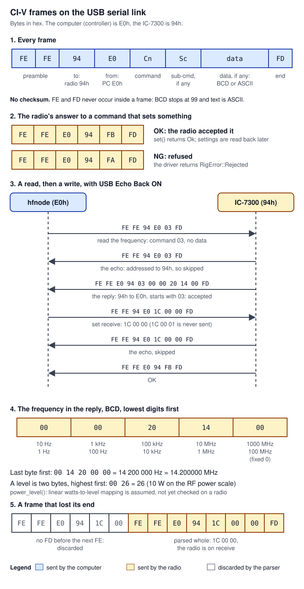

# 07 CI-V and the IC-7300

> The `civ` crate (`crates/civ`) is how the node drives an ICOM IC-7300: it speaks CI-V, ICOM's byte protocol for computer control, over the radio's USB serial port. It holds the `Rig` trait that every radio driver in the project implements, the CI-V frame codec, the `Ic7300` driver with one named method per command, the read-only preflight that must pass before anything is written to a radio, the read-back after setup, a serial-port finder, the code that lowers the port's DTR and RTS lines, an in-memory `SimRig` and a byte-level mock IC-7300 that tests and `hfnode selftest` drive through the real driver. In `crates/hfnode`, the `hfnode radio` subcommands and `commissioning.rs` decide what may be sent at each bring-up stage. Every command is cited to ICOM's *IC-7300 Full Manual*. **None of it has run against a real IC-7300 yet**: it has only been run against the mock. PR #27 (open, ready, audit-cleared, not on main) adds seven read-only preflight reads: six refuse, for any command that can transmit (a warning for `radio check` and `radio setup`), a radio whose front-panel or microphone key is set to a keyer memory, and the seventh refuses MIC Up/Down Keyer ON, which makes the microphone's [UP]/[DN] keys a CW key ([`crates/civ/src/preflight.rs:370-426`](https://github.com/robinonsay/cw-message-gateway/blob/3c97427bcf59fcb8223af7a3676eeebdec529f52/crates/civ/src/preflight.rs#L370-L426)).

Words used on this page, in plain terms (the [17 Glossary](17-glossary.md) has more):

| Term | Meaning here |
|---|---|
| CI-V | ICOM's protocol for controlling a radio from a computer. Each message is a short frame of bytes; commands are written as hex bytes, for example `1C 00` (read transmit status). On the IC-7300 it runs over the USB cable, through a USB-to-serial chip inside the radio. |
| Frame | One CI-V message: `FE FE <to> <from> <command> [<sub-command>] [<data>] FD`. `FE FE` starts it and `FD` ends it. |
| Address | Every device on a CI-V bus has a one-byte address. The IC-7300 is `94h` by default and the computer (the "controller") is `E0h`. `00h` is the broadcast address the radio uses for unasked "transceive" frames. |
| OK, NG | The radio answers a command it carried out with the body `FB` (OK) and one it refused with `FA` (NG, "no good"). A read is answered with the command bytes and the data instead. |
| BCD | Binary-coded decimal: each 4-bit half of a byte holds one decimal digit, so the byte `0x14` means fourteen. CI-V sends frequencies and levels this way. |
| Echo back | A radio setting (CI-V USB Echo Back) that makes the radio send back a copy of every frame it receives. The driver works with it on or off. |
| Transceive | A radio setting (CI-V Transceive) that makes the radio send a frame to address `00h` whenever someone changes the frequency or mode at its front panel. The driver ignores those frames. |
| CP210x, DTR, RTS | The IC-7300's USB port is a Silicon Labs CP210x USB-to-serial bridge. A serial port has two output "control lines", DTR and RTS, that a computer can raise or lower. |
| USB SEND, USB Keying | Radio menu items that make the radio transmit (USB SEND), key CW (USB Keying (CW)) or FSK-key RTTY, a teleprinter mode (USB Keying (RTTY)), while the computer raises DTR or RTS (manual lines 6895-6927). The node requires all three OFF. |
| Keyer, command `17` | The radio's built-in keyer turns text into Morse code. CI-V command `17` hands it up to 30 characters; `17 FF` stops it. |
| Semi break-in, break-in delay | With semi break-in on, the radio goes to transmit when its keyer keys and returns to receive once the key has been up for the break-in delay (2 to 13 "dots", a dot being the shortest Morse element). Without break-in, `17` text is not transmitted at all. |
| TOT | The radio's own Time-Out Timer (CI-V): it ends a transmission "initiated by a CI-V command or pushing TRANSMIT" after a set time. The node requires 3 minutes. |
| TX Inhibit | A radio function (`16 66`) that, while ON, makes the radio refuse to transmit. The node turns it on when it inhibits itself. |
| Split, ∂TX | Two radio functions that make it transmit on a frequency other than the one on the dial. The node requires both OFF. |
| Tuner | The IC-7300's built-in automatic antenna tuner. A tune (`1C 01 02`) transmits a carrier for 2-3 seconds. |
| SWR, Po | The radio's standing-wave-ratio meter (how well the antenna takes the power; 1.0 is perfect) and output-power meter (percent of full output, 100 W). |
| VOX, PTT Start | VOX transmits when sound reaches the microphone. PTT Start makes the tuner start a tune when the push-to-talk line is pressed. Both must be OFF. |
| Scope data output | `27 11`: with it and the radio's spectrum scope on, the radio streams waveform frames to the computer without being asked. |
| Front Key / MIC Key Customize, keyer memory | (PR #27) Menu items that reassign some front-panel and microphone keys. A key assigned to a "Voice/Keyer/RTTY Memory" transmits a stored message when pushed. |
| Preflight, read-back | The preflight is the list of read-only checks made before anything is written to the radio. The read-back reads the settings again after the node has set them. |
| Bring-up stage | `station.commissioned` in the config: how far the hardware test plan has got on this radio (`none`, `link`, `setup`, `tune`, `keying`, `done`). Each stage allows more commands; `keying` also allows more than 10 W. |
| wpm | Words per minute, the Morse speed. One dot lasts 1.2 s / wpm ("PARIS" timing, named after the standard test word: dot 1, dash 3, gaps 1, 3 and 7 dots). |
| Carrier | The plain, unmodulated signal a transmitter puts out, for example during a tune. |
| Sidetone | The tone the radio plays in its own speaker while it keys. |
| Dummy load | A resistor that absorbs the transmitter's power in place of an antenna, so nothing goes on the air. |
| [REMOTE], CI-V USB port | The radio's 3.5 mm CI-V jack, a shared bus that other controllers can be on. "Unlink from [REMOTE]" makes the USB port a separate link. |
| CW-R, FIL1-3 | CW-R is CW received on the other sideband; FIL1, FIL2 and FIL3 are the radio's three receive filter widths. |
| SSB/CW Synchronous Tuning | A radio menu item that shifts the dial by the CW pitch when the mode changes between SSB and CW. |
| IC-PW2 | An ICOM linear amplifier; the manual documents TX Inhibit only for it. |
| Window start | The node's set-up, check and tune at the start of a listening window ([05](05-node-loop-station-safety.md)). |
| K-numbers, E1 | `K4`, `K11` and so on are findings of the separate safety audit (`audit/report.md` §4, project files), listed in [docs/civ-audit.md](../civ-audit.md)'s 2026-10-08 addendum. `E1` is a label in the mock's violation text ([`crates/civ/src/mock.rs:957`](https://github.com/robinonsay/cw-message-gateway/blob/44185fa9a00369c379d9d8af40ca307e3867e860/crates/civ/src/mock.rs#L957)); its source was not found in the code at `44185fa`. |

## Where it lives

All paths are at `main` [`44185fa`](https://github.com/robinonsay/cw-message-gateway/tree/44185fa9a00369c379d9d8af40ca307e3867e860) unless marked PR #27, which is at [`3c97427`](https://github.com/robinonsay/cw-message-gateway/tree/3c97427bcf59fcb8223af7a3676eeebdec529f52). Line ranges are code first, then the file's tests.

| Path | What it holds | Lines |
|---|---|---|
| [`crates/civ/Cargo.toml:1-11`](https://github.com/robinonsay/cw-message-gateway/blob/44185fa9a00369c379d9d8af40ca307e3867e860/crates/civ/Cargo.toml#L1-L11) | The crate: depends on `cw` (Morse tables), `log` and `serialport` 4 with default features off | 11 |
| [`crates/civ/src/lib.rs:1-215`](https://github.com/robinonsay/cw-message-gateway/blob/44185fa9a00369c379d9d8af40ca307e3867e860/crates/civ/src/lib.rs#L1-L215) | Module list, `MAX_CW_CHARS`, `RigError`, the `Rig` trait, `split_for_keyer` | 1-215, tests 217-240 |
| [`crates/civ/src/frame.rs:1-120`](https://github.com/robinonsay/cw-message-gateway/blob/44185fa9a00369c379d9d8af40ca307e3867e860/crates/civ/src/frame.rs#L1-L120) | CI-V frame constants, `Frame`, the parser `take_frame`, BCD helpers | 1-120, tests 122-172 |
| [`crates/civ/src/ic7300.rs:1-820`](https://github.com/robinonsay/cw-message-gateway/blob/44185fa9a00369c379d9d8af40ca307e3867e860/crates/civ/src/ic7300.rs#L1-L820) | The IC-7300 driver: link constants, every command with its manual citation, scales, `Port`, `Ic7300`, its named reads and its `Rig` implementation | 1-820, tests 822-1317 |
| [`crates/civ/src/preflight.rs:1-695`](https://github.com/robinonsay/cw-message-gateway/blob/44185fa9a00369c379d9d8af40ca307e3867e860/crates/civ/src/preflight.rs#L1-L695) | `preflight`, `preflight_for`, `verify_setup`, `Report`, `Check`, `Level`, `Purpose`, `Setup` | 1-695, tests 697-1048 |
| [`crates/civ/src/ports.rs:1-135`](https://github.com/robinonsay/cw-message-gateway/blob/44185fa9a00369c379d9d8af40ca307e3867e860/crates/civ/src/ports.rs#L1-L135) | `list()` of serial ports, most likely radio first, without opening any | 1-135, tests 137-188 |
| [`crates/civ/src/serial.rs:1-45`](https://github.com/robinonsay/cw-message-gateway/blob/44185fa9a00369c379d9d8af40ca307e3867e860/crates/civ/src/serial.rs#L1-L45) | `ControlLines` and `lower_control_lines` (DTR, then RTS) | 1-45, tests 47-100 |
| [`crates/civ/src/sim.rs:1-320`](https://github.com/robinonsay/cw-message-gateway/blob/44185fa9a00369c379d9d8af40ca307e3867e860/crates/civ/src/sim.rs#L1-L320) | `SimRig`, an in-memory radio for unit tests (no bytes) | 1-320 |
| [`crates/civ/src/mock.rs:1-1508`](https://github.com/robinonsay/cw-message-gateway/blob/44185fa9a00369c379d9d8af40ca307e3867e860/crates/civ/src/mock.rs#L1-L1508) | The byte-level mock IC-7300: `MockRadio`, `MockPort`, `MockConfig`, `Menu`, `Fault`, `Report`, `is_read` | 1-1508, tests 1510-2249 |
| [`crates/hfnode/src/main.rs:280-295`](https://github.com/robinonsay/cw-message-gateway/blob/44185fa9a00369c379d9d8af40ca307e3867e860/crates/hfnode/src/main.rs#L280-L295), [`crates/hfnode/src/main.rs:834-1106`](https://github.com/robinonsay/cw-message-gateway/blob/44185fa9a00369c379d9d8af40ca307e3867e860/crates/hfnode/src/main.rs#L834-L1106) | The `hfnode radio` subcommands, `hfnode devices`, `open_radio`, `open_for`, `verify_setup`, `release_tx_inhibit` | in `main.rs` |
| [`crates/hfnode/src/main.rs:433-524`](https://github.com/robinonsay/cw-message-gateway/blob/44185fa9a00369c379d9d8af40ca307e3867e860/crates/hfnode/src/main.rs#L433-L524) | The stop-signal handler and the radio guard (described on [05](05-node-loop-station-safety.md)) | in `main.rs` |
| [`crates/hfnode/src/commissioning.rs:1-225`](https://github.com/robinonsay/cw-message-gateway/blob/44185fa9a00369c379d9d8af40ca307e3867e860/crates/hfnode/src/commissioning.rs#L1-L225) | Bring-up stages, `BENCH_MAX_WATTS`, `RUN_MAX_KEY_SECONDS`, `open_for` | 1-225, tests 227-499 |
| [`crates/hfnode/src/selftest.rs:581-676`](https://github.com/robinonsay/cw-message-gateway/blob/44185fa9a00369c379d9d8af40ca307e3867e860/crates/hfnode/src/selftest.rs#L581-L676) | `TimeScaled`, the wrapper that lets the station time keying against a sped-up mock | in `selftest.rs` |
| [docs/civ-audit.md](../civ-audit.md) | The byte-by-byte audit of the driver against the manual, and its addenda (see "The CI-V audit document" below) | 436 lines (439 with PR #27) |
| [docs/hardware-test-plan.md](../hardware-test-plan.md) | Bring-up stages, what the software enforces, step 0 (every command against the manual) to step 13 | |
| [docs/raspberry-pi-setup.md](../raspberry-pi-setup.md) | Section 6: the radio's menu settings the preflight checks | |
| PR #27: [`crates/civ/src/ic7300.rs:217-231`](https://github.com/robinonsay/cw-message-gateway/blob/3c97427bcf59fcb8223af7a3676eeebdec529f52/crates/civ/src/ic7300.rs#L217-L231), [`crates/civ/src/ic7300.rs:263-409`](https://github.com/robinonsay/cw-message-gateway/blob/3c97427bcf59fcb8223af7a3676eeebdec529f52/crates/civ/src/ic7300.rs#L263-L409), [`crates/civ/src/preflight.rs:370-426`](https://github.com/robinonsay/cw-message-gateway/blob/3c97427bcf59fcb8223af7a3676eeebdec529f52/crates/civ/src/preflight.rs#L370-L426) | Front Key and MIC Key Customize reads, MIC Up/Down Keyer read, their decoding and preflight checks | PR #27, open, not on main |

The manual itself is not in the repository. A text copy is in the project files as `reference/IC-7300_ENG_FM_12b.txt`; this page, the code and `docs/civ-audit.md` cite its line numbers. Section 19 "CONTROL COMMAND" starts at line 8531; the command table runs from p. 19-3 (its header at line 8575) to p. 19-8, the data descriptions from p. 19-9 (line 9418) to p. 19-15.

## How it works

### The wire



*Figure 1: CI-V framing. Notice that no frame carries a checksum, and that the driver tells the radio's echo of its own frame from the radio's reply by the addresses alone: the echo is addressed to 94h, the reply to E0h. The parser's restart at the next FE (part 5) is why a frame cut short never swallows the next one.*

A CI-V frame is two `FE` bytes, the address it is going to, the address it is from, a command byte, an optional sub-command, optional data, and `FD` (manual p. 19-2, line 8551). The computer sends `FE FE 94 E0 ...`; the radio answers `FE FE E0 94 ...`. A command that sets something is answered `FB` (OK) or `FA` (NG); a read (the command sent with no data) is answered with the command bytes and the data (line 8551-8552). There is no checksum, so the node confirms the things that matter (receive, a stopped tuner) with two readings in a row ([05](05-node-loop-station-safety.md)). The constants and the codec are in [`crates/civ/src/frame.rs:7-80`](https://github.com/robinonsay/cw-message-gateway/blob/44185fa9a00369c379d9d8af40ca307e3867e860/crates/civ/src/frame.rs#L7-L80).

The data are BCD. A frequency is five bytes, lowest digits first: 14.200000 MHz is `00 00 20 14 00` (p. 19-9, lines 9422-9430; [`crates/civ/src/frame.rs:84-107`](https://github.com/robinonsay/cw-message-gateway/blob/44185fa9a00369c379d9d8af40ca307e3867e860/crates/civ/src/frame.rs#L84-L107)). A level or meter value is two bytes, highest digits first, from `00 00` to `02 55` ([`crates/civ/src/frame.rs:109-120`](https://github.com/robinonsay/cw-message-gateway/blob/44185fa9a00369c379d9d8af40ca307e3867e860/crates/civ/src/frame.rs#L109-L120)). Neither ever contains `FD` or `FE`, nor does the ASCII text of command `17`, which is why the parser can treat an `FE` inside a frame as the start of the next one ([`crates/civ/src/frame.rs:51-54`](https://github.com/robinonsay/cw-message-gateway/blob/44185fa9a00369c379d9d8af40ca307e3867e860/crates/civ/src/frame.rs#L51-L54)).

The link is the radio's USB serial port at one of six baud rates (115200 by default in the config), 8 data bits, no parity, 1 stop bit, no flow control ([`crates/civ/src/ic7300.rs:342-362`](https://github.com/robinonsay/cw-message-gateway/blob/44185fa9a00369c379d9d8af40ca307e3867e860/crates/civ/src/ic7300.rs#L342-L362)). The same USB cable also carries the radio's receive audio as a USB sound device, which page [04](04-cw-decoder-audio.md) covers.

**Echo and collisions.** With USB Echo Back on, the radio sends back a copy of each frame it receives; `transact` skips it because it is addressed to the radio, not to `E0h` ([`crates/civ/src/ic7300.rs:453-462`](https://github.com/robinonsay/cw-message-gateway/blob/44185fa9a00369c379d9d8af40ca307e3867e860/crates/civ/src/ic7300.rs#L453-L462)). The IC-7300 manual describes no collision handling and no jammer code (no "collision" or "jammer" in the text copy). With CI-V USB Port set to "Unlink from [REMOTE]", the USB port and the [REMOTE] jack "function independently" (manual lines 6853-6863), so the USB link carries only this computer and the radio; a collision could only come from a shared [REMOTE] bus, and the preflight refuses "Link to [REMOTE]". A frame cut short is dropped by `take_frame` (Algorithms, step 4), the command then times out, and the next command drains the link first. The driver never retries a command itself: a lost reply is `RigError::Timeout`, and the caller decides what to do.

### The layers


*Figure 2: the CI-V stack. Notice that the tests swap in at two levels: `SimRig` replaces the whole driver, while `MockPort` replaces only the serial port so that the real `Ic7300` code sends and parses every byte.*

`Station<R: Rig>` in `crates/hfnode/src/station.rs` is the only code that keys a radio ([05](05-node-loop-station-safety.md)). It talks to the radio only through the `Rig` trait ([`crates/civ/src/lib.rs:58-186`](https://github.com/robinonsay/cw-message-gateway/blob/44185fa9a00369c379d9d8af40ca307e3867e860/crates/civ/src/lib.rs#L58-L186)): set frequency, mode, power, keyer speed and break-in; read status, meters and tuner; send CW text; stop. Four radio types implement it: `Ic7300<P: Port>` ([`crates/civ/src/ic7300.rs:671`](https://github.com/robinonsay/cw-message-gateway/blob/44185fa9a00369c379d9d8af40ca307e3867e860/crates/civ/src/ic7300.rs#L671), this page), `SimRig` ([`crates/civ/src/sim.rs:167`](https://github.com/robinonsay/cw-message-gateway/blob/44185fa9a00369c379d9d8af40ca307e3867e860/crates/civ/src/sim.rs#L167), this page), `KeyerRig` for the keyer box ([`crates/hfnode/src/keyer/rig.rs:552`](https://github.com/robinonsay/cw-message-gateway/blob/44185fa9a00369c379d9d8af40ca307e3867e860/crates/hfnode/src/keyer/rig.rs#L552), page [09](09-keyer-host-side.md)) and `Handheld` for the UV-K1 ([`crates/hfnode/src/handheld.rs:863`](https://github.com/robinonsay/cw-message-gateway/blob/44185fa9a00369c379d9d8af40ca307e3867e860/crates/hfnode/src/handheld.rs#L863), page [10](10-uv-k1-handheld.md)). A fifth, `TimeScaled<R>`, wraps one of them for the self-test ([`crates/hfnode/src/selftest.rs:589`](https://github.com/robinonsay/cw-message-gateway/blob/44185fa9a00369c379d9d8af40ca307e3867e860/crates/hfnode/src/selftest.rs#L589)), and the station's own tests add three test rigs (`Radio`, `Switchable`, `KeyAtJack` at [`crates/hfnode/src/station.rs:3308`](https://github.com/robinonsay/cw-message-gateway/blob/44185fa9a00369c379d9d8af40ca307e3867e860/crates/hfnode/src/station.rs#L3308), [`crates/hfnode/src/station.rs:4039`](https://github.com/robinonsay/cw-message-gateway/blob/44185fa9a00369c379d9d8af40ca307e3867e860/crates/hfnode/src/station.rs#L4039), [`crates/hfnode/src/station.rs:4987`](https://github.com/robinonsay/cw-message-gateway/blob/44185fa9a00369c379d9d8af40ca307e3867e860/crates/hfnode/src/station.rs#L4987)).

`Ic7300<P: Port>` ([`crates/civ/src/ic7300.rs:317-327`](https://github.com/robinonsay/cw-message-gateway/blob/44185fa9a00369c379d9d8af40ca307e3867e860/crates/civ/src/ic7300.rs#L317-L327)) owns the port, the radio's address, a receive buffer, the 500 ms reply timeout, a "resync" flag and the last keyer-speed level set. Every command goes through one private function, `transact` ([`crates/civ/src/ic7300.rs:427-475`](https://github.com/robinonsay/cw-message-gateway/blob/44185fa9a00369c379d9d8af40ca307e3867e860/crates/civ/src/ic7300.rs#L427-L475)), and every command byte sequence is a named constant in `mod cmd` with its manual citation ([`crates/civ/src/ic7300.rs:107-216`](https://github.com/robinonsay/cw-message-gateway/blob/44185fa9a00369c379d9d8af40ca307e3867e860/crates/civ/src/ic7300.rs#L107-L216)). Reads are reachable only through named methods, so no caller can put an arbitrary frame on the wire ([`crates/civ/src/ic7300.rs:30-33`](https://github.com/robinonsay/cw-message-gateway/blob/44185fa9a00369c379d9d8af40ca307e3867e860/crates/civ/src/ic7300.rs#L30-L33)).

`Ic7300` has no locking of its own: every method takes `&mut self`. `Station` keeps the rig in an `Arc<Mutex<R>>` ([`crates/hfnode/src/station.rs:888`](https://github.com/robinonsay/cw-message-gateway/blob/44185fa9a00369c379d9d8af40ca307e3867e860/crates/hfnode/src/station.rs#L888), handed out by `rig()` at [`crates/hfnode/src/station.rs:1010-1012`](https://github.com/robinonsay/cw-message-gateway/blob/44185fa9a00369c379d9d8af40ca307e3867e860/crates/hfnode/src/station.rs#L1010-L1012)) that the station loop, the watchdog thread and the stop-signal handler share; that is why `Rig: Send`. One command holds that lock for at most about 2.55 s: a 2 s drain after an earlier timeout, the 500 ms reply timeout and one more 50 ms port read (Algorithms §2). The stop handler's `STOP_WAIT` and the watchdog's `radio_wait` (10 s each, [`crates/hfnode/src/main.rs:480`](https://github.com/robinonsay/cw-message-gateway/blob/44185fa9a00369c379d9d8af40ca307e3867e860/crates/hfnode/src/main.rs#L480), [`crates/hfnode/src/station.rs:176`](https://github.com/robinonsay/cw-message-gateway/blob/44185fa9a00369c379d9d8af40ca307e3867e860/crates/hfnode/src/station.rs#L176)) are sized to cover that; page [05](05-node-loop-station-safety.md) describes them.

`P` is anything that implements `Port` (`Read + Write + Send` plus `discard_input`, [`crates/civ/src/ic7300.rs:305-315`](https://github.com/robinonsay/cw-message-gateway/blob/44185fa9a00369c379d9d8af40ca307e3867e860/crates/civ/src/ic7300.rs#L305-L315)). In production it is `Box<dyn serialport::SerialPort>`; in tests it is `MockPort` or a scripted fake. Opening a real port also needs `ControlLines` ([`crates/civ/src/serial.rs:19-35`](https://github.com/robinonsay/cw-message-gateway/blob/44185fa9a00369c379d9d8af40ca307e3867e860/crates/civ/src/serial.rs#L19-L35)), so that DTR and RTS can be lowered before the driver exists.

### What can transmit, and what is never sent

Only two frames the driver can send make the radio transmit: `17 <text>` (the keyer sends the text, and only with CW mode and break-in on) and `1C 01 02` (a tuner cycle) ([`crates/civ/src/ic7300.rs:30-33`](https://github.com/robinonsay/cw-message-gateway/blob/44185fa9a00369c379d9d8af40ca307e3867e860/crates/civ/src/ic7300.rs#L30-L33)). The driver refuses `set_transmit(true)` without sending anything, so `1C 00 01` (transmit on) is never sent ([`crates/civ/src/ic7300.rs:783-790`](https://github.com/robinonsay/cw-message-gateway/blob/44185fa9a00369c379d9d8af40ca307e3867e860/crates/civ/src/ic7300.rs#L783-L790); test [`crates/civ/src/ic7300.rs:1122`](https://github.com/robinonsay/cw-message-gateway/blob/44185fa9a00369c379d9d8af40ca307e3867e860/crates/civ/src/ic7300.rs#L1122)). It never writes the radio's menu settings, VOX or scope output: the preflight refuses to go on instead. The mock records a write to any of the preflight's menu items, to VOX (`16 46`), to the ID (`19 00`) or to `27 11` as a violation ([`crates/civ/src/mock.rs:951-958`](https://github.com/robinonsay/cw-message-gateway/blob/44185fa9a00369c379d9d8af40ca307e3867e860/crates/civ/src/mock.rs#L951-L958)), with one exception: it accepts a USB Echo Back write (`1A 05 00 75 00` or `01`) with OK and no violation, so that its own tests can switch echo off ([`crates/civ/src/mock.rs:933-936`](https://github.com/robinonsay/cw-message-gateway/blob/44185fa9a00369c379d9d8af40ca307e3867e860/crates/civ/src/mock.rs#L933-L936), used at [`crates/civ/src/mock.rs:1619-1634`](https://github.com/robinonsay/cw-message-gateway/blob/44185fa9a00369c379d9d8af40ca307e3867e860/crates/civ/src/mock.rs#L1619-L1634)). It also accepts `16 47 02` (full break-in) and `1C 01 00`/`01` (tuner off or on) without a violation ([`crates/civ/src/mock.rs:917-920`](https://github.com/robinonsay/cw-message-gateway/blob/44185fa9a00369c379d9d8af40ca307e3867e860/crates/civ/src/mock.rs#L917-L920), [`crates/civ/src/mock.rs:982-985`](https://github.com/robinonsay/cw-message-gateway/blob/44185fa9a00369c379d9d8af40ca307e3867e860/crates/civ/src/mock.rs#L982-L985)). The driver has no method that sends any of these, so the gap matters only if a new write is added. The only writes are the operating settings (`05`, `06`, `14 0A`, `14 0C`, `14 0F`, `16 47`), the stop and receive commands (`17 FF`, `1C 00 00`), the tune, CW text, and TX Inhibit on and off (`16 66 01`, `16 66 00`).

### The gate in front of every write


*Figure 3: from command to first write. Notice that a refused stage opens no port at all, that a failed preflight drops the port with nothing written, and that the first write after the preflight is always `1C 00 00` (receive) except when `radio setup` first clears the radio's TX Inhibit.*

Every command that writes settings or can transmit (`hfnode radio setup`, `radio tune`, `radio cw` and `hfnode run`) opens the radio through `commissioning::open_for` ([`crates/hfnode/src/commissioning.rs:201-225`](https://github.com/robinonsay/cw-message-gateway/blob/44185fa9a00369c379d9d8af40ca307e3867e860/crates/hfnode/src/commissioning.rs#L201-L225)):

1. The bring-up stage and the power cap are checked before the port is opened. A command needs its stage (`setup` needs `link`, `tune` needs `setup`, `cw` needs `tune`, `run` needs `done`), and `station.power_watts` above `BENCH_MAX_WATTS` (10 W) needs stage `keying` ([`crates/hfnode/src/commissioning.rs:61`](https://github.com/robinonsay/cw-message-gateway/blob/44185fa9a00369c379d9d8af40ca307e3867e860/crates/hfnode/src/commissioning.rs#L61), [`crates/hfnode/src/commissioning.rs:102-119`](https://github.com/robinonsay/cw-message-gateway/blob/44185fa9a00369c379d9d8af40ca307e3867e860/crates/hfnode/src/commissioning.rs#L102-L119)). For `run`, `check_keying` also refuses `max_key_seconds` above `RUN_MAX_KEY_SECONDS` (55), or too short for one character at `key_speed_wpm`, and a configuration whose longest reply would key for longer than `MAX_TRANSMISSION` (30 min) ([`crates/hfnode/src/commissioning.rs:125-168`](https://github.com/robinonsay/cw-message-gateway/blob/44185fa9a00369c379d9d8af40ca307e3867e860/crates/hfnode/src/commissioning.rs#L125-L168)). A refused command opens no port and sends nothing (test [`crates/hfnode/src/commissioning.rs:379-400`](https://github.com/robinonsay/cw-message-gateway/blob/44185fa9a00369c379d9d8af40ca307e3867e860/crates/hfnode/src/commissioning.rs#L379-L400)).
2. The port is opened and DTR, then RTS, are lowered; if either fails the port is dropped and nothing is written ([`crates/civ/src/ic7300.rs:370-375`](https://github.com/robinonsay/cw-message-gateway/blob/44185fa9a00369c379d9d8af40ca307e3867e860/crates/civ/src/ic7300.rs#L370-L375)).
3. The read-only preflight runs: 27 reads on main, 34 with PR #27. Any `Fail` closes the radio with the message "radio preflight failed (...); nothing was written to the radio" ([`crates/hfnode/src/commissioning.rs:217-223`](https://github.com/robinonsay/cw-message-gateway/blob/44185fa9a00369c379d9d8af40ca307e3867e860/crates/hfnode/src/commissioning.rs#L217-L223); test [`crates/hfnode/src/commissioning.rs:403-442`](https://github.com/robinonsay/cw-message-gateway/blob/44185fa9a00369c379d9d8af40ca307e3867e860/crates/hfnode/src/commissioning.rs#L403-L442)).
4. Only then do the writes start. For `radio setup`, the radio's TX Inhibit is turned off first if it is on and no `tx-inhibited` file exists ([`crates/hfnode/src/main.rs:1083-1106`](https://github.com/robinonsay/cw-message-gateway/blob/44185fa9a00369c379d9d8af40ca307e3867e860/crates/hfnode/src/main.rs#L1083-L1106)). Then `Station::configure` sends `1C 00 00` (receive) and the settings, semi break-in last ([`crates/hfnode/src/station.rs:1260-1286`](https://github.com/robinonsay/cw-message-gateway/blob/44185fa9a00369c379d9d8af40ca307e3867e860/crates/hfnode/src/station.rs#L1260-L1286); test [`crates/hfnode/src/commissioning.rs:483-498`](https://github.com/robinonsay/cw-message-gateway/blob/44185fa9a00369c379d9d8af40ca307e3867e860/crates/hfnode/src/commissioning.rs#L483-L498)).
5. The settings are read back with `verify_setup`, and the command stops unless every one matches ([`crates/hfnode/src/main.rs:929-953`](https://github.com/robinonsay/cw-message-gateway/blob/44185fa9a00369c379d9d8af40ca307e3867e860/crates/hfnode/src/main.rs#L929-L953)).
6. Only then does `radio tune` run a window start (the settings and the checks again, then `1C 01 02`, [`crates/hfnode/src/station.rs:1407-1421`](https://github.com/robinonsay/cw-message-gateway/blob/44185fa9a00369c379d9d8af40ca307e3867e860/crates/hfnode/src/station.rs#L1407-L1421)) or `radio cw` key its text with `17` through `Station::transmit`. `run` keys replies with `17` and also runs the same window start, with its `1C 01 02` tune, at start-up, at the top of each listening window, and before a reply when the last tune is too old ([`crates/hfnode/src/station.rs:1395-1403`](https://github.com/robinonsay/cw-message-gateway/blob/44185fa9a00369c379d9d8af40ca307e3867e860/crates/hfnode/src/station.rs#L1395-L1403)).

`hfnode radio rx` is the one write path without a preflight: it must be able to bring back to receive a radio that is transmitting, even one the preflight would refuse ([`crates/hfnode/src/commissioning.rs:12-14`](https://github.com/robinonsay/cw-message-gateway/blob/44185fa9a00369c379d9d8af40ca307e3867e860/crates/hfnode/src/commissioning.rs#L12-L14)). It sends `17 FF` and `1C 00 00` and reads `1C 00` until receive is confirmed; if receive cannot be confirmed it also sends `16 47 00` and `16 66 01` and writes the `tx-inhibited` file ([`crates/hfnode/src/main.rs:894-897`](https://github.com/robinonsay/cw-message-gateway/blob/44185fa9a00369c379d9d8af40ca307e3867e860/crates/hfnode/src/main.rs#L894-L897), [`crates/hfnode/src/station.rs:387-437`](https://github.com/robinonsay/cw-message-gateway/blob/44185fa9a00369c379d9d8af40ca307e3867e860/crates/hfnode/src/station.rs#L387-L437)).

### Test doubles

`SimRig` ([`crates/civ/src/sim.rs:13-57`](https://github.com/robinonsay/cw-message-gateway/blob/44185fa9a00369c379d9d8af40ca307e3867e860/crates/civ/src/sim.rs#L13-L57)) implements `Rig` directly in memory: no bytes, settable faults, keying timed element by element. The station's and node's unit tests use it. `MockRadio` with `MockPort` ([`crates/civ/src/mock.rs:483-488`](https://github.com/robinonsay/cw-message-gateway/blob/44185fa9a00369c379d9d8af40ca307e3867e860/crates/civ/src/mock.rs#L483-L488)) is a byte-level IC-7300: the real `Ic7300<MockPort>` sends and parses every byte, and the mock checks each frame against Section 19 of the manual, models the keyer, break-in, meters and tuner in a time-scaled "radio time", injects faults, and records anything the manual does not allow as a `Violation` ([`crates/civ/src/mock.rs:1-66`](https://github.com/robinonsay/cw-message-gateway/blob/44185fa9a00369c379d9d8af40ca307e3867e860/crates/civ/src/mock.rs#L1-L66)). `hfnode selftest` opens the mock exactly as `hfnode run` opens a radio, through `commissioning::open_for(Stage::Done, Action::Run, ...)`, and fails a scenario on any violation ([`crates/hfnode/src/selftest.rs:1652-1654`](https://github.com/robinonsay/cw-message-gateway/blob/44185fa9a00369c379d9d8af40ca307e3867e860/crates/hfnode/src/selftest.rs#L1652-L1654), [`crates/hfnode/src/selftest.rs:1736-1745`](https://github.com/robinonsay/cw-message-gateway/blob/44185fa9a00369c379d9d8af40ca307e3867e860/crates/hfnode/src/selftest.rs#L1736-L1745)). Page [12](12-testing.md) describes the test layers.

## How it connects

Figure 2 draws the neighbours on the radio path (the station, the bring-up gate, the serial port and the radio, and the test doubles). The rest in the table below each use one or two items from the crate and stay off that path: the config check, the `cw` crate's tables, the keyer and handheld serial ports, the keyer-box self-test and the service scripts.

| Neighbour | Direction | What crosses |
|---|---|---|
| `Station` ([05](05-node-loop-station-safety.md)) | calls in | Every `Rig` method; the station sets up, checks, tunes, keys and watches through them. |
| `commissioning.rs` | calls in | `Ic7300::open` (through a closure), `preflight::preflight_for`, `Report` ([`crates/hfnode/src/commissioning.rs:201-225`](https://github.com/robinonsay/cw-message-gateway/blob/44185fa9a00369c379d9d8af40ca307e3867e860/crates/hfnode/src/commissioning.rs#L201-L225)). |
| `main.rs` radio commands | calls in | `Ic7300::open`, `preflight::preflight`, `preflight::verify_setup`, `Ic7300::tx_inhibit`, `Ic7300::release_tx_inhibit`, `ports::list`, `ports::is_macos_dialin` ([`crates/hfnode/src/main.rs:834-1106`](https://github.com/robinonsay/cw-message-gateway/blob/44185fa9a00369c379d9d8af40ca307e3867e860/crates/hfnode/src/main.rs#L834-L1106)). |
| `config.rs` ([15](15-config-cli-deployment.md)) | calls in | `ic7300::check_link_settings` validates `station.baud` and `station.civ_address` at load ([`crates/hfnode/src/config.rs:940-941`](https://github.com/robinonsay/cw-message-gateway/blob/44185fa9a00369c379d9d8af40ca307e3867e860/crates/hfnode/src/config.rs#L940-L941)). |
| Keyer box and handheld ports ([09](09-keyer-host-side.md), [10](10-uv-k1-handheld.md)) | call in | `serial::lower_control_lines` for their own serial ports ([`crates/civ/src/serial.rs:1-11`](https://github.com/robinonsay/cw-message-gateway/blob/44185fa9a00369c379d9d8af40ca307e3867e860/crates/civ/src/serial.rs#L1-L11)); `Rig` and `RigError`. |
| `selftest.rs` and tests ([12](12-testing.md)) | call in | `MockRadio`, `MockConfig`, `Menu`, `Fault`, `is_read`, `SimRig`. |
| Keyer-box self-test ([09](09-keyer-host-side.md)) | calls in | Reuses `civ::mock::Keyed` as the record of each keyed message ([`crates/hfnode/src/selftest/any_radio.rs:287`](https://github.com/robinonsay/cw-message-gateway/blob/44185fa9a00369c379d9d8af40ca307e3867e860/crates/hfnode/src/selftest/any_radio.rs#L287)). |
| Keyer box link ([09](09-keyer-host-side.md)) | calls in | `ports::list` and `ports::PortInfo` to find and check the box's port ([`crates/hfnode/src/keyer/link.rs:74`](https://github.com/robinonsay/cw-message-gateway/blob/44185fa9a00369c379d9d8af40ca307e3867e860/crates/hfnode/src/keyer/link.rs#L74), [`crates/hfnode/src/keyer/link.rs:107`](https://github.com/robinonsay/cw-message-gateway/blob/44185fa9a00369c379d9d8af40ca307e3867e860/crates/hfnode/src/keyer/link.rs#L107)). |
| Deployment ([15](15-config-cli-deployment.md)) | calls in | The systemd unit's `ExecStopPost` and the supervise script run `hfnode radio ... rx` after every stop or crash ([`deploy/hfnode.service:33`](https://github.com/robinonsay/cw-message-gateway/blob/44185fa9a00369c379d9d8af40ca307e3867e860/deploy/hfnode.service#L33), [`deploy/hfnode-supervise.sh:88`](https://github.com/robinonsay/cw-message-gateway/blob/44185fa9a00369c379d9d8af40ca307e3867e860/deploy/hfnode-supervise.sh#L88)); `radio_route` sends it to `hfnode keyer rx` when `station.rig = "keyer"` (the audit's KB-12, [`crates/hfnode/src/main.rs:963-977`](https://github.com/robinonsay/cw-message-gateway/blob/44185fa9a00369c379d9d8af40ca307e3867e860/crates/hfnode/src/main.rs#L963-L977)). |
| `cw` crate | called | `cw::is_sendable` (which characters `17` may carry) and `cw::encode_char` (the mock's Morse timing) ([`crates/cw/src/morse.rs:59-72`](https://github.com/robinonsay/cw-message-gateway/blob/44185fa9a00369c379d9d8af40ca307e3867e860/crates/cw/src/morse.rs#L59-L72)); `cw::Keyer::timing` (`SimRig`'s timing, [`crates/cw/src/synth.rs:45`](https://github.com/robinonsay/cw-message-gateway/blob/44185fa9a00369c379d9d8af40ca307e3867e860/crates/cw/src/synth.rs#L45), called at [`crates/civ/src/sim.rs:261-262`](https://github.com/robinonsay/cw-message-gateway/blob/44185fa9a00369c379d9d8af40ca307e3867e860/crates/civ/src/sim.rs#L261-L262)). |
| `serialport` crate | called | Port listing, opening, timeouts, DTR/RTS, buffer clearing. |
| `log` crate | called | Every frame at trace level: `RUST_LOG=civ=trace` ([`crates/civ/src/ic7300.rs:419-426`](https://github.com/robinonsay/cw-message-gateway/blob/44185fa9a00369c379d9d8af40ca307e3867e860/crates/civ/src/ic7300.rs#L419-L426)). |
| The IC-7300 | wire | CI-V frames on the CP210x USB serial port (VID 10C4h, PID EA60h, [`crates/civ/src/ports.rs:17-20`](https://github.com/robinonsay/cw-message-gateway/blob/44185fa9a00369c379d9d8af40ca307e3867e860/crates/civ/src/ports.rs#L17-L20)), address 94h. |

Inputs from the config (`[station]`, [`crates/hfnode/src/config.rs:40-83`](https://github.com/robinonsay/cw-message-gateway/blob/44185fa9a00369c379d9d8af40ca307e3867e860/crates/hfnode/src/config.rs#L40-L83)):

| Key | Type, default | Used for | Checked |
|---|---|---|---|
| `rig` | `"ic7300"` (default), `"keyer"`, `"handheld"` | Which `Rig`; `hfnode radio` serves only `ic7300` (and routes `rx` to the keyer box) | [`crates/hfnode/src/main.rs:963-977`](https://github.com/robinonsay/cw-message-gateway/blob/44185fa9a00369c379d9d8af40ca307e3867e860/crates/hfnode/src/main.rs#L963-L977) |
| `serial_port` | string, no default | The path `Ic7300::open` opens; `hfnode devices` lists candidates | macOS `/dev/tty.*` gets a warning ([`crates/hfnode/src/main.rs:899-912`](https://github.com/robinonsay/cw-message-gateway/blob/44185fa9a00369c379d9d8af40ca307e3867e860/crates/hfnode/src/main.rs#L899-L912)) |
| `baud` | u32, 115200 ([`crates/hfnode/src/config.rs:734`](https://github.com/robinonsay/cw-message-gateway/blob/44185fa9a00369c379d9d8af40ca307e3867e860/crates/hfnode/src/config.rs#L734)) | Must equal the radio's CI-V USB Baud Rate | one of 4800, 9600, 19200, 38400, 57600, 115200 |
| `civ_address` | u8, `0x94` ([`crates/hfnode/src/config.rs:737`](https://github.com/robinonsay/cw-message-gateway/blob/44185fa9a00369c379d9d8af40ca307e3867e860/crates/hfnode/src/config.rs#L737)) | The radio's address | 02h-DFh |
| `commissioned` | stage, `none` | Bring-up gate | `none`, `link`, `setup`, `tune`, `keying`, `done` |
| `power_watts` | u32, 40 ([`crates/hfnode/src/config.rs:740`](https://github.com/robinonsay/cw-message-gateway/blob/44185fa9a00369c379d9d8af40ca307e3867e860/crates/hfnode/src/config.rs#L740)) | `14 0A` level | 1-100; above 10 needs stage `keying` |
| `key_speed_wpm` | u32, 18 ([`crates/hfnode/src/config.rs:743`](https://github.com/robinonsay/cw-message-gateway/blob/44185fa9a00369c379d9d8af40ca307e3867e860/crates/hfnode/src/config.rs#L743)) | `14 0C` level | 6-48 ([`crates/hfnode/src/config.rs:958-960`](https://github.com/robinonsay/cw-message-gateway/blob/44185fa9a00369c379d9d8af40ca307e3867e860/crates/hfnode/src/config.rs#L958-L960)) |
| `frequency_hz` | u64 | `05` | inside the transmit coverage list for the IC-7300 ([`crates/hfnode/src/config.rs:961-964`](https://github.com/robinonsay/cw-message-gateway/blob/44185fa9a00369c379d9d8af40ca307e3867e860/crates/hfnode/src/config.rs#L961-L964)) |
| `max_key_seconds` | u64, 45 ([`crates/hfnode/src/config.rs:746-748`](https://github.com/robinonsay/cw-message-gateway/blob/44185fa9a00369c379d9d8af40ca307e3867e860/crates/hfnode/src/config.rs#L746-L748)) | The station's software keying watchdog: one keying run longer than this forces receive. **Never loosen.** Page [13](13-safety-rules.md), rows 5.1 and 5.2 | 1-120 ([`crates/hfnode/src/config.rs:945-947`](https://github.com/robinonsay/cw-message-gateway/blob/44185fa9a00369c379d9d8af40ca307e3867e860/crates/hfnode/src/config.rs#L945-L947)); `run` also refuses more than 55 (`RUN_MAX_KEY_SECONDS`, [`crates/hfnode/src/commissioning.rs:125`](https://github.com/robinonsay/cw-message-gateway/blob/44185fa9a00369c379d9d8af40ca307e3867e860/crates/hfnode/src/commissioning.rs#L125)) or too little for one character ([`crates/hfnode/src/commissioning.rs:135-168`](https://github.com/robinonsay/cw-message-gateway/blob/44185fa9a00369c379d9d8af40ca307e3867e860/crates/hfnode/src/commissioning.rs#L135-L168)) |
| `swr_limit` | f32, 2.0 ([`crates/hfnode/src/config.rs:749-751`](https://github.com/robinonsay/cw-message-gateway/blob/44185fa9a00369c379d9d8af40ca307e3867e860/crates/hfnode/src/config.rs#L749-L751)) | SWR above this stops the piece and keeps the node silent until the next tune. **Never loosen.** Page [13](13-safety-rules.md), row 4.17 | 1.1-3.0 ([`crates/hfnode/src/config.rs:953-955`](https://github.com/robinonsay/cw-message-gateway/blob/44185fa9a00369c379d9d8af40ca307e3867e860/crates/hfnode/src/config.rs#L953-L955)) |
| `chunk_chars` | usize, 60 ([`crates/hfnode/src/config.rs:752-754`](https://github.com/robinonsay/cw-message-gateway/blob/44185fa9a00369c379d9d8af40ca307e3867e860/crates/hfnode/src/config.rs#L752-L754)) | Longest chunk of a reply; `send_cw` takes at most 30 characters a command, so a chunk is one or two `17` commands | 10-60 ([`crates/hfnode/src/config.rs:950-952`](https://github.com/robinonsay/cw-message-gateway/blob/44185fa9a00369c379d9d8af40ca307e3867e860/crates/hfnode/src/config.rs#L950-L952)); `run` also refuses a value whose longest reply would key past `MAX_TRANSMISSION` ([`crates/hfnode/src/commissioning.rs:153-166`](https://github.com/robinonsay/cw-message-gateway/blob/44185fa9a00369c379d9d8af40ca307e3867e860/crates/hfnode/src/commissioning.rs#L153-L166)) |
| `node_call`, `field_calls` | strings, no default | Keyed with `17` in every transmission | letters, digits and `/` only, because `17` sends only its own character set ([`crates/hfnode/src/config.rs:932-938`](https://github.com/robinonsay/cw-message-gateway/blob/44185fa9a00369c379d9d8af40ca307e3867e860/crates/hfnode/src/config.rs#L932-L938)) |

The example config's `[station]` section is at [`hfnode.example.toml:14-37`](https://github.com/robinonsay/cw-message-gateway/blob/44185fa9a00369c379d9d8af40ca307e3867e860/hfnode.example.toml#L14-L37).

### The CI-V audit document

[docs/civ-audit.md](../civ-audit.md) is the independent review of the driver against the manual: every byte the driver puts on the link and every path that can make the radio transmit. It was done on 2026-10-04 in pull request #1, against commit `852e9fc`, before the node had met a real IC-7300 ([`docs/civ-audit.md:1-15`](https://github.com/robinonsay/cw-message-gateway/blob/44185fa9a00369c379d9d8af40ca307e3867e860/docs/civ-audit.md#L1-L15)). Later changes added dated addenda instead of rewriting it. Its parts at `main`:

| Starts at line | Section | What to use it for |
|---|---|---|
| 17 | Verdict | The short answer: the bytes match Section 19 |
| 41 | Fixes | What the review changed, with severity |
| 64 | Byte-by-byte conformance | One row per command, with its manual line and whether it was audited. A new command adds a row here |
| 133 | Where the manual is silent | What the mock assumes and the bench must measure |
| 151 | Not changed, and why | Decisions not to act, such as not writing menu settings |
| 173 | Open before unattended operation | The open list in "Work left" below |
| 216 | Addendum, 2026-10-04: macOS and Windows | Opening the port, and DTR and RTS, on each platform |
| 267 | Addendum, 2026-10-04: listening all the time | The window-start checks when the node never stops listening |
| 303 | Addendum, 2026-10-07: fixes from the independent safety audit | The extra reply look after the timeout, and new `1C 00` and `1C 01` reads |
| 333 | Addendum, 2026-10-08: unattended operation (K4-K16) | `16 47 00` and `16 66 01` on the latch, the TOT and power reads; where this page's K-numbers are explained |

The K-numbers come from a separate safety audit, `audit/report.md` §4 (project files); civ-audit.md records what the CI-V side did about each. PR #27 adds three rows to the byte-by-byte table, still marked "Added later, not yet audited" ([`docs/civ-audit.md:115-117`](https://github.com/robinonsay/cw-message-gateway/blob/3c97427bcf59fcb8223af7a3676eeebdec529f52/docs/civ-audit.md#L115-L117)).

## Interfaces and APIs

### `lib.rs`: errors, the `Rig` trait, keyer pieces

| Item | Signature | Meaning |
|---|---|---|
| `MAX_CW_CHARS` | `pub const MAX_CW_CHARS: usize = 30` ([`crates/civ/src/lib.rs:24`](https://github.com/robinonsay/cw-message-gateway/blob/44185fa9a00369c379d9d8af40ca307e3867e860/crates/civ/src/lib.rs#L24)) | Longest text one `17` command takes ("Up to 30 characters", line 9711). |
| `RigError` | `pub enum RigError { Io(io::Error), Timeout, Rejected, Protocol(String) }` ([`crates/civ/src/lib.rs:27-34`](https://github.com/robinonsay/cw-message-gateway/blob/44185fa9a00369c379d9d8af40ca307e3867e860/crates/civ/src/lib.rs#L27-L34)) | `Io`: serial error. `Timeout`: no accepted reply within the reply timeout. `Rejected`: the radio answered NG. `Protocol`: a reply of the wrong shape, or a command the driver refused to send. Displayed as "serial I/O: ...", "no reply from radio", "radio rejected the command (NG)", "unexpected reply: ..." ([`crates/civ/src/lib.rs:36-45`](https://github.com/robinonsay/cw-message-gateway/blob/44185fa9a00369c379d9d8af40ca307e3867e860/crates/civ/src/lib.rs#L36-L45)). `From<io::Error>` ([`crates/civ/src/lib.rs:49-53`](https://github.com/robinonsay/cw-message-gateway/blob/44185fa9a00369c379d9d8af40ca307e3867e860/crates/civ/src/lib.rs#L49-L53)). |
| `Result<T>` | `std::result::Result<T, RigError>` ([`crates/civ/src/lib.rs:55`](https://github.com/robinonsay/cw-message-gateway/blob/44185fa9a00369c379d9d8af40ca307e3867e860/crates/civ/src/lib.rs#L55)) | |
| `Rig` | `pub trait Rig: Send` ([`crates/civ/src/lib.rs:58-186`](https://github.com/robinonsay/cw-message-gateway/blob/44185fa9a00369c379d9d8af40ca307e3867e860/crates/civ/src/lib.rs#L58-L186)) | Everything the station asks of a radio. Table below. |
| `split_for_keyer` | `pub fn split_for_keyer(text: &str) -> Vec<String>` ([`crates/civ/src/lib.rs:189-215`](https://github.com/robinonsay/cw-message-gateway/blob/44185fa9a00369c379d9d8af40ca307e3867e860/crates/civ/src/lib.rs#L189-L215)) | Splits text on word boundaries into pieces of at most 30 characters; a longer word is cut by characters, not bytes, so non-ASCII text cannot panic here. |

The `Rig` methods, and what `Ic7300` sends for each:

| Method | Default | Contract | `Ic7300` |
|---|---|---|---|
| `frequency(&mut self) -> Result<u64>` | required | Operating frequency in Hz ([`crates/civ/src/lib.rs:59`](https://github.com/robinonsay/cw-message-gateway/blob/44185fa9a00369c379d9d8af40ca307e3867e860/crates/civ/src/lib.rs#L59)) | `03` read, 5 BCD bytes ending `00` ([`crates/civ/src/ic7300.rs:672-675`](https://github.com/robinonsay/cw-message-gateway/blob/44185fa9a00369c379d9d8af40ca307e3867e860/crates/civ/src/ic7300.rs#L672-L675)) |
| `set_frequency(&mut self, hz: u64) -> Result<()>` | required | Tune to `hz` ([`crates/civ/src/lib.rs:60`](https://github.com/robinonsay/cw-message-gateway/blob/44185fa9a00369c379d9d8af40ca307e3867e860/crates/civ/src/lib.rs#L60)) | Refuses outside 30 kHz-74.8 MHz with nothing sent; `05` + 5 BCD bytes ([`crates/civ/src/ic7300.rs:677-684`](https://github.com/robinonsay/cw-message-gateway/blob/44185fa9a00369c379d9d8af40ca307e3867e860/crates/civ/src/ic7300.rs#L677-L684)) |
| `set_mode_cw(&mut self) -> Result<()>` | required | CW mode ([`crates/civ/src/lib.rs:61`](https://github.com/robinonsay/cw-message-gateway/blob/44185fa9a00369c379d9d8af40ca307e3867e860/crates/civ/src/lib.rs#L61)) | `06 03 01`: CW, filter 1 ([`crates/civ/src/ic7300.rs:686-688`](https://github.com/robinonsay/cw-message-gateway/blob/44185fa9a00369c379d9d8af40ca307e3867e860/crates/civ/src/ic7300.rs#L686-L688)) |
| `set_rf_power_watts(&mut self, watts: u32) -> Result<()>` | required | Watts on a 0-100 W scale ([`crates/civ/src/lib.rs:63`](https://github.com/robinonsay/cw-message-gateway/blob/44185fa9a00369c379d9d8af40ca307e3867e860/crates/civ/src/lib.rs#L63)) | `14 0A` + level from `power_level` ([`crates/civ/src/ic7300.rs:690-692`](https://github.com/robinonsay/cw-message-gateway/blob/44185fa9a00369c379d9d8af40ca307e3867e860/crates/civ/src/ic7300.rs#L690-L692)) |
| `set_key_speed(&mut self, wpm: u32) -> Result<()>` | required | Internal keyer speed for `send_cw` ([`crates/civ/src/lib.rs:65`](https://github.com/robinonsay/cw-message-gateway/blob/44185fa9a00369c379d9d8af40ca307e3867e860/crates/civ/src/lib.rs#L65)) | `14 0C` + level; caches the level for `dot_duration`, cleared first so a failed set leaves no stale cache ([`crates/civ/src/ic7300.rs:694-700`](https://github.com/robinonsay/cw-message-gateway/blob/44185fa9a00369c379d9d8af40ca307e3867e860/crates/civ/src/ic7300.rs#L694-L700)) |
| `set_break_in(&mut self, on: bool) -> Result<()>` | required | Semi break-in on, so text sent with `send_cw` keys the transmitter ([`crates/civ/src/lib.rs:67`](https://github.com/robinonsay/cw-message-gateway/blob/44185fa9a00369c379d9d8af40ca307e3867e860/crates/civ/src/lib.rs#L67)) | `16 47 01` or `16 47 00`; never `02` (full break-in) ([`crates/civ/src/ic7300.rs:702-711`](https://github.com/robinonsay/cw-message-gateway/blob/44185fa9a00369c379d9d8af40ca307e3867e860/crates/civ/src/ic7300.rs#L702-L711)) |
| `set_break_in_delay(&mut self, dots: f32) -> Result<()>` | required | Delay in dots; above 7 (a word gap) the radio stays on transmit for a whole message ([`crates/civ/src/lib.rs:68-71`](https://github.com/robinonsay/cw-message-gateway/blob/44185fa9a00369c379d9d8af40ca307e3867e860/crates/civ/src/lib.rs#L68-L71)) | `14 0F` + level ([`crates/civ/src/ic7300.rs:713-718`](https://github.com/robinonsay/cw-message-gateway/blob/44185fa9a00369c379d9d8af40ca307e3867e860/crates/civ/src/ic7300.rs#L713-L718)) |
| `dot_duration(&mut self) -> Result<Duration>` | required | One dot at the speed the radio actually uses ([`crates/civ/src/lib.rs:72-74`](https://github.com/robinonsay/cw-message-gateway/blob/44185fa9a00369c379d9d8af40ca307e3867e860/crates/civ/src/lib.rs#L72-L74)) | 1.2 s / wpm, from the cached level or a `14 0C` read ([`crates/civ/src/ic7300.rs:720-730`](https://github.com/robinonsay/cw-message-gateway/blob/44185fa9a00369c379d9d8af40ca307e3867e860/crates/civ/src/ic7300.rs#L720-L730)) |
| `start_tune(&mut self) -> Result<()>` | required | Start one tuner cycle ([`crates/civ/src/lib.rs:76`](https://github.com/robinonsay/cw-message-gateway/blob/44185fa9a00369c379d9d8af40ca307e3867e860/crates/civ/src/lib.rs#L76)) | `1C 01 02`, **transmits** ([`crates/civ/src/ic7300.rs:732-734`](https://github.com/robinonsay/cw-message-gateway/blob/44185fa9a00369c379d9d8af40ca307e3867e860/crates/civ/src/ic7300.rs#L732-L734)) |
| `tuner_busy(&mut self) -> Result<bool>` | required | Whether a tuner cycle is still running ([`crates/civ/src/lib.rs:78`](https://github.com/robinonsay/cw-message-gateway/blob/44185fa9a00369c379d9d8af40ca307e3867e860/crates/civ/src/lib.rs#L78)) | `1C 01` reads `02` ([`crates/civ/src/ic7300.rs:736-738`](https://github.com/robinonsay/cw-message-gateway/blob/44185fa9a00369c379d9d8af40ca307e3867e860/crates/civ/src/ic7300.rs#L736-L738)) |
| `tuner_matched(&mut self) -> Result<bool>` | `Ok(true)` | After a cycle: did the tuner match? ([`crates/civ/src/lib.rs:79-85`](https://github.com/robinonsay/cw-message-gateway/blob/44185fa9a00369c379d9d8af40ca307e3867e860/crates/civ/src/lib.rs#L79-L85)) | `1C 01` reads `01`; `00` means it bypassed itself ([`crates/civ/src/ic7300.rs:740-744`](https://github.com/robinonsay/cw-message-gateway/blob/44185fa9a00369c379d9d8af40ca307e3867e860/crates/civ/src/ic7300.rs#L740-L744)) |
| `transmit_frequency(&mut self) -> Result<u64>` | `frequency()` | Where it would transmit ([`crates/civ/src/lib.rs:86-91`](https://github.com/robinonsay/cw-message-gateway/blob/44185fa9a00369c379d9d8af40ca307e3867e860/crates/civ/src/lib.rs#L86-L91)) | `1C 03` read ([`crates/civ/src/ic7300.rs:746-749`](https://github.com/robinonsay/cw-message-gateway/blob/44185fa9a00369c379d9d8af40ca307e3867e860/crates/civ/src/ic7300.rs#L746-L749)) |
| `split_or_delta_tx(&mut self) -> Result<bool>` | `Ok(false)` | Whether split or ∂TX is on; either moves the transmit frequency away from the one set ([`crates/civ/src/lib.rs:92-96`](https://github.com/robinonsay/cw-message-gateway/blob/44185fa9a00369c379d9d8af40ca307e3867e860/crates/civ/src/lib.rs#L92-L96)) | `0F`, then `21 02` only if split reads off (`self.split()? || self.delta_tx()?`) ([`crates/civ/src/ic7300.rs:751-754`](https://github.com/robinonsay/cw-message-gateway/blob/44185fa9a00369c379d9d8af40ca307e3867e860/crates/civ/src/ic7300.rs#L751-L754)) |
| `read_swr(&mut self) -> Result<f32>` | required | SWR; 1.0 with no RF out ([`crates/civ/src/lib.rs:97-99`](https://github.com/robinonsay/cw-message-gateway/blob/44185fa9a00369c379d9d8af40ca307e3867e860/crates/civ/src/lib.rs#L97-L99)) | `15 12` through `swr_from_meter` ([`crates/civ/src/ic7300.rs:756-758`](https://github.com/robinonsay/cw-message-gateway/blob/44185fa9a00369c379d9d8af40ca307e3867e860/crates/civ/src/ic7300.rs#L756-L758)) |
| `read_po(&mut self) -> Result<f32>` | required | Output in percent of full ([`crates/civ/src/lib.rs:100-101`](https://github.com/robinonsay/cw-message-gateway/blob/44185fa9a00369c379d9d8af40ca307e3867e860/crates/civ/src/lib.rs#L100-L101)) | `15 11` through `po_from_meter` ([`crates/civ/src/ic7300.rs:760-762`](https://github.com/robinonsay/cw-message-gateway/blob/44185fa9a00369c379d9d8af40ca307e3867e860/crates/civ/src/ic7300.rs#L760-L762)) |
| `send_cw(&mut self, text: &str) -> Result<()>` | required | Key at most 30 characters with the internal keyer. It returns once the radio accepts the command; the keying follows, so callers time it from `dot_duration` and poll `is_transmitting`. One message at a time: a second `17` while the keyer is busy is a mock violation ([`crates/civ/src/mock.rs:1120`](https://github.com/robinonsay/cw-message-gateway/blob/44185fa9a00369c379d9d8af40ca307e3867e860/crates/civ/src/mock.rs#L1120)) and a `SimRig` error ([`crates/civ/src/sim.rs:254-259`](https://github.com/robinonsay/cw-message-gateway/blob/44185fa9a00369c379d9d8af40ca307e3867e860/crates/civ/src/sim.rs#L254-L259)) ([`crates/civ/src/lib.rs:102-103`](https://github.com/robinonsay/cw-message-gateway/blob/44185fa9a00369c379d9d8af40ca307e3867e860/crates/civ/src/lib.rs#L102-L103)) | Refuses empty, longer than 30 bytes, or any character `cw::is_sendable` rejects, with nothing sent; `17` + the text upper-cased, **transmits** ([`crates/civ/src/ic7300.rs:764-769`](https://github.com/robinonsay/cw-message-gateway/blob/44185fa9a00369c379d9d8af40ca307e3867e860/crates/civ/src/ic7300.rs#L764-L769)). `cw::is_sendable` takes A-Z (either case), 0-9, space and `. , ? ' / ( ) : = + - " @` ([`crates/cw/src/morse.rs:6-56`](https://github.com/robinonsay/cw-message-gateway/blob/44185fa9a00369c379d9d8af40ca307e3867e860/crates/cw/src/morse.rs#L6-L56), [`crates/cw/src/morse.rs:70-72`](https://github.com/robinonsay/cw-message-gateway/blob/44185fa9a00369c379d9d8af40ca307e3867e860/crates/cw/src/morse.rs#L70-L72)): the manual's list for `17` (lines 9711-9733) without `^`, which the driver never sends. The mock also accepts `^` ([`crates/civ/src/mock.rs:527-532`](https://github.com/robinonsay/cw-message-gateway/blob/44185fa9a00369c379d9d8af40ca307e3867e860/crates/civ/src/mock.rs#L527-L532)) |
| `stop_cw(&mut self) -> Result<()>` | required | Abort keyer text ([`crates/civ/src/lib.rs:104-105`](https://github.com/robinonsay/cw-message-gateway/blob/44185fa9a00369c379d9d8af40ca307e3867e860/crates/civ/src/lib.rs#L104-L105)) | `17 FF` ([`crates/civ/src/ic7300.rs:771-773`](https://github.com/robinonsay/cw-message-gateway/blob/44185fa9a00369c379d9d8af40ca307e3867e860/crates/civ/src/ic7300.rs#L771-L773)) |
| `is_transmitting(&mut self) -> Result<bool>` | required | Whether the radio is on transmit. Callers count an `Err` as "not confirmed on receive" ([`crates/civ/src/lib.rs:106`](https://github.com/robinonsay/cw-message-gateway/blob/44185fa9a00369c379d9d8af40ca307e3867e860/crates/civ/src/lib.rs#L106)) | `1C 00` read: `00` receive, `01` transmit, anything else an error ([`crates/civ/src/ic7300.rs:775-779`](https://github.com/robinonsay/cw-message-gateway/blob/44185fa9a00369c379d9d8af40ca307e3867e860/crates/civ/src/ic7300.rs#L775-L779)) |
| `set_transmit(&mut self, tx: bool) -> Result<()>` | required | The node only ever passes `false` ([`crates/civ/src/lib.rs:107-109`](https://github.com/robinonsay/cw-message-gateway/blob/44185fa9a00369c379d9d8af40ca307e3867e860/crates/civ/src/lib.rs#L107-L109)) | `true`: refused, nothing sent. `false`: `1C 00 00` ([`crates/civ/src/ic7300.rs:781-790`](https://github.com/robinonsay/cw-message-gateway/blob/44185fa9a00369c379d9d8af40ca307e3867e860/crates/civ/src/ic7300.rs#L781-L790)) |
| `has_tuner(&self) -> bool` | `true` | `false`: the node never asks it to tune ([`crates/civ/src/lib.rs:110-114`](https://github.com/robinonsay/cw-message-gateway/blob/44185fa9a00369c379d9d8af40ca307e3867e860/crates/civ/src/lib.rs#L110-L114)) | default |
| `has_meters(&self) -> bool` | `true` | Whether `read_swr` and `read_po` measure the transmitter. `false`: the node cannot check SWR or output and relies on the rig's own limits ([`crates/civ/src/lib.rs:115-120`](https://github.com/robinonsay/cw-message-gateway/blob/44185fa9a00369c379d9d8af40ca307e3867e860/crates/civ/src/lib.rs#L115-L120)) | default |
| `rest_needed(&mut self, keying: Duration) -> Result<Duration>` | `Ok(ZERO)` | How long to stay on receive before keying a run of `keying` (a handheld's duty limit). The node waits that long and asks again; an `Err` means do not key at all ([`crates/civ/src/lib.rs:121-129`](https://github.com/robinonsay/cw-message-gateway/blob/44185fa9a00369c379d9d8af40ca307e3867e860/crates/civ/src/lib.rs#L121-L129)) | default |
| `keying_confirmed(&mut self) -> Result<Option<bool>>` | `Ok(None)` | For a rig without meters, after a piece: did the rig see the radio key it (a keyer box hears the sidetone)? `Some(false)` stops the transmission and keeps the node silent until its next window start ([`crates/civ/src/lib.rs:130-137`](https://github.com/robinonsay/cw-message-gateway/blob/44185fa9a00369c379d9d8af40ca307e3867e860/crates/civ/src/lib.rs#L130-L137)) | default |
| `transmit_detail(&mut self) -> Option<String>` | `None` | Why `is_transmitting` last answered `true`, if the rig can say more; it goes into the inhibit's reason ([`crates/civ/src/lib.rs:138-143`](https://github.com/robinonsay/cw-message-gateway/blob/44185fa9a00369c379d9d8af40ca307e3867e860/crates/civ/src/lib.rs#L138-L143)) | default |
| `receive_settle(&self) -> Duration` | `ZERO` | Least time after a stop before the rig can show receive (a keyer box waits for its audio). The station waits for this or the radio's longest break-in delay, whichever is longer ([`crates/civ/src/lib.rs:144-150`](https://github.com/robinonsay/cw-message-gateway/blob/44185fa9a00369c379d9d8af40ca307e3867e860/crates/civ/src/lib.rs#L144-L150)) | default |
| `held_key(&mut self) -> Option<String>` | `None` | Whether the radio looks keyed with nothing keying it, from what the rig knows without asking the radio, and why. Asked often while idle, so it must be quick ([`crates/civ/src/lib.rs:151-157`](https://github.com/robinonsay/cw-message-gateway/blob/44185fa9a00369c379d9d8af40ca307e3867e860/crates/civ/src/lib.rs#L151-L157)) | default |
| `polls_status_while_idle(&self) -> bool` | `false` | May the station read status every second while idle? ([`crates/civ/src/lib.rs:158-164`](https://github.com/robinonsay/cw-message-gateway/blob/44185fa9a00369c379d9d8af40ca307e3867e860/crates/civ/src/lib.rs#L158-L164)) | `true`: `1C 00` is one short read ([`crates/civ/src/ic7300.rs:792-795`](https://github.com/robinonsay/cw-message-gateway/blob/44185fa9a00369c379d9d8af40ca307e3867e860/crates/civ/src/ic7300.rs#L792-L795)) |
| `time_out_timer(&mut self) -> Result<Option<Duration>>` | `Ok(None)` | The radio's own transmit limit; `Some(ZERO)` is OFF ([`crates/civ/src/lib.rs:165-170`](https://github.com/robinonsay/cw-message-gateway/blob/44185fa9a00369c379d9d8af40ca307e3867e860/crates/civ/src/lib.rs#L165-L170)) | `1A 05 00 29`, codes 0-5 to 0, 3, 5, 10, 20, 30 min ([`crates/civ/src/ic7300.rs:797-803`](https://github.com/robinonsay/cw-message-gateway/blob/44185fa9a00369c379d9d8af40ca307e3867e860/crates/civ/src/ic7300.rs#L797-L803)) |
| `rf_power_watts(&mut self) -> Result<Option<f32>>` | `Ok(None)` | Power read back on the 0-100 W scale ([`crates/civ/src/lib.rs:171-176`](https://github.com/robinonsay/cw-message-gateway/blob/44185fa9a00369c379d9d8af40ca307e3867e860/crates/civ/src/lib.rs#L171-L176)) | `14 0A` level × 100 / 255 ([`crates/civ/src/ic7300.rs:805-809`](https://github.com/robinonsay/cw-message-gateway/blob/44185fa9a00369c379d9d8af40ca307e3867e860/crates/civ/src/ic7300.rs#L805-L809)) |
| `inhibit_transmit(&mut self) -> Result<()>` | `Ok(())` | Everything that keeps the radio from transmitting again ([`crates/civ/src/lib.rs:177-185`](https://github.com/robinonsay/cw-message-gateway/blob/44185fa9a00369c379d9d8af40ca307e3867e860/crates/civ/src/lib.rs#L177-L185)) | `16 47 00` then `16 66 01`, each sent whether or not the other was taken ([`crates/civ/src/ic7300.rs:811-819`](https://github.com/robinonsay/cw-message-gateway/blob/44185fa9a00369c379d9d8af40ca307e3867e860/crates/civ/src/ic7300.rs#L811-L819)) |

What each `RigError` means coming from `Ic7300`, so a caller knows what to do with it:

- `Io`: the serial port failed on write or read ([`crates/civ/src/ic7300.rs:437`](https://github.com/robinonsay/cw-message-gateway/blob/44185fa9a00369c379d9d8af40ca307e3867e860/crates/civ/src/ic7300.rs#L437), [`crates/civ/src/ic7300.rs:468-473`](https://github.com/robinonsay/cw-message-gateway/blob/44185fa9a00369c379d9d8af40ca307e3867e860/crates/civ/src/ic7300.rs#L468-L473)).
- `Timeout`: no accepted reply by the 500 ms deadline and one last read after it ([`crates/civ/src/ic7300.rs:440-467`](https://github.com/robinonsay/cw-message-gateway/blob/44185fa9a00369c379d9d8af40ca307e3867e860/crates/civ/src/ic7300.rs#L440-L467)).
- `Rejected`: the radio answered NG (`FA`) ([`crates/civ/src/ic7300.rs:454-456`](https://github.com/robinonsay/cw-message-gateway/blob/44185fa9a00369c379d9d8af40ca307e3867e860/crates/civ/src/ic7300.rs#L454-L456)).
- `Protocol`: a reply of the wrong shape (a byte out of range, bad BCD), or a command the driver refused before sending anything: `set_frequency` outside 30 kHz-74.8 MHz, `send_cw` with empty, too long or unsendable text, and `set_transmit(true)` ([`crates/civ/src/ic7300.rs:677-684`](https://github.com/robinonsay/cw-message-gateway/blob/44185fa9a00369c379d9d8af40ca307e3867e860/crates/civ/src/ic7300.rs#L677-L684), [`crates/civ/src/ic7300.rs:764-769`](https://github.com/robinonsay/cw-message-gateway/blob/44185fa9a00369c379d9d8af40ca307e3867e860/crates/civ/src/ic7300.rs#L764-L769), [`crates/civ/src/ic7300.rs:781-790`](https://github.com/robinonsay/cw-message-gateway/blob/44185fa9a00369c379d9d8af40ca307e3867e860/crates/civ/src/ic7300.rs#L781-L790)).

After a `Timeout` or an `Io` error once anything may have gone out, the next command first reads until the link has been quiet for 500 ms, for at most 2 s (four timeouts), so a late reply cannot pass for its own ([`crates/civ/src/ic7300.rs:400-417`](https://github.com/robinonsay/cw-message-gateway/blob/44185fa9a00369c379d9d8af40ca307e3867e860/crates/civ/src/ic7300.rs#L400-L417)). None of these errors is retried inside the driver. The station's `force_receive` logs a failed `stop_cw` or `set_transmit` and carries on to the `is_transmitting` check, which is what decides ([`crates/hfnode/src/station.rs:403-408`](https://github.com/robinonsay/cw-message-gateway/blob/44185fa9a00369c379d9d8af40ca307e3867e860/crates/hfnode/src/station.rs#L403-L408)).

### `frame.rs`

| Item | Signature or value | Meaning |
|---|---|---|
| `PREAMBLE`, `END`, `OK`, `NG` | `0xFE`, `0xFD`, `0xFB`, `0xFA` ([`crates/civ/src/frame.rs:7-10`](https://github.com/robinonsay/cw-message-gateway/blob/44185fa9a00369c379d9d8af40ca307e3867e860/crates/civ/src/frame.rs#L7-L10)) | Line 8551-8552 |
| `CONTROLLER` | `0xE0` ([`crates/civ/src/frame.rs:12`](https://github.com/robinonsay/cw-message-gateway/blob/44185fa9a00369c379d9d8af40ca307e3867e860/crates/civ/src/frame.rs#L12)) | The computer's default address |
| `Frame` | `pub struct Frame { pub to: u8, pub from: u8, pub body: Vec<u8> }` ([`crates/civ/src/frame.rs:15-20`](https://github.com/robinonsay/cw-message-gateway/blob/44185fa9a00369c379d9d8af40ca307e3867e860/crates/civ/src/frame.rs#L15-L20)) | `body` is command, sub-command and data as on the wire |
| `Frame::new`, `encode` | `fn new(to, from, body: &[u8]) -> Self`, `fn encode(&self) -> Vec<u8>` ([`crates/civ/src/frame.rs:23-37`](https://github.com/robinonsay/cw-message-gateway/blob/44185fa9a00369c379d9d8af40ca307e3867e860/crates/civ/src/frame.rs#L23-L37)) | `encode` gives `FE FE to from body FD` |
| `Frame::is_ok`, `is_ng` | `body == [FB]`, `body == [FA]` ([`crates/civ/src/frame.rs:39-45`](https://github.com/robinonsay/cw-message-gateway/blob/44185fa9a00369c379d9d8af40ca307e3867e860/crates/civ/src/frame.rs#L39-L45)) | |
| `take_frame` | `pub fn take_frame(buf: &mut Vec<u8>) -> Option<Frame>` ([`crates/civ/src/frame.rs:55-80`](https://github.com/robinonsay/cw-message-gateway/blob/44185fa9a00369c379d9d8af40ca307e3867e860/crates/civ/src/frame.rs#L55-L80)) | The first complete frame, discarding bytes before it; `None` leaves a partial frame in place. Algorithm below. |
| `bcd_le`, `from_bcd_le` | `fn bcd_le(value: u64, bytes: usize) -> Vec<u8>`, `fn from_bcd_le(&[u8]) -> Option<u64>` ([`crates/civ/src/frame.rs:84-107`](https://github.com/robinonsay/cw-message-gateway/blob/44185fa9a00369c379d9d8af40ca307e3867e860/crates/civ/src/frame.rs#L84-L107)) | Lowest digits first (frequency). `None` on a nibble above 9. |
| `bcd_be`, `from_bcd_be` | same, highest digits first ([`crates/civ/src/frame.rs:110-120`](https://github.com/robinonsay/cw-message-gateway/blob/44185fa9a00369c379d9d8af40ca307e3867e860/crates/civ/src/frame.rs#L110-L120)) | Levels |

### `ic7300.rs`: constants, scales and the port

| Item | Value or signature | Meaning |
|---|---|---|
| `ADDRESS_RANGE` | `0x02..=0xDF` ([`crates/civ/src/ic7300.rs:74`](https://github.com/robinonsay/cw-message-gateway/blob/44185fa9a00369c379d9d8af40ca307e3867e860/crates/civ/src/ic7300.rs#L74)) | "Range: 02h ~ 94h ~ DFh" (line 6825) |
| `IC7300_ID` | `0x94` ([`crates/civ/src/ic7300.rs:79`](https://github.com/robinonsay/cw-message-gateway/blob/44185fa9a00369c379d9d8af40ca307e3867e860/crates/civ/src/ic7300.rs#L79)) | What `19 00` must read |
| `USB_BAUD_RATES` | `[4800, 9600, 19200, 38400, 57600, 115200]` ([`crates/civ/src/ic7300.rs:83`](https://github.com/robinonsay/cw-message-gateway/blob/44185fa9a00369c379d9d8af40ca307e3867e860/crates/civ/src/ic7300.rs#L83)) | Lines 6869-6872 |
| `FREQUENCY_RANGE_HZ` | `30_000..=74_800_000` ([`crates/civ/src/ic7300.rs:88`](https://github.com/robinonsay/cw-message-gateway/blob/44185fa9a00369c379d9d8af40ca307e3867e860/crates/civ/src/ic7300.rs#L88)) | The receiver's range (line 8014); `set_frequency` refuses anything else |
| `check_link_settings` | `pub fn check_link_settings(baud: u32, addr: u8) -> Result<()>` ([`crates/civ/src/ic7300.rs:91-103`](https://github.com/robinonsay/cw-message-gateway/blob/44185fa9a00369c379d9d8af40ca307e3867e860/crates/civ/src/ic7300.rs#L91-L103)) | `Protocol` error for a baud or address the radio cannot be set to |
| `UsbLine`, `UsbLines` | `enum UsbLine { Off, Dtr, Rts }`; `struct UsbLines { send, keying_cw, keying_rtty }` ([`crates/civ/src/ic7300.rs:229-245`](https://github.com/robinonsay/cw-message-gateway/blob/44185fa9a00369c379d9d8af40ca307e3867e860/crates/civ/src/ic7300.rs#L229-L245)) | "00=OFF, 01=DTR, 02=RTS" |
| `swr_from_meter` | `pub fn swr_from_meter(level: u16) -> f32` ([`crates/civ/src/ic7300.rs:268-270`](https://github.com/robinonsay/cw-message-gateway/blob/44185fa9a00369c379d9d8af40ca307e3867e860/crates/civ/src/ic7300.rs#L268-L270)) | Points (0, 1.0), (48, 1.5), (80, 2.0), (120, 3.0) ([`crates/civ/src/ic7300.rs:248`](https://github.com/robinonsay/cw-message-gateway/blob/44185fa9a00369c379d9d8af40ca307e3867e860/crates/civ/src/ic7300.rs#L248)) |
| `po_from_meter` | `pub fn po_from_meter(level: u16) -> f32` ([`crates/civ/src/ic7300.rs:273-275`](https://github.com/robinonsay/cw-message-gateway/blob/44185fa9a00369c379d9d8af40ca307e3867e860/crates/civ/src/ic7300.rs#L273-L275)) | Points (0, 0 %), (143, 50 %), (213, 100 %) ([`crates/civ/src/ic7300.rs:251`](https://github.com/robinonsay/cw-message-gateway/blob/44185fa9a00369c379d9d8af40ca307e3867e860/crates/civ/src/ic7300.rs#L251)) |
| `key_speed_level`, `key_speed_wpm` | `fn(wpm: u32) -> u16`, `fn(level: u16) -> f32` ([`crates/civ/src/ic7300.rs:278-287`](https://github.com/robinonsay/cw-message-gateway/blob/44185fa9a00369c379d9d8af40ca307e3867e860/crates/civ/src/ic7300.rs#L278-L287)) | 6 wpm = 0, 48 wpm = 255, linear |
| `break_in_delay_level` | `fn(dots: f32) -> u16` ([`crates/civ/src/ic7300.rs:292-294`](https://github.com/robinonsay/cw-message-gateway/blob/44185fa9a00369c379d9d8af40ca307e3867e860/crates/civ/src/ic7300.rs#L292-L294)) | 2.0 dots = 0, 13.0 dots = 255; **linear is an assumption** |
| `power_level` | `fn(watts: u32) -> u16` ([`crates/civ/src/ic7300.rs:300-302`](https://github.com/robinonsay/cw-message-gateway/blob/44185fa9a00369c379d9d8af40ca307e3867e860/crates/civ/src/ic7300.rs#L300-L302)) | 0 W = 0, 100 W = 255; **linear is an assumption**: the manual defines the level as the [RF PWR] knob position |
| `Port` | `pub trait Port: Read + Write + Send { fn discard_input(&mut self) -> io::Result<()>; }` ([`crates/civ/src/ic7300.rs:305-308`](https://github.com/robinonsay/cw-message-gateway/blob/44185fa9a00369c379d9d8af40ca307e3867e860/crates/civ/src/ic7300.rs#L305-L308)) | Implemented for `Box<dyn SerialPort>` (clears the input buffer, [`crates/civ/src/ic7300.rs:310-315`](https://github.com/robinonsay/cw-message-gateway/blob/44185fa9a00369c379d9d8af40ca307e3867e860/crates/civ/src/ic7300.rs#L310-L315)) and `MockPort` |
| `Ic7300<P>` | `pub struct Ic7300<P: Port = Box<dyn SerialPort>>` ([`crates/civ/src/ic7300.rs:317-327`](https://github.com/robinonsay/cw-message-gateway/blob/44185fa9a00369c379d9d8af40ca307e3867e860/crates/civ/src/ic7300.rs#L317-L327)) | The driver |
| `Ic7300::open` | `pub fn open(path: &str, baud: u32, addr: u8) -> Result<Ic7300>` ([`crates/civ/src/ic7300.rs:342-362`](https://github.com/robinonsay/cw-message-gateway/blob/44185fa9a00369c379d9d8af40ca307e3867e860/crates/civ/src/ic7300.rs#L342-L362)) | 8N1, no flow control, `dtr_on_open(false)`, 50 ms port timeout, exclusive on Unix |
| `Ic7300::open_with` | `pub fn open_with(open: impl FnOnce() -> Result<P>, baud: u32, addr: u8) -> Result<Self>` where `P: Port + ControlLines` ([`crates/civ/src/ic7300.rs:365-376`](https://github.com/robinonsay/cw-message-gateway/blob/44185fa9a00369c379d9d8af40ca307e3867e860/crates/civ/src/ic7300.rs#L365-L376)) | Link settings checked, then `open()`, then DTR and RTS lowered |
| `Ic7300::with_port` | `pub fn with_port(port: P, addr: u8) -> Self` ([`crates/civ/src/ic7300.rs:383-392`](https://github.com/robinonsay/cw-message-gateway/blob/44185fa9a00369c379d9d8af40ca307e3867e860/crates/civ/src/ic7300.rs#L383-L392)) | Wraps an open port; 500 ms reply timeout. Tests and the self-test use this. |

The named reads on `Ic7300<P>` (each sends the command with no data; each is also a row in the command table below). Two of them share a name with a `Rig` method and win on a plain call: `rig.time_out_timer()` on an `Ic7300` gives the raw code 0-5 as `u8`, and `Rig::time_out_timer(&mut rig)` gives the `Option<Duration>`; `transmit_frequency` is the same read either way. `key_speed_level` and `break_in_delay_level` are also free functions in the module, which turn wpm or dots into a level; the methods read the level from the radio.


| Method | Returns | Command, accepted reply | Line |
|---|---|---|---|
| `transceiver_id()` | `u8` | `19 00`, any byte | [`crates/civ/src/ic7300.rs:521-523`](https://github.com/robinonsay/cw-message-gateway/blob/44185fa9a00369c379d9d8af40ca307e3867e860/crates/civ/src/ic7300.rs#L521-L523) |
| `read_mode()` | `(mode, filter)` | `04`, mode `00`-`05`, `07`, `08`; filter `01`-`03` | [`crates/civ/src/ic7300.rs:527-532`](https://github.com/robinonsay/cw-message-gateway/blob/44185fa9a00369c379d9d8af40ca307e3867e860/crates/civ/src/ic7300.rs#L527-L532) |
| `split()`, `delta_tx()` | `bool` | `0F`, `21 02`: `00`/`01` | [`crates/civ/src/ic7300.rs:535-542`](https://github.com/robinonsay/cw-message-gateway/blob/44185fa9a00369c379d9d8af40ca307e3867e860/crates/civ/src/ic7300.rs#L535-L542) |
| `rf_power_level()`, `key_speed_level()`, `break_in_delay_level()` | `u16` 0-255 | `14 0A`, `14 0C`, `14 0F`: exactly 2 BCD bytes | [`crates/civ/src/ic7300.rs:545-557`](https://github.com/robinonsay/cw-message-gateway/blob/44185fa9a00369c379d9d8af40ca307e3867e860/crates/civ/src/ic7300.rs#L545-L557) |
| `break_in()` | `u8` | `16 47`: `00`-`02` | [`crates/civ/src/ic7300.rs:560-562`](https://github.com/robinonsay/cw-message-gateway/blob/44185fa9a00369c379d9d8af40ca307e3867e860/crates/civ/src/ic7300.rs#L560-L562) |
| `tuner_state()` | `u8` | `1C 01`: `00`-`02` | [`crates/civ/src/ic7300.rs:565-567`](https://github.com/robinonsay/cw-message-gateway/blob/44185fa9a00369c379d9d8af40ca307e3867e860/crates/civ/src/ic7300.rs#L565-L567) |
| `time_out_timer()` | `u8` | `1A 05 00 29`: `00`-`05` | [`crates/civ/src/ic7300.rs:570-572`](https://github.com/robinonsay/cw-message-gateway/blob/44185fa9a00369c379d9d8af40ca307e3867e860/crates/civ/src/ic7300.rs#L570-L572) |
| `usb_lines()` | `UsbLines` | `1A 05 00 78`, `00 79`, `00 80`: `00`-`02`; stops at the first that fails | [`crates/civ/src/ic7300.rs:582-588`](https://github.com/robinonsay/cw-message-gateway/blob/44185fa9a00369c379d9d8af40ca307e3867e860/crates/civ/src/ic7300.rs#L582-L588) |
| `usb_inhibit_timer()` | `bool` | `1A 05 01 97` | [`crates/civ/src/ic7300.rs:591-593`](https://github.com/robinonsay/cw-message-gateway/blob/44185fa9a00369c379d9d8af40ca307e3867e860/crates/civ/src/ic7300.rs#L591-L593) |
| `usb_echo_back_raw()` | `u8` | `1A 05 00 75`: `00`/`01`, reported raw | [`crates/civ/src/ic7300.rs:597-599`](https://github.com/robinonsay/cw-message-gateway/blob/44185fa9a00369c379d9d8af40ca307e3867e860/crates/civ/src/ic7300.rs#L597-L599) |
| `transmit_frequency()` | `u64` | `1C 03`: 5 BCD bytes ending `00` | [`crates/civ/src/ic7300.rs:603-606`](https://github.com/robinonsay/cw-message-gateway/blob/44185fa9a00369c379d9d8af40ca307e3867e860/crates/civ/src/ic7300.rs#L603-L606) |
| `scope_data_output()` | `bool` | `27 11` | [`crates/civ/src/ic7300.rs:609-611`](https://github.com/robinonsay/cw-message-gateway/blob/44185fa9a00369c379d9d8af40ca307e3867e860/crates/civ/src/ic7300.rs#L609-L611) |
| `meter_peak_hold()` | `bool` | `1A 05 00 84` | [`crates/civ/src/ic7300.rs:614-616`](https://github.com/robinonsay/cw-message-gateway/blob/44185fa9a00369c379d9d8af40ca307e3867e860/crates/civ/src/ic7300.rs#L614-L616) |
| `keyer_ratio()` | `f32` 2.8-4.5 | `1A 05 01 61`: BCD `28`-`45`, divided by 10 | [`crates/civ/src/ic7300.rs:619-625`](https://github.com/robinonsay/cw-message-gateway/blob/44185fa9a00369c379d9d8af40ca307e3867e860/crates/civ/src/ic7300.rs#L619-L625) |
| `civ_transceive()` | `bool` | `1A 05 00 71` | [`crates/civ/src/ic7300.rs:628-630`](https://github.com/robinonsay/cw-message-gateway/blob/44185fa9a00369c379d9d8af40ca307e3867e860/crates/civ/src/ic7300.rs#L628-L630) |
| `civ_usb_unlinked()` | `bool` | `1A 05 00 74`: `01` = Unlink | [`crates/civ/src/ic7300.rs:635-637`](https://github.com/robinonsay/cw-message-gateway/blob/44185fa9a00369c379d9d8af40ca307e3867e860/crates/civ/src/ic7300.rs#L635-L637) |
| `vox()`, `tx_inhibit()`, `ptt_tune()` | `bool` | `16 46`, `16 66`, `1A 05 00 35` | [`crates/civ/src/ic7300.rs:640-652`](https://github.com/robinonsay/cw-message-gateway/blob/44185fa9a00369c379d9d8af40ca307e3867e860/crates/civ/src/ic7300.rs#L640-L652) |
| `mod_input_data_off()`, `mod_input_data()` | `u8` 0-4 | `1A 05 00 66`, `00 67` | [`crates/civ/src/ic7300.rs:656-663`](https://github.com/robinonsay/cw-message-gateway/blob/44185fa9a00369c379d9d8af40ca307e3867e860/crates/civ/src/ic7300.rs#L656-L663) |
| `civ_output_ant()` | `bool` | `1A 05 00 73` | [`crates/civ/src/ic7300.rs:666-668`](https://github.com/robinonsay/cw-message-gateway/blob/44185fa9a00369c379d9d8af40ca307e3867e860/crates/civ/src/ic7300.rs#L666-L668) |
| `mic_up_down_keyer()` (PR #27) | `bool` | `1A 05 01 65` | [`crates/civ/src/ic7300.rs:835-837`](https://github.com/robinonsay/cw-message-gateway/blob/3c97427bcf59fcb8223af7a3676eeebdec529f52/crates/civ/src/ic7300.rs#L835-L837) |
| `key_function(key)` (PR #27) | `KeyFunction` | `1A 05 01 98` to `02 03`; a byte not in the key's table is a `Protocol` error | [`crates/civ/src/ic7300.rs:841-846`](https://github.com/robinonsay/cw-message-gateway/blob/3c97427bcf59fcb8223af7a3676eeebdec529f52/crates/civ/src/ic7300.rs#L841-L846) |

The one public write outside `Rig`: `release_tx_inhibit()` sends `16 66 00` ([`crates/civ/src/ic7300.rs:574-579`](https://github.com/robinonsay/cw-message-gateway/blob/44185fa9a00369c379d9d8af40ca307e3867e860/crates/civ/src/ic7300.rs#L574-L579)); only `hfnode radio setup` calls it.

### The command table

Every frame body the driver can send, at `main` unless marked. "R" is a read (the command with no data), "W" a write. Manual references are the page of the command table and the line in the text copy; data formats are on the page given. Code is where the bytes are defined and where they are sent.

| Bytes | Constant | Purpose | R/W | Who sends it, and the gate | Manual | Code |
|---|---|---|---|---|---|---|
| `03` | `READ_FREQ` | Read operating frequency | R | Preflight (info), read-back, `radio status` | p. 19-3, line 8579; data p. 19-9, 9422-9430 | [`crates/civ/src/ic7300.rs:110`](https://github.com/robinonsay/cw-message-gateway/blob/44185fa9a00369c379d9d8af40ca307e3867e860/crates/civ/src/ic7300.rs#L110), [`crates/civ/src/ic7300.rs:672-675`](https://github.com/robinonsay/cw-message-gateway/blob/44185fa9a00369c379d9d8af40ca307e3867e860/crates/civ/src/ic7300.rs#L672-L675) |
| `04` | `READ_MODE` | Read mode and filter | R | Preflight (info), read-back (must be CW `03`) | p. 19-3, 8580; data 9431-9445 | [`crates/civ/src/ic7300.rs:159`](https://github.com/robinonsay/cw-message-gateway/blob/44185fa9a00369c379d9d8af40ca307e3867e860/crates/civ/src/ic7300.rs#L159), [`crates/civ/src/ic7300.rs:527-532`](https://github.com/robinonsay/cw-message-gateway/blob/44185fa9a00369c379d9d8af40ca307e3867e860/crates/civ/src/ic7300.rs#L527-L532) |
| `05` + 5 BCD | `SET_FREQ` | Set operating frequency | W | `Station::apply_settings`, after a passed preflight; refused outside 30 kHz-74.8 MHz before sending | p. 19-3, 8581; data 9422-9430 | [`crates/civ/src/ic7300.rs:112`](https://github.com/robinonsay/cw-message-gateway/blob/44185fa9a00369c379d9d8af40ca307e3867e860/crates/civ/src/ic7300.rs#L112), [`crates/civ/src/ic7300.rs:677-684`](https://github.com/robinonsay/cw-message-gateway/blob/44185fa9a00369c379d9d8af40ca307e3867e860/crates/civ/src/ic7300.rs#L677-L684) |
| `06 03 01` | `SET_MODE`, `MODE_CW`, `FILTER_1` | CW, filter 1 | W | `apply_settings`, the first setting (before `05`) | p. 19-3, 8582; data 9431-9445 | [`crates/civ/src/ic7300.rs:115-117`](https://github.com/robinonsay/cw-message-gateway/blob/44185fa9a00369c379d9d8af40ca307e3867e860/crates/civ/src/ic7300.rs#L115-L117), [`crates/civ/src/ic7300.rs:686-688`](https://github.com/robinonsay/cw-message-gateway/blob/44185fa9a00369c379d9d8af40ca307e3867e860/crates/civ/src/ic7300.rs#L686-L688) |
| `0F` | `SPLIT` | Read split | R | Preflight (ON fails), read-back, before every tune and transmission | p. 19-3, 8624 | [`crates/civ/src/ic7300.rs:161`](https://github.com/robinonsay/cw-message-gateway/blob/44185fa9a00369c379d9d8af40ca307e3867e860/crates/civ/src/ic7300.rs#L161), [`crates/civ/src/ic7300.rs:535-537`](https://github.com/robinonsay/cw-message-gateway/blob/44185fa9a00369c379d9d8af40ca307e3867e860/crates/civ/src/ic7300.rs#L535-L537) |
| `14 0A` [+ 2 BCD] | `RF_POWER` | Read or set the [RF PWR] level | R/W | W: `apply_settings`; at most 10 W before stage `keying`. R: preflight (info), read-back, before every tune and transmission | p. 19-3, 8675-8678 | [`crates/civ/src/ic7300.rs:119`](https://github.com/robinonsay/cw-message-gateway/blob/44185fa9a00369c379d9d8af40ca307e3867e860/crates/civ/src/ic7300.rs#L119), [`crates/civ/src/ic7300.rs:690-692`](https://github.com/robinonsay/cw-message-gateway/blob/44185fa9a00369c379d9d8af40ca307e3867e860/crates/civ/src/ic7300.rs#L690-L692), [`crates/civ/src/ic7300.rs:805-809`](https://github.com/robinonsay/cw-message-gateway/blob/44185fa9a00369c379d9d8af40ca307e3867e860/crates/civ/src/ic7300.rs#L805-L809) |
| `14 0C` [+ 2 BCD] | `KEY_SPEED` | Read or set the keyer speed | R/W | W: `apply_settings`. R: read-back, `dot_duration` when no level is cached | p. 19-3, 8683-8686 | [`crates/civ/src/ic7300.rs:121`](https://github.com/robinonsay/cw-message-gateway/blob/44185fa9a00369c379d9d8af40ca307e3867e860/crates/civ/src/ic7300.rs#L121), [`crates/civ/src/ic7300.rs:694-700`](https://github.com/robinonsay/cw-message-gateway/blob/44185fa9a00369c379d9d8af40ca307e3867e860/crates/civ/src/ic7300.rs#L694-L700), [`crates/civ/src/ic7300.rs:720-730`](https://github.com/robinonsay/cw-message-gateway/blob/44185fa9a00369c379d9d8af40ca307e3867e860/crates/civ/src/ic7300.rs#L720-L730) |
| `14 0F` [+ 2 BCD] | `BREAK_IN_DELAY` | Read or set the break-in delay | R/W | W: `apply_settings` (10 dots). R: read-back | p. 19-3, 8696-8699 | [`crates/civ/src/ic7300.rs:124`](https://github.com/robinonsay/cw-message-gateway/blob/44185fa9a00369c379d9d8af40ca307e3867e860/crates/civ/src/ic7300.rs#L124), [`crates/civ/src/ic7300.rs:713-718`](https://github.com/robinonsay/cw-message-gateway/blob/44185fa9a00369c379d9d8af40ca307e3867e860/crates/civ/src/ic7300.rs#L713-L718) |
| `15 11` | `PO_METER` | Read the Po meter | R | Every SWR sample while keying, the tune | p. 19-3, 8730-8733 | [`crates/civ/src/ic7300.rs:126`](https://github.com/robinonsay/cw-message-gateway/blob/44185fa9a00369c379d9d8af40ca307e3867e860/crates/civ/src/ic7300.rs#L126), [`crates/civ/src/ic7300.rs:760-762`](https://github.com/robinonsay/cw-message-gateway/blob/44185fa9a00369c379d9d8af40ca307e3867e860/crates/civ/src/ic7300.rs#L760-L762) |
| `15 12` | `SWR_METER` | Read the SWR meter | R | Every SWR sample while keying | p. 19-3, 8734-8738 | [`crates/civ/src/ic7300.rs:129`](https://github.com/robinonsay/cw-message-gateway/blob/44185fa9a00369c379d9d8af40ca307e3867e860/crates/civ/src/ic7300.rs#L129), [`crates/civ/src/ic7300.rs:756-758`](https://github.com/robinonsay/cw-message-gateway/blob/44185fa9a00369c379d9d8af40ca307e3867e860/crates/civ/src/ic7300.rs#L756-L758) |
| `16 46` | `VOX` | Read VOX | R | Preflight (ON fails); never written | p. 19-3, 8766 | [`crates/civ/src/ic7300.rs:202`](https://github.com/robinonsay/cw-message-gateway/blob/44185fa9a00369c379d9d8af40ca307e3867e860/crates/civ/src/ic7300.rs#L202), [`crates/civ/src/ic7300.rs:640-642`](https://github.com/robinonsay/cw-message-gateway/blob/44185fa9a00369c379d9d8af40ca307e3867e860/crates/civ/src/ic7300.rs#L640-L642) |
| `16 47` [+ `00`/`01`] | `BREAK_IN`, `BREAK_IN_OFF`, `BREAK_IN_SEMI` | Read or set break-in | R/W | `01`: last of `apply_settings`, not while the node is inhibited. `00`: `inhibit_transmit`, and `apply_settings` while inhibited. R: preflight (info), read-back (must be `01`) | p. 19-3, 8767-8769 | [`crates/civ/src/ic7300.rs:132-134`](https://github.com/robinonsay/cw-message-gateway/blob/44185fa9a00369c379d9d8af40ca307e3867e860/crates/civ/src/ic7300.rs#L132-L134), [`crates/civ/src/ic7300.rs:702-711`](https://github.com/robinonsay/cw-message-gateway/blob/44185fa9a00369c379d9d8af40ca307e3867e860/crates/civ/src/ic7300.rs#L702-L711) |
| `16 66` [+ `00`/`01`] | `TX_INHIBIT` | Read or set TX Inhibit | R/W | R: preflight. `01`: `inhibit_transmit`, whenever the node latches its inhibit with the radio reachable. `00`: only `radio setup`, only with no `tx-inhibited` file anywhere it looks | p. 19-4, 8788-8789; effect p. 13-6, 7500-7507 | [`crates/civ/src/ic7300.rs:152`](https://github.com/robinonsay/cw-message-gateway/blob/44185fa9a00369c379d9d8af40ca307e3867e860/crates/civ/src/ic7300.rs#L152), [`crates/civ/src/ic7300.rs:577-579`](https://github.com/robinonsay/cw-message-gateway/blob/44185fa9a00369c379d9d8af40ca307e3867e860/crates/civ/src/ic7300.rs#L577-L579), [`crates/civ/src/ic7300.rs:815-819`](https://github.com/robinonsay/cw-message-gateway/blob/44185fa9a00369c379d9d8af40ca307e3867e860/crates/civ/src/ic7300.rs#L815-L819) |
| `17` + 1-30 ASCII | `SEND_CW` | Send CW text from the radio's keyer: **transmits** with CW mode and break-in on | W | `Station::transmit`: `radio cw` (stage `tune`), `run` (stage `done`, including the ID after each window-start tune); after the TOT, power and transmit-frequency checks | p. 19-4, 8790; footnote *2 9397-9400; codes p. 19-13, 9711-9735 | [`crates/civ/src/ic7300.rs:137`](https://github.com/robinonsay/cw-message-gateway/blob/44185fa9a00369c379d9d8af40ca307e3867e860/crates/civ/src/ic7300.rs#L137), [`crates/civ/src/ic7300.rs:764-769`](https://github.com/robinonsay/cw-message-gateway/blob/44185fa9a00369c379d9d8af40ca307e3867e860/crates/civ/src/ic7300.rs#L764-L769) |
| `17 FF` | `STOP_CW` | Stop the keyer | W | Every forced receive, `radio rx` (no preflight), the stop handler | p. 19-13, 9733 | [`crates/civ/src/ic7300.rs:138`](https://github.com/robinonsay/cw-message-gateway/blob/44185fa9a00369c379d9d8af40ca307e3867e860/crates/civ/src/ic7300.rs#L138), [`crates/civ/src/ic7300.rs:771-773`](https://github.com/robinonsay/cw-message-gateway/blob/44185fa9a00369c379d9d8af40ca307e3867e860/crates/civ/src/ic7300.rs#L771-L773) |
| `19 00` | `TRANSCEIVER_ID` | Read the transceiver ID | R | First preflight read; anything but `94` ends the preflight there | p. 19-4, 8793 | [`crates/civ/src/ic7300.rs:163`](https://github.com/robinonsay/cw-message-gateway/blob/44185fa9a00369c379d9d8af40ca307e3867e860/crates/civ/src/ic7300.rs#L163), [`crates/civ/src/ic7300.rs:521-523`](https://github.com/robinonsay/cw-message-gateway/blob/44185fa9a00369c379d9d8af40ca307e3867e860/crates/civ/src/ic7300.rs#L521-L523) |
| `1A 05 00 29` | `TIME_OUT_TIMER` | Read the Time-Out Timer (CI-V) | R | Preflight; before every tune and transmission | p. 19-4, 8861-8863; item p. 12-5, 6281-6286 | [`crates/civ/src/ic7300.rs:168`](https://github.com/robinonsay/cw-message-gateway/blob/44185fa9a00369c379d9d8af40ca307e3867e860/crates/civ/src/ic7300.rs#L168), [`crates/civ/src/ic7300.rs:800-803`](https://github.com/robinonsay/cw-message-gateway/blob/44185fa9a00369c379d9d8af40ca307e3867e860/crates/civ/src/ic7300.rs#L800-L803) |
| `1A 05 00 35` | `PTT_TUNE` | Read PTT Start | R | Preflight (ON fails) | p. 19-4, 8872; item 6310-6315 | [`crates/civ/src/ic7300.rs:206`](https://github.com/robinonsay/cw-message-gateway/blob/44185fa9a00369c379d9d8af40ca307e3867e860/crates/civ/src/ic7300.rs#L206), [`crates/civ/src/ic7300.rs:650-652`](https://github.com/robinonsay/cw-message-gateway/blob/44185fa9a00369c379d9d8af40ca307e3867e860/crates/civ/src/ic7300.rs#L650-L652) |
| `1A 05 00 66` | `MOD_INPUT_DATA_OFF` | Read MOD input, DATA OFF | R | Preflight (USB warns) | p. 19-5, 8953-8956 | [`crates/civ/src/ic7300.rs:209`](https://github.com/robinonsay/cw-message-gateway/blob/44185fa9a00369c379d9d8af40ca307e3867e860/crates/civ/src/ic7300.rs#L209), [`crates/civ/src/ic7300.rs:656-658`](https://github.com/robinonsay/cw-message-gateway/blob/44185fa9a00369c379d9d8af40ca307e3867e860/crates/civ/src/ic7300.rs#L656-L658) |
| `1A 05 00 67` | `MOD_INPUT_DATA` | Read MOD input, DATA | R | Preflight (USB warns) | p. 19-5, 8957-8959 | [`crates/civ/src/ic7300.rs:212`](https://github.com/robinonsay/cw-message-gateway/blob/44185fa9a00369c379d9d8af40ca307e3867e860/crates/civ/src/ic7300.rs#L212), [`crates/civ/src/ic7300.rs:661-663`](https://github.com/robinonsay/cw-message-gateway/blob/44185fa9a00369c379d9d8af40ca307e3867e860/crates/civ/src/ic7300.rs#L661-L663) |
| `1A 05 00 71` | `CIV_TRANSCEIVE` | Read CI-V Transceive | R | Preflight (info) | p. 19-5, 8966; item 6827-6834 | [`crates/civ/src/ic7300.rs:170`](https://github.com/robinonsay/cw-message-gateway/blob/44185fa9a00369c379d9d8af40ca307e3867e860/crates/civ/src/ic7300.rs#L170), [`crates/civ/src/ic7300.rs:628-630`](https://github.com/robinonsay/cw-message-gateway/blob/44185fa9a00369c379d9d8af40ca307e3867e860/crates/civ/src/ic7300.rs#L628-L630) |
| `1A 05 00 73` | `CIV_OUTPUT_ANT` | Read CI-V Output (for ANT) | R | Preflight (ON warns) | p. 19-5, 8973-8974; item 6846-6850 | [`crates/civ/src/ic7300.rs:215`](https://github.com/robinonsay/cw-message-gateway/blob/44185fa9a00369c379d9d8af40ca307e3867e860/crates/civ/src/ic7300.rs#L215), [`crates/civ/src/ic7300.rs:666-668`](https://github.com/robinonsay/cw-message-gateway/blob/44185fa9a00369c379d9d8af40ca307e3867e860/crates/civ/src/ic7300.rs#L666-L668) |
| `1A 05 00 74` | `CIV_USB_PORT` | Read CI-V USB port link | R | Preflight (Link fails) | p. 19-5, 8975; item 6853-6863 | [`crates/civ/src/ic7300.rs:173`](https://github.com/robinonsay/cw-message-gateway/blob/44185fa9a00369c379d9d8af40ca307e3867e860/crates/civ/src/ic7300.rs#L173), [`crates/civ/src/ic7300.rs:635-637`](https://github.com/robinonsay/cw-message-gateway/blob/44185fa9a00369c379d9d8af40ca307e3867e860/crates/civ/src/ic7300.rs#L635-L637) |
| `1A 05 00 75` | `USB_ECHO_BACK` | Read USB Echo Back | R | Preflight (info, raw) | p. 19-5, 8978; item 6879-6886 | [`crates/civ/src/ic7300.rs:176`](https://github.com/robinonsay/cw-message-gateway/blob/44185fa9a00369c379d9d8af40ca307e3867e860/crates/civ/src/ic7300.rs#L176), [`crates/civ/src/ic7300.rs:597-599`](https://github.com/robinonsay/cw-message-gateway/blob/44185fa9a00369c379d9d8af40ca307e3867e860/crates/civ/src/ic7300.rs#L597-L599) |
| `1A 05 00 78` | `USB_SEND` | Read USB SEND | R | Preflight (anything but OFF fails) | p. 19-5, 8986; item 6895-6905 | [`crates/civ/src/ic7300.rs:179`](https://github.com/robinonsay/cw-message-gateway/blob/44185fa9a00369c379d9d8af40ca307e3867e860/crates/civ/src/ic7300.rs#L179), [`crates/civ/src/ic7300.rs:582-588`](https://github.com/robinonsay/cw-message-gateway/blob/44185fa9a00369c379d9d8af40ca307e3867e860/crates/civ/src/ic7300.rs#L582-L588) |
| `1A 05 00 79` | `USB_KEYING_CW` | Read USB Keying (CW) | R | Preflight (anything but OFF fails) | p. 19-5, 8991; item 6906-6916 | [`crates/civ/src/ic7300.rs:182`](https://github.com/robinonsay/cw-message-gateway/blob/44185fa9a00369c379d9d8af40ca307e3867e860/crates/civ/src/ic7300.rs#L182) |
| `1A 05 00 80` | `USB_KEYING_RTTY` | Read USB Keying (RTTY) | R | Preflight (anything but OFF fails) | p. 19-5, 8995; item 6917-6927 | [`crates/civ/src/ic7300.rs:185`](https://github.com/robinonsay/cw-message-gateway/blob/44185fa9a00369c379d9d8af40ca307e3867e860/crates/civ/src/ic7300.rs#L185) |
| `1A 05 00 84` | `METER_PEAK_HOLD` | Read meter peak hold | R | Preflight (ON warns) | p. 19-5, 9006 | [`crates/civ/src/ic7300.rs:192`](https://github.com/robinonsay/cw-message-gateway/blob/44185fa9a00369c379d9d8af40ca307e3867e860/crates/civ/src/ic7300.rs#L192), [`crates/civ/src/ic7300.rs:614-616`](https://github.com/robinonsay/cw-message-gateway/blob/44185fa9a00369c379d9d8af40ca307e3867e860/crates/civ/src/ic7300.rs#L614-L616) |
| `1A 05 01 61` | `KEYER_RATIO` | Read the keyer dot/dash ratio | R | Preflight (anything but 3.0 fails) | p. 19-6, 9185 | [`crates/civ/src/ic7300.rs:195`](https://github.com/robinonsay/cw-message-gateway/blob/44185fa9a00369c379d9d8af40ca307e3867e860/crates/civ/src/ic7300.rs#L195), [`crates/civ/src/ic7300.rs:619-625`](https://github.com/robinonsay/cw-message-gateway/blob/44185fa9a00369c379d9d8af40ca307e3867e860/crates/civ/src/ic7300.rs#L619-L625) |
| `1A 05 01 97` | `USB_INHIBIT_TIMER` | Read Inhibit Timer at USB connection | R | Preflight (OFF warns) | p. 19-7, 9269; item 6928-6946 | [`crates/civ/src/ic7300.rs:187`](https://github.com/robinonsay/cw-message-gateway/blob/44185fa9a00369c379d9d8af40ca307e3867e860/crates/civ/src/ic7300.rs#L187), [`crates/civ/src/ic7300.rs:591-593`](https://github.com/robinonsay/cw-message-gateway/blob/44185fa9a00369c379d9d8af40ca307e3867e860/crates/civ/src/ic7300.rs#L591-L593) |
| `1C 00` | `TX_STATUS` | Read transmit status | R | Preflight, read-back, before and after every setting change, every SWR sample, every forced receive, idle every second | p. 19-7, 9319 | [`crates/civ/src/ic7300.rs:140`](https://github.com/robinonsay/cw-message-gateway/blob/44185fa9a00369c379d9d8af40ca307e3867e860/crates/civ/src/ic7300.rs#L140), [`crates/civ/src/ic7300.rs:775-779`](https://github.com/robinonsay/cw-message-gateway/blob/44185fa9a00369c379d9d8af40ca307e3867e860/crates/civ/src/ic7300.rs#L775-L779) |
| `1C 00 00` | `TX_STATUS` + `00` | Receive | W | First write of `configure`, every forced receive, `radio rx` (no preflight) | p. 19-7, 9319-9323 | [`crates/civ/src/ic7300.rs:783-790`](https://github.com/robinonsay/cw-message-gateway/blob/44185fa9a00369c379d9d8af40ca307e3867e860/crates/civ/src/ic7300.rs#L783-L790) |
| `1C 01` | `TUNER` | Read tuner state | R | Preflight (info), tune supervision | p. 19-7, 9327-9329 | [`crates/civ/src/ic7300.rs:143`](https://github.com/robinonsay/cw-message-gateway/blob/44185fa9a00369c379d9d8af40ca307e3867e860/crates/civ/src/ic7300.rs#L143), [`crates/civ/src/ic7300.rs:565-567`](https://github.com/robinonsay/cw-message-gateway/blob/44185fa9a00369c379d9d8af40ca307e3867e860/crates/civ/src/ic7300.rs#L565-L567) |
| `1C 01 02` | `TUNER`, `TUNER_TUNE` | Start a tune: **transmits** a 2-3 s carrier | W | `Station::start_window`: `radio tune` (stage `setup`), `run` (stage `done`); after the TOT, power and transmit-frequency checks | p. 19-7, 9327-9329; tuner p. 11-2, 5911-5918 | [`crates/civ/src/ic7300.rs:144`](https://github.com/robinonsay/cw-message-gateway/blob/44185fa9a00369c379d9d8af40ca307e3867e860/crates/civ/src/ic7300.rs#L144), [`crates/civ/src/ic7300.rs:732-734`](https://github.com/robinonsay/cw-message-gateway/blob/44185fa9a00369c379d9d8af40ca307e3867e860/crates/civ/src/ic7300.rs#L732-L734) |
| `1C 03` | `TX_FREQ` | Read transmit frequency | R | Preflight (info), read-back (must equal the set frequency), before every tune and transmission | p. 19-7, 9332 | [`crates/civ/src/ic7300.rs:190`](https://github.com/robinonsay/cw-message-gateway/blob/44185fa9a00369c379d9d8af40ca307e3867e860/crates/civ/src/ic7300.rs#L190), [`crates/civ/src/ic7300.rs:603-606`](https://github.com/robinonsay/cw-message-gateway/blob/44185fa9a00369c379d9d8af40ca307e3867e860/crates/civ/src/ic7300.rs#L603-L606) |
| `21 02` | `DELTA_TX` | Read ∂TX | R | Preflight (ON fails), read-back, before every tune and transmission | p. 19-7, 9348 | [`crates/civ/src/ic7300.rs:165`](https://github.com/robinonsay/cw-message-gateway/blob/44185fa9a00369c379d9d8af40ca307e3867e860/crates/civ/src/ic7300.rs#L165), [`crates/civ/src/ic7300.rs:540-542`](https://github.com/robinonsay/cw-message-gateway/blob/44185fa9a00369c379d9d8af40ca307e3867e860/crates/civ/src/ic7300.rs#L540-L542) |
| `27 11` | `SCOPE_DATA_OUTPUT` | Read scope data output | R | Preflight (ON or unread fails) | p. 19-7, 9360; 27 00 note 9353-9357; footnote *4 9414-9416 | [`crates/civ/src/ic7300.rs:198`](https://github.com/robinonsay/cw-message-gateway/blob/44185fa9a00369c379d9d8af40ca307e3867e860/crates/civ/src/ic7300.rs#L198), [`crates/civ/src/ic7300.rs:609-611`](https://github.com/robinonsay/cw-message-gateway/blob/44185fa9a00369c379d9d8af40ca307e3867e860/crates/civ/src/ic7300.rs#L609-L611) |
| `1A 05 01 98`, `01 99`, `02 00`, `02 01` | `FRONT_KEY_*` | Read Front Key Customize [VOX/BK-IN], [AUTOTUNE], [▲], [▼] | R | (PR #27, open, not on main) Preflight: a keyer memory fails `tune`, `cw`, `run`, warns otherwise; unread or unknown fails | p. 19-7, 9271-9278; data p. 19-12, 9629-9638, 9688-9705 | [`crates/civ/src/ic7300.rs:222-225`](https://github.com/robinonsay/cw-message-gateway/blob/3c97427bcf59fcb8223af7a3676eeebdec529f52/crates/civ/src/ic7300.rs#L222-L225), [`crates/civ/src/ic7300.rs:841-846`](https://github.com/robinonsay/cw-message-gateway/blob/3c97427bcf59fcb8223af7a3676eeebdec529f52/crates/civ/src/ic7300.rs#L841-L846) |
| `1A 05 02 02`, `02 03` | `MIC_KEY_UP`, `MIC_KEY_DOWN` | Read MIC Key Customize [UP], [DN] | R | (PR #27) As above; BCD `11`-`14` are the memories | p. 19-7, 9279-9282; data p. 19-12, 9639-9661 | [`crates/civ/src/ic7300.rs:226-227`](https://github.com/robinonsay/cw-message-gateway/blob/3c97427bcf59fcb8223af7a3676eeebdec529f52/crates/civ/src/ic7300.rs#L226-L227) |
| `1A 05 01 65` | `MIC_UP_DOWN_KEYER` | Read MIC Up/Down Keyer | R | (PR #27) ON fails `tune`, `cw`, `run`, warns otherwise | p. 19-6, 9194-9195; effect p. 4-21, 3052-3058 | [`crates/civ/src/ic7300.rs:228-231`](https://github.com/robinonsay/cw-message-gateway/blob/3c97427bcf59fcb8223af7a3676eeebdec529f52/crates/civ/src/ic7300.rs#L228-L231), [`crates/civ/src/ic7300.rs:835-837`](https://github.com/robinonsay/cw-message-gateway/blob/3c97427bcf59fcb8223af7a3676eeebdec529f52/crates/civ/src/ic7300.rs#L835-L837) |

Never sent, by design: `1C 00 01` (transmit on; `set_transmit(true)` is refused), `16 47 02` (full break-in), and any write to a `1A 05` menu item, `16 46` (VOX) or `27 11`. The node refuses to go on instead of changing the operator's menu settings ([docs/civ-audit.md](../civ-audit.md), "Not changed, and why").

### `preflight.rs`

| Item | Signature | Meaning |
|---|---|---|
| `Level` | `enum Level { Info, Pass, Warn, Fail }` ([`crates/civ/src/preflight.rs:31-39`](https://github.com/robinonsay/cw-message-gateway/blob/44185fa9a00369c379d9d8af40ca307e3867e860/crates/civ/src/preflight.rs#L31-L39)) | Ordered; shown as `info`, `PASS`, `WARN`, `FAIL`. Only `Fail` stops anything. |
| `Check` | `struct Check { name: &'static str, command: &'static str, value: String, level: Level, note: String }` ([`crates/civ/src/preflight.rs:53-60`](https://github.com/robinonsay/cw-message-gateway/blob/44185fa9a00369c379d9d8af40ca307e3867e860/crates/civ/src/preflight.rs#L53-L60)) | One line of the report; `value` is `"-"` when the read failed |
| `Report` | `struct Report { checks: Vec<Check> }`; `passed()`, `failures()`; `Display` one line per check ([`crates/civ/src/preflight.rs:63-75`](https://github.com/robinonsay/cw-message-gateway/blob/44185fa9a00369c379d9d8af40ca307e3867e860/crates/civ/src/preflight.rs#L63-L75), [`crates/civ/src/preflight.rs:126-141`](https://github.com/robinonsay/cw-message-gateway/blob/44185fa9a00369c379d9d8af40ca307e3867e860/crates/civ/src/preflight.rs#L126-L141)) | |
| `Purpose` | `enum Purpose { Check, Setup, Transmit }` ([`crates/civ/src/preflight.rs:211-218`](https://github.com/robinonsay/cw-message-gateway/blob/44185fa9a00369c379d9d8af40ca307e3867e860/crates/civ/src/preflight.rs#L211-L218)) | `radio check`; `radio setup`; `radio tune`, `radio cw` and `run` |
| `preflight` | `pub fn preflight<P: Port>(r: &mut Ic7300<P>, purpose: Purpose) -> Report` ([`crates/civ/src/preflight.rs:223-225`](https://github.com/robinonsay/cw-message-gateway/blob/44185fa9a00369c379d9d8af40ca307e3867e860/crates/civ/src/preflight.rs#L223-L225)) | `preflight_for(r, purpose, false)` |
| `preflight_for` | `pub fn preflight_for<P: Port>(r, purpose, node_inhibited: bool) -> Report` ([`crates/civ/src/preflight.rs:232-576`](https://github.com/robinonsay/cw-message-gateway/blob/44185fa9a00369c379d9d8af40ca307e3867e860/crates/civ/src/preflight.rs#L232-L576)) | The reads below. `node_inhibited` (the node's `tx-inhibited` file exists, `run` only) turns a TX Inhibit ON into a warning. |
| `Setup` | `struct Setup { frequency_hz: u64, power_watts: u32, key_speed_wpm: u32, break_in_delay_dots: f32 }` ([`crates/civ/src/preflight.rs:580-585`](https://github.com/robinonsay/cw-message-gateway/blob/44185fa9a00369c379d9d8af40ca307e3867e860/crates/civ/src/preflight.rs#L580-L585)) | What was asked of the radio |
| `verify_setup` | `pub fn verify_setup<P: Port>(r: &mut Ic7300<P>, s: &Setup) -> Report` ([`crates/civ/src/preflight.rs:591-695`](https://github.com/robinonsay/cw-message-gateway/blob/44185fa9a00369c379d9d8af40ca307e3867e860/crates/civ/src/preflight.rs#L591-L695)) | The read-back below |
| `mode_name` | `pub fn mode_name(mode: u8) -> &'static str` ([`crates/civ/src/preflight.rs:169-181`](https://github.com/robinonsay/cw-message-gateway/blob/44185fa9a00369c379d9d8af40ca307e3867e860/crates/civ/src/preflight.rs#L169-L181)) | `LSB`, `USB`, `AM`, `CW`, `RTTY`, `FM`, `CW-R`, `RTTY-R` |

A read that fails becomes a line with value `-` and the note "not read: ..." or, for NG, "radio answered NG: its firmware may not have this item; check it on the radio" ([`crates/civ/src/preflight.rs:143-150`](https://github.com/robinonsay/cw-message-gateway/blob/44185fa9a00369c379d9d8af40ca307e3867e860/crates/civ/src/preflight.rs#L143-L150)). Whether that line is `Fail` or `Warn` depends on the item (table in "Algorithms").

### `ports.rs` and `serial.rs`

| Item | Signature or value | Meaning |
|---|---|---|
| `CP210X_VID`, `CP210X_PID` | `0x10C4`, `0xEA60` ([`crates/civ/src/ports.rs:18-20`](https://github.com/robinonsay/cw-message-gateway/blob/44185fa9a00369c379d9d8af40ca307e3867e860/crates/civ/src/ports.rs#L18-L20)) | Silicon Labs CP210x, as in the IC-7300 |
| `PortInfo` | `struct PortInfo { path: String, stable_path: Option<String>, usb: Option<UsbInfo> }` ([`crates/civ/src/ports.rs:24-31`](https://github.com/robinonsay/cw-message-gateway/blob/44185fa9a00369c379d9d8af40ca307e3867e860/crates/civ/src/ports.rs#L24-L31)) | `path` goes in `station.serial_port`; `stable_path` is Linux's `/dev/serial/by-id` link |
| `UsbInfo` | `struct UsbInfo { vid, pid, serial_number, manufacturer, product }` ([`crates/civ/src/ports.rs:34-40`](https://github.com/robinonsay/cw-message-gateway/blob/44185fa9a00369c379d9d8af40ca307e3867e860/crates/civ/src/ports.rs#L34-L40)) | |
| `Match` | `enum Match { No, Cp210x, Ic7300 }` ([`crates/civ/src/ports.rs:44-50`](https://github.com/robinonsay/cw-message-gateway/blob/44185fa9a00369c379d9d8af40ca307e3867e860/crates/civ/src/ports.rs#L44-L50)) | Ordered by likelihood |
| `PortInfo::radio_match` | `fn radio_match(&self) -> Match` ([`crates/civ/src/ports.rs:53-70`](https://github.com/robinonsay/cw-message-gateway/blob/44185fa9a00369c379d9d8af40ca307e3867e860/crates/civ/src/ports.rs#L53-L70)) | `Ic7300` if VID:PID is the CP210x and the serial number, product, manufacturer or stable path contains "IC-7300" or "IC7300" |
| `list` | `pub fn list() -> io::Result<Vec<PortInfo>>` ([`crates/civ/src/ports.rs:74-105`](https://github.com/robinonsay/cw-message-gateway/blob/44185fa9a00369c379d9d8af40ca307e3867e860/crates/civ/src/ports.rs#L74-L105)) | Opens nothing |
| `is_macos_dialin` | `pub fn is_macos_dialin(path: &str) -> bool` ([`crates/civ/src/ports.rs:114-116`](https://github.com/robinonsay/cw-message-gateway/blob/44185fa9a00369c379d9d8af40ca307e3867e860/crates/civ/src/ports.rs#L114-L116)) | `/dev/tty.*` |
| `ControlLines` | `pub trait ControlLines { fn set_dtr(&mut self, bool) -> io::Result<()>; fn set_rts(&mut self, bool) -> io::Result<()>; }` ([`crates/civ/src/serial.rs:19-24`](https://github.com/robinonsay/cw-message-gateway/blob/44185fa9a00369c379d9d8af40ca307e3867e860/crates/civ/src/serial.rs#L19-L24)) | Implemented for `Box<dyn SerialPort>` ([`crates/civ/src/serial.rs:26-35`](https://github.com/robinonsay/cw-message-gateway/blob/44185fa9a00369c379d9d8af40ca307e3867e860/crates/civ/src/serial.rs#L26-L35)) |
| `lower_control_lines` | `pub fn lower_control_lines<P: ControlLines + ?Sized>(port: &mut P) -> io::Result<()>` ([`crates/civ/src/serial.rs:40-45`](https://github.com/robinonsay/cw-message-gateway/blob/44185fa9a00369c379d9d8af40ca307e3867e860/crates/civ/src/serial.rs#L40-L45)) | DTR, then RTS; the error names the line ("lowering DTR: ...") |

### `sim.rs`: `SimRig`

`SimRig` ([`crates/civ/src/sim.rs:13-57`](https://github.com/robinonsay/cw-message-gateway/blob/44185fa9a00369c379d9d8af40ca307e3867e860/crates/civ/src/sim.rs#L13-L57)) is built with `SimRig::new()` (the same as `SimRig::default()`, [`crates/civ/src/sim.rs:109-111`](https://github.com/robinonsay/cw-message-gateway/blob/44185fa9a00369c379d9d8af40ca307e3867e860/crates/civ/src/sim.rs#L109-L111)) and has public fields a test sets directly. `pub fn keyer_busy(&self) -> bool` says whether the keyer still has text to send ([`crates/civ/src/sim.rs:161-164`](https://github.com/robinonsay/cw-message-gateway/blob/44185fa9a00369c379d9d8af40ca307e3867e860/crates/civ/src/sim.rs#L161-L164)). Defaults ([`crates/civ/src/sim.rs:77-106`](https://github.com/robinonsay/cw-message-gateway/blob/44185fa9a00369c379d9d8af40ca307e3867e860/crates/civ/src/sim.rs#L77-L106)): 7.030 MHz, not in CW mode, 100 W, 20 wpm, break-in off, 7.5 dots, SWR 1.3, TOT 180 s, time scale 1.0.

| Field | Effect |
|---|---|
| `frequency_hz`, `cw_mode`, `power_watts`, `key_wpm`, `break_in`, `break_in_delay_dots`, `swr` | The radio's state as set; `key_wpm` clamps to 6-48, the delay to 2-13 dots |
| `sent`, `tunes` | Every piece keyed; tuner cycles started |
| `stuck_key` | Fault: the key sticks down once keying starts, until `stop_cw` or `set_transmit(false)` |
| `tx_on_delay` | From `send_cw` to the keyer starting (default 20 ms) |
| `stop_cw_fails` | Fault: `stop_cw` returns `Timeout` and does nothing |
| `tx_jammed` | Fault: on transmit whatever it is told |
| `tuner_bypassed` | Fault: `tuner_matched` answers `false` |
| `split_tx_hz` | Split on, transmitting there |
| `keyed_elsewhere` | Something else keys the radio until `set_transmit(false)` |
| `time_out_timer`, `power_read_back`, `po_override` | What the TOT, the power read-back and the Po meter answer |
| `tx_inhibit` | Set by `inhibit_transmit`; `send_cw` then errors |
| `time_scale` | Keying, tuning and the dot run this many times faster |

`send_cw` returns `Rejected` for more than 30 bytes, and a `Protocol` error without CW mode and break-in, with `tx_inhibit`, or while the keyer is still sending, so a station bug shows up as a test failure ([`crates/civ/src/sim.rs:244-272`](https://github.com/robinonsay/cw-message-gateway/blob/44185fa9a00369c379d9d8af40ca307e3867e860/crates/civ/src/sim.rs#L244-L272)). Unlike `Ic7300`, `set_transmit(true)` is accepted ([`crates/civ/src/sim.rs:291-299`](https://github.com/robinonsay/cw-message-gateway/blob/44185fa9a00369c379d9d8af40ca307e3867e860/crates/civ/src/sim.rs#L291-L299)).

### `mock.rs`: the mock IC-7300

| Item | Signature | Meaning |
|---|---|---|
| `MockConfig` | struct ([`crates/civ/src/mock.rs:80-130`](https://github.com/robinonsay/cw-message-gateway/blob/44185fa9a00369c379d9d8af40ca307e3867e860/crates/civ/src/mock.rs#L80-L130)), `Default` ([`crates/civ/src/mock.rs:243-262`](https://github.com/robinonsay/cw-message-gateway/blob/44185fa9a00369c379d9d8af40ca307e3867e860/crates/civ/src/mock.rs#L243-L262)) | `address` (94h), `echo` (`true`, unlike ICOM's default OFF, so the echo skip is exercised), `time_scale` (1.0), `tx_on_delay` (10 ms), `tune_time` (2.5 s), `hang_after_stop` (`true`: `17 FF` and `1C 00 00` do not cut the break-in delay short), `swr` (1.2), `tuned_swr` (1.3), `foldback` (none), `read_timeout` (2 ms real), `transceive` (`true`), `default_filter` (`02`), `transceiver_id` (94h), `menu`, `tx_inhibit` (`false`) |
| `Menu` | struct of raw bytes ([`crates/civ/src/mock.rs:136-175`](https://github.com/robinonsay/cw-message-gateway/blob/44185fa9a00369c379d9d8af40ca307e3867e860/crates/civ/src/mock.rs#L136-L175)), `Default` ([`crates/civ/src/mock.rs:177-196`](https://github.com/robinonsay/cw-message-gateway/blob/44185fa9a00369c379d9d8af40ca307e3867e860/crates/civ/src/mock.rs#L177-L196)) | What each preflight item reads. Defaults are the settings the bring-up asks for: TOT `01`, USB port `01` (Unlink), USB SEND and both Keying `00`, peak hold `00`, ratio `30`, USB inhibit timer `01`, scope `00`, VOX `00`, PTT Start `00`, MOD inputs `02` and `01`, Output (for ANT) `00`. PR #27 adds the six key items (`00`, `00`, `00`, `01`, `03`, `04`) and MIC Up/Down Keyer `00` ([`crates/civ/src/mock.rs:175-190`](https://github.com/robinonsay/cw-message-gateway/blob/3c97427bcf59fcb8223af7a3676eeebdec529f52/crates/civ/src/mock.rs#L175-L190)). |
| `is_read` | `pub fn is_read(body: &[u8]) -> bool` ([`crates/civ/src/mock.rs:222-241`](https://github.com/robinonsay/cw-message-gateway/blob/44185fa9a00369c379d9d8af40ca307e3867e860/crates/civ/src/mock.rs#L222-L241)) | Whether a command body is one of the reads the mock answers, sent without data. Tests use it to prove "nothing but reads went out". PR #27 adds `01 65`, `01 98`, `01 99`, `02 00`-`02 03` ([`crates/civ/src/mock.rs:266-267`](https://github.com/robinonsay/cw-message-gateway/blob/3c97427bcf59fcb8223af7a3676eeebdec529f52/crates/civ/src/mock.rs#L266-L267)). |
| `Foldback` | `struct Foldback { above_swr: f32, fraction: f32 }` ([`crates/civ/src/mock.rs:269-272`](https://github.com/robinonsay/cw-message-gateway/blob/44185fa9a00369c379d9d8af40ca307e3867e860/crates/civ/src/mock.rs#L269-L272)) | Output cut to `fraction` above that SWR |
| `ReplyFault` | `enum ReplyFault { Drop, Delay(Duration), Ng }` ([`crates/civ/src/mock.rs:276-283`](https://github.com/robinonsay/cw-message-gateway/blob/44185fa9a00369c379d9d8af40ca307e3867e860/crates/civ/src/mock.rs#L276-L283)) | Reply lost (command still acted on), late, or NG (not acted on) |
| `Fault` | `enum Fault { Reply { cmd, skip, times, kind }, StickInTx { skip, carrier, recoverable }, TuneNeverFinishes, SwrAfter { skip, swr } }` ([`crates/civ/src/mock.rs:286-311`](https://github.com/robinonsay/cw-message-gateway/blob/44185fa9a00369c379d9d8af40ca307e3867e860/crates/civ/src/mock.rs#L286-L311)) | Injected with `MockRadio::inject` |
| `Violation` | `struct Violation { at: Duration, bytes: Vec<u8>, reason: String }` ([`crates/civ/src/mock.rs:316-322`](https://github.com/robinonsay/cw-message-gateway/blob/44185fa9a00369c379d9d8af40ca307e3867e860/crates/civ/src/mock.rs#L316-L322)) | A frame the manual does not allow, or one the node must never send |
| `Keyed` | `struct Keyed { text: String, sent: String, accepted, start, end: Duration, complete: bool, on_air: bool }` ([`crates/civ/src/mock.rs:326-339`](https://github.com/robinonsay/cw-message-gateway/blob/44185fa9a00369c379d9d8af40ca307e3867e860/crates/civ/src/mock.rs#L326-L339)) | One `17` message: the text as accepted (upper case), the part actually keyed, when it was accepted, its first element and last key-up, whether it ran to the end, and whether it went on the air at all |
| `TxPeriod` | `struct TxPeriod { start: Duration, end: Option<Duration>, key_down: Duration }` ([`crates/civ/src/mock.rs:343-349`](https://github.com/robinonsay/cw-message-gateway/blob/44185fa9a00369c379d9d8af40ca307e3867e860/crates/civ/src/mock.rs#L343-L349)) | One continuous period on transmit; `end` is `None` while still transmitting; `key_down` is the RF-out time inside it |
| `Report` | `struct Report { now, keyed: Vec<Keyed>, transmissions: Vec<TxPeriod>, total_tx, total_key_down, max_tx, max_key_down, violations: Vec<Violation>, tunes: u32, transmitting: bool, keyer_busy: bool }` ([`crates/civ/src/mock.rs:353-369`](https://github.com/robinonsay/cw-message-gateway/blob/44185fa9a00369c379d9d8af40ca307e3867e860/crates/civ/src/mock.rs#L353-L369)) | Everything recorded so far; durations are radio time |
| `Settings` | `struct Settings { frequency_hz: u64, mode: u8, filter: u8, rf_power_level: u16, key_speed_level: u16, break_in: u8, break_in_delay_level: u16, tuner: u8, echo: bool, tx_inhibit: bool }` ([`crates/civ/src/mock.rs:373-385`](https://github.com/robinonsay/cw-message-gateway/blob/44185fa9a00369c379d9d8af40ca307e3867e860/crates/civ/src/mock.rs#L373-L385)) | The radio's settings as last set, for asserts |
| `MockRadio` | `#[derive(Clone)] pub struct MockRadio(Arc<Shared>)` ([`crates/civ/src/mock.rs:483-485`](https://github.com/robinonsay/cw-message-gateway/blob/44185fa9a00369c379d9d8af40ca307e3867e860/crates/civ/src/mock.rs#L483-L485)) | Clones share one radio |
| `MockPort` | `pub struct MockPort(MockRadio)` ([`crates/civ/src/mock.rs:487-488`](https://github.com/robinonsay/cw-message-gateway/blob/44185fa9a00369c379d9d8af40ca307e3867e860/crates/civ/src/mock.rs#L487-L488)) | Implements `Port`, `Read`, `Write` ([`crates/civ/src/mock.rs:1458-1508`](https://github.com/robinonsay/cw-message-gateway/blob/44185fa9a00369c379d9d8af40ca307e3867e860/crates/civ/src/mock.rs#L1458-L1508)); does not implement `ControlLines`, so tests build the driver with `Ic7300::with_port` |

The `Menu` fields, each the raw CI-V data byte the preflight reads, with the default (what the bring-up asks for). `Menu` is `Copy` and `PartialEq`, so a test changes one field with `Menu { vox: 0x01, ..Menu::default() }`.

| Field | Item | Default |
|---|---|---|
| `time_out_timer` | `1A 05 00 29` TOT | `01` (3 min; the factory default is OFF) |
| `civ_usb_port` | `1A 05 00 74` CI-V USB Port | `01` (Unlink from [REMOTE]) |
| `usb_send`, `usb_keying_cw`, `usb_keying_rtty` | `1A 05 00 78`, `00 79`, `00 80` | `00` each (OFF) |
| `meter_peak_hold` | `1A 05 00 84` | `00` (OFF; the factory default is ON) |
| `keyer_ratio` | `1A 05 01 61` | `30` (1:1:3.0) |
| `usb_inhibit_timer` | `1A 05 01 97` | `01` (ON) |
| `scope_data_output` | `27 11` | `00` (OFF) |
| `vox` | `16 46` | `00` (OFF) |
| `ptt_tune` | `1A 05 00 35` PTT Start | `00` (OFF) |
| `mod_input_data_off`, `mod_input_data` | `1A 05 00 66`, `00 67` | `02` (MIC,ACC), `01` (ACC) |
| `civ_output_ant` | `1A 05 00 73` | `00` (OFF) |
| `front_key_vox_bk_in`, `front_key_autotune`, `front_key_up`, `front_key_down` (PR #27, not on main) | `1A 05 01 98`, `01 99`, `02 00`, `02 01` | `00`, `00`, `00`, `01` (the factory functions) |
| `mic_key_up`, `mic_key_down` (PR #27, not on main) | `1A 05 02 02`, `02 03` | `03`, `04` (UP and DOWN, VFO kHz) |
| `mic_up_down_keyer` (PR #27, not on main) | `1A 05 01 65` | `00` (OFF) |

Main's struct and defaults are at [`crates/civ/src/mock.rs:136-196`](https://github.com/robinonsay/cw-message-gateway/blob/44185fa9a00369c379d9d8af40ca307e3867e860/crates/civ/src/mock.rs#L136-L196); PR #27's added fields and defaults at [`crates/civ/src/mock.rs:175-219`](https://github.com/robinonsay/cw-message-gateway/blob/3c97427bcf59fcb8223af7a3676eeebdec529f52/crates/civ/src/mock.rs#L175-L219).

`MockRadio` methods ([`crates/civ/src/mock.rs:1251-1456`](https://github.com/robinonsay/cw-message-gateway/blob/44185fa9a00369c379d9d8af40ca307e3867e860/crates/civ/src/mock.rs#L1251-L1456)):

| Method | What it does |
|---|---|
| `new(cfg)` | A radio left in USB mode on 14.2 MHz, full power, keyer level 85, break-in off: the node must set everything it relies on ([`crates/civ/src/mock.rs:1252-1282`](https://github.com/robinonsay/cw-message-gateway/blob/44185fa9a00369c379d9d8af40ca307e3867e860/crates/civ/src/mock.rs#L1252-L1282)) |
| `port()` | A `MockPort` for the driver |
| `now()`, `epoch()`, `time_scale()` | Radio time (real time × scale) |
| `inject(fault)`, `configure(f)` | Arm a fault; change the config (for example the load's SWR) mid-test |
| `turn_dial(hz)`, `select_mode(mode, filter)` | Someone at the front panel; sends a transceive frame to 00h when CI-V Transceive is on |
| `set_split(tx_hz)`, `set_delta_tx(on)`, `push_transmit()` | Someone at the radio switches split, ∂TX or [TRANSMIT] |
| `clear_stuck()` | A hardware timer or power cycle ends a stuck transmission |
| `settings()`, `busy()`, `transmitting()`, `audible()`, `tunes()` | State for asserts |
| `keyed_from(i)`, `key_down_between(a, b)`, `transmit_between(a, b)` | Keyer messages and intervals in radio time |
| `commands()` | Every command body received, with its time |
| `report()` | The `Report` |

### `hfnode radio` subcommands

`hfnode radio --config <file> <action>` ([`crates/hfnode/src/main.rs:280-295`](https://github.com/robinonsay/cw-message-gateway/blob/44185fa9a00369c379d9d8af40ca307e3867e860/crates/hfnode/src/main.rs#L280-L295), [`crates/hfnode/src/main.rs:979-1046`](https://github.com/robinonsay/cw-message-gateway/blob/44185fa9a00369c379d9d8af40ca307e3867e860/crates/hfnode/src/main.rs#L979-L1046)). `hfnode devices` needs no config.

| Command | Stage needed | Preflight | What goes to the radio | Prints |
|---|---|---|---|---|
| `hfnode devices` | none | none | Nothing: lists ports and audio inputs, marking "<- the IC-7300" ([`crates/hfnode/src/main.rs:834-889`](https://github.com/robinonsay/cw-message-gateway/blob/44185fa9a00369c379d9d8af40ca307e3867e860/crates/hfnode/src/main.rs#L834-L889)) | One line per port, with its USB IDs and stable path |
| `radio status` | none | none | Port opened, DTR and RTS lowered; reads `03`, `1C 00` | `frequency N Hz`, `transmitting: false` |
| `radio check` | none | `Purpose::Check` | Reads only (27 on main, 34 with PR #27) | The report, the stage, then "preflight passed; nothing was written to the radio", or an error naming the fix |
| `radio rx` | none | **none** | `14 0C` read (dot length), then `17 FF`, `1C 00 00`, `1C 00` read, repeated until two receive readings in a row; if not confirmed, `16 47 00`, `16 66 01` and the `tx-inhibited` file ([`crates/hfnode/src/main.rs:894-897`](https://github.com/robinonsay/cw-message-gateway/blob/44185fa9a00369c379d9d8af40ca307e3867e860/crates/hfnode/src/main.rs#L894-L897), [`crates/hfnode/src/station.rs:387-437`](https://github.com/robinonsay/cw-message-gateway/blob/44185fa9a00369c379d9d8af40ca307e3867e860/crates/hfnode/src/station.rs#L387-L437)) | `receive (confirmed)` |
| `radio setup` | `link` | `Purpose::Setup` | A `16 66` read; `16 66 00` only if TX Inhibit is ON and no `tx-inhibited` file is in the state directory or any of the standard ones (`/var/lib/hfnode`, `~/Library/Application Support/hfnode/state`, `~\AppData\Local\hfnode\state`); a file there, or a directory that cannot be read, leaves it ON ([`crates/hfnode/src/main.rs:1050-1106`](https://github.com/robinonsay/cw-message-gateway/blob/44185fa9a00369c379d9d8af40ca307e3867e860/crates/hfnode/src/main.rs#L1050-L1106)). Then `1C 00 00`, `06 03 01`, `05`, `14 0A`, `14 0C`, `14 0F`, `16 47 01`; read-back | `configured and read back: ...` |
| `radio tune` | `setup` | `Purpose::Transmit` | As setup (without the `16 66` step), read-back, then `start_window`: the settings and checks again, `1C 01 02`, `1C 01` until the tune ends. No ID is keyed; the operator identifies ([`crates/hfnode/src/station.rs:4219-4220`](https://github.com/robinonsay/cw-message-gateway/blob/44185fa9a00369c379d9d8af40ca307e3867e860/crates/hfnode/src/station.rs#L4219-L4220)) | `tuned` |
| `radio cw "<text>"` | `tune` | `Purpose::Transmit` | As setup, read-back, then one transmission of the text through `Station::transmit` | `sent; see health.csv for the SWR reading` |
| `hfnode run` | `done` | `Purpose::Transmit` (TX Inhibit only warns if `tx-inhibited` exists) | The node ([05](05-node-loop-station-safety.md)) | |

`radio setup`, `tune` and `cw` first check that the state directory is writable, before any port is opened ([`crates/hfnode/src/main.rs:1013-1015`](https://github.com/robinonsay/cw-message-gateway/blob/44185fa9a00369c379d9d8af40ca307e3867e860/crates/hfnode/src/main.rs#L1013-L1015)). With `station.rig = "keyer"`, `radio rx` runs `hfnode keyer rx` instead and every other `radio` command is refused; with `"handheld"` every `radio` command is refused ([`crates/hfnode/src/main.rs:963-977`](https://github.com/robinonsay/cw-message-gateway/blob/44185fa9a00369c379d9d8af40ca307e3867e860/crates/hfnode/src/main.rs#L963-L977)).

### `commissioning.rs`

| Item | Signature or value | Meaning |
|---|---|---|
| `Stage` | `enum Stage { None, Link, Setup, Tune, Keying, Done }`, ordered, `Default = None`, deserialised lower-case ([`crates/hfnode/src/commissioning.rs:24-45`](https://github.com/robinonsay/cw-message-gateway/blob/44185fa9a00369c379d9d8af40ca307e3867e860/crates/hfnode/src/commissioning.rs#L24-L45)) | `station.commissioned` |
| `BENCH_MAX_WATTS` | `pub const BENCH_MAX_WATTS: u32 = 10` ([`crates/hfnode/src/commissioning.rs:61`](https://github.com/robinonsay/cw-message-gateway/blob/44185fa9a00369c379d9d8af40ca307e3867e860/crates/hfnode/src/commissioning.rs#L61)) | **Never loosen.** Highest `power_watts` before stage `keying` |
| `Action` | `enum Action { Setup, Tune, Cw, Run }` ([`crates/hfnode/src/commissioning.rs:65-70`](https://github.com/robinonsay/cw-message-gateway/blob/44185fa9a00369c379d9d8af40ca307e3867e860/crates/hfnode/src/commissioning.rs#L65-L70)); `purpose()` ([`crates/hfnode/src/commissioning.rs:93-98`](https://github.com/robinonsay/cw-message-gateway/blob/44185fa9a00369c379d9d8af40ca307e3867e860/crates/hfnode/src/commissioning.rs#L93-L98)) | Needs `Link`, `Setup`, `Tune`, `Done` ([`crates/hfnode/src/commissioning.rs:73-80`](https://github.com/robinonsay/cw-message-gateway/blob/44185fa9a00369c379d9d8af40ca307e3867e860/crates/hfnode/src/commissioning.rs#L73-L80)); `Setup` → `Purpose::Setup`, the rest → `Purpose::Transmit` |
| `check` | `pub fn check(stage, action, power_watts: u32) -> anyhow::Result<()>` ([`crates/hfnode/src/commissioning.rs:102-119`](https://github.com/robinonsay/cw-message-gateway/blob/44185fa9a00369c379d9d8af40ca307e3867e860/crates/hfnode/src/commissioning.rs#L102-L119)) | The stage and power gate |
| `RUN_MAX_KEY_SECONDS` | `pub const RUN_MAX_KEY_SECONDS: u64 = 55` ([`crates/hfnode/src/commissioning.rs:125`](https://github.com/robinonsay/cw-message-gateway/blob/44185fa9a00369c379d9d8af40ca307e3867e860/crates/hfnode/src/commissioning.rs#L125)) | **Never loosen.** `run` refuses `max_key_seconds` above it, below the hardware timer's 60 s |
| `check_keying` | `pub fn check_keying(action, l: Limits) -> anyhow::Result<()>` ([`crates/hfnode/src/commissioning.rs:135-168`](https://github.com/robinonsay/cw-message-gateway/blob/44185fa9a00369c379d9d8af40ca307e3867e860/crates/hfnode/src/commissioning.rs#L135-L168)) | For `run` only: `max_key_seconds` ≤ 55 and long enough for one character; the longest reply within `MAX_TRANSMISSION` (30 min) |
| `Limits` | `struct Limits { power_watts, max_key_seconds, key_speed_wpm, chunk_chars }`; `Limits::of(&config::Station)` ([`crates/hfnode/src/commissioning.rs:172-188`](https://github.com/robinonsay/cw-message-gateway/blob/44185fa9a00369c379d9d8af40ca307e3867e860/crates/hfnode/src/commissioning.rs#L172-L188)) | |
| `open_for` | `pub fn open_for<P: Port>(stage, action, limits, state_dir: &Path, open: impl FnOnce() -> Result<Ic7300<P>>) -> Result<Ic7300<P>>` ([`crates/hfnode/src/commissioning.rs:201-225`](https://github.com/robinonsay/cw-message-gateway/blob/44185fa9a00369c379d9d8af40ca307e3867e860/crates/hfnode/src/commissioning.rs#L201-L225)) | The gate in Figure 3 |

### PR #27 additions (open, not on main)

| Item | Signature | Meaning |
|---|---|---|
| `CustomKey` | `enum CustomKey { VoxBkIn, Autotune, Up, Down, MicUp, MicDown }` ([`crates/civ/src/ic7300.rs:263-275`](https://github.com/robinonsay/cw-message-gateway/blob/3c97427bcf59fcb8223af7a3676eeebdec529f52/crates/civ/src/ic7300.rs#L263-L275)) | The six keys whose function can be reassigned (manual p. 12-6, lines 6425-6438) |
| `KeyFunction` | `enum KeyFunction { Memory(u8), Other(&'static str) }`, `Display` ([`crates/civ/src/ic7300.rs:277-300`](https://github.com/robinonsay/cw-message-gateway/blob/3c97427bcf59fcb8223af7a3676eeebdec529f52/crates/civ/src/ic7300.rs#L277-L300)) | `Memory(n)` transmits keyer memory `n` when pushed in CW mode, repeatedly if held for a second (lines 6459-6463) |
| `CustomKey::ALL`, `name`, `menu_item`, `command`, `default_function` | ([`crates/civ/src/ic7300.rs:302-358`](https://github.com/robinonsay/cw-message-gateway/blob/3c97427bcf59fcb8223af7a3676eeebdec529f52/crates/civ/src/ic7300.rs#L302-L358)) | Report text, menu path, command bytes and text, factory setting |
| `CustomKey::function` | `pub fn function(self, data: u8) -> Option<KeyFunction>` ([`crates/civ/src/ic7300.rs:360-408`](https://github.com/robinonsay/cw-message-gateway/blob/3c97427bcf59fcb8223af7a3676eeebdec529f52/crates/civ/src/ic7300.rs#L360-L408)) | Decodes the p. 19-12 tables; `None` for a byte the table does not list |
| `Ic7300::mic_up_down_keyer`, `key_function` | ([`crates/civ/src/ic7300.rs:834-846`](https://github.com/robinonsay/cw-message-gateway/blob/3c97427bcf59fcb8223af7a3676eeebdec529f52/crates/civ/src/ic7300.rs#L834-L846)) | The reads |
| Preflight checks | ([`crates/civ/src/preflight.rs:370-426`](https://github.com/robinonsay/cw-message-gateway/blob/3c97427bcf59fcb8223af7a3676eeebdec529f52/crates/civ/src/preflight.rs#L370-L426)) | After the TOT check: each key, then MIC Up/Down Keyer |
| Failure message | ([`crates/hfnode/src/commissioning.rs:218-231`](https://github.com/robinonsay/cw-message-gateway/blob/3c97427bcf59fcb8223af7a3676eeebdec529f52/crates/hfnode/src/commissioning.rs#L218-L231)) | Now lists `name = value` or `name not read` for each failed item |
| Self-test scenario `preflight-front-key-memory` | ([`crates/hfnode/src/selftest.rs:3739-3745`](https://github.com/robinonsay/cw-message-gateway/blob/3c97427bcf59fcb8223af7a3676eeebdec529f52/crates/hfnode/src/selftest.rs#L3739-L3745)) | [VOX/BK-IN] set to a keyer memory (`02`): `run` must refuse to start, having only read from the radio |

## Algorithms and processing

### 1. Parsing frames: `take_frame`

[`crates/civ/src/frame.rs:55-80`](https://github.com/robinonsay/cw-message-gateway/blob/44185fa9a00369c379d9d8af40ca307e3867e860/crates/civ/src/frame.rs#L55-L80). The buffer holds whatever bytes have arrived.

1. Find the first `FE FE`. If there is none, return `None` (the bytes stay). Drop everything before it.
2. Skip any further `FE` bytes (a sender may repeat the preamble).
3. Scan for the first `FD` or `FE` after the preamble. If neither is there yet, return `None`: the frame is incomplete.
4. If an `FE` comes before any `FD`, this frame lost its end (a dropped byte or a collision). Drop everything up to that `FE` and start again at step 1, so the next frame is not swallowed.
5. Otherwise take the frame up to and including `FD`. If its inside (addresses and body) is at least 3 bytes, return it as `to`, `from`, `body`; if it is shorter it is noise, so go back to step 1.

The tests show a truncated `1C 00` reply followed by a whole one, and a truncated frame ahead of an OK, both recovered ([`crates/civ/src/frame.rs:141-158`](https://github.com/robinonsay/cw-message-gateway/blob/44185fa9a00369c379d9d8af40ca307e3867e860/crates/civ/src/frame.rs#L141-L158)).

### 2. One command: `transact`

[`crates/civ/src/ic7300.rs:427-475`](https://github.com/robinonsay/cw-message-gateway/blob/44185fa9a00369c379d9d8af40ca307e3867e860/crates/civ/src/ic7300.rs#L427-L475). Every read and write goes through it, with a predicate `wanted` saying which reply it is waiting for.

1. **Drain** ([`crates/civ/src/ic7300.rs:400-417`](https://github.com/robinonsay/cw-message-gateway/blob/44185fa9a00369c379d9d8af40ca307e3867e860/crates/civ/src/ic7300.rs#L400-L417)). Clear the driver's buffer. If the previous command did not finish cleanly (the `resync` flag), read the port until it has been quiet for one whole reply timeout (500 ms), for at most four timeouts (2 s). Then discard the operating system's input buffer. This stops a late reply to an earlier command being taken as this one's answer; that matters most for OK, which carries no command echo.
2. Set `resync`: from here on, a failure may leave a reply in flight.
3. **Write** `FE FE <addr> E0 <body> FD` with `write_all`. There is deliberately no `flush()`: on a serial port it is `tcdrain`, which has no timeout, and a port that never drained would hold the radio's lock against the watchdog and the stop signal (the safety audit's K4).
4. **Read** until a reply is accepted. Each complete frame is checked: only frames from the radio's address to `E0` count. The USB echo of our own frame is addressed to the radio, and transceive frames go to `00h`, so both are skipped. An NG is `Err(Rejected)`. A frame that `wanted` accepts is returned. Anything else (a stale reply that does not fit) is skipped.
5. **Deadline.** 500 ms after the write. Once past it the port is read once more ("last look") before `Err(Timeout)`, so a thread that was held up past the deadline still finds a reply that came in time ([`crates/civ/src/ic7300.rs:442-445`](https://github.com/robinonsay/cw-message-gateway/blob/44185fa9a00369c379d9d8af40ca307e3867e860/crates/civ/src/ic7300.rs#L442-L445)).
6. On success or NG, `resync` is cleared. After a timeout or I/O error it stays set, so the next command drains first.

The two predicates: `set` wants `FB` ([`crates/civ/src/ic7300.rs:483-487`](https://github.com/robinonsay/cw-message-gateway/blob/44185fa9a00369c379d9d8af40ca307e3867e860/crates/civ/src/ic7300.rs#L483-L487)); `read` wants a body that starts with the command bytes and returns the data after them ([`crates/civ/src/ic7300.rs:490-493`](https://github.com/robinonsay/cw-message-gateway/blob/44185fa9a00369c379d9d8af40ca307e3867e860/crates/civ/src/ic7300.rs#L490-L493)). On top of `read`, `read_level` requires exactly two BCD bytes up to 255 and `read_byte` exactly one byte in a given range; anything else is `Protocol` ([`crates/civ/src/ic7300.rs:496-510`](https://github.com/robinonsay/cw-message-gateway/blob/44185fa9a00369c379d9d8af40ca307e3867e860/crates/civ/src/ic7300.rs#L496-L510)). So every reply must have exactly the documented shape.

Worst case for one command: 2 s of drain after an earlier timeout, 500 ms of reply timeout and one more port read (the real port's read timeout is 50 ms). The stop paths wait at most `STOP_WAIT` (10 s) for the radio, which covers this ([`crates/hfnode/src/main.rs:477-480`](https://github.com/robinonsay/cw-message-gateway/blob/44185fa9a00369c379d9d8af40ca307e3867e860/crates/hfnode/src/main.rs#L477-L480)).

### 3. Numbers on the wire

| Quantity | Encoding | Formula | Worked example |
|---|---|---|---|
| Frequency | 5 BCD bytes, lowest first, last byte `00` | `bcd_le(hz, 5)`; read back with `parse_frequency` ([`crates/civ/src/ic7300.rs:220-225`](https://github.com/robinonsay/cw-message-gateway/blob/44185fa9a00369c379d9d8af40ca307e3867e860/crates/civ/src/ic7300.rs#L220-L225)) | 7 030 000 Hz → `00 00 03 07 00` (test [`crates/civ/src/ic7300.rs:925-953`](https://github.com/robinonsay/cw-message-gateway/blob/44185fa9a00369c379d9d8af40ca307e3867e860/crates/civ/src/ic7300.rs#L925-L953)) |
| RF power | 2 BCD bytes, `00 00`-`02 55` | `round(min(W, 100) × 255 / 100)`; back: `level × 100 / 255` W | 10 W → 26 → `00 26`; 40 W → 102 → `01 02`; level 26 reads back as 10.2 W |
| Key speed | same | `round((clamp(wpm, 6, 48) − 6) × 255 / 42)`; back: `6 + level × 42 / 255` | 18 wpm → 73 → `00 73`, which reads back as 18.02 wpm |
| Break-in delay | same | `round((clamp(dots, 2, 13) − 2) × 255 / 11)` | 10 dots → 185 → `01 85` |
| Dot length | | `1.2 s / wpm` at the radio's level | 18.02 wpm → 66.6 ms |
| SWR meter | same, read only | Linear between (0, 1.0), (48, 1.5), (80, 2.0), (120, 3.0); the last segment extended above 120 ([`crates/civ/src/ic7300.rs:254-264`](https://github.com/robinonsay/cw-message-gateway/blob/44185fa9a00369c379d9d8af40ca307e3867e860/crates/civ/src/ic7300.rs#L254-L264)) | 100 → 2.5; 200 → 5.0 |
| Po meter | same, read only | Linear between (0, 0 %), (143, 50 %), (213, 100 %), extended above | 143 → 50 %; 255 → 130 % |
| Keyer ratio | 1 BCD byte `28`-`45` | ÷ 10 | `30` → 3.0 |

The power, key-speed and break-in-delay scales are linear between the end points the manual gives; the manual gives no points between them, so linearity is an assumption that bench steps 4 and 9 measure ([docs/hardware-test-plan.md](../hardware-test-plan.md)).

### 4. Opening the port

1. At config load, `check_link_settings` refuses a baud rate or address the radio cannot be set to ([`crates/hfnode/src/config.rs:940-941`](https://github.com/robinonsay/cw-message-gateway/blob/44185fa9a00369c379d9d8af40ca307e3867e860/crates/hfnode/src/config.rs#L940-L941)).
2. For a command that writes, the stage, power and (for `run`) keying limits are checked before the port is opened (Figure 3).
3. `open_radio` warns if a macOS config names the dial-in `/dev/tty.*` device ([`crates/hfnode/src/main.rs:899-912`](https://github.com/robinonsay/cw-message-gateway/blob/44185fa9a00369c379d9d8af40ca307e3867e860/crates/hfnode/src/main.rs#L899-L912)).
4. `Ic7300::open` checks the link settings again, then opens with DTR off on open, 8N1, no flow control, a 50 ms read timeout and, on Unix, exclusive access (Windows gives one handle per COM port by itself) ([`crates/civ/src/ic7300.rs:342-362`](https://github.com/robinonsay/cw-message-gateway/blob/44185fa9a00369c379d9d8af40ca307e3867e860/crates/civ/src/ic7300.rs#L342-L362)).
5. `lower_control_lines` lowers DTR, then RTS ([`crates/civ/src/serial.rs:40-45`](https://github.com/robinonsay/cw-message-gateway/blob/44185fa9a00369c379d9d8af40ca307e3867e860/crates/civ/src/serial.rs#L40-L45)). Lowering DTR first never passes through a state where only DTR is up, which some USB push-to-talk cables key on ([`crates/civ/src/serial.rs:9-11`](https://github.com/robinonsay/cw-message-gateway/blob/44185fa9a00369c379d9d8af40ca307e3867e860/crates/civ/src/serial.rs#L9-L11)). If either fails, the port is dropped (closing it lowers both lines on Linux and macOS) and the command fails.

Every system may raise DTR and RTS for a moment between opening and these calls: Linux and macOS raise both on open, and Windows applies its settings during open ([`crates/civ/src/ic7300.rs:35-63`](https://github.com/robinonsay/cw-message-gateway/blob/44185fa9a00369c379d9d8af40ca307e3867e860/crates/civ/src/ic7300.rs#L35-L63)). The radio's Inhibit Timer at USB Connection holds off a SEND or keying signal "for a few seconds" (lines 6928-6946), but what actually makes the lines harmless is USB SEND and both USB Keying items set to OFF, which the preflight requires. The pulse has not been measured; [docs/hardware-test-plan.md](../hardware-test-plan.md) describes an optional measurement on a separate CP2102 board.

### 5. Finding the port

`ports::list` ([`crates/civ/src/ports.rs:74-105`](https://github.com/robinonsay/cw-message-gateway/blob/44185fa9a00369c379d9d8af40ca307e3867e860/crates/civ/src/ports.rs#L74-L105)) asks `serialport` for the system's ports inside `catch_unwind` (its Linux scan panics where `/sys/class/tty` is missing), drops macOS dial-in devices, adds the Linux `/dev/serial/by-id` link for each, sorts by `radio_match` (IC-7300, then any CP210x, then the rest) and then by path, and removes duplicates. Nothing is opened. ICOM programs the CP210x serial number with the radio's name, for example "IC-7300 03001234" ([`crates/civ/src/ports.rs:3-5`](https://github.com/robinonsay/cw-message-gateway/blob/44185fa9a00369c379d9d8af40ca307e3867e860/crates/civ/src/ports.rs#L3-L5)).

### 6. The preflight

[`crates/civ/src/preflight.rs:232-576`](https://github.com/robinonsay/cw-message-gateway/blob/44185fa9a00369c379d9d8af40ca307e3867e860/crates/civ/src/preflight.rs#L232-L576). In this order (27 reads when every read answers):

| # | Report name | Read | Pass | Warn | Fail | If the read fails | Lines |
|---|---|---|---|---|---|---|---|
| 1 | transceiver ID | `19 00` | `94` | | anything else; **the preflight stops here** | Fail, stops | [`crates/civ/src/preflight.rs:235-248`](https://github.com/robinonsay/cw-message-gateway/blob/44185fa9a00369c379d9d8af40ca307e3867e860/crates/civ/src/preflight.rs#L235-L248) |
| 2 | on receive | `1C 00` | RX | | TX | Fail | [`crates/civ/src/preflight.rs:250-260`](https://github.com/robinonsay/cw-message-gateway/blob/44185fa9a00369c379d9d8af40ca307e3867e860/crates/civ/src/preflight.rs#L250-L260) |
| 3-5 | USB SEND, USB Keying (CW), USB Keying (RTTY) | `1A 05 00 78`, `00 79`, `00 80` | OFF | | DTR or RTS | one Fail line "USB SEND / USB Keying" | [`crates/civ/src/preflight.rs:262-291`](https://github.com/robinonsay/cw-message-gateway/blob/44185fa9a00369c379d9d8af40ca307e3867e860/crates/civ/src/preflight.rs#L262-L291) |
| 6 | split | `0F` | OFF | | ON | Fail | [`crates/civ/src/preflight.rs:293-303`](https://github.com/robinonsay/cw-message-gateway/blob/44185fa9a00369c379d9d8af40ca307e3867e860/crates/civ/src/preflight.rs#L293-L303) |
| 7 | ∂TX | `21 02` | OFF | | ON | Fail | [`crates/civ/src/preflight.rs:305-315`](https://github.com/robinonsay/cw-message-gateway/blob/44185fa9a00369c379d9d8af40ca307e3867e860/crates/civ/src/preflight.rs#L305-L315) |
| 8 | VOX | `16 46` | OFF | | ON | Fail | [`crates/civ/src/preflight.rs:317-329`](https://github.com/robinonsay/cw-message-gateway/blob/44185fa9a00369c379d9d8af40ca307e3867e860/crates/civ/src/preflight.rs#L317-L329) |
| 9 | PTT Start (tuner) | `1A 05 00 35` | OFF | | ON | Fail | [`crates/civ/src/preflight.rs:331-344`](https://github.com/robinonsay/cw-message-gateway/blob/44185fa9a00369c379d9d8af40ca307e3867e860/crates/civ/src/preflight.rs#L331-L344) |
| 10 | Time-Out Timer (CI-V) | `1A 05 00 29` | 3 min | anything else, for `Check` and `Setup` | anything else, for `Transmit` | Fail | [`crates/civ/src/preflight.rs:346-367`](https://github.com/robinonsay/cw-message-gateway/blob/44185fa9a00369c379d9d8af40ca307e3867e860/crates/civ/src/preflight.rs#L346-L367) |
| 11 | TX Inhibit | `16 66` | OFF | ON for `Check`, `Setup`, or `Transmit` with the node's own `tx-inhibited` file | ON for `Transmit` otherwise | same level as ON | [`crates/civ/src/preflight.rs:369-389`](https://github.com/robinonsay/cw-message-gateway/blob/44185fa9a00369c379d9d8af40ca307e3867e860/crates/civ/src/preflight.rs#L369-L389) |
| 12 | CI-V USB port | `1A 05 00 74` | Unlink from [REMOTE] | | Link to [REMOTE] | Fail | [`crates/civ/src/preflight.rs:391-410`](https://github.com/robinonsay/cw-message-gateway/blob/44185fa9a00369c379d9d8af40ca307e3867e860/crates/civ/src/preflight.rs#L391-L410) |
| 13 | CI-V Output (for ANT) | `1A 05 00 73` | OFF | ON | | Warn | [`crates/civ/src/preflight.rs:412-440`](https://github.com/robinonsay/cw-message-gateway/blob/44185fa9a00369c379d9d8af40ca307e3867e860/crates/civ/src/preflight.rs#L412-L440) |
| 14 | USB inhibit timer | `1A 05 01 97` | ON | OFF | | Warn | [`crates/civ/src/preflight.rs:442-458`](https://github.com/robinonsay/cw-message-gateway/blob/44185fa9a00369c379d9d8af40ca307e3867e860/crates/civ/src/preflight.rs#L442-L458) |
| 15-16 | MOD input (DATA OFF), MOD input (DATA) | `1A 05 00 66`, `00 67` | MIC, ACC, MIC/ACC | USB, MIC/USB | | Warn | [`crates/civ/src/preflight.rs:460-482`](https://github.com/robinonsay/cw-message-gateway/blob/44185fa9a00369c379d9d8af40ca307e3867e860/crates/civ/src/preflight.rs#L460-L482) |
| 17 | keyer dot/dash ratio | `1A 05 01 61` | 1:1:3.0 | | anything else | Fail | [`crates/civ/src/preflight.rs:484-509`](https://github.com/robinonsay/cw-message-gateway/blob/44185fa9a00369c379d9d8af40ca307e3867e860/crates/civ/src/preflight.rs#L484-L509) |
| 18 | meter peak hold | `1A 05 00 84` | OFF | ON | | Warn | [`crates/civ/src/preflight.rs:511-529`](https://github.com/robinonsay/cw-message-gateway/blob/44185fa9a00369c379d9d8af40ca307e3867e860/crates/civ/src/preflight.rs#L511-L529) |
| 19 | scope data output | `27 11` | OFF | | ON | Fail | [`crates/civ/src/preflight.rs:531-545`](https://github.com/robinonsay/cw-message-gateway/blob/44185fa9a00369c379d9d8af40ca307e3867e860/crates/civ/src/preflight.rs#L531-L545) |
| 20-27 | frequency, transmit frequency, mode, RF power, break-in, tuner, CI-V Transceive, USB Echo Back (raw) | `03`, `1C 03`, `04`, `14 0A`, `16 47`, `1C 01`, `1A 05 00 71`, `1A 05 00 75` | (Info: reported only) | | | Warn | [`crates/civ/src/preflight.rs:547-574`](https://github.com/robinonsay/cw-message-gateway/blob/44185fa9a00369c379d9d8af40ca307e3867e860/crates/civ/src/preflight.rs#L547-L574) |

Why each item matters, from the code's own comments:

- USB SEND and USB Keying: a raised DTR or RTS would key the radio, and the driver is not the only program that can raise them ([`crates/civ/src/preflight.rs:262-263`](https://github.com/robinonsay/cw-message-gateway/blob/44185fa9a00369c379d9d8af40ca307e3867e860/crates/civ/src/preflight.rs#L262-L263)).
- Split and ∂TX: the radio would transmit somewhere other than the dial frequency.
- VOX: sound at the microphone transmits (line 2464). PTT Start: a transmission could start a tuner cycle the node does not time (lines 6310-6315).
- TOT at 3 min: the radio's own limit on a transmission "initiated by a CI-V command", the backstop that holds with the software stopped (lines 6281-6286). Whether it covers keyer text sent with `17` is not documented; bench step 10 checks it.
- TX Inhibit ON: the radio "cannot transmit" (lines 7505-7506); something set it, and that has not been dealt with. `run` only warns while its own `tx-inhibited` file is there, so it can start and tell the owner instead of failing silently at every restart ([`crates/civ/src/preflight.rs:227-231`](https://github.com/robinonsay/cw-message-gateway/blob/44185fa9a00369c379d9d8af40ca307e3867e860/crates/civ/src/preflight.rs#L227-L231)).
- CI-V USB port linked to [REMOTE]: another controller's replies could pass as the radio's, and the USB baud and echo items no longer apply.
- CI-V Output (for ANT): the radio sends `1C 00` and `1C 03` unasked, with the same bytes as replies the node waits for; the menu routes it to [REMOTE], so only a warning.
- MOD input from USB: computer audio would be transmitted in that mode; the node sends no audio, so a warning.
- Keyer ratio: the node times keying at dash = 3 dots; a longer dash makes every piece run long and trips the stuck-transmitter check, and a shorter one is not the code the field operator's decoder expects ([`crates/civ/src/preflight.rs:484-486`](https://github.com/robinonsay/cw-message-gateway/blob/44185fa9a00369c379d9d8af40ca307e3867e860/crates/civ/src/preflight.rs#L484-L486)).
- Meter peak hold: if it applies to CI-V meter reads (undocumented), the Po meter could show output after the key went up.
- Scope data output: waveform frames would stream unasked. They are skipped, but the link is never quiet, so every command after a timeout waits out the full 2 s drain, the stop commands included. That is why it fails rather than warns.

PR #27 (open, not on main) inserts seven reads after the TOT check ([`crates/civ/src/preflight.rs:370-426`](https://github.com/robinonsay/cw-message-gateway/blob/3c97427bcf59fcb8223af7a3676eeebdec529f52/crates/civ/src/preflight.rs#L370-L426)), making 34:

| Report name | Read | Pass | Warn | Fail | If the read fails, or the byte is not in the table |
|---|---|---|---|---|---|
| Front Key [VOX/BK-IN], [AUTOTUNE] | `1A 05 01 98`, `01 99` | `00` own function, `01` PRESET | `02`-`05` (Memory 1-4) for `Check`, `Setup` | `02`-`05` for `Transmit` | Fail for every purpose |
| Front Key [▲], [▼] | `1A 05 02 00`, `02 01` | `00` M-CH UP, `01` M-CH DOWN, `02` PRESET | `03`-`06` (Memory 1-4) for `Check`, `Setup` | `03`-`06` for `Transmit` | Fail |
| MIC Key [UP], [DN] | `1A 05 02 02`, `02 03` | `00h`-`09h`, `10h`, `15h`-`19h` (BCD 00-10, 15-19) | `11h`-`14h` (Memory 1-4) for `Check`, `Setup` | `11h`-`14h` for `Transmit` | Fail (`0Ah`-`0Fh`, and `1Ah` and above, are not in the table: [`crates/civ/src/ic7300.rs:383-405`](https://github.com/robinonsay/cw-message-gateway/blob/3c97427bcf59fcb8223af7a3676eeebdec529f52/crates/civ/src/ic7300.rs#L383-L405), tested at [`crates/civ/src/preflight.rs:1136-1139`](https://github.com/robinonsay/cw-message-gateway/blob/3c97427bcf59fcb8223af7a3676eeebdec529f52/crates/civ/src/preflight.rs#L1136-L1139)) |
| MIC Up/Down Keyer | `1A 05 01 65` | OFF | ON for `Check`, `Setup` | ON for `Transmit` | Fail |

The MIC key table in the manual prints `09` as BAND DOWN a second time; the code reports it as "SPEECH (table: BAND DOWN)", because the list of functions on p. 12-8 has SPEECH there ([`crates/civ/src/ic7300.rs:393-396`](https://github.com/robinonsay/cw-message-gateway/blob/3c97427bcf59fcb8223af7a3676eeebdec529f52/crates/civ/src/ic7300.rs#L393-L396)).

### 7. The read-back: `verify_setup`

[`crates/civ/src/preflight.rs:591-695`](https://github.com/robinonsay/cw-message-gateway/blob/44185fa9a00369c379d9d8af40ca307e3867e860/crates/civ/src/preflight.rs#L591-L695). After `configure`, ten required reads (a failed read fails):

| Read | Must be |
|---|---|
| `1C 00` | RX |
| `03` | exactly the configured frequency |
| `1C 03` | exactly the configured frequency (catches split, ∂TX, a memory channel) |
| `04` | mode `03` (CW); CW-R fails. The filter is reported, not checked. |
| `0F`, `21 02` | OFF |
| `16 47` | `01` (semi break-in) |
| `14 0A` | from 3 below the level sent to 1 above it: never above what was sent by more than a rounding step |
| `14 0C` | within 1 wpm of the configured speed |
| `14 0F` | within 0.2 dots of the configured delay |

An OK (`FB`) says only that the radio accepted a command, not that it did what the node expects; this is the check that it did ([`crates/civ/src/preflight.rs:14-16`](https://github.com/robinonsay/cw-message-gateway/blob/44185fa9a00369c379d9d8af40ca307e3867e860/crates/civ/src/preflight.rs#L14-L16)). `hfnode radio setup`, `tune`, `cw` and `run` all run it after `configure` ([`crates/hfnode/src/main.rs:1025-1026`](https://github.com/robinonsay/cw-message-gateway/blob/44185fa9a00369c379d9d8af40ca307e3867e860/crates/hfnode/src/main.rs#L1025-L1026), [`crates/hfnode/src/main.rs:1250-1251`](https://github.com/robinonsay/cw-message-gateway/blob/44185fa9a00369c379d9d8af40ca307e3867e860/crates/hfnode/src/main.rs#L1250-L1251)).

### 8. What the station does with the driver

Page [05](05-node-loop-station-safety.md) owns these algorithms; in CI-V terms:

- **Set-up order.** `configure` sends `1C 00 00`, then `apply_settings`: `06 03 01` (mode first, because SSB/CW synchronous tuning shifts the frequency on a mode change), `05`, `14 0A`, `14 0C`, `14 0F` (10 dots, [`crates/hfnode/src/station.rs:183`](https://github.com/robinonsay/cw-message-gateway/blob/44185fa9a00369c379d9d8af40ca307e3867e860/crates/hfnode/src/station.rs#L183)), and `16 47 01` last, or `16 47 00` while the node is inhibited ([`crates/hfnode/src/station.rs:1260-1286`](https://github.com/robinonsay/cw-message-gateway/blob/44185fa9a00369c379d9d8af40ca307e3867e860/crates/hfnode/src/station.rs#L1260-L1286)).
- **Before every tune and transmission** (`prepare`, [`crates/hfnode/src/station.rs:1367-1375`](https://github.com/robinonsay/cw-message-gateway/blob/44185fa9a00369c379d9d8af40ca307e3867e860/crates/hfnode/src/station.rs#L1367-L1375)): `1C 00` must read receive, the settings are sent again, then `check_ready` reads `1C 00` twice, the TOT (`1A 05 00 29`) must be exactly `REQUIRED_TOT` 180 s, `14 0A` must read back within `POWER_TOLERANCE_W` 1 W, and `0F`, `21 02` and `1C 03` must show no split, no ∂TX and the configured frequency ([`crates/hfnode/src/station.rs:1291-1361`](https://github.com/robinonsay/cw-message-gateway/blob/44185fa9a00369c379d9d8af40ca307e3867e860/crates/hfnode/src/station.rs#L1291-L1361)). The TOT and power checks are **never-loosen** rules ([`crates/hfnode/src/station.rs:348`](https://github.com/robinonsay/cw-message-gateway/blob/44185fa9a00369c379d9d8af40ca307e3867e860/crates/hfnode/src/station.rs#L348), [`crates/hfnode/src/station.rs:353`](https://github.com/robinonsay/cw-message-gateway/blob/44185fa9a00369c379d9d8af40ca307e3867e860/crates/hfnode/src/station.rs#L353)).
- **While keying**, each sample reads `15 11`, `1C 00`, `15 12`, `15 11` ([`crates/hfnode/src/station.rs:2137-2144`](https://github.com/robinonsay/cw-message-gateway/blob/44185fa9a00369c379d9d8af40ca307e3867e860/crates/hfnode/src/station.rs#L2137-L2144)). Output above `po_limit` (set watts × 1.5 + 5, [`crates/hfnode/src/station.rs:203-205`](https://github.com/robinonsay/cw-message-gateway/blob/44185fa9a00369c379d9d8af40ca307e3867e860/crates/hfnode/src/station.rs#L203-L205)), high SWR, no output for `NO_OUTPUT_SAMPLES` (40) samples, or `1C 00` reading receive while the Po meter shows output, each stop the transmission. SWR above `swr_limit` (default 2.0) stops the piece and keeps the node silent until the next tune; it is only measured once Po is above `swr_min_po`, a quarter of the set power and at least 2 % ([`crates/hfnode/src/station.rs:161-163`](https://github.com/robinonsay/cw-message-gateway/blob/44185fa9a00369c379d9d8af40ca307e3867e860/crates/hfnode/src/station.rs#L161-L163), [`crates/hfnode/src/station.rs:2174-2187`](https://github.com/robinonsay/cw-message-gateway/blob/44185fa9a00369c379d9d8af40ca307e3867e860/crates/hfnode/src/station.rs#L2174-L2187); **never loosen**, page [13](13-safety-rules.md) row 4.17). Separately, the watchdog thread forces receive when one keying run lasts longer than `max_key_seconds` (default 45 s), and latches the inhibit if it cannot reach the radio within `radio_wait` ([`crates/hfnode/src/station.rs:1124-1142`](https://github.com/robinonsay/cw-message-gateway/blob/44185fa9a00369c379d9d8af40ca307e3867e860/crates/hfnode/src/station.rs#L1124-L1142); **never loosen**, row 5.1).
- **Forced receive** ([`crates/hfnode/src/station.rs:387-437`](https://github.com/robinonsay/cw-message-gateway/blob/44185fa9a00369c379d9d8af40ca307e3867e860/crates/hfnode/src/station.rs#L387-L437)): `17 FF`, `1C 00 00`, `1C 00`, every 100 ms, at least `FORCE_RX_ATTEMPTS` (3) times and for the longest break-in delay (13 dots at the keyer's speed), until two receive readings in a row (`RX_READINGS`). Not confirmed: `inhibit_transmit` (`16 47 00`, `16 66 01`) and the `tx-inhibited` file.
- **Idle**: the watchdog thread reads `1C 00` every 4 ticks of 250 ms, so once a second; two transmit readings force receive and latch; five failed reads in a row force receive ([`crates/hfnode/src/station.rs:332-342`](https://github.com/robinonsay/cw-message-gateway/blob/44185fa9a00369c379d9d8af40ca307e3867e860/crates/hfnode/src/station.rs#L332-L342)).
- **Tune**: `1C 01 02`, then `1C 01` until it no longer reads `02`, within the 20 s `tune_timeout` ([`crates/hfnode/src/station.rs:168`](https://github.com/robinonsay/cw-message-gateway/blob/44185fa9a00369c379d9d8af40ca307e3867e860/crates/hfnode/src/station.rs#L168); the manual's maximum is 15 s, line 8119); the polling is `run_tuner` ([`crates/hfnode/src/station.rs:1586-1638`](https://github.com/robinonsay/cw-message-gateway/blob/44185fa9a00369c379d9d8af40ca307e3867e860/crates/hfnode/src/station.rs#L1586-L1638)). Then `tuner_matched` is read ([`crates/hfnode/src/station.rs:1449-1451`](https://github.com/robinonsay/cw-message-gateway/blob/44185fa9a00369c379d9d8af40ca307e3867e860/crates/hfnode/src/station.rs#L1449-L1451)); `00` means the tuner bypassed itself, and the node keeps silent until the next tune (`self.fault`, [`crates/hfnode/src/station.rs:1488-1496`](https://github.com/robinonsay/cw-message-gateway/blob/44185fa9a00369c379d9d8af40ca307e3867e860/crates/hfnode/src/station.rs#L1488-L1496)).

All of these limits are in the canonical table on [13 Safety rules](13-safety-rules.md); none may be loosened.

### 9. The mock radio's model

`MockPort::write` hands bytes to `State::receive` ([`crates/civ/src/mock.rs:757-785`](https://github.com/robinonsay/cw-message-gateway/blob/44185fa9a00369c379d9d8af40ca307e3867e860/crates/civ/src/mock.rs#L757-L785)), which records any bytes outside a frame as a violation and passes each whole frame to `frame` ([`crates/civ/src/mock.rs:787-832`](https://github.com/robinonsay/cw-message-gateway/blob/44185fa9a00369c379d9d8af40ca307e3867e860/crates/civ/src/mock.rs#L787-L832)):

1. With echo on, the raw frame is copied to the output first.
2. A frame shorter than address plus command, or addressed to another radio, is a violation and gets no reply. One not from `E0` is a violation but is still answered.
3. The command is logged (`commands()`), then any armed reply fault is applied: `Ng` answers NG without acting; `Drop` acts but sends nothing; `Delay` acts and sends the reply later in real time.
4. `command` ([`crates/civ/src/mock.rs:869-1035`](https://github.com/robinonsay/cw-message-gateway/blob/44185fa9a00369c379d9d8af40ca307e3867e860/crates/civ/src/mock.rs#L869-L1035)) acts on the body exactly as the manual describes, or returns a reason, which becomes a violation and an NG. Writes with data to the menu items `00 29`, `00 35`, `00 66`, `00 67`, `00 71`, `00 73`, `00 74`, `00 78`, `00 79`, `00 80`, `00 84`, `01 61` and `01 97`, and to `27 11`, `16 46` (VOX) and `19 00` (the ID), are refused as "the node never writes the radio's menu settings or VOX (E1)" ([`crates/civ/src/mock.rs:951-958`](https://github.com/robinonsay/cw-message-gateway/blob/44185fa9a00369c379d9d8af40ca307e3867e860/crates/civ/src/mock.rs#L951-L958)); `E1` is a label in that string only, defined nowhere else. Not every write is caught: USB Echo Back (`1A 05 00 75`) is accepted as a setting ([`crates/civ/src/mock.rs:933-936`](https://github.com/robinonsay/cw-message-gateway/blob/44185fa9a00369c379d9d8af40ca307e3867e860/crates/civ/src/mock.rs#L933-L936)), and so are `16 47 02` and `1C 01 00`/`01` ([`crates/civ/src/mock.rs:917-920`](https://github.com/robinonsay/cw-message-gateway/blob/44185fa9a00369c379d9d8af40ca307e3867e860/crates/civ/src/mock.rs#L917-L920), [`crates/civ/src/mock.rs:982-985`](https://github.com/robinonsay/cw-message-gateway/blob/44185fa9a00369c379d9d8af40ca307e3867e860/crates/civ/src/mock.rs#L982-L985)), none as a violation. `1C 00 01` is accepted (the radio would) but recorded as a violation ([`crates/civ/src/mock.rs:969-976`](https://github.com/robinonsay/cw-message-gateway/blob/44185fa9a00369c379d9d8af40ca307e3867e860/crates/civ/src/mock.rs#L969-L976)). A tune with TX Inhibit ON, while the keyer sends, or outside the transmit ranges is a violation ([`crates/civ/src/mock.rs:986-1007`](https://github.com/robinonsay/cw-message-gateway/blob/44185fa9a00369c379d9d8af40ca307e3867e860/crates/civ/src/mock.rs#L986-L1007)).

The keyer ([`crates/civ/src/mock.rs:1072-1146`](https://github.com/robinonsay/cw-message-gateway/blob/44185fa9a00369c379d9d8af40ca307e3867e860/crates/civ/src/mock.rs#L1072-L1146)): a `17` message goes on the air only in CW or CW-R mode, with break-in on or transmit forced, inside the transmitter's frequency ranges ([`crates/civ/src/mock.rs:496-509`](https://github.com/robinonsay/cw-message-gateway/blob/44185fa9a00369c379d9d8af40ca307e3867e860/crates/civ/src/mock.rs#L496-L509)) and with TX Inhibit off; otherwise it is accepted with OK, puts out nothing, and is a violation. It starts `tx_on_delay` after acceptance and is scheduled with PARIS timing (dot 1, dash 3, gaps 1, 3 and 7) at the dot length of the current `14 0C` level ([`crates/civ/src/mock.rs:538-566`](https://github.com/robinonsay/cw-message-gateway/blob/44185fa9a00369c379d9d8af40ca307e3867e860/crates/civ/src/mock.rs#L538-L566), [`crates/civ/src/mock.rs:596-599`](https://github.com/robinonsay/cw-message-gateway/blob/44185fa9a00369c379d9d8af40ca307e3867e860/crates/civ/src/mock.rs#L596-L599)). A `17` sent while the keyer is still busy is a violation and is queued 7 dots after the last element. The radio stays on transmit for the break-in delay after the last key-up (zero with full break-in), and by default also after `17 FF` or `1C 00 00` cut a message short, because the manual does not say either command shortens it ([`crates/civ/src/mock.rs:92-96`](https://github.com/robinonsay/cw-message-gateway/blob/44185fa9a00369c379d9d8af40ca307e3867e860/crates/civ/src/mock.rs#L92-L96), [`crates/civ/src/mock.rs:603-609`](https://github.com/robinonsay/cw-message-gateway/blob/44185fa9a00369c379d9d8af40ca307e3867e860/crates/civ/src/mock.rs#L603-L609)).

The meters read only while the key is down ([`crates/civ/src/mock.rs:903-913`](https://github.com/robinonsay/cw-message-gateway/blob/44185fa9a00369c379d9d8af40ca307e3867e860/crates/civ/src/mock.rs#L903-L913)): Po from the `14 0A` level on the same linear scale as the driver (with optional fold-back above an SWR), SWR from the load, or the tuned SWR once a tune on that load has finished; with no output the SWR meter reads 0 (1.0). The tuner reads `02` for `tune_time`, then `01` if the load is below 3:1 or `00` (bypassed) if not; `TuneNeverFinishes` keeps it at `02` ([`crates/civ/src/mock.rs:691-709`](https://github.com/robinonsay/cw-message-gateway/blob/44185fa9a00369c379d9d8af40ca307e3867e860/crates/civ/src/mock.rs#L691-L709), [`crates/civ/src/mock.rs:1008-1023`](https://github.com/robinonsay/cw-message-gateway/blob/44185fa9a00369c379d9d8af40ca307e3867e860/crates/civ/src/mock.rs#L1008-L1023)).

Time: radio time is real time since creation × `time_scale` ([`crates/civ/src/mock.rs:591-593`](https://github.com/robinonsay/cw-message-gateway/blob/44185fa9a00369c379d9d8af40ca307e3867e860/crates/civ/src/mock.rs#L591-L593)). `MockPort::read` waits up to `read_timeout` (2 ms real) for output, delivering delayed replies as their time comes, then returns `TimedOut` like a serial port ([`crates/civ/src/mock.rs:1467-1496`](https://github.com/robinonsay/cw-message-gateway/blob/44185fa9a00369c379d9d8af40ca307e3867e860/crates/civ/src/mock.rs#L1467-L1496)). The self-test wraps the driver in `TimeScaled`, which divides `dot_duration` by the scale so the station's keying times match the sped-up radio ([`crates/hfnode/src/selftest.rs:581-588`](https://github.com/robinonsay/cw-message-gateway/blob/44185fa9a00369c379d9d8af40ca307e3867e860/crates/hfnode/src/selftest.rs#L581-L588)).

### 10. `SimRig`'s model

[`crates/civ/src/sim.rs:121-165`](https://github.com/robinonsay/cw-message-gateway/blob/44185fa9a00369c379d9d8af40ca307e3867e860/crates/civ/src/sim.rs#L121-L165), [`crates/civ/src/sim.rs:244-272`](https://github.com/robinonsay/cw-message-gateway/blob/44185fa9a00369c379d9d8af40ca307e3867e860/crates/civ/src/sim.rs#L244-L272). `send_cw` builds the key-down and key-up runs with `cw::Keyer::timing` at the configured speed, starting `tx_on_delay` later. The radio is on transmit from the first key-down until the key has been up for the break-in delay, which can happen between words if the delay is short. The meters read SWR and the set power (as percent) only while the key is down. `is_transmitting` is also true when jammed, forced, keyed elsewhere or stuck. Everything is scaled by `time_scale`.

## Programming against it

### Read the radio from Rust

```rust
use civ::ic7300::Ic7300;
use civ::preflight::{preflight, Purpose};
use civ::Rig;

// Opens /dev/ttyUSB0 at 115200 baud for address 94h, lowers DTR then RTS.
let mut rig = Ic7300::open("/dev/ttyUSB0", 115_200, 0x94)?;
let report = preflight(&mut rig, Purpose::Check); // reads only
print!("{report}");
if report.passed() {
    println!("{} Hz, transmitting: {}", rig.frequency()?, rig.is_transmitting()?);
}
```

Anything that writes must go through `commissioning::open_for`, not `Ic7300::open`, so that the stage gate and the preflight run first.

### Drive the real driver against the mock

```rust
use civ::ic7300::Ic7300;
use civ::mock::{is_read, MockConfig, MockRadio};
use civ::preflight::{preflight, verify_setup, Purpose, Setup};
use civ::Rig;

let radio = MockRadio::new(MockConfig { time_scale: 100.0, ..MockConfig::default() });
let mut rig = Ic7300::with_port(radio.port(), 0x94);
assert!(preflight(&mut rig, Purpose::Transmit).passed());
assert!(radio.commands().iter().all(|(_, body)| is_read(body))); // 27 reads, nothing written
rig.set_transmit(false)?;
rig.set_mode_cw()?;                // mode first, as the station does
rig.set_frequency(7_030_000)?;
rig.set_rf_power_watts(10)?;
rig.set_key_speed(18)?;
rig.set_break_in_delay(10.0)?;
rig.set_break_in(true)?;
// Read the radio back and compare it with what was set (reads only).
let want = Setup { frequency_hz: 7_030_000, power_watts: 10, key_speed_wpm: 18, break_in_delay_dots: 10.0 };
assert!(verify_setup(&mut rig, &want).passed());
rig.send_cw("CQ")?;
assert!(radio.report().violations.is_empty());
```

The mock's own tests follow this pattern ([`crates/civ/src/mock.rs:1518-1536`](https://github.com/robinonsay/cw-message-gateway/blob/44185fa9a00369c379d9d8af40ca307e3867e860/crates/civ/src/mock.rs#L1518-L1536), [`crates/civ/src/mock.rs:2046-2060`](https://github.com/robinonsay/cw-message-gateway/blob/44185fa9a00369c379d9d8af40ca307e3867e860/crates/civ/src/mock.rs#L2046-L2060)).

### Make the radio misbehave

```rust
use civ::ic7300::Ic7300;
use civ::mock::{Fault, Menu, MockConfig, MockRadio, ReplyFault};
use civ::preflight::{preflight, Purpose};
use std::time::Duration;

// A radio whose Time-Out Timer is OFF: every command that can transmit is refused.
let cfg = MockConfig { menu: Menu { time_out_timer: 0x00, ..Menu::default() }, ..MockConfig::default() };
let radio = MockRadio::new(cfg);
let mut rig = Ic7300::with_port(radio.port(), 0x94);
assert!(!preflight(&mut rig, Purpose::Transmit).passed());

// The next frame whose body starts 1C 00 (the 1C 00 read or the 1C 00 00 write)
// is answered 700 ms late, after the driver's 500 ms timeout.
radio.inject(Fault::Reply { cmd: vec![0x1C, 0x00], skip: 0, times: 1, kind: ReplyFault::Delay(Duration::from_millis(700)) });
// The second keyer message from now leaves the radio on transmit with the carrier on.
radio.inject(Fault::StickInTx { skip: 1, carrier: true, recoverable: true });
```

`commissioning.rs`'s tests show how to assert that a refused open sent nothing at all, and that only reads went out before a refusal ([`crates/hfnode/src/commissioning.rs:379-442`](https://github.com/robinonsay/cw-message-gateway/blob/44185fa9a00369c379d9d8af40ca307e3867e860/crates/hfnode/src/commissioning.rs#L379-L442)).

### Open the radio through the gate

`open_for` is what every writing command uses. With the mock in place of the port it can be tested the same way ([`crates/hfnode/src/commissioning.rs:201-225`](https://github.com/robinonsay/cw-message-gateway/blob/44185fa9a00369c379d9d8af40ca307e3867e860/crates/hfnode/src/commissioning.rs#L201-L225); `Limits` has public fields):

```rust
use civ::ic7300::Ic7300;
use civ::mock::{is_read, Menu, MockConfig, MockRadio};
use hfnode::commissioning::{open_for, Action, Limits, Stage};
use std::path::Path;

// VOX on: the transmit preflight must refuse, with only reads sent.
let radio = MockRadio::new(MockConfig { menu: Menu { vox: 0x01, ..Menu::default() }, ..MockConfig::default() });
let limits = Limits { power_watts: 10, max_key_seconds: 45, key_speed_wpm: 18, chunk_chars: 30 };
let r = open_for(Stage::Done, Action::Cw, limits, Path::new("."), || Ok(Ic7300::with_port(radio.port(), 0x94)));
assert!(r.is_err()); // "radio preflight failed (VOX); nothing was written to the radio"
assert!(radio.commands().iter().all(|(_, body)| is_read(body)));
```

The state directory only matters for `Action::Run`, where a `tx-inhibited` file in it turns the radio's TX Inhibit into a warning.

### Implement `Rig` for another radio

These are the 16 required methods; every other method has a default ([`crates/civ/src/lib.rs:58-186`](https://github.com/robinonsay/cw-message-gateway/blob/44185fa9a00369c379d9d8af40ca307e3867e860/crates/civ/src/lib.rs#L58-L186)). The one rule the type system cannot enforce: `set_transmit(true)` must fail.

```rust
use civ::{Result, Rig, RigError};
use std::time::Duration;

struct MyRadio { /* the port and what the radio was last told */ }

impl Rig for MyRadio {
    fn frequency(&mut self) -> Result<u64> { todo!() }
    fn set_frequency(&mut self, hz: u64) -> Result<()> { todo!() }
    fn set_mode_cw(&mut self) -> Result<()> { todo!() }
    fn set_rf_power_watts(&mut self, watts: u32) -> Result<()> { todo!() }
    fn set_key_speed(&mut self, wpm: u32) -> Result<()> { todo!() }
    fn set_break_in(&mut self, on: bool) -> Result<()> { todo!() }
    fn set_break_in_delay(&mut self, dots: f32) -> Result<()> { todo!() }
    fn dot_duration(&mut self) -> Result<Duration> { todo!() }
    fn start_tune(&mut self) -> Result<()> { todo!() }    // never called if has_tuner() is false
    fn tuner_busy(&mut self) -> Result<bool> { todo!() }
    fn read_swr(&mut self) -> Result<f32> { todo!() }      // not used if has_meters() is false
    fn read_po(&mut self) -> Result<f32> { todo!() }
    fn send_cw(&mut self, text: &str) -> Result<()> { todo!() }
    fn stop_cw(&mut self) -> Result<()> { todo!() }
    fn is_transmitting(&mut self) -> Result<bool> { todo!() }
    fn set_transmit(&mut self, tx: bool) -> Result<()> {
        if tx {
            return Err(RigError::Protocol("refusing to force transmit".into()));
        }
        todo!("put the radio on receive")
    }
}
```

### At the command line

```sh
hfnode devices                                   # find station.serial_port; opens nothing
hfnode radio --config hfnode.toml check          # read-only preflight, any stage
RUST_LOG=info,civ=trace hfnode radio --config hfnode.toml status   # every frame, with reply times
hfnode radio --config hfnode.toml rx             # force receive; no preflight
hfnode selftest                                  # the whole node against the mock radio
```

`radio setup`, `tune`, `cw` and `run` are bring-up steps that write to or key a real radio; they belong to [docs/hardware-test-plan.md](../hardware-test-plan.md) and the audit's rulings ([14 Audit, bench and flashing](14-audit-bench-flashing.md)), not to experimentation.

## Changing it

**Adding a read** (a new preflight item, for example):

1. Add the constant to `mod cmd` with the manual's quoted text, page and text line ([`crates/civ/src/ic7300.rs:107-216`](https://github.com/robinonsay/cw-message-gateway/blob/44185fa9a00369c379d9d8af40ca307e3867e860/crates/civ/src/ic7300.rs#L107-L216)). Check the line in the text copy yourself; see "Known bugs" for citations that drifted.
2. Add a named method on `Ic7300` using `read_byte` or `read_level` with the exact range the manual allows.
3. Teach the mock to answer it: a `Menu` field with the bring-up default and its citation, `Menu::item` or a `command` arm, the write arm that refuses it as E1, and `is_read` ([`crates/civ/src/mock.rs:136-241`](https://github.com/robinonsay/cw-message-gateway/blob/44185fa9a00369c379d9d8af40ca307e3867e860/crates/civ/src/mock.rs#L136-L241), [`crates/civ/src/mock.rs:944-958`](https://github.com/robinonsay/cw-message-gateway/blob/44185fa9a00369c379d9d8af40ca307e3867e860/crates/civ/src/mock.rs#L944-L958)).
4. Add the check to `preflight_for` with its level per `Purpose`, and decide what an unread item means (required → Fail, info → Warn).
5. Update the tests that count reads: `a_well_set_radio_passes_and_nothing_is_written` ([`crates/civ/src/preflight.rs:827-843`](https://github.com/robinonsay/cw-message-gateway/blob/44185fa9a00369c379d9d8af40ca307e3867e860/crates/civ/src/preflight.rs#L827-L843), 27 on main) and `the_preflight_passes_on_the_mock_and_only_reads` ([`crates/civ/src/mock.rs:2046-2060`](https://github.com/robinonsay/cw-message-gateway/blob/44185fa9a00369c379d9d8af40ca307e3867e860/crates/civ/src/mock.rs#L2046-L2060)), the fake radio's `good()` table ([`crates/civ/src/preflight.rs:753-789`](https://github.com/robinonsay/cw-message-gateway/blob/44185fa9a00369c379d9d8af40ca307e3867e860/crates/civ/src/preflight.rs#L753-L789)), and add a failing-case test in `preflight.rs` and in `commissioning.rs`. PR #27 is a worked example of all of this. It touched these tests: the read count, now 34 ([`crates/civ/src/preflight.rs:894-911`](https://github.com/robinonsay/cw-message-gateway/blob/3c97427bcf59fcb8223af7a3676eeebdec529f52/crates/civ/src/preflight.rs#L894-L911), [`crates/civ/src/mock.rs:2078-2091`](https://github.com/robinonsay/cw-message-gateway/blob/3c97427bcf59fcb8223af7a3676eeebdec529f52/crates/civ/src/mock.rs#L2078-L2091)); `an_unanswered_key_read_fails_the_preflight` ([`crates/civ/src/mock.rs:2096`](https://github.com/robinonsay/cw-message-gateway/blob/3c97427bcf59fcb8223af7a3676eeebdec529f52/crates/civ/src/mock.rs#L2096)); `menu_settings_read_as_set_and_are_never_written`, 20 cases where main has 13 ([`crates/civ/src/mock.rs:2123`](https://github.com/robinonsay/cw-message-gateway/blob/3c97427bcf59fcb8223af7a3676eeebdec529f52/crates/civ/src/mock.rs#L2123)); `an_unread_or_unknown_key_setting_fails` ([`crates/civ/src/preflight.rs:1136`](https://github.com/robinonsay/cw-message-gateway/blob/3c97427bcf59fcb8223af7a3676eeebdec529f52/crates/civ/src/preflight.rs#L1136)); `nothing_is_written_after_a_failed_preflight`, 15 cases where main has 12 ([`crates/hfnode/src/commissioning.rs:412-414`](https://github.com/robinonsay/cw-message-gateway/blob/3c97427bcf59fcb8223af7a3676eeebdec529f52/crates/hfnode/src/commissioning.rs#L412-L414)); a self-test scenario ([`crates/hfnode/src/selftest.rs:3739-3745`](https://github.com/robinonsay/cw-message-gateway/blob/3c97427bcf59fcb8223af7a3676eeebdec529f52/crates/hfnode/src/selftest.rs#L3739-L3745)); and the scenario's name in both lists of `tests/mock_radio_e2e.rs`, which `every_scenario_has_a_test` checks ([`crates/hfnode/tests/mock_radio_e2e.rs:113`](https://github.com/robinonsay/cw-message-gateway/blob/3c97427bcf59fcb8223af7a3676eeebdec529f52/crates/hfnode/tests/mock_radio_e2e.rs#L113), [`crates/hfnode/tests/mock_radio_e2e.rs:225`](https://github.com/robinonsay/cw-message-gateway/blob/3c97427bcf59fcb8223af7a3676eeebdec529f52/crates/hfnode/tests/mock_radio_e2e.rs#L225), [`crates/hfnode/tests/mock_radio_e2e.rs:135`](https://github.com/robinonsay/cw-message-gateway/blob/3c97427bcf59fcb8223af7a3676eeebdec529f52/crates/hfnode/tests/mock_radio_e2e.rs#L135)). Run `cargo test -p civ`, `cargo test -p hfnode commissioning`, `cargo test -p hfnode --test mock_radio_e2e` and `hfnode selftest`; CI runs the mock end-to-end suite at 20 times speed ([12 Testing](12-testing.md)).
6. Update [docs/civ-audit.md](../civ-audit.md) (a new row, "Added later, not yet audited"), step 0 and step 1 of [docs/hardware-test-plan.md](../hardware-test-plan.md), and section 6 of [docs/raspberry-pi-setup.md](../raspberry-pi-setup.md) if the operator must set something.
7. The safety audit reviews the change before it merges (PR #27 was cleared at `3c97427`).

**Adding a write** is a much bigger change: it is a new way for the node to change the radio. It needs the constant, a method, the mock's model of its effect, `frames_on_the_wire`-style byte tests ([`crates/civ/src/ic7300.rs:925-997`](https://github.com/robinonsay/cw-message-gateway/blob/44185fa9a00369c379d9d8af40ca307e3867e860/crates/civ/src/ic7300.rs#L925-L997)), an entry in the audit's byte tables, a bench step that checks the effect on the radio, and the audit's review before it touches a radio. The on-air bench ruling (`audit/req-on-air-bench-ruling.md` §4.7, project files) says this explicitly for `27 11 00`: even that small write is a code change for its own thread, audited first.

**Changing the `Rig` trait.** A new method needs a safe default in the trait (what a radio that cannot tell should answer), or an implementation in all four radios: `Ic7300` ([`crates/civ/src/ic7300.rs:671`](https://github.com/robinonsay/cw-message-gateway/blob/44185fa9a00369c379d9d8af40ca307e3867e860/crates/civ/src/ic7300.rs#L671)), `SimRig` ([`crates/civ/src/sim.rs:167`](https://github.com/robinonsay/cw-message-gateway/blob/44185fa9a00369c379d9d8af40ca307e3867e860/crates/civ/src/sim.rs#L167)), the keyer box ([`crates/hfnode/src/keyer/rig.rs:552`](https://github.com/robinonsay/cw-message-gateway/blob/44185fa9a00369c379d9d8af40ca307e3867e860/crates/hfnode/src/keyer/rig.rs#L552)) and the handheld ([`crates/hfnode/src/handheld.rs:863`](https://github.com/robinonsay/cw-message-gateway/blob/44185fa9a00369c379d9d8af40ca307e3867e860/crates/hfnode/src/handheld.rs#L863)). Forward it in the self-test's `TimeScaled` wrapper too, and decide whether it returns a time that must be scaled ([`crates/hfnode/src/selftest.rs:589-676`](https://github.com/robinonsay/cw-message-gateway/blob/44185fa9a00369c379d9d8af40ca307e3867e860/crates/hfnode/src/selftest.rs#L589-L676)): a method left out there silently falls back to the trait default. `receive_settle` and `held_key` are not forwarded today; that is harmless only because `TimeScaled` wraps nothing but the mock IC-7300, which uses the defaults. The station's own test rigs implement the trait as well and must keep compiling ([`crates/hfnode/src/station.rs:3308`](https://github.com/robinonsay/cw-message-gateway/blob/44185fa9a00369c379d9d8af40ca307e3867e860/crates/hfnode/src/station.rs#L3308), [`crates/hfnode/src/station.rs:4039`](https://github.com/robinonsay/cw-message-gateway/blob/44185fa9a00369c379d9d8af40ca307e3867e860/crates/hfnode/src/station.rs#L4039), [`crates/hfnode/src/station.rs:4987`](https://github.com/robinonsay/cw-message-gateway/blob/44185fa9a00369c379d9d8af40ca307e3867e860/crates/hfnode/src/station.rs#L4987)). Then run the tests and `hfnode selftest` as above.

**Adding a radio**:

1. Implement `Rig` (the skeleton above). `set_transmit(true)` must return an error, and `inhibit_transmit` must send whatever the radio has that stops it transmitting again ([13 Safety rules](13-safety-rules.md)). Override the other defaulted methods that apply (`time_out_timer`, `rf_power_watts`, `has_tuner`, `has_meters`, `polls_status_while_idle` and so on).
2. Call `serial::lower_control_lines` on any serial port it opens.
3. Add it to `RigKind` ([`crates/hfnode/src/config.rs:88-93`](https://github.com/robinonsay/cw-message-gateway/blob/44185fa9a00369c379d9d8af40ca307e3867e860/crates/hfnode/src/config.rs#L88-L93)), to `run_node`'s match with its own open and read-back closure ([`crates/hfnode/src/main.rs:1248-1265`](https://github.com/robinonsay/cw-message-gateway/blob/44185fa9a00369c379d9d8af40ca307e3867e860/crates/hfnode/src/main.rs#L1248-L1265)), and to `radio_route` ([`crates/hfnode/src/main.rs:963-977`](https://github.com/robinonsay/cw-message-gateway/blob/44185fa9a00369c379d9d8af40ca307e3867e860/crates/hfnode/src/main.rs#L963-L977)), so that `hfnode radio ... rx` and the service's stop hook reach it. Give it its own bring-up stage gate, as the keyer box and handheld have (see [05](05-node-loop-station-safety.md)).
4. Give it a test double and self-test scenarios.
5. The safety audit reviews it before it touches a radio.

Pages [09](09-keyer-host-side.md) and [10](10-uv-k1-handheld.md) are the two existing examples.

**What must never change** (each is a rule on [13 Safety rules](13-safety-rules.md)):

- Nothing is written before the preflight has passed, except by `radio rx`, whose writes only stop the keyer, return to receive, and inhibit.
- USB SEND and both USB Keying items must read OFF; DTR and RTS are lowered at every open, DTR first, and the port is not used if either fails.
- `set_transmit(true)` stays refused; `1C 00 01` is never sent; the only frames that transmit are `17` and `1C 01 02`.
- `BENCH_MAX_WATTS` = 10 before stage `keying` ([`crates/hfnode/src/commissioning.rs:61`](https://github.com/robinonsay/cw-message-gateway/blob/44185fa9a00369c379d9d8af40ca307e3867e860/crates/hfnode/src/commissioning.rs#L61)); `RUN_MAX_KEY_SECONDS` = 55 ([`crates/hfnode/src/commissioning.rs:125`](https://github.com/robinonsay/cw-message-gateway/blob/44185fa9a00369c379d9d8af40ca307e3867e860/crates/hfnode/src/commissioning.rs#L125)); `REQUIRED_TOT` = 180 s for `tune`, `cw` and `run` ([`crates/hfnode/src/station.rs:353`](https://github.com/robinonsay/cw-message-gateway/blob/44185fa9a00369c379d9d8af40ca307e3867e860/crates/hfnode/src/station.rs#L353)). `MAX_TRANSMISSION` = 30 min for one transmission ([`crates/hfnode/src/station.rs:222`](https://github.com/robinonsay/cw-message-gateway/blob/44185fa9a00369c379d9d8af40ca307e3867e860/crates/hfnode/src/station.rs#L222), checked by `check_keying` at [`crates/hfnode/src/commissioning.rs:153-166`](https://github.com/robinonsay/cw-message-gateway/blob/44185fa9a00369c379d9d8af40ca307e3867e860/crates/hfnode/src/commissioning.rs#L153-L166)); `POWER_TOLERANCE_W` = 1.0 W for the power read-back ([`crates/hfnode/src/station.rs:348`](https://github.com/robinonsay/cw-message-gateway/blob/44185fa9a00369c379d9d8af40ca307e3867e860/crates/hfnode/src/station.rs#L348)).
- No flush after a write (K4), the 500 ms reply timeout, and the drain's cap of four timeouts. Together they keep one radio call well under `STOP_WAIT` and `radio_wait` (10 s each, [`crates/hfnode/src/main.rs:480`](https://github.com/robinonsay/cw-message-gateway/blob/44185fa9a00369c379d9d8af40ca307e3867e860/crates/hfnode/src/main.rs#L480), [`crates/hfnode/src/station.rs:176`](https://github.com/robinonsay/cw-message-gateway/blob/44185fa9a00369c379d9d8af40ca307e3867e860/crates/hfnode/src/station.rs#L176)), which is what lets the stop signal and the watchdog reach the radio. Any change to them goes to the safety audit.
- A stage may never be skipped; a refused stage opens no port.
- Every reply must have exactly its documented shape; an unexpected `1C 00` value is an error, never "receive".
- The menu settings are read, never written.
- The mock must keep recording any write to the menu items in [`crates/civ/src/mock.rs:951-958`](https://github.com/robinonsay/cw-message-gateway/blob/44185fa9a00369c379d9d8af40ca307e3867e860/crates/civ/src/mock.rs#L951-L958), and any `1C 00 01`, as a violation, and the self-test must keep failing on any violation.

## Known bugs, limits and flakes

**Not verified on hardware.** No `hfnode` command has yet been run against a real IC-7300. Everything below is open until the bench steps in [docs/hardware-test-plan.md](../hardware-test-plan.md) measure it. The "Where the manual is silent" table of [docs/civ-audit.md](../civ-audit.md) lists most of these ([`docs/civ-audit.md:133-149`](https://github.com/robinonsay/cw-message-gateway/blob/44185fa9a00369c379d9d8af40ca307e3867e860/docs/civ-audit.md#L133-L149)); TX Inhibit is under its "Not changed, and why" ([`docs/civ-audit.md:155-162`](https://github.com/robinonsay/cw-message-gateway/blob/44185fa9a00369c379d9d8af40ca307e3867e860/docs/civ-audit.md#L155-L162)), DTR and RTS at open are in its macOS and Windows addendum ([`docs/civ-audit.md:228-241`](https://github.com/robinonsay/cw-message-gateway/blob/44185fa9a00369c379d9d8af40ca307e3867e860/docs/civ-audit.md#L228-L241)), and the `1C 03` question comes from the mock:

- whether the `1A 05` item numbers of the radio's firmware match the manual revision cited (step 1 flips items on the front panel and watches `check` follow);
- which way round USB Echo Back reads (the table says `00` = ON, the menu default is OFF); nothing depends on it;
- whether the RF power, key speed and break-in delay scales are linear;
- what `1C 00` reads while the keyer sends `17` text and while the tuner tunes, and how long `1C 01` reads `02`;
- whether `17 FF` and `1C 00 00` each end a message the keyer is sending, and whether either cuts the break-in delay short;
- whether the TOT covers text keyed with `17` (the manual only says "initiated by a CI-V command or pushing TRANSMIT"); the hardware transmit timer of step 10 stays required either way;
- whether CI-V meter reads return a held peak with Meter Peak Hold ON;
- what TX Inhibit (`16 66 01`) covers and whether it survives a power cycle; the manual documents it only for an IC-PW2 amplifier, so it is never counted as the only stop;
- whether `1C 03` includes a ∂TX offset (the mock leaves it out, [`crates/civ/src/mock.rs:879-885`](https://github.com/robinonsay/cw-message-gateway/blob/44185fa9a00369c379d9d8af40ca307e3867e860/crates/civ/src/mock.rs#L879-L885));
- how long DTR and RTS are up while a port opens, on each system.

**The mock shares the driver's assumptions.** It is written from the same manual, so where the manual is silent both make the same choice and a passing self-test proves nothing about the radio ([docs/civ-audit.md](../civ-audit.md)). The mock does not model the effect of a raised DTR or RTS at all ([`crates/civ/src/mock.rs:144-146`](https://github.com/robinonsay/cw-message-gateway/blob/44185fa9a00369c379d9d8af40ca307e3867e860/crates/civ/src/mock.rs#L144-L146)).

**Citation drift in comments** (code is right; the line numbers in comments are off):

- [`crates/civ/src/ic7300.rs:811`](https://github.com/robinonsay/cw-message-gateway/blob/44185fa9a00369c379d9d8af40ca307e3867e860/crates/civ/src/ic7300.rs#L811) cites "16 47 00 BK-IN OFF (p. 19-3; line 8776)". Line 8776 is the header of the p. 19-4 table; the `16 47` row is lines 8767-8769. `docs/civ-audit.md` repeats "line 8776" in its 2026-10-08 addendum.
- [`crates/civ/src/ic7300.rs:812-813`](https://github.com/robinonsay/cw-message-gateway/blob/44185fa9a00369c379d9d8af40ca307e3867e860/crates/civ/src/ic7300.rs#L812-L813) and [`crates/hfnode/src/station.rs:1266-1268`](https://github.com/robinonsay/cw-message-gateway/blob/44185fa9a00369c379d9d8af40ca307e3867e860/crates/hfnode/src/station.rs#L1266-L1268) cite "lines 2833-2836" for break-in OFF sounding only the sidetone; the sentence is at lines 2835-2837.
- [`crates/civ/src/ic7300.rs:8-9`](https://github.com/robinonsay/cw-message-gateway/blob/44185fa9a00369c379d9d8af40ca307e3867e860/crates/civ/src/ic7300.rs#L8-L9) and [`crates/civ/src/mock.rs:9-10`](https://github.com/robinonsay/cw-message-gateway/blob/44185fa9a00369c379d9d8af40ca307e3867e860/crates/civ/src/mock.rs#L9-L10) say the command table starts at line 8771; 8771 is a "Command table" label inside p. 19-3, and the table itself starts at line 8575.
- [`crates/civ/src/ic7300.rs:196`](https://github.com/robinonsay/cw-message-gateway/blob/44185fa9a00369c379d9d8af40ca307e3867e860/crates/civ/src/ic7300.rs#L196) and [`crates/civ/src/mock.rs:159`](https://github.com/robinonsay/cw-message-gateway/blob/44185fa9a00369c379d9d8af40ca307e3867e860/crates/civ/src/mock.rs#L159) cite p. 19-14 for `27 11`; the command row is on p. 19-7 (line 9360) and p. 19-14 describes the `27 00` waveform data.

**Other limits:**

- [`crates/civ/src/lib.rs:3-4`](https://github.com/robinonsay/cw-message-gateway/blob/44185fa9a00369c379d9d8af40ca307e3867e860/crates/civ/src/lib.rs#L3-L4) says `SimRig` serves "tests and `hfnode sim`"; `hfnode sim` uses no radio, and `SimRig` is only used in tests.
- [`crates/hfnode/src/commissioning.rs:12-14`](https://github.com/robinonsay/cw-message-gateway/blob/44185fa9a00369c379d9d8af40ca307e3867e860/crates/hfnode/src/commissioning.rs#L12-L14) (and `docs/civ-audit.md`) say `radio rx` sends `17 FF` and `1C 00 00`. When receive cannot be confirmed it also sends `16 47 00` and `16 66 01` through `inhibit_transmit` ([`crates/hfnode/src/station.rs:430-435`](https://github.com/robinonsay/cw-message-gateway/blob/44185fa9a00369c379d9d8af40ca307e3867e860/crates/hfnode/src/station.rs#L430-L435)). Both writes only make transmitting harder, and the on-air bench ruling already notes them; the comment is incomplete, not unsafe.
- `RigError::Protocol` is displayed as "unexpected reply: ..." even when the driver refused to send something itself, for example "unexpected reply: refusing to force transmit (1C 00 01)" ([`crates/civ/src/lib.rs:42`](https://github.com/robinonsay/cw-message-gateway/blob/44185fa9a00369c379d9d8af40ca307e3867e860/crates/civ/src/lib.rs#L42)).
- `verify_setup` does not check the filter: `06 03 01` asks for FIL1 but any filter passes the read-back.
- The mock does not flag every write the node must never make: USB Echo Back (`1A 05 00 75` with data), `16 47 02` (full break-in) and `1C 01 00`/`01` are accepted as settings, not violations ([`crates/civ/src/mock.rs:917-920`](https://github.com/robinonsay/cw-message-gateway/blob/44185fa9a00369c379d9d8af40ca307e3867e860/crates/civ/src/mock.rs#L917-L920), [`crates/civ/src/mock.rs:933-936`](https://github.com/robinonsay/cw-message-gateway/blob/44185fa9a00369c379d9d8af40ca307e3867e860/crates/civ/src/mock.rs#L933-L936), [`crates/civ/src/mock.rs:982-985`](https://github.com/robinonsay/cw-message-gateway/blob/44185fa9a00369c379d9d8af40ca307e3867e860/crates/civ/src/mock.rs#L982-L985)). The driver has no way to send the first two, and `1C 01 00`/`01` is not in its command list either, so today nothing exercises the gap.
- The bench commands `radio tune` and `radio cw` do not check the storm stand-down; only `run` starts it ([`crates/hfnode/src/main.rs:1108-1132`](https://github.com/robinonsay/cw-message-gateway/blob/44185fa9a00369c379d9d8af40ca307e3867e860/crates/hfnode/src/main.rs#L1108-L1132), called at [`crates/hfnode/src/main.rs:1223`](https://github.com/robinonsay/cw-message-gateway/blob/44185fa9a00369c379d9d8af40ca307e3867e860/crates/hfnode/src/main.rs#L1223); see [15](15-config-cli-deployment.md)).
- The self-test's `TimeScaled` wrapper does not forward `receive_settle` or `held_key` ([`crates/hfnode/src/selftest.rs:589-676`](https://github.com/robinonsay/cw-message-gateway/blob/44185fa9a00369c379d9d8af40ca307e3867e860/crates/hfnode/src/selftest.rs#L589-L676)); harmless today, as it only wraps the mock IC-7300, which uses the trait defaults for both.
- With scope data output ON every command after a timeout waits a full 2 s drain; that is why the preflight fails it. If the bench finds `27 11` ON, the on-air ruling (§4.7, project files) says to power-cycle or have the program that set it turn its scope off, and to stop and report if it is still ON. The preflight is never waived, and there is no command that writes `27 11 00`.
- (PR #27) A MIC key set to TUNER (`19h`) passes the preflight, although holding it for 1 second starts a manual tune, which transmits (manual lines 6671-6674). The bring-up keeps the microphone unplugged, which is what the PR relies on for every MIC key function that is not a keyer memory ([`crates/civ/src/preflight.rs:370-380`](https://github.com/robinonsay/cw-message-gateway/blob/3c97427bcf59fcb8223af7a3676eeebdec529f52/crates/civ/src/preflight.rs#L370-L380), [`crates/civ/src/ic7300.rs:286-290`](https://github.com/robinonsay/cw-message-gateway/blob/3c97427bcf59fcb8223af7a3676eeebdec529f52/crates/civ/src/ic7300.rs#L286-L290)).
- (PR #27) The key settings are read once, at the start of a command. The TOT, power and transmit frequency are read again before every transmission; the key settings are not, so a key reassigned at the front panel while `run` is running is only caught at the next start.
- A USB link that drops and re-enumerates leaves the node holding a dead port: five failed idle reads force receive and may latch the inhibit, but the node does not reopen the port ([docs/civ-audit.md](../civ-audit.md), "Open before unattended operation").
- On Windows, closing the console window or ending the task kills the process without the forced receive; the radio finishes the text already in its keyer (at most 30 characters) by itself ([docs/civ-audit.md](../civ-audit.md), macOS and Windows addendum).

**Flakes.** No flake is known in the `civ` crate's own tests. The project's notes record IC-7300 mock end-to-end failures on CI on 2026-10-08: macOS `wx_last` and Windows `lost_result` failed with "17 FF sent while the node ran" and were green on re-run. The Windows "17 FF sent 4 times, machine 0.00 s" cuts turned out to be a duty-file write that was held up and timed as keying, fixed by PRs #21 and #22, both merged. The macOS `wx_last` failure (`17 FF` sent twice, the reply never keyed) is still unexplained. This is from the notes, not verified here. [16 Work left](16-work-left-known-bugs.md) lists it as FL5, and page [12](12-testing.md) describes the CI runs.

## Work left

- **Bench bring-up** on a real IC-7300, following [docs/hardware-test-plan.md](../hardware-test-plan.md) with the audit's on-air ruling (`audit/req-on-air-bench-ruling.md` §4.2, project files) in place of the dummy-load lines. On the tuned antenna the ruling allows steps 1 to 7 (step 1 at RF POWER 0 %, the rest at 5 W), the TOT-by-hand half of step 10, and step 12 after step 7, **never above 10 W**. Step 8 (the high-SWR lockout) needs a non-inductive 100 Ω or 150 Ω load; until it passes, the person at the radio is the SWR stop. Step 9 (power calibration) needs an independent wattmeter and is not on this bench, and the hardware-timer half of step 10 is blocked because the timer does not exist yet. So stage `done`, and `hfnode run` on the IC-7300, wait on both. The stages follow the steps: `link` after step 1, `setup` after step 4, `tune` after step 5, `keying` after steps 6, 7 and 8, `done` after steps 9 and 10 ([`docs/hardware-test-plan.md:25-32`](https://github.com/robinonsay/cw-message-gateway/blob/44185fa9a00369c379d9d8af40ca307e3867e860/docs/hardware-test-plan.md#L25-L32)). The audit's final grades (`audit/final-grades.md`, project files) give the IC-7300 "GO with steps" to connect and to key on the bench, and "not yet" for unattended use.
- **Where the bench is now**: nothing has been connected. The bench notes (`bench/ic7300.md`, project files) show their stage 2 (radio menus, USB cable out) sent to Robin on 2026-10-09 and every later stage not started. Pages [14](14-audit-bench-flashing.md) and [16](16-work-left-known-bugs.md) (WL10, WL12) track it.
- **Unattended use** waits on bench steps 5-10 and the link-loss test passed and written down, and on the external hardware transmit timer of step 10, which is not built yet ([16 Work left](16-work-left-known-bugs.md)).
- **PR #27** (front-key and MIC Up/Down Keyer preflight) is ready and audit-cleared; it waits on Robin's merge. Its `docs/civ-audit.md` rows still say "Added later, not yet audited" even though the audit has since cleared the head commit; that wording can be updated when it merges.
- **Item-number check** for the `1A 05 01 xx` and `02 xx` pages on the radio, extended by PR #27's step 1 change (flip Front Key Customize [▲] and watch `check` follow).
- **Open items before unattended operation** from [docs/civ-audit.md](../civ-audit.md): band edges (the config accepts any frequency in the transmit coverage, regardless of licence class), the identification of a tune that fails, and a lost USB link (latch and exit after a few consecutive timeouts instead of holding a dead port).
- The comment citations listed under "Known bugs".

## Sources

Code at `main` `44185fa9a00369c379d9d8af40ca307e3867e860`: `crates/civ/Cargo.toml`, `crates/civ/src/{lib,frame,ic7300,preflight,ports,serial,sim,mock}.rs`, `crates/hfnode/src/{main,commissioning,station,selftest,config,handheld}.rs`, `crates/hfnode/src/keyer/{rig,link}.rs`, `crates/hfnode/src/selftest/any_radio.rs`, `crates/cw/src/{morse,synth}.rs`, `deploy/hfnode.service`, `deploy/hfnode-supervise.sh`, `hfnode.example.toml`.

PR #27 at `3c97427bcf59fcb8223af7a3676eeebdec529f52` (branch `claude/ic7300-front-key-preflight-2mqta3` into `main`, merge base `afdb802`, merges cleanly onto `main` at `44185fa`): `crates/civ/src/{ic7300,preflight,mock}.rs`, `crates/hfnode/src/{commissioning,selftest}.rs`, `crates/hfnode/tests/mock_radio_e2e.rs`, `docs/{civ-audit,hardware-test-plan,raspberry-pi-setup}.md`.

Repository docs: [docs/civ-audit.md](../civ-audit.md), [docs/hardware-test-plan.md](../hardware-test-plan.md), [docs/raspberry-pi-setup.md](../raspberry-pi-setup.md).

Project files (not linkable): ICOM's *IC-7300 Full Manual* as text, `reference/IC-7300_ENG_FM_12b.txt` (Section 19 and the menu pages cited by line); the safety audit's `audit/report.md` §4, `audit/final-grades.md`, `audit/req-ic7300-fixes.md` and `audit/req-on-air-bench-ruling.md` §4; the bench notes `bench/ic7300.md` (status only); the project's memory notes on the CI-V audit, PR #27 and the 2026-10-08 CI failures (checked against the code; where they differ, the code is stated).
