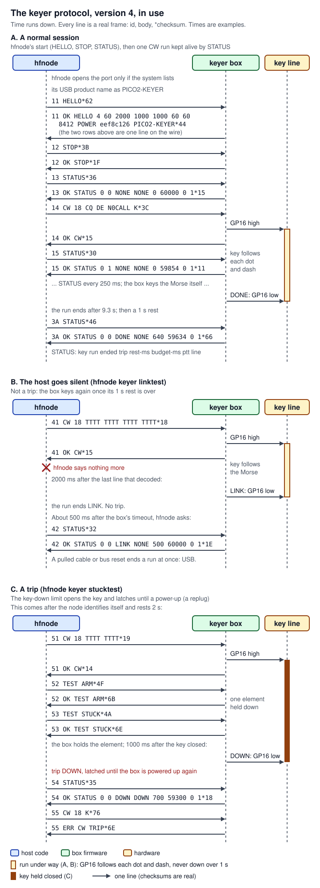
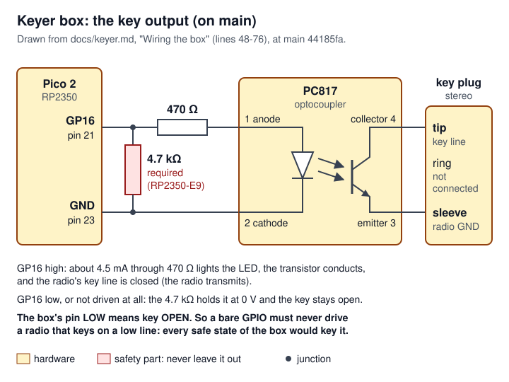

# 08 Keyer box: firmware and protocol

> The keyer box is a Raspberry Pi Pico 2 on a small board that closes a radio's key line when `hfnode` tells it to, over a USB serial port. Every rule and limit it keeps lives in one `no_std` crate, `crates/keyer-core`, which the box's firmware (`firmware/pico2-keyer`, built on Robin's bare-metal OS `rustos`) runs in a loop that never waits, and which `hfnode` also runs as its mock box in tests. This page covers the box on `main` at `44185fa`: the crate, the firmware, the line protocol (version 4), the wiring, and the printed enclosure. The host side (`hfnode`'s keyer rig) is [09 Keyer box: host side](09-keyer-host-side.md); the one-Pico image with a Morse decoder on the second core (PR #31, draft) is [11 Decoder box and the one-Pico image](11-decoder-box-one-pico.md). One Pico 2 has run this firmware: on Robin's Quansheng bench she flashed CI's audited `eef8c126` file, and the box reported build `eef8c126` and the audited limits (the bench record `bench/quansheng.md`, stages H and 2, steps 1-4, project files). No box has been wired to a radio or keyed one, and everything else on this page is untested on hardware.

**Terms used here** (the full list is [17 Glossary](17-glossary.md)):

- **CW**: Morse code sent by switching a radio's transmitter on and off. **Key down** means the transmitter is on, **key up** off.
- **Key line, key jack**: the radio's input for a Morse key. The radio holds it at a few volts; shorting it to the radio's ground ("closing the key") makes the radio transmit. The box behaves like a **straight key**: one switch, closed for each dot or dash.
- **Element**: one dot or dash. **wpm**: words per minute by the standard word "PARIS"; one dot lasts `1200 / wpm` ms.
- **PTT** (push-to-talk): the contact that puts an FM handheld radio into transmit. **MCW**: Morse keyed as an audio tone into an FM radio's microphone while its PTT is held.
- **Optocoupler (PC817)**: an LED and a light-sensitive transistor in one package. Current through the LED turns the transistor on; the two sides share no wire.
- **Pull-down resistor**: a resistor from a pin to ground that holds the pin at 0 V while nothing drives it.
- **RP2350**: the Pico 2's microcontroller. **Pad isolation latch (ISO)**: a per-pin latch that freezes a pin's state until software releases it. **Erratum RP2350-E9**: a chip bug by which an undriven pin with only the chip's internal pull-down can sit near 2 V.
- **Watchdog**: a hardware timer that resets the chip unless software restarts ("feeds") it in time.
- **USB CDC-ACM**: the USB class for a virtual serial port. **UF2**: the file format the Pico 2's boot ROM takes when it appears as a USB drive (the BOOTSEL button held at plug-in).
- **Trip**: a latched fault. A tripped box keys nothing until a power-up or another chip-level reset clears it; unplugging it and plugging it in again is the supported way.
- **PWM** (pulse-width modulation): a hardware counter that switches a pin on and off at a set frequency and duty. The RP2350 has PWM **slices**, each with two **channels** (A and B); a channel's **compare value `CC`** sets how much of each period the pin is high.
- **SIO**: the RP2350's single-cycle I/O block. Writing a bit to its `GPIO_OUT_CLR` register drives that pin low in one store.
- **`IO_BANK0`, `PADS_BANK0`**: the RP2350 blocks that pick each pin's function and set its pad (drive, pulls, input enable, isolation latch). **`OUTOVER`**: a per-pin override in `IO_BANK0` that can force a pin's output low or high whatever drives it.
- **Exception, HardFault**: an exception is the processor stopping normal code to run a handler. HardFault is the Cortex-M33's exception for a crash (a bad memory access, an illegal instruction).
- **Enumeration, bus reset, suspend**: enumeration is the computer finding and configuring a USB device. A **bus reset** (the computer restarting the device's USB state) and **suspend** (the bus going quiet, also how a pulled cable looks) both end the link.
- **Tip, ring, sleeve**: the three contacts of a stereo 3.5 mm plug, from the point back. **Paddle**, **Bug**: radio keyer modes in which the ring is a second key input (the dash paddle), unlike **Straight**.
- **Sidetone**: the tone a radio plays in its own speaker or headphones while it is keyed. **Dummy load**: a resistor that takes a transmitter's power in place of an antenna, so nothing goes on air.
- **photoMOS relay**: a solid-state relay with an LED input, like an optocoupler but switching larger voltages or currents. **BAT85**: a small Schottky diode (a diode with a low forward drop).
- **SWD**: Arm's two-wire debug port, used by a debugger or probe.
- **ELF, vector table, `IMAGE_DEF`, Thumb**: ELF is the compiler's output file. The vector table is the table the processor reads at reset (the first stack pointer, then each handler's address). `IMAGE_DEF` is the metadata block the RP2350's boot ROM needs before it will run an image. Thumb is the Arm instruction set the Cortex-M33 runs; a Thumb address has its lowest bit set.

## Where it lives

| Path (at `main` `44185fa`) | What it holds | Lines |
|---|---|---|
| [`crates/keyer-core/src/lib.rs`](https://github.com/robinonsay/cw-message-gateway/blob/44185fa9a00369c379d9d8af40ca307e3867e860/crates/keyer-core/src/lib.rs) | Protocol version, box name, line and text sizes, speeds, every limit (`limits`), `MCW` timing (`mcw`) | 115 |
| [`crates/keyer-core/src/frame.rs`](https://github.com/robinonsay/cw-message-gateway/blob/44185fa9a00369c379d9d8af40ca307e3867e860/crates/keyer-core/src/frame.rs) | Line format: `<id> <body>*<cs>`, encode, decode, the byte-to-line reader | 284 |
| [`crates/keyer-core/src/morse.rs`](https://github.com/robinonsay/cw-message-gateway/blob/44185fa9a00369c379d9d8af40ca307e3867e860/crates/keyer-core/src/morse.rs) | Morse table and timing: text to key-down/key-up segments | 309 |
| [`crates/keyer-core/src/keyer.rs`](https://github.com/robinonsay/cw-message-gateway/blob/44185fa9a00369c379d9d8af40ca307e3867e860/crates/keyer-core/src/keyer.rs) | The box as a state machine: commands, replies, runs, limits, trips, saved state | 1003 |
| [`crates/keyer-core/src/control.rs`](https://github.com/robinonsay/cw-message-gateway/blob/44185fa9a00369c379d9d8af40ca307e3867e860/crates/keyer-core/src/control.rs) | One pass of the firmware's loop against a `Hardware` trait: USB, pins, pin guards, clock check, watchdog | 453 |
| [`crates/keyer-core/src/keyer/tests.rs`](https://github.com/robinonsay/cw-message-gateway/blob/44185fa9a00369c379d9d8af40ca307e3867e860/crates/keyer-core/src/keyer/tests.rs), [`crates/keyer-core/src/control/tests.rs`](https://github.com/robinonsay/cw-message-gateway/blob/44185fa9a00369c379d9d8af40ca307e3867e860/crates/keyer-core/src/control/tests.rs) | Host tests of the state machine and of the loop against a board in memory | 1325, 987 |
| [`firmware/pico2-keyer/src/main.rs`](https://github.com/robinonsay/cw-message-gateway/blob/44185fa9a00369c379d9d8af40ca307e3867e860/firmware/pico2-keyer/src/main.rs) | The board: start-up order, `Hardware` for the Pico 2, the safe state for faults and panics | 288 |
| [`firmware/pico2-keyer/Cargo.toml`](https://github.com/robinonsay/cw-message-gateway/blob/44185fa9a00369c379d9d8af40ca307e3867e860/firmware/pico2-keyer/Cargo.toml), [`firmware/pico2-keyer/rust-toolchain.toml`](https://github.com/robinonsay/cw-message-gateway/blob/44185fa9a00369c379d9d8af40ca307e3867e860/firmware/pico2-keyer/rust-toolchain.toml), [`firmware/pico2-keyer/.cargo/config.toml`](https://github.com/robinonsay/cw-message-gateway/blob/44185fa9a00369c379d9d8af40ca307e3867e860/firmware/pico2-keyer/.cargo/config.toml), [`firmware/pico2-keyer/build.rs`](https://github.com/robinonsay/cw-message-gateway/blob/44185fa9a00369c379d9d8af40ca307e3867e860/firmware/pico2-keyer/build.rs) | Own Cargo workspace, rustos pin, compiler pin 1.97.0, target, build id | 40, 9, 7, 6 |
| [`firmware/pico2-keyer/build.sh`](https://github.com/robinonsay/cw-message-gateway/blob/44185fa9a00369c379d9d8af40ca307e3867e860/firmware/pico2-keyer/build.sh) | Reproducible build of a commit into `pico2-keyer.uf2` and its SHA-256 | 40 |
| [`firmware/pico2-keyer/uf2.py`](https://github.com/robinonsay/cw-message-gateway/blob/44185fa9a00369c379d9d8af40ca307e3867e860/firmware/pico2-keyer/uf2.py) | ELF to UF2, refusing an image the RP2350 would not boot | 153 |
| [`firmware/pico2-keyer/check_faults.py`](https://github.com/robinonsay/cw-message-gateway/blob/44185fa9a00369c379d9d8af40ca307e3867e860/firmware/pico2-keyer/check_faults.py) | Reads the built machine code: each fault and panic handler's first store opens the key | 158 |
| [`firmware/pico2-keyer/README.md`](https://github.com/robinonsay/cw-message-gateway/blob/44185fa9a00369c379d9d8af40ca307e3867e860/firmware/pico2-keyer/README.md) | How to build and check the firmware | 73 |
| [docs/keyer.md](../keyer.md) | Wiring, flashing, bring-up and operation for people (1529 lines; "Wiring the box" is lines 48-119) | 1529 |
| [docs/keyer-protocol.md](../keyer-protocol.md) | The protocol for people | 195 |
| [`hardware/keyer-box/README.md`](https://github.com/robinonsay/cw-message-gateway/blob/44185fa9a00369c379d9d8af40ca307e3867e860/hardware/keyer-box/README.md), [`hardware/keyer-box/keyer-box.scad`](https://github.com/robinonsay/cw-message-gateway/blob/44185fa9a00369c379d9d8af40ca307e3867e860/hardware/keyer-box/keyer-box.scad) | The 3D-printed enclosure (PR #29) | 135, 747 |
| [`hardware/keyer-box/render.sh`](https://github.com/robinonsay/cw-message-gateway/blob/44185fa9a00369c379d9d8af40ca307e3867e860/hardware/keyer-box/render.sh) | Remakes the enclosure's pictures in `images/` and runs the six `check_*` fit parts with OpenSCAD ([`hardware/keyer-box/README.md:17`](https://github.com/robinonsay/cw-message-gateway/blob/44185fa9a00369c379d9d8af40ca307e3867e860/hardware/keyer-box/README.md#L17)). CI does not run it | 46 |
| [`.github/workflows/ci.yml:144-216`](https://github.com/robinonsay/cw-message-gateway/blob/44185fa9a00369c379d9d8af40ca307e3867e860/.github/workflows/ci.yml#L144-L216) | CI job `pico2-keyer`: fmt, clippy, UF2, `check_faults.py`, the second-checkout build, the artifact | - |

The firmware builds against rustos at commit `8c91507` ([`firmware/pico2-keyer/Cargo.toml:30-31`](https://github.com/robinonsay/cw-message-gateway/blob/44185fa9a00369c379d9d8af40ca307e3867e860/firmware/pico2-keyer/Cargo.toml#L30-L31)), master's merge of rustos #4. That commit is an ancestor of rustos master `80bf599`, and this page cites rustos at `80bf599`. Between the two, the `gpio`, `pwm`, `timer`, `systick`, `watchdog` and `usb` drivers and rustos's `api` crate are identical. `lib.rs` (the `entry!` macro and the fault handlers) gains only `pub mod dma; pub mod adc;` and a doc line, so its code is unchanged but its line numbers at `80bf599` sit 2 lower from line 116 on. `clocks.rs` adds a `clk_adc` start that the keyer never calls, and `common/board.rs` and `common/reg.rs` add the DMA and ADC handles and addresses. The rustos side is in the rustos handover set, page 08: <https://github.com/robinonsay/rustos/blob/claude/handover-docs-us00cn/docs/handover/08-changes-for-cw-gateway.md>.

## How it works

The box has three outputs and one input ([`crates/keyer-core/src/keyer.rs:4-10`](https://github.com/robinonsay/cw-message-gateway/blob/44185fa9a00369c379d9d8af40ca307e3867e860/crates/keyer-core/src/keyer.rs#L4-L10)):

- the **key** (GP16), which lights an optocoupler's LED and so closes a radio's key line (`CW`);
- the **PTT** (GP17), a second optocoupler across an FM handheld's PTT contact (`MCW`);
- the **tone** (GP18), a 700 Hz square wave filtered into the handheld's microphone (`MCW`);
- the **PTT line** (GP19), an input that reads the handheld's PTT contact back.

`hfnode` sends it one text line at a time over USB. `CW 18 CQ DE N0CALL K` makes the box key that text in Morse with its own timing; `STATUS` asks what it is doing; `STOP` opens everything. The box decides every timing and every limit itself, so a crashed or wrong host can never hold the key down longer than the box allows.

The split between the two halves is strict ([`crates/keyer-core/src/lib.rs:7-15`](https://github.com/robinonsay/cw-message-gateway/blob/44185fa9a00369c379d9d8af40ca307e3867e860/crates/keyer-core/src/lib.rs#L7-L15), [`firmware/pico2-keyer/src/main.rs:8-11`](https://github.com/robinonsay/cw-message-gateway/blob/44185fa9a00369c379d9d8af40ca307e3867e860/firmware/pico2-keyer/src/main.rs#L8-L11)):

- **`keyer-core`** holds all the rules, with no hardware, no allocator and no dependencies ([`crates/keyer-core/Cargo.toml:8-10`](https://github.com/robinonsay/cw-message-gateway/blob/44185fa9a00369c379d9d8af40ca307e3867e860/crates/keyer-core/Cargo.toml#L8-L10)). `Keyer` is a pure state machine over time in milliseconds; `Control` is one pass of the firmware loop against a `Hardware` trait. Both run on a PC in the tests.
- **`firmware/pico2-keyer`** is the board: it brings the chip up in a safe order, implements `Hardware` for the Pico 2, and calls `Control::pass` in a loop forever ([`firmware/pico2-keyer/src/main.rs:229-233`](https://github.com/robinonsay/cw-message-gateway/blob/44185fa9a00369c379d9d8af40ca307e3867e860/firmware/pico2-keyer/src/main.rs#L229-L233)).


*Figure: green is the data path, from USB down to the pins, where the firmware's `Hardware` for the Pico 2 turns `set_key`, `set_tone`, `set_ptt` and `set_led` into pin writes and `ptt_line` into a read of GP19; red are the safety parts: the watchdog, pin guards, clock check and fault handlers open the key whatever the data path does, and the saved state keeps a trip and the duty budget across a restart; amber is hardware. The fault handlers are not called by the loop: the processor runs them on a fault, and Rust runs the panic handler on a panic.*

### Start-up order

`main` ([`firmware/pico2-keyer/src/main.rs:174-234`](https://github.com/robinonsay/cw-message-gateway/blob/44185fa9a00369c379d9d8af40ca307e3867e860/firmware/pico2-keyer/src/main.rs#L174-L234)) does exactly this, in this order. The order is the safety argument, so keep it.

1. Take the board singleton and start the GPIO driver, which takes `IO_BANK0` and `PADS_BANK0` out of reset ([`firmware/pico2-keyer/src/main.rs:175-176`](https://github.com/robinonsay/cw-message-gateway/blob/44185fa9a00369c379d9d8af40ca307e3867e860/firmware/pico2-keyer/src/main.rs#L175-L176), [`firmware/pico2/src/gpio/gpio.rs:132-139`](https://github.com/robinonsay/rustos/blob/80bf5998a60a41b3741041062ff7e9c59caf95b2/firmware/pico2/src/gpio/gpio.rs#L132-L139)).
2. **GP16 (key) and GP17 (PTT) become outputs driven low, before anything else** ([`firmware/pico2-keyer/src/main.rs:177-182`](https://github.com/robinonsay/cw-message-gateway/blob/44185fa9a00369c379d9d8af40ca307e3867e860/firmware/pico2-keyer/src/main.rs#L177-L182)). rustos's output constructor writes the low level first, then enables the driver, sets up the pad, connects the pin to SIO, and **clears the pad's isolation latch last** ([`firmware/pico2/src/gpio/gpio.rs:432-461`](https://github.com/robinonsay/rustos/blob/80bf5998a60a41b3741041062ff7e9c59caf95b2/firmware/pico2/src/gpio/gpio.rs#L432-L461)). Until that latch clears, and while the chip is in reset, the pad's reset state and the board's 4.7 kΩ pull-down hold the pin low ([`firmware/pico2-keyer/src/main.rs:15-18`](https://github.com/robinonsay/cw-message-gateway/blob/44185fa9a00369c379d9d8af40ca307e3867e860/firmware/pico2-keyer/src/main.rs#L15-L18)).
3. GP25 (LED) as an output; GP19 (PTT line) as an input with the pad's pull-up ([`firmware/pico2-keyer/src/main.rs:183-186`](https://github.com/robinonsay/cw-message-gateway/blob/44185fa9a00369c379d9d8af40ca307e3867e860/firmware/pico2-keyer/src/main.rs#L183-L186)).
4. Clocks ([`firmware/pico2-keyer/src/main.rs:188`](https://github.com/robinonsay/cw-message-gateway/blob/44185fa9a00369c379d9d8af40ca307e3867e860/firmware/pico2-keyer/src/main.rs#L188)).
5. The tone: the PWM slice is started with its output at 0 % and only then is GP18 connected to it, so the pin is low the moment its latch clears; the firmware writes `false` once more and sets `TONE_UP`, which tells the panic path the tone exists ([`firmware/pico2-keyer/src/main.rs:189-193`](https://github.com/robinonsay/cw-message-gateway/blob/44185fa9a00369c379d9d8af40ca307e3867e860/firmware/pico2-keyer/src/main.rs#L189-L193), [`firmware/pico2/src/pwm.rs:886-911`](https://github.com/robinonsay/rustos/blob/80bf5998a60a41b3741041062ff7e9c59caf95b2/firmware/pico2/src/pwm.rs#L886-L911)).
6. TIMER0 (the loop's millisecond clock), SysTick (the processor's own cycle count) and the watchdog driver ([`firmware/pico2-keyer/src/main.rs:194-196`](https://github.com/robinonsay/cw-message-gateway/blob/44185fa9a00369c379d9d8af40ca307e3867e860/firmware/pico2-keyer/src/main.rs#L194-L196)). The timer driver clears TIMER0's `DBGPAUSE`, so a debugger cannot freeze the box's clock ([`firmware/pico2/src/timer.rs:42-56`](https://github.com/robinonsay/rustos/blob/80bf5998a60a41b3741041062ff7e9c59caf95b2/firmware/pico2/src/timer.rs#L42-L56), [`firmware/pico2/src/timer.rs:189-197`](https://github.com/robinonsay/rustos/blob/80bf5998a60a41b3741041062ff7e9c59caf95b2/firmware/pico2/src/timer.rs#L189-L197)).
7. Read what the last boot saved in watchdog scratch registers 0 and 1 ([`firmware/pico2-keyer/src/main.rs:197-201`](https://github.com/robinonsay/cw-message-gateway/blob/44185fa9a00369c379d9d8af40ca307e3867e860/firmware/pico2-keyer/src/main.rs#L197-L201)). After a power-up they hold nothing.
8. Start USB. The driver holds the USB pull-up off for 10 ms so the host sees a fresh attach, then turns it on; enumeration happens later inside `poll` ([`firmware/pico2-keyer/src/main.rs:202-204`](https://github.com/robinonsay/cw-message-gateway/blob/44185fa9a00369c379d9d8af40ca307e3867e860/firmware/pico2-keyer/src/main.rs#L202-L204), [`firmware/pico2/src/usb/mod.rs:363-424`](https://github.com/robinonsay/rustos/blob/80bf5998a60a41b3741041062ff7e9c59caf95b2/firmware/pico2/src/usb/mod.rs#L363-L424)). This blocks about 10 ms, which is why it comes before the watchdog starts.
9. Classify the reset into `POWER`, `WATCHDOG` or `OTHER` ([`firmware/pico2-keyer/src/main.rs:205-215`](https://github.com/robinonsay/cw-message-gateway/blob/44185fa9a00369c379d9d8af40ca307e3867e860/firmware/pico2-keyer/src/main.rs#L205-L215)). A watchdog timeout the firmware armed is `WATCHDOG`. Power-on, the RUN pin and debugger resets are `POWER`. Everything else is `OTHER`, including the bootrom's own reboot after a UF2 copy ([`firmware/pico2/src/watchdog.rs:378-389`](https://github.com/robinonsay/rustos/blob/80bf5998a60a41b3741041062ff7e9c59caf95b2/firmware/pico2/src/watchdog.rs#L378-L389)), which is why the first boot after flashing reports `OTHER`. `OTHER` also covers a brown-out, the supply glitch detector, a forced watchdog trigger and a chip-level watchdog reset (`ResetReason`, `ForcedBy` and `ChipResetCause`, [`firmware/pico2/src/watchdog.rs:364-416`](https://github.com/robinonsay/rustos/blob/80bf5998a60a41b3741041062ff7e9c59caf95b2/firmware/pico2/src/watchdog.rs#L364-L416)). A brown-out also clears the saved words ([`firmware/pico2/src/watchdog.rs:129-139`](https://github.com/robinonsay/rustos/blob/80bf5998a60a41b3741041062ff7e9c59caf95b2/firmware/pico2/src/watchdog.rs#L129-L139)), so the box starts untripped with a budget of 0, and `hfnode` keys nothing on an `OTHER` box until it is unplugged and plugged in again ([`crates/hfnode/src/keyer/rig.rs:216-225`](https://github.com/robinonsay/cw-message-gateway/blob/44185fa9a00369c379d9d8af40ca307e3867e860/crates/hfnode/src/keyer/rig.rs#L216-L225)).
10. **Start the watchdog at 500 ms** (`WATCHDOG_MS * 1000` µs, [`firmware/pico2-keyer/src/main.rs:216`](https://github.com/robinonsay/cw-message-gateway/blob/44185fa9a00369c379d9d8af40ca307e3867e860/firmware/pico2-keyer/src/main.rs#L216)).
11. Build the `Keyer` from the boot reason and saved words (`Keyer::restore`), stamp the build id, wrap it in `Control`, and loop on `Control::pass` forever ([`firmware/pico2-keyer/src/main.rs:218-233`](https://github.com/robinonsay/cw-message-gateway/blob/44185fa9a00369c379d9d8af40ca307e3867e860/firmware/pico2-keyer/src/main.rs#L218-L233)).

### The main loop

Each pass of `Control::pass` does ten things in a fixed order ([`crates/keyer-core/src/control.rs:7-32`](https://github.com/robinonsay/cw-message-gateway/blob/44185fa9a00369c379d9d8af40ca307e3867e860/crates/keyer-core/src/control.rs#L7-L32), code at [`crates/keyer-core/src/control.rs:368-435`](https://github.com/robinonsay/cw-message-gateway/blob/44185fa9a00369c379d9d8af40ca307e3867e860/crates/keyer-core/src/control.rs#L368-L435)): service USB and read the clocks and the PTT line; end any run if the USB link went away; feed received bytes to the line reader and the keyer; bring the keyer up to now; check the pins against their limits by the loop's own clock; check the clock against the processor's count; drive key, tone, PTT, then the LED; send queued replies; save state for the next boot; feed the watchdog once. Nothing in a pass waits. "Algorithms and processing" below takes each step apart.

There are no interrupt handlers. The USB controller is polled, its interrupt line never enabled (`INTE` = 0, [`firmware/pico2/src/usb/mod.rs:216-217`](https://github.com/robinonsay/rustos/blob/80bf5998a60a41b3741041062ff7e9c59caf95b2/firmware/pico2/src/usb/mod.rs#L216-L217)), and any unexpected interrupt lands in rustos's `DefaultHandler`, which runs `safe_state` and spins ([`firmware/pico2/src/lib.rs:447-469`](https://github.com/robinonsay/rustos/blob/80bf5998a60a41b3741041062ff7e9c59caf95b2/firmware/pico2/src/lib.rs#L447-L469)).

### What keeps the key open

The key line is open (GP16 low) in each of these cases. Each is a never-loosen rule; the canonical list is [13 Safety rules](13-safety-rules.md).

| When | What holds GP16 low | Where |
|---|---|---|
| Power-up, before `main` | The pad's reset state (pulled down, isolated) and the **required** 4.7 kΩ pull-down on the board | [`firmware/pico2-keyer/src/main.rs:15-18`](https://github.com/robinonsay/cw-message-gateway/blob/44185fa9a00369c379d9d8af40ca307e3867e860/firmware/pico2-keyer/src/main.rs#L15-L18), [`docs/keyer.md:59-65`](https://github.com/robinonsay/cw-message-gateway/blob/44185fa9a00369c379d9d8af40ca307e3867e860/docs/keyer.md#L59-L65) |
| First thing in `main` | Driven low, then the isolation latch cleared | [`firmware/pico2-keyer/src/main.rs:177-182`](https://github.com/robinonsay/cw-message-gateway/blob/44185fa9a00369c379d9d8af40ca307e3867e860/firmware/pico2-keyer/src/main.rs#L177-L182) |
| USB enumeration | No run exists until a `CW` line is taken; the first enumeration's bus reset counts as a link loss and ends nothing | [`crates/keyer-core/src/control.rs:379-386`](https://github.com/robinonsay/cw-message-gateway/blob/44185fa9a00369c379d9d8af40ca307e3867e860/crates/keyer-core/src/control.rs#L379-L386) |
| Host silence | No valid line for 2 s ends the run | [`crates/keyer-core/src/lib.rs:58-60`](https://github.com/robinonsay/cw-message-gateway/blob/44185fa9a00369c379d9d8af40ca307e3867e860/crates/keyer-core/src/lib.rs#L58-L60) |
| USB gone (bus reset, suspend, pulled cable, deconfigured) | The run ends on the same pass | [`crates/keyer-core/src/control.rs:379-386`](https://github.com/robinonsay/cw-message-gateway/blob/44185fa9a00369c379d9d8af40ca307e3867e860/crates/keyer-core/src/control.rs#L379-L386), [`crates/keyer-core/src/keyer.rs:752-758`](https://github.com/robinonsay/cw-message-gateway/blob/44185fa9a00369c379d9d8af40ca307e3867e860/crates/keyer-core/src/keyer.rs#L752-L758) |
| Any limit or trip | `stop_run` opens the element output, then the PTT | [`crates/keyer-core/src/keyer.rs:719-738`](https://github.com/robinonsay/cw-message-gateway/blob/44185fa9a00369c379d9d8af40ca307e3867e860/crates/keyer-core/src/keyer.rs#L719-L738) |
| Control loop stalls | The watchdog resets the chip within 500 ms; the reset returns the pad to its reset state | [`firmware/pico2-keyer/src/main.rs:19-21`](https://github.com/robinonsay/cw-message-gateway/blob/44185fa9a00369c379d9d8af40ca307e3867e860/firmware/pico2-keyer/src/main.rs#L19-L21) |
| Panic, HardFault, any unexpected exception | `safe_state()`: one store to SIO `GPIO_OUT_CLR` opens GP16 and GP17 first | [`firmware/pico2-keyer/src/main.rs:246-261`](https://github.com/robinonsay/cw-message-gateway/blob/44185fa9a00369c379d9d8af40ca307e3867e860/firmware/pico2-keyer/src/main.rs#L246-L261) |
| Unplugged | No power; the pull-down holds the pin | [`docs/keyer.md:59-62`](https://github.com/robinonsay/cw-message-gateway/blob/44185fa9a00369c379d9d8af40ca307e3867e860/docs/keyer.md#L59-L62) |

The box never reads the serial port's DTR and RTS lines, so opening or closing the port does nothing by itself ([`firmware/pico2-keyer/src/main.rs:22-23`](https://github.com/robinonsay/cw-message-gateway/blob/44185fa9a00369c379d9d8af40ca307e3867e860/firmware/pico2-keyer/src/main.rs#L22-L23), [`firmware/pico2/src/usb/mod.rs:522-526`](https://github.com/robinonsay/rustos/blob/80bf5998a60a41b3741041062ff7e9c59caf95b2/firmware/pico2/src/usb/mod.rs#L522-L526)).

### Fault and panic handlers

rustos's `entry!` macro takes a `safe_state` function that its HardFault handler and its catch-all `DefaultHandler` call before they spin ([`firmware/pico2/src/lib.rs:380-415`](https://github.com/robinonsay/rustos/blob/80bf5998a60a41b3741041062ff7e9c59caf95b2/firmware/pico2/src/lib.rs#L380-L415), [`firmware/pico2/src/lib.rs:453-469`](https://github.com/robinonsay/rustos/blob/80bf5998a60a41b3741041062ff7e9c59caf95b2/firmware/pico2/src/lib.rs#L453-L469)). The firmware names `safe_state` there ([`firmware/pico2-keyer/src/main.rs:60`](https://github.com/robinonsay/cw-message-gateway/blob/44185fa9a00369c379d9d8af40ca307e3867e860/firmware/pico2-keyer/src/main.rs#L60)) and its own panic handler calls it too ([`firmware/pico2-keyer/src/main.rs:282-288`](https://github.com/robinonsay/cw-message-gateway/blob/44185fa9a00369c379d9d8af40ca307e3867e860/firmware/pico2-keyer/src/main.rs#L282-L288)). `safe_state` does three things, in this order ([`firmware/pico2-keyer/src/main.rs:246-252`](https://github.com/robinonsay/cw-message-gateway/blob/44185fa9a00369c379d9d8af40ca307e3867e860/firmware/pico2-keyer/src/main.rs#L246-L252)):

1. `outputs_open()`: one volatile store of `(1 << 16) | (1 << 17)` to SIO `GPIO_OUT_CLR` at `0xd000_0020`. No driver, no lock, nothing that can fault. Harmless if the pins are not outputs yet ([`firmware/pico2-keyer/src/main.rs:256-261`](https://github.com/robinonsay/cw-message-gateway/blob/44185fa9a00369c379d9d8af40ca307e3867e860/firmware/pico2-keyer/src/main.rs#L256-L261)).
2. `Rp2350Pwm::silence_all()`: compare value `CC` = 0 on every PWM channel through the atomic clear alias, and nothing at all if the PWM block is still in reset ([`firmware/pico2/src/pwm.rs:697-728`](https://github.com/robinonsay/rustos/blob/80bf5998a60a41b3741041062ff7e9c59caf95b2/firmware/pico2/src/pwm.rs#L697-L728)).
3. `tone_low()`: only once GP18 is a PWM output, force GP18's output override to "drive low" (`OUTOVER` bits 13:12 = `0b10` in `GPIO18_CTRL` at `0x4002_8094`, through the clear and set aliases) ([`firmware/pico2-keyer/src/main.rs:268-277`](https://github.com/robinonsay/cw-message-gateway/blob/44185fa9a00369c379d9d8af40ca307e3867e860/firmware/pico2-keyer/src/main.rs#L268-L277)).

After that the handler spins. If the watchdog is running it resets the chip within 500 ms and the box comes back tripped (`WATCHDOG`); if a fault happens before the watchdog starts, the box stays in the handler with every output open until it is unplugged ([`firmware/pico2-keyer/src/main.rs:279-281`](https://github.com/robinonsay/cw-message-gateway/blob/44185fa9a00369c379d9d8af40ca307e3867e860/firmware/pico2-keyer/src/main.rs#L279-L281)). Because no computer can run these handlers, `check_faults.py` reads the built machine code and fails CI unless each handler's first store is the one that opens GP16 and GP17 (see "Firmware build tools" below).

### PWM tones

The tone is a 50 % square wave at `TONE_HZ` = 700 ([`firmware/pico2-keyer/src/main.rs:76-77`](https://github.com/robinonsay/cw-message-gateway/blob/44185fa9a00369c379d9d8af40ca307e3867e860/firmware/pico2-keyer/src/main.rs#L76-L77)) on PWM slice 1 channel A ([`firmware/pico2-keyer/src/main.rs:70-71`](https://github.com/robinonsay/cw-message-gateway/blob/44185fa9a00369c379d9d8af40ca307e3867e860/firmware/pico2-keyer/src/main.rs#L70-L71)). rustos turns a tone off only by setting its compare value `CC` to 0 with the slice left running, never by stopping the slice, because a slice stopped in the high half of a period holds its pin high ([`firmware/pico2/src/pwm.rs:154-163`](https://github.com/robinonsay/rustos/blob/80bf5998a60a41b3741041062ff7e9c59caf95b2/firmware/pico2/src/pwm.rs#L154-L163)). `write(true)` stores the 50 % level and `write(false)` clears that channel's half of `CC`, each in one store; the change takes effect at the next counter wrap, at most one period later (about 1.4 ms at 700 Hz) ([`firmware/pico2/src/pwm.rs:774-804`](https://github.com/robinonsay/rustos/blob/80bf5998a60a41b3741041062ff7e9c59caf95b2/firmware/pico2/src/pwm.rs#L774-L804)). Dropping the handle also turns the tone off ([`firmware/pico2/src/pwm.rs:806-811`](https://github.com/robinonsay/rustos/blob/80bf5998a60a41b3741041062ff7e9c59caf95b2/firmware/pico2/src/pwm.rs#L806-L811)).

### The pins

| Pin | Pico 2 pin | Direction | Use | Why this way |
|---|---|---|---|---|
| GP16 | 21 | out, push-pull | Key: high lights PC817 #1's LED, which closes the radio's key line | Driven low first at boot; 4.7 kΩ pull-down required (E9). `KEY_GPIO` [`firmware/pico2-keyer/src/main.rs:65-67`](https://github.com/robinonsay/cw-message-gateway/blob/44185fa9a00369c379d9d8af40ca307e3867e860/firmware/pico2-keyer/src/main.rs#L65-L67) |
| GP17 | 22 | out, push-pull | PTT: high lights PC817 #2's LED, which closes a handheld's PTT | Same rules as GP16. `PTT_GPIO` [`firmware/pico2-keyer/src/main.rs:68-69`](https://github.com/robinonsay/cw-message-gateway/blob/44185fa9a00369c379d9d8af40ca307e3867e860/firmware/pico2-keyer/src/main.rs#L68-L69) |
| GP18 | 24 | PWM slice 1 A | Tone, 700 Hz, through an RC filter into the handheld's microphone | Connected to the PWM only while its output is 0 %. `TONE_GPIO` [`firmware/pico2-keyer/src/main.rs:70-71`](https://github.com/robinonsay/cw-message-gateway/blob/44185fa9a00369c379d9d8af40ca307e3867e860/firmware/pico2-keyer/src/main.rs#L70-L71) |
| GP19 | 25 | in, pull-up | PTT line: reads the PTT contact through a BAT85 diode; low while anything holds the PTT | An unreadable pin reads low, which refuses `MCW` [`firmware/pico2-keyer/src/main.rs:72-73`](https://github.com/robinonsay/cw-message-gateway/blob/44185fa9a00369c379d9d8af40ca307e3867e860/firmware/pico2-keyer/src/main.rs#L72-L73), [`firmware/pico2-keyer/src/main.rs:160-163`](https://github.com/robinonsay/cw-message-gateway/blob/44185fa9a00369c379d9d8af40ca307e3867e860/firmware/pico2-keyer/src/main.rs#L160-L163) |
| GP25 | on board | out | LED: lit while the key or PTT is closed, flashes 250 ms on, 250 ms off when tripped | Not on a Pico 2 W, where GP25 belongs to the radio chip ([`docs/keyer.md:30-31`](https://github.com/robinonsay/cw-message-gateway/blob/44185fa9a00369c379d9d8af40ca307e3867e860/docs/keyer.md#L30-L31)). [`firmware/pico2-keyer/src/main.rs:74-75`](https://github.com/robinonsay/cw-message-gateway/blob/44185fa9a00369c379d9d8af40ca307e3867e860/firmware/pico2-keyer/src/main.rs#L74-L75) |
| GND | 23 | - | Return for both optocoupler LEDs and the pull-downs | Sits between GP17 and GP18 on the header |

Why GP16-GP19 in particular is not written down in the code or the docs. They are four header pins (21, 22, 24, 25) with a ground pin (23) among them. The pin numbers appear in at least these places, which must change together:

- `main.rs`: the constants ([`firmware/pico2-keyer/src/main.rs:65-75`](https://github.com/robinonsay/cw-message-gateway/blob/44185fa9a00369c379d9d8af40ca307e3867e860/firmware/pico2-keyer/src/main.rs#L65-L75)), the header comments ([`firmware/pico2-keyer/src/main.rs:4-8`](https://github.com/robinonsay/cw-message-gateway/blob/44185fa9a00369c379d9d8af40ca307e3867e860/firmware/pico2-keyer/src/main.rs#L4-L8), [`firmware/pico2-keyer/src/main.rs:15-18`](https://github.com/robinonsay/cw-message-gateway/blob/44185fa9a00369c379d9d8af40ca307e3867e860/firmware/pico2-keyer/src/main.rs#L15-L18)), `outputs_open`'s bits ([`firmware/pico2-keyer/src/main.rs:254-261`](https://github.com/robinonsay/cw-message-gateway/blob/44185fa9a00369c379d9d8af40ca307e3867e860/firmware/pico2-keyer/src/main.rs#L254-L261)), and the `GPIO18_CTRL` address in `tone_low`, guarded by a `const` assert ([`firmware/pico2-keyer/src/main.rs:270-271`](https://github.com/robinonsay/cw-message-gateway/blob/44185fa9a00369c379d9d8af40ca307e3867e860/firmware/pico2-keyer/src/main.rs#L270-L271));
- `check_faults.py`'s `KEY_BIT` and `PTT_BIT` ([`firmware/pico2-keyer/check_faults.py:37-40`](https://github.com/robinonsay/cw-message-gateway/blob/44185fa9a00369c379d9d8af40ca307e3867e860/firmware/pico2-keyer/check_faults.py#L37-L40));
- the wiring in `docs/keyer.md` ([`docs/keyer.md:48-76`](https://github.com/robinonsay/cw-message-gateway/blob/44185fa9a00369c379d9d8af40ca307e3867e860/docs/keyer.md#L48-L76)) and its handheld section;
- `docs/keyer-protocol.md` ([`docs/keyer-protocol.md:27-31`](https://github.com/robinonsay/cw-message-gateway/blob/44185fa9a00369c379d9d8af40ca307e3867e860/docs/keyer-protocol.md#L27-L31)) and the firmware README ([`firmware/pico2-keyer/README.md:22`](https://github.com/robinonsay/cw-message-gateway/blob/44185fa9a00369c379d9d8af40ca307e3867e860/firmware/pico2-keyer/README.md#L22));
- the enclosure's board layout, if the parts move ([`hardware/keyer-box/README.md:62-85`](https://github.com/robinonsay/cw-message-gateway/blob/44185fa9a00369c379d9d8af40ca307e3867e860/hardware/keyer-box/README.md#L62-L85)).

The "A pin change" recipe under "Changing it" lists the checks.

## How it connects


*Figure: the top row is code: `keyer-core` is built into the firmware together with rustos's drivers, and the same `Keyer` runs in `hfnode`'s mock box. The red gate is the safety audit: no build reaches a Pico 2 without it. The bottom row is the box at work, between `hfnode` and a radio.*

| Neighbour | Direction | What crosses | Page |
|---|---|---|---|
| `hfnode` keyer rig (`crates/hfnode/src/keyer/`) | both | Protocol lines over USB CDC-ACM | [09](09-keyer-host-side.md) |
| `hfnode` mock box and self-test | in-process | The same `Keyer` type, run on a mock clock ([`crates/hfnode/src/keyer/mock.rs:245`](https://github.com/robinonsay/cw-message-gateway/blob/44185fa9a00369c379d9d8af40ca307e3867e860/crates/hfnode/src/keyer/mock.rs#L245)) | [09](09-keyer-host-side.md), [12](12-testing.md) |
| Radio key jack | out | PC817 #1 output across tip and sleeve | below |
| FM handheld (PTT, microphone, PTT contact) | out and in | PC817 #2, the filtered tone, the BAT85 sense line | [10](10-uv-k1-handheld.md) |
| rustos | build | GPIO, clocks, timer, SysTick, watchdog, USB, PWM drivers and fault handlers | [rustos 08 Changes made for cw-message-gateway](https://github.com/robinonsay/rustos/blob/claude/handover-docs-us00cn/docs/handover/08-changes-for-cw-gateway.md) |
| The safety audit | process | Every firmware change is a new UF2 that needs a fresh audit and hash | [14](14-audit-bench-flashing.md) |

### The serial link

USB CDC-ACM: the computer sees a serial port; the baud rate means nothing ([`docs/keyer-protocol.md:10-11`](https://github.com/robinonsay/cw-message-gateway/blob/44185fa9a00369c379d9d8af40ca307e3867e860/docs/keyer-protocol.md#L10-L11)). The USB identity is VID `0x2e8a`, PID `0x0009` (the Pico SDK's USB serial IDs), manufacturer `hfnode`, product `PICO2-KEYER`, serial `1` ([`firmware/pico2-keyer/src/main.rs:83-93`](https://github.com/robinonsay/cw-message-gateway/blob/44185fa9a00369c379d9d8af40ca307e3867e860/firmware/pico2-keyer/src/main.rs#L83-L93)). `hfnode` opens a port only if the system lists its USB product name as `PICO2-KEYER` ([`crates/hfnode/src/keyer/link.rs:74-104`](https://github.com/robinonsay/cw-message-gateway/blob/44185fa9a00369c379d9d8af40ca307e3867e860/crates/hfnode/src/keyer/link.rs#L74-L104)), because opening a radio's own port could key it.

### A session, and two ways a run ends early



*Figure: time runs down. In panels A and B the outlined bar marks the run: GP16 follows each dot and dash on and off, never down for more than 1 s ([`crates/keyer-core/src/keyer.rs:608-640`](https://github.com/robinonsay/cw-message-gateway/blob/44185fa9a00369c379d9d8af40ca307e3867e860/crates/keyer-core/src/keyer.rs#L608-L640)). In panel C the solid bar is one element held down. The middle panel is not a trip: after a link timeout the box keys again once its 1 s rest is over. The bottom panel is a real trip, which only a power-up (a replug) clears.*

The lines in the figure are real frames with correct checksums. The `HELLO` and `STATUS` replies have the shapes the crate's own tests check ([`crates/keyer-core/src/keyer/tests.rs:208-215`](https://github.com/robinonsay/cw-message-gateway/blob/44185fa9a00369c379d9d8af40ca307e3867e860/crates/keyer-core/src/keyer/tests.rs#L208-L215), [`crates/keyer-core/src/keyer/tests.rs:236-262`](https://github.com/robinonsay/cw-message-gateway/blob/44185fa9a00369c379d9d8af40ca307e3867e860/crates/keyer-core/src/keyer/tests.rs#L236-L262)). The times and the uptime are examples; the build id `eef8c126` is the one the safety audit's `final-grades.md` (project files) names for the file to flash; the budget values follow the duty-budget rule below for that text at 18 wpm. `hfnode`'s order at start is `HELLO`, `STOP`, `STATUS` ([`crates/hfnode/src/keyer/rig.rs:192-240`](https://github.com/robinonsay/cw-message-gateway/blob/44185fa9a00369c379d9d8af40ca307e3867e860/crates/hfnode/src/keyer/rig.rs#L192-L240)); during a run it sends `STATUS` every 250 ms ([`crates/hfnode/src/keyer/rig.rs:42`](https://github.com/robinonsay/cw-message-gateway/blob/44185fa9a00369c379d9d8af40ca307e3867e860/crates/hfnode/src/keyer/rig.rs#L42)); for a test it sends `TEST ARM` and then the test, during a run ([`crates/hfnode/src/keyer/rig.rs:394-404`](https://github.com/robinonsay/cw-message-gateway/blob/44185fa9a00369c379d9d8af40ca307e3867e860/crates/hfnode/src/keyer/rig.rs#L394-L404)). In panel B, `hfnode keyer linktest` sends nothing after `CW`; its next line is its own `STATUS`, sent at the box's link timeout plus `LINK_MARGIN` (500 ms), so the reply shows 500 ms of rest left ([`crates/hfnode/src/keyer/rig.rs:48`](https://github.com/robinonsay/cw-message-gateway/blob/44185fa9a00369c379d9d8af40ca307e3867e860/crates/hfnode/src/keyer/rig.rs#L48), [`crates/hfnode/src/keyer/rig.rs:413-440`](https://github.com/robinonsay/cw-message-gateway/blob/44185fa9a00369c379d9d8af40ca307e3867e860/crates/hfnode/src/keyer/rig.rs#L413-L440)). In panel C, `hfnode keyer stucktest` first identifies the station with a run of its own and rests 2 s, then sends the `CW` line and the test ([`crates/hfnode/src/keyer/bench.rs:690-702`](https://github.com/robinonsay/cw-message-gateway/blob/44185fa9a00369c379d9d8af40ca307e3867e860/crates/hfnode/src/keyer/bench.rs#L690-L702)).

### Wiring the box (on main)

This is the wiring `docs/keyer.md` gives ([`docs/keyer.md:48-76`](https://github.com/robinonsay/cw-message-gateway/blob/44185fa9a00369c379d9d8af40ca307e3867e860/docs/keyer.md#L48-L76)), drawn from it and nothing else:



*Figure: the key output exactly as [docs/keyer.md](../keyer.md), "Wiring the box", draws it. The pull-down sits on the pin side of the 470 Ω, from GP16 to GND.*

- **GP16 high lights the PC817's LED**, about 4.5 mA through 470 Ω, which closes the key ([`docs/keyer.md:57-58`](https://github.com/robinonsay/cw-message-gateway/blob/44185fa9a00369c379d9d8af40ca307e3867e860/docs/keyer.md#L57-L58)).
- **The 4.7 kΩ pull-down is required, never optional.** It holds GP16 low whenever nothing drives it: while the chip starts, resets, sits in BOOTSEL or is unplugged. Erratum RP2350-E9 can leave an undriven pad with only the internal pull-down at about 2 V, enough to light the LED and key the radio. Raspberry Pi's own fix is an external pull-down of 8.2 kΩ or less; 4.7 kΩ is that with margin ([`docs/keyer.md:59-65`](https://github.com/robinonsay/cw-message-gateway/blob/44185fa9a00369c379d9d8af40ca307e3867e860/docs/keyer.md#L59-L65); BOOTSEL is named at [`docs/keyer.md:981-985`](https://github.com/robinonsay/cw-message-gateway/blob/44185fa9a00369c379d9d8af40ca307e3867e860/docs/keyer.md#L981-L985)). Never loosen.
- **The box's pin LOW means key OPEN.** Every safe state above drives or holds GP16 low, and the optocoupler turns "pin low" into "line open". So **a bare GPIO must never drive a radio that keys on a low line**: wired straight to such a radio, every safe state of the box (power-up, every fault handler, a watchdog reset) would key it, and a Pico that is resetting, in BOOTSEL or unpowered would not leave the line open either. The safety audit graded that NO-GO ([`docs/keyer.md:966-976`](https://github.com/robinonsay/cw-message-gateway/blob/44185fa9a00369c379d9d8af40ca307e3867e860/docs/keyer.md#L966-L976)). A switch (the PC817, or the audit-cleared one-transistor key in [`docs/keyer.md:987-1112`](https://github.com/robinonsay/cw-message-gateway/blob/44185fa9a00369c379d9d8af40ca307e3867e860/docs/keyer.md#L987-L1112)) with the same pull-down is always needed.
- **Polarity on the output**: collector (pin 4) to the tip, the radio's key line, which the radio pulls up; emitter (pin 3) to the sleeve, the radio's ground ([`docs/keyer.md:66-71`](https://github.com/robinonsay/cw-message-gateway/blob/44185fa9a00369c379d9d8af40ca307e3867e860/docs/keyer.md#L66-L71)).
- **A stereo plug, ring left open.** A mono plug shorts ring to sleeve; on a radio set to Paddle or Bug that is a dash paddle held down, which keys continuously with nothing the box can do ([`docs/keyer.md:72-76`](https://github.com/robinonsay/cw-message-gateway/blob/44185fa9a00369c379d9d8af40ca307e3867e860/docs/keyer.md#L72-L76)).
- The optocoupler keeps the computer's ground off the key line only; the audio cable from the radio joins the two grounds anyway ([`docs/keyer.md:66-71`](https://github.com/robinonsay/cw-message-gateway/blob/44185fa9a00369c379d9d8af40ca307e3867e860/docs/keyer.md#L66-L71)).
- **Clip-on ferrites** on the key lead and on the audio cable, at the radio end, before the first test with power: RF getting into GP16 is one of the few things that could key the radio without the node asking ([`docs/keyer.md:77-80`](https://github.com/robinonsay/cw-message-gateway/blob/44185fa9a00369c379d9d8af40ca307e3867e860/docs/keyer.md#L77-L80)).
- If the radio's headphone output carries any DC, a 1 µF film capacitor in series with each audio lead, at the radio end, blocks it; a meter on the jack tells you ([`docs/keyer.md:81-84`](https://github.com/robinonsay/cw-message-gateway/blob/44185fa9a00369c379d9d8af40ca307e3867e860/docs/keyer.md#L81-L84)).
- Never attach an SWD probe or debugger while the box is plugged into a radio: a debugger can rewrite any register, the watchdog's included ([`docs/keyer.md:87-91`](https://github.com/robinonsay/cw-message-gateway/blob/44185fa9a00369c379d9d8af40ca307e3867e860/docs/keyer.md#L87-L91)).
- Before the box goes near a radio, the meter checks in [`docs/keyer.md:93-119`](https://github.com/robinonsay/cw-message-gateway/blob/44185fa9a00369c379d9d8af40ca307e3867e860/docs/keyer.md#L93-L119): 0 V tip to sleeve, open both ways on the diode test, the LED wiring checked by eye and continuity, and 0 V across the 470 Ω with the box plugged in and idle.
- Before the radio: measure its key line (stage zero). The PC817 circuit is for a positive line of 17 V or less drawing 1 mA or less; anything else needs a photoMOS relay driven the same way, with the same pull-down ([`docs/keyer.md:236-252`](https://github.com/robinonsay/cw-message-gateway/blob/44185fa9a00369c379d9d8af40ca307e3867e860/docs/keyer.md#L236-L252)).

The handheld outputs (PC817 #2 on GP17 with its own 4.7 kΩ, the two-pole RC tone filter on GP18, the BAT85 sense on GP19 with a 1 nF capacitor) are in [`docs/keyer.md:569-642`](https://github.com/robinonsay/cw-message-gateway/blob/44185fa9a00369c379d9d8af40ca307e3867e860/docs/keyer.md#L569-L642) and on [10 Quansheng UV-K1 handheld](10-uv-k1-handheld.md).

### The enclosure (PR #29, merged)

`hardware/keyer-box/` holds an OpenSCAD design for a 3D-printed box and snap-on lid around the box's 70 × 50 mm perfboard ([`hardware/keyer-box/README.md:1-10`](https://github.com/robinonsay/cw-message-gateway/blob/44185fa9a00369c379d9d8af40ca307e3867e860/hardware/keyer-box/README.md#L1-L10)). With the defaults it is 75.7 × 55.6 × 24.6 mm outside. The board sits on printed pegs through its four corner holes (no screws); the USB opening is in the left wall and follows the Pico; the key lead leaves through a slot in the right wall that the lid's tongue closes over; a window in the lid shows the Pico's LED ([`hardware/keyer-box/README.md:60-110`](https://github.com/robinonsay/cw-message-gateway/blob/44185fa9a00369c379d9d8af40ca307e3867e860/hardware/keyer-box/README.md#L60-L110)). The board's sizes were measured from a photo, the board thickness (1.6 mm) and key lead diameter (4.0 mm) are assumed, and the LED window's position is an estimate ([`hardware/keyer-box/README.md:23-50`](https://github.com/robinonsay/cw-message-gateway/blob/44185fa9a00369c379d9d8af40ca307e3867e860/hardware/keyer-box/README.md#L23-L50), [`hardware/keyer-box/README.md:108-110`](https://github.com/robinonsay/cw-message-gateway/blob/44185fa9a00369c379d9d8af40ca307e3867e860/hardware/keyer-box/README.md#L108-L110)). Print `part = "peg_test"` first; six `check_*` parts must render empty ([`hardware/keyer-box/README.md:40-42`](https://github.com/robinonsay/cw-message-gateway/blob/44185fa9a00369c379d9d8af40ca307e3867e860/hardware/keyer-box/README.md#L40-L42), [`hardware/keyer-box/README.md:130-135`](https://github.com/robinonsay/cw-message-gateway/blob/44185fa9a00369c379d9d8af40ca307e3867e860/hardware/keyer-box/README.md#L130-L135)). The box changes nothing electrical; a panel jack on the key line would be a wiring change for the audit ([`hardware/keyer-box/README.md:112-115`](https://github.com/robinonsay/cw-message-gateway/blob/44185fa9a00369c379d9d8af40ca307e3867e860/hardware/keyer-box/README.md#L112-L115)). The parameters an engineer changes are under "Enclosure parameters" in "Interfaces and APIs", and the steps to make the STL files are under "Make the enclosure's STL files" in "Programming against it".

## Interfaces and APIs

### The keyer protocol, version 4

**Line format** ([`crates/keyer-core/src/frame.rs:1-12`](https://github.com/robinonsay/cw-message-gateway/blob/44185fa9a00369c379d9d8af40ca307e3867e860/crates/keyer-core/src/frame.rs#L1-L12)): printable ASCII (`0x20`-`0x7E`) ending in `\n`; a `\r` before the `\n` is dropped. At most `MAX_LINE` = 96 characters before the newline ([`crates/keyer-core/src/lib.rs:31-32`](https://github.com/robinonsay/cw-message-gateway/blob/44185fa9a00369c379d9d8af40ca307e3867e860/crates/keyer-core/src/lib.rs#L31-L32)).

```text
<id> <body>*<cs>
```

- `<id>`: two uppercase hex digits. The reply repeats it, so a late reply to an earlier command is never taken for this one. `hfnode` never uses `00` and never repeats an id back to back ([`docs/keyer-protocol.md:17-19`](https://github.com/robinonsay/cw-message-gateway/blob/44185fa9a00369c379d9d8af40ca307e3867e860/docs/keyer-protocol.md#L17-L19)).
- `<cs>`: two uppercase hex digits, the XOR of every byte before the `*` (id, space and body).
- A line that does not decode (too long, not ASCII, no or bad checksum, no id, lower-case hex) is ignored by both sides: no reply, nothing done, and on the box it does **not** count as hearing from the host ([`crates/keyer-core/src/keyer.rs:760-781`](https://github.com/robinonsay/cw-message-gateway/blob/44185fa9a00369c379d9d8af40ca307e3867e860/crates/keyer-core/src/keyer.rs#L760-L781)).

Example: `01 STATUS*35` ([`crates/keyer-core/src/frame.rs:198-200`](https://github.com/robinonsay/cw-message-gateway/blob/44185fa9a00369c379d9d8af40ca307e3867e860/crates/keyer-core/src/frame.rs#L198-L200)).

**Commands** (host to box) and **replies** (box to host). The body must match exactly: `HELLO` with anything after it is `ERR HELLO UNKNOWN`. Code: [`crates/keyer-core/src/keyer.rs:769-873`](https://github.com/robinonsay/cw-message-gateway/blob/44185fa9a00369c379d9d8af40ca307e3867e860/crates/keyer-core/src/keyer.rs#L769-L873).

| Command | Reply on success | When it is taken | Code |
|---|---|---|---|
| `HELLO` | `OK HELLO <version> <run limit s> <link timeout ms> <key-down limit ms> <rest ms> <duty budget s> <ptt limit s> <uptime ms> <boot> <build> <name>` | Always | [`crates/keyer-core/src/keyer.rs:785-798`](https://github.com/robinonsay/cw-message-gateway/blob/44185fa9a00369c379d9d8af40ca307e3867e860/crates/keyer-core/src/keyer.rs#L785-L798) |
| `STATUS` | `OK STATUS <key> <run> <ended> <trip> <rest left ms> <budget ms> <ptt> <line>` | Always | [`crates/keyer-core/src/keyer.rs:799-816`](https://github.com/robinonsay/cw-message-gateway/blob/44185fa9a00369c379d9d8af40ca307e3867e860/crates/keyer-core/src/keyer.rs#L799-L816) |
| `CW <wpm> <text>` | `OK CW`; the key closes on the first element at once | No trip, no run, and every start check below | [`crates/keyer-core/src/keyer.rs:821-827`](https://github.com/robinonsay/cw-message-gateway/blob/44185fa9a00369c379d9d8af40ca307e3867e860/crates/keyer-core/src/keyer.rs#L821-L827) |
| `MCW <wpm> <text>` | `OK MCW`; the PTT closes at once, the tone starts 500 ms later | As `CW`, plus the `MCW` checks | [`crates/keyer-core/src/keyer.rs:821-827`](https://github.com/robinonsay/cw-message-gateway/blob/44185fa9a00369c379d9d8af40ca307e3867e860/crates/keyer-core/src/keyer.rs#L821-L827) |
| `STOP` | `OK STOP`; every output open, any run ended `STOP` | Always (also with nothing running) | [`crates/keyer-core/src/keyer.rs:817-820`](https://github.com/robinonsay/cw-message-gateway/blob/44185fa9a00369c379d9d8af40ca307e3867e860/crates/keyer-core/src/keyer.rs#L817-L820) |
| `TEST ARM` | `OK TEST ARM`; the next test within 2 s is taken, once | Always | [`crates/keyer-core/src/keyer.rs:828-831`](https://github.com/robinonsay/cw-message-gateway/blob/44185fa9a00369c379d9d8af40ca307e3867e860/crates/keyer-core/src/keyer.rs#L828-L831) |
| `TEST HANG` | `OK TEST HANG`; at the next key-down (at once if the key or tone is on) the control loop stops, so the watchdog must reset the chip | During a run, armed | [`crates/keyer-core/src/keyer.rs:845-851`](https://github.com/robinonsay/cw-message-gateway/blob/44185fa9a00369c379d9d8af40ca307e3867e860/crates/keyer-core/src/keyer.rs#L845-L851) |
| `TEST STUCK` | `OK TEST STUCK`; the current or next element is held, so the key-down limit must trip the box | During a run, armed | [`crates/keyer-core/src/keyer.rs:852-857`](https://github.com/robinonsay/cw-message-gateway/blob/44185fa9a00369c379d9d8af40ca307e3867e860/crates/keyer-core/src/keyer.rs#L852-L857) |
| `TEST HOLD` | `OK TEST HOLD`; the PTT stays closed after the text, so the PTT limit must trip the box. Host tests only | During an `MCW` run, armed | [`crates/keyer-core/src/keyer.rs:858-863`](https://github.com/robinonsay/cw-message-gateway/blob/44185fa9a00369c379d9d8af40ca307e3867e860/crates/keyer-core/src/keyer.rs#L858-L863) |

**`HELLO` fields** (the real box on main answers `OK HELLO 4 60 2000 1000 1000 60 60 <uptime> <boot> <build> PICO2-KEYER`, [`crates/keyer-core/src/keyer/tests.rs:208-215`](https://github.com/robinonsay/cw-message-gateway/blob/44185fa9a00369c379d9d8af40ca307e3867e860/crates/keyer-core/src/keyer/tests.rs#L208-L215)):

| # | Field | Value on main | Source |
|---|---|---|---|
| 1 | version | `4` | `VERSION` [`crates/keyer-core/src/lib.rs:24-26`](https://github.com/robinonsay/cw-message-gateway/blob/44185fa9a00369c379d9d8af40ca307e3867e860/crates/keyer-core/src/lib.rs#L24-L26) |
| 2 | run limit, s | `60` | `RUN_MS / 1000` |
| 3 | link timeout, ms | `2000` | `LINK_TIMEOUT_MS` |
| 4 | key-down limit, ms | `1000` | `KEY_DOWN_MS` |
| 5 | rest, ms | `1000` | `REST_MS` |
| 6 | duty budget, s | `60` | `DUTY_BUDGET_MS / 1000` |
| 7 | PTT limit, s | `60` | `PTT_MS / 1000` |
| 8 | uptime, ms | ms since the box's clock started at boot | `Keyer::now` |
| 9 | boot | `POWER`, `WATCHDOG` or `OTHER` | [`crates/keyer-core/src/keyer.rs:77-103`](https://github.com/robinonsay/cw-message-gateway/blob/44185fa9a00369c379d9d8af40ca307e3867e860/crates/keyer-core/src/keyer.rs#L77-L103) |
| 10 | build | 1-12 of `[A-Za-z0-9._-]` (CI: the commit's first 8 hex digits), `-` for a working-tree build, `?` if the stamped id is malformed | [`crates/keyer-core/src/keyer.rs:447-457`](https://github.com/robinonsay/cw-message-gateway/blob/44185fa9a00369c379d9d8af40ca307e3867e860/crates/keyer-core/src/keyer.rs#L447-L457) |
| 11 | name | `PICO2-KEYER` | `NAME` [`crates/keyer-core/src/lib.rs:28-29`](https://github.com/robinonsay/cw-message-gateway/blob/44185fa9a00369c379d9d8af40ca307e3867e860/crates/keyer-core/src/lib.rs#L28-L29) |

`hfnode` refuses a box with another name, another version, or any limit looser than these (`check_hello`, [`crates/hfnode/src/keyer.rs:376-439`](https://github.com/robinonsay/cw-message-gateway/blob/44185fa9a00369c379d9d8af40ca307e3867e860/crates/hfnode/src/keyer.rs#L376-L439)), and with `[keyer] firmware_build` set it refuses any other build ([`crates/hfnode/src/keyer.rs:441-451`](https://github.com/robinonsay/cw-message-gateway/blob/44185fa9a00369c379d9d8af40ca307e3867e860/crates/hfnode/src/keyer.rs#L441-L451)).

**`STATUS` fields**:

| # | Field | Values |
|---|---|---|
| 1 | key | `1` while the key is closed, else `0` |
| 2 | run | `1` while a run is under way |
| 3 | ended | How the last run ended (table below); `NONE` before the first |
| 4 | trip | The latched trip (table below); `NONE` if none |
| 5 | rest left, ms | Rest still to go after the last run; `0` during a run |
| 6 | budget, ms | Keyed time the duty budget allows now, never below 0 (a budget in debt reads 0) |
| 7 | ptt | `1` while the PTT is closed |
| 8 | line | `1` while the PTT line reads high (PTT contact open, or nothing connected) |

**`<ended>` values** (`Ended`, [`crates/keyer-core/src/keyer.rs:105-162`](https://github.com/robinonsay/cw-message-gateway/blob/44185fa9a00369c379d9d8af40ca307e3867e860/crates/keyer-core/src/keyer.rs#L105-L162)):

| Value | Meaning |
|---|---|
| `NONE` | No run since the box started |
| `DONE` | The text went out |
| `STOP` | `STOP` |
| `LINK` | No valid line for the 2 s link timeout |
| `LIMIT` | The 60 s run limit |
| `DOWN` | The box tripped during the run (key-down limit, or a firmware pin, slow-pass or clock trip; `<trip>` says which) |
| `USB` | The USB link went away: bus reset, suspend (also how a pulled cable looks), or deconfigured. Closing the port is none of these |
| `PTT` | The PTT limit (the box tripped) |
| `LINE` | `MCW`: the PTT line did not read low 100 ms after the box closed the PTT (cable out, radio off, line not wired). Not a trip |

**`<trip>` values** (`Trip`, [`crates/keyer-core/src/keyer.rs:164-220`](https://github.com/robinonsay/cw-message-gateway/blob/44185fa9a00369c379d9d8af40ca307e3867e860/crates/keyer-core/src/keyer.rs#L164-L220)). A trip opens every output, refuses every `CW` and `MCW` with `TRIP`, and survives a watchdog reset. Only a chip-level reset clears it, because only that clears the scratch registers it is saved in: power-on (unplugging and plugging in again, the supported way), a brown-out, the RUN pin or a debugger reset ([`firmware/pico2/src/watchdog.rs:129-139`](https://github.com/robinonsay/rustos/blob/80bf5998a60a41b3741041062ff7e9c59caf95b2/firmware/pico2/src/watchdog.rs#L129-L139), [`crates/keyer-core/src/keyer.rs:420-435`](https://github.com/robinonsay/cw-message-gateway/blob/44185fa9a00369c379d9d8af40ca307e3867e860/crates/keyer-core/src/keyer.rs#L420-L435)).

| Value | Cause | Set by |
|---|---|---|
| `NONE` | No trip | - |
| `DOWN` | Key or tone on for the 1 s key-down limit (on the keyer's timeline) | [`crates/keyer-core/src/keyer.rs:574`](https://github.com/robinonsay/cw-message-gateway/blob/44185fa9a00369c379d9d8af40ca307e3867e860/crates/keyer-core/src/keyer.rs#L574) |
| `PIN` | The loop saw its key or tone pin on for the key-down limit, or its PTT pin down for the PTT limit, by its own clock readings | [`crates/keyer-core/src/control.rs:202-210`](https://github.com/robinonsay/cw-message-gateway/blob/44185fa9a00369c379d9d8af40ca307e3867e860/crates/keyer-core/src/control.rs#L202-L210) |
| `SLOW` | A pass came more than 10 ms after the last with the key or tone on | [`crates/keyer-core/src/control.rs:202-207`](https://github.com/robinonsay/cw-message-gateway/blob/44185fa9a00369c379d9d8af40ca307e3867e860/crates/keyer-core/src/control.rs#L202-L207) |
| `CLOCK` | The loop's clock stopped or slowed against the processor's cycle count (or the count stopped); the loop also stops feeding the watchdog | [`crates/keyer-core/src/control.rs:121-136`](https://github.com/robinonsay/cw-message-gateway/blob/44185fa9a00369c379d9d8af40ca307e3867e860/crates/keyer-core/src/control.rs#L121-L136), [`crates/keyer-core/src/control.rs:408-412`](https://github.com/robinonsay/cw-message-gateway/blob/44185fa9a00369c379d9d8af40ca307e3867e860/crates/keyer-core/src/control.rs#L408-L412) |
| `WATCHDOG` | The box restarted because its watchdog fired | [`crates/keyer-core/src/keyer.rs:406-409`](https://github.com/robinonsay/cw-message-gateway/blob/44185fa9a00369c379d9d8af40ca307e3867e860/crates/keyer-core/src/keyer.rs#L406-L409) |
| `PTT` | PTT down for the 60 s PTT limit | [`crates/keyer-core/src/keyer.rs:575`](https://github.com/robinonsay/cw-message-gateway/blob/44185fa9a00369c379d9d8af40ca307e3867e860/crates/keyer-core/src/keyer.rs#L575) |
| `LINE` | The PTT line still read low 100 ms after the box opened the PTT: something else holds it | [`crates/keyer-core/src/keyer.rs:591-603`](https://github.com/robinonsay/cw-message-gateway/blob/44185fa9a00369c379d9d8af40ca307e3867e860/crates/keyer-core/src/keyer.rs#L591-L603) |

**Errors** are `ERR <command> <code>` ([`crates/keyer-core/src/keyer.rs:34-36`](https://github.com/robinonsay/cw-message-gateway/blob/44185fa9a00369c379d9d8af40ca307e3867e860/crates/keyer-core/src/keyer.rs#L34-L36), `StartError` [`crates/keyer-core/src/keyer.rs:964-1000`](https://github.com/robinonsay/cw-message-gateway/blob/44185fa9a00369c379d9d8af40ca307e3867e860/crates/keyer-core/src/keyer.rs#L964-L1000)). The start checks run in this order, so the first that fails names the code ([`crates/keyer-core/src/keyer.rs:876-934`](https://github.com/robinonsay/cw-message-gateway/blob/44185fa9a00369c379d9d8af40ca307e3867e860/crates/keyer-core/src/keyer.rs#L876-L934)):

| Order | Code | `CW` refused when | `MCW` refused when |
|---|---|---|---|
| 1 | `TRIP` | The box is tripped | Same |
| 2 | `RUN` | A run is under way | Same |
| 3 | `LEN` | No space after the word (`CW` alone) | Same |
| 4 | `WPM` | Speed not 1-3 digits, or outside 5-50 | Same |
| 5 | `LEN`, `CHAR` | Text empty, all spaces or over 30 characters (`LEN`); a character not in the table, lower case included (`CHAR`) | Same |
| 6 | `LIMIT` | Morse length over the 60 s run limit | Lead 500 ms + Morse + tail 200 ms not **under** both the 60 s PTT limit and the 60 s run limit |
| 7 | `LINE` | The PTT's last move is still waiting for its 100 ms line check | Same, or the PTT line reads low |
| 8 | `REST` | Less than 1 s since the last run ended | Same |
| 9 | `DUTY` | The budget holds less than the run's key-down time | The budget holds less than the run's whole PTT time |

| Other errors | When |
|---|---|
| `ERR TEST RUN` | `TEST HANG` or `TEST STUCK` with no run; `TEST HOLD` with no `MCW` run. The arm is not used up |
| `ERR TEST ARM` | A test with no `TEST ARM` before it, or more than 2 s after it. The arm is used up either way |
| `ERR TEST UNKNOWN` | `TEST` followed by anything else |
| `ERR <word> UNKNOWN` | Any other line; `<word>` is the first word cut to 12 characters, `?` if empty |

`docs/keyer-protocol.md`'s error table lists `LINE` for `MCW` only; the code also refuses `CW` with `LINE` in the 100 ms after a PTT move ([`crates/keyer-core/src/keyer.rs:924-928`](https://github.com/robinonsay/cw-message-gateway/blob/44185fa9a00369c379d9d8af40ca307e3867e860/crates/keyer-core/src/keyer.rs#L924-L928)), and `hfnode` knows the code ([`crates/hfnode/src/keyer/proto.rs:130`](https://github.com/robinonsay/cw-message-gateway/blob/44185fa9a00369c379d9d8af40ca307e3867e860/crates/hfnode/src/keyer/proto.rs#L130)). See "Known bugs".

**Version history** ([`crates/keyer-core/src/lib.rs:24-25`](https://github.com/robinonsay/cw-message-gateway/blob/44185fa9a00369c379d9d8af40ca307e3867e860/crates/keyer-core/src/lib.rs#L24-L25)): 3 added the `CLOCK` and `WATCHDOG` trips to `STATUS`; 4 added `MCW`, the PTT output, the PTT line and `TEST HOLD`. PR #31 (draft, not on main) makes it 5 ([`crates/keyer-core/src/lib.rs:25-29`](https://github.com/robinonsay/cw-message-gateway/blob/bc5062ae4f56ae1f9949b3b067218c7e675d88f8/crates/keyer-core/src/lib.rs#L25-L29)).

### `keyer-core` constants (`lib.rs`)

Every limit below is a **never-loosen** rule. hfnode bounds what it accepts from `HELLO` by these same constants ([`crates/hfnode/src/keyer.rs:95-116`](https://github.com/robinonsay/cw-message-gateway/blob/44185fa9a00369c379d9d8af40ca307e3867e860/crates/hfnode/src/keyer.rs#L95-L116)).

| Constant | Value | Meaning | Line |
|---|---|---|---|
| `VERSION` | `4` | Protocol version in `HELLO` | [`crates/keyer-core/src/lib.rs:26`](https://github.com/robinonsay/cw-message-gateway/blob/44185fa9a00369c379d9d8af40ca307e3867e860/crates/keyer-core/src/lib.rs#L26) |
| `NAME` | `"PICO2-KEYER"` | Last field of `HELLO`; also the USB product name | [`crates/keyer-core/src/lib.rs:29`](https://github.com/robinonsay/cw-message-gateway/blob/44185fa9a00369c379d9d8af40ca307e3867e860/crates/keyer-core/src/lib.rs#L29) |
| `MAX_LINE` | `96` | Longest line, without its newline | [`crates/keyer-core/src/lib.rs:32`](https://github.com/robinonsay/cw-message-gateway/blob/44185fa9a00369c379d9d8af40ca307e3867e860/crates/keyer-core/src/lib.rs#L32) |
| `MAX_TEXT` | `30` | Most characters in one `CW` or `MCW` run (the IC-7300's keyer takes 30 too) | [`crates/keyer-core/src/lib.rs:36`](https://github.com/robinonsay/cw-message-gateway/blob/44185fa9a00369c379d9d8af40ca307e3867e860/crates/keyer-core/src/lib.rs#L36) |
| `MIN_WPM`, `MAX_WPM` | `5`, `50` | Accepted speeds | [`crates/keyer-core/src/lib.rs:39-40`](https://github.com/robinonsay/cw-message-gateway/blob/44185fa9a00369c379d9d8af40ca307e3867e860/crates/keyer-core/src/lib.rs#L39-L40) |
| `limits::KEY_DOWN_MS` | `1_000` ms | Longest key-down (or tone element); past it the box trips `DOWN`. No element is longer than a dash at 5 wpm (720 ms) | [`crates/keyer-core/src/lib.rs:45-48`](https://github.com/robinonsay/cw-message-gateway/blob/44185fa9a00369c379d9d8af40ca307e3867e860/crates/keyer-core/src/lib.rs#L45-L48) |
| `limits::RUN_MS` | `60_000` ms | Longest run; longer text is refused, a run is ended at it | [`crates/keyer-core/src/lib.rs:49-51`](https://github.com/robinonsay/cw-message-gateway/blob/44185fa9a00369c379d9d8af40ca307e3867e860/crates/keyer-core/src/lib.rs#L49-L51) |
| `limits::PTT_MS` | `60_000` ms | Longest PTT-down, whatever holds it; past it the box trips `PTT`. No longer than the run limit | [`crates/keyer-core/src/lib.rs:52-57`](https://github.com/robinonsay/cw-message-gateway/blob/44185fa9a00369c379d9d8af40ca307e3867e860/crates/keyer-core/src/lib.rs#L52-L57) |
| `limits::LINK_TIMEOUT_MS` | `2_000` ms | A run stops when no valid line has arrived for this long | [`crates/keyer-core/src/lib.rs:58-60`](https://github.com/robinonsay/cw-message-gateway/blob/44185fa9a00369c379d9d8af40ca307e3867e860/crates/keyer-core/src/lib.rs#L58-L60) |
| `limits::WATCHDOG_MS` | `500` ms | The hardware watchdog's timeout | [`crates/keyer-core/src/lib.rs:61-62`](https://github.com/robinonsay/cw-message-gateway/blob/44185fa9a00369c379d9d8af40ca307e3867e860/crates/keyer-core/src/lib.rs#L61-L62) |
| `limits::REST_MS` | `1_000` ms | Key up at least this long after any run before the next | [`crates/keyer-core/src/lib.rs:63-66`](https://github.com/robinonsay/cw-message-gateway/blob/44185fa9a00369c379d9d8af40ca307e3867e860/crates/keyer-core/src/lib.rs#L63-L66) |
| `limits::MIN_GAP_MS` | `1200 / MAX_WPM` = `24` ms | A key-up shorter than this does not restart the key-down limit | [`crates/keyer-core/src/lib.rs:67-69`](https://github.com/robinonsay/cw-message-gateway/blob/44185fa9a00369c379d9d8af40ca307e3867e860/crates/keyer-core/src/lib.rs#L67-L69) |
| `limits::DUTY_BUDGET_MS` | `60_000` ms | The duty budget's ceiling (see the algorithm below) | [`crates/keyer-core/src/lib.rs:70-78`](https://github.com/robinonsay/cw-message-gateway/blob/44185fa9a00369c379d9d8af40ca307e3867e860/crates/keyer-core/src/lib.rs#L70-L78) |
| `limits::ARM_MS` | `2_000` ms | A test is taken only this soon after `TEST ARM` | [`crates/keyer-core/src/lib.rs:79-80`](https://github.com/robinonsay/cw-message-gateway/blob/44185fa9a00369c379d9d8af40ca307e3867e860/crates/keyer-core/src/lib.rs#L79-L80) |
| `limits::SLOW_PASS_MS` | `10` ms | A pass slower than this with the key or tone on trips `SLOW` | [`crates/keyer-core/src/lib.rs:81-84`](https://github.com/robinonsay/cw-message-gateway/blob/44185fa9a00369c379d9d8af40ca307e3867e860/crates/keyer-core/src/lib.rs#L81-L84) |
| `limits::HANG_OPEN_MS` | `WATCHDOG_MS + 500` = `1_000` ms | After `TEST HANG`, the loop opens everything itself if the watchdog has not reset the chip by then | [`crates/keyer-core/src/lib.rs:85-88`](https://github.com/robinonsay/cw-message-gateway/blob/44185fa9a00369c379d9d8af40ca307e3867e860/crates/keyer-core/src/lib.rs#L85-L88) |
| `limits::CLOCK_CHECK_MS` | `50` ms | Window of the clock check | [`crates/keyer-core/src/lib.rs:89-94`](https://github.com/robinonsay/cw-message-gateway/blob/44185fa9a00369c379d9d8af40ca307e3867e860/crates/keyer-core/src/lib.rs#L89-L94) |
| `limits::RESTART_CHARGE_MS` | `HANG_OPEN_MS` = `1_000` ms | Charged to the budget after a restart that saved the transmitter keyed | [`crates/keyer-core/src/lib.rs:95-100`](https://github.com/robinonsay/cw-message-gateway/blob/44185fa9a00369c379d9d8af40ca307e3867e860/crates/keyer-core/src/lib.rs#L95-L100) |
| `mcw::LEAD_MS` | `500` ms | PTT down before the first tone element | [`crates/keyer-core/src/lib.rs:105-107`](https://github.com/robinonsay/cw-message-gateway/blob/44185fa9a00369c379d9d8af40ca307e3867e860/crates/keyer-core/src/lib.rs#L105-L107) |
| `mcw::TAIL_MS` | `200` ms | PTT held after the last element | [`crates/keyer-core/src/lib.rs:108-109`](https://github.com/robinonsay/cw-message-gateway/blob/44185fa9a00369c379d9d8af40ca307e3867e860/crates/keyer-core/src/lib.rs#L108-L109) |
| `mcw::LINE_MS` | `100` ms | The PTT line must show the PTT's last move this long after it | [`crates/keyer-core/src/lib.rs:110-114`](https://github.com/robinonsay/cw-message-gateway/blob/44185fa9a00369c379d9d8af40ca307e3867e860/crates/keyer-core/src/lib.rs#L110-L114) |

### `frame.rs`

| Item | Signature | Behaviour | Line |
|---|---|---|---|
| `checksum` | `pub fn checksum(bytes: &[u8]) -> u8` | XOR of all bytes | [`crates/keyer-core/src/frame.rs:17-20`](https://github.com/robinonsay/cw-message-gateway/blob/44185fa9a00369c379d9d8af40ca307e3867e860/crates/keyer-core/src/frame.rs#L17-L20) |
| `Line` | `pub struct Line { buf: [u8; MAX_LINE], len }` | A line without its newline, fixed buffer; `new` (a `const fn`), `as_bytes`, `as_str`, `len`, `is_empty`, `Debug`, and `Default` ([`crates/keyer-core/src/frame.rs:55-59`](https://github.com/robinonsay/cw-message-gateway/blob/44185fa9a00369c379d9d8af40ca307e3867e860/crates/keyer-core/src/frame.rs#L55-L59)) | [`crates/keyer-core/src/frame.rs:22-65`](https://github.com/robinonsay/cw-message-gateway/blob/44185fa9a00369c379d9d8af40ca307e3867e860/crates/keyer-core/src/frame.rs#L22-L65) |
| `impl fmt::Write for Line` | `write_str(&mut self, &str) -> fmt::Result` | Fails and leaves the line unchanged if the text would pass 96 bytes or is not printable ASCII | [`crates/keyer-core/src/frame.rs:67-79`](https://github.com/robinonsay/cw-message-gateway/blob/44185fa9a00369c379d9d8af40ca307e3867e860/crates/keyer-core/src/frame.rs#L67-L79) |
| `encode` | `pub fn encode(id: u8, body: fmt::Arguments<'_>) -> Option<Line>` | `"{id:02X} "` + body + `"*{cs:02X}"`; `None` if too long or not printable | [`crates/keyer-core/src/frame.rs:81-91`](https://github.com/robinonsay/cw-message-gateway/blob/44185fa9a00369c379d9d8af40ca307e3867e860/crates/keyer-core/src/frame.rs#L81-L91) |
| `FrameError` | `TooLong`, `NotAscii`, `NoChecksum`, `BadChecksum`, `NoId` | Why a line was ignored | [`crates/keyer-core/src/frame.rs:93-101`](https://github.com/robinonsay/cw-message-gateway/blob/44185fa9a00369c379d9d8af40ca307e3867e860/crates/keyer-core/src/frame.rs#L93-L101) |
| `decode` | `pub fn decode(line: &[u8]) -> Result<(u8, &str), FrameError>` | Drops a trailing `\r`; checks length, ASCII, the last `*` and two uppercase hex digits after it, the checksum, then `"HH "` and a non-empty body | [`crates/keyer-core/src/frame.rs:103-129`](https://github.com/robinonsay/cw-message-gateway/blob/44185fa9a00369c379d9d8af40ca307e3867e860/crates/keyer-core/src/frame.rs#L103-L129) |
| `LineReader` | `pub struct LineReader { buf: [u8; MAX_LINE + 1], len, overflow }`; `pub const fn new() -> Self` ([`crates/keyer-core/src/frame.rs:152-159`](https://github.com/robinonsay/cw-message-gateway/blob/44185fa9a00369c379d9d8af40ca307e3867e860/crates/keyer-core/src/frame.rs#L152-L159)), `Default` ([`crates/keyer-core/src/frame.rs:186-190`](https://github.com/robinonsay/cw-message-gateway/blob/44185fa9a00369c379d9d8af40ca307e3867e860/crates/keyer-core/src/frame.rs#L186-L190)) | Bytes in, lines out; one extra byte so a `\r` fits. | [`crates/keyer-core/src/frame.rs:144-150`](https://github.com/robinonsay/cw-message-gateway/blob/44185fa9a00369c379d9d8af40ca307e3867e860/crates/keyer-core/src/frame.rs#L144-L150) |
| `LineReader::push` | `pub fn push(&mut self, b: u8) -> Option<&[u8]>` | At `\n`, the line (without it), unless it overflowed, in which case the whole line is dropped up to its newline | [`crates/keyer-core/src/frame.rs:161-177`](https://github.com/robinonsay/cw-message-gateway/blob/44185fa9a00369c379d9d8af40ca307e3867e860/crates/keyer-core/src/frame.rs#L161-L177) |
| `LineReader::clear` | `pub fn clear(&mut self)` | Forget a part-line (after a link loss) | [`crates/keyer-core/src/frame.rs:179-183`](https://github.com/robinonsay/cw-message-gateway/blob/44185fa9a00369c379d9d8af40ca307e3867e860/crates/keyer-core/src/frame.rs#L179-L183) |

### `morse.rs`

| Item | Signature | Behaviour | Line |
|---|---|---|---|
| `TABLE` (private) | `&[(u8, &[u8])]` | A-Z, 0-9 and `. , ? ' / ( ) : = + - " @`; checked against the decoder crate's table in a test | [`crates/keyer-core/src/morse.rs:10-61`](https://github.com/robinonsay/cw-message-gateway/blob/44185fa9a00369c379d9d8af40ca307e3867e860/crates/keyer-core/src/morse.rs#L10-L61) |
| `MAX_ELEMENTS` | `6` | Most elements in one character | [`crates/keyer-core/src/morse.rs:63-64`](https://github.com/robinonsay/cw-message-gateway/blob/44185fa9a00369c379d9d8af40ca307e3867e860/crates/keyer-core/src/morse.rs#L63-L64) |
| `MAX_SEGMENTS` | `MAX_TEXT * 12` = `360` | Segment buffer size | [`crates/keyer-core/src/morse.rs:66-68`](https://github.com/robinonsay/cw-message-gateway/blob/44185fa9a00369c379d9d8af40ca307e3867e860/crates/keyer-core/src/morse.rs#L66-L68) |
| `pattern` | `pub fn pattern(c: u8) -> Option<&'static [u8]>` | Dots and dashes for an upper-case character | [`crates/keyer-core/src/morse.rs:70-73`](https://github.com/robinonsay/cw-message-gateway/blob/44185fa9a00369c379d9d8af40ca307e3867e860/crates/keyer-core/src/morse.rs#L70-L73) |
| `TextError` | `Len`, `Char` | Empty, all spaces or over 30; a character not in the table | [`crates/keyer-core/src/morse.rs:75-82`](https://github.com/robinonsay/cw-message-gateway/blob/44185fa9a00369c379d9d8af40ca307e3867e860/crates/keyer-core/src/morse.rs#L75-L82) |
| `dot_ms` | `pub fn dot_ms(wpm: u32) -> Result<u32, WpmError>` | `1200 / wpm`, rounded down, for 5-50 wpm | [`crates/keyer-core/src/morse.rs:88-95`](https://github.com/robinonsay/cw-message-gateway/blob/44185fa9a00369c379d9d8af40ca307e3867e860/crates/keyer-core/src/morse.rs#L88-L95) |
| `WpmError` | unit struct | A speed outside 5-50 | [`crates/keyer-core/src/morse.rs:84-86`](https://github.com/robinonsay/cw-message-gateway/blob/44185fa9a00369c379d9d8af40ca307e3867e860/crates/keyer-core/src/morse.rs#L84-L86) |
| `Segment` | `{ down: bool, units: u8 }` | Down 1 or 3 dots; up 1, 3 or 7 | [`crates/keyer-core/src/morse.rs:97-103`](https://github.com/robinonsay/cw-message-gateway/blob/44185fa9a00369c379d9d8af40ca307e3867e860/crates/keyer-core/src/morse.rs#L97-L103) |
| `Segments` | `{ segs: [Segment; MAX_SEGMENTS], len }` (private fields), `Copy` | The layout of one text | [`crates/keyer-core/src/morse.rs:104-117`](https://github.com/robinonsay/cw-message-gateway/blob/44185fa9a00369c379d9d8af40ca307e3867e860/crates/keyer-core/src/morse.rs#L104-L117) |
| `Segments::of` | `pub fn of(text: &[u8]) -> Result<Segments, TextError>` | Lays out the segments, first element to last | [`crates/keyer-core/src/morse.rs:119-155`](https://github.com/robinonsay/cw-message-gateway/blob/44185fa9a00369c379d9d8af40ca307e3867e860/crates/keyer-core/src/morse.rs#L119-L155) |
| `Segments::as_slice`, `units` | `&[Segment]`, `u32` | The segments; total length in dots | [`crates/keyer-core/src/morse.rs:163-170`](https://github.com/robinonsay/cw-message-gateway/blob/44185fa9a00369c379d9d8af40ca307e3867e860/crates/keyer-core/src/morse.rs#L163-L170) |
| `run_ms` | `pub fn run_ms(text: &[u8], wpm: u32) -> Result<u32, RunError>` | Morse length in ms, first element to last. `hfnode` uses it to plan runs ([`crates/hfnode/src/keyer.rs:200`](https://github.com/robinonsay/cw-message-gateway/blob/44185fa9a00369c379d9d8af40ca307e3867e860/crates/hfnode/src/keyer.rs#L200)) | [`crates/keyer-core/src/morse.rs:173-178`](https://github.com/robinonsay/cw-message-gateway/blob/44185fa9a00369c379d9d8af40ca307e3867e860/crates/keyer-core/src/morse.rs#L173-L178) |
| `RunError` | `Wpm`, `Text(TextError)` | Why `run_ms` failed | [`crates/keyer-core/src/morse.rs:180-184`](https://github.com/robinonsay/cw-message-gateway/blob/44185fa9a00369c379d9d8af40ca307e3867e860/crates/keyer-core/src/morse.rs#L180-L184) |

### `keyer.rs`

| Item | Signature | Behaviour | Line |
|---|---|---|---|
| `Limits` | `{ key_down_ms, run_ms, link_timeout_ms, rest_ms, duty_budget_ms, ptt_ms: u32 }` | Limits a `Keyer` keeps; `Limits::BOX` is the real box's | [`crates/keyer-core/src/keyer.rs:43-64`](https://github.com/robinonsay/cw-message-gateway/blob/44185fa9a00369c379d9d8af40ca307e3867e860/crates/keyer-core/src/keyer.rs#L43-L64) |
| `Pin` | `Key`, `Ptt`, `Tone` | An output, for change callbacks | [`crates/keyer-core/src/keyer.rs:66-75`](https://github.com/robinonsay/cw-message-gateway/blob/44185fa9a00369c379d9d8af40ca307e3867e860/crates/keyer-core/src/keyer.rs#L66-L75) |
| `Boot` | `Power`, `Watchdog`, `Other`; `as_str`, `parse` | Why the box last started | [`crates/keyer-core/src/keyer.rs:77-103`](https://github.com/robinonsay/cw-message-gateway/blob/44185fa9a00369c379d9d8af40ca307e3867e860/crates/keyer-core/src/keyer.rs#L77-L103) |
| `Ended` | 9 values; `as_str`, `parse` | How the last run ended | [`crates/keyer-core/src/keyer.rs:105-162`](https://github.com/robinonsay/cw-message-gateway/blob/44185fa9a00369c379d9d8af40ca307e3867e860/crates/keyer-core/src/keyer.rs#L105-L162) |
| `Trip` | 8 values; `as_str`, `parse` | The latched fault | [`crates/keyer-core/src/keyer.rs:164-220`](https://github.com/robinonsay/cw-message-gateway/blob/44185fa9a00369c379d9d8af40ca307e3867e860/crates/keyer-core/src/keyer.rs#L164-L220) |
| `Saved` | `{ trip: Trip, key: bool, budget: i32 }`; `encode() -> [u32; 2]`, `decode([u32; 2]) -> Option<Saved>` | State kept across a watchdog reset | [`crates/keyer-core/src/keyer.rs:222-288`](https://github.com/robinonsay/cw-message-gateway/blob/44185fa9a00369c379d9d8af40ca307e3867e860/crates/keyer-core/src/keyer.rs#L222-L288) |
| `Keyer::new` | `pub fn new(limits: Limits, boot: Boot, now: u64) -> Self` | Outputs off; budget full only after `Power`; tripped `WATCHDOG` after `Watchdog` | [`crates/keyer-core/src/keyer.rs:377-413`](https://github.com/robinonsay/cw-message-gateway/blob/44185fa9a00369c379d9d8af40ca307e3867e860/crates/keyer-core/src/keyer.rs#L377-L413) |
| `Keyer::restore` | `pub fn restore(limits, boot, now, saved: Option<Saved>) -> Self` | `new`, then the saved trip, the lower budget, and a 1 s rest | [`crates/keyer-core/src/keyer.rs:415-435`](https://github.com/robinonsay/cw-message-gateway/blob/44185fa9a00369c379d9d8af40ca307e3867e860/crates/keyer-core/src/keyer.rs#L415-L435) |
| `Keyer::saved` | `pub fn saved(&self, now: u64) -> Saved` | What to leave for the next boot | [`crates/keyer-core/src/keyer.rs:437-445`](https://github.com/robinonsay/cw-message-gateway/blob/44185fa9a00369c379d9d8af40ca307e3867e860/crates/keyer-core/src/keyer.rs#L437-L445) |
| `Keyer::with_build` | `pub fn with_build(self, build: &'static str) -> Self` | The build id for `HELLO` (`?` if malformed) | [`crates/keyer-core/src/keyer.rs:447-457`](https://github.com/robinonsay/cw-message-gateway/blob/44185fa9a00369c379d9d8af40ca307e3867e860/crates/keyer-core/src/keyer.rs#L447-L457) |
| Getters | `limits`, `key_down`, `ptt`, `tone`, `line`, `running`, `ended`, `trip`, `hung` | State as of the last poll | [`crates/keyer-core/src/keyer.rs:459-499`](https://github.com/robinonsay/cw-message-gateway/blob/44185fa9a00369c379d9d8af40ca307e3867e860/crates/keyer-core/src/keyer.rs#L459-L499) |
| `Keyer::set_line` | `pub fn set_line(&mut self, high: bool)` | The PTT line's level, before each poll; ignored once hung | [`crates/keyer-core/src/keyer.rs:501-508`](https://github.com/robinonsay/cw-message-gateway/blob/44185fa9a00369c379d9d8af40ca307e3867e860/crates/keyer-core/src/keyer.rs#L501-L508) |
| `Keyer::poll`, `poll_with` | `poll(&mut self, now: u64) -> bool`; `poll_with(&mut self, now, on_change: impl FnMut(u64, Pin, bool)) -> bool` | Apply everything due up to `now`, each at its own due time; report each output change; return whether the key is down | [`crates/keyer-core/src/keyer.rs:510-533`](https://github.com/robinonsay/cw-message-gateway/blob/44185fa9a00369c379d9d8af40ca307e3867e860/crates/keyer-core/src/keyer.rs#L510-L533) |
| `Keyer::trip_now` | `pub fn trip_now(&mut self, now, why: Trip, on_change)` | A firmware-detected fault: open everything and trip (ended `DOWN`) | [`crates/keyer-core/src/keyer.rs:740-748`](https://github.com/robinonsay/cw-message-gateway/blob/44185fa9a00369c379d9d8af40ca307e3867e860/crates/keyer-core/src/keyer.rs#L740-L748) |
| `Keyer::link_lost` | `pub fn link_lost(&mut self, now, on_change)` | USB went away: disarm tests, end any run (`USB`) | [`crates/keyer-core/src/keyer.rs:750-758`](https://github.com/robinonsay/cw-message-gateway/blob/44185fa9a00369c379d9d8af40ca307e3867e860/crates/keyer-core/src/keyer.rs#L750-L758) |
| `Keyer::handle_line`, `handle_line_with` | `(&mut self, now: u64, line: &[u8]) -> Option<Line>` (+ `on_change`) | One received line: the reply, or `None` for a line that does not decode or a hung box | [`crates/keyer-core/src/keyer.rs:760-873`](https://github.com/robinonsay/cw-message-gateway/blob/44185fa9a00369c379d9d8af40ca307e3867e860/crates/keyer-core/src/keyer.rs#L760-L873) |
| `StartError` | `Trip`, `Run`, `Wpm`, `Len`, `Char`, `Limit`, `Line`, `Rest`, `Duty`; `Display` gives the code | Why `CW`/`MCW` was refused | [`crates/keyer-core/src/keyer.rs:964-1000`](https://github.com/robinonsay/cw-message-gateway/blob/44185fa9a00369c379d9d8af40ca307e3867e860/crates/keyer-core/src/keyer.rs#L964-L1000) |

### `control.rs`

**`Hardware`**, the board as the loop uses it ([`crates/keyer-core/src/control.rs:45-78`](https://github.com/robinonsay/cw-message-gateway/blob/44185fa9a00369c379d9d8af40ca307e3867e860/crates/keyer-core/src/control.rs#L45-L78)). The firmware's implementation is [`firmware/pico2-keyer/src/main.rs:116-172`](https://github.com/robinonsay/cw-message-gateway/blob/44185fa9a00369c379d9d8af40ca307e3867e860/firmware/pico2-keyer/src/main.rs#L116-L172); the tests' is a board in memory ([`crates/keyer-core/src/control/tests.rs:28-157`](https://github.com/robinonsay/cw-message-gateway/blob/44185fa9a00369c379d9d8af40ca307e3867e860/crates/keyer-core/src/control/tests.rs#L28-L157)).

| Member | Contract | Pico 2 implementation |
|---|---|---|
| `const CPU_CYCLES_PER_MS: u32` | How far `cpu_cycles` advances in 1 ms | `systick::CYCLES_PER_MS` = 150 000 ([`firmware/pico2/src/systick.rs:81-83`](https://github.com/robinonsay/rustos/blob/80bf5998a60a41b3741041062ff7e9c59caf95b2/firmware/pico2/src/systick.rs#L81-L83)) |
| `fn now_ms(&self) -> u64` | Milliseconds since start | TIMER0 µs / 1000 ([`firmware/pico2-keyer/src/main.rs:119-121`](https://github.com/robinonsay/cw-message-gateway/blob/44185fa9a00369c379d9d8af40ca307e3867e860/firmware/pico2-keyer/src/main.rs#L119-L121)) |
| `fn cpu_cycles(&self) -> u32` | A second count on another clock, modulo 2^24; the loop reads it at least once per wrap (2^24 cycles, about 112 ms at 150 MHz), [`crates/keyer-core/src/control.rs:52-55`](https://github.com/robinonsay/cw-message-gateway/blob/44185fa9a00369c379d9d8af40ca307e3867e860/crates/keyer-core/src/control.rs#L52-L55) | SysTick on `clk_sys` ([`firmware/pico2/src/systick.rs:111-117`](https://github.com/robinonsay/rustos/blob/80bf5998a60a41b3741041062ff7e9c59caf95b2/firmware/pico2/src/systick.rs#L111-L117)) |
| `fn save(&mut self, words: [u32; 2])` | Must survive a watchdog reset and be lost at power-up | Watchdog `SCRATCH0`, `SCRATCH1` ([`firmware/pico2-keyer/src/main.rs:127-130`](https://github.com/robinonsay/cw-message-gateway/blob/44185fa9a00369c379d9d8af40ca307e3867e860/firmware/pico2-keyer/src/main.rs#L127-L130), [`firmware/pico2/src/watchdog.rs:129-149`](https://github.com/robinonsay/rustos/blob/80bf5998a60a41b3741041062ff7e9c59caf95b2/firmware/pico2/src/watchdog.rs#L129-L149)) |
| `fn usb_poll(&mut self)` | Service the USB controller (at least every 1 ms) | `Rp2350Usb::poll` ([`firmware/pico2/src/usb/mod.rs:428-449`](https://github.com/robinonsay/rustos/blob/80bf5998a60a41b3741041062ff7e9c59caf95b2/firmware/pico2/src/usb/mod.rs#L428-L449)) |
| `fn link_epoch(&self) -> u32` | Changes each time the link went away | `Rp2350Usb::link_epoch` ([`firmware/pico2/src/usb/mod.rs:501-509`](https://github.com/robinonsay/rustos/blob/80bf5998a60a41b3741041062ff7e9c59caf95b2/firmware/pico2/src/usb/mod.rs#L501-L509)) |
| `fn usb_read(&mut self, buf: &mut [u8]) -> usize` | Received bytes | `Rp2350Usb::read`, never blocks ([`firmware/pico2/src/usb/mod.rs:451-459`](https://github.com/robinonsay/rustos/blob/80bf5998a60a41b3741041062ff7e9c59caf95b2/firmware/pico2/src/usb/mod.rs#L451-L459), [`firmware/pico2-keyer/src/main.rs:140-142`](https://github.com/robinonsay/cw-message-gateway/blob/44185fa9a00369c379d9d8af40ca307e3867e860/firmware/pico2-keyer/src/main.rs#L140-L142)) |
| `fn usb_write(&mut self, bytes: &[u8]) -> usize` | Queue bytes; how many were taken | `Rp2350Usb::write`, 0 while not configured ([`firmware/pico2/src/usb/mod.rs:461-480`](https://github.com/robinonsay/rustos/blob/80bf5998a60a41b3741041062ff7e9c59caf95b2/firmware/pico2/src/usb/mod.rs#L461-L480)) |
| `fn set_key(&mut self, down: bool)` | `true` closes the radio's key | GP16 ([`firmware/pico2-keyer/src/main.rs:148-150`](https://github.com/robinonsay/cw-message-gateway/blob/44185fa9a00369c379d9d8af40ca307e3867e860/firmware/pico2-keyer/src/main.rs#L148-L150)) |
| `fn set_tone(&mut self, on: bool)` | Tone on or off | GP18 PWM ([`firmware/pico2-keyer/src/main.rs:152-154`](https://github.com/robinonsay/cw-message-gateway/blob/44185fa9a00369c379d9d8af40ca307e3867e860/firmware/pico2-keyer/src/main.rs#L152-L154)) |
| `fn set_ptt(&mut self, down: bool)` | `true` closes the PTT | GP17 ([`firmware/pico2-keyer/src/main.rs:156-158`](https://github.com/robinonsay/cw-message-gateway/blob/44185fa9a00369c379d9d8af40ca307e3867e860/firmware/pico2-keyer/src/main.rs#L156-L158)) |
| `fn ptt_line(&mut self) -> bool` | `true` while the PTT contact is open | GP19; an error reads `false` ([`firmware/pico2-keyer/src/main.rs:160-163`](https://github.com/robinonsay/cw-message-gateway/blob/44185fa9a00369c379d9d8af40ca307e3867e860/firmware/pico2-keyer/src/main.rs#L160-L163)) |
| `fn set_led(&mut self, on: bool)` | LED | GP25 ([`firmware/pico2-keyer/src/main.rs:165-167`](https://github.com/robinonsay/cw-message-gateway/blob/44185fa9a00369c379d9d8af40ca307e3867e860/firmware/pico2-keyer/src/main.rs#L165-L167)) |
| `fn feed_watchdog(&mut self)` | Feed the watchdog | `Rp2350Watchdog::feed` ([`firmware/pico2/src/watchdog.rs:550-562`](https://github.com/robinonsay/rustos/blob/80bf5998a60a41b3741041062ff7e9c59caf95b2/firmware/pico2/src/watchdog.rs#L550-L562)) |

| Item | Signature | Behaviour | Line |
|---|---|---|---|
| `TRIP_FLASH_MS` | `250` | LED half-period while tripped | [`crates/keyer-core/src/control.rs:80-81`](https://github.com/robinonsay/cw-message-gateway/blob/44185fa9a00369c379d9d8af40ca307e3867e860/crates/keyer-core/src/control.rs#L80-L81) |
| `CPU_CYCLES_MASK` | `0x00ff_ffff` | `cpu_cycles` wraps at 2^24; the firmware asserts it equals SysTick's mask ([`firmware/pico2-keyer/src/main.rs:62-63`](https://github.com/robinonsay/cw-message-gateway/blob/44185fa9a00369c379d9d8af40ca307e3867e860/firmware/pico2-keyer/src/main.rs#L62-L63)) | [`crates/keyer-core/src/control.rs:83-84`](https://github.com/robinonsay/cw-message-gateway/blob/44185fa9a00369c379d9d8af40ca307e3867e860/crates/keyer-core/src/control.rs#L83-L84) |
| `ClockCheck` | `new(now: u64, cycles: u32, per_ms: u32)`, `check(&mut self, now, cycles) -> Option<Trip>` | Clock against cycle count, 50 ms windows | [`crates/keyer-core/src/control.rs:86-137`](https://github.com/robinonsay/cw-message-gateway/blob/44185fa9a00369c379d9d8af40ca307e3867e860/crates/keyer-core/src/control.rs#L86-L137) |
| `PinGuard` | `new(now, key_down_ms)`, `ptt(now, ptt_ms)`, `high`, `high_for`, `fault(now, down) -> Option<Trip>`, `driven(now, down)` | One output pin timed by the loop's own clock readings | [`crates/keyer-core/src/control.rs:139-227`](https://github.com/robinonsay/cw-message-gateway/blob/44185fa9a00369c379d9d8af40ca307e3867e860/crates/keyer-core/src/control.rs#L139-L227) |
| `Outbox` | `new`, `clear`, `push(&[u8])`, `send(&mut impl Hardware)` | 256-byte reply queue; a line that does not fit is dropped | [`crates/keyer-core/src/control.rs:229-274`](https://github.com/robinonsay/cw-message-gateway/blob/44185fa9a00369c379d9d8af40ca307e3867e860/crates/keyer-core/src/control.rs#L229-L274) |
| `Outputs` | `{ key, tone, ptt: bool }`, `OFF` | The outputs as driven; driven key, tone, PTT in that order | [`crates/keyer-core/src/control.rs:276-304`](https://github.com/robinonsay/cw-message-gateway/blob/44185fa9a00369c379d9d8af40ca307e3867e860/crates/keyer-core/src/control.rs#L276-L304) |
| `Control::new` | `pub fn new<H: Hardware>(keyer: Keyer, hw: &H) -> Self` | Expects key and PTT already low and the tone off. Pin guards are capped at the box's own limits whatever `keyer` was given | [`crates/keyer-core/src/control.rs:325-345`](https://github.com/robinonsay/cw-message-gateway/blob/44185fa9a00369c379d9d8af40ca307e3867e860/crates/keyer-core/src/control.rs#L325-L345) |
| `Control::pass` | `pub fn pass(&mut self, hw: &mut impl Hardware)` | One pass of the loop | [`crates/keyer-core/src/control.rs:367-435`](https://github.com/robinonsay/cw-message-gateway/blob/44185fa9a00369c379d9d8af40ca307e3867e860/crates/keyer-core/src/control.rs#L367-L435) |
| `Control::pins`, `keyer`, `hung`, `starved` | getters | Outputs as driven; the keyer; `TEST HANG` stopped the loop; the clock check failed | [`crates/keyer-core/src/control.rs:347-365`](https://github.com/robinonsay/cw-message-gateway/blob/44185fa9a00369c379d9d8af40ca307e3867e860/crates/keyer-core/src/control.rs#L347-L365) |

### Firmware (`main.rs`)

| Item | Value or signature | Line |
|---|---|---|
| `pico2::entry!(main, safe_state = safe_state)` | Entry point and fault-handler hook | [`firmware/pico2-keyer/src/main.rs:60`](https://github.com/robinonsay/cw-message-gateway/blob/44185fa9a00369c379d9d8af40ca307e3867e860/firmware/pico2-keyer/src/main.rs#L60) |
| `KEY_GPIO`, `PTT_GPIO`, `TONE_GPIO`, `LINE_GPIO`, `LED_GPIO` | 16, 17, 18, 19, 25 | [`firmware/pico2-keyer/src/main.rs:65-75`](https://github.com/robinonsay/cw-message-gateway/blob/44185fa9a00369c379d9d8af40ca307e3867e860/firmware/pico2-keyer/src/main.rs#L65-L75) |
| `TONE_HZ` | 700 | [`firmware/pico2-keyer/src/main.rs:77`](https://github.com/robinonsay/cw-message-gateway/blob/44185fa9a00369c379d9d8af40ca307e3867e860/firmware/pico2-keyer/src/main.rs#L77) |
| `TONE_UP: AtomicBool` | Set once GP18 is a PWM output; read by `tone_low` | [`firmware/pico2-keyer/src/main.rs:79-81`](https://github.com/robinonsay/cw-message-gateway/blob/44185fa9a00369c379d9d8af40ca307e3867e860/firmware/pico2-keyer/src/main.rs#L79-L81) |
| `USB: UsbDeviceConfig` | `0x2e8a:0x0009`, release `0x0100`, `hfnode`, `PICO2-KEYER`, serial `1` | [`firmware/pico2-keyer/src/main.rs:83-93`](https://github.com/robinonsay/cw-message-gateway/blob/44185fa9a00369c379d9d8af40ca307e3867e860/firmware/pico2-keyer/src/main.rs#L83-L93) |
| `BUILD: &str` | `option_env!("KEYER_BUILD_ID")`, else `-` | [`firmware/pico2-keyer/src/main.rs:95-101`](https://github.com/robinonsay/cw-message-gateway/blob/44185fa9a00369c379d9d8af40ca307e3867e860/firmware/pico2-keyer/src/main.rs#L95-L101) |
| `struct Board` | Timer, SysTick, USB, watchdog, the five pins | [`firmware/pico2-keyer/src/main.rs:103-114`](https://github.com/robinonsay/cw-message-gateway/blob/44185fa9a00369c379d9d8af40ca307e3867e860/firmware/pico2-keyer/src/main.rs#L103-L114) |
| `fn safe_state()` | Key and PTT open, PWM silenced, tone pin held low | [`firmware/pico2-keyer/src/main.rs:236-252`](https://github.com/robinonsay/cw-message-gateway/blob/44185fa9a00369c379d9d8af40ca307e3867e860/firmware/pico2-keyer/src/main.rs#L236-L252) |
| `fn outputs_open()` | One store to `0xd000_0020` | [`firmware/pico2-keyer/src/main.rs:254-261`](https://github.com/robinonsay/cw-message-gateway/blob/44185fa9a00369c379d9d8af40ca307e3867e860/firmware/pico2-keyer/src/main.rs#L254-L261) |
| `fn tone_low()` | GP18 `OUTOVER` = drive low | [`firmware/pico2-keyer/src/main.rs:263-277`](https://github.com/robinonsay/cw-message-gateway/blob/44185fa9a00369c379d9d8af40ca307e3867e860/firmware/pico2-keyer/src/main.rs#L263-L277) |
| `#[panic_handler] fn panic` | `safe_state`, then spin | [`firmware/pico2-keyer/src/main.rs:279-288`](https://github.com/robinonsay/cw-message-gateway/blob/44185fa9a00369c379d9d8af40ca307e3867e860/firmware/pico2-keyer/src/main.rs#L279-L288) |

### Firmware build tools

| Tool | What it does | Line |
|---|---|---|
| `rust-toolchain.toml` | Pins rustc 1.97.0 with the `thumbv8m.main-none-eabihf` target and `llvm-tools`. A different compiler is a different firmware | [`firmware/pico2-keyer/rust-toolchain.toml:1-9`](https://github.com/robinonsay/cw-message-gateway/blob/44185fa9a00369c379d9d8af40ca307e3867e860/firmware/pico2-keyer/rust-toolchain.toml#L1-L9) |
| `.cargo/config.toml` | Target `thumbv8m.main-none-eabihf`, linker script `link.ld` from rustos | [`firmware/pico2-keyer/.cargo/config.toml:1-7`](https://github.com/robinonsay/cw-message-gateway/blob/44185fa9a00369c379d9d8af40ca307e3867e860/firmware/pico2-keyer/.cargo/config.toml#L1-L7) |
| `Cargo.toml` | Own workspace; `keyer-core` by path; rustos `api` and `pico2` by git rev; `panic = "abort"`, LTO, one codegen unit | [`firmware/pico2-keyer/Cargo.toml:9-40`](https://github.com/robinonsay/cw-message-gateway/blob/44185fa9a00369c379d9d8af40ca307e3867e860/firmware/pico2-keyer/Cargo.toml#L9-L40) |
| `build.rs` | Rebuilds when `KEYER_BUILD_ID` changes, so a cached build cannot report a stale id | [`firmware/pico2-keyer/build.rs:1-6`](https://github.com/robinonsay/cw-message-gateway/blob/44185fa9a00369c379d9d8af40ca307e3867e860/firmware/pico2-keyer/build.rs#L1-L6) |
| `build.sh [COMMIT]` | `git archive` of the commit unpacked at the fixed path `/tmp/pico2-keyer-build`, `KEYER_BUILD_ID` = first 8 characters of the commit, environment flags cleared, `cargo build --release --locked`, then `uf2.py` and a SHA-256. The fixed path makes the UF2 byte-identical wherever the checkout is | [`firmware/pico2-keyer/build.sh:1-40`](https://github.com/robinonsay/cw-message-gateway/blob/44185fa9a00369c379d9d8af40ca307e3867e860/firmware/pico2-keyer/build.sh#L1-L40) |
| `uf2.py ELF OUT` | Loaded segments into 256-byte pages, each in a 512-byte UF2 block with family `rp2350-arm-s` (`0xE48BFF59`); refuses an image outside the 4 MB flash, without a vector table (stack pointer in SRAM, Thumb reset handler in the image), or without an `IMAGE_DEF` block in the first 4 kB | [`firmware/pico2-keyer/uf2.py:1-20`](https://github.com/robinonsay/cw-message-gateway/blob/44185fa9a00369c379d9d8af40ca307e3867e860/firmware/pico2-keyer/uf2.py#L1-L20), [`firmware/pico2-keyer/uf2.py:91-109`](https://github.com/robinonsay/cw-message-gateway/blob/44185fa9a00369c379d9d8af40ca307e3867e860/firmware/pico2-keyer/uf2.py#L91-L109) |
| `check_faults.py ELF` | Disassembles `OnHardFault`, `DefaultHandler` and the panic handler with `llvm-objdump` and follows each in a straight line (into calls two deep): the first store that is not to the stack must put bits 16 and 17 into `0xd0000020`. A branch, a return or any other store first fails it | [`firmware/pico2-keyer/check_faults.py:1-29`](https://github.com/robinonsay/cw-message-gateway/blob/44185fa9a00369c379d9d8af40ca307e3867e860/firmware/pico2-keyer/check_faults.py#L1-L29), [`firmware/pico2-keyer/check_faults.py:99-137`](https://github.com/robinonsay/cw-message-gateway/blob/44185fa9a00369c379d9d8af40ca307e3867e860/firmware/pico2-keyer/check_faults.py#L99-L137) |

CI runs all of these on every push, builds the commit a second time from another checkout and fails if the two UF2 files differ, and uploads `pico2-keyer.uf2` and its `.sha256` as the `pico2-keyer-firmware` artifact ([`.github/workflows/ci.yml:171-216`](https://github.com/robinonsay/cw-message-gateway/blob/44185fa9a00369c379d9d8af40ca307e3867e860/.github/workflows/ci.yml#L171-L216)). Step-by-step detail of `build.sh`, `uf2.py`, `check_faults.py` and the `pico2-keyer` CI job is on [02 Codebase, build and CI](02-codebase-build-ci.md).

### rustos drivers the firmware uses

| Driver | Used for | Line |
|---|---|---|
| `Rp2350::take`, `board.pins` | The board singleton, taken once, and its pin handles (`gpio16` to `gpio19`, `led`), which the firmware hands to the drivers below ([`firmware/pico2-keyer/src/main.rs:175-191`](https://github.com/robinonsay/cw-message-gateway/blob/44185fa9a00369c379d9d8af40ca307e3867e860/firmware/pico2-keyer/src/main.rs#L175-L191)) | [`firmware/pico2/src/common/board.rs:97-146`](https://github.com/robinonsay/rustos/blob/80bf5998a60a41b3741041062ff7e9c59caf95b2/firmware/pico2/src/common/board.rs#L97-L146) |
| `Rp2350Clocks::new` | Crystal, both PLLs, `clk_sys` at 150 MHz (asserted at [`firmware/pico2/src/clocks.rs:179`](https://github.com/robinonsay/rustos/blob/80bf5998a60a41b3741041062ff7e9c59caf95b2/firmware/pico2/src/clocks.rs#L179)) and `clk_usb` at 48 MHz. `clk_sys` is what `systick::CYCLES_PER_MS` (150 000) and the 112 ms SysTick wrap the clock check relies on come from ([`firmware/pico2/src/systick.rs:83`](https://github.com/robinonsay/rustos/blob/80bf5998a60a41b3741041062ff7e9c59caf95b2/firmware/pico2/src/systick.rs#L83)) | [`firmware/pico2/src/clocks.rs:375-386`](https://github.com/robinonsay/rustos/blob/80bf5998a60a41b3741041062ff7e9c59caf95b2/firmware/pico2/src/clocks.rs#L375-L386) |
| `Rp2350Gpio::output_from_handle`, `input_from_handle` | Key, PTT, LED outputs (low first, isolation latch last); PTT line input with pull-up | [`firmware/pico2/src/gpio/gpio.rs:157-163`](https://github.com/robinonsay/rustos/blob/80bf5998a60a41b3741041062ff7e9c59caf95b2/firmware/pico2/src/gpio/gpio.rs#L157-L163), [`firmware/pico2/src/gpio/gpio.rs:347-461`](https://github.com/robinonsay/rustos/blob/80bf5998a60a41b3741041062ff7e9c59caf95b2/firmware/pico2/src/gpio/gpio.rs#L347-L461) |
| `Rp2350Pwm::square_from_handle`, `Rp2350PwmSquare::write`, `silence_all` | The tone | [`firmware/pico2/src/pwm.rs:653-693`](https://github.com/robinonsay/rustos/blob/80bf5998a60a41b3741041062ff7e9c59caf95b2/firmware/pico2/src/pwm.rs#L653-L693), [`firmware/pico2/src/pwm.rs:721-728`](https://github.com/robinonsay/rustos/blob/80bf5998a60a41b3741041062ff7e9c59caf95b2/firmware/pico2/src/pwm.rs#L721-L728), [`firmware/pico2/src/pwm.rs:788-803`](https://github.com/robinonsay/rustos/blob/80bf5998a60a41b3741041062ff7e9c59caf95b2/firmware/pico2/src/pwm.rs#L788-L803) |
| `Rp2350Timer::new`, `now` | The loop's clock (µs, `DBGPAUSE` = 0) | [`firmware/pico2/src/timer.rs:189-197`](https://github.com/robinonsay/rustos/blob/80bf5998a60a41b3741041062ff7e9c59caf95b2/firmware/pico2/src/timer.rs#L189-L197), [`firmware/pico2/src/timer.rs:199-207`](https://github.com/robinonsay/rustos/blob/80bf5998a60a41b3741041062ff7e9c59caf95b2/firmware/pico2/src/timer.rs#L199-L207) |
| `Rp2350SysTick::cycles` | The clock check's second clock | [`firmware/pico2/src/systick.rs:111-117`](https://github.com/robinonsay/rustos/blob/80bf5998a60a41b3741041062ff7e9c59caf95b2/firmware/pico2/src/systick.rs#L111-L117) |
| `Rp2350Watchdog::start`, `feed`, `scratch`, `set_scratch`, `reset_reason` | Watchdog, saved state, boot reason | [`firmware/pico2/src/watchdog.rs:508-576`](https://github.com/robinonsay/rustos/blob/80bf5998a60a41b3741041062ff7e9c59caf95b2/firmware/pico2/src/watchdog.rs#L508-L576) |
| `Rp2350Usb::new`, `poll`, `read`, `write`, `link_epoch` | The serial link | [`firmware/pico2/src/usb/mod.rs:352-509`](https://github.com/robinonsay/rustos/blob/80bf5998a60a41b3741041062ff7e9c59caf95b2/firmware/pico2/src/usb/mod.rs#L352-L509) |
| `entry!`, `OnHardFault`, `DefaultHandler` | Entry point and fault hook | [`firmware/pico2/src/lib.rs:395-469`](https://github.com/robinonsay/rustos/blob/80bf5998a60a41b3741041062ff7e9c59caf95b2/firmware/pico2/src/lib.rs#L395-L469) |

rustos's own handover set covers these drivers in depth (its index is <https://github.com/robinonsay/rustos/blob/claude/handover-docs-us00cn/docs/handover/README.md>): [rustos 02 Boot and runtime](https://github.com/robinonsay/rustos/blob/claude/handover-docs-us00cn/docs/handover/02-boot-runtime.md) has `entry!` and the fault handlers, [rustos 04 Drivers: core](https://github.com/robinonsay/rustos/blob/claude/handover-docs-us00cn/docs/handover/04-drivers-core.md) the clocks, timer, SysTick and watchdog, and [rustos 05 Drivers: GPIO, USB, PWM, ADC, DMA](https://github.com/robinonsay/rustos/blob/claude/handover-docs-us00cn/docs/handover/05-drivers-io.md) the GPIO, PWM and USB drivers.

### Enclosure parameters (`keyer-box.scad`, OpenSCAD Customizer)

The enclosure's interface is the set of named values at the top of `keyer-box.scad`, which OpenSCAD's **Window > Customizer** shows as sliders and menus. Every size is in mm, measured from the perfboard: x along its 70 mm side, y along its 50 mm side, z = 0 on its underside ([`hardware/keyer-box/keyer-box.scad:4-14`](https://github.com/robinonsay/cw-message-gateway/blob/44185fa9a00369c379d9d8af40ca307e3867e860/hardware/keyer-box/keyer-box.scad#L4-L14)). These are the ones to change for a different board, plug or lead. The rest (wall, floor and lid thicknesses, snap ridges, labels, opening 3, `extra_openings`, `lid_holes`) sit beside them in the file, and the README's "Options" lists the switches ([`hardware/keyer-box/README.md:117-128`](https://github.com/robinonsay/cw-message-gateway/blob/44185fa9a00369c379d9d8af40ca307e3867e860/hardware/keyer-box/README.md#L117-L128)).

| Parameter | Default | What it sets | When to change it | Line |
|---|---|---|---|---|
| `part` | `"assembly"` | What F6 renders: `box` and `lid` are the parts to export; `peg_test` is a thin frame with the four pegs to try the board on; `print` lays both parts out as on the plate; the six `check_*` parts render to nothing when the parts clear each other; `assembly`, `open`, `exploded`, `section` and `section_corner` are pictures | `box`, then `lid`, to make the STL files; `peg_test` before the first full print | [`hardware/keyer-box/keyer-box.scad:18`](https://github.com/robinonsay/cw-message-gateway/blob/44185fa9a00369c379d9d8af40ca307e3867e860/hardware/keyer-box/keyer-box.scad#L18) |
| `board_l`, `board_w` | 70.5, 50.4 | The board size the box is built around: the measured 70.3 × 50.2 over the cut edges, plus 0.1 a side | A different board | [`hardware/keyer-box/keyer-box.scad:24-26`](https://github.com/robinonsay/cw-message-gateway/blob/44185fa9a00369c379d9d8af40ca307e3867e860/hardware/keyer-box/keyer-box.scad#L24-L26) |
| `board_t` | 1.6 | Board thickness. **Assumed**: the standard thickness, not measurable from the photo | Measure the real board | [`hardware/keyer-box/keyer-box.scad:28`](https://github.com/robinonsay/cw-message-gateway/blob/44185fa9a00369c379d9d8af40ca307e3867e860/hardware/keyer-box/keyer-box.scad#L28) |
| `hole_d`, `hole_inset_x`, `hole_inset_y` | 2.0, 2.25, 2.15 | Corner hole diameter, and its centre's distance from the left/right and front/back edges, which set the pegs 66.0 × 46.1 apart | A different board | [`hardware/keyer-box/keyer-box.scad:30-34`](https://github.com/robinonsay/cw-message-gateway/blob/44185fa9a00369c379d9d8af40ca307e3867e860/hardware/keyer-box/keyer-box.scad#L30-L34) |
| `below`, `above` | 5.0, 14.0 | Room under the board for solder joints and wires; room over it up to the lid's underside | Taller parts; a Pico in sockets needs `above` 17.5 or more ([`hardware/keyer-box/README.md:73-75`](https://github.com/robinonsay/cw-message-gateway/blob/44185fa9a00369c379d9d8af40ca307e3867e860/hardware/keyer-box/README.md#L73-L75)) | [`hardware/keyer-box/keyer-box.scad:47-49`](https://github.com/robinonsay/cw-message-gateway/blob/44185fa9a00369c379d9d8af40ca307e3867e860/hardware/keyer-box/keyer-box.scad#L47-L49) |
| `fit` | 0.2 per side | Sliding clearance between the lid and the box | Lid too tight or too loose: change it by 0.05 and print the lid again ([`hardware/keyer-box/README.md:57-58`](https://github.com/robinonsay/cw-message-gateway/blob/44185fa9a00369c379d9d8af40ca307e3867e860/hardware/keyer-box/README.md#L57-L58)) | [`hardware/keyer-box/keyer-box.scad:53`](https://github.com/robinonsay/cw-message-gateway/blob/44185fa9a00369c379d9d8af40ca307e3867e860/hardware/keyer-box/keyer-box.scad#L53) |
| `mount` | `"pins"` | `pins`: printed pegs through the corner holes, and the lid's posts stop the board lifting off them. `screws`: posts with 1.6 mm pilot holes for M2 self-tapping screws, and no lid posts | To use screws instead of pegs | [`hardware/keyer-box/keyer-box.scad:57`](https://github.com/robinonsay/cw-message-gateway/blob/44185fa9a00369c379d9d8af40ca307e3867e860/hardware/keyer-box/keyer-box.scad#L57) |
| `pin_clear` | 0.5 | Peg diameter is `hole_d` minus this | After `peg_test`: 0.6 if the board is tight on the pegs, 0.4 if it rattles a lot ([`hardware/keyer-box/README.md:40-42`](https://github.com/robinonsay/cw-message-gateway/blob/44185fa9a00369c379d9d8af40ca307e3867e860/hardware/keyer-box/README.md#L40-L42)) | [`hardware/keyer-box/keyer-box.scad:59`](https://github.com/robinonsay/cw-message-gateway/blob/44185fa9a00369c379d9d8af40ca307e3867e860/hardware/keyer-box/keyer-box.scad#L59) |
| `bootsel_hole` | `false` | A hole in the lid over the BOOTSEL button. Its position is an estimate | Off, so re-flashing means taking the lid off, which also follows the rule to unplug the radio first. Check the position against your Pico before turning it on ([`hardware/keyer-box/README.md:121-123`](https://github.com/robinonsay/cw-message-gateway/blob/44185fa9a00369c379d9d8af40ca307e3867e860/hardware/keyer-box/README.md#L121-L123)) | [`hardware/keyer-box/keyer-box.scad:96`](https://github.com/robinonsay/cw-message-gateway/blob/44185fa9a00369c379d9d8af40ca307e3867e860/hardware/keyer-box/keyer-box.scad#L96) |
| `pico_usb_wall`, `pico_inset`, `pico_inset_holes`, `pico_center`, `pico_height` | `"left"`, -1, 0, -1, 2.5 | Where the Pico 2 sits: the wall its USB socket faces (only `left` or `right` fit a 70 × 50 board), pin 1's hole column, its centre line, and its height over the board (2.5 on pin headers, 8.5 in sockets, 0 soldered flat). The USB opening and the LED window follow the Pico; the other openings do not | A different layout. With the USB on the right wall, move the key lead (`o1_wall`) to the left ([`hardware/keyer-box/README.md:64-75`](https://github.com/robinonsay/cw-message-gateway/blob/44185fa9a00369c379d9d8af40ca307e3867e860/hardware/keyer-box/README.md#L64-L75)) | [`hardware/keyer-box/keyer-box.scad:105-113`](https://github.com/robinonsay/cw-message-gateway/blob/44185fa9a00369c379d9d8af40ca307e3867e860/hardware/keyer-box/keyer-box.scad#L105-L113) |
| `usb_plug_w`, `usb_plug_h` | 11, 8 | The USB plug's moulded body, used by the pictures and `check_plug`. The opening itself is `usb_hole_w` × `usb_hole_h`, 13 × 10 | A different cable: set them to its body and run the fit checks | [`hardware/keyer-box/keyer-box.scad:123-128`](https://github.com/robinonsay/cw-message-gateway/blob/44185fa9a00369c379d9d8af40ca307e3867e860/hardware/keyer-box/keyer-box.scad#L123-L128) |
| `o1_w` | 4.0 | The key lead's diameter, for opening 1 (`o1_wall` `"right"`, `o1_shape` `"cable"`: a slot that the lid's tongue closes over). **Assumed**: the lead was not in the photo | Measure the real lead. A panel jack on the key line instead of the lead is a wiring change and goes to the safety audit first ([`hardware/keyer-box/README.md:112-115`](https://github.com/robinonsay/cw-message-gateway/blob/44185fa9a00369c379d9d8af40ca307e3867e860/hardware/keyer-box/README.md#L112-L115)) | [`hardware/keyer-box/keyer-box.scad:135-143`](https://github.com/robinonsay/cw-message-gateway/blob/44185fa9a00369c379d9d8af40ca307e3867e860/hardware/keyer-box/keyer-box.scad#L135-L143) |
| `o2_on` | `false` | Opening 2: a spare 6.2 mm round hole in the right wall for a 3.5 mm panel jack, "for the audio input that comes later". Turned on, it cuts the lid's skirt back for a jack body up to `o2_body_w` × `o2_body_h` (10 × 10), and `check_jacks` checks that body ([`hardware/keyer-box/README.md:90-93`](https://github.com/robinonsay/cw-message-gateway/blob/44185fa9a00369c379d9d8af40ca307e3867e860/hardware/keyer-box/README.md#L90-L93)) | When that audio input is wired. The decoder images of PR #30 and PR #31 (not on main) take the radio's audio on GP26 ([11 Decoder box and the one-Pico image](11-decoder-box-one-pico.md)) | [`hardware/keyer-box/keyer-box.scad:150-166`](https://github.com/robinonsay/cw-message-gateway/blob/44185fa9a00369c379d9d8af40ca307e3867e860/hardware/keyer-box/keyer-box.scad#L150-L166) |

## Algorithms and processing

### Line framing

`LineReader::push` collects bytes until `\n`. A line longer than 97 bytes sets `overflow` and is dropped whole, up to its newline, so a burst of junk costs one line ([`crates/keyer-core/src/frame.rs:161-177`](https://github.com/robinonsay/cw-message-gateway/blob/44185fa9a00369c379d9d8af40ca307e3867e860/crates/keyer-core/src/frame.rs#L161-L177)). `decode` then drops a trailing `\r`, checks the length (96), that every byte is printable, finds the **last** `*`, parses two uppercase hex digits after it, compares the XOR of everything before it, and finally checks for `HH ` and a body of at least one character ([`crates/keyer-core/src/frame.rs:105-129`](https://github.com/robinonsay/cw-message-gateway/blob/44185fa9a00369c379d9d8af40ca307e3867e860/crates/keyer-core/src/frame.rs#L105-L129)). Encoding builds `HH ` + body in a 96-byte buffer, XORs it and appends `*HH`; anything that would overflow returns `None` ([`crates/keyer-core/src/frame.rs:83-91`](https://github.com/robinonsay/cw-message-gateway/blob/44185fa9a00369c379d9d8af40ca307e3867e860/crates/keyer-core/src/frame.rs#L83-L91)). The same format is used by the handheld firmware's protocol, which is parked ([`docs/handheld-protocol.md:37-46`](https://github.com/robinonsay/cw-message-gateway/blob/44185fa9a00369c379d9d8af40ca307e3867e860/docs/handheld-protocol.md#L37-L46); [10 Quansheng UV-K1 handheld](10-uv-k1-handheld.md)).

### Morse timing

A dot lasts `1200 / wpm` ms, rounded down: 240 ms at 5 wpm, 66 ms at 18, 24 ms at 50 ([`crates/keyer-core/src/morse.rs:88-95`](https://github.com/robinonsay/cw-message-gateway/blob/44185fa9a00369c379d9d8af40ca307e3867e860/crates/keyer-core/src/morse.rs#L88-L95), tested at [`crates/keyer-core/src/morse.rs:303-307`](https://github.com/robinonsay/cw-message-gateway/blob/44185fa9a00369c379d9d8af40ca307e3867e860/crates/keyer-core/src/morse.rs#L303-L307)). `Segments::of` turns text into alternating key-down and key-up segments measured in dots ([`crates/keyer-core/src/morse.rs:122-155`](https://github.com/robinonsay/cw-message-gateway/blob/44185fa9a00369c379d9d8af40ca307e3867e860/crates/keyer-core/src/morse.rs#L122-L155)):

- dot = 1 down, dash = 3 down;
- 1 up between the elements of a character, 3 between characters, 7 between words;
- spaces at the start and end are ignored, and a run of spaces is one word gap;
- the first segment is always a key-down and the last is always a key-down; no trailing gap.

So `A B` is `down 1, up 1, down 3, up 7, down 3, up 1, down 1, up 1, down 1, up 1, down 1` ([`crates/keyer-core/src/morse.rs:238-286`](https://github.com/robinonsay/cw-message-gateway/blob/44185fa9a00369c379d9d8af40ca307e3867e860/crates/keyer-core/src/morse.rs#L238-L286)). `PARIS` is 43 dots: 2580 ms at 20 wpm ([`crates/keyer-core/src/morse.rs:225`](https://github.com/robinonsay/cw-message-gateway/blob/44185fa9a00369c379d9d8af40ca307e3867e860/crates/keyer-core/src/morse.rs#L225)). The longest down segment is a dash; at 5 wpm that is 720 ms, under the 1 s key-down limit.

### The keyer state machine


*Figure: the states and every limit on its transition, as `keyer.rs` and `control.rs` implement them. Red marks a never-loosen limit or a latched fault. Hung does not go straight to Tripped: the watchdog resets the chip, and the box starts again through `Keyer::restore` as a `WATCHDOG` boot, which comes up tripped ([`crates/keyer-core/src/keyer.rs:406-409`](https://github.com/robinonsay/cw-message-gateway/blob/44185fa9a00369c379d9d8af40ca307e3867e860/crates/keyer-core/src/keyer.rs#L406-L409)).*

`Keyer` has no clock of its own. Every call passes `now` in milliseconds, and `poll_with` applies everything that came due up to `now` **at the exact time it came due**, in time order, reporting each output change with that time ([`crates/keyer-core/src/keyer.rs:515-533`](https://github.com/robinonsay/cw-message-gateway/blob/44185fa9a00369c379d9d8af40ca307e3867e860/crates/keyer-core/src/keyer.rs#L515-L533)). So polling every millisecond (the firmware) and polling now and then (the mock box) give the same changes at the same times; a test checks exactly that ([`crates/keyer-core/src/keyer/tests.rs:265-287`](https://github.com/robinonsay/cw-message-gateway/blob/44185fa9a00369c379d9d8af40ca307e3867e860/crates/keyer-core/src/keyer/tests.rs#L265-L287)). `now` never runs backwards inside: a smaller `now` is treated as the last one ([`crates/keyer-core/src/keyer.rs:521`](https://github.com/robinonsay/cw-message-gateway/blob/44185fa9a00369c379d9d8af40ca307e3867e860/crates/keyer-core/src/keyer.rs#L521)).

**What can come due** (`next_event`, [`crates/keyer-core/src/keyer.rs:535-570`](https://github.com/robinonsay/cw-message-gateway/blob/44185fa9a00369c379d9d8af40ca307e3867e860/crates/keyer-core/src/keyer.rs#L535-L570)):

| Event | Due at | Considered when | Effect ([`crates/keyer-core/src/keyer.rs:572-606`](https://github.com/robinonsay/cw-message-gateway/blob/44185fa9a00369c379d9d8af40ca307e3867e860/crates/keyer-core/src/keyer.rs#L572-L606)) |
|---|---|---|---|
| Key-down limit | `elem_since + 1000` | Key or tone on | Trip `DOWN`, run ended `DOWN` |
| PTT limit | `ptt_since + 60000` | PTT down | Trip `PTT`, run ended `PTT` |
| Link | `last_line + 2000` | A run is under way | Run ended `LINK` |
| Run limit | `start + 60000` | A run is under way | Run ended `LIMIT`, or `DONE` if it is exactly on its last segment's end and not held by a test |
| Segment | `seg_end` | A run, unless `TEST STUCK` holds an element or `TEST HOLD` holds the tail | Next segment, or the `MCW` tail, or the end (`DONE`) |
| Line check | `line_due` (PTT move + 100) | After any PTT move | If the PTT is down and the line reads high: run ended `LINE`. If the PTT is up and the line reads low: trip `LINE` |

The earliest event wins. At the same millisecond, the first one `next_event` considers wins: key-down limit, PTT limit, link, run limit, segment, line check. (The comment on `Event` puts the line check before the segment; with the current timings the two cannot fall on the same millisecond, see "Known bugs".)

**A `CW` run.** `start` ([`crates/keyer-core/src/keyer.rs:876-961`](https://github.com/robinonsay/cw-message-gateway/blob/44185fa9a00369c379d9d8af40ca307e3867e860/crates/keyer-core/src/keyer.rs#L876-L961)) runs the checks in the error table's order, then creates a `Run` with the segments and closes the key on the first element at once. Each `Segment` event moves to the next segment and sets the key from it; after the last, the run ends `DONE`. The run's planned key-down time (the down segments times the dot) is what the duty budget must hold ([`crates/keyer-core/src/keyer.rs:914-923`](https://github.com/robinonsay/cw-message-gateway/blob/44185fa9a00369c379d9d8af40ca307e3867e860/crates/keyer-core/src/keyer.rs#L914-L923)).

**An `MCW` run.** The PTT closes at once (phase `Lead`); 500 ms later the first element turns the tone on (phase `Morse`); after the last element the tone stops and the PTT stays down 200 ms (phase `Tail`); then the run ends `DONE` and the PTT opens ([`crates/keyer-core/src/keyer.rs:608-630`](https://github.com/robinonsay/cw-message-gateway/blob/44185fa9a00369c379d9d8af40ca307e3867e860/crates/keyer-core/src/keyer.rs#L608-L630)). The whole PTT time is what the budget must hold, because an FM carrier is on for all of it ([`crates/keyer-core/src/keyer.rs:904-913`](https://github.com/robinonsay/cw-message-gateway/blob/44185fa9a00369c379d9d8af40ca307e3867e860/crates/keyer-core/src/keyer.rs#L904-L913)). In an `MCW` run the elements go to the tone, never to the key ([`crates/keyer-core/src/keyer.rs:632-640`](https://github.com/robinonsay/cw-message-gateway/blob/44185fa9a00369c379d9d8af40ca307e3867e860/crates/keyer-core/src/keyer.rs#L632-L640)).

**The PTT line.** Every PTT move schedules a check 100 ms later ([`crates/keyer-core/src/keyer.rs:671-682`](https://github.com/robinonsay/cw-message-gateway/blob/44185fa9a00369c379d9d8af40ca307e3867e860/crates/keyer-core/src/keyer.rs#L671-L682)). After the PTT closes the line must read low, or the run ends `LINE` with no trip (the radio was never keyed). After it opens the line must read high, or the box trips `LINE` (something else holds the PTT). While a check is pending, no new run starts (`LINE`), and `MCW` needs the line high to start ([`crates/keyer-core/src/keyer.rs:924-928`](https://github.com/robinonsay/cw-message-gateway/blob/44185fa9a00369c379d9d8af40ca307e3867e860/crates/keyer-core/src/keyer.rs#L924-L928)). The firmware reads GP19 on every pass and calls `set_line` before the keyer handles any line or polls: after `usb_poll` and the clock reads, before the link check ([`crates/keyer-core/src/control.rs:373-377`](https://github.com/robinonsay/cw-message-gateway/blob/44185fa9a00369c379d9d8af40ca307e3867e860/crates/keyer-core/src/control.rs#L373-L377)).

**Key-down limit and the minimum gap.** `elem_since` is when the key (or tone) came on. A key-up shorter than `MIN_GAP_MS` (24 ms, one dot at 50 wpm) does **not** restart it ([`crates/keyer-core/src/keyer.rs:641-655`](https://github.com/robinonsay/cw-message-gateway/blob/44185fa9a00369c379d9d8af40ca307e3867e860/crates/keyer-core/src/keyer.rs#L641-L655)). This closes the hole the audit found (KB-1): runs sent back to back with a near-zero gap can no longer restart the 1 s limit. Inside a run every gap is at least one dot, which is at least 24 ms, so normal Morse always restarts it.

**Rest.** After any run, however it ended, `CW` and `MCW` are refused (`REST`) until 1 s has passed since the run ended ([`crates/keyer-core/src/keyer.rs:712-717`](https://github.com/robinonsay/cw-message-gateway/blob/44185fa9a00369c379d9d8af40ca307e3867e860/crates/keyer-core/src/keyer.rs#L712-L717), [`crates/keyer-core/src/keyer.rs:929-931`](https://github.com/robinonsay/cw-message-gateway/blob/44185fa9a00369c379d9d8af40ca307e3867e860/crates/keyer-core/src/keyer.rs#L929-L931)). A restart that kept saved state also starts a rest, from boot ([`crates/keyer-core/src/keyer.rs:432`](https://github.com/robinonsay/cw-message-gateway/blob/44185fa9a00369c379d9d8af40ca307e3867e860/crates/keyer-core/src/keyer.rs#L432)).

**Duty budget.** The budget is a signed count of milliseconds ([`crates/keyer-core/src/keyer.rs:689-710`](https://github.com/robinonsay/cw-message-gateway/blob/44185fa9a00369c379d9d8af40ca307e3867e860/crates/keyer-core/src/keyer.rs#L689-L710)). Every millisecond the transmitter is keyed (key down or PTT down) takes one away; every millisecond it is not adds one back, up to 60 000. It is settled at each change of the key or the PTT. A run is refused (`DUTY`) when the budget, read as 0 if negative, holds less than the time the run will key the transmitter. The bound this gives: over any stretch of T ms the transmitter is keyed at most T/2 + 30 000 ms, which is at most 55 % of any 10 minutes and 50 % in the long run ([`crates/keyer-core/src/lib.rs:70-78`](https://github.com/robinonsay/cw-message-gateway/blob/44185fa9a00369c379d9d8af40ca307e3867e860/crates/keyer-core/src/lib.rs#L70-L78)). The budget starts full only after a power-up; any other start begins at 0 ([`crates/keyer-core/src/keyer.rs:398-401`](https://github.com/robinonsay/cw-message-gateway/blob/44185fa9a00369c379d9d8af40ca307e3867e860/crates/keyer-core/src/keyer.rs#L398-L401)). A run held longer than planned by a test can drive it below 0, and that debt is kept. This is a 60 s bucket that refills at the rate it drains, not a fixed "60 s per 10 minutes" window.

**Run limit and link timeout.** A run ends at `start + 60 s` ([`crates/keyer-core/src/keyer.rs:560`](https://github.com/robinonsay/cw-message-gateway/blob/44185fa9a00369c379d9d8af40ca307e3867e860/crates/keyer-core/src/keyer.rs#L560)), and at `last_line + 2 s` where `last_line` is the time of the last line that decoded, whatever it said ([`crates/keyer-core/src/keyer.rs:780-781`](https://github.com/robinonsay/cw-message-gateway/blob/44185fa9a00369c379d9d8af40ca307e3867e860/crates/keyer-core/src/keyer.rs#L780-L781)). `CW` text longer than the run limit is refused up front ([`crates/keyer-core/src/keyer.rs:914-917`](https://github.com/robinonsay/cw-message-gateway/blob/44185fa9a00369c379d9d8af40ca307e3867e860/crates/keyer-core/src/keyer.rs#L914-L917)).

**`TEST ARM` and the tests** ([`crates/keyer-core/src/keyer.rs:828-863`](https://github.com/robinonsay/cw-message-gateway/blob/44185fa9a00369c379d9d8af40ca307e3867e860/crates/keyer-core/src/keyer.rs#L828-L863)). `TEST ARM` sets `armed_until = now + 2000`. A test is checked for its run first (`ERR TEST RUN`, arm kept), then the arm is taken (`Option::take`) and must not have expired (`now > armed_until` refuses): one arm, one test. A link loss disarms ([`crates/keyer-core/src/keyer.rs:754`](https://github.com/robinonsay/cw-message-gateway/blob/44185fa9a00369c379d9d8af40ca307e3867e860/crates/keyer-core/src/keyer.rs#L754)).

- `TEST HANG` sets the hang pending; the next element that turns on makes it `Now` (at once if the key or tone is already on). From then on the keyer is frozen: `poll` changes nothing, lines get no reply, `set_line` is ignored ([`crates/keyer-core/src/keyer.rs:495-533`](https://github.com/robinonsay/cw-message-gateway/blob/44185fa9a00369c379d9d8af40ca307e3867e860/crates/keyer-core/src/keyer.rs#L495-L533), [`crates/keyer-core/src/keyer.rs:666-668`](https://github.com/robinonsay/cw-message-gateway/blob/44185fa9a00369c379d9d8af40ca307e3867e860/crates/keyer-core/src/keyer.rs#L666-L668)). A run that ends before its next element cancels a pending hang ([`crates/keyer-core/src/keyer.rs:724-726`](https://github.com/robinonsay/cw-message-gateway/blob/44185fa9a00369c379d9d8af40ca307e3867e860/crates/keyer-core/src/keyer.rs#L724-L726)).
- `TEST STUCK` stops `Segment` events while the key or tone is on, so the key-down limit must trip the box ([`crates/keyer-core/src/keyer.rs:561`](https://github.com/robinonsay/cw-message-gateway/blob/44185fa9a00369c379d9d8af40ca307e3867e860/crates/keyer-core/src/keyer.rs#L561)).
- `TEST HOLD` stops the `MCW` tail from ending, so the PTT limit must trip the box ([`crates/keyer-core/src/keyer.rs:561`](https://github.com/robinonsay/cw-message-gateway/blob/44185fa9a00369c379d9d8af40ca307e3867e860/crates/keyer-core/src/keyer.rs#L561)).

**Trips.** `trip_at` keeps the first trip (a second cause does not overwrite it) and ends the run ([`crates/keyer-core/src/keyer.rs:733-738`](https://github.com/robinonsay/cw-message-gateway/blob/44185fa9a00369c379d9d8af40ca307e3867e860/crates/keyer-core/src/keyer.rs#L733-L738)). `stop_run` always opens the element output first, then the PTT ([`crates/keyer-core/src/keyer.rs:719-731`](https://github.com/robinonsay/cw-message-gateway/blob/44185fa9a00369c379d9d8af40ca307e3867e860/crates/keyer-core/src/keyer.rs#L719-L731)). While tripped, `start` refuses everything with `TRIP` before any other check.

### Saved state across a restart

Each pass saves the keyer's trip, whether the transmitter is keyed, and the budget into watchdog scratch registers 0 and 1 ([`crates/keyer-core/src/control.rs:424`](https://github.com/robinonsay/cw-message-gateway/blob/44185fa9a00369c379d9d8af40ca307e3867e860/crates/keyer-core/src/control.rs#L424), [`crates/keyer-core/src/keyer.rs:437-445`](https://github.com/robinonsay/cw-message-gateway/blob/44185fa9a00369c379d9d8af40ca307e3867e860/crates/keyer-core/src/keyer.rs#L437-L445)). Those registers survive a watchdog reset and are cleared by every chip-level reset (power-on, brown-out, RUN pin, debugger reset) ([`firmware/pico2/src/watchdog.rs:129-149`](https://github.com/robinonsay/rustos/blob/80bf5998a60a41b3741041062ff7e9c59caf95b2/firmware/pico2/src/watchdog.rs#L129-L149)).

Encoding ([`crates/keyer-core/src/keyer.rs:241-288`](https://github.com/robinonsay/cw-message-gateway/blob/44185fa9a00369c379d9d8af40ca307e3867e860/crates/keyer-core/src/keyer.rs#L241-L288)):

```text
word 0:  bits 31-16  MAGIC 0x4b59
         bits 15-8   flags: bits 2-0 = index of the trip in Trip::ALL (0 NONE ... 7 LINE),
                            bit 3 = transmitter keyed (key or PTT down), bits 7-4 = 0
         bits 7-0    check byte: c = 0xa5; for each of [MAGIC hi, MAGIC lo, flags,
                     budget bytes big-endian]: c = c.rotate_left(1) ^ byte
word 1:  budget in ms, as i32 bits
```

`decode` returns `None` for zeros (after a power-up), another magic, a bad check byte, or unknown flag bits. `Keyer::restore` then ([`crates/keyer-core/src/keyer.rs:420-435`](https://github.com/robinonsay/cw-message-gateway/blob/44185fa9a00369c379d9d8af40ca307e3867e860/crates/keyer-core/src/keyer.rs#L420-L435)):

- keeps a saved trip (it replaces the `WATCHDOG` trip `new` sets after a watchdog boot, so the box reports the original cause);
- sets the budget to the lower of two numbers: the new start's budget (0 unless `POWER`), and the saved budget less `RESTART_CHARGE_MS` (1000 ms) if the transmitter was saved keyed. The 1000 ms is the longest it could have stayed keyed after that pass: the 500 ms watchdog, or at most the 1000 ms hang escape;
- starts a 1 s rest.

So a host that makes the box restart over and over gets no more keying from it than from a box that never restarts ([`crates/keyer-core/src/control/tests.rs:970-987`](https://github.com/robinonsay/cw-message-gateway/blob/44185fa9a00369c379d9d8af40ca307e3867e860/crates/keyer-core/src/control/tests.rs#L970-L987)).

### One pass of the control loop

`Control::pass` ([`crates/keyer-core/src/control.rs:368-435`](https://github.com/robinonsay/cw-message-gateway/blob/44185fa9a00369c379d9d8af40ca307e3867e860/crates/keyer-core/src/control.rs#L368-L435)), step by step:

1. **USB and inputs.** `usb_poll`, then read `now_ms`, run the clock check with `cpu_cycles` (its verdict is used in step 6), read the PTT line and give it to the keyer ([`crates/keyer-core/src/control.rs:373-377`](https://github.com/robinonsay/cw-message-gateway/blob/44185fa9a00369c379d9d8af40ca307e3867e860/crates/keyer-core/src/control.rs#L373-L377)).
2. **Link loss.** If `link_epoch` changed, call `link_lost` (ends any run `USB`, opens the outputs in the keyer's state at once), clear the line reader and the outbox ([`crates/keyer-core/src/control.rs:379-386`](https://github.com/robinonsay/cw-message-gateway/blob/44185fa9a00369c379d9d8af40ca307e3867e860/crates/keyer-core/src/control.rs#L379-L386)). The first enumeration also changes it, harmlessly.
3. **Lines.** Read up to 64 bytes; each completed line goes to `handle_line`, and its reply into the outbox ([`crates/keyer-core/src/control.rs:388-396`](https://github.com/robinonsay/cw-message-gateway/blob/44185fa9a00369c379d9d8af40ca307e3867e860/crates/keyer-core/src/control.rs#L388-L396)).
4. **Keyer to now** with `poll(now)` ([`crates/keyer-core/src/control.rs:398`](https://github.com/robinonsay/cw-message-gateway/blob/44185fa9a00369c379d9d8af40ca307e3867e860/crates/keyer-core/src/control.rs#L398)).
5. **Pin guards.** Before driving, ask the key/tone guard and the PTT guard whether the pins they are about to drive would break a limit by the loop's own clock; if so `trip_now` and take the keyer's (now open) outputs ([`crates/keyer-core/src/control.rs:399-407`](https://github.com/robinonsay/cw-message-gateway/blob/44185fa9a00369c379d9d8af40ca307e3867e860/crates/keyer-core/src/control.rs#L399-L407)).
6. **Clock check.** If step 1's check failed, `trip_now(CLOCK)` and set `starved` so the watchdog is never fed again ([`crates/keyer-core/src/control.rs:408-412`](https://github.com/robinonsay/cw-message-gateway/blob/44185fa9a00369c379d9d8af40ca307e3867e860/crates/keyer-core/src/control.rs#L408-L412)).
7. **Drive** key, tone, PTT in that order, record them in the guards, then the LED: lit while key or PTT is closed, or flashing every 250 ms while tripped ([`crates/keyer-core/src/control.rs:413-421`](https://github.com/robinonsay/cw-message-gateway/blob/44185fa9a00369c379d9d8af40ca307e3867e860/crates/keyer-core/src/control.rs#L413-L421)).
8. **Send** what replies fit in the USB buffer ([`crates/keyer-core/src/control.rs:422`](https://github.com/robinonsay/cw-message-gateway/blob/44185fa9a00369c379d9d8af40ca307e3867e860/crates/keyer-core/src/control.rs#L422)).
9. **Save** `keyer.saved(now)` ([`crates/keyer-core/src/control.rs:424`](https://github.com/robinonsay/cw-message-gateway/blob/44185fa9a00369c379d9d8af40ca307e3867e860/crates/keyer-core/src/control.rs#L424)).
10. **Hang or feed.** If the keyer is hung, record `hung_at` and return without feeding. Otherwise feed the watchdog once, unless starved ([`crates/keyer-core/src/control.rs:425-434`](https://github.com/robinonsay/cw-message-gateway/blob/44185fa9a00369c379d9d8af40ca307e3867e860/crates/keyer-core/src/control.rs#L425-L434)).

**`PinGuard`** ([`crates/keyer-core/src/control.rs:139-227`](https://github.com/robinonsay/cw-message-gateway/blob/44185fa9a00369c379d9d8af40ca307e3867e860/crates/keyer-core/src/control.rs#L139-L227)). It remembers when its pin went high (`high_from`), bridging lows shorter than 24 ms, and when the pin was last driven. `fault(now, down)` returns `SLOW` if this is a key/tone guard, the pin is high, and more than 10 ms passed since it was last driven; then `PIN` if the pin is to be driven high and has been high, bridged, for at least its limit. The key/tone guard's limit is the lower of the keyer's and 1000 ms; the PTT guard's is the lower of the keyer's and 60 000 ms, and it has no slow-pass rule because the watchdog bounds it ([`crates/keyer-core/src/control.rs:336-339`](https://github.com/robinonsay/cw-message-gateway/blob/44185fa9a00369c379d9d8af40ca307e3867e860/crates/keyer-core/src/control.rs#L336-L339)). This is the audit's KB-1(d) and KB-6: the pin is timed apart from the keyer's timeline.

**`ClockCheck`** ([`crates/keyer-core/src/control.rs:99-136`](https://github.com/robinonsay/cw-message-gateway/blob/44185fa9a00369c379d9d8af40ca307e3867e860/crates/keyer-core/src/control.rs#L99-L136)). Each pass adds the cycle-count delta (modulo 2^24) to a running total. Once either the clock or the cycle count has covered 50 ms, it compares them and starts a new window: trip `CLOCK` if `clock * 2 < cpu` (the clock ran less than half as fast as the processor: TIMER0 stopped or slowed, so every limit would stop with it) or `cpu * 4 < clock` (the cycle count stopped, so the check itself is dead). The second rule is the looser one because a pass longer than the count's wrap (about 112 ms at 150 MHz) undercounts the processor ([`crates/keyer-core/src/control.rs:86-97`](https://github.com/robinonsay/cw-message-gateway/blob/44185fa9a00369c379d9d8af40ca307e3867e860/crates/keyer-core/src/control.rs#L86-L97)). This is the audit's KB-5. If the processor clock itself stops, no software runs; the watchdog, on the reference clock, resets the chip ([`docs/keyer.md:345-350`](https://github.com/robinonsay/cw-message-gateway/blob/44185fa9a00369c379d9d8af40ca307e3867e860/docs/keyer.md#L345-L350)).

**After `TEST HANG`** ([`crates/keyer-core/src/control.rs:437-449`](https://github.com/robinonsay/cw-message-gateway/blob/44185fa9a00369c379d9d8af40ca307e3867e860/crates/keyer-core/src/control.rs#L437-L449)). Each pass only reads the clock and re-drives the pins as they were: no USB, no save, no feed. The watchdog should reset the chip within 500 ms. If it has not after `HANG_OPEN_MS` (1000 ms), or once the key or tone has been on for its limit or the PTT for its, the pass opens everything itself and holds it open, still without feeding.

**Watchdog.** The only feed is step 10 ([`firmware/pico2-keyer/src/main.rs:169-171`](https://github.com/robinonsay/cw-message-gateway/blob/44185fa9a00369c379d9d8af40ca307e3867e860/firmware/pico2-keyer/src/main.rs#L169-L171)). `Rp2350Watchdog::start` sets the reset scope to everything but the oscillators and marks scratch register 4 so the next boot can tell its own timeout from the bootrom's reboot ([`firmware/pico2/src/watchdog.rs:518-548`](https://github.com/robinonsay/rustos/blob/80bf5998a60a41b3741041062ff7e9c59caf95b2/firmware/pico2/src/watchdog.rs#L518-L548), [`firmware/pico2/src/watchdog.rs:96-121`](https://github.com/robinonsay/rustos/blob/80bf5998a60a41b3741041062ff7e9c59caf95b2/firmware/pico2/src/watchdog.rs#L96-L121)).

## Programming against it

### Drive the state machine in a host test

The crate runs on the PC. This test drives the public API the way `hfnode`'s mock box does, and checks what the crate's own `stop_opens_the_key_at_once` checks ([`crates/keyer-core/src/keyer/tests.rs:288-303`](https://github.com/robinonsay/cw-message-gateway/blob/44185fa9a00369c379d9d8af40ca307e3867e860/crates/keyer-core/src/keyer/tests.rs#L288-L303)). Written this way it is an integration test, a new file under `crates/keyer-core/tests/`; inside `src/keyer/tests.rs`, use the `Bench` helper there instead ([`crates/keyer-core/src/keyer/tests.rs:22-186`](https://github.com/robinonsay/cw-message-gateway/blob/44185fa9a00369c379d9d8af40ca307e3867e860/crates/keyer-core/src/keyer/tests.rs#L22-L186)). Run either with `cargo test -p keyer-core`; before you push, run the whole list in "Checks before you push" under "Changing it", because `hfnode` runs the same `Keyer`.

```rust
use keyer_core::frame::{decode, encode};
use keyer_core::keyer::{Boot, Ended, Keyer, Limits, Pin};

/// Send `body` under `id` at `t`; the reply's body. Records every output change.
fn send(k: &mut Keyer, t: u64, id: u8, body: &str, log: &mut Vec<(u64, Pin, bool)>) -> String {
    let line = encode(id, format_args!("{body}")).expect("fits a line");
    let reply = k
        .handle_line_with(t, line.as_bytes(), |at, pin, on| log.push((at, pin, on)))
        .expect("a line that decodes gets a reply");
    let (rid, body) = decode(reply.as_bytes()).expect("the reply decodes");
    assert_eq!(rid, id);
    body.to_string()
}

#[test]
fn stop_opens_the_key() {
    let mut k = Keyer::new(Limits::BOX, Boot::Power, 0);
    k.set_line(true); // GP19 reads high on its pull-up with nothing attached
    let mut log = Vec::new();
    assert_eq!(send(&mut k, 0, 1, "CW 10 TTTT", &mut log), "OK CW");
    k.poll_with(150, |at, pin, on| log.push((at, pin, on))); // mid-dash: a dash is 360 ms at 10 wpm
    assert!(k.key_down());
    assert_eq!(send(&mut k, 200, 2, "STOP", &mut log), "OK STOP");
    assert_eq!(log, vec![(0, Pin::Key, true), (200, Pin::Key, false)]);
    assert_eq!(k.ended(), Ended::Stop);
    // rest left 999 ms; budget 60000 - 200 ms keyed + 1 ms since
    assert_eq!(send(&mut k, 201, 3, "STATUS", &mut log), "OK STATUS 0 0 STOP NONE 999 59801 0 1");
}
```

Remember the link timeout: a test that lets a run go longer than 2 s must send a valid line (hfnode sends `STATUS`) more often than every 2 s, as `Bench::keep_alive` does every 250 ms ([`crates/keyer-core/src/keyer/tests.rs:100-108`](https://github.com/robinonsay/cw-message-gateway/blob/44185fa9a00369c379d9d8af40ca307e3867e860/crates/keyer-core/src/keyer/tests.rs#L100-L108)). A line exactly 2000 ms after the last one is too late: `handle_line_with` polls first ([`crates/keyer-core/src/keyer.rs:775`](https://github.com/robinonsay/cw-message-gateway/blob/44185fa9a00369c379d9d8af40ca307e3867e860/crates/keyer-core/src/keyer.rs#L775)), and the link event is due at `last_line + 2000` ([`crates/keyer-core/src/keyer.rs:557`](https://github.com/robinonsay/cw-message-gateway/blob/44185fa9a00369c379d9d8af40ca307e3867e860/crates/keyer-core/src/keyer.rs#L557)), so the run has already ended `LINK`.

### Drive the loop against a board in memory

`Control` needs only a `Hardware`. The tests' `Board` ([`crates/keyer-core/src/control/tests.rs:28-157`](https://github.com/robinonsay/cw-message-gateway/blob/44185fa9a00369c379d9d8af40ca307e3867e860/crates/keyer-core/src/control/tests.rs#L28-L157)) records every call, so a test can assert, for example, that the watchdog is fed exactly once per pass and only after the pins are driven ([`crates/keyer-core/src/control/tests.rs:295-344`](https://github.com/robinonsay/cw-message-gateway/blob/44185fa9a00369c379d9d8af40ca307e3867e860/crates/keyer-core/src/control/tests.rs#L295-L344)). The firmware's whole use of it is three lines ([`firmware/pico2-keyer/src/main.rs:229-233`](https://github.com/robinonsay/cw-message-gateway/blob/44185fa9a00369c379d9d8af40ca307e3867e860/firmware/pico2-keyer/src/main.rs#L229-L233)):

```rust
let keyer = Keyer::restore(Limits::BOX, boot, hw.now_ms(), saved).with_build(BUILD);
let mut control = Control::new(keyer, &hw);
loop {
    control.pass(&mut hw);
}
```

The tests' `Board` is private to the crate's test module. To port the box to another board, or to simulate it outside `keyer-core`, implement the trait yourself. This skeleton implements every member of `Hardware` ([`crates/keyer-core/src/control.rs:45-78`](https://github.com/robinonsay/cw-message-gateway/blob/44185fa9a00369c379d9d8af40ca307e3867e860/crates/keyer-core/src/control.rs#L45-L78)) and runs one `CW` run through the real loop:

```rust
use keyer_core::control::{Control, Hardware, CPU_CYCLES_MASK};
use keyer_core::frame::{decode, encode};
use keyer_core::keyer::{Boot, Keyer, Limits};

/// A board in memory: two clocks, a USB pipe each way, the outputs as last driven.
#[derive(Default)]
struct Sim {
    t: u64,       // the loop's clock, ms
    cyc: u32,     // the processor's count, CPU_CYCLES_PER_MS a millisecond
    saved: [u32; 2],
    epoch: u32,   // bump it to look like a pulled cable
    rx: Vec<u8>,  // bytes from the host
    tx: Vec<u8>,  // bytes to the host
    key: bool,
    tone: bool,
    ptt: bool,
    led: bool,
    fed: u32,
}

impl Hardware for Sim {
    const CPU_CYCLES_PER_MS: u32 = 1000;
    fn now_ms(&self) -> u64 { self.t }
    fn cpu_cycles(&self) -> u32 { self.cyc & CPU_CYCLES_MASK }
    fn save(&mut self, words: [u32; 2]) { self.saved = words; }
    fn usb_poll(&mut self) {}
    fn link_epoch(&self) -> u32 { self.epoch }
    fn usb_read(&mut self, buf: &mut [u8]) -> usize {
        let n = buf.len().min(self.rx.len());
        buf[..n].copy_from_slice(&self.rx[..n]);
        self.rx.drain(..n);
        n
    }
    fn usb_write(&mut self, bytes: &[u8]) -> usize { self.tx.extend_from_slice(bytes); bytes.len() }
    fn set_key(&mut self, down: bool) { self.key = down; }
    fn set_tone(&mut self, on: bool) { self.tone = on; }
    fn set_ptt(&mut self, down: bool) { self.ptt = down; }
    fn ptt_line(&mut self) -> bool { !self.ptt } // a handheld whose PTT follows ours
    fn set_led(&mut self, on: bool) { self.led = on; }
    fn feed_watchdog(&mut self) { self.fed += 1; }
}

impl Sim {
    /// Run the loop for `ms` milliseconds, one pass a millisecond, both clocks together.
    fn run(&mut self, control: &mut Control, ms: u64) {
        for _ in 0..ms {
            self.t += 1;
            self.cyc = self.cyc.wrapping_add(Self::CPU_CYCLES_PER_MS);
            control.pass(self);
        }
    }
    /// Queue one line from the host.
    fn send(&mut self, id: u8, body: &str) {
        let line = encode(id, format_args!("{body}")).expect("fits a line");
        self.rx.extend_from_slice(line.as_bytes());
        self.rx.push(b'\n');
    }
}

#[test]
fn a_cw_run_keys_the_pin_and_feeds_the_watchdog() {
    let mut sim = Sim::default();
    let keyer = Keyer::new(Limits::BOX, Boot::Power, sim.now_ms());
    let mut control = Control::new(keyer, &sim);
    sim.send(1, "CW 18 E"); // one dot: 66 ms at 18 wpm
    sim.run(&mut control, 10);
    assert!(sim.key);
    sim.run(&mut control, 100);
    assert!(!sim.key);
    assert_eq!(decode(sim.tx.strip_suffix(b"\n").unwrap()), Ok((1, "OK CW")));
    assert_eq!(sim.fed, 110); // once a pass
}
```

Advance `t` and `cyc` together. A simulation that moves `t` and leaves `cyc` still trips `CLOCK` within about 50 ms and stops feeding the watchdog, exactly as a box whose processor count stopped would ([`crates/keyer-core/src/control.rs:121-136`](https://github.com/robinonsay/cw-message-gateway/blob/44185fa9a00369c379d9d8af40ca307e3867e860/crates/keyer-core/src/control.rs#L121-L136)). A pass more than 10 ms after the last with the key on trips `SLOW`, so step the loop in small steps while anything is keyed.

### Build a line by hand

Only on a box with nothing plugged into a radio. `hfnode keyer check` is the supported way to talk to the box ([09](09-keyer-host-side.md)).

```python
def line(id_, body):
    s = f"{id_:02X} {body}"
    cs = 0
    for b in s.encode("ascii"):
        cs ^= b
    return f"{s}*{cs:02X}\n"

print(line(1, "STATUS"), end="")  # 01 STATUS*35
```

### Build and check the firmware

On Linux, from a checkout (this is CI's build; it writes `pico2-keyer.uf2`, `.uf2.sha256` and `pico2-keyer.elf` next to the script) ([`firmware/pico2-keyer/README.md:36-62`](https://github.com/robinonsay/cw-message-gateway/blob/44185fa9a00369c379d9d8af40ca307e3867e860/firmware/pico2-keyer/README.md#L36-L62)):

```sh
sh firmware/pico2-keyer/build.sh            # HEAD, or name a commit
cd firmware/pico2-keyer && python3 check_faults.py pico2-keyer.elf
```

The file you flash is never your own build: it is CI's artifact for the commit the safety audit names, checked against the SHA-256 the audit published ([`docs/keyer.md:121-166`](https://github.com/robinonsay/cw-message-gateway/blob/44185fa9a00369c379d9d8af40ca307e3867e860/docs/keyer.md#L121-L166), [14](14-audit-bench-flashing.md)). A plain `cargo build --release` in `firmware/pico2-keyer` is fine for development, but its UF2 can differ from one checkout to another, and it reports build `-`, so `hfnode` refuses it whenever `[keyer] firmware_build` is set ([`firmware/pico2-keyer/README.md:57-62`](https://github.com/robinonsay/cw-message-gateway/blob/44185fa9a00369c379d9d8af40ca307e3867e860/firmware/pico2-keyer/README.md#L57-L62), [`crates/hfnode/src/keyer.rs:441-451`](https://github.com/robinonsay/cw-message-gateway/blob/44185fa9a00369c379d9d8af40ca307e3867e860/crates/hfnode/src/keyer.rs#L441-L451)).

### Build against a local rustos

To change a rustos driver the box uses and try it with the firmware, put a rustos checkout beside this repository and build from `firmware/pico2-keyer` with cargo's patch override ([`firmware/pico2-keyer/README.md:67-73`](https://github.com/robinonsay/cw-message-gateway/blob/44185fa9a00369c379d9d8af40ca307e3867e860/firmware/pico2-keyer/README.md#L67-L73)):

```sh
cargo build --release \
  --config 'patch."https://github.com/robinonsay/rustos".api.path="../../../rustos/api"' \
  --config 'patch."https://github.com/robinonsay/rustos".pico2.path="../../../rustos/firmware/pico2"'
```

This is for development only. The file to flash is always CI's build of a commit whose `Cargo.toml` pins rustos by `rev` ([`firmware/pico2-keyer/Cargo.toml:30-31`](https://github.com/robinonsay/cw-message-gateway/blob/44185fa9a00369c379d9d8af40ca307e3867e860/firmware/pico2-keyer/Cargo.toml#L30-L31)), never a build with a local override; moving that pin to your rustos change is a new firmware that needs a fresh audit and hash (the "A rustos pin move" recipe below).

### Make the enclosure's STL files

In OpenSCAD 2021.01 or newer ([`hardware/keyer-box/README.md:13-21`](https://github.com/robinonsay/cw-message-gateway/blob/44185fa9a00369c379d9d8af40ca307e3867e860/hardware/keyer-box/README.md#L13-L21)):

1. Open `hardware/keyer-box/keyer-box.scad`, then **Window > Customizer**.
2. Change only what your board, plug or lead needs ("Enclosure parameters" above).
3. Set **part** to `box`, press **F6** (fn+F6 on a Mac, or **Design > Render**), then **File > Export > Export as STL**.
4. Do the same with `lid`. Both come out already turned the way they print.

Before printing, pick each of the six `check_*` parts and press F6: each must leave the view empty, and the console must say `Current top level object is empty.` ([`hardware/keyer-box/README.md:130-135`](https://github.com/robinonsay/cw-message-gateway/blob/44185fa9a00369c379d9d8af40ca307e3867e860/hardware/keyer-box/README.md#L130-L135)). `render.sh` runs all six from the command line and prints `<check>: clear` or `<check>: OVERLAP` for each ([`hardware/keyer-box/render.sh:37-46`](https://github.com/robinonsay/cw-message-gateway/blob/44185fa9a00369c379d9d8af40ca307e3867e860/hardware/keyer-box/render.sh#L37-L46)); [02 Codebase, build and CI](02-codebase-build-ci.md) has its options and outputs:

```sh
sh hardware/keyer-box/render.sh                  # pictures in images/ and the six fit checks
sh hardware/keyer-box/render.sh -D board_t=1.2   # the same with a setting changed (no spaces inside a setting)
```

`render.sh` also rewrites the pictures in `images/`, which are renders of the default design ([`hardware/keyer-box/README.md:16`](https://github.com/robinonsay/cw-message-gateway/blob/44185fa9a00369c379d9d8af40ca307e3867e860/hardware/keyer-box/README.md#L16)). Then print `part = "peg_test"` first, try the board on it, and adjust `pin_clear`. The print settings (PETG, no supports, 0.2 mm layers) are in [`hardware/keyer-box/README.md:52-58`](https://github.com/robinonsay/cw-message-gateway/blob/44185fa9a00369c379d9d8af40ca307e3867e860/hardware/keyer-box/README.md#L52-L58).

## Changing it

**Before anything:** every change to `crates/keyer-core` or `firmware/pico2-keyer`, a rustos pin move, or a toolchain change produces a different UF2. Nothing is flashed until the safety audit has reviewed that commit, rebuilt it and published its hash, and Robin (the project owner) has said go ([14](14-audit-bench-flashing.md), [13](13-safety-rules.md)). Before that, any PR that touches `crates/keyer-core`, `firmware/pico2-keyer`, the rustos pin or the box's wiring goes to the safety audit, which posts its result on the PR before Robin merges it ([13 Safety rules](13-safety-rules.md), [14 Audit, bench and flashing](14-audit-bench-flashing.md)). Code untested on hardware may still merge.

**Checks before you push.** CI runs all of these; run them first.

- From the repository root: `cargo fmt --all --check`, `cargo clippy --all-targets -- -D warnings`, `cargo test --all` and `cargo run --release -p hfnode -- selftest --scale 20` ([`.github/workflows/ci.yml:26-33`](https://github.com/robinonsay/cw-message-gateway/blob/44185fa9a00369c379d9d8af40ca307e3867e860/.github/workflows/ci.yml#L26-L33), [`.github/workflows/ci.yml:83-90`](https://github.com/robinonsay/cw-message-gateway/blob/44185fa9a00369c379d9d8af40ca307e3867e860/.github/workflows/ci.yml#L83-L90)). CI runs the host tests and the self-test with the mock radio at 20x real time (`HFNODE_E2E_SCALE` = 20, [`.github/workflows/ci.yml:14-16`](https://github.com/robinonsay/cw-message-gateway/blob/44185fa9a00369c379d9d8af40ca307e3867e860/.github/workflows/ci.yml#L14-L16), [`.github/workflows/ci.yml:57-70`](https://github.com/robinonsay/cw-message-gateway/blob/44185fa9a00369c379d9d8af40ca307e3867e860/.github/workflows/ci.yml#L57-L70)). Never lower the 20x scale.
- In `firmware/pico2-keyer`: `cargo fmt --check` and `cargo clippy --release --locked -- -D warnings` ([`.github/workflows/ci.yml:166-170`](https://github.com/robinonsay/cw-message-gateway/blob/44185fa9a00369c379d9d8af40ca307e3867e860/.github/workflows/ci.yml#L166-L170)), then `build.sh` and `check_faults.py` ("Build and check the firmware" above).
- `cargo test -p keyer-core` alone is not enough: `hfnode` runs the same `Keyer` in its mock box ([`crates/hfnode/src/keyer/mock.rs:245`](https://github.com/robinonsay/cw-message-gateway/blob/44185fa9a00369c379d9d8af40ca307e3867e860/crates/hfnode/src/keyer/mock.rs#L245), [`crates/hfnode/src/keyer/mock.rs:294`](https://github.com/robinonsay/cw-message-gateway/blob/44185fa9a00369c379d9d8af40ca307e3867e860/crates/hfnode/src/keyer/mock.rs#L294)), which `crates/hfnode/tests/keyer_e2e.rs`, `crates/hfnode/src/keyer/tests.rs`, `crates/hfnode/src/keyer/rig/tests.rs` and `crates/hfnode/src/keyer/bench/tests.rs` exercise, and the any-radio self-test checks its keying against `limits::KEY_DOWN_MS` and `PTT_MS` ([`crates/hfnode/src/selftest/any_radio.rs:520-532`](https://github.com/robinonsay/cw-message-gateway/blob/44185fa9a00369c379d9d8af40ca307e3867e860/crates/hfnode/src/selftest/any_radio.rs#L520-L532)). [12 Testing](12-testing.md) has the whole test map.

**Never change** (each is a never-loosen rule; tightening is a change the audit must still review):

- any value in `limits` or `mcw`, or the 20x CI scale of the host tests;
- the start-up order (GP16 and GP17 low first; watchdog before the loop);
- `safe_state`'s order (key and PTT first, in one store, before the PWM);
- the pull-down, and the rule that the box's pin low means key open;
- the `TEST ARM` gate, and that `TEST` lines exist only for bring-up;
- that DTR and RTS are never read;
- the numbers of existing trips in `Saved` (append new trips at the end of `Trip::ALL`);
- the watchdog fed in one place only, once, at the end of each pass, after the pins are driven ([`crates/keyer-core/src/control.rs:425-434`](https://github.com/robinonsay/cw-message-gateway/blob/44185fa9a00369c379d9d8af40ca307e3867e860/crates/keyer-core/src/control.rs#L425-L434), [`firmware/pico2-keyer/src/main.rs:169-171`](https://github.com/robinonsay/cw-message-gateway/blob/44185fa9a00369c379d9d8af40ca307e3867e860/firmware/pico2-keyer/src/main.rs#L169-L171); guarded by [`crates/keyer-core/src/control/tests.rs:295`](https://github.com/robinonsay/cw-message-gateway/blob/44185fa9a00369c379d9d8af40ca307e3867e860/crates/keyer-core/src/control/tests.rs#L295));
- the pin guards capped at `limits::KEY_DOWN_MS` and `limits::PTT_MS` whatever `Limits` the `Keyer` was given ([`crates/keyer-core/src/control.rs:336-339`](https://github.com/robinonsay/cw-message-gateway/blob/44185fa9a00369c379d9d8af40ca307e3867e860/crates/keyer-core/src/control.rs#L336-L339)).

**Recipes.**

| Change | Files | Tests and checks |
|---|---|---|
| A new command | `keyer.rs` (`handle_line_with`, a new arm before the final `_`), the module table at the top of `keyer.rs`, `docs/keyer-protocol.md`; `hfnode`'s `Command`, `answers`, `parse_reply`, `explain` ([`crates/hfnode/src/keyer/proto.rs:8-145`](https://github.com/robinonsay/cw-message-gateway/blob/44185fa9a00369c379d9d8af40ca307e3867e860/crates/hfnode/src/keyer/proto.rs#L8-L145)) | `keyer/tests.rs`; decide whether `hfnode` may resend it (`repeatable`). Bump `VERSION` in `lib.rs` and update `hfnode`'s `check_hello` if `hfnode` will rely on the command: `hfnode` refuses any other version, and PR #31 (draft, not on main) bumped it to 5 for its `TEST CORE1` commands ([`crates/keyer-core/src/lib.rs:25-29`](https://github.com/robinonsay/cw-message-gateway/blob/bc5062ae4f56ae1f9949b3b067218c7e675d88f8/crates/keyer-core/src/lib.rs#L25-L29)). Keep every reply within `MAX_LINE` (96, including the id and the checksum) |
| A new reply field or a changed one | `keyer.rs`, `VERSION` in `lib.rs`, `docs/keyer-protocol.md`, `hfnode`'s `Hello`/`Status` parsers and `check_hello` | Both ends must move together: `hfnode` refuses any other version ([`crates/hfnode/src/keyer.rs:387-394`](https://github.com/robinonsay/cw-message-gateway/blob/44185fa9a00369c379d9d8af40ca307e3867e860/crates/hfnode/src/keyer.rs#L387-L394)) |
| A new trip | `Trip`, `Trip::ALL` (append), `as_str`; `Saved::encode`/`decode`; `hfnode`'s `trip_text` | On main all 8 slots of the 3-bit trip index are used, so a ninth trip needs a wider encoding. PR #31 (draft, not on main) does this by putting the fourth bit in flag bit 4, so protocol 4's saved words still read the same ([`crates/keyer-core/src/keyer.rs:257-288`](https://github.com/robinonsay/cw-message-gateway/blob/bc5062ae4f56ae1f9949b3b067218c7e675d88f8/crates/keyer-core/src/keyer.rs#L257-L288)). Update `the_saved_state_round_trips_and_nothing_else_decodes` ([`crates/keyer-core/src/keyer/tests.rs:717`](https://github.com/robinonsay/cw-message-gateway/blob/44185fa9a00369c379d9d8af40ca307e3867e860/crates/keyer-core/src/keyer/tests.rs#L717)) |
| A new limit | `lib.rs` `limits`, `Limits`, `HELLO` (a field and a version bump), `hfnode` bounds ([`crates/hfnode/src/keyer.rs:95-116`](https://github.com/robinonsay/cw-message-gateway/blob/44185fa9a00369c379d9d8af40ca307e3867e860/crates/hfnode/src/keyer.rs#L95-L116)) | A test that fails without it; the audit |
| The Morse table or timing | `morse.rs` `TABLE`, kept identical to the decoder crate's (`crates/cw`); never the dot, dash and gap ratios, which the decoder and `hfnode`'s run planning (`morse::run_ms`, [`crates/hfnode/src/keyer.rs:200`](https://github.com/robinonsay/cw-message-gateway/blob/44185fa9a00369c379d9d8af40ca307e3867e860/crates/hfnode/src/keyer.rs#L200)) assume too | `same_table_as_the_decoder` ([`crates/keyer-core/src/morse.rs:191`](https://github.com/robinonsay/cw-message-gateway/blob/44185fa9a00369c379d9d8af40ca307e3867e860/crates/keyer-core/src/morse.rs#L191)), `timing_matches_the_decoder_crate` ([`crates/keyer-core/src/morse.rs:213`](https://github.com/robinonsay/cw-message-gateway/blob/44185fa9a00369c379d9d8af40ca307e3867e860/crates/keyer-core/src/morse.rs#L213)), `segments_alternate_and_never_hold_down_long` ([`crates/keyer-core/src/morse.rs:230`](https://github.com/robinonsay/cw-message-gateway/blob/44185fa9a00369c379d9d8af40ca307e3867e860/crates/keyer-core/src/morse.rs#L230)); `hfnode`'s keyer tests; the audit |
| A pin change | `main.rs` constants and header comments, `outputs_open`, `tone_low` (its address and `const` assert), `check_faults.py` (`KEY_BIT`, `PTT_BIT`), `docs/keyer.md` wiring, `docs/keyer-protocol.md`, the firmware README, the enclosure if the layout moves (the list under "The pins") | `check_faults.py` in CI; the audit |
| A rustos pin move | `firmware/pico2-keyer/Cargo.toml` and `Cargo.lock` | The UF2 can change with no source change, because cargo hashes the commit into symbol names ([`firmware/pico2-keyer/Cargo.toml:21-31`](https://github.com/robinonsay/cw-message-gateway/blob/44185fa9a00369c379d9d8af40ca307e3867e860/firmware/pico2-keyer/Cargo.toml#L21-L31)); fresh audit |
| The enclosure | `hardware/keyer-box/keyer-box.scad` (its parameters, "Enclosure parameters" above), `hardware/keyer-box/README.md`, and the pictures in `images/` (remade by `render.sh`) when a default changes | `render.sh` reports all six `check_*` parts `clear`; print `peg_test` first. CI does not run it. Nothing electrical changes; a panel jack on the key line instead of the lead is a wiring change and goes to the safety audit first ([`hardware/keyer-box/README.md:112-115`](https://github.com/robinonsay/cw-message-gateway/blob/44185fa9a00369c379d9d8af40ca307e3867e860/hardware/keyer-box/README.md#L112-L115)) |

**Tests that guard the safety properties** (each was asked for by the audit and fails if its fix is removed):

| Property | Test |
|---|---|
| Whatever lines arrive, the key never stays down past 1 s | [`crates/keyer-core/src/keyer/tests.rs:476`](https://github.com/robinonsay/cw-message-gateway/blob/44185fa9a00369c379d9d8af40ca307e3867e860/crates/keyer-core/src/keyer/tests.rs#L476) |
| Runs back to back cannot hold the pin down | [`crates/keyer-core/src/control/tests.rs:190`](https://github.com/robinonsay/cw-message-gateway/blob/44185fa9a00369c379d9d8af40ca307e3867e860/crates/keyer-core/src/control/tests.rs#L190), [`crates/keyer-core/src/control/tests.rs:217`](https://github.com/robinonsay/cw-message-gateway/blob/44185fa9a00369c379d9d8af40ca307e3867e860/crates/keyer-core/src/control/tests.rs#L217) |
| Key-up under 24 ms does not restart the limit | [`crates/keyer-core/src/keyer/tests.rs:611`](https://github.com/robinonsay/cw-message-gateway/blob/44185fa9a00369c379d9d8af40ca307e3867e860/crates/keyer-core/src/keyer/tests.rs#L611) |
| Duty budget | [`crates/keyer-core/src/keyer/tests.rs:641`](https://github.com/robinonsay/cw-message-gateway/blob/44185fa9a00369c379d9d8af40ca307e3867e860/crates/keyer-core/src/keyer/tests.rs#L641), [`crates/keyer-core/src/control/tests.rs:983`](https://github.com/robinonsay/cw-message-gateway/blob/44185fa9a00369c379d9d8af40ca307e3867e860/crates/keyer-core/src/control/tests.rs#L983) |
| Key pin guard at 1 s whatever the keyer says | [`crates/keyer-core/src/control/tests.rs:541`](https://github.com/robinonsay/cw-message-gateway/blob/44185fa9a00369c379d9d8af40ca307e3867e860/crates/keyer-core/src/control/tests.rs#L541) |
| PTT pin guard at 60 s | [`crates/keyer-core/src/control/tests.rs:576`](https://github.com/robinonsay/cw-message-gateway/blob/44185fa9a00369c379d9d8af40ca307e3867e860/crates/keyer-core/src/control/tests.rs#L576) |
| Watchdog fed once per pass, after the pins | [`crates/keyer-core/src/control/tests.rs:295`](https://github.com/robinonsay/cw-message-gateway/blob/44185fa9a00369c379d9d8af40ca307e3867e860/crates/keyer-core/src/control/tests.rs#L295) |
| Link loss opens the key on the same pass | [`crates/keyer-core/src/control/tests.rs:346`](https://github.com/robinonsay/cw-message-gateway/blob/44185fa9a00369c379d9d8af40ca307e3867e860/crates/keyer-core/src/control/tests.rs#L346) |
| Hang: no feed, and the loop opens the key if the watchdog does not | [`crates/keyer-core/src/control/tests.rs:375`](https://github.com/robinonsay/cw-message-gateway/blob/44185fa9a00369c379d9d8af40ca307e3867e860/crates/keyer-core/src/control/tests.rs#L375) |
| Stopped clock trips and starves the watchdog | [`crates/keyer-core/src/control/tests.rs:824`](https://github.com/robinonsay/cw-message-gateway/blob/44185fa9a00369c379d9d8af40ca307e3867e860/crates/keyer-core/src/control/tests.rs#L824) |
| Restart keeps the trip and the spent budget | [`crates/keyer-core/src/keyer/tests.rs:740`](https://github.com/robinonsay/cw-message-gateway/blob/44185fa9a00369c379d9d8af40ca307e3867e860/crates/keyer-core/src/keyer/tests.rs#L740) |
| Tests only just after `TEST ARM`, once | [`crates/keyer-core/src/keyer/tests.rs:799`](https://github.com/robinonsay/cw-message-gateway/blob/44185fa9a00369c379d9d8af40ca307e3867e860/crates/keyer-core/src/keyer/tests.rs#L799) |
| Fault handlers open the key first | `check_faults.py` on the built ELF ([`.github/workflows/ci.yml:182-186`](https://github.com/robinonsay/cw-message-gateway/blob/44185fa9a00369c379d9d8af40ca307e3867e860/.github/workflows/ci.yml#L182-L186)) |

The firmware itself has no host tests (`test = false`, [`firmware/pico2-keyer/Cargo.toml:13-16`](https://github.com/robinonsay/cw-message-gateway/blob/44185fa9a00369c379d9d8af40ca307e3867e860/firmware/pico2-keyer/Cargo.toml#L13-L16)); everything testable is in `keyer-core` for that reason.

## Known bugs, limits and flakes

- **Almost nothing has run on hardware.** One box has been flashed with `eef8c126` and answered with the audited build and limits on Robin's Quansheng bench (`bench/quansheng.md`, stages H and 2, project files). No box has been wired to a radio or keyed. The audit's own evidence is a rebuild of the UF2 that matches CI's hash, plus code reading, simulation and mock tests (`audit/report.md` §1, project files). Unverified: pad levels through power-up, BOOTSEL and enumeration; whether the watchdog reset really opens the key; real loop pass times (the code assumes microseconds); suspend detection on a real host; whether the bootrom keeps scratch register 4 (the `WATCHDOG` versus `OTHER` boot reason, [`firmware/pico2/src/watchdog.rs:96-127`](https://github.com/robinonsay/rustos/blob/80bf5998a60a41b3741041062ff7e9c59caf95b2/firmware/pico2/src/watchdog.rs#L96-L127)); RF susceptibility; whether pulling the USB cable removes all power from the box (the audit's B3, `audit/req-keyer-box-fixes.md`, "Open items that need hardware", project files).
- **Not audited: implicit panics in rustos's USB SETUP parsers** (rustos `api/src/usb/control.rs`), so a host might make the box panic. A panic runs `safe_state`, so the key opens; the watchdog then resets the box, which comes back tripped `WATCHDOG` ([`firmware/pico2-keyer/src/main.rs:279-288`](https://github.com/robinonsay/cw-message-gateway/blob/44185fa9a00369c379d9d8af40ca307e3867e860/firmware/pico2-keyer/src/main.rs#L279-L288), [`crates/keyer-core/src/keyer.rs:406-409`](https://github.com/robinonsay/cw-message-gateway/blob/44185fa9a00369c379d9d8af40ca307e3867e860/crates/keyer-core/src/keyer.rs#L406-L409)). Tracked as WL17 on [16 Work left and known bugs](16-work-left-known-bugs.md).
- **Unattended use is not cleared.** The audit grades the keyer box "not yet", to be graded after Robin's bench tests (the audit's `final-grades.md`, rubric H1, project files). For the UV-K1 straight-key route and the IC-7300 the same file also asks for a hardware timer independent of the box first.
- **One clock family.** Every limit is timed on TIMER0, and TIMER0 and the watchdog both tick from the crystal; if the crystal stops, the watchdog stops counting too (the audit's KB-5 in `audit/report.md`, project files). The clock check covers TIMER0 stopping or slowing while the processor runs on. The audit's hardware option, driving the PC817 through a retriggerable monostable or a charge pump fed by a toggling pin so that no static GPIO level can hold its LED on, is not built and would need bench validation.
- **First boot after flashing is `OTHER`**, and `hfnode` keys nothing on an `OTHER` box until it is unplugged and plugged in again ([`docs/keyer.md:137-140`](https://github.com/robinonsay/cw-message-gateway/blob/44185fa9a00369c379d9d8af40ca307e3867e860/docs/keyer.md#L137-L140)).
- **A debugger can defeat everything.** Never attach one with a radio connected ([`docs/keyer.md:87-91`](https://github.com/robinonsay/cw-message-gateway/blob/44185fa9a00369c379d9d8af40ca307e3867e860/docs/keyer.md#L87-L91)).
- **Doc gap:** `docs/keyer-protocol.md`'s error table ([`docs/keyer-protocol.md:99-115`](https://github.com/robinonsay/cw-message-gateway/blob/44185fa9a00369c379d9d8af40ca307e3867e860/docs/keyer-protocol.md#L99-L115)) omits `ERR CW LINE`, which the box sends for `CW` within 100 ms of a PTT move ([`crates/keyer-core/src/keyer.rs:924-928`](https://github.com/robinonsay/cw-message-gateway/blob/44185fa9a00369c379d9d8af40ca307e3867e860/crates/keyer-core/src/keyer.rs#L924-L928)).
- **Doc gap:** `docs/keyer-protocol.md` says `hfnode` never resends `TEST` lines ([`docs/keyer-protocol.md:24-25`](https://github.com/robinonsay/cw-message-gateway/blob/44185fa9a00369c379d9d8af40ca307e3867e860/docs/keyer-protocol.md#L24-L25)), but `hfnode` resends `TEST ARM` up to three times ([`crates/hfnode/src/keyer/proto.rs:66-74`](https://github.com/robinonsay/cw-message-gateway/blob/44185fa9a00369c379d9d8af40ca307e3867e860/crates/hfnode/src/keyer/proto.rs#L66-L74), [`crates/hfnode/src/keyer/link.rs:228-231`](https://github.com/robinonsay/cw-message-gateway/blob/44185fa9a00369c379d9d8af40ca307e3867e860/crates/hfnode/src/keyer/link.rs#L228-L231)). Harmless: `TEST ARM` only renews its window; the tests themselves are never resent.
- **Comment mismatch:** `Event`'s comment says ties apply in the enum's order, line check before segment ([`crates/keyer-core/src/keyer.rs:328-338`](https://github.com/robinonsay/cw-message-gateway/blob/44185fa9a00369c379d9d8af40ca307e3867e860/crates/keyer-core/src/keyer.rs#L328-L338)), but `next_event` considers the segment first ([`crates/keyer-core/src/keyer.rs:555-568`](https://github.com/robinonsay/cw-message-gateway/blob/44185fa9a00369c379d9d8af40ca307e3867e860/crates/keyer-core/src/keyer.rs#L555-L568)). A tie cannot happen with the current timings: a line check falls 100 ms after a PTT move, the first segment of an `MCW` run 500 ms after it, and after the run ends there are no segments.
- **`STATUS` hides budget debt**: it reports 0 for a negative budget ([`crates/keyer-core/src/keyer.rs:707-710`](https://github.com/robinonsay/cw-message-gateway/blob/44185fa9a00369c379d9d8af40ca307e3867e860/crates/keyer-core/src/keyer.rs#L707-L710)).
- **Replies can be lost**: the 256-byte outbox drops a reply that does not fit ([`crates/keyer-core/src/control.rs:248-257`](https://github.com/robinonsay/cw-message-gateway/blob/44185fa9a00369c379d9d8af40ca307e3867e860/crates/keyer-core/src/control.rs#L248-L257)), and a link loss clears it ([`crates/keyer-core/src/control.rs:379-386`](https://github.com/robinonsay/cw-message-gateway/blob/44185fa9a00369c379d9d8af40ca307e3867e860/crates/keyer-core/src/control.rs#L379-L386)); `hfnode` times out after 300 ms and resends what is safe to resend ([`crates/hfnode/src/keyer.rs:110-111`](https://github.com/robinonsay/cw-message-gateway/blob/44185fa9a00369c379d9d8af40ca307e3867e860/crates/hfnode/src/keyer.rs#L110-L111)).
- **While hung, the box services no USB**, so the host sees silence until the watchdog resets the chip and it enumerates again ([`crates/keyer-core/src/control.rs:437-449`](https://github.com/robinonsay/cw-message-gateway/blob/44185fa9a00369c379d9d8af40ca307e3867e860/crates/keyer-core/src/control.rs#L437-L449)).
- **Enclosure assumptions:** the board thickness ([`hardware/keyer-box/README.md:38`](https://github.com/robinonsay/cw-message-gateway/blob/44185fa9a00369c379d9d8af40ca307e3867e860/hardware/keyer-box/README.md#L38)) and the key lead's diameter ([`hardware/keyer-box/README.md:50`](https://github.com/robinonsay/cw-message-gateway/blob/44185fa9a00369c379d9d8af40ca307e3867e860/hardware/keyer-box/README.md#L50)) are assumed, and the LED window's position is an estimate from photos ([`hardware/keyer-box/README.md:108-110`](https://github.com/robinonsay/cw-message-gateway/blob/44185fa9a00369c379d9d8af40ca307e3867e860/hardware/keyer-box/README.md#L108-L110)). Its layout notes place the one-transistor key's parts (the 2N3904 and its two resistors) near the right wall ([`hardware/keyer-box/README.md:76-80`](https://github.com/robinonsay/cw-message-gateway/blob/44185fa9a00369c379d9d8af40ca307e3867e860/hardware/keyer-box/README.md#L76-L80)), while `docs/keyer.md`'s main wiring is the PC817. The enclosure README describes only the transistor layout; whether a PC817 board fits the same box is not stated (unverified).
- **Flakes:** none in `keyer-core`'s own tests are recorded. Host-side keyer test flakes on CI runners are on [12 Testing](12-testing.md).

## Work left

- **Bench bring-up on hardware**, stage by stage, each on Robin's go and with her at the radio: the meter checks and stage zero, then `devices`, `check` and `listen`, then `key`, `sidetone` and stepped power, then `hangtest`, `stucktest` and `linktest` ([`docs/keyer.md:229-318`](https://github.com/robinonsay/cw-message-gateway/blob/44185fa9a00369c379d9d8af40ca307e3867e860/docs/keyer.md#L229-L318)). `docs/keyer.md` asks for a dummy load from the first keyed step; the audit's later on-air bench ruling (`audit/req-on-air-bench-ruling.md`, project files) sets each radio's bench conditions instead, and [14 Audit, bench and flashing](14-audit-bench-flashing.md) has them. The file to flash is the audited CI artifact. On Robin's Quansheng bench (a UV-K1 on the NR7Y CW firmware, with the box as its straight key and her 2N3904 one-transistor key as the switch) the host set-up, stage 2 steps 1-4 (flash and the box's own report) and part of stage 3 (contact identification) are done; wiring the key output, the meter checks and every keyed stage are not (`bench/quansheng.md`, project files).
- **PR #31, the one-Pico keyer image (draft, audit-cleared to flash only after it merges).** It moves the protocol to version 5 and runs the Morse decoder on the RP2350's second core, adding a `CORE1` trip when that core faults or its heartbeat stalls for 100 ms ([`crates/keyer-core/src/lib.rs:25-29`](https://github.com/robinonsay/cw-message-gateway/blob/bc5062ae4f56ae1f9949b3b067218c7e675d88f8/crates/keyer-core/src/lib.rs#L25-L29), [`crates/keyer-core/src/lib.rs:104-110`](https://github.com/robinonsay/cw-message-gateway/blob/bc5062ae4f56ae1f9949b3b067218c7e675d88f8/crates/keyer-core/src/lib.rs#L104-L110)). See [11 Decoder box and the one-Pico image](11-decoder-box-one-pico.md).
- **A rustos re-pin.** PR #31 pins rustos at the head of rustos #6 and is to move to master's merge of it once it merges ([`firmware/pico2-keyer/Cargo.toml:29-31`](https://github.com/robinonsay/cw-message-gateway/blob/bc5062ae4f56ae1f9949b3b067218c7e675d88f8/firmware/pico2-keyer/Cargo.toml#L29-L31)). That move gives #31 a new head, and any new head needs a fresh audit and a new hash before anything is flashed.
- **A hardware timer** independent of the box, which the audit asks for before unattended use on the routes it names ([14](14-audit-bench-flashing.md)).
- **The doc gaps** listed above in `docs/keyer-protocol.md`.
- **The KB-5 hardware option** (key line driven through a monostable or charge pump) is a design decision nobody has taken.

The project-wide list, with who decides each item, is [16 Work left and known bugs](16-work-left-known-bugs.md) (WL12 the hardware timer, WL17 the audit's leftovers).

## Sources

- Code at `main` `44185fa`: `crates/keyer-core/` (all files), `firmware/pico2-keyer/` (all files), `.github/workflows/ci.yml`, `crates/hfnode/src/keyer.rs`, `crates/hfnode/src/keyer/{link,proto,rig,mock,bench}.rs` and `crates/hfnode/src/selftest/any_radio.rs` (only where they touch the box), `hardware/keyer-box/` (README and `render.sh`).
- Code at PR #31 `bc5062a`: `crates/keyer-core/src/lib.rs`, `crates/keyer-core/src/keyer.rs` (the version 5 and `CORE1` changes only).
- rustos at master `80bf599`, compared with the pinned `8c91507` by `git diff` (the drivers the keyer uses are identical; `lib.rs`, `clocks.rs`, `common/board.rs` and `common/reg.rs` differ only by the DMA and ADC additions): `firmware/pico2/src/{gpio/gpio.rs,pwm.rs,timer.rs,systick.rs,watchdog.rs,usb/mod.rs,lib.rs,clocks.rs,common/board.rs}`.
- Repository docs: [docs/keyer.md](../keyer.md), [docs/keyer-protocol.md](../keyer-protocol.md), [docs/handheld-protocol.md](../handheld-protocol.md), [firmware/pico2-keyer/README.md](../../firmware/pico2-keyer/README.md), [hardware/keyer-box/README.md](../../hardware/keyer-box/README.md).
- Project files (not public): the safety audit's `audit/report.md` §1, `audit/req-keyer-box-fixes.md` (KB-1 to KB-14 and "Open items that need hardware"), `audit/final-grades.md`; `bench/quansheng.md` (the Quansheng bench record, stages H, 2 and 3); `design/spec-any-radio.md` ("The Pico 2 keyer box"). Where the audit's 2026-10-07/08 files say nothing has run on a Pico 2, the later bench record is newer and wins; where `audit/req-keyer-box-fixes.md` says a panic "clears a trip", the current code keeps the trip across the watchdog reset (`Keyer::restore`), and this page follows the code.
- Project memory notes: `any-radio-keyer.md`, `keyer-box-safety-fixes.md`, `keyer-unattended-pr.md`, `flash-files.md`, `keyer-box-enclosure.md` (checked against the code; the code wins).
