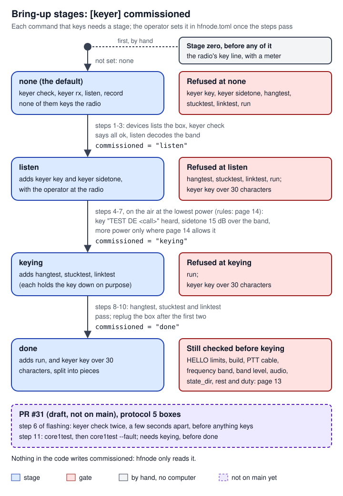
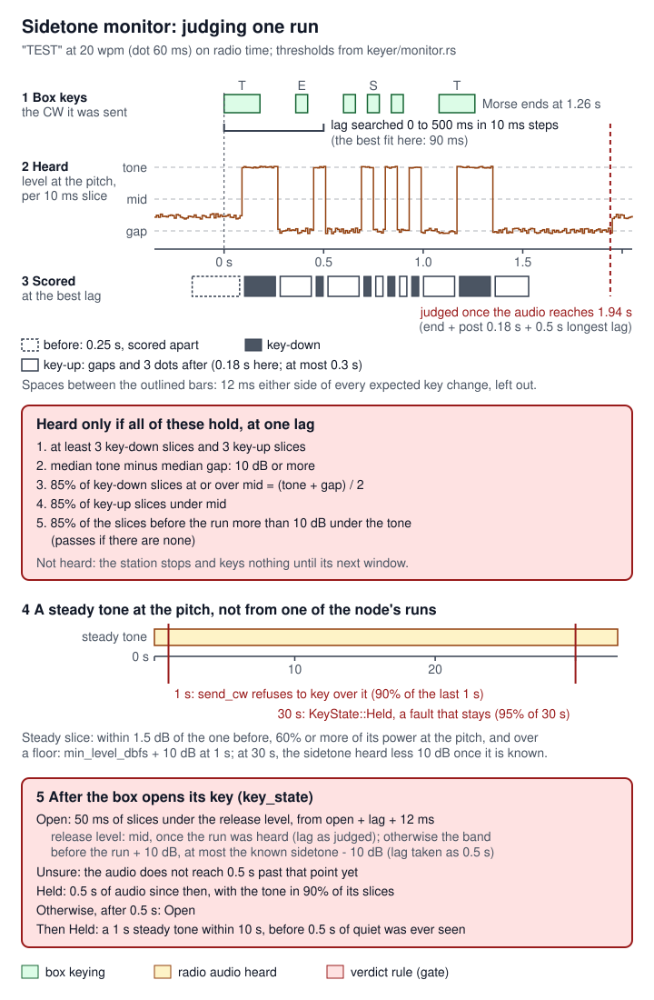

# 09 Keyer box: host side

> This page covers hfnode's side of the keyer box: the `keyer` module of the `hfnode` crate, which drives any CW radio through the small USB keyer box (a Raspberry Pi Pico 2) described on [08 Keyer box: firmware and protocol](08-keyer-box-firmware.md). The box cannot read anything back from the radio, so this side does two jobs. It turns the station's generic radio calls (the `civ::Rig` trait) into keyer-protocol lines over USB serial. It also listens to the radio's headphone audio with a sidetone monitor, to confirm that each transmission really keyed and that the radio's key opened again afterwards. Around those two jobs are the `[keyer]` settings and their checks, the bring-up stage gate, the `hfnode keyer ...` bench commands, an in-memory mock of the box and the radio, and eight end-to-end self-test scenarios. The code is in `crates/hfnode/src/keyer.rs` and `crates/hfnode/src/keyer/`, cited at main `44185fa` unless a sentence says otherwise. Nothing on this page has keyed a real radio. The non-keying path (open, the `HELLO` and limits check, `STATUS`, `keyer check`) has run once against the real flashed box with no radio attached (`bench/quansheng.md`, Results, 2026-10-09 16:19Z: all ok, protocol 4, limits as audited). Everything that keys has run only against the mock box and radio.

A few radio terms first, explained in full in the [17 Glossary](17-glossary.md):

| Term | Meaning |
|---|---|
| CW | Morse code sent by switching a transmitter's carrier on and off. |
| key jack | The socket on a radio where a Morse key plugs in. Closing its contact transmits. |
| sidetone | The tone a radio plays in its own headphones while its key is closed, so the operator hears what they send. |
| break-in | The radio switches to transmit when the key closes, and back to receive a moment after it opens. |
| PTT | Push-to-talk: the contact that puts an FM radio on transmit. |
| MCW | Modulated CW: an FM carrier held on while an audio tone is keyed in Morse. The box sends it to a handheld. |
| wpm | Words per minute. A dot lasts 1200/wpm ms ([`crates/keyer-core/src/morse.rs:88-95`](https://github.com/robinonsay/cw-message-gateway/blob/44185fa9a00369c379d9d8af40ca307e3867e860/crates/keyer-core/src/morse.rs#L88-L95)). |
| dBFS | Decibels relative to digital full scale. 0 dBFS is the loudest a sound card can record. The node will not key when the radio's audio is quieter than `[keyer] min_level_dbfs`, -65 dBFS by default ([`crates/hfnode/src/config.rs:778-780`](https://github.com/robinonsay/cw-message-gateway/blob/44185fa9a00369c379d9d8af40ca307e3867e860/crates/hfnode/src/config.rs#L778-L780)). |
| carrier | The steady signal a transmitter puts out. A "carrier at the pitch" here means a steady tone at the sidetone's pitch in the audio: another station's signal, or this radio's own key held closed. |
| over | One side's turn in a radio exchange. "After the node's over" means after the node's transmission ends. |
| identify (ID) | Sending the station's call sign, which amateur radio rules require at the end of each exchange and at least every 10 minutes. `DE <call>` is the node's ID. |
| SWR | Standing wave ratio: how well the antenna takes the transmitter's power. A radio with meters reports it; through the box the node cannot read it. |
| dummy load | A resistor that takes the transmitter's power in place of an antenna, so tests radiate almost nothing. The benches do not use one (see "Work left"). |
| semi and full break-in | Semi break-in waits a moment (the "hang") after the last element before going back to receive; full break-in receives between elements. |
| debounce | Ignoring a contact's changes for a short time after one, so a bouncing contact counts once. |
| squelch | The receiver circuit that silences an FM radio's speaker when no station is heard. The handheld mode needs it open, so band noise is heard. |
| K-plug | The two-pin headset plug of many handheld radios; the box reaches a handheld's PTT and microphone through it. |
| DTR, RTS | Two control lines of a serial port. Some radios key the transmitter when one of them is raised on their own USB port. |
| USB CDC, enumerate | The USB class that makes the box look like a serial port. Enumerating is the computer discovering a device when it is plugged in or restarts; the box "re-enumerates" after a reset. |
| watchdog, trip | The watchdog is a hardware timer that restarts the box's chip if its program stops feeding it. A trip is the box opening every output and refusing to key until it is unplugged and plugged in again. |
| optocoupler | A switch made of an LED and a light-sensitive transistor, used to close a radio's key line without a wired connection. A shorted one keys the radio for good. |
| 47 CFR, eCFR | Title 47 of the US Code of Federal Regulations (part 97 is amateur radio); the eCFR is its online edition. |

## Where it lives

| Path | What it holds | Lines |
|---|---|---|
| [`crates/hfnode/src/keyer.rs`](https://github.com/robinonsay/cw-message-gateway/blob/44185fa9a00369c379d9d8af40ca307e3867e860/crates/hfnode/src/keyer.rs) | The module root: the allowed bands, `Output`, the bring-up `Stage` and its gate, the `[keyer]` validation, the box's `HELLO` checks, trip texts | 454 |
| [`crates/hfnode/src/keyer/proto.rs`](https://github.com/robinonsay/cw-message-gateway/blob/44185fa9a00369c379d9d8af40ca307e3867e860/crates/hfnode/src/keyer/proto.rs) | The commands hfnode sends, the reply parser, and the `Hello` and `Status` records | 441 (tests from 263) |
| [`crates/hfnode/src/keyer/link.rs`](https://github.com/robinonsay/cw-message-gateway/blob/44185fa9a00369c379d9d8af40ca307e3867e860/crates/hfnode/src/keyer/link.rs) | The `Transport` trait, the USB serial transport that opens only the box, and `Link` (one command at a time, replies matched by id) | 506 (tests from 290) |
| [`crates/hfnode/src/keyer/rig.rs`](https://github.com/robinonsay/cw-message-gateway/blob/44185fa9a00369c379d9d8af40ca307e3867e860/crates/hfnode/src/keyer/rig.rs) | `KeyerRig`, the `civ::Rig` implementation: the checks before each run, the keep-alive thread, the duty window, the fault latches | 990 |
| [`crates/hfnode/src/keyer/monitor.rs`](https://github.com/robinonsay/cw-message-gateway/blob/44185fa9a00369c379d9d8af40ca307e3867e860/crates/hfnode/src/keyer/monitor.rs) | The sidetone monitor: Goertzel on 10 ms slices, run judging, key state, band level, carrier detection, and a handheld's receive-noise mode | 1388 |
| [`crates/hfnode/src/keyer/bench.rs`](https://github.com/robinonsay/cw-message-gateway/blob/44185fa9a00369c379d9d8af40ca307e3867e860/crates/hfnode/src/keyer/bench.rs) | What the `hfnode keyer` subcommands do: `check`, `rx`, `key`, `sidetone`, `hangtest`, `stucktest`, `linktest` | 751 |
| [`crates/hfnode/src/keyer/mock.rs`](https://github.com/robinonsay/cw-message-gateway/blob/44185fa9a00369c379d9d8af40ca307e3867e860/crates/hfnode/src/keyer/mock.rs) | `MockBox` (keyer-core's own keyer behind a fake serial port), `MockRadio` (headphone audio from the box's outputs) and the shared `Clock` | 816 |
| [`crates/hfnode/src/keyer/testbench.rs`](https://github.com/robinonsay/cw-message-gateway/blob/44185fa9a00369c379d9d8af40ca307e3867e860/crates/hfnode/src/keyer/testbench.rs) | Test-only: a station on the mock box and radio at 5x real time | 168 |
| [`crates/hfnode/src/keyer/tests.rs`](https://github.com/robinonsay/cw-message-gateway/blob/44185fa9a00369c379d9d8af40ca307e3867e860/crates/hfnode/src/keyer/tests.rs), [`crates/hfnode/src/keyer/rig/tests.rs`](https://github.com/robinonsay/cw-message-gateway/blob/44185fa9a00369c379d9d8af40ca307e3867e860/crates/hfnode/src/keyer/rig/tests.rs), [`crates/hfnode/src/keyer/monitor/tests.rs`](https://github.com/robinonsay/cw-message-gateway/blob/44185fa9a00369c379d9d8af40ca307e3867e860/crates/hfnode/src/keyer/monitor/tests.rs), [`crates/hfnode/src/keyer/bench/tests.rs`](https://github.com/robinonsay/cw-message-gateway/blob/44185fa9a00369c379d9d8af40ca307e3867e860/crates/hfnode/src/keyer/bench/tests.rs) | Unit tests: config and stages; the rig under a station; the monitor on synthetic audio; the bench commands | 266, 806, 1095, 327 |
| [`crates/hfnode/src/main.rs`](https://github.com/robinonsay/cw-message-gateway/blob/44185fa9a00369c379d9d8af40ca307e3867e860/crates/hfnode/src/main.rs) | The CLI: `hfnode keyer`, `open_keyer`, the stage gate, `run` with `rig = "keyer"`, the `radio rx` route, the stop-signal handler | (whole binary) |
| [`crates/hfnode/src/config.rs`](https://github.com/robinonsay/cw-message-gateway/blob/44185fa9a00369c379d9d8af40ca307e3867e860/crates/hfnode/src/config.rs) | The `Keyer` config struct and its defaults; `Config::validate` calls `keyer::validate` | (whole config) |
| [`crates/hfnode/src/selftest/any_radio.rs`](https://github.com/robinonsay/cw-message-gateway/blob/44185fa9a00369c379d9d8af40ca307e3867e860/crates/hfnode/src/selftest/any_radio.rs) | The eight `keyer-*` self-test scenarios, the pause meter, the box safety check | 768 |
| [`crates/hfnode/tests/keyer_e2e.rs`](https://github.com/robinonsay/cw-message-gateway/blob/44185fa9a00369c379d9d8af40ca307e3867e860/crates/hfnode/tests/keyer_e2e.rs) | One integration test per keyer scenario, in its own test binary | 93 |
| `crates/keyer-core/` | Shared with the firmware: line framing, Morse timing, the box's limits, `Boot`, `Ended`, `Trip`, and the command parser `MockBox` runs ([08 Keyer box: firmware and protocol](08-keyer-box-firmware.md)) | |

## How it works

The keyer box is a timing device with limits of its own. hfnode tells it what to key and when to stop; the box times the Morse, opens its key on any fault, and answers `STATUS`. The radio is on the far side of a key cable, and the only thing the node learns from the radio is its audio. So the host side rests on two sources that do not depend on each other ([`crates/hfnode/src/keyer/rig.rs:1-24`](https://github.com/robinonsay/cw-message-gateway/blob/44185fa9a00369c379d9d8af40ca307e3867e860/crates/hfnode/src/keyer/rig.rs#L1-L24)):

- **The box**, through `STATUS`: whether its key or PTT is down, whether a run is under way, how the last run ended, whether it has tripped, and how much rest and duty budget it has left.
- **The radio's audio**, through the sidetone monitor: whether the sidetone followed the box's elements (the radio really keyed), whether the sidetone stopped when the box opened its key (the key is not stuck at the radio), and whether a steady tone sits on the frequency.

The radio counts as transmitting if either source says so, or if the audio cannot yet show the key open after a run.


*Figure: the station only ever sees `KeyerRig`. The box is reached through `Link`, which waits for its reply to every command; the radio is reached only through its audio. `KeyerRig` tells the monitor about each run and each key opening, and reads back its verdicts. In tests, `MockBox` and `MockRadio` stand in for the serial port, the box, the radio and the sound card.*

### Opening the box

Before anything opens, `keyer_cmd` refuses what it can refuse without the box ([`crates/hfnode/src/main.rs:1434-1455`](https://github.com/robinonsay/cw-message-gateway/blob/44185fa9a00369c379d9d8af40ca307e3867e860/crates/hfnode/src/main.rs#L1434-L1455)). For `key`, `sidetone` and the three box tests, it refuses a `key` text over 30 characters before `done` (`check_key_length`, [`crates/hfnode/src/main.rs:1372-1382`](https://github.com/robinonsay/cw-message-gateway/blob/44185fa9a00369c379d9d8af40ca307e3867e860/crates/hfnode/src/main.rs#L1372-L1382)), refuses `sidetone` with `output = "ptt"`, and checks that `state_dir` can be written (`check_state_dir`, [`crates/hfnode/src/main.rs:1454`](https://github.com/robinonsay/cw-message-gateway/blob/44185fa9a00369c379d9d8af40ca307e3867e860/crates/hfnode/src/main.rs#L1454), defined at [`crates/hfnode/src/station.rs:609`](https://github.com/robinonsay/cw-message-gateway/blob/44185fa9a00369c379d9d8af40ca307e3867e860/crates/hfnode/src/station.rs#L609); `hfnode run` does the same first, [`crates/hfnode/src/main.rs:1221`](https://github.com/robinonsay/cw-message-gateway/blob/44185fa9a00369c379d9d8af40ca307e3867e860/crates/hfnode/src/main.rs#L1221)). That last check is the safety audit's K6: a node that cannot write `tx-inhibited` must not key, and opening a port can itself key some radios. Only then does every command that may key go through `open_keyer` ([`crates/hfnode/src/main.rs:1348-1367`](https://github.com/robinonsay/cw-message-gateway/blob/44185fa9a00369c379d9d8af40ca307e3867e860/crates/hfnode/src/main.rs#L1348-L1367)):

1. The bring-up stage must allow the command (`check_stage`, below).
2. With `output = "ptt"`, the handheld's PTT contact voltage must be on record and within 2.5-25 V (`check_ptt_cable`).
3. Audio capture starts first, with a tap that hands every captured block to a new `Monitor` before the decoder's queue (`bench::start_listening`, [`crates/hfnode/src/keyer/bench.rs:74-83`](https://github.com/robinonsay/cw-message-gateway/blob/44185fa9a00369c379d9d8af40ca307e3867e860/crates/hfnode/src/keyer/bench.rs#L74-L83)).
4. `bench::open_rig` loads the sidetone level kept by an earlier `hfnode keyer sidetone`, opens the serial port only if the operating system lists it as a USB device named `PICO2-KEYER`, opens `KeyerRig`, and checks the firmware build against `keyer.firmware_build` ([`crates/hfnode/src/keyer/bench.rs:109-121`](https://github.com/robinonsay/cw-message-gateway/blob/44185fa9a00369c379d9d8af40ca307e3867e860/crates/hfnode/src/keyer/bench.rs#L109-L121)).
5. It waits up to 5 s for the monitor to measure the band level, logging the level or a carrier.

`KeyerRig::open` ([`crates/hfnode/src/keyer/rig.rs:192-286`](https://github.com/robinonsay/cw-message-gateway/blob/44185fa9a00369c379d9d8af40ca307e3867e860/crates/hfnode/src/keyer/rig.rs#L192-L286)) sends `HELLO` and checks the box's protocol version and limits, then latches a fault if the box last restarted from its watchdog, or asks for a replug if it last started other than by power-up. It then sends `STOP` and `STATUS`, latches a fault if the box is tripped, refuses to open if the box still reads busy, and starts the keep-alive thread. The details are under "Algorithms and processing".

### One transmission

The station on page [05 Node loop and station safety](05-node-loop-station-safety.md) does the same thing for every rig: it waits out `rest_needed`, calls `send_cw` with one piece of at most 30 characters, watches `is_transmitting` until the radio is back on receive, and then asks `keying_confirmed`. For a rig without meters, which this one is, the station skips the SWR and power checks and relies on `keying_confirmed` instead ([`crates/hfnode/src/station.rs:67-73`](https://github.com/robinonsay/cw-message-gateway/blob/44185fa9a00369c379d9d8af40ca307e3867e860/crates/hfnode/src/station.rs#L67-L73)). With `KeyerRig` behind those calls:

1. `rest_needed` waits for the box's 1 s rest, its duty budget, and the node's own duty window, and with a handheld for a clear channel.
2. `send_cw` checks the audio (arriving, band level, no carrier, key not held at the radio), then the box (`STATUS`: not tripped, not busy, rested). It sends `CW <wpm> <text>` (or `MCW` for a handheld), registers the run with the monitor, and marks the run active, so the keep-alive thread that `open` started pings the box until the run ends ([`crates/hfnode/src/keyer/rig.rs:755-759`](https://github.com/robinonsay/cw-message-gateway/blob/44185fa9a00369c379d9d8af40ca307e3867e860/crates/hfnode/src/keyer/rig.rs#L755-L759)).
3. While the run lasts, the keep-alive thread sends `STATUS` every 250 ms. The box ends the run on its own if those stop for its 2 s link timeout. If the run is still going 1 s past its expected end, the thread sends `STOP`.
4. `is_transmitting` answers `true` while the box is busy, or while the audio cannot yet show the key open. It answers an error if the box tripped or the audio shows the key held at the radio.
5. `keying_confirmed` waits for the monitor's verdict on the run. A run that was not heard stops the transmission and keeps the node silent until its next window start ([`crates/hfnode/src/station.rs:2079-2097`](https://github.com/robinonsay/cw-message-gateway/blob/44185fa9a00369c379d9d8af40ca307e3867e860/crates/hfnode/src/station.rs#L2079-L2097)).
6. While idle, the station's watchdog asks `held_key` every 250 ms ([`crates/hfnode/src/station.rs:1164-1170`](https://github.com/robinonsay/cw-message-gateway/blob/44185fa9a00369c379d9d8af40ca307e3867e860/crates/hfnode/src/station.rs#L1164-L1170)), which looks for a key held at the radio or a steady tone.

### The latches that never clear

Once the audio has shown the radio's key held with the box's open, or the box has come back from a watchdog reset, or it was found tripped when the rig opened it, `KeyerRig` never again reads the radio as on receive. Every status read is an error, so the station latches its transmit inhibit (the file `state_dir/tx-inhibited`, which only the owner clears) and emails the owner ([`crates/hfnode/src/keyer/rig.rs:14-18`](https://github.com/robinonsay/cw-message-gateway/blob/44185fa9a00369c379d9d8af40ca307e3867e860/crates/hfnode/src/keyer/rig.rs#L14-L18), field `fault` at [`crates/hfnode/src/keyer/rig.rs:177-179`](https://github.com/robinonsay/cw-message-gateway/blob/44185fa9a00369c379d9d8af40ca307e3867e860/crates/hfnode/src/keyer/rig.rs#L177-L179)). A box that last started other than by power-up (as straight after flashing) sets `replug` instead: nothing is keyed, but nothing is latched, until it is unplugged and plugged in again.

## How it connects

| Neighbour | Direction | What passes | Where |
|---|---|---|---|
| Station ([05 Node loop and station safety](05-node-loop-station-safety.md)) | calls in | the `civ::Rig` trait: `send_cw`, `stop_cw`, `is_transmitting`, `rest_needed`, `keying_confirmed`, `held_key`, `receive_settle`, `transmit_detail` | [`crates/civ/src/lib.rs:58-186`](https://github.com/robinonsay/cw-message-gateway/blob/44185fa9a00369c379d9d8af40ca307e3867e860/crates/civ/src/lib.rs#L58-L186) |
| CLI ([15 Config, CLI and deployment](15-config-cli-deployment.md)) | calls in | `hfnode keyer --config C <cmd>`, `hfnode run`, `hfnode radio rx`, Ctrl-C | [`crates/hfnode/src/main.rs:1414-1522`](https://github.com/robinonsay/cw-message-gateway/blob/44185fa9a00369c379d9d8af40ca307e3867e860/crates/hfnode/src/main.rs#L1414-L1522) |
| Keyer box firmware ([08 Keyer box: firmware and protocol](08-keyer-box-firmware.md)) | both ways | text lines `<id> <body>*<cs>` over USB CDC serial; the protocol is [docs/keyer-protocol.md](../keyer-protocol.md) | [`crates/keyer-core/src/frame.rs:1-12`](https://github.com/robinonsay/cw-message-gateway/blob/44185fa9a00369c379d9d8af40ca307e3867e860/crates/keyer-core/src/frame.rs#L1-L12) |
| Audio capture ([04 CW decoder and audio](04-cw-decoder-audio.md)) | in | every captured block, through `audio::Tap`, before the decoder's queue | [`crates/hfnode/src/audio.rs:168`](https://github.com/robinonsay/cw-message-gateway/blob/44185fa9a00369c379d9d8af40ca307e3867e860/crates/hfnode/src/audio.rs#L168), [`crates/hfnode/src/audio.rs:179`](https://github.com/robinonsay/cw-message-gateway/blob/44185fa9a00369c379d9d8af40ca307e3867e860/crates/hfnode/src/audio.rs#L179) |
| `state_dir` | out | `keyer-sidetone` (the measured sidetone level); `tx-inhibited` and `health.csv` through the station | [`crates/hfnode/src/keyer/bench.rs:89-106`](https://github.com/robinonsay/cw-message-gateway/blob/44185fa9a00369c379d9d8af40ca307e3867e860/crates/hfnode/src/keyer/bench.rs#L89-L106) |
| Self-test ([12 Testing](12-testing.md)) | calls in | the mock box and radio under a full node | [`crates/hfnode/src/selftest/any_radio.rs:361-491`](https://github.com/robinonsay/cw-message-gateway/blob/44185fa9a00369c379d9d8af40ca307e3867e860/crates/hfnode/src/selftest/any_radio.rs#L361-L491) |
| UV-K1 handheld ([10 Quansheng UV-K1 handheld](10-uv-k1-handheld.md)) | both ways | **Route C, Robin's:** the radio runs NR7Y v1.3 in CW mode with `CWkin = PTT HandKey`. The box's ordinary key output (GP16, `output = "key"`) closes the radio's PTT line as a straight key, and the monitor runs in `Mode::Sidetone` on the radio's own CW sidetone (its `CWfreq`). This rig is used unchanged. **Route B:** `output = "ptt"`, the box holds a stock radio's PTT and keys an MCW tone into its microphone, and the monitor runs in `Mode::Mute`; merged, but it cannot key Robin's paddle-reworked radios. Operator procedure: [docs/keyer.md](../keyer.md), "A UV-K1 on NR7Y in CW mode", including "Stopping NR7Y CW by hand" (pull the plug from the radio's 3.5 mm jack first) | [`docs/keyer.md:840-1511`](https://github.com/robinonsay/cw-message-gateway/blob/44185fa9a00369c379d9d8af40ca307e3867e860/docs/keyer.md#L840-L1511) |

The wire format in one paragraph: each line is printable ASCII ending in a newline, at most 96 characters before it ([`crates/keyer-core/src/lib.rs:32`](https://github.com/robinonsay/cw-message-gateway/blob/44185fa9a00369c379d9d8af40ca307e3867e860/crates/keyer-core/src/lib.rs#L32)), shaped `<id> <body>*<cs>`. `<id>` is two upper-case hex digits that the reply repeats, so a late reply to an earlier command is never taken for this one's. `<cs>` is the XOR of every byte before the `*`, as two hex digits. A line that does not decode is ignored by both sides ([`crates/keyer-core/src/frame.rs:1-12`](https://github.com/robinonsay/cw-message-gateway/blob/44185fa9a00369c379d9d8af40ca307e3867e860/crates/keyer-core/src/frame.rs#L1-L12)). hfnode encodes and decodes with the same `keyer_core::frame` code the firmware runs ([`crates/hfnode/src/keyer/proto.rs:259-261`](https://github.com/robinonsay/cw-message-gateway/blob/44185fa9a00369c379d9d8af40ca307e3867e860/crates/hfnode/src/keyer/proto.rs#L259-L261)).

## Interfaces and APIs

### `keyer.rs`: limits, bands, stages and checks

Every limit below is a safety number. **Never loosen any of them**; the canonical table is [13 Safety rules](13-safety-rules.md).

| Item | Value | Meaning | Where |
|---|---|---|---|
| `BANDS_HZ` | 13 ranges, 1.8 MHz to 450 MHz, 60 m left out | where `station.frequency_hz` may be; written "from memory, not checked against the eCFR" | [`crates/hfnode/src/keyer.rs:36-55`](https://github.com/robinonsay/cw-message-gateway/blob/44185fa9a00369c379d9d8af40ca307e3867e860/crates/hfnode/src/keyer.rs#L36-L55) |
| `MCW_BANDS_HZ` | 50.1-54, 144.1-148, 222-225, 420-450 MHz | where `output = "ptt"` may send MCW (47 CFR 97.305(c), also from memory) | [`crates/hfnode/src/keyer.rs:57-67`](https://github.com/robinonsay/cw-message-gateway/blob/44185fa9a00369c379d9d8af40ca307e3867e860/crates/hfnode/src/keyer.rs#L57-L67) |
| `PTT_CONTACT_VOLTS` | (2.5, 25.0) V | the handheld PTT contact voltage the box may be wired to | [`crates/hfnode/src/keyer.rs:93`](https://github.com/robinonsay/cw-message-gateway/blob/44185fa9a00369c379d9d8af40ca307e3867e860/crates/hfnode/src/keyer.rs#L93) |
| `MAX_RUN_LIMIT` | 60 s (`keyer_core::limits::RUN_MS`) | the longest run limit a box may report; also caps `max_key_seconds` | [`crates/hfnode/src/keyer.rs:96`](https://github.com/robinonsay/cw-message-gateway/blob/44185fa9a00369c379d9d8af40ca307e3867e860/crates/hfnode/src/keyer.rs#L96) |
| `MAX_PTT_LIMIT` | 60 s (`PTT_MS`) | the longest PTT limit a box may report | [`crates/hfnode/src/keyer.rs:99`](https://github.com/robinonsay/cw-message-gateway/blob/44185fa9a00369c379d9d8af40ca307e3867e860/crates/hfnode/src/keyer.rs#L99) |
| `MAX_KEY_DOWN_LIMIT` | 1000 ms (`KEY_DOWN_MS`) | the longest key-down limit a box may report | [`crates/hfnode/src/keyer.rs:102-103`](https://github.com/robinonsay/cw-message-gateway/blob/44185fa9a00369c379d9d8af40ca307e3867e860/crates/hfnode/src/keyer.rs#L102-L103) |
| `MIN_LINK_TIMEOUT`, `MAX_LINK_TIMEOUT` | 1 s, 2000 ms (`LINK_TIMEOUT_MS`) | the box's link timeout must lie between these | [`crates/hfnode/src/keyer.rs:107-109`](https://github.com/robinonsay/cw-message-gateway/blob/44185fa9a00369c379d9d8af40ca307e3867e860/crates/hfnode/src/keyer.rs#L107-L109) |
| `REPLY_TIMEOUT` | 300 ms | how long `Link` waits for each reply | [`crates/hfnode/src/keyer.rs:111`](https://github.com/robinonsay/cw-message-gateway/blob/44185fa9a00369c379d9d8af40ca307e3867e860/crates/hfnode/src/keyer.rs#L111) |
| `MIN_REST` | 1000 ms (`REST_MS`) | the shortest rest after a run a box may report | [`crates/hfnode/src/keyer.rs:114`](https://github.com/robinonsay/cw-message-gateway/blob/44185fa9a00369c379d9d8af40ca307e3867e860/crates/hfnode/src/keyer.rs#L114) |
| `MAX_DUTY_BUDGET` | 60 s (`DUTY_BUDGET_MS`) | the largest duty budget a box may report | [`crates/hfnode/src/keyer.rs:115-116`](https://github.com/robinonsay/cw-message-gateway/blob/44185fa9a00369c379d9d8af40ca307e3867e860/crates/hfnode/src/keyer.rs#L115-L116) |
| `MAX_DUTY_PERCENT` | 50 | the loosest `[keyer] max_duty_percent` | [`crates/hfnode/src/keyer.rs:118`](https://github.com/robinonsay/cw-message-gateway/blob/44185fa9a00369c379d9d8af40ca307e3867e860/crates/hfnode/src/keyer.rs#L118) |
| `MAX_DUTY_WINDOW_SECS` | 600 | the loosest `[keyer] duty_window_secs` | [`crates/hfnode/src/keyer.rs:119`](https://github.com/robinonsay/cw-message-gateway/blob/44185fa9a00369c379d9d8af40ca307e3867e860/crates/hfnode/src/keyer.rs#L119) |
| `KEY_SECONDS_SPARE` | 2 s | room in `max_key_seconds` past the longest piece | [`crates/hfnode/src/keyer.rs:211`](https://github.com/robinonsay/cw-message-gateway/blob/44185fa9a00369c379d9d8af40ca307e3867e860/crates/hfnode/src/keyer.rs#L211) |

The box's own limits are in `keyer_core::limits` ([`crates/keyer-core/src/lib.rs:48-80`](https://github.com/robinonsay/cw-message-gateway/blob/44185fa9a00369c379d9d8af40ca307e3867e860/crates/keyer-core/src/lib.rs#L48-L80)): key-down 1000 ms, run 60 000 ms, PTT 60 000 ms, link timeout 2000 ms, watchdog 500 ms, rest 1000 ms, minimum gap 24 ms (`MIN_GAP_MS`, a key-up shorter than one dot at 50 wpm does not end a key-down), duty budget 60 000 ms, test arm window 2000 ms. The host reads the run, link timeout, key-down, rest, duty budget and PTT limits in `HELLO` and checks them against the constants above. The watchdog, the minimum gap and the arm window are not reported, and are the firmware's alone. Never loosen any of them; a change goes back to the audit. [08 Keyer box: firmware and protocol](08-keyer-box-firmware.md) explains how the firmware enforces them.

| Function or type | Signature | What it does | Where |
|---|---|---|---|
| `enum Output` | `Key` (default) or `Ptt`; serde lower case | what the box keys: a radio's key jack with `CW`, or a handheld's PTT with `MCW` | [`crates/hfnode/src/keyer.rs:69-78`](https://github.com/robinonsay/cw-message-gateway/blob/44185fa9a00369c379d9d8af40ca307e3867e860/crates/hfnode/src/keyer.rs#L69-L78) |
| `enum Stage` | `None` (default) < `Listen` < `Keying` < `Done`; derives `Ord` | the last bring-up stage passed (`[keyer] commissioned`) | [`crates/hfnode/src/keyer.rs:120-138`](https://github.com/robinonsay/cw-message-gateway/blob/44185fa9a00369c379d9d8af40ca307e3867e860/crates/hfnode/src/keyer.rs#L120-L138) |
| `Display for Output`, `Display for Stage` | `key`, `ptt`; `none`, `listen`, `keying`, `done` | the same words as the config file, for messages and `keyer check` | [`crates/hfnode/src/keyer.rs:80-87`](https://github.com/robinonsay/cw-message-gateway/blob/44185fa9a00369c379d9d8af40ca307e3867e860/crates/hfnode/src/keyer.rs#L80-L87), [`crates/hfnode/src/keyer.rs:140-149`](https://github.com/robinonsay/cw-message-gateway/blob/44185fa9a00369c379d9d8af40ca307e3867e860/crates/hfnode/src/keyer.rs#L140-L149) |
| `enum Action` | `Key`, `Test`, `Run` | the three kinds of command that key | [`crates/hfnode/src/keyer.rs:151-157`](https://github.com/robinonsay/cw-message-gateway/blob/44185fa9a00369c379d9d8af40ca307e3867e860/crates/hfnode/src/keyer.rs#L151-L157) |
| `check_ptt_cable` | `fn(&config::Keyer) -> Result<()>` | with `output = "ptt"`: `ptt_contact_volts` recorded and within 2.5-25 V; nothing keys until then | [`crates/hfnode/src/keyer.rs:161-178`](https://github.com/robinonsay/cw-message-gateway/blob/44185fa9a00369c379d9d8af40ca307e3867e860/crates/hfnode/src/keyer.rs#L161-L178) |
| `check_stage` | `fn(Stage, Action) -> Result<()>` | `Key` needs `listen`, `Test` needs `keying`, `Run` needs `done` | [`crates/hfnode/src/keyer.rs:181-194`](https://github.com/robinonsay/cw-message-gateway/blob/44185fa9a00369c379d9d8af40ca307e3867e860/crates/hfnode/src/keyer.rs#L181-L194) |
| `longest_piece` | `fn(wpm: u32, Output) -> Option<Duration>` | 30 zeros (the slowest characters) at `wpm`; with `Ptt`, plus the box's 500 ms lead and 200 ms tail | [`crates/hfnode/src/keyer.rs:199-207`](https://github.com/robinonsay/cw-message-gateway/blob/44185fa9a00369c379d9d8af40ca307e3867e860/crates/hfnode/src/keyer.rs#L199-L207) |
| `validate` | `fn(&Config) -> Result<()>` | every `[keyer]` rule below; called from `Config::validate` ([`crates/hfnode/src/config.rs:1175`](https://github.com/robinonsay/cw-message-gateway/blob/44185fa9a00369c379d9d8af40ca307e3867e860/crates/hfnode/src/config.rs#L1175)) | [`crates/hfnode/src/keyer.rs:214-344`](https://github.com/robinonsay/cw-message-gateway/blob/44185fa9a00369c379d9d8af40ca307e3867e860/crates/hfnode/src/keyer.rs#L214-L344) |
| `trip_text` | `fn(Trip) -> &'static str` | a sentence for each `STATUS` trip code | [`crates/hfnode/src/keyer.rs:347-368`](https://github.com/robinonsay/cw-message-gateway/blob/44185fa9a00369c379d9d8af40ca307e3867e860/crates/hfnode/src/keyer.rs#L347-L368) |
| `is_keyer_box` | `fn(usb_product: &str) -> bool` | the USB product string is `PICO2-KEYER`; used by `hfnode devices` ([`crates/hfnode/src/main.rs:852-858`](https://github.com/robinonsay/cw-message-gateway/blob/44185fa9a00369c379d9d8af40ca307e3867e860/crates/hfnode/src/main.rs#L852-L858)) | [`crates/hfnode/src/keyer.rs:372-374`](https://github.com/robinonsay/cw-message-gateway/blob/44185fa9a00369c379d9d8af40ca307e3867e860/crates/hfnode/src/keyer.rs#L372-L374) |
| `check_hello` | `fn(&Hello) -> Result<()>` | name, version, and every limit no looser than the node's | [`crates/hfnode/src/keyer.rs:379-439`](https://github.com/robinonsay/cw-message-gateway/blob/44185fa9a00369c379d9d8af40ca307e3867e860/crates/hfnode/src/keyer.rs#L379-L439) |
| `check_build` | `fn(&Hello, Option<&str>) -> Result<()>` | with `keyer.firmware_build` set, the box must report that build; called once, by `bench::open_rig` | [`crates/hfnode/src/keyer.rs:442-451`](https://github.com/robinonsay/cw-message-gateway/blob/44185fa9a00369c379d9d8af40ca307e3867e860/crates/hfnode/src/keyer.rs#L442-L451) |

`check_hello` refuses a box whose name is not `PICO2-KEYER`, whose protocol version is not `keyer_core::VERSION` (4 on main, [`crates/keyer-core/src/lib.rs:26`](https://github.com/robinonsay/cw-message-gateway/blob/44185fa9a00369c379d9d8af40ca307e3867e860/crates/keyer-core/src/lib.rs#L26)), or that reports any of: rest under 1000 ms, duty budget outside 1-60 s, run limit outside 1-60 s, PTT limit outside 1-60 s or longer than its run limit, key-down limit outside 1-1000 ms, link timeout outside 1000-2000 ms.

### `[keyer]` configuration

The `[keyer]` section is the `Keyer` struct, with `deny_unknown_fields` ([`crates/hfnode/src/config.rs:95-135`](https://github.com/robinonsay/cw-message-gateway/blob/44185fa9a00369c379d9d8af40ca307e3867e860/crates/hfnode/src/config.rs#L95-L135)), read only with `station.rig = "keyer"`: `keyer::validate` returns early for the other rigs ([`crates/hfnode/src/keyer.rs:216-221`](https://github.com/robinonsay/cw-message-gateway/blob/44185fa9a00369c379d9d8af40ca307e3867e860/crates/hfnode/src/keyer.rs#L216-L221)). The keys this page leans on are `commissioned` (the bring-up stage, below; `station.commissioned` is the IC-7300's and the keyer never reads it), `output` (`"key"` keys a radio's key jack with `CW`, `"ptt"` a handheld's PTT with `MCW`, which also needs `ptt_contact_volts` and a frequency in `MCW_BANDS_HZ`), `min_level_dbfs` (the node does not key while band noise is quieter than this, -65 dBFS by default), `max_duty_percent` and `duty_window_secs` (the node's own duty window, at most 50% of 600 s), `sidetone_hz` (the monitor's pitch, `audio.pitch_hz` unless set) and `firmware_build` (the build the box must report, checked once when the rig opens; see "Known bugs"), and from the other sections `station.serial_port` (opened only if it is the box), `station.frequency_hz` (inside `BANDS_HZ`, only logged), `station.key_speed_wpm` and `station.max_key_seconds` (rules below), `audio.device` (the sound card the radio's headphone audio goes into) and `state_dir` (writable before any keying command opens anything). [15 Config, CLI and deployment](15-config-cli-deployment.md) has every key with its type, default, range and permalink.

`baud`, `civ_address` and `power_watts` do nothing at the box but are still validated for every rig, and `power_watts` also sets the station's own duty share, `duty_for_power(W) = min(25 / W, 0.5)` of every 10 minutes, which `Station::rest_needed` waits for alongside the rig's own rest ([`crates/hfnode/src/station.rs:173`](https://github.com/robinonsay/cw-message-gateway/blob/44185fa9a00369c379d9d8af40ca307e3867e860/crates/hfnode/src/station.rs#L173), [`crates/hfnode/src/station.rs:214-216`](https://github.com/robinonsay/cw-message-gateway/blob/44185fa9a00369c379d9d8af40ca307e3867e860/crates/hfnode/src/station.rs#L214-L216), [`crates/hfnode/src/station.rs:1829-1831`](https://github.com/robinonsay/cw-message-gateway/blob/44185fa9a00369c379d9d8af40ca307e3867e860/crates/hfnode/src/station.rs#L1829-L1831)). So `power_watts = 100` in a keyer config cuts the node to 25% key-down in 10 minutes, under `[keyer] max_duty_percent`; leave it at 50 or less. [docs/keyer.md](../keyer.md) ("Configuration") and the comment in `hfnode.example.toml` say these three keys are not used; the code says otherwise, and the code wins.

### The `max_key_seconds` rules

`station.max_key_seconds` is the station's own keying watchdog ([05 Node loop and station safety](05-node-loop-station-safety.md)). With the keyer, `validate` ties it to the longest piece the station may send: 30 zeros, the slowest 30 characters there are ([`crates/hfnode/src/keyer.rs:254-304`](https://github.com/robinonsay/cw-message-gateway/blob/44185fa9a00369c379d9d8af40ca307e3867e860/crates/hfnode/src/keyer.rs#L254-L304)).

1. `max_key_seconds` must be 60 or less, the box's run limit.
2. The longest piece must fit the box: for `output = "key"` its Morse must be at most 60 s; for `"ptt"`, its Morse plus the 700 ms lead and tail must be under 60 s.
3. `max_key_seconds` must be at least the longest piece plus `KEY_SECONDS_SPARE` (2 s), plus `RX_BACK` (1.5 s) for `"ptt"`, rounded up.

Worked numbers. These are computed from `Segments::of` and `dot_ms`, except where a test is cited. A zero is five dashes, 19 dot units; 30 of them with 29 letter gaps of 3 are 657 units.

| Speed | Dot | Longest piece | `"key"` needs | `"ptt"` needs |
|---|---|---|---|---|
| 13 wpm | 92 ms | 60.4 s | refused: over 60 s (test at [`crates/hfnode/src/keyer/tests.rs:64-67`](https://github.com/robinonsay/cw-message-gateway/blob/44185fa9a00369c379d9d8af40ca307e3867e860/crates/hfnode/src/keyer/tests.rs#L64-L67)) | refused (test at [`crates/hfnode/src/keyer/tests.rs:214-219`](https://github.com/robinonsay/cw-message-gateway/blob/44185fa9a00369c379d9d8af40ca307e3867e860/crates/hfnode/src/keyer/tests.rs#L214-L219)) |
| 14 wpm | 85 ms | 55.8 s | 58 s | refused: 61 s needed, over the cap of 60 |
| 18 wpm (default) | 66 ms | 43.4 s | 46 s (test at [`crates/hfnode/src/keyer/tests.rs:24-43`](https://github.com/robinonsay/cw-message-gateway/blob/44185fa9a00369c379d9d8af40ca307e3867e860/crates/hfnode/src/keyer/tests.rs#L24-L43)) | 48 s |
| 20 wpm | 60 ms | 39.4 s | 42 s (same test) | 44 s (test at [`crates/hfnode/src/keyer/tests.rs:220-225`](https://github.com/robinonsay/cw-message-gateway/blob/44185fa9a00369c379d9d8af40ca307e3867e860/crates/hfnode/src/keyer/tests.rs#L220-L225)) |

The example config ships `max_key_seconds = 45` for the IC-7300 ([`hfnode.example.toml:34`](https://github.com/robinonsay/cw-message-gateway/blob/44185fa9a00369c379d9d8af40ca307e3867e860/hfnode.example.toml#L34)), so switching it to `rig = "keyer"` at the default 18 wpm fails validation until it is raised to 46. Its comment says so ([`hfnode.example.toml:50-57`](https://github.com/robinonsay/cw-message-gateway/blob/44185fa9a00369c379d9d8af40ca307e3867e860/hfnode.example.toml#L50-L57)).

### Bring-up stages

`[keyer] commissioned` names the last bring-up stage passed. Bring-up itself is the operator's procedure in [docs/keyer.md](../keyer.md), "Bring-up". The code only reads the stage and refuses commands that need a later one. Nothing in the code writes it: the operator edits `hfnode.toml` after each stage passes. Before any of them, docs/keyer.md has a "stage zero" done by hand with a meter and no computer: measuring the radio's own key line. The code knows nothing of it.



*Figure: each stage adds commands. The red boxes beside `none`, `listen` and `keying` are what `check_stage` and `check_key_length` refuse there; the one beside `done` lists the checks that still apply to every run. Moving on is the operator's edit, after the numbered steps in docs/keyer.md pass, under the bench rules in [14 Audit, bench and flashing](14-audit-bench-flashing.md). Stage zero is done by hand before the first step.*

| Stage | Allows | Code |
|---|---|---|
| `none` | `keyer check`, `keyer rx`, `listen`, `record` (none of them keys) | [`crates/hfnode/src/keyer.rs:126-129`](https://github.com/robinonsay/cw-message-gateway/blob/44185fa9a00369c379d9d8af40ca307e3867e860/crates/hfnode/src/keyer.rs#L126-L129) |
| `listen` | adds `keyer key` and `keyer sidetone`, with the operator at the radio; `keyer key` limited to one piece of 30 characters ([`crates/hfnode/src/main.rs:1369-1382`](https://github.com/robinonsay/cw-message-gateway/blob/44185fa9a00369c379d9d8af40ca307e3867e860/crates/hfnode/src/main.rs#L1369-L1382)) | [`crates/hfnode/src/keyer.rs:130-132`](https://github.com/robinonsay/cw-message-gateway/blob/44185fa9a00369c379d9d8af40ca307e3867e860/crates/hfnode/src/keyer.rs#L130-L132) |
| `keying` | adds `keyer hangtest`, `keyer stucktest`, `keyer linktest` (all `Action::Test`) | [`crates/hfnode/src/keyer.rs:133-135`](https://github.com/robinonsay/cw-message-gateway/blob/44185fa9a00369c379d9d8af40ca307e3867e860/crates/hfnode/src/keyer.rs#L133-L135), [`crates/hfnode/src/main.rs:1434-1441`](https://github.com/robinonsay/cw-message-gateway/blob/44185fa9a00369c379d9d8af40ca307e3867e860/crates/hfnode/src/main.rs#L1434-L1441) |
| `done` | adds `run`, and `keyer key` longer than 30 characters | [`crates/hfnode/src/keyer.rs:136-137`](https://github.com/robinonsay/cw-message-gateway/blob/44185fa9a00369c379d9d8af40ca307e3867e860/crates/hfnode/src/keyer.rs#L136-L137) |

`keyer check` and `keyer rx` are never gated ([`crates/hfnode/src/main.rs:1418-1432`](https://github.com/robinonsay/cw-message-gateway/blob/44185fa9a00369c379d9d8af40ca307e3867e860/crates/hfnode/src/main.rs#L1418-L1432)). The stage gate sits on top of every other check, never in place of one.

### `proto.rs`: commands and replies

| `Command` | Line body | `OK` reply fields | Sent again if its reply is lost | Used by |
|---|---|---|---|---|
| `Hello` | `HELLO` | 11, parsed into `Hello` | yes | `KeyerRig::open`, `hello_again` |
| `Status` | `STATUS` | 8, parsed into `Status` | yes | everywhere; the keep-alive |
| `Stop` | `STOP` | none used | yes | `stop_cw`, open, drop, the keep-alive past a deadline |
| `Cw { wpm, text }` | `CW <wpm> <text>` | none used | **no** | `send_cw` with `output = "key"` |
| `Mcw { wpm, text }` | `MCW <wpm> <text>` | none used | **no** | `send_cw` with `output = "ptt"` |
| `TestArm` | `TEST ARM` | reply must be exactly `OK TEST ARM` | yes | `KeyerRig::test` |
| `TestHang` | `TEST HANG` | exactly `OK TEST HANG` | no | `hangtest` |
| `TestStuck` | `TEST STUCK` | exactly `OK TEST STUCK` | no | `stucktest` |
| `TestHold` | `TEST HOLD` | exactly `OK TEST HOLD` | no | tests only (holds a handheld's PTT past its text) |

Sources: the enum [`crates/hfnode/src/keyer/proto.rs:9-36`](https://github.com/robinonsay/cw-message-gateway/blob/44185fa9a00369c379d9d8af40ca307e3867e860/crates/hfnode/src/keyer/proto.rs#L9-L36), `body` [`crates/hfnode/src/keyer/proto.rs:40-52`](https://github.com/robinonsay/cw-message-gateway/blob/44185fa9a00369c379d9d8af40ca307e3867e860/crates/hfnode/src/keyer/proto.rs#L40-L52), `name` [`crates/hfnode/src/keyer/proto.rs:55-64`](https://github.com/robinonsay/cw-message-gateway/blob/44185fa9a00369c379d9d8af40ca307e3867e860/crates/hfnode/src/keyer/proto.rs#L55-L64), `repeatable` [`crates/hfnode/src/keyer/proto.rs:69-74`](https://github.com/robinonsay/cw-message-gateway/blob/44185fa9a00369c379d9d8af40ca307e3867e860/crates/hfnode/src/keyer/proto.rs#L69-L74). `CW`, `MCW` and the tests start something, so a lost reply is never answered by sending them twice; `TEST ARM` only renews itself.

| Function or type | Signature | What it does | Where |
|---|---|---|---|
| `enum Reply` | `Ok(Vec<String>)` or `Err(String)` | the fields after `OK <command>`, or the code after `ERR <command>` | [`crates/hfnode/src/keyer/proto.rs:76-84`](https://github.com/robinonsay/cw-message-gateway/blob/44185fa9a00369c379d9d8af40ca307e3867e860/crates/hfnode/src/keyer/proto.rs#L76-L84) |
| `answers` | `fn(&Command, body: &str) -> bool` | whether a reply belongs to this command (its name, or the full `OK TEST ...` text) | [`crates/hfnode/src/keyer/proto.rs:88-101`](https://github.com/robinonsay/cw-message-gateway/blob/44185fa9a00369c379d9d8af40ca307e3867e860/crates/hfnode/src/keyer/proto.rs#L88-L101) |
| `parse_reply` | `fn(&Command, &str) -> Result<Reply, String>` | `ERR <cmd> <code>`, `OK TEST <x>`, or `OK <cmd> <fields...>` | [`crates/hfnode/src/keyer/proto.rs:104-112`](https://github.com/robinonsay/cw-message-gateway/blob/44185fa9a00369c379d9d8af40ca307e3867e860/crates/hfnode/src/keyer/proto.rs#L104-L112) |
| `explain` | `fn(&Command, code: &str) -> Option<&'static str>` | a sentence for each `ERR` code | [`crates/hfnode/src/keyer/proto.rs:115-145`](https://github.com/robinonsay/cw-message-gateway/blob/44185fa9a00369c379d9d8af40ca307e3867e860/crates/hfnode/src/keyer/proto.rs#L115-L145) |
| `Hello::parse` | `fn(&[String]) -> Result<Hello, String>` | needs exactly 11 fields, which refuses protocol 1 and 2 boxes by count | [`crates/hfnode/src/keyer/proto.rs:173-201`](https://github.com/robinonsay/cw-message-gateway/blob/44185fa9a00369c379d9d8af40ca307e3867e860/crates/hfnode/src/keyer/proto.rs#L173-L201) |
| `Status::parse` | `fn(&[String]) -> Result<Status, String>` | needs exactly 8 fields; bits must be `0` or `1` | [`crates/hfnode/src/keyer/proto.rs:224-250`](https://github.com/robinonsay/cw-message-gateway/blob/44185fa9a00369c379d9d8af40ca307e3867e860/crates/hfnode/src/keyer/proto.rs#L224-L250) |
| `Status::busy` | `fn(&self) -> bool` | `key || ptt || run` | [`crates/hfnode/src/keyer/proto.rs:253-255`](https://github.com/robinonsay/cw-message-gateway/blob/44185fa9a00369c379d9d8af40ca307e3867e860/crates/hfnode/src/keyer/proto.rs#L253-L255) |
| `encode` | `fn(id: u8, &Command) -> Option<String>` | the framed line, or `None` if it does not fit 96 characters | [`crates/hfnode/src/keyer/proto.rs:259-261`](https://github.com/robinonsay/cw-message-gateway/blob/44185fa9a00369c379d9d8af40ca307e3867e860/crates/hfnode/src/keyer/proto.rs#L259-L261) |

The line format, every `HELLO` and `STATUS` field, the `ended` and `trip` values and the `ERR` codes are on [08 Keyer box: firmware and protocol](08-keyer-box-firmware.md), which owns the protocol. What the host does with them:

- **`HELLO`.** `Hello::parse` takes exactly 11 fields into `Hello { version: u32, run_limit, link_timeout, key_down_limit, rest, duty_budget, ptt_limit, uptime: Duration, boot: Boot, build: String, name: String }`. The run limit, duty budget and PTT limit arrive in seconds, the others in milliseconds; a field that is not a number, or a `boot` other than `POWER`, `WATCHDOG` or `OTHER`, fails the parse ([`crates/hfnode/src/keyer/proto.rs:147-201`](https://github.com/robinonsay/cw-message-gateway/blob/44185fa9a00369c379d9d8af40ca307e3867e860/crates/hfnode/src/keyer/proto.rs#L147-L201)). `check_hello` then checks the name, the version and the limits (above), and `KeyerRig::open` acts on `boot`: `WATCHDOG` latches a fault, `OTHER` asks for a replug ("`KeyerRig::open`", below).
- **`STATUS`.** `Status::parse` takes exactly 8 fields: `key`, `run`, `ptt` and `line` as `bool` (`0` or `1`, nothing else), `ended` as `Ended`, `trip` as `Trip`, and `rest_left` and `budget` as `Duration` from milliseconds ([`crates/hfnode/src/keyer/proto.rs:203-250`](https://github.com/robinonsay/cw-message-gateway/blob/44185fa9a00369c379d9d8af40ca307e3867e860/crates/hfnode/src/keyer/proto.rs#L203-L250)). `rest_left` and `budget` feed `rest_needed` and the checks in `send_cw`; `line` low with a handheld counts as transmitting.
- **`ended`.** When a `STATUS` shows the box idle with a run of the node's still on record, `ended` closes that run ([`crates/hfnode/src/keyer/rig.rs:133-162`](https://github.com/robinonsay/cw-message-gateway/blob/44185fa9a00369c379d9d8af40ca307e3867e860/crates/hfnode/src/keyer/rig.rs#L133-L162)). `DONE` and `STOP` are the normal ends. Every other value (`LINK`, `USB`, `LIMIT`, `DOWN`, `PTT`, `LINE`, or `NONE`, "did it restart?") is logged as "the keyer box ended the run early: ..." and fails the transmission once, at the next `is_transmitting`. An early end also tells the monitor when the key opened and trims the duty record.
- **`trip`.** Any value but `NONE` latches `fault` when the rig opens ([`crates/hfnode/src/keyer/rig.rs:236-250`](https://github.com/robinonsay/cw-message-gateway/blob/44185fa9a00369c379d9d8af40ca307e3867e860/crates/hfnode/src/keyer/rig.rs#L236-L250)), makes `send_cw` refuse with `TRIP` ([`crates/hfnode/src/keyer/rig.rs:684-686`](https://github.com/robinonsay/cw-message-gateway/blob/44185fa9a00369c379d9d8af40ca307e3867e860/crates/hfnode/src/keyer/rig.rs#L684-L686)), and makes every `is_transmitting` an error naming it through `trip_text` ([`crates/hfnode/src/keyer/rig.rs:804-810`](https://github.com/robinonsay/cw-message-gateway/blob/44185fa9a00369c379d9d8af40ca307e3867e860/crates/hfnode/src/keyer/rig.rs#L804-L810)), so the station latches its inhibit.
- **`ERR`.** `Link::request` turns `ERR <command> <code>` into `RigError::Protocol` through `refused`, adding `explain`'s sentence when it knows the code ([`crates/hfnode/src/keyer/link.rs:282-288`](https://github.com/robinonsay/cw-message-gateway/blob/44185fa9a00369c379d9d8af40ca307e3867e860/crates/hfnode/src/keyer/link.rs#L282-L288), [`crates/hfnode/src/keyer/proto.rs:115-145`](https://github.com/robinonsay/cw-message-gateway/blob/44185fa9a00369c379d9d8af40ca307e3867e860/crates/hfnode/src/keyer/proto.rs#L115-L145)); an unknown code is passed on bare. `send_cw` takes the `ERR` reply to `CW` or `MCW` through `request_reply` and reports it the same way.

### `link.rs`: transport and link

| Item | Signature | What it does | Where |
|---|---|---|---|
| `trait Transport: Send` | `write_line(&mut self, &str) -> io::Result<()>`; `read_line(&mut self, deadline: Instant) -> io::Result<Option<String>>`; `clear_input(&mut self) -> io::Result<()>`; `describe(&self) -> String` | moves lines without their newline; `read_line` returns `Ok(None)` at the deadline | [`crates/hfnode/src/keyer/link.rs:9-18`](https://github.com/robinonsay/cw-message-gateway/blob/44185fa9a00369c379d9d8af40ca307e3867e860/crates/hfnode/src/keyer/link.rs#L9-L18) |
| `SerialTransport::open` | `fn(path: &str) -> anyhow::Result<Self>` | opens the box's port; reopens it by name after the box went away | [`crates/hfnode/src/keyer/link.rs:20-48`](https://github.com/robinonsay/cw-message-gateway/blob/44185fa9a00369c379d9d8af40ca307e3867e860/crates/hfnode/src/keyer/link.rs#L20-L48) |
| `check_identity` | `fn(path: &str, ports: &[civ::ports::PortInfo]) -> anyhow::Result<()>` | the port must be listed as a USB device whose product is `PICO2-KEYER`; matches by path, stable path, `cu.`/`tty.` pair, Windows case, or canonical path | [`crates/hfnode/src/keyer/link.rs:74-103`](https://github.com/robinonsay/cw-message-gateway/blob/44185fa9a00369c379d9d8af40ca307e3867e860/crates/hfnode/src/keyer/link.rs#L74-L103) |
| `open_port_among` | private | 115200 baud (meaningless on USB CDC), no flow control, DTR off before open, 20 ms read timeout, exclusive on Unix, then DTR and RTS held low | [`crates/hfnode/src/keyer/link.rs:113-131`](https://github.com/robinonsay/cw-message-gateway/blob/44185fa9a00369c379d9d8af40ca307e3867e860/crates/hfnode/src/keyer/link.rs#L113-L131) |
| `Link::new` | `fn(Box<dyn Transport>, timeout: Duration) -> Link` | ids start at 01 | [`crates/hfnode/src/keyer/link.rs:191-201`](https://github.com/robinonsay/cw-message-gateway/blob/44185fa9a00369c379d9d8af40ca307e3867e860/crates/hfnode/src/keyer/link.rs#L191-L201) |
| `Link::describe` | `fn(&self) -> String` | the transport's `describe()`: the port name, for messages | [`crates/hfnode/src/keyer/link.rs:203-205`](https://github.com/robinonsay/cw-message-gateway/blob/44185fa9a00369c379d9d8af40ca307e3867e860/crates/hfnode/src/keyer/link.rs#L203-L205) |
| `Link::request` | `fn(&mut self, &Command) -> civ::Result<Vec<String>>` | the `OK` fields; an `ERR` becomes `RigError::Protocol` with its code explained | [`crates/hfnode/src/keyer/link.rs:217-225`](https://github.com/robinonsay/cw-message-gateway/blob/44185fa9a00369c379d9d8af40ca307e3867e860/crates/hfnode/src/keyer/link.rs#L217-L225) |
| `Link::request_reply` | `fn(&mut self, &Command) -> civ::Result<Reply>` | as `request`, but an `ERR` is returned | [`crates/hfnode/src/keyer/link.rs:227-247`](https://github.com/robinonsay/cw-message-gateway/blob/44185fa9a00369c379d9d8af40ca307e3867e860/crates/hfnode/src/keyer/link.rs#L227-L247) |
| `Link::answered`, `Link::sent` | `fn(&self) -> Option<Instant>` | when the box last answered; when a line last went out (or was tried) | [`crates/hfnode/src/keyer/link.rs:206-215`](https://github.com/robinonsay/cw-message-gateway/blob/44185fa9a00369c379d9d8af40ca307e3867e860/crates/hfnode/src/keyer/link.rs#L206-L215) |
| `refused` | `fn(&Command, code: &str) -> RigError` | `the keyer box refused <body>: <code> (<why>)` | [`crates/hfnode/src/keyer/link.rs:281-288`](https://github.com/robinonsay/cw-message-gateway/blob/44185fa9a00369c379d9d8af40ca307e3867e860/crates/hfnode/src/keyer/link.rs#L281-L288) |

DTR and RTS are held low because the same port name on another computer, or a typo, could be a radio's own USB port, where either line may key the transmitter ([`crates/hfnode/src/keyer/link.rs:20-34`](https://github.com/robinonsay/cw-message-gateway/blob/44185fa9a00369c379d9d8af40ca307e3867e860/crates/hfnode/src/keyer/link.rs#L20-L34)).

### `rig.rs`: `KeyerRig`

Constants ([`crates/hfnode/src/keyer/rig.rs:40-69`](https://github.com/robinonsay/cw-message-gateway/blob/44185fa9a00369c379d9d8af40ca307e3867e860/crates/hfnode/src/keyer/rig.rs#L40-L69)). Radio time is wall time multiplied by the scale (1 outside tests); "real" means added unscaled to scaled times ("Time scale", below).

| Constant | Value | Meaning |
|---|---|---|
| `KEEP_ALIVE` | 250 ms | `STATUS` interval while a run lasts, and only then. **Never loosen** ([13 Safety rules](13-safety-rules.md), row 3.5) |
| `RUN_SLACK` | 1 s | a run still going this long past its Morse length is stopped, and the transmission fails. **Never loosen** (row 3.5) |
| `LINK_MARGIN` | 500 ms | past the box's link timeout, how much longer before its key counts as open without its word. **Never change it, either way**: a longer margin lets `keyer linktest` pass a box whose link timeout runs longer than it reports ([`crates/hfnode/src/keyer/rig.rs:414`](https://github.com/robinonsay/cw-message-gateway/blob/44185fa9a00369c379d9d8af40ca307e3867e860/crates/hfnode/src/keyer/rig.rs#L414)); a shorter one counts the key open too soon when the box does not answer ([`crates/hfnode/src/keyer/rig.rs:823`](https://github.com/robinonsay/cw-message-gateway/blob/44185fa9a00369c379d9d8af40ca307e3867e860/crates/hfnode/src/keyer/rig.rs#L823)) |
| `JUDGE_WAIT` | 1500 ms, real | how long past the run and the longest audio delay to wait for the audio that judges it |
| `SETTLE_MARGIN` | 500 ms, real | room for the capture's blocks to arrive in `receive_settle` |
| `QUIET_WAIT` | 2 s | with a handheld's channel busy, how long before asking again |
| `QUIET_GIVE_UP` | 60 s | how long a busy channel is waited for in all |
| `ptt_time(morse)` | morse + 500 ms lead + 200 ms tail | a `MCW` run's PTT time ([`crates/keyer-core/src/lib.rs:107-109`](https://github.com/robinonsay/cw-message-gateway/blob/44185fa9a00369c379d9d8af40ca307e3867e860/crates/keyer-core/src/lib.rs#L107-L109)) |

`Settings` ([`crates/hfnode/src/keyer/rig.rs:71-86`](https://github.com/robinonsay/cw-message-gateway/blob/44185fa9a00369c379d9d8af40ca307e3867e860/crates/hfnode/src/keyer/rig.rs#L71-L86)): `frequency_hz: u64` (logged only), `min_level_dbfs: f32`, `scale: f32`, `duty: f32` (`max_duty_percent / 100`), `duty_window: Duration` (radio time), `output: Output`. `bench::rig_settings` builds it from the config ([`crates/hfnode/src/keyer/bench.rs:59-71`](https://github.com/robinonsay/cw-message-gateway/blob/44185fa9a00369c379d9d8af40ca307e3867e860/crates/hfnode/src/keyer/bench.rs#L59-L71)).

Inherent methods:

| Method | Signature | What it does | Where |
|---|---|---|---|
| `open` | `fn(Box<dyn Transport>, Arc<Mutex<Monitor>>, Settings) -> anyhow::Result<KeyerRig>` | greet, check, stop, latch, start the keep-alive; `monitor` must already be getting audio | [`crates/hfnode/src/keyer/rig.rs:189-286`](https://github.com/robinonsay/cw-message-gateway/blob/44185fa9a00369c379d9d8af40ca307e3867e860/crates/hfnode/src/keyer/rig.rs#L189-L286) |
| `refusal` | `fn(&self) -> Option<&str>` | the latched fault, else the replug request | [`crates/hfnode/src/keyer/rig.rs:288-292`](https://github.com/robinonsay/cw-message-gateway/blob/44185fa9a00369c379d9d8af40ca307e3867e860/crates/hfnode/src/keyer/rig.rs#L288-L292) |
| `wait_rest` | `fn(&mut self, keying: Duration) -> civ::Result<()>` | sleeps until `rest_needed` says zero | [`crates/hfnode/src/keyer/rig.rs:294-304`](https://github.com/robinonsay/cw-message-gateway/blob/44185fa9a00369c379d9d8af40ca307e3867e860/crates/hfnode/src/keyer/rig.rs#L294-L304) |
| `hello`, `output`, `monitor`, `last_run` | accessors | the last `HELLO`; `[keyer] output`; the shared monitor; the monitor id of the last run | [`crates/hfnode/src/keyer/rig.rs:348-372`](https://github.com/robinonsay/cw-message-gateway/blob/44185fa9a00369c379d9d8af40ca307e3867e860/crates/hfnode/src/keyer/rig.rs#L348-L372) |
| `hello_again` | `fn(&mut self) -> civ::Result<Hello>` | `HELLO` and `check_hello` again, as after a reset | [`crates/hfnode/src/keyer/rig.rs:374-381`](https://github.com/robinonsay/cw-message-gateway/blob/44185fa9a00369c379d9d8af40ca307e3867e860/crates/hfnode/src/keyer/rig.rs#L374-L381) |
| `status` | `fn(&mut self) -> civ::Result<Status>` | `STATUS`; if idle, ends the run on record | [`crates/hfnode/src/keyer/rig.rs:383-390`](https://github.com/robinonsay/cw-message-gateway/blob/44185fa9a00369c379d9d8af40ca307e3867e860/crates/hfnode/src/keyer/rig.rs#L383-L390) |
| `test` | `fn(&mut self, &Command) -> civ::Result<()>` | `TEST ARM` then `TEST HANG`, `TEST STUCK` or `TEST HOLD`, under one lock | [`crates/hfnode/src/keyer/rig.rs:392-404`](https://github.com/robinonsay/cw-message-gateway/blob/44185fa9a00369c379d9d8af40ca307e3867e860/crates/hfnode/src/keyer/rig.rs#L392-L404) |
| `link_test` | `fn(&mut self, text: &str) -> civ::Result<Duration>` | keys `text`, then sends nothing for the link timeout plus 500 ms; the box must have ended the run `LINK` | [`crates/hfnode/src/keyer/rig.rs:406-458`](https://github.com/robinonsay/cw-message-gateway/blob/44185fa9a00369c379d9d8af40ca307e3867e860/crates/hfnode/src/keyer/rig.rs#L406-L458) |

The `Rig` implementation ([`crates/hfnode/src/keyer/rig.rs:552-987`](https://github.com/robinonsay/cw-message-gateway/blob/44185fa9a00369c379d9d8af40ca307e3867e860/crates/hfnode/src/keyer/rig.rs#L552-L987)):

| `Rig` method | What `KeyerRig` does |
|---|---|
| `frequency`, `set_frequency` | keeps the number, to log; the radio is tuned by hand |
| `set_mode_cw`, `set_rf_power_watts`, `set_break_in`, `set_break_in_delay` | `Ok(())`: set at the radio |
| `set_key_speed` | 5-50 wpm, the box's range, else an error ([`crates/hfnode/src/keyer/rig.rs:572-582`](https://github.com/robinonsay/cw-message-gateway/blob/44185fa9a00369c379d9d8af40ca307e3867e860/crates/hfnode/src/keyer/rig.rs#L572-L582)) |
| `dot_duration` | `1200/wpm` ms divided by the scale |
| `start_tune`, `read_swr`, `read_po` | errors: no tuner, no SWR meter, no power meter |
| `tuner_busy` | `false` |
| `has_tuner`, `has_meters` | `false`, `false` |
| `send_cw` | the checks and the run start below ([`crates/hfnode/src/keyer/rig.rs:614-772`](https://github.com/robinonsay/cw-message-gateway/blob/44185fa9a00369c379d9d8af40ca307e3867e860/crates/hfnode/src/keyer/rig.rs#L614-L772)) |
| `stop_cw` | `STOP`; ends the run on record; the key counts as open now, or a link timeout from now if `STOP` failed ([`crates/hfnode/src/keyer/rig.rs:774-791`](https://github.com/robinonsay/cw-message-gateway/blob/44185fa9a00369c379d9d8af40ca307e3867e860/crates/hfnode/src/keyer/rig.rs#L774-L791)) |
| `is_transmitting` | below ([`crates/hfnode/src/keyer/rig.rs:793-863`](https://github.com/robinonsay/cw-message-gateway/blob/44185fa9a00369c379d9d8af40ca307e3867e860/crates/hfnode/src/keyer/rig.rs#L793-L863)) |
| `set_transmit(true)` | error: the rig never puts the radio on transmit; `set_transmit(false)` is `stop_cw` |
| `receive_settle` | key: (500 + 500 ms) / scale + 500 ms; handheld: (700 + 500 + 1500 ms) / scale + 500 ms ([`crates/hfnode/src/keyer/rig.rs:878-887`](https://github.com/robinonsay/cw-message-gateway/blob/44185fa9a00369c379d9d8af40ca307e3867e860/crates/hfnode/src/keyer/rig.rs#L878-L887)) |
| `held_key` | the latched fault, or a key held as the monitor hears it ([`crates/hfnode/src/keyer/rig.rs:889-897`](https://github.com/robinonsay/cw-message-gateway/blob/44185fa9a00369c379d9d8af40ca307e3867e860/crates/hfnode/src/keyer/rig.rs#L889-L897)) |
| `rest_needed` | below ([`crates/hfnode/src/keyer/rig.rs:899-944`](https://github.com/robinonsay/cw-message-gateway/blob/44185fa9a00369c379d9d8af40ca307e3867e860/crates/hfnode/src/keyer/rig.rs#L899-L944)) |
| `transmit_detail` | why the radio still reads transmitting: the PTT line low, a held key, or audio not yet showing it open |
| `keying_confirmed` | the monitor's verdict on the last run, `Some(false)` if no audio covers it in time ([`crates/hfnode/src/keyer/rig.rs:967-986`](https://github.com/robinonsay/cw-message-gateway/blob/44185fa9a00369c379d9d8af40ca307e3867e860/crates/hfnode/src/keyer/rig.rs#L967-L986)) |

Methods the trait gives defaults for and `KeyerRig` leaves alone: `tuner_matched` (`true`), `transmit_frequency`, `split_or_delta_tx` (`false`), `polls_status_while_idle` (`false`), `time_out_timer` (`None`), `rf_power_watts` (`None`), `inhibit_transmit` (nothing more to send).

### `monitor.rs`: the sidetone monitor

Types:

| Item | Fields or variants | Where |
|---|---|---|
| `enum Mode` | `Sidetone` (default, `output = "key"`), `Mute` (a handheld's receive noise, `output = "ptt"`) | [`crates/hfnode/src/keyer/monitor.rs:156-165`](https://github.com/robinonsay/cw-message-gateway/blob/44185fa9a00369c379d9d8af40ca307e3867e860/crates/hfnode/src/keyer/monitor.rs#L156-L165) |
| `struct Settings` | `sample_rate: u32`, `pitch_hz: f32`, `min_level_dbfs: f32`, `scale: f32`, `mode: Mode` | [`crates/hfnode/src/keyer/monitor.rs:167-178`](https://github.com/robinonsay/cw-message-gateway/blob/44185fa9a00369c379d9d8af40ca307e3867e860/crates/hfnode/src/keyer/monitor.rs#L167-L178) |
| `struct Judge` | `mode`, `heard: bool`, `lag: Duration`, `tone_db`, `gap_db`, `before_db: Option<f32>`, `share_down`, `share_up`, `share_before`, `slices_down`, `slices_up`; `contrast_db()`, `why_not()`, `Display` | [`crates/hfnode/src/keyer/monitor.rs:223-322`](https://github.com/robinonsay/cw-message-gateway/blob/44185fa9a00369c379d9d8af40ca307e3867e860/crates/hfnode/src/keyer/monitor.rs#L223-L322) |
| `struct Band` | `audio: bool` (a block within 1 s), `level_db: Option<f32>`, `carrier_db: Option<f32>` | [`crates/hfnode/src/keyer/monitor.rs:324-337`](https://github.com/robinonsay/cw-message-gateway/blob/44185fa9a00369c379d9d8af40ca307e3867e860/crates/hfnode/src/keyer/monitor.rs#L324-L337) |
| `enum KeyState` | `Open`, `Unsure` (the audio does not yet reach far enough), `Held(String)` (why) | [`crates/hfnode/src/keyer/monitor.rs:339-349`](https://github.com/robinonsay/cw-message-gateway/blob/44185fa9a00369c379d9d8af40ca307e3867e860/crates/hfnode/src/keyer/monitor.rs#L339-L349) |

Public methods of `Monitor`:

| Method | Signature | What it does | Where |
|---|---|---|---|
| `new`, `starting_at` | `fn(Settings) -> Monitor`, `fn(Settings, t0: Instant) -> Monitor` | radio time counts from `t0` | [`crates/hfnode/src/keyer/monitor.rs:383-410`](https://github.com/robinonsay/cw-message-gateway/blob/44185fa9a00369c379d9d8af40ca307e3867e860/crates/hfnode/src/keyer/monitor.rs#L383-L410) |
| `settings` | `fn(&self) -> Settings` | the settings it runs with | [`crates/hfnode/src/keyer/monitor.rs:412-414`](https://github.com/robinonsay/cw-message-gateway/blob/44185fa9a00369c379d9d8af40ca307e3867e860/crates/hfnode/src/keyer/monitor.rs#L412-L414) |
| `push` | `fn(&mut self, at: Instant, samples: &[f32])` | one captured block, completed at `at` | [`crates/hfnode/src/keyer/monitor.rs:431-488`](https://github.com/robinonsay/cw-message-gateway/blob/44185fa9a00369c379d9d8af40ca307e3867e860/crates/hfnode/src/keyer/monitor.rs#L431-L488) |
| `run_started` | `fn(&mut self, start: Instant, dot: Duration, segs: &[Segment]) -> u64` | a `CW` run the box took; returns its id | [`crates/hfnode/src/keyer/monitor.rs:545-559`](https://github.com/robinonsay/cw-message-gateway/blob/44185fa9a00369c379d9d8af40ca307e3867e860/crates/hfnode/src/keyer/monitor.rs#L545-L559) |
| `ptt_started` | `fn(&mut self, start: Instant, ptt: Duration) -> u64` | an `MCW` run, PTT held for `ptt` | [`crates/hfnode/src/keyer/monitor.rs:561-566`](https://github.com/robinonsay/cw-message-gateway/blob/44185fa9a00369c379d9d8af40ca307e3867e860/crates/hfnode/src/keyer/monitor.rs#L561-L566) |
| `key_opened` | `fn(&mut self, id: u64, at: Instant)` | the box opened its key early | [`crates/hfnode/src/keyer/monitor.rs:596-603`](https://github.com/robinonsay/cw-message-gateway/blob/44185fa9a00369c379d9d8af40ca307e3867e860/crates/hfnode/src/keyer/monitor.rs#L596-L603) |
| `judge` | `fn(&mut self, id: u64) -> Option<Judge>` | `None` until the audio covers the run and its longest delay | [`crates/hfnode/src/keyer/monitor.rs:605-633`](https://github.com/robinonsay/cw-message-gateway/blob/44185fa9a00369c379d9d8af40ca307e3867e860/crates/hfnode/src/keyer/monitor.rs#L605-L633) |
| `set_known_sidetone` | `fn(&mut self, db: f32)` | the level `keyer sidetone` measured | [`crates/hfnode/src/keyer/monitor.rs:635-639`](https://github.com/robinonsay/cw-message-gateway/blob/44185fa9a00369c379d9d8af40ca307e3867e860/crates/hfnode/src/keyer/monitor.rs#L635-L639) |
| `key_state` | `fn(&mut self) -> KeyState` | the radio's key as the audio shows it | [`crates/hfnode/src/keyer/monitor.rs:654-666`](https://github.com/robinonsay/cw-message-gateway/blob/44185fa9a00369c379d9d8af40ca307e3867e860/crates/hfnode/src/keyer/monitor.rs#L654-L666) |
| `quieted` | `fn(&self) -> bool` | `Mute` only: the receiver is quiet now with the box idle (a station on the channel) | [`crates/hfnode/src/keyer/monitor.rs:840-862`](https://github.com/robinonsay/cw-message-gateway/blob/44185fa9a00369c379d9d8af40ca307e3867e860/crates/hfnode/src/keyer/monitor.rs#L840-L862) |
| `band` | `fn(&mut self, now: Instant) -> Band` | audio arriving, band level, carrier | [`crates/hfnode/src/keyer/monitor.rs:1014-1032`](https://github.com/robinonsay/cw-message-gateway/blob/44185fa9a00369c379d9d8af40ca307e3867e860/crates/hfnode/src/keyer/monitor.rs#L1014-L1032) |
| `sidetone_db` | `fn(&self) -> Option<f32>` | the sidetone level of the last run heard | [`crates/hfnode/src/keyer/monitor.rs:1061-1064`](https://github.com/robinonsay/cw-message-gateway/blob/44185fa9a00369c379d9d8af40ca307e3867e860/crates/hfnode/src/keyer/monitor.rs#L1061-L1064) |
| `record`, `pitch` | `fn(&mut self, on: bool)`, `fn(&self, id: u64) -> Option<f32>` | keep up to 120 s of raw audio; find the sidetone's pitch in a run, 300-1200 Hz in 5 Hz steps | [`crates/hfnode/src/keyer/monitor.rs:1066-1105`](https://github.com/robinonsay/cw-message-gateway/blob/44185fa9a00369c379d9d8af40ca307e3867e860/crates/hfnode/src/keyer/monitor.rs#L1066-L1105) |
| `longest_on_air`, `longest_tone` | `fn(&self, from: Instant) -> Duration` | the longest unbroken stretch on the air since `from`, for the box tests | [`crates/hfnode/src/keyer/monitor.rs:1107-1144`](https://github.com/robinonsay/cw-message-gateway/blob/44185fa9a00369c379d9d8af40ca307e3867e860/crates/hfnode/src/keyer/monitor.rs#L1107-L1144) |

Thresholds ([`crates/hfnode/src/keyer/monitor.rs:53-154`](https://github.com/robinonsay/cw-message-gateway/blob/44185fa9a00369c379d9d8af40ca307e3867e860/crates/hfnode/src/keyer/monitor.rs#L53-L154)). The ones marked "real" are stated in real seconds. `STAMP_JUMP_S`, `LOSS_S` and `LOSS_CONFIRM_S` are multiplied by the scale into radio seconds (`Monitor::real`, [`crates/hfnode/src/keyer/monitor.rs:421-424`](https://github.com/robinonsay/cw-message-gateway/blob/44185fa9a00369c379d9d8af40ca307e3867e860/crates/hfnode/src/keyer/monitor.rs#L421-L424), used at [`crates/hfnode/src/keyer/monitor.rs:442`](https://github.com/robinonsay/cw-message-gateway/blob/44185fa9a00369c379d9d8af40ca307e3867e860/crates/hfnode/src/keyer/monitor.rs#L442) and [`crates/hfnode/src/keyer/monitor.rs:498`](https://github.com/robinonsay/cw-message-gateway/blob/44185fa9a00369c379d9d8af40ca307e3867e860/crates/hfnode/src/keyer/monitor.rs#L498)), because the capture stamps are radio time: at 5x, a 1 s real jump is 5 s of radio time. `AUDIO_FRESH` and `LEVEL_KEEPS` are compared with wall-clock `Instant`s directly ([`crates/hfnode/src/keyer/monitor.rs:1016-1018`](https://github.com/robinonsay/cw-message-gateway/blob/44185fa9a00369c379d9d8af40ca307e3867e860/crates/hfnode/src/keyer/monitor.rs#L1016-L1018), [`crates/hfnode/src/keyer/monitor.rs:1025`](https://github.com/robinonsay/cw-message-gateway/blob/44185fa9a00369c379d9d8af40ca307e3867e860/crates/hfnode/src/keyer/monitor.rs#L1025)). All others are radio time. The detection thresholds are safety numbers: never loosen them.

| Constant | Value | Used for |
|---|---|---|
| `SLICE_S` | 10 ms | the unit of measurement |
| `KEEP_S`, `STAMPS_S` | 120 s, 30 s | slices kept; capture time stamps kept for the timing |
| `STAMP_JUMP_S` | 1 s real | a block this late restarts the timing |
| `LOSS_S`, `LOSS_CONFIRM_S` | 50 ms, 300 ms, real | a little lost audio: blocks late by this much, for this long |
| `MAX_LAG` | 500 ms | the longest audio delay searched |
| `EDGE_S`, `PRE_S`, `POST_S` | 12 ms, 250 ms, 300 ms | slices left out at each key change; audio before a run scored; key-up audio after it |
| `MIN_CONTRAST_DB` | 10 dB | tone over gap for a run to be heard |
| `MIN_SHARE`, `MIN_SLICES` | 0.85, 3 | share of slices that must agree; fewest slices per side |
| `STUCK_AFTER_RUN` | 500 ms | audio needed past the key opening to show it open |
| `RELEASE_S`, `HELD_SHARE` | 50 ms, 0.9 | a quiet break that is the key opening; toned share that is a held key |
| `STEADY_TONE`, `STEADY_SHARE` | 30 s, 0.95 | a steady tone this long latches the inhibit |
| `MIN_PURITY`, `STEADY_STEP_DB` | 0.6, 1.5 dB | what counts as a steady slice |
| `CARRIER_S`, `CARRIER_SHARE` | 1 s, 0.9 | a carrier now: the node does not key over it |
| `BELOW_SIDETONE_DB`, `OVER_MIN_LEVEL_DB`, `OVER_RECEIVE_DB` | 10 dB each | the tone floor and release levels |
| `CARRIER_AFTER_RUN` | 10 s | a tone back within this long of a run, the key never seen open, is a held key |
| `AUDIO_FRESH` | 1 s real | how recent a block must be for "audio arriving" |
| `LEVEL_S`, `LEVEL_MIN_S`, `RX_AFTER_S`, `LEVEL_KEEPS` | 1 s, 0.5 s, 2.5 s; 120 s real | the band level: window, least audio, wait after a run, how long a level stands |
| `MUTE_DB` | 15 dB | a handheld's receive noise must drop this much while it transmits |
| `RX_BACK` | 1500 ms | a handheld's noise must come back within this after the PTT is let up |
| `NOISE_GONE`, `NOISE_GONE_SHARE` | 30 s, 0.95 | no receive noise this long is a PTT held or the radio off |
| `QUIET_MIN_S`, `QUIET_SHARE`, `QUIETING_SHARE` | 0.3 s, 0.9, 0.25 | a station on a handheld's channel |

### `bench.rs`: the bench commands

| Item | Signature or value | What it does | Where |
|---|---|---|---|
| `pitch`, `monitor_settings`, `output`, `rig_settings` | from `&Config` (and `scale`) | the settings the monitor and rig run with | [`crates/hfnode/src/keyer/bench.rs:27-71`](https://github.com/robinonsay/cw-message-gateway/blob/44185fa9a00369c379d9d8af40ca307e3867e860/crates/hfnode/src/keyer/bench.rs#L27-L71) |
| `start_listening` | `fn(&Config) -> Result<(Capture, Arc<Mutex<Monitor>>)>` | capture with a tap into a new monitor | [`crates/hfnode/src/keyer/bench.rs:73-83`](https://github.com/robinonsay/cw-message-gateway/blob/44185fa9a00369c379d9d8af40ca307e3867e860/crates/hfnode/src/keyer/bench.rs#L73-L83) |
| `SIDETONE_FILE`, `save_sidetone`, `load_sidetone` | `"keyer-sidetone"` in `state_dir` | the sidetone level kept between runs (safety audit KB-2(ii)) | [`crates/hfnode/src/keyer/bench.rs:85-106`](https://github.com/robinonsay/cw-message-gateway/blob/44185fa9a00369c379d9d8af40ca307e3867e860/crates/hfnode/src/keyer/bench.rs#L85-L106) |
| `open_rig` | `fn(&Config, Arc<Mutex<Monitor>>) -> Result<KeyerRig>` | as above | [`crates/hfnode/src/keyer/bench.rs:108-121`](https://github.com/robinonsay/cw-message-gateway/blob/44185fa9a00369c379d9d8af40ca307e3867e860/crates/hfnode/src/keyer/bench.rs#L108-L121) |
| `wait_for_band` | `fn(&Mutex<Monitor>, timeout: Duration) -> Band` | polls every 100 ms for a level or a carrier | [`crates/hfnode/src/keyer/bench.rs:123-134`](https://github.com/robinonsay/cw-message-gateway/blob/44185fa9a00369c379d9d8af40ca307e3867e860/crates/hfnode/src/keyer/bench.rs#L123-L134) |
| `carrier_note` | `fn(db: f32) -> String` | the warning for a steady tone at the pitch, used by `open_keyer`, `check` and `rx` | [`crates/hfnode/src/keyer/bench.rs:274-281`](https://github.com/robinonsay/cw-message-gateway/blob/44185fa9a00369c379d9d8af40ca307e3867e860/crates/hfnode/src/keyer/bench.rs#L274-L281) |
| `check` | `fn(&mut KeyerRig, min_level_dbfs: f32) -> (String, bool)` | `hfnode keyer check`: the box's limits, boot cause, trip, key, PTT line, audio, band level, carrier, held key; keys nothing | [`crates/hfnode/src/keyer/bench.rs:136-272`](https://github.com/robinonsay/cw-message-gateway/blob/44185fa9a00369c379d9d8af40ca307e3867e860/crates/hfnode/src/keyer/bench.rs#L136-L272) |
| `rx` | `fn(&mut KeyerRig, state_dir: &Path, wait: Duration) -> Result<()>` | forces receive; latches the inhibit if the key is not confirmed open, there is no audio, or a carrier sits at the pitch (KB-2) | [`crates/hfnode/src/keyer/bench.rs:283-304`](https://github.com/robinonsay/cw-message-gateway/blob/44185fa9a00369c379d9d8af40ca307e3867e860/crates/hfnode/src/keyer/bench.rs#L283-L304) |
| `key` | `fn(&mut Station<KeyerRig>, text: &str) -> Result<Option<Judge>>` | opens a window, transmits `text` through the station, returns the verdict | [`crates/hfnode/src/keyer/bench.rs:325-335`](https://github.com/robinonsay/cw-message-gateway/blob/44185fa9a00369c379d9d8af40ca307e3867e860/crates/hfnode/src/keyer/bench.rs#L325-L335) |
| `MIN_SIDETONE_MARGIN_DB` | 15 dB | `sidetone` passes only if the sidetone is this far over the band | [`crates/hfnode/src/keyer/bench.rs:337-339`](https://github.com/robinonsay/cw-message-gateway/blob/44185fa9a00369c379d9d8af40ca307e3867e860/crates/hfnode/src/keyer/bench.rs#L337-L339) |
| `SidetoneReport` | `judge: Judge`, `pitch_hz: Option<f32>`, `band_db: Option<f32>` | what `sidetone` measured: the run's verdict, the pitch found, the band level before it | [`crates/hfnode/src/keyer/bench.rs:341-347`](https://github.com/robinonsay/cw-message-gateway/blob/44185fa9a00369c379d9d8af40ca307e3867e860/crates/hfnode/src/keyer/bench.rs#L341-L347) |
| `sidetone`, `SidetoneReport::explain` | keys `DE <call>` with raw audio recorded | heard, margin at least 15 dB, not over -6 dBFS (clipping), pitch within 30 Hz of the configured one | [`crates/hfnode/src/keyer/bench.rs:341-445`](https://github.com/robinonsay/cw-message-gateway/blob/44185fa9a00369c379d9d8af40ca307e3867e860/crates/hfnode/src/keyer/bench.rs#L341-L445) |
| `TestReport` | `longest`, `limit`, `passed`, `notes` | what a box test saw | [`crates/hfnode/src/keyer/bench.rs:460-470`](https://github.com/robinonsay/cw-message-gateway/blob/44185fa9a00369c379d9d8af40ca307e3867e860/crates/hfnode/src/keyer/bench.rs#L460-L470) |
| `MIN_TEST_TONE`, `TEST_SPAN` | 250 ms, 6 s | a test must have measured this much key-down, within this span (KB-3) | [`crates/hfnode/src/keyer/bench.rs:475-483`](https://github.com/robinonsay/cw-message-gateway/blob/44185fa9a00369c379d9d8af40ca307e3867e860/crates/hfnode/src/keyer/bench.rs#L475-L483) |
| `MANUAL_STOP`, `STOP_NOW` | text | printed before each test that holds the key down, and if one times out | [`crates/hfnode/src/keyer/bench.rs:485-493`](https://github.com/robinonsay/cw-message-gateway/blob/44185fa9a00369c379d9d8af40ca307e3867e860/crates/hfnode/src/keyer/bench.rs#L485-L493) |
| `LINK_TEST_TEXT` | `"TTTT TTTT TTTT TTTT"` | the `linktest` text: 105 dot units, no call sign | [`crates/hfnode/src/keyer/bench.rs:542`](https://github.com/robinonsay/cw-message-gateway/blob/44185fa9a00369c379d9d8af40ca307e3867e860/crates/hfnode/src/keyer/bench.rs#L542) |
| `linktest` | `fn(&mut Station<KeyerRig>, id: &str, state_dir: &Path) -> Result<Duration>` | `link_test` with `LINK_TEST_TEXT`, then receive confirmed or the inhibit latched, then identifies | [`crates/hfnode/src/keyer/bench.rs:541-560`](https://github.com/robinonsay/cw-message-gateway/blob/44185fa9a00369c379d9d8af40ca307e3867e860/crates/hfnode/src/keyer/bench.rs#L541-L560) |
| `hangtest` | `fn(&mut Station<KeyerRig>, id: &str, scale: f32) -> Result<TestReport>` | limit: watchdog 500 ms + 250 ms (+ 1.1 s for a handheld) | [`crates/hfnode/src/keyer/bench.rs:562-658`](https://github.com/robinonsay/cw-message-gateway/blob/44185fa9a00369c379d9d8af40ca307e3867e860/crates/hfnode/src/keyer/bench.rs#L562-L658) |
| `stucktest` | same | limit: key-down 1000 ms + 250 ms (+ 1.1 s for a handheld); must trip `DOWN` | [`crates/hfnode/src/keyer/bench.rs:690-748`](https://github.com/robinonsay/cw-message-gateway/blob/44185fa9a00369c379d9d8af40ca307e3867e860/crates/hfnode/src/keyer/bench.rs#L690-L748) |

### `mock.rs` and `testbench.rs`: the box and radio in memory

| Item | What it is | Where |
|---|---|---|
| `Clock { epoch, scale }` | radio time = wall time since `epoch` times `scale`; `secs()`, `ms()`, `instant(t)` | [`crates/hfnode/src/keyer/mock.rs:28-55`](https://github.com/robinonsay/cw-message-gateway/blob/44185fa9a00369c379d9d8af40ca307e3867e860/crates/hfnode/src/keyer/mock.rs#L28-L55) |
| `MockBox { state, clock }` | `keyer_core::keyer::Keyer` with the box's limits, brought up to the clock 1 ms at a time on every look | [`crates/hfnode/src/keyer/mock.rs:399-412`](https://github.com/robinonsay/cw-message-gateway/blob/44185fa9a00369c379d9d8af40ca307e3867e860/crates/hfnode/src/keyer/mock.rs#L399-L412) |
| `MockBox::new` | `fn(Clock) -> MockBox` | a box just plugged in (`Boot::Power`), USB up | [`crates/hfnode/src/keyer/mock.rs:407-412`](https://github.com/robinonsay/cw-message-gateway/blob/44185fa9a00369c379d9d8af40ca307e3867e860/crates/hfnode/src/keyer/mock.rs#L407-L412) |
| `MockBox::now`, `transport`, `set_line`, `unplug` | the box at this instant; a `Transport` to it; the PTT line as the radio holds it; pull or replug USB | [`crates/hfnode/src/keyer/mock.rs:414-452`](https://github.com/robinonsay/cw-message-gateway/blob/44185fa9a00369c379d9d8af40ca307e3867e860/crates/hfnode/src/keyer/mock.rs#L414-L452) |
| `BoxState` faults | `deaf_to_silence` (no link timeout), `slow_wpm` (keys slower than asked), `hides_watchdog_trip` (old firmware) | [`crates/hfnode/src/keyer/mock.rs:231-239`](https://github.com/robinonsay/cw-message-gateway/blob/44185fa9a00369c379d9d8af40ca307e3867e860/crates/hfnode/src/keyer/mock.rs#L231-L239) |
| `BoxState` records | `lines`, `runs`, `resets`; `downs`, `ptt_downs`, `tones`, `keyed` | [`crates/hfnode/src/keyer/mock.rs:225-230`](https://github.com/robinonsay/cw-message-gateway/blob/44185fa9a00369c379d9d8af40ca307e3867e860/crates/hfnode/src/keyer/mock.rs#L225-L230), [`crates/hfnode/src/keyer/mock.rs:372-397`](https://github.com/robinonsay/cw-message-gateway/blob/44185fa9a00369c379d9d8af40ca307e3867e860/crates/hfnode/src/keyer/mock.rs#L372-L397) |
| `BoxState` accessors | `key_down()`, `ptt()`, `tone()`, `running()`, `ended()`, `trip()`, `connected()` (USB up and enumerated); field `line: PttLine` | [`crates/hfnode/src/keyer/mock.rs:343-370`](https://github.com/robinonsay/cw-message-gateway/blob/44185fa9a00369c379d9d8af40ca307e3867e860/crates/hfnode/src/keyer/mock.rs#L343-L370), [`crates/hfnode/src/keyer/mock.rs:220`](https://github.com/robinonsay/cw-message-gateway/blob/44185fa9a00369c379d9d8af40ca307e3867e860/crates/hfnode/src/keyer/mock.rs#L220) |
| `PttLine` | `wired`, `off`, `cable_out`, `held_from`, `held_until`; `of(&RadioSettings)`, `reads(t, ptt) -> bool` | a handheld's PTT contact as the box's sense input reads it: high unless the radio is off, the PTT is down or something holds it | [`crates/hfnode/src/keyer/mock.rs:115-153`](https://github.com/robinonsay/cw-message-gateway/blob/44185fa9a00369c379d9d8af40ca307e3867e860/crates/hfnode/src/keyer/mock.rs#L115-L153) |
| `mock::Run` | `text`, `wpm`, `mcw`, `start`, `end`, `ended`; `morse_start()`, `sent_by(t)` | one `CW` or `MCW` command the box took, for tests to check what was keyed | [`crates/hfnode/src/keyer/mock.rs:70-113`](https://github.com/robinonsay/cw-message-gateway/blob/44185fa9a00369c379d9d8af40ca307e3867e860/crates/hfnode/src/keyer/mock.rs#L70-L113) |
| `RadioSettings` | `sample_rate`, `pitch_hz`, `fm`, `sidetone`, `noise`, `floor`, `hang`, `delay`, `latency`; faults `cable_out`, `stuck_from`, `stuck_until`, `sense_open`, `off`, `unplugged`, `carrier` | [`crates/hfnode/src/keyer/mock.rs:591-632`](https://github.com/robinonsay/cw-message-gateway/blob/44185fa9a00369c379d9d8af40ca307e3867e860/crates/hfnode/src/keyer/mock.rs#L591-L632) |
| `RadioSettings::new`, `handheld` | a radio on the key line (sidetone 0.3, hang 0.6 s, latency 60 ms); an FM handheld (no sidetone, noise 0.05, hang 0.15 s) | [`crates/hfnode/src/keyer/mock.rs:634-667`](https://github.com/robinonsay/cw-message-gateway/blob/44185fa9a00369c379d9d8af40ca307e3867e860/crates/hfnode/src/keyer/mock.rs#L634-L667) |
| `MockRadio::start` | `fn(settings: RadioSettings, keyer_box: MockBox, monitor: Arc<Mutex<Monitor>>, decoder: Option<BlockSender>, field: Option<Field>) -> MockRadio` | starts the audio thread: 50 ms blocks into the monitor (and the decoder if given), on the box's clock; `field` adds the field station's audio (`type Field = Box<dyn FnMut(f64, usize) -> Vec<f32> + Send>`). Dropping it stops the thread | [`crates/hfnode/src/keyer/mock.rs:672`](https://github.com/robinonsay/cw-message-gateway/blob/44185fa9a00369c379d9d8af40ca307e3867e860/crates/hfnode/src/keyer/mock.rs#L672), [`crates/hfnode/src/keyer/mock.rs:687-796`](https://github.com/robinonsay/cw-message-gateway/blob/44185fa9a00369c379d9d8af40ca307e3867e860/crates/hfnode/src/keyer/mock.rs#L687-L796) |
| `MockRadio::set` | `fn(&self, impl FnOnce(&mut RadioSettings))` | change the radio while it runs; a handheld's PTT line follows at once | [`crates/hfnode/src/keyer/mock.rs:798-806`](https://github.com/robinonsay/cw-message-gateway/blob/44185fa9a00369c379d9d8af40ca307e3867e860/crates/hfnode/src/keyer/mock.rs#L798-L806) |
| `testbench::SCALE` | 5.0 | not faster: the 2 s link timeout is 0.4 s real at 5x | [`crates/hfnode/src/keyer/testbench.rs:17-20`](https://github.com/robinonsay/cw-message-gateway/blob/44185fa9a00369c379d9d8af40ca307e3867e860/crates/hfnode/src/keyer/testbench.rs#L17-L20) |
| `bench`, `bench_at`, `handheld`, `bench_with` | a station on the mock box and radio, 7.030 MHz (or 144.15 MHz for a handheld), then 2.5 s of radio time of band heard | [`crates/hfnode/src/keyer/testbench.rs:89-168`](https://github.com/robinonsay/cw-message-gateway/blob/44185fa9a00369c379d9d8af40ca307e3867e860/crates/hfnode/src/keyer/testbench.rs#L89-L168) |
| `Bench` | `station: Station<KeyerRig>`, `keyer_box: MockBox`, `radio: MockRadio`, `dir: TempDir`; `inhibit_file()`, `now()` (radio seconds), `cw_lines()` (the `CW` and `MCW` lines sent) | what the bench functions return | [`crates/hfnode/src/keyer/testbench.rs:61-87`](https://github.com/robinonsay/cw-message-gateway/blob/44185fa9a00369c379d9d8af40ca307e3867e860/crates/hfnode/src/keyer/testbench.rs#L61-L87) |
| `cfg_at`, `tx`, `radio_secs` | `fn(scale: f32) -> StationConfig`; `fn(&[&str]) -> Transmission`; `fn(f64) -> Duration` | the station's settings at `scale` (20 wpm, `DE N0DE`, 5 W, every time divided by the scale); a transmission of those segments; radio seconds as wall time at `SCALE` | [`crates/hfnode/src/keyer/testbench.rs:22-59`](https://github.com/robinonsay/cw-message-gateway/blob/44185fa9a00369c379d9d8af40ca307e3867e860/crates/hfnode/src/keyer/testbench.rs#L22-L59) |

**How the mock works.** The box is `keyer_core`'s own `Keyer` with the box's limits (`Limits::BOX`), the same code the firmware runs, brought up to the clock one millisecond at a time whenever anything looks at it (`BoxState::poll`, [`crates/hfnode/src/keyer/mock.rs:306-341`](https://github.com/robinonsay/cw-message-gateway/blob/44185fa9a00369c379d9d8af40ca307e3867e860/crates/hfnode/src/keyer/mock.rs#L306-L341)). A hung control loop (`TEST HANG`) is reset `WATCHDOG_MS` later: its outputs go low, it comes back with `Boot::Watchdog` and its saved trip, and its USB re-enumerates `USB_RESET_MS` (1 s of radio time) after that ([`crates/hfnode/src/keyer/mock.rs:57-58`](https://github.com/robinonsay/cw-message-gateway/blob/44185fa9a00369c379d9d8af40ca307e3867e860/crates/hfnode/src/keyer/mock.rs#L57-L58), [`crates/hfnode/src/keyer/mock.rs:285-302`](https://github.com/robinonsay/cw-message-gateway/blob/44185fa9a00369c379d9d8af40ca307e3867e860/crates/hfnode/src/keyer/mock.rs#L285-L302)). `MockTransport` answers every call with `NotConnected` unless the USB is up ([`crates/hfnode/src/keyer/mock.rs:506-511`](https://github.com/robinonsay/cw-message-gateway/blob/44185fa9a00369c379d9d8af40ca307e3867e860/crates/hfnode/src/keyer/mock.rs#L506-L511)). `unplug(true)` takes the box's power: the run ends with `Ended::Usb`, every output goes low, and a replug comes back as a fresh `Boot::Power` box a second later ([`crates/hfnode/src/keyer/mock.rs:432-452`](https://github.com/robinonsay/cw-message-gateway/blob/44185fa9a00369c379d9d8af40ca307e3867e860/crates/hfnode/src/keyer/mock.rs#L432-L452)).

The radio's audio thread builds each 50 ms block from the box's recorded outputs ([`crates/hfnode/src/keyer/mock.rs:707-787`](https://github.com/robinonsay/cw-message-gateway/blob/44185fa9a00369c379d9d8af40ca307e3867e860/crates/hfnode/src/keyer/mock.rs#L707-L787)). The key (or a handheld's PTT) counts as closed `delay` after the box closed it, or from `stuck_from` to `stuck_until` whatever the box does, and never with `cable_out`. While it is closed, and for `hang` after, the receiver is muted to the sound card's `floor` noise; otherwise the block is band `noise` (a handheld's receive noise), plus the field station's audio if given. A key radio adds its sidetone while the key is down. A `carrier` adds a tone at the pitch, and on a handheld also quiets the noise, as an FM signal does. Each block reaches the monitor `latency` after it ends, unless `unplugged`.

The bench waits 2.5 s of radio time after the station opens ([`crates/hfnode/src/keyer/testbench.rs:161`](https://github.com/robinonsay/cw-message-gateway/blob/44185fa9a00369c379d9d8af40ca307e3867e860/crates/hfnode/src/keyer/testbench.rs#L161)) because `send_cw` refuses until the monitor knows the band level, which needs at least 0.5 s of receive audio in the last 1 s (`LEVEL_S`, `LEVEL_MIN_S`).

### The CLI

`hfnode keyer --config C <subcommand>` ([`crates/hfnode/src/main.rs:100-107`](https://github.com/robinonsay/cw-message-gateway/blob/44185fa9a00369c379d9d8af40ca307e3867e860/crates/hfnode/src/main.rs#L100-L107), [`crates/hfnode/src/main.rs:297-322`](https://github.com/robinonsay/cw-message-gateway/blob/44185fa9a00369c379d9d8af40ca307e3867e860/crates/hfnode/src/main.rs#L297-L322), dispatch [`crates/hfnode/src/main.rs:1414-1522`](https://github.com/robinonsay/cw-message-gateway/blob/44185fa9a00369c379d9d8af40ca307e3867e860/crates/hfnode/src/main.rs#L1414-L1522)). Every subcommand needs `station.rig = "keyer"` and a `[keyer]` section ([`crates/hfnode/src/main.rs:1384-1392`](https://github.com/robinonsay/cw-message-gateway/blob/44185fa9a00369c379d9d8af40ca307e3867e860/crates/hfnode/src/main.rs#L1384-L1392)).

| Subcommand | Stage | Keys | What it does |
|---|---|---|---|
| `check` | any | no | `bench::check`; prints the stage passed; fails on any red line |
| `rx` | any | no | `bench::rx`: stop, confirm open, latch the inhibit if it cannot ([`crates/hfnode/src/main.rs:1394-1412`](https://github.com/robinonsay/cw-message-gateway/blob/44185fa9a00369c379d9d8af40ca307e3867e860/crates/hfnode/src/main.rs#L1394-L1412)) |
| `key TEXT` | `listen` | yes | one piece of at most 30 characters until `done` (part of the audit's KB-4, "no duty window"); prints the verdict |
| `sidetone` | `listen` | yes | refused with `output = "ptt"`; saves the measured level to `state_dir/keyer-sidetone` on a pass |
| `hangtest` | `keying` | yes | prints `MANUAL_STOP`, runs at scale 1.0 |
| `stucktest` | `keying` | yes | prints `MANUAL_STOP`, runs at scale 1.0 |
| `linktest` | `keying` | yes | prints how long the box took to open its key, then identifies; refuses at 36 wpm and faster ("Known bugs") |

`hfnode run` with `rig = "keyer"` calls `open_keyer` with no action named, which counts as `Action::Run`, so it needs `done` ([`crates/hfnode/src/main.rs:1253-1256`](https://github.com/robinonsay/cw-message-gateway/blob/44185fa9a00369c379d9d8af40ca307e3867e860/crates/hfnode/src/main.rs#L1253-L1256), [`crates/hfnode/src/main.rs:1353`](https://github.com/robinonsay/cw-message-gateway/blob/44185fa9a00369c379d9d8af40ca307e3867e860/crates/hfnode/src/main.rs#L1353)). `hfnode radio rx` with `rig = "keyer"` routes to `keyer rx`; it is what the systemd unit and the supervise scripts run after every stop or crash (KB-12, [`crates/hfnode/src/main.rs:963-972`](https://github.com/robinonsay/cw-message-gateway/blob/44185fa9a00369c379d9d8af40ca307e3867e860/crates/hfnode/src/main.rs#L963-L972)). Every other `hfnode radio` action is refused for the keyer. The commands that key call `guard_station`, so Ctrl-C or a stop signal puts the radio back on receive before the program exits, and latches the inhibit if it cannot confirm receive ([`crates/hfnode/src/main.rs:443-475`](https://github.com/robinonsay/cw-message-gateway/blob/44185fa9a00369c379d9d8af40ca307e3867e860/crates/hfnode/src/main.rs#L443-L475), [`crates/hfnode/src/main.rs:489-524`](https://github.com/robinonsay/cw-message-gateway/blob/44185fa9a00369c379d9d8af40ca307e3867e860/crates/hfnode/src/main.rs#L489-L524)).

### Self-test scenarios on the box

Eight `hfnode selftest` scenarios run a whole node (decoder, session, station) on `MockBox` and `MockRadio`, with a simulated field operator. [12 Testing](12-testing.md) has the full scenario table; these are the keyer ones, in the order `scenarios()` builds them ([`crates/hfnode/src/selftest/any_radio.rs:591-768`](https://github.com/robinonsay/cw-message-gateway/blob/44185fa9a00369c379d9d8af40ca307e3867e860/crates/hfnode/src/selftest/any_radio.rs#L591-L768)) and `NAMES` lists them ([`crates/hfnode/tests/keyer_e2e.rs:34-43`](https://github.com/robinonsay/cw-message-gateway/blob/44185fa9a00369c379d9d8af40ca307e3867e860/crates/hfnode/tests/keyer_e2e.rs#L34-L43)):

| Scenario | Based on | What it proves |
|---|---|---|
| `keyer-tx` | `tx` | a TX request on any radio through the box: every piece heard in the sidetone |
| `keyer-rx-long` | `rx-long` | a 26-chunk readout, one run per piece, IDs between chunks |
| `keyer-agn` | `agn` | `AGN` repeats the last over; the operator's audio brings its own band noise, 27 dB under its signal, so stray decodes fall the same way each run |
| `keyer-cable-out` | `tx` | `KeyerFault::CableOut`: the read-back is not heard (`NotHeard`), so nothing more is keyed until the retune 10 minutes on; cable back in, a fresh exchange goes through. Expects `forced_receive` |
| `keyer-stuck-key` | `tx` | `KeyerFault::KeyStuck { secs: 60.0 }`: the box opens its key but the sidetone goes on, so the node inhibits and alerts the owner. Expects `inhibited` and `forced_receive` |
| `keyer-box-unplugged` | `tx` | `KeyerFault::Unplugged`, pulled while the node listens (for a pull during a run see "When the USB link drops during a run"): the read-back fails with no keying and no inhibit; plugged in again, a repeated open gets its read-back. Expects `forced_receive = false`, because `STOP` cannot reach an unplugged box |
| `keyer-ht-tx` | `tx` | a handheld on the box's PTT (`output = "ptt"`): MCW for each piece, receive noise quiet on transmit and back after |
| `keyer-ht-stuck-ptt` | `tx` | a handheld's PTT stuck at the radio: the box trips `LINE`, the node inhibits and alerts. Expects `inhibited` |

`KeyerFault` has three variants, `CableOut(bool)`, `KeyStuck { secs: f64 }` and `Unplugged(bool)` ([`crates/hfnode/src/selftest/any_radio.rs:166-178`](https://github.com/robinonsay/cw-message-gateway/blob/44185fa9a00369c379d9d8af40ca307e3867e860/crates/hfnode/src/selftest/any_radio.rs#L166-L178)). `MAX_SCALE = 5.0` caps the speed of every keyer scenario whatever scale is asked ([`crates/hfnode/src/selftest/any_radio.rs:47-48`](https://github.com/robinonsay/cw-message-gateway/blob/44185fa9a00369c379d9d8af40ca307e3867e860/crates/hfnode/src/selftest/any_radio.rs#L47-L48), clamped at [`crates/hfnode/src/selftest/any_radio.rs:362`](https://github.com/robinonsay/cw-message-gateway/blob/44185fa9a00369c379d9d8af40ca307e3867e860/crates/hfnode/src/selftest/any_radio.rs#L362)). `PAUSE_LIMIT` is 1 s of radio time: a run in which the whole test process paused this long or more is not judged (below, [`crates/hfnode/src/selftest/any_radio.rs:50-55`](https://github.com/robinonsay/cw-message-gateway/blob/44185fa9a00369c379d9d8af40ca307e3867e860/crates/hfnode/src/selftest/any_radio.rs#L50-L55)).

`box_safety` checks every keyer scenario, whatever it expects ([`crates/hfnode/src/selftest/any_radio.rs:497-565`](https://github.com/robinonsay/cw-message-gateway/blob/44185fa9a00369c379d9d8af40ca307e3867e860/crates/hfnode/src/selftest/any_radio.rs#L497-L565)):

- no key-down, or handheld tone element, longer than `KEY_DOWN_MS` (1000 ms);
- no run longer than `station.max_key_seconds`;
- no PTT hold longer than `PTT_MS` (60 s);
- the box never tripped, except `Trip::Line` in a scenario that expects an inhibit;
- the box not keying when the node stopped;
- total key-down (and PTT) time at most 50% of the scenario's whole time;
- the transmit inhibit latched exactly as the scenario expects.

`every_keyer_scenario_has_a_test` compares the scenario names with `NAMES`, in order ([`crates/hfnode/tests/keyer_e2e.rs:45-53`](https://github.com/robinonsay/cw-message-gateway/blob/44185fa9a00369c379d9d8af40ca307e3867e860/crates/hfnode/tests/keyer_e2e.rs#L45-L53)).

### PR #31 (draft, not on main): protocol 5 on the host side

PR #31 puts a CW decoder on the box's second processor core; [11 Decoder box and the one-Pico image](11-decoder-box-one-pico.md) covers it. Its host-side changes, at `bc5062a`, are small:

- **Protocol 5.** `keyer_core::VERSION` becomes 5 ([`crates/keyer-core/src/lib.rs:29`](https://github.com/robinonsay/cw-message-gateway/blob/bc5062ae4f56ae1f9949b3b067218c7e675d88f8/crates/keyer-core/src/lib.rs#L29)). The host accepts both versions: `pub const VERSIONS: [u32; 2] = [4, keyer_core::VERSION]` ([`crates/hfnode/src/keyer.rs:380-386`](https://github.com/robinonsay/cw-message-gateway/blob/bc5062ae4f56ae1f9949b3b067218c7e675d88f8/crates/hfnode/src/keyer.rs#L380-L386)), checked at [`crates/hfnode/src/keyer.rs:399`](https://github.com/robinonsay/cw-message-gateway/blob/bc5062ae4f56ae1f9949b3b067218c7e675d88f8/crates/hfnode/src/keyer.rs#L399). Its doc comment says the commands, replies and limits are the same in both; 5 adds the `CORE1` trip, `TEST CORE1` and the `RX` lines, which this node does not send yet.
- **A new trip.** `Trip::Core1`: the decoder's core faulted or stopped, so the box opened every output and let its watchdog restart it ([`crates/hfnode/src/keyer.rs:367-370`](https://github.com/robinonsay/cw-message-gateway/blob/bc5062ae4f56ae1f9949b3b067218c7e675d88f8/crates/hfnode/src/keyer.rs#L367-L370)). The box watches that core with `CORE1_MS = 100` ms ([`crates/keyer-core/src/lib.rs:110`](https://github.com/robinonsay/cw-message-gateway/blob/bc5062ae4f56ae1f9949b3b067218c7e675d88f8/crates/keyer-core/src/lib.rs#L110)).
- **Two new test commands.** `TestCore1Hang` (`TEST CORE1 HANG`) and `TestCore1Fault` (`TEST CORE1 FAULT`) ([`crates/hfnode/src/keyer/proto.rs:36-42`](https://github.com/robinonsay/cw-message-gateway/blob/bc5062ae4f56ae1f9949b3b067218c7e675d88f8/crates/hfnode/src/keyer/proto.rs#L36-L42)), accepted by `KeyerRig::test` ([`crates/hfnode/src/keyer/rig.rs:395-402`](https://github.com/robinonsay/cw-message-gateway/blob/bc5062ae4f56ae1f9949b3b067218c7e675d88f8/crates/hfnode/src/keyer/rig.rs#L395-L402)); `ERR TEST UNKNOWN` is explained as a protocol 4 box ([`crates/hfnode/src/keyer/proto.rs:158-160`](https://github.com/robinonsay/cw-message-gateway/blob/bc5062ae4f56ae1f9949b3b067218c7e675d88f8/crates/hfnode/src/keyer/proto.rs#L158-L160)).
- **`hfnode keyer core1test [--fault]`** ([`crates/hfnode/src/main.rs:322-332`](https://github.com/robinonsay/cw-message-gateway/blob/bc5062ae4f56ae1f9949b3b067218c7e675d88f8/crates/hfnode/src/main.rs#L322-L332)), stage `keying` like the other tests ([`crates/hfnode/src/main.rs:1449`](https://github.com/robinonsay/cw-message-gateway/blob/bc5062ae4f56ae1f9949b3b067218c7e675d88f8/crates/hfnode/src/main.rs#L1449)). `bench::core1test` refuses a box below protocol 5, identifies, then shares `reset_test` with `hangtest`: the key must open within 100 ms plus 250 ms, the box must come back from a watchdog reset tripped `CORE1`. It needs no minimum tone, since the key is down for at most about 0.1 s ([`crates/hfnode/src/keyer/bench.rs:584-616`](https://github.com/robinonsay/cw-message-gateway/blob/bc5062ae4f56ae1f9949b3b067218c7e675d88f8/crates/hfnode/src/keyer/bench.rs#L584-L616), [`crates/hfnode/src/keyer/bench.rs:622`](https://github.com/robinonsay/cw-message-gateway/blob/bc5062ae4f56ae1f9949b3b067218c7e675d88f8/crates/hfnode/src/keyer/bench.rs#L622)). Docs add it as bring-up step 11, and a "check twice" step 6 before anything keys.
- **The mock** models the core watch (`core1`, with a `core1_unwatched` fault) ([`crates/hfnode/src/keyer/mock.rs:316-335`](https://github.com/robinonsay/cw-message-gateway/blob/bc5062ae4f56ae1f9949b3b067218c7e675d88f8/crates/hfnode/src/keyer/mock.rs#L316-L335), [`crates/hfnode/src/keyer/mock.rs:246`](https://github.com/robinonsay/cw-message-gateway/blob/bc5062ae4f56ae1f9949b3b067218c7e675d88f8/crates/hfnode/src/keyer/mock.rs#L246)), with tests at [`crates/hfnode/src/keyer/bench/tests.rs:152`](https://github.com/robinonsay/cw-message-gateway/blob/bc5062ae4f56ae1f9949b3b067218c7e675d88f8/crates/hfnode/src/keyer/bench/tests.rs#L152) and [`crates/hfnode/src/keyer/bench/tests.rs:182`](https://github.com/robinonsay/cw-message-gateway/blob/bc5062ae4f56ae1f9949b3b067218c7e675d88f8/crates/hfnode/src/keyer/bench/tests.rs#L182).

- **Order.** hfnode built from main accepts only protocol 4, so it refuses a protocol 5 box ([`crates/hfnode/src/keyer.rs:387-394`](https://github.com/robinonsay/cw-message-gateway/blob/44185fa9a00369c379d9d8af40ca307e3867e860/crates/hfnode/src/keyer.rs#L387-L394)). The one-Pico image may be flashed only after #31 merges and hfnode is rebuilt from main, and only the file the audit cleared for the head that merged (`bc5062a` while that head is unchanged; re-pinning rustos makes a new head, with a fresh audit and a new hash); then `hfnode keyer check` runs twice before anything keys. #31 stays a draft while it changes; see [16 Work left and known bugs](16-work-left-known-bugs.md), "The merge order", and [14 Audit, bench and flashing](14-audit-bench-flashing.md).

`source = "keyer"` (taking the decoded text from the keyer box instead of the sound card) is **not found in the code at `bc5062a`**. The one-Pico design note lists it with protocol 5 as part of the keyer-image work (`design/spec-pico-decoder.md` §7.4 and item 7 of its PR list). The design's PR 4, which receives from a separate decoder box, refuses `rig = "keyer"` with `source = "box"`, because the keyer rig's sidetone monitor still needs the sound card (`design/pico-decoder-pr4.patch`); §6 of the note keeps that refusal until "PR 5" feeds the monitor from the box's `SL` lines (project files, not linkable). PR #31 is stacked on PR #30, which also touches this module: it moves the Goertzel code from `monitor.rs` into `cw::level` without changing it ([`crates/hfnode/src/keyer/monitor.rs:47`](https://github.com/robinonsay/cw-message-gateway/blob/3efaf842e1aab75354e5e19d0384a703d4d786be/crates/hfnode/src/keyer/monitor.rs#L47), [`crates/hfnode/src/keyer/monitor.rs:1149`](https://github.com/robinonsay/cw-message-gateway/blob/3efaf842e1aab75354e5e19d0384a703d4d786be/crates/hfnode/src/keyer/monitor.rs#L1149)).

## Algorithms and processing

### Link: one command at a time

`Link::once` ([`crates/hfnode/src/keyer/link.rs:249-279`](https://github.com/robinonsay/cw-message-gateway/blob/44185fa9a00369c379d9d8af40ca307e3867e860/crates/hfnode/src/keyer/link.rs#L249-L279)):

1. Take the next id; ids wrap from FF to 01 and never use 00.
2. Clear the input, so an old reply cannot be read as this one's, and write the framed line. Record `sent` unless the port was not there at all (`NotConnected`), since even a failed write may have reached the box.
3. Read lines until the 300 ms deadline. A line is the reply only if it decodes, carries this id, and `answers` this command. Anything else (a late reply, a damaged line, a reply to another command under the same id from before the link opened) is logged at debug level and skipped.

`request_reply` ([`crates/hfnode/src/keyer/link.rs:227-247`](https://github.com/robinonsay/cw-message-gateway/blob/44185fa9a00369c379d9d8af40ca307e3867e860/crates/hfnode/src/keyer/link.rs#L227-L247)) tries a repeatable command up to 3 times, 10 ms apart, and anything else once. `NotConnected` returns at once: with the box unplugged, asking again cannot help.

`SerialTransport` ([`crates/hfnode/src/keyer/link.rs:41-68`](https://github.com/robinonsay/cw-message-gateway/blob/44185fa9a00369c379d9d8af40ca307e3867e860/crates/hfnode/src/keyer/link.rs#L41-L68)) keeps the port in an `Option`. Any error except a timeout drops it, and the next read or write reopens it by name, through the same identity check. That is how the rig finds the box again after a watchdog reset, when it comes back as a new USB device. The reopen happens in `port()`, on whichever transport call comes next; in `Link::once` that is `clear_input`, before `write_line` ([`crates/hfnode/src/keyer/link.rs:50-60`](https://github.com/robinonsay/cw-message-gateway/blob/44185fa9a00369c379d9d8af40ca307e3867e860/crates/hfnode/src/keyer/link.rs#L50-L60), [`crates/hfnode/src/keyer/link.rs:254`](https://github.com/robinonsay/cw-message-gateway/blob/44185fa9a00369c379d9d8af40ca307e3867e860/crates/hfnode/src/keyer/link.rs#L254)). A reconnect re-runs only the `PICO2-KEYER` name check. `HELLO`, `check_hello`, `keyer.firmware_build` and the boot-cause latch run once, in `KeyerRig::open` ([`crates/hfnode/src/keyer/rig.rs:197-232`](https://github.com/robinonsay/cw-message-gateway/blob/44185fa9a00369c379d9d8af40ca307e3867e860/crates/hfnode/src/keyer/rig.rs#L197-L232)) and `bench::open_rig`, and again only in `hello_again`, which only `hangtest` calls. A watchdog restart is still caught, because the box comes back tripped `WATCHDOG` and `STATUS` reports it. A replug by hand, or a different box, is not re-checked (see "Known bugs"). `read_line` ([`crates/hfnode/src/keyer/link.rs:142-163`](https://github.com/robinonsay/cw-message-gateway/blob/44185fa9a00369c379d9d8af40ca307e3867e860/crates/hfnode/src/keyer/link.rs#L142-L163)) throws its buffer away if it grows past `MAX_LINE + 2` bytes without a newline.

### `KeyerRig::open`

1. `HELLO`, `Hello::parse`, `check_hello` ([`crates/hfnode/src/keyer/rig.rs:197-203`](https://github.com/robinonsay/cw-message-gateway/blob/44185fa9a00369c379d9d8af40ca307e3867e860/crates/hfnode/src/keyer/rig.rs#L197-L203)). Any failure: the rig does not open.
2. The boot cause ([`crates/hfnode/src/keyer/rig.rs:205-232`](https://github.com/robinonsay/cw-message-gateway/blob/44185fa9a00369c379d9d8af40ca307e3867e860/crates/hfnode/src/keyer/rig.rs#L205-L232)): `WATCHDOG` latches `fault` (the control loop stalled; report it unless it was `hangtest`); `OTHER` sets `replug`; `POWER` is logged.
3. `STOP`, then `STATUS` ([`crates/hfnode/src/keyer/rig.rs:233-235`](https://github.com/robinonsay/cw-message-gateway/blob/44185fa9a00369c379d9d8af40ca307e3867e860/crates/hfnode/src/keyer/rig.rs#L233-L235)). A trip latches `fault` rather than failing the open, so that a station on it latches its inhibit and tells the owner instead of the node failing to start without a word ([`crates/hfnode/src/keyer/rig.rs:236-250`](https://github.com/robinonsay/cw-message-gateway/blob/44185fa9a00369c379d9d8af40ca307e3867e860/crates/hfnode/src/keyer/rig.rs#L236-L250)).
4. Still busy after `STOP`: refuse to open ([`crates/hfnode/src/keyer/rig.rs:251-253`](https://github.com/robinonsay/cw-message-gateway/blob/44185fa9a00369c379d9d8af40ca307e3867e860/crates/hfnode/src/keyer/rig.rs#L251-L253)).
5. With a handheld, a low PTT line is logged: nothing keys until it reads high.
6. Spawn the keep-alive thread, with the interval and link timeout divided by the scale ([`crates/hfnode/src/keyer/rig.rs:260-269`](https://github.com/robinonsay/cw-message-gateway/blob/44185fa9a00369c379d9d8af40ca307e3867e860/crates/hfnode/src/keyer/rig.rs#L260-L269)). The rig's speed starts at 20 wpm until the station's `configure` sets it.

### `send_cw`: the checks before each run

In this order ([`crates/hfnode/src/keyer/rig.rs:614-772`](https://github.com/robinonsay/cw-message-gateway/blob/44185fa9a00369c379d9d8af40ca307e3867e860/crates/hfnode/src/keyer/rig.rs#L614-L772)); each failure is an error and nothing is keyed:

1. `refusal()`: a latched fault, or a replug pending.
2. The text, trimmed and upper-cased, must lay out as Morse (`Segments::of`: 1-30 characters from the table).
3. `monitor.band(now)`: audio arriving within the last second ([`crates/hfnode/src/keyer/rig.rs:623-630`](https://github.com/robinonsay/cw-message-gateway/blob/44185fa9a00369c379d9d8af40ca307e3867e860/crates/hfnode/src/keyer/rig.rs#L623-L630)).
4. No carrier: a steady tone at the pitch over the last second ([`crates/hfnode/src/keyer/rig.rs:631-637`](https://github.com/robinonsay/cw-message-gateway/blob/44185fa9a00369c379d9d8af40ca307e3867e860/crates/hfnode/src/keyer/rig.rs#L631-L637)).
5. A band level known, and at least `min_level_dbfs` ([`crates/hfnode/src/keyer/rig.rs:638-657`](https://github.com/robinonsay/cw-message-gateway/blob/44185fa9a00369c379d9d8af40ca307e3867e860/crates/hfnode/src/keyer/rig.rs#L638-L657)).
6. With a handheld, the receiver not quieted by a station on the channel.
7. `key_state()` is `Open`: `Unsure` and `Held` both refuse ([`crates/hfnode/src/keyer/rig.rs:665-673`](https://github.com/robinonsay/cw-message-gateway/blob/44185fa9a00369c379d9d8af40ca307e3867e860/crates/hfnode/src/keyer/rig.rs#L665-L673)).
8. No run of the node's already under way.
9. `STATUS`: not tripped (`TRIP`), not busy, and with a handheld the PTT line high (`LINE`) ([`crates/hfnode/src/keyer/rig.rs:677-694`](https://github.com/robinonsay/cw-message-gateway/blob/44185fa9a00369c379d9d8af40ca307e3867e860/crates/hfnode/src/keyer/rig.rs#L677-L694)).
10. The box rested, and its budget covers the run's key-down time (with a handheld, the whole PTT time) ([`crates/hfnode/src/keyer/rig.rs:695-720`](https://github.com/robinonsay/cw-message-gateway/blob/44185fa9a00369c379d9d8af40ca307e3867e860/crates/hfnode/src/keyer/rig.rs#L695-L720)).
11. Send `CW` or `MCW` once, never again ([`crates/hfnode/src/keyer/rig.rs:721-726`](https://github.com/robinonsay/cw-message-gateway/blob/44185fa9a00369c379d9d8af40ca307e3867e860/crates/hfnode/src/keyer/rig.rs#L721-L726)). An `ERR` reply is a refusal with its code explained.
12. From here the box may be keying, even if the reply was lost, so the run is always registered ([`crates/hfnode/src/keyer/rig.rs:727-759`](https://github.com/robinonsay/cw-message-gateway/blob/44185fa9a00369c379d9d8af40ca307e3867e860/crates/hfnode/src/keyer/rig.rs#L727-L759)): with the monitor (its id), in `on_air` for the duty window (each key-down, or the whole PTT time), and as the active run with deadline = expected end + 1 s. A lost reply is still returned as an error after that.

### The keep-alive thread

`keep_alive` ([`crates/hfnode/src/keyer/rig.rs:481-536`](https://github.com/robinonsay/cw-message-gateway/blob/44185fa9a00369c379d9d8af40ca307e3867e860/crates/hfnode/src/keyer/rig.rs#L481-L536)) sleeps 250 ms (divided by the scale), then, only if a run is active, takes the link and sends `STATUS`:

- Not busy: the run ended. `ended` ([`crates/hfnode/src/keyer/rig.rs:133-162`](https://github.com/robinonsay/cw-message-gateway/blob/44185fa9a00369c379d9d8af40ca307e3867e860/crates/hfnode/src/keyer/rig.rs#L133-L162)) closes it. An early end trims the duty record and tells the monitor when the key opened. Any end other than `DONE` or `STOP` sets a failure for the next `is_transmitting` to report once.
- Past the deadline, still keying or not answering: `STOP`, once, and no more keep-alives for it, so that the box's own link timeout ends the run if the `STOP` is lost. The key counts as open now if `STOP` was answered, or a link timeout later if not. A failure is set.
- Otherwise a `STATUS` error is logged and the loop goes on.

Dropping the rig stops the thread and sends `STOP` ([`crates/hfnode/src/keyer/rig.rs:538-546`](https://github.com/robinonsay/cw-message-gateway/blob/44185fa9a00369c379d9d8af40ca307e3867e860/crates/hfnode/src/keyer/rig.rs#L538-L546)).

### `is_transmitting`

([`crates/hfnode/src/keyer/rig.rs:793-863`](https://github.com/robinonsay/cw-message-gateway/blob/44185fa9a00369c379d9d8af40ca307e3867e860/crates/hfnode/src/keyer/rig.rs#L793-L863))

1. A latched fault: error, every time.
2. `STATUS`. Busy: `true`. Tripped: an error naming the trip, so the station inhibits. With a handheld and the PTT line low: `true` (the radio counts as transmitting until the line reads high).
3. `STATUS` failed: the box opens its key by itself a link timeout after the last line it took. Sleep until `sent + link_timeout + 500 ms` (scaled), ask again. Busy: `true`. Fails again: note the box as unreachable and go on, since its key is open by now.
4. A failure the keep-alive recorded: an error, once.
5. `key_state()`: `Held` is an error (not "still transmitting", which a key released in time would answer by the station's deadline). `Unsure` is `true`. `Open` is `false`, unless the box was unreachable and no audio is arriving either: then an error.

### When the USB link drops during a run

No one test or scenario shows this whole path, so here it is end to end, from the box to the station.

1. **The box.** If the box keeps its power (the computer's USB reset or suspend, or the box deconfigured), `Control::pass` sees the link epoch change and calls `Keyer::link_lost`, which ends the run `USB` and drives key, tone and PTT low on that same pass, with no trip ([`crates/keyer-core/src/control.rs:379-386`](https://github.com/robinonsay/cw-message-gateway/blob/44185fa9a00369c379d9d8af40ca307e3867e860/crates/keyer-core/src/control.rs#L379-L386), [`crates/keyer-core/src/keyer.rs:750-758`](https://github.com/robinonsay/cw-message-gateway/blob/44185fa9a00369c379d9d8af40ca307e3867e860/crates/keyer-core/src/keyer.rs#L750-L758)). A pulled cable takes the box's power instead, since the box is powered from USB: the required 4.7 kΩ pull-down holds GP16 low while the chip is off, and the box comes back as a fresh `POWER` boot ([`docs/keyer.md:59-65`](https://github.com/robinonsay/cw-message-gateway/blob/44185fa9a00369c379d9d8af40ca307e3867e860/docs/keyer.md#L59-L65), [`docs/keyer.md:404-405`](https://github.com/robinonsay/cw-message-gateway/blob/44185fa9a00369c379d9d8af40ca307e3867e860/docs/keyer.md#L404-L405); [08 Keyer box: firmware and protocol](08-keyer-box-firmware.md)).
2. **The link.** Every command now fails. `SerialTransport` drops the port at the first I/O error, and while the box is not listed its reopen fails as `NotConnected` ([`crates/hfnode/src/keyer/link.rs:50-68`](https://github.com/robinonsay/cw-message-gateway/blob/44185fa9a00369c379d9d8af40ca307e3867e860/crates/hfnode/src/keyer/link.rs#L50-L68)); `MockTransport` answers `NotConnected` at once ([`crates/hfnode/src/keyer/mock.rs:506-511`](https://github.com/robinonsay/cw-message-gateway/blob/44185fa9a00369c379d9d8af40ca307e3867e860/crates/hfnode/src/keyer/mock.rs#L506-L511)). `request_reply` does not retry `NotConnected`, and it does not move `sent` ([`crates/hfnode/src/keyer/link.rs:238-241`](https://github.com/robinonsay/cw-message-gateway/blob/44185fa9a00369c379d9d8af40ca307e3867e860/crates/hfnode/src/keyer/link.rs#L238-L241), [`crates/hfnode/src/keyer/link.rs:256-260`](https://github.com/robinonsay/cw-message-gateway/blob/44185fa9a00369c379d9d8af40ca307e3867e860/crates/hfnode/src/keyer/link.rs#L256-L260)).
3. **The rig.** The keep-alive's `STATUS` fails and is logged. Once the run is past its deadline (its expected end plus `RUN_SLACK`), the thread sends `STOP` once, which fails too, takes the run off, counts the key open a link timeout later, and records a failure ([`crates/hfnode/src/keyer/rig.rs:502-533`](https://github.com/robinonsay/cw-message-gateway/blob/44185fa9a00369c379d9d8af40ca307e3867e860/crates/hfnode/src/keyer/rig.rs#L502-L533)). `is_transmitting` waits until `sent` plus the link timeout plus `LINK_MARGIN`, asks again, and when the box still does not answer takes its key as open and lets the audio decide ([`crates/hfnode/src/keyer/rig.rs:818-840`](https://github.com/robinonsay/cw-message-gateway/blob/44185fa9a00369c379d9d8af40ca307e3867e860/crates/hfnode/src/keyer/rig.rs#L818-L840)). If the box kept its power and answers again while the run is still on record, its `STATUS` reads `ended = USB`, and the rig fails the transmission with "the keyer box ended the run early: the USB link dropped" ([`crates/hfnode/src/keyer/rig.rs:146`](https://github.com/robinonsay/cw-message-gateway/blob/44185fa9a00369c379d9d8af40ca307e3867e860/crates/hfnode/src/keyer/rig.rs#L146)).
4. **The station.** The transmission fails. Once a piece has gone to the keyer, the station counts it as one fault: "a transmission failed while keying", or the not-heard fault if the verdict came first, never both. That fault keeps the node silent until the next window start (`start_window`). A second fault in a row, with no transmission going out whole between them, latches `tx-inhibited` (`FAULTS_TO_LATCH` = 2; [`crates/hfnode/src/station.rs:329`](https://github.com/robinonsay/cw-message-gateway/blob/44185fa9a00369c379d9d8af40ca307e3867e860/crates/hfnode/src/station.rs#L329), [`crates/hfnode/src/station.rs:1714-1720`](https://github.com/robinonsay/cw-message-gateway/blob/44185fa9a00369c379d9d8af40ca307e3867e860/crates/hfnode/src/station.rs#L1714-L1720), [`crates/hfnode/src/station.rs:1939-1951`](https://github.com/robinonsay/cw-message-gateway/blob/44185fa9a00369c379d9d8af40ca307e3867e860/crates/hfnode/src/station.rs#L1939-L1951); [05 Node loop and station safety](05-node-loop-station-safety.md)).
5. **After a replug**, `SerialTransport` finds the box again with the `PICO2-KEYER` name check only; nothing else about the box is checked again (see "Known bugs").

The test is `a_box_unplugged_mid_run_fails_the_transmission_without_inhibiting` ([`crates/hfnode/src/keyer/rig/tests.rs:268-286`](https://github.com/robinonsay/cw-message-gateway/blob/44185fa9a00369c379d9d8af40ca307e3867e860/crates/hfnode/src/keyer/rig/tests.rs#L268-L286)): it pulls the box's cable 2 s of radio time into a five-word piece. The transmission fails, but not with `Inhibited`, and no inhibit is latched; after the replug, `open_window` and a new `transmit` succeed. Contrast `audio_lost_mid_run_takes_the_key_as_held` ([`crates/hfnode/src/keyer/rig/tests.rs:288-302`](https://github.com/robinonsay/cw-message-gateway/blob/44185fa9a00369c379d9d8af40ca307e3867e860/crates/hfnode/src/keyer/rig/tests.rs#L288-L302)): with the sound card's cable pulled instead, the node cannot hear its key open after the box's, takes it as held, and latches the inhibit. The self-test scenario `keyer-box-unplugged` pulls the cable while the node listens, not during a run ([`crates/hfnode/src/selftest/any_radio.rs:690-722`](https://github.com/robinonsay/cw-message-gateway/blob/44185fa9a00369c379d9d8af40ca307e3867e860/crates/hfnode/src/selftest/any_radio.rs#L690-L722)), so it does not cover this path.

### `rest_needed` and the duty window

([`crates/hfnode/src/keyer/rig.rs:899-944`](https://github.com/robinonsay/cw-message-gateway/blob/44185fa9a00369c379d9d8af40ca307e3867e860/crates/hfnode/src/keyer/rig.rs#L899-L944), `duty_rest` [`crates/hfnode/src/keyer/rig.rs:306-346`](https://github.com/robinonsay/cw-message-gateway/blob/44185fa9a00369c379d9d8af40ca307e3867e860/crates/hfnode/src/keyer/rig.rs#L306-L346))

1. A refusal: error.
2. The run's on-air time, counted for up to two runs (an ID and a piece): with a handheld, each run's 700 ms lead and tail too ([`crates/hfnode/src/keyer/rig.rs:356-363`](https://github.com/robinonsay/cw-message-gateway/blob/44185fa9a00369c379d9d8af40ca307e3867e860/crates/hfnode/src/keyer/rig.rs#L356-L363)). In box time, more than its duty budget: error.
3. `STATUS`. The box earns its budget back 1 ms for each ms the key is up, so the wait is the larger of `rest_left` and `on_air - budget`.
4. The node's own window: `allows = duty_window * max_duty_percent / 100`. A run longer than `allows`: error. Otherwise, drop key-downs older than the window and binary-search the shortest wait `t` such that the key-down time inside the window ending at `now + t`, plus the run counted whole, fits `allows`. The search stops at 10 ms (scaled).
5. The wait is the larger of 3 and 4. With a handheld and none, a station on the channel makes it wait 2 s and ask again, and after 60 s of that gives the transmission up.

### The sidetone monitor



*Figure: "TEST" at 20 wpm, illustrative audio. The run is judged only once the audio reaches the end plus the key-up margin plus the longest lag. The audio is drawn 90 ms late; the monitor's own test feeds an 85 ms delay (an 80 ms sound card and a 5 ms radio) and accepts a found lag within 15 ms of it ([`crates/hfnode/src/keyer/monitor/tests.rs:272-274`](https://github.com/robinonsay/cw-message-gateway/blob/44185fa9a00369c379d9d8af40ca307e3867e860/crates/hfnode/src/keyer/monitor/tests.rs#L272-L274)), since the search moves in 10 ms steps.*

**Slicing and measuring.** `push` ([`crates/hfnode/src/keyer/monitor.rs:431-488`](https://github.com/robinonsay/cw-message-gateway/blob/44185fa9a00369c379d9d8af40ca307e3867e860/crates/hfnode/src/keyer/monitor.rs#L431-L488)) appends each block's samples and cuts them into 10 ms slices (80 samples at 8 kHz). Each slice goes through `measure` ([`crates/hfnode/src/keyer/monitor.rs:1147-1173`](https://github.com/robinonsay/cw-message-gateway/blob/44185fa9a00369c379d9d8af40ca307e3867e860/crates/hfnode/src/keyer/monitor.rs#L1147-L1173)), a Goertzel filter (a cheap way to measure the power at one frequency) at the sidetone pitch with coefficient `2 cos(2 pi f / sr)`:

```text
s0 = x + coeff * s1 - s2           for every sample
mag2 = s1^2 + s2^2 - coeff * s1 * s2
tone  = 2 * mag2 / n^2             mean square of a sine of that amplitude
total = sum(x^2) / n               mean square of the slice
purity = min(tone / total, 1)
tone_db = 10 log10(tone + 1e-12),  total_db likewise
```

**Timing.** The audio stream has no clock of its own, so the monitor works out when each sample was heard ([`crates/hfnode/src/keyer/monitor.rs:436-460`](https://github.com/robinonsay/cw-message-gateway/blob/44185fa9a00369c379d9d8af40ca307e3867e860/crates/hfnode/src/keyer/monitor.rs#L436-L460)). For each block completed at radio time `at_r` with `end` samples in all so far, `first = at_r - end / sample_rate` is the latest the first sample could have been captured. The minimum of `first` over the last 30 s, `base`, is the best estimate of the delay-free timing; keeping only 30 s stops the sound card's clock drifting against the computer's from adding up. A slice's time is then `base + (n + slice_len / 2) / sample_rate`. The audio delay that is left (the least capture delay plus the radio's keying delay) is what `judge` searches for as the lag. Two cases move the timing:

- A block more than 1 s (real) later than `base` allows: audio was lost; the stamps are cleared and timing starts again.
- `check_loss` ([`crates/hfnode/src/keyer/monitor.rs:490-543`](https://github.com/robinonsay/cw-message-gateway/blob/44185fa9a00369c379d9d8af40ca307e3867e860/crates/hfnode/src/keyer/monitor.rs#L490-L543)): every block over the last 0.3 s (real) arriving late by more than 50 ms, by the same amount and not catching up: a little audio was lost. The slices since the first late block move by that amount. Audio held up and then delivered at once is not lost: its blocks come in less and less late.

**Judging a CW run** (`judge` [`crates/hfnode/src/keyer/monitor.rs:605-633`](https://github.com/robinonsay/cw-message-gateway/blob/44185fa9a00369c379d9d8af40ca307e3867e860/crates/hfnode/src/keyer/monitor.rs#L605-L633), `judge_run` [`crates/hfnode/src/keyer/monitor.rs:1304-1385`](https://github.com/robinonsay/cw-message-gateway/blob/44185fa9a00369c379d9d8af40ca307e3867e860/crates/hfnode/src/keyer/monitor.rs#L1304-L1385)). The run is laid out from the same Morse segments the box keys. It is judged once the latest audio reaches `start + open + post + 0.5 s`, where `open` is the end of the Morse (or the early stop) and `post = min(300 ms, 3 dots)`. Then, for each lag from 0 to 500 ms in 10 ms steps:

1. Class each slice near the run by `part` ([`crates/hfnode/src/keyer/monitor.rs:1268-1302`](https://github.com/robinonsay/cw-message-gateway/blob/44185fa9a00369c379d9d8af40ca307e3867e860/crates/hfnode/src/keyer/monitor.rs#L1268-L1302)): **Before** (from 250 ms to 12 ms before the start), **Down** (inside an element), **Up** (inside a gap, or up to `post` after the end), or **Neither** (within 12 ms of any key change, or outside).
2. `tone` = median Down level, `gap` = median Up level, `mid = (tone + gap) / 2`.
3. `share_down` = share of Down slices at or over `mid`; `share_up` = share of Up slices under `mid`; `share_before` = share of Before slices more than 10 dB under `tone` (1 if there are none). The audio before the run is scored on its own: with semi break-in the receiver is muted in the run's gaps but not before it, so band noise there may sit over `mid` and still not be sidetone.
4. **Heard** if at least 3 Down and 3 Up slices, `tone - gap >= 10 dB`, and all three shares at least 0.85.
5. Keep the best lag: heard beats not heard; then the larger of the three shares' minimum; then the larger contrast.

A heard run sets `sidetone_db` to its tone level. The monitor keeps the last 4 runs ([`crates/hfnode/src/keyer/monitor.rs:590-592`](https://github.com/robinonsay/cw-message-gateway/blob/44185fa9a00369c379d9d8af40ca307e3867e860/crates/hfnode/src/keyer/monitor.rs#L590-L592)).

**Judging an MCW run** on a handheld (`judge_mute` [`crates/hfnode/src/keyer/monitor.rs:1197-1247`](https://github.com/robinonsay/cw-message-gateway/blob/44185fa9a00369c379d9d8af40ca307e3867e860/crates/hfnode/src/keyer/monitor.rs#L1197-L1247)): the reference is the band level when the run started, or the median total level over the 250 ms before it. Heard if at least 3 slices lie between 500 ms after the PTT went down and the moment it came up (12 ms trimmed at each end), and 85% of them are at least 15 dB (`MUTE_DB`) under the reference. The lag is how long after the PTT went down the audio first stayed that quiet for 50 ms in a row, searched up to 550 ms, and 500 ms if it never did. An MCW run is judged as soon as the audio reaches its PTT release plus one slice (`start + open + 10 ms`), not after the 0.5 s longest lag that a CW run waits for ([`crates/hfnode/src/keyer/monitor.rs:613-620`](https://github.com/robinonsay/cw-message-gateway/blob/44185fa9a00369c379d9d8af40ca307e3867e860/crates/hfnode/src/keyer/monitor.rs#L613-L620)).

**Key state** (`key_state` [`crates/hfnode/src/keyer/monitor.rs:654-666`](https://github.com/robinonsay/cw-message-gateway/blob/44185fa9a00369c379d9d8af40ca307e3867e860/crates/hfnode/src/keyer/monitor.rs#L654-L666)). With a sidetone:

1. `after_run` ([`crates/hfnode/src/keyer/monitor.rs:878-928`](https://github.com/robinonsay/cw-message-gateway/blob/44185fa9a00369c379d9d8af40ca307e3867e860/crates/hfnode/src/keyer/monitor.rs#L878-L928)) looks from `open + lag + 12 ms` on. If the run was heard, the release level is `mid` and the lag is the judged one. If not (or not judged yet), the lag is the full 500 ms and the release level is the lowest of: the band level when the run started (or the tone level before it, or `min_level_dbfs`) plus 10 dB; and the sidetone heard (or measured by `keyer sidetone`) less 10 dB. That second term stops a quiet sidetone held on from passing for band noise.
   - 5 quiet slices in a row (50 ms) under the release level: **Open**. The run is marked released only once it has been judged, so a guess is never final.
   - Less than 500 ms of audio past that point: **Unsure**.
   - The tone at or over the release level in 90% or more of the slices since: **Held** ("the sidetone went on ... after the box opened its key").
   - Otherwise: **Open**.
2. If that says Open, `carrier_after_run` ([`crates/hfnode/src/keyer/monitor.rs:692-757`](https://github.com/robinonsay/cw-message-gateway/blob/44185fa9a00369c379d9d8af40ca307e3867e860/crates/hfnode/src/keyer/monitor.rs#L692-L757)) looks for a steady tone lasting 1 s within 10 s of the key opening, with the key never seen quiet for 500 ms in between: **Held**. Here a steady slice must be at or over the lower of `min_level_dbfs + 10` and the tone floor, and 90% of the slices in some 1 s window must be steady ([`crates/hfnode/src/keyer/monitor.rs:706`](https://github.com/robinonsay/cw-message-gateway/blob/44185fa9a00369c379d9d8af40ca307e3867e860/crates/hfnode/src/keyer/monitor.rs#L706), [`crates/hfnode/src/keyer/monitor.rs:738`](https://github.com/robinonsay/cw-message-gateway/blob/44185fa9a00369c379d9d8af40ca307e3867e860/crates/hfnode/src/keyer/monitor.rs#L738)). It catches a held key behind a dropout in the audio, while a station tuning up after the node's over (after a real gap) does not count.
3. Then `steady_tone` ([`crates/hfnode/src/keyer/monitor.rs:930-947`](https://github.com/robinonsay/cw-message-gateway/blob/44185fa9a00369c379d9d8af40ca307e3867e860/crates/hfnode/src/keyer/monitor.rs#L930-L947)): 95% of the slices over the last 30 s steady at or over the tone floor: **Held** ("the key is closed at the radio, or a carrier sits on the frequency").

A steady slice is within 1.5 dB of the one before, has 60% or more of its power at the pitch, and is at or over a floor ([`crates/hfnode/src/keyer/monitor.rs:949-963`](https://github.com/robinonsay/cw-message-gateway/blob/44185fa9a00369c379d9d8af40ca307e3867e860/crates/hfnode/src/keyer/monitor.rs#L949-L963)). The tone floor is the sidetone level less 10 dB once one is known, else `min_level_dbfs + 10` ([`crates/hfnode/src/keyer/monitor.rs:646-652`](https://github.com/robinonsay/cw-message-gateway/blob/44185fa9a00369c379d9d8af40ca307e3867e860/crates/hfnode/src/keyer/monitor.rs#L646-L652)).

With a handheld (`Mode::Mute`): `after_ptt` ([`crates/hfnode/src/keyer/monitor.rs:767-802`](https://github.com/robinonsay/cw-message-gateway/blob/44185fa9a00369c379d9d8af40ca307e3867e860/crates/hfnode/src/keyer/monitor.rs#L767-L802)) wants 50 ms of receive noise at no more than 7.5 dB (half of `MUTE_DB`) under the reference, from `open + lag` on. Without it: **Unsure** for up to 1.5 s, then **Held** (the PTT held at the radio). If Open, `noise_gone` ([`crates/hfnode/src/keyer/monitor.rs:804-838`](https://github.com/robinonsay/cw-message-gateway/blob/44185fa9a00369c379d9d8af40ca307e3867e860/crates/hfnode/src/keyer/monitor.rs#L804-L838)): once noise has been heard, 95% of the last 30 s under `min_level_dbfs` with no run of the node's in that time is **Held** (a PTT held, or the radio off or its squelch closed). `quieted` ([`crates/hfnode/src/keyer/monitor.rs:840-862`](https://github.com/robinonsay/cw-message-gateway/blob/44185fa9a00369c379d9d8af40ca307e3867e860/crates/hfnode/src/keyer/monitor.rs#L840-L862)), which `send_cw` and `rest_needed` use to wait for a clear channel, looks at the last second of audio, but no earlier than the last run's PTT release plus its lag. It needs at least 0.3 s of that, with 90% of the slices more than 7.5 dB under the receive level.

**Band** (`band` [`crates/hfnode/src/keyer/monitor.rs:1014-1032`](https://github.com/robinonsay/cw-message-gateway/blob/44185fa9a00369c379d9d8af40ca307e3867e860/crates/hfnode/src/keyer/monitor.rs#L1014-L1032)): `audio` is a block within the last second of wall time. `carrier` ([`crates/hfnode/src/keyer/monitor.rs:965-984`](https://github.com/robinonsay/cw-message-gateway/blob/44185fa9a00369c379d9d8af40ca307e3867e860/crates/hfnode/src/keyer/monitor.rs#L965-L984)) is the median tone level if 90% of the last second is steady over `min_level_dbfs + 10`. The band level (`receive_level` [`crates/hfnode/src/keyer/monitor.rs:1034-1059`](https://github.com/robinonsay/cw-message-gateway/blob/44185fa9a00369c379d9d8af40ca307e3867e860/crates/hfnode/src/keyer/monitor.rs#L1034-L1059)) is the median total level over the last second, leaving out steady slices, starting no sooner than 3 s after the last run's key opened (500 ms of lag plus 2.5 s), and needing at least 0.5 s of such audio. It is updated only while no carrier is heard, and, with a handheld, not while the receiver is being quieted by a station; a level stands for up to 120 s. When it is updated depends on the mode: with a sidetone only when something calls `band()` (`send_cw`, `wait_for_band`, `keyer check`); with a handheld on every captured block ([`crates/hfnode/src/keyer/monitor.rs:485-487`](https://github.com/robinonsay/cw-message-gateway/blob/44185fa9a00369c379d9d8af40ca307e3867e860/crates/hfnode/src/keyer/monitor.rs#L485-L487), [`crates/hfnode/src/keyer/monitor.rs:991-1012`](https://github.com/robinonsay/cw-message-gateway/blob/44185fa9a00369c379d9d8af40ca307e3867e860/crates/hfnode/src/keyer/monitor.rs#L991-L1012)). So in sidetone mode the level is measured from the last second of audio at the moment of the call, which is the root of the rig-test band flake under "Known bugs".

**Pitch** (`pitch` [`crates/hfnode/src/keyer/monitor.rs:1072-1105`](https://github.com/robinonsay/cw-message-gateway/blob/44185fa9a00369c379d9d8af40ca307e3867e860/crates/hfnode/src/keyer/monitor.rs#L1072-L1105)), for `keyer sidetone`: from the recorded raw audio, the elements of the run at the judged lag (15 ms trimmed at each end), scored by summed purity at each frequency from 300 to 1200 Hz in 5 Hz steps (181 trials); the best one wins.

### The bench tests

- **`sidetone`** ([`crates/hfnode/src/keyer/bench.rs:424-445`](https://github.com/robinonsay/cw-message-gateway/blob/44185fa9a00369c379d9d8af40ca307e3867e860/crates/hfnode/src/keyer/bench.rs#L424-L445)): measures the band level, records raw audio, keys `DE <call>` through the station, and reports the verdict, the delay, the level over the gaps and the pitch. Passing needs the run heard, the sidetone at least 15 dB over the band (more than the 10 dB within which the node takes a tone for the sidetone), not above -6 dBFS, and the pitch within 30 Hz of the configured one ([`crates/hfnode/src/keyer/bench.rs:349-421`](https://github.com/robinonsay/cw-message-gateway/blob/44185fa9a00369c379d9d8af40ca307e3867e860/crates/hfnode/src/keyer/bench.rs#L349-L421)).
- **`hangtest`** ([`crates/hfnode/src/keyer/bench.rs:562-658`](https://github.com/robinonsay/cw-message-gateway/blob/44185fa9a00369c379d9d8af40ca307e3867e860/crates/hfnode/src/keyer/bench.rs#L562-L658)): identifies first, so the sidetone level and delay are known. Then it waits out the rest, keys `"TTTT TTTT"`, waits 100 ms (scaled) and sends `TEST ARM` + `TEST HANG`. It polls `STATUS` and `key_state` every 50 ms (scaled) for up to 6 s, deliberately not through `is_transmitting`, which would read the tripped box as an error. Then `HELLO` again for up to 5 s (scaled) while the box re-enumerates. Passed only if the box reports a watchdog restart, `STATUS` reads tripped `WATCHDOG`, the longest unbroken tone is at least 250 ms, the key read open within 6 s, and the longest tone is within 750 ms (plus 1.1 s for a handheld).
- **`stucktest`** ([`crates/hfnode/src/keyer/bench.rs:690-748`](https://github.com/robinonsay/cw-message-gateway/blob/44185fa9a00369c379d9d8af40ca307e3867e860/crates/hfnode/src/keyer/bench.rs#L690-L748)): like `hangtest` but without the 100 ms wait or the second `HELLO`. It identifies, waits out the rest, keys `"TTTT TTTT"` and sends `TEST ARM` + `TEST STUCK` at once; the box must trip `DOWN`, the longest unbroken tone be at least 250 ms, and within 1250 ms (plus 1.1 s for a handheld).
- **`linktest`** (`KeyerRig::link_test` [`crates/hfnode/src/keyer/rig.rs:406-458`](https://github.com/robinonsay/cw-message-gateway/blob/44185fa9a00369c379d9d8af40ca307e3867e860/crates/hfnode/src/keyer/rig.rs#L406-L458)): refuses a text that would not outlast the link timeout plus 1.5 s. Waits out the rest, keys, takes the run off the keep-alive, sleeps the link timeout plus 500 ms, then asks `STATUS`. Still busy: `STOP` and fail. Ended other than `LINK`: fail. The box's link timeout is counted from the last line before that `STATUS`. `bench::linktest` then forces receive (or latches the inhibit) and identifies, since the test text carries no call.

### Time scale

Radio time is wall time multiplied by `scale`. Outside tests the scale is 1 (`bench::open_rig` and `start_listening` pass 1.0). The testbench runs at 5 ([`crates/hfnode/src/keyer/testbench.rs:17-20`](https://github.com/robinonsay/cw-message-gateway/blob/44185fa9a00369c379d9d8af40ca307e3867e860/crates/hfnode/src/keyer/testbench.rs#L17-L20)) and the keyer self-test scenarios at most at 5 ([`crates/hfnode/src/selftest/any_radio.rs:47-48`](https://github.com/robinonsay/cw-message-gateway/blob/44185fa9a00369c379d9d8af40ca307e3867e860/crates/hfnode/src/selftest/any_radio.rs#L47-L48), clamped at [`crates/hfnode/src/selftest/any_radio.rs:362`](https://github.com/robinonsay/cw-message-gateway/blob/44185fa9a00369c379d9d8af40ca307e3867e860/crates/hfnode/src/selftest/any_radio.rs#L362)), whatever `HFNODE_E2E_SCALE` says; CI sets 20 for the other scenarios ([`.github/workflows/ci.yml:16`](https://github.com/robinonsay/cw-message-gateway/blob/44185fa9a00369c379d9d8af40ca307e3867e860/.github/workflows/ci.yml#L16)). Waits that depend on how late the computer delivers audio are stated in real time, and are handled in three ways. In `rig.rs`, `JUDGE_WAIT` and `SETTLE_MARGIN` are added unscaled to times that are divided by the scale ([`crates/hfnode/src/keyer/rig.rs:878-887`](https://github.com/robinonsay/cw-message-gateway/blob/44185fa9a00369c379d9d8af40ca307e3867e860/crates/hfnode/src/keyer/rig.rs#L878-L887), [`crates/hfnode/src/keyer/rig.rs:971`](https://github.com/robinonsay/cw-message-gateway/blob/44185fa9a00369c379d9d8af40ca307e3867e860/crates/hfnode/src/keyer/rig.rs#L971)). In the monitor, whose capture stamps are radio time, `STAMP_JUMP_S`, `LOSS_S` and `LOSS_CONFIRM_S` are multiplied by the scale into radio seconds (`Monitor::real`): at 5x, a 1 s real jump is 5 s of radio time. `AUDIO_FRESH` and `LEVEL_KEEPS` are compared with wall-clock `Instant`s directly.

## Programming against it

### Bring-up and daily use, as commands

The operator's procedure is [docs/keyer.md](../keyer.md); this is its skeleton. `C` is the path to `hfnode.toml`. The benches run on the air, with Robin (the project owner) at the radio, under the audit's on-air bench ruling (`audit/req-on-air-bench-ruling.md`, project files; [14 Audit, bench and flashing](14-audit-bench-flashing.md)): listen, send `QRL? DE <call>`, listen again, and identify. A bare `key "TEST"` does not identify, so key `"TEST DE <call>"`. docs/keyer.md still says "dummy load" here, from before that decision.

```sh
hfnode devices                               # the box is marked "<- the keyer box"
hfnode keyer --config C check                # stage none: limits, key up, audio, band level
hfnode listen --config C                     # stage none: the decoder copies the band
# edit hfnode.toml: [keyer] commissioned = "listen"
hfnode keyer --config C key "TEST DE <call>" # at the radio, lowest power, after listening
                                             # and QRL? (bench rules: page 14): "sent: heard ..."
hfnode keyer --config C sidetone             # 15 dB over the band; level kept in state_dir
# edit: commissioned = "keying"
hfnode keyer --config C hangtest             # then unplug and replug the box
hfnode keyer --config C stucktest            # then unplug and replug the box
hfnode keyer --config C linktest
# edit: commissioned = "done"
hfnode run --config C
hfnode keyer --config C rx                   # any time: stop the box, confirm receive
```

After `hangtest` and `stucktest`, `state_dir/tx-inhibited` is expected: read it, check it names the watchdog or the trip, and remove it with the node stopped ([docs/keyer.md](../keyer.md), "Bring-up", steps 8-9).

### Stopping a run by hand (operator rule)

If the radio is transmitting and must stop now, the order is fixed ([docs/keyer.md](../keyer.md), "Stopping it by hand"), and `MANUAL_STOP` prints its first two steps before every test that holds the key down ([`crates/hfnode/src/keyer/bench.rs:485-489`](https://github.com/robinonsay/cw-message-gateway/blob/44185fa9a00369c379d9d8af40ca307e3867e860/crates/hfnode/src/keyer/bench.rs#L485-L489)):

1. **Pull the key plug out of the radio** (a handheld's K-plug). It opens the key whatever the box, the computer or the software is doing.
2. **Switch the radio off** at its own power switch.
3. Pull the box's USB cable.
4. **Ctrl-C last** (or `systemctl --user stop hfnode`). It must reach a running program, reach the box over USB and be answered; pulling the plug does not depend on any of that.

Afterwards, read `state_dir/tx-inhibited` if it is there, find out what happened, and only then delete it with the node stopped.

### A station on the mock box, in a unit test

The testbench gives a full `Station<KeyerRig>` on the mock box and radio, with radio time at 5x. This is how the rig tests are written ([`crates/hfnode/src/keyer/rig/tests.rs:9-19`](https://github.com/robinonsay/cw-message-gateway/blob/44185fa9a00369c379d9d8af40ca307e3867e860/crates/hfnode/src/keyer/rig/tests.rs#L9-L19), and the cable-out case at [`crates/hfnode/src/keyer/rig/tests.rs:151-163`](https://github.com/robinonsay/cw-message-gateway/blob/44185fa9a00369c379d9d8af40ca307e3867e860/crates/hfnode/src/keyer/rig/tests.rs#L151-L163)):

```rust
use crate::keyer::testbench::{bench, tx};
use crate::station::TxError;

#[test]
fn a_cable_out_is_not_heard() {
    // Radio faults go in the closure: here the key cable is out of the radio.
    let mut b = bench(|r| r.cable_out = true);
    assert_eq!(b.station.transmit(&tx(&["DE N0DE K"])), Err(TxError::NotHeard));
    // What the box saw: every line, every run, how the last one ended.
    let st = b.keyer_box.now();
    assert!(st.lines.iter().any(|l| l.contains("CW 20 DE N0DE K")));
}
```

`bench_with(scale, output, tweak, before_open)` adds the output and a hook that runs against the box before the rig opens it (to trip it first, for instance). Faults are set on `RadioSettings` (`stuck_from`, `stuck_until`, `carrier`, `off`, `unplugged`, `sense_open`) or `BoxState` (`slow_wpm`, `deaf_to_silence`, `hides_watchdog_trip`), and `b.keyer_box.unplug(true)` pulls the USB cable. Use `radio_secs(s)` for waits in radio seconds. Tests that depend on real-time waits use `bench_at(1.0, ...)`, as [`crates/hfnode/src/keyer/rig/tests.rs:596-608`](https://github.com/robinonsay/cw-message-gateway/blob/44185fa9a00369c379d9d8af40ca307e3867e860/crates/hfnode/src/keyer/rig/tests.rs#L596-L608) does.

### Driving the rig without a station

`KeyerRig` is an ordinary `civ::Rig`. Calling it directly, as [`crates/hfnode/src/keyer/rig/tests.rs:446-485`](https://github.com/robinonsay/cw-message-gateway/blob/44185fa9a00369c379d9d8af40ca307e3867e860/crates/hfnode/src/keyer/rig/tests.rs#L446-L485) does, lets a test step through one run. The sketch below is written for `crates/hfnode/src/keyer/rig/tests.rs`: that file's `use super::*` ([`crates/hfnode/src/keyer/rig/tests.rs:3-5`](https://github.com/robinonsay/cw-message-gateway/blob/44185fa9a00369c379d9d8af40ca307e3867e860/crates/hfnode/src/keyer/rig/tests.rs#L3-L5)) brings in the `civ::Rig` trait, `std::thread`, rig.rs's private `lock` helper and the testbench's `bench` and `radio_secs`, and its tests return `()` and use `.unwrap()`. Elsewhere, use `rig.lock().unwrap()` and import `civ::Rig` and the testbench items yourself. This exact test is not in the tree.

```rust
#[test]
fn one_run_is_heard() {
    let b = bench(|_| {});
    let rig = b.station.rig();                   // Arc<Mutex<KeyerRig>>
    let mut r = lock(&rig);
    r.send_cw("DE N0DE K").unwrap();             // the checks, then CW 20 DE N0DE K
    while r.is_transmitting().unwrap() {
        thread::sleep(radio_secs(0.1));
    }
    assert_eq!(r.keying_confirmed().unwrap(), Some(true));
}
```

Outside tests, take the rig from `bench::open_rig(&cfg, monitor)` after `bench::start_listening(&cfg)`, and keep the returned `Capture` alive for as long as the rig: the monitor hears nothing without it. Any keying code outside `bench.rs` should still go through a `Station`, so the station's watchdog, duty and inhibit rules apply ([05 Node loop and station safety](05-node-loop-station-safety.md)).

### Another transport

`Transport` is the seam for anything other than the USB port: a logging wrapper, or a test double such as `MockTransport` ([`crates/hfnode/src/keyer/mock.rs:513-589`](https://github.com/robinonsay/cw-message-gateway/blob/44185fa9a00369c379d9d8af40ca307e3867e860/crates/hfnode/src/keyer/mock.rs#L513-L589)). The contract that `Link` and `KeyerRig` rely on:

- `write_line` sends one line, without the newline (the transport adds it).
- `read_line(deadline)` returns `Ok(Some(line))` without its newline, or `Ok(None)` once `deadline` passes. It must not block past the deadline.
- `clear_input` drops anything received and not yet read. `Link` calls it first for every command, before `write_line`.
- Returning `io::ErrorKind::NotConnected` from `clear_input` or `write_line` tells `Link` the device is absent: no retry, and `sent` is not updated, since nothing can have reached the box ([`crates/hfnode/src/keyer/link.rs:239-241`](https://github.com/robinonsay/cw-message-gateway/blob/44185fa9a00369c379d9d8af40ca307e3867e860/crates/hfnode/src/keyer/link.rs#L239-L241), [`crates/hfnode/src/keyer/link.rs:254-260`](https://github.com/robinonsay/cw-message-gateway/blob/44185fa9a00369c379d9d8af40ca307e3867e860/crates/hfnode/src/keyer/link.rs#L254-L260)). `is_transmitting` then treats the box as unreachable.
- An implementation that can reconnect should do it on the next call that needs the device (for `Link` that is `clear_input`, then `write_line`), as `SerialTransport::port` does ([`crates/hfnode/src/keyer/link.rs:50-60`](https://github.com/robinonsay/cw-message-gateway/blob/44185fa9a00369c379d9d8af40ca307e3867e860/crates/hfnode/src/keyer/link.rs#L50-L60)). It must run `check_identity` again on every reopen.

```rust
struct Logged<T: Transport>(T);
impl<T: Transport> Transport for Logged<T> {
    fn write_line(&mut self, line: &str) -> io::Result<()> {
        log::debug!("-> {line}");
        self.0.write_line(line)
    }
    fn read_line(&mut self, deadline: Instant) -> io::Result<Option<String>> {
        let r = self.0.read_line(deadline);
        if let Ok(Some(l)) = &r { log::debug!("<- {l}"); }
        r
    }
    fn clear_input(&mut self) -> io::Result<()> { self.0.clear_input() }
    fn describe(&self) -> String { self.0.describe() }
}
```

Never open a port by any route that skips `check_identity`: the port check is what stops the node opening an IC-7300's USB port, where opening may key the radio.

### The monitor on synthetic audio

The monitor needs only `push` and the run registration, which makes it easy to test alone. The monitor tests build a synthetic radio at 8 kHz and 600 Hz, with 80 ms of capture delay, and feed it in blocks ([`crates/hfnode/src/keyer/monitor/tests.rs:7-15`](https://github.com/robinonsay/cw-message-gateway/blob/44185fa9a00369c379d9d8af40ca307e3867e860/crates/hfnode/src/keyer/monitor/tests.rs#L7-L15), [`crates/hfnode/src/keyer/monitor/tests.rs:220-265`](https://github.com/robinonsay/cw-message-gateway/blob/44185fa9a00369c379d9d8af40ca307e3867e860/crates/hfnode/src/keyer/monitor/tests.rs#L220-L265), [`crates/hfnode/src/keyer/monitor/tests.rs:267-278`](https://github.com/robinonsay/cw-message-gateway/blob/44185fa9a00369c379d9d8af40ca307e3867e860/crates/hfnode/src/keyer/monitor/tests.rs#L267-L278)):

```rust
let mut m = Monitor::starting_at(Settings {
    sample_rate: 8000, pitch_hz: 600.0, min_level_dbfs: -65.0,
    scale: 1.0, mode: Mode::Sidetone,
}, t0);
let segs = Segments::of(b"DE N0CALL K").unwrap();
let id = m.run_started(t0 + start, Duration::from_millis(60), segs.as_slice());
// push(at, samples) for each block, `at` = when the block was complete
let j = m.judge(id).expect("audio covers the run");
assert!(j.heard && (j.lag.as_millis() as i64 - 85).abs() <= 15);
assert_eq!(m.key_state(), KeyState::Open);
```

### A new self-test fault

The keyer scenarios are IC-7300 scenarios moved onto the box with `on_keyer` or `on_handheld` ([`crates/hfnode/src/selftest/any_radio.rs:567-588`](https://github.com/robinonsay/cw-message-gateway/blob/44185fa9a00369c379d9d8af40ca307e3867e860/crates/hfnode/src/selftest/any_radio.rs#L567-L588)), with `Step::Keyer(KeyerFault::...)` steps in their scripts ([`crates/hfnode/src/selftest/any_radio.rs:591-768`](https://github.com/robinonsay/cw-message-gateway/blob/44185fa9a00369c379d9d8af40ca307e3867e860/crates/hfnode/src/selftest/any_radio.rs#L591-L768)). To add a fault:

1. Add a variant to `KeyerFault` ([`crates/hfnode/src/selftest/any_radio.rs:166-178`](https://github.com/robinonsay/cw-message-gateway/blob/44185fa9a00369c379d9d8af40ca307e3867e860/crates/hfnode/src/selftest/any_radio.rs#L166-L178)) and its `Display` text.
2. Apply it in `KeyerAir::fault` ([`crates/hfnode/src/selftest/any_radio.rs:331-347`](https://github.com/robinonsay/cw-message-gateway/blob/44185fa9a00369c379d9d8af40ca307e3867e860/crates/hfnode/src/selftest/any_radio.rs#L331-L347)), through `RadioSettings` or the `MockBox`.
3. Add a scenario in `scenarios()` with the expectations it changes (`keyed`, `forced_receive`, `inhibited`, `last_seq`). `box_safety` checks the box's limits on every scenario anyway ([`crates/hfnode/src/selftest/any_radio.rs:493-565`](https://github.com/robinonsay/cw-message-gateway/blob/44185fa9a00369c379d9d8af40ca307e3867e860/crates/hfnode/src/selftest/any_radio.rs#L493-L565)).
4. Add its name to `NAMES` and a `#[test]` in [`crates/hfnode/tests/keyer_e2e.rs:34-43`](https://github.com/robinonsay/cw-message-gateway/blob/44185fa9a00369c379d9d8af40ca307e3867e860/crates/hfnode/tests/keyer_e2e.rs#L34-L43); `every_keyer_scenario_has_a_test` fails until both lists agree.

To run the keyer tests on your own machine: `cargo test -p hfnode keyer::` for the unit tests, and `cargo test -p hfnode --test keyer_e2e` for the scenarios (they run at most 5x real time).

## Changing it

**Where things are.** A new box command touches `proto.rs` (`Command`, `body`, `name`, `repeatable`, `answers`, `explain`), the caller in `rig.rs` or `bench.rs`, [docs/keyer-protocol.md](../keyer-protocol.md), and `keyer_core::VERSION` with `check_hello` (or `VERSIONS` once PR #31 lands). On the box's side it touches the shared command parser, `Keyer::handle_line` in `crates/keyer-core/src/keyer.rs` ([`crates/keyer-core/src/keyer.rs:763-769`](https://github.com/robinonsay/cw-message-gateway/blob/44185fa9a00369c379d9d8af40ca307e3867e860/crates/keyer-core/src/keyer.rs#L763-L769)), which the firmware runs through its control loop in `crates/keyer-core/src/control.rs` ([`crates/keyer-core/src/control.rs:368`](https://github.com/robinonsay/cw-message-gateway/blob/44185fa9a00369c379d9d8af40ca307e3867e860/crates/keyer-core/src/control.rs#L368)). `MockBox` runs the same `Keyer`, so the host tests exercise a new command without a mock change; the firmware image changes too, which means a new audit and a new hash ([08 Keyer box: firmware and protocol](08-keyer-box-firmware.md)). A new keying subcommand needs a `KeyerCmd` variant ([`crates/hfnode/src/main.rs:297-322`](https://github.com/robinonsay/cw-message-gateway/blob/44185fa9a00369c379d9d8af40ca307e3867e860/crates/hfnode/src/main.rs#L297-L322)), its `Action` in `keyer_cmd` ([`crates/hfnode/src/main.rs:1439-1442`](https://github.com/robinonsay/cw-message-gateway/blob/44185fa9a00369c379d9d8af40ca307e3867e860/crates/hfnode/src/main.rs#L1439-L1442)), `MANUAL_STOP` printed first if it holds the key down, and a line in `every_keying_command_needs_a_state_directory_it_can_write_first` ([`crates/hfnode/src/main.rs:2156-2223`](https://github.com/robinonsay/cw-message-gateway/blob/44185fa9a00369c379d9d8af40ca307e3867e860/crates/hfnode/src/main.rs#L2156-L2223)). A new `TEST` command also goes in `KeyerRig::test`'s match ([`crates/hfnode/src/keyer/rig.rs:394-400`](https://github.com/robinonsay/cw-message-gateway/blob/44185fa9a00369c379d9d8af40ca307e3867e860/crates/hfnode/src/keyer/rig.rs#L394-L400)). A new `HELLO` or `STATUS` field changes the field count in `Hello::parse` or `Status::parse`, which is also how older boxes get refused. A new config key goes in `config::Keyer`, `keyer::validate`, `hfnode.example.toml` and the "Configuration" section of docs/keyer.md. A new check before keying goes in `send_cw`, in the order above, and needs a test in `rig/tests.rs` that the check refuses and keys nothing (`b.cw_lines()` unchanged). A monitor change needs a case in `monitor/tests.rs` and, if timing is involved, one at real time.

**Tests to keep green.** `keyer/tests.rs` pins the config rules and the `max_key_seconds` figures in docs/keyer.md and the example. `rig/tests.rs` pins every fault path against a station. `monitor/tests.rs` pins detection, including the false alarms that must not happen. `bench/tests.rs` pins that the bench tests fail when they measured nothing. The `keyer-*` scenarios pin the whole node. When a test fails on a busy CI runner, look at its `machine` check before hunting a bug (below).

**The audit.** Every change to `crates/hfnode/src/keyer.rs` or `crates/hfnode/src/keyer/`, `crates/keyer-core`, the box firmware or the keyer self-test scenarios touches keying. It goes to the safety audit before Robin (the project owner) merges it, and every new head commit needs a fresh review; a firmware image also needs a new hash ([13 Safety rules](13-safety-rules.md), [14 Audit, bench and flashing](14-audit-bench-flashing.md)). The audit's finding ids in the code mark the checks it asked for: KB-2 (a key held at the radio, `rx` latching, the stop signal), KB-3 (a test that measured nothing passing), KB-4 (no duty window: the rest and duty-window check, the box's duty budget, and the one-piece cap on `keyer key` before `done`), KB-11 (the link test), KB-12 (`radio rx` after every stop). Never weaken them. Nothing from this module keys a real radio until the audit has cleared it and Robin has said go.

**What must never change:**

- Never loosen a limit: the box's (key-down 1 s, run 60 s, PTT 60 s, link timeout 2 s, watchdog 0.5 s, rest 1 s, duty budget 60 s, minimum gap 24 ms), the host's checks of them in `check_hello`, the duty window (50% of 600 s at most), or any detection threshold in `monitor.rs` or `bench.rs`. The canonical table is [13 Safety rules](13-safety-rules.md).
- Never lengthen `KEEP_ALIVE` (250 ms) or `RUN_SLACK` (1 s) ([`crates/hfnode/src/keyer/rig.rs:40-45`](https://github.com/robinonsay/cw-message-gateway/blob/44185fa9a00369c379d9d8af40ca307e3867e860/crates/hfnode/src/keyer/rig.rs#L40-L45)), `REPLY_TIMEOUT` (300 ms, [`crates/hfnode/src/keyer.rs:111`](https://github.com/robinonsay/cw-message-gateway/blob/44185fa9a00369c379d9d8af40ca307e3867e860/crates/hfnode/src/keyer.rs#L111)) or the 3 tries ([`crates/hfnode/src/keyer/link.rs:229`](https://github.com/robinonsay/cw-message-gateway/blob/44185fa9a00369c379d9d8af40ca307e3867e860/crates/hfnode/src/keyer/link.rs#L229)).
- Never change `LINK_MARGIN` (500 ms, [`crates/hfnode/src/keyer/rig.rs:48`](https://github.com/robinonsay/cw-message-gateway/blob/44185fa9a00369c379d9d8af40ca307e3867e860/crates/hfnode/src/keyer/rig.rs#L48)) in either direction: longer loosens the link test, shorter takes the key as open too soon (the constants table above).
- Never send `CW` or `MCW` twice for one lost reply, and never stop registering a run whose reply was lost.
- Never let a latched fault clear while the node runs, and never let a status read pass with one latched.
- Never open a serial port without the `PICO2-KEYER` identity check, and never raise DTR or RTS.
- Never key over a carrier, without audio, or with the key state `Unsure`.
- Never raise `MAX_SCALE` or `testbench::SCALE` past 5, never lower the CI scale of 20, and never widen a timeout to make a flaky test pass.
- Never make `keyer check` or `keyer rx` key anything.

## Known bugs, limits and flakes

- **Untested on hardware.** No transmission through this code has reached a real radio. Apart from one `keyer check` against the bare box with no radio attached (`bench/quansheng.md`, Results, 2026-10-09 16:19Z), everything above is verified only against `MockBox` (which runs keyer-core's own keyer) and `MockRadio`'s synthetic audio. The audio levels, the radio's keying delay, its break-in hang and real band noise are models.
- **The bands are from memory.** `BANDS_HZ` and `MCW_BANDS_HZ` say in their doc comments that they were not checked against the eCFR ([`crates/hfnode/src/keyer.rs:36-40`](https://github.com/robinonsay/cw-message-gateway/blob/44185fa9a00369c379d9d8af40ca307e3867e860/crates/hfnode/src/keyer.rs#L36-L40), [`crates/hfnode/src/keyer.rs:57-61`](https://github.com/robinonsay/cw-message-gateway/blob/44185fa9a00369c379d9d8af40ca307e3867e860/crates/hfnode/src/keyer.rs#L57-L61)). Licence class is not checked within a band.
- **No SWR or power.** The box reads nothing back from the radio, so there is no high-SWR cut-out and no "no output" check: a cut coax looks like a good antenna ([docs/keyer.md](../keyer.md), "What stops a stuck key").
- **The example config trap.** `hfnode.example.toml` ships `max_key_seconds = 45`, which fails validation with `rig = "keyer"` at the default 18 wpm (46 needed). Its comment says so; it is a trap for a new user, not a bug.
- **The slowest usable speed.** With `output = "key"` the keyer refuses anything under 14 wpm, and with `"ptt"` under 15 wpm (computed in the table above), although `station.key_speed_wpm` accepts 6-48.
- **`linktest` needs 35 wpm or slower.** `KeyerRig::link_test` refuses a text that keys for less than the link timeout + 0.5 s + 1 s, 3.5 s at scale 1 ([`crates/hfnode/src/keyer/rig.rs:414-426`](https://github.com/robinonsay/cw-message-gateway/blob/44185fa9a00369c379d9d8af40ca307e3867e860/crates/hfnode/src/keyer/rig.rs#L414-L426)). `LINK_TEST_TEXT` is 105 dot units (four words of 21 units and three word gaps of 7, by `Segments::of`, [`crates/keyer-core/src/morse.rs:122-155`](https://github.com/robinonsay/cw-message-gateway/blob/44185fa9a00369c379d9d8af40ca307e3867e860/crates/keyer-core/src/morse.rs#L122-L155)). At 36 wpm the dot is 33 ms, so the text keys for 3.465 s and the test refuses; at 35 wpm (34 ms) it keys for 3.57 s. The station accepts up to 48 wpm. It fails safe: lower `key_speed_wpm` for the test. This is computed from `dot_ms` and `Segments::of`, not from a test.
- **Not re-checked after a USB reconnect** (an open question for the audit, not a fix). `SerialTransport` reopens a lost port with only the `PICO2-KEYER` name check; the protocol version, the limits, `keyer.firmware_build` and the boot cause are checked once, when the rig opens ("Link: one command at a time", below "Algorithms and processing"). After an unplug and replug while the node runs, the rig goes on with whatever box answers on that port as long as its `STATUS` parses, and `keyer-box-unplugged` expects exactly that resume. A box restarted by its watchdog is still caught, since it comes back tripped. `check_hello` and `firmware_build` therefore guarantee less than their descriptions above suggest for a node that runs for days.
- **A box with tighter limits.** `check_hello` accepts a box whose run limit is under 60 s, but `validate` sizes `max_key_seconds` and the longest piece against 60 s. Such a box would refuse a long piece with `ERR CW LIMIT`: safe, but the transmission fails. The box in this repository reports exactly the maxima, so this does not arise today.
- **Only the last 4 runs are kept** by the monitor ([`crates/hfnode/src/keyer/monitor.rs:590-592`](https://github.com/robinonsay/cw-message-gateway/blob/44185fa9a00369c379d9d8af40ca307e3867e860/crates/hfnode/src/keyer/monitor.rs#L590-L592)). The station keeps at most two runs between checks, so this is a limit for new callers, not a bug.
- **False alarms by design.** A station answering on the exact pitch the instant the node unkeys, a carrier at the pitch for 30 s, or a tone starting within 10 s of the node's over with the key never heard open: each latches the inhibit, the safe way to be wrong ([docs/keyer.md](../keyer.md), "False alarms"). With a handheld, a dead carrier on the channel for 30 s inhibits the same way ([`crates/hfnode/src/keyer/rig/tests.rs:795`](https://github.com/robinonsay/cw-message-gateway/blob/44185fa9a00369c379d9d8af40ca307e3867e860/crates/hfnode/src/keyer/rig/tests.rs#L795)).
- **Mac CI flakes from process pauses.** The mock box, radio and node all run on the wall clock at up to 5x, so a 0.5 s pause of the test process plays as a 2.5 s stop of the host, which the box's link timeout rightly ends. The scenarios measure the longest pause (`PauseMeter`, [`crates/hfnode/src/selftest/any_radio.rs:60-160`](https://github.com/robinonsay/cw-message-gateway/blob/44185fa9a00369c379d9d8af40ca307e3867e860/crates/hfnode/src/selftest/any_radio.rs#L60-L160)); a run paused for 1 s of radio time or more is not judged and runs again, at most twice ([`crates/hfnode/src/selftest.rs:1570`](https://github.com/robinonsay/cw-message-gateway/blob/44185fa9a00369c379d9d8af40ca307e3867e860/crates/hfnode/src/selftest.rs#L1570), [`crates/hfnode/src/selftest.rs:1581-1600`](https://github.com/robinonsay/cw-message-gateway/blob/44185fa9a00369c379d9d8af40ca307e3867e860/crates/hfnode/src/selftest.rs#L1581-L1600)). A project note dated 2026-10-11 records one macOS failure of `keyer-ht-stuck-ptt` whose pause check passed (0.17 s against the 0.20 s real limit), while a twin run of the same commit passed: a pause under the limit can still fail a scenario, and the rule is one re-run, never a wider timeout. The unit tests at `testbench::SCALE` have no pause meter. One known case is `a_key_closed_at_the_radio_just_before_a_piece_inhibits` ([`crates/hfnode/src/keyer/rig/tests.rs:391-401`](https://github.com/robinonsay/cw-message-gateway/blob/44185fa9a00369c379d9d8af40ca307e3867e860/crates/hfnode/src/keyer/rig/tests.rs#L391-L401)): a stall of over about 0.12 s real before `transmit` leaves too little band audio, and it fails with "the band has not been heard long enough yet to key" instead of an inhibit. The node still refuses to key; only the inhibit file is not written. This comes from a project memory note dated 2026-10-09 and was not re-checked against the current tree.
- **Docs that disagree with the code.** [`docs/keyer.md:227`](https://github.com/robinonsay/cw-message-gateway/blob/44185fa9a00369c379d9d8af40ca307e3867e860/docs/keyer.md#L227) and the comment at [`hfnode.example.toml:55-56`](https://github.com/robinonsay/cw-message-gateway/blob/44185fa9a00369c379d9d8af40ca307e3867e860/hfnode.example.toml#L55-L56) say `baud`, `civ_address` and `power_watts` are not used with the box. They are validated for every rig, and `power_watts` sets the station's duty share ("`[keyer]` configuration", above). The code wins.
- **Code bugs.** None found in the keyer host code while writing this page, apart from the reconnect question above. One test comment is slightly off: [`crates/hfnode/src/keyer/tests.rs:214-215`](https://github.com/robinonsay/cw-message-gateway/blob/44185fa9a00369c379d9d8af40ca307e3867e860/crates/hfnode/src/keyer/tests.rs#L214-L215) says 30 zeros at 13 wpm take 60.6 s, but `dot_ms` uses whole milliseconds (92 ms), which gives 60.4 s. The assertion holds either way.

## Work left

- **Hardware bring-up.** Every stage in docs/keyer.md on a real radio, on the air under the audit's on-air bench ruling (`audit/req-on-air-bench-ruling.md`, project files: the UV-K1 on its own antenna at Power LOW 1, never on coax; the IC-7300 on its tuned antenna at 5 W; listen, `QRL?` and identify around each keyed test), with Robin (the project owner) at the radio and on her go. Only `keyer check` against the bare box has run so far (`bench/quansheng.md`, 2026-10-09). docs/keyer.md's generic bring-up text still says "dummy load" ([`docs/keyer.md:233`](https://github.com/robinonsay/cw-message-gateway/blob/44185fa9a00369c379d9d8af40ca307e3867e860/docs/keyer.md#L233), [`docs/keyer.md:271`](https://github.com/robinonsay/cw-message-gateway/blob/44185fa9a00369c379d9d8af40ca307e3867e860/docs/keyer.md#L271), [`docs/keyer.md:290`](https://github.com/robinonsay/cw-message-gateway/blob/44185fa9a00369c379d9d8af40ca307e3867e860/docs/keyer.md#L290)), from before Robin decided to test on the air; the ruling supersedes it, and rewording it is an optional docs change if Robin wants it ([14 Audit, bench and flashing](14-audit-bench-flashing.md)).
- **Route C bench stages** (the UV-K1 on NR7Y CW, keyed by the box's key output): from the stage-zero meter readings on, each on Robin's go; owned by the Quansheng bench thread ([10 Quansheng UV-K1 handheld](10-uv-k1-handheld.md), [14 Audit, bench and flashing](14-audit-bench-flashing.md)).
- **The audio side into the box** (GP26), wired only after PR #31 merges and its cleared image is flashed, then bench stages 5 and 6 again; the Mac's microphone stays the bench's audio feed until "PR 5" (below) is audited ([10 Quansheng UV-K1 handheld](10-uv-k1-handheld.md)).
- **PR #31** (draft): protocol 5 on the host and `core1test`, stacked on PR #30 (also not on main); [11 Decoder box and the one-Pico image](11-decoder-box-one-pico.md).
- **`source = "keyer"`**: decoded text from the keyer box instead of the sound card. Not in the code on any branch cited here; the design note puts it in the same keyer-image work as protocol 5 (`design/spec-pico-decoder.md` §7.4 and its PR list, item 7, project files).
- **"PR 5"** of that design note: feed the keyer rig's sidetone monitor from the box's `SL` lines (its 10 ms level measurements) instead of the sound card; keyer area, with its own audit review. Until then the design refuses `rig = "keyer"` with `source = "box"` (§6).
- **Unattended use** is not cleared. docs/keyer.md says to run in the foreground until the whole bring-up has passed, and then to take the safety audit's verdict for the setup and the control-operator rules for automatic CW before leaving the node on its own ([docs/keyer.md](../keyer.md), "Running it outside"; [16 Work left and known bugs](16-work-left-known-bugs.md)).
- **The bands** need checking against the eCFR before anyone relies on them.
- **A test-only fix for the band flake** of `a_key_closed_at_the_radio_just_before_a_piece_inhibits` ("Known bugs"). A patch exists in the project files (`ci/stuck-key-band-flake.patch`, see [16 Work left and known bugs](16-work-left-known-bugs.md) FL1) but is not opened; it would be a new keyer change, with its own audit review, and never a wider timeout or a lower scale.
- **Re-pinning rustos** in PR #31 after rustos PR #6 merges gives #31 a new head, which needs a fresh audit review and a new image hash before anything is flashed ([16 Work left and known bugs](16-work-left-known-bugs.md)).

## Sources

- Code at main `44185fa9a00369c379d9d8af40ca307e3867e860`: `crates/hfnode/src/keyer.rs` and `crates/hfnode/src/keyer/` (every file), `crates/hfnode/src/main.rs`, `config.rs`, `station.rs`, `audio.rs`, `selftest.rs`, `selftest/any_radio.rs`, `tests/keyer_e2e.rs`, `crates/civ/src/lib.rs`, `crates/keyer-core/src/{lib,morse,frame,keyer,control}.rs`, `firmware/pico2-keyer/src/main.rs` (its use of `Control`), `hfnode.example.toml`, `.github/workflows/ci.yml`.
- Code at PR #31 `bc5062ae4f56ae1f9949b3b067218c7e675d88f8` (diffed against its merge base with main, `e8450dc`) and PR #30 `3efaf842e1aab75354e5e19d0384a703d4d786be`.
- Repo docs: [docs/keyer.md](../keyer.md) (Wiring the box, Configuration, Bring-up, What stops a stuck key, Stopping it by hand, False alarms, A UV-K1 on NR7Y in CW mode) and [docs/keyer-protocol.md](../keyer-protocol.md).
- Project files (not linkable): `design/spec-pico-decoder.md` §4, §6, §7.4 and its PR list, and `design/pico-decoder-pr4.patch`, for `source = "keyer"`, `source = "box"` and PR 5; `audit/req-on-air-bench-ruling.md` §1, §2 and §6 (the benches on the air); `audit/req-keyer-box-fixes.md` (KB-4); `bench/quansheng.md` (Status table and Results, 2026-10-09, for the one `keyer check` on the real box).
- Project memory notes (point-in-time, checked against the code): `MEMORY.md`, `any-radio-keyer.md`, `ci-keyer-e2e-pauses.md`, `stuck-key-test-band-flake.md`. Where they disagree with the code, this page follows the code: the testbench warm-up is 2.5 s of radio time, 0.5 s real at 5x ([`crates/hfnode/src/keyer/testbench.rs:161`](https://github.com/robinonsay/cw-message-gateway/blob/44185fa9a00369c379d9d8af40ca307e3867e860/crates/hfnode/src/keyer/testbench.rs#L161)), not the 125 ms a note gives; there are eight keyer scenarios, not six; the protocol is version 4 on main and 5 on PR #31.
- Related pages: [04 CW decoder and audio](04-cw-decoder-audio.md), [05 Node loop and station safety](05-node-loop-station-safety.md), [08 Keyer box: firmware and protocol](08-keyer-box-firmware.md), [10 Quansheng UV-K1 handheld](10-uv-k1-handheld.md), [11 Decoder box and the one-Pico image](11-decoder-box-one-pico.md), [12 Testing](12-testing.md), [13 Safety rules](13-safety-rules.md), [14 Audit, bench and flashing](14-audit-bench-flashing.md), [15 Config, CLI and deployment](15-config-cli-deployment.md), [16 Work left and known bugs](16-work-left-known-bugs.md), [17 Glossary](17-glossary.md).
