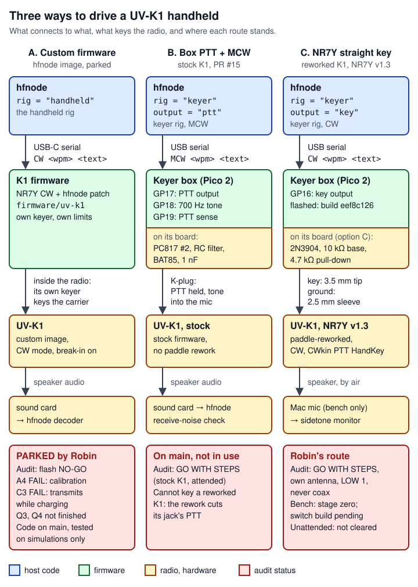

# 10 Quansheng UV-K1 handheld

> The project can drive a Quansheng UV-K1 handheld radio on 2 m in three ways, and only one of them is in use. **Route A** puts hfnode's own commands into the radio's firmware and keys it over its USB-C port. It is merged (PR #10) and tested against simulations, but it is **parked**: Robin (the project owner) dropped it on 2026-10-07, the safety audit then graded flashing it NO-GO, and it was never flashed. **Route B** keeps a stock radio's firmware and has the keyer box hold its PTT (push-to-talk) while it keys a tone into the microphone (MCW, PR #15). It is merged and cleared for an attended bench, but it cannot key the radios that Robin uses, because their paddle rework cuts that PTT contact. **Route C** is Robin's route: her radios run NR7Y's v1.3 CW firmware with NR7Y's paddle rework, and the keyer box keys the radio's PTT line as a straight key through one NPN transistor (the audit's "option C"). It needs no code change. It is cleared for an attended bench on the radio's own antenna at Power LOW 1, never on coax. On the bench it is at stage zero. The box is flashed with build `eef8c126` and reports the audited limits (bench stage 2, 2026-10-09). The option C switch is drawn, but building it and its meter checks are not yet recorded as done. Robin has started stage 3 with her meter (the two sleeves are not tied, 2026-10-11). The box has not been connected to the radio, and nothing from the project has keyed it. Host code is in `crates/hfnode/src/handheld*` (route A) and the keyer rig (routes B and C). Firmware is in `firmware/uv-k1` (route A) and `firmware/pico2-keyer` (B and C). The wiring and settings come from the safety audit's rulings, which are project files.

**Status at a glance** (code at main `44185fa`; project files as last updated 2026-10-11):

| Route | What keys the transmitter | On main | Safety audit | In use |
|---|---|---|---|---|
| A. Custom firmware (`rig = "handheld"`) | The radio's own CW keyer, from `CW <wpm> <text>` sent over USB-C | Yes (PR #10) | **Flash: NO-GO.** Connect and key: never graded (Q3, Q4 not finished) | No. Parked by Robin 2026-10-07 13:59Z; never flashed |
| B. Box PTT + MCW (`output = "ptt"`) | The box's PTT optocoupler (GP17) holds the radio's PTT; a 700 Hz tone (GP18) goes into the mic | Yes (PR #15) | Connect and bench keying: GO WITH STEPS on a **stock** radio | No. Robin's radios are reworked, and the rework cuts this PTT contact |
| C. NR7Y straight key (`output = "key"`) | The box's key output (GP16) closes the radio's PTT line, which NR7Y's CW mode reads as a straight key | Wiring and docs only; no code needed | Bench, attended: GO WITH STEPS, own antenna, LOW 1, never coax. Unattended: not cleared | Yes. The bench is at stage zero |

Radio words used on this page (more in [17 Glossary](17-glossary.md)):

| Term | Meaning here |
|---|---|
| handheld, HT | A small battery FM radio, here the Quansheng UV-K1 (2 m and 70 cm). |
| 2 m | The amateur band at 144-148 MHz. |
| CW | Morse code sent by switching a carrier on and off. |
| MCW | Modulated CW: an FM carrier held on while an audio tone is keyed in Morse. |
| PTT | Push-to-talk: the line that puts the radio into transmit while it is held low. |
| straight key | A plain on/off key. Closing it is key down, opening it is key up. |
| K-plug | The UV-K1's two-pin headset socket: a 3.5 mm and a 2.5 mm jack side by side. Each plug has a tip, a ring and a sleeve contact. |
| NR7Y firmware | A third-party CW firmware for the UV-K1 and UV-K5 v3 (`briand/uv-k1-k5v3-firmware-custom`, by NR7Y). Route A patches it; route C runs its v1.3 release unmodified. |
| paddle rework | NR7Y's hardware change inside the radio (R72 and R70 removed, two wires added) that turns the 3.5 mm jack into a key input. All of Robin's UV-K1s have it, by her account; which revision each has is still an open audit question (ruling §8), and a board photo settles it. |
| break-in (`CWbkin`) | When ON, a key-down transmits. When OFF, NR7Y plays only the sidetone and transmits nothing. |
| sidetone | The tone the radio plays in its own speaker while CW is keyed. The node listens for it to confirm what was keyed. |
| squelch | The receiver circuit that mutes the speaker when no signal is heard. |
| LOW 1 | NR7Y's lowest transmit power level. The watts it gives are unmeasured. |
| dummy load, coax | A resistor that absorbs a transmitter's output, and the cable that would carry RF to it. Robin skipped the dummy load. The K1 is never keyed through coax. |
| BK4819 | The radio chip in the UV-K1. Its register 0x30 shows whether it is set up to transmit. |
| PY32F071 | The UV-K1's processor. Its PTT input pin is PB10. |
| IWDG | The PY32F071's independent hardware watchdog. |
| CDC | USB "virtual serial port" (communications device class). |
| RP2350-E9 | An erratum of the keyer box's chip: an undriven pad can float near 2 V. An external pull-down of 8.2 kΩ or less is the fix; the box uses 4.7 kΩ. |
| RF, carrier | Radio-frequency energy; the carrier is the steady RF signal a transmitter puts out while keyed. |
| wpm | Words per minute, the Morse speed. One dot lasts 1.2 s / wpm (67 ms at 18 wpm). |
| dit, dah | The short and long Morse elements (dot and dash). A paddle has a dit side and a dah side. |
| iambic, bug | Two kinds of paddle keying that NR7Y offers as `CWkin` modes; this project uses neither. |
| `QRL?`, `DE <call>` | "Is this frequency in use?", and "from <call>": the operator's check before transmitting and the station's identification. |
| simplex, repeater offset | Receiving and transmitting on the same frequency, versus transmitting on a shifted one (through a repeater). The node requires simplex. |
| dual watch | A radio listening on two channels at once; the stock UV-K1 calls it TDR. |
| optocoupler (PC817) | A part with an LED and a light-sensitive transistor in one package: the box lights the LED, and the transistor closes the radio's line with no wire between the two sides. |
| Schottky diode (BAT85) | A diode with a low forward drop, used by the box to read the PTT contact without driving it. |
| ferrite | A clip-on magnetic ring around a wire that blocks RF picked up on it. |
| TO-92 | The small three-leg plastic package of the 2N3904. The leg order differs between part numbers. |
| SysTick, LSI | The processor's 10 ms timer interrupt, and its low-speed internal clock (about 32 kHz, not precise) that the watchdog counts. |
| SWDIO | The processor's debug-port data pin. The rework's dah wire goes to it. |
| BOOTSEL | The Pico 2's boot button. Held at power-up, the chip starts its built-in USB loader instead of the box's firmware. |
| UVTools2, CHIRP | Computer programs used with a UV-K1 over its USB-C port: UVTools2 flashes firmware and dumps or restores calibration, CHIRP programs channels. Neither is used on the bench. |
| Audit IDs | `H1` to `H5` are the safety rubric's unattended-use criteria (H1 "bench proven", H3 "bad load without a person"); `A4` (factory data preserved) and `C3` (thermal) are rubric criteria too, and `Q1-14` is question 14 of the firmware audit's section 1. `C1` to `C11` with a route (for example "the audit's C10, RF on the cable") are the handheld route constraints in `audit/req-handheld-generic-route-constraints.md`, a separate list. |

## Where it lives

### Route A: the parked custom firmware

| Path | What it holds | Lines |
|---|---|---|
| [`crates/hfnode/src/handheld.rs`](https://github.com/robinonsay/cw-message-gateway/blob/44185fa9a00369c379d9d8af40ca307e3867e860/crates/hfnode/src/handheld.rs) | The `Handheld` rig: limits, config checks, bring-up stages, keep-alive thread, duty and busy waits, link and hang tests, `impl Rig` | 1099 |
| [`crates/hfnode/src/handheld/proto.rs`](https://github.com/robinonsay/cw-message-gateway/blob/44185fa9a00369c379d9d8af40ca307e3867e860/crates/hfnode/src/handheld/proto.rs) | Wire protocol v1: line encode/decode, `Command`, `Reply`, `Hello`, `Status`, parsers, `ERR` explanations, and tests that read the firmware's C source | 570 |
| [`crates/hfnode/src/handheld/link.rs`](https://github.com/robinonsay/cw-message-gateway/blob/44185fa9a00369c379d9d8af40ca307e3867e860/crates/hfnode/src/handheld/link.rs) | `Transport` trait, `SerialTransport` (USB-C port), `Link` (ids, retries, reply matching) | 291 |
| [`crates/hfnode/src/handheld/mock.rs`](https://github.com/robinonsay/cw-message-gateway/blob/44185fa9a00369c379d9d8af40ca307e3867e860/crates/hfnode/src/handheld/mock.rs) | `MockFirmware`: a simulated radio running the firmware, with fault switches | 652 |
| [`crates/hfnode/src/handheld/tests.rs`](https://github.com/robinonsay/cw-message-gateway/blob/44185fa9a00369c379d9d8af40ca307e3867e860/crates/hfnode/src/handheld/tests.rs) | Rig and station tests against the mock, including the ID-timing flake guard | 1028 |
| [`crates/hfnode/src/config.rs:137-171`](https://github.com/robinonsay/cw-message-gateway/blob/44185fa9a00369c379d9d8af40ca307e3867e860/crates/hfnode/src/config.rs#L137-L171) | `[handheld]` config section (`struct Handheld`) | 35 |
| [`crates/hfnode/src/main.rs:1524-1748`](https://github.com/robinonsay/cw-message-gateway/blob/44185fa9a00369c379d9d8af40ca307e3867e860/crates/hfnode/src/main.rs#L1524-L1748) | `hfnode handheld check / key / linktest / hangtest / rx` | 225 |
| [`firmware/uv-k1/app/hfnode.c`](https://github.com/robinonsay/cw-message-gateway/blob/44185fa9a00369c379d9d8af40ca307e3867e860/firmware/uv-k1/app/hfnode.c) | The firmware side: commands, run state machine, limits, watchdog | 593 |
| [`firmware/uv-k1/app/hfnode.h`](https://github.com/robinonsay/cw-message-gateway/blob/44185fa9a00369c379d9d8af40ca307e3867e860/firmware/uv-k1/app/hfnode.h) | `HFNODE_Init`, `HFNODE_Poll`, `HFNODE_WatchdogTick` | 38 |
| [`firmware/uv-k1/app/hfnode_line.c`](https://github.com/robinonsay/cw-message-gateway/blob/44185fa9a00369c379d9d8af40ca307e3867e860/firmware/uv-k1/app/hfnode_line.c), [`firmware/uv-k1/app/hfnode_line.h`](https://github.com/robinonsay/cw-message-gateway/blob/44185fa9a00369c379d9d8af40ca307e3867e860/firmware/uv-k1/app/hfnode_line.h) | Line reader, parser, formatter, Morse character set | 121, 58 |
| [`firmware/uv-k1/nr7y-hfnode.patch`](https://github.com/robinonsay/cw-message-gateway/blob/44185fa9a00369c379d9d8af40ca307e3867e860/firmware/uv-k1/nr7y-hfnode.patch) | Hooks into NR7Y's own files (CMake option, own-speed text playback, five Morse characters, early BK4819 reset, main loop and SysTick calls) | 302 |
| [`firmware/uv-k1/build.sh`](https://github.com/robinonsay/cw-message-gateway/blob/44185fa9a00369c379d9d8af40ca307e3867e860/firmware/uv-k1/build.sh) | `build.sh [work-dir]`: fetches NR7Y at a pinned commit, applies the patch, builds, hashes (see "Build the route A firmware" below) | 98 |
| [`firmware/uv-k1/test/test_hfnode.c`](https://github.com/robinonsay/cw-message-gateway/blob/44185fa9a00369c379d9d8af40ca307e3867e860/firmware/uv-k1/test/test_hfnode.c) and `test/stubs/` | Host test of `hfnode.c` against stand-ins for the radio | 907 |
| [`firmware/uv-k1/README.md`](https://github.com/robinonsay/cw-message-gateway/blob/44185fa9a00369c379d9d8af40ca307e3867e860/firmware/uv-k1/README.md) | Build, flash and host-test notes | 145 |
| [docs/handheld.md](../handheld.md), [docs/handheld-protocol.md](../handheld-protocol.md) | The route's user guide and the wire protocol; both marked **Parked** | 293, 193 |

### Routes B and C: the keyer box on the K-plug

These routes add no handheld-specific module. They use the keyer box firmware ([08 Keyer box: firmware](08-keyer-box-firmware.md)) and the keyer rig ([09 Keyer box: host side](09-keyer-host-side.md)). The handheld-specific parts are:

| Path | What it holds |
|---|---|
| [`crates/keyer-core/src/lib.rs:44-115`](https://github.com/robinonsay/cw-message-gateway/blob/44185fa9a00369c379d9d8af40ca307e3867e860/crates/keyer-core/src/lib.rs#L44-L115) | The box's limits, including `PTT_MS`, and the MCW timing (`mcw::LEAD_MS`, `TAIL_MS`, `LINE_MS`) |
| [`firmware/pico2-keyer/src/main.rs:65-77`](https://github.com/robinonsay/cw-message-gateway/blob/44185fa9a00369c379d9d8af40ca307e3867e860/firmware/pico2-keyer/src/main.rs#L65-L77) | Pins: GP16 key, GP17 PTT, GP18 tone, GP19 PTT sense, `TONE_HZ` |
| [`crates/hfnode/src/keyer.rs:57-93`](https://github.com/robinonsay/cw-message-gateway/blob/44185fa9a00369c379d9d8af40ca307e3867e860/crates/hfnode/src/keyer.rs#L57-L93) | `MCW_BANDS_HZ`, `enum Output` (`key` or `ptt`), `PTT_CONTACT_VOLTS` |
| [`crates/hfnode/src/keyer.rs:159-178`](https://github.com/robinonsay/cw-message-gateway/blob/44185fa9a00369c379d9d8af40ca307e3867e860/crates/hfnode/src/keyer.rs#L159-L178) | `check_ptt_cable` |
| [`docs/keyer.md:433-839`](https://github.com/robinonsay/cw-message-gateway/blob/44185fa9a00369c379d9d8af40ca307e3867e860/docs/keyer.md#L433-L839) | Route B: "A handheld through its headset jack" (stock radio, MCW) |
| [`docs/keyer.md:840-1511`](https://github.com/robinonsay/cw-message-gateway/blob/44185fa9a00369c379d9d8af40ca307e3867e860/docs/keyer.md#L840-L1511) | Route C: "A UV-K1 on NR7Y in CW mode (paddle-reworked)" |

### Project files (not in the repository; cited in plain text)

- The safety audit's rulings: `audit/req-handheld-nr7y-cw-ruling.md` (route C wiring, settings and stages), `audit/req-handheld-nr7y-ruling.md` (NR7Y settings it keeps), `audit/req-on-air-bench-ruling.md` (the bench on the radio's own antenna), `audit/req-handheld-generic-route-constraints.md` (route B, C1-C11), `audit/req-handheld-no-tx-while-charging.md` (route A, parked).
- `audit/report.md` §2 (route A's grades) and `audit/final-grades.md`.
- `bench/quansheng.md` (the bench thread's stages and results) and `bench/k1-2n3904-key.svg` (the bench's own option C drawing).
- `design/spec-handheld.md` (route A's design) and `reference/K1_EN.txt` (the UV-K1 manual as text).

## How it works



*Figure: read each column top to bottom: what hfnode sends, what keys the radio, what hears it, and where the route stands. Only C is in use.*

All three routes share the same node above the radio: the code sheet, protocol, decoder, gateways, station safety layer and inhibit latch ([05 Node loop and station safety](05-node-loop-station-safety.md)). They differ in what holds the transmitter on and in what stops it.

### Route A: hfnode's own commands inside the radio (parked)

The idea was to drive the handheld the way the IC-7300 is driven: the node sends text, and the radio's own keyer sends it. hfnode opens the UV-K1's USB-C port, which appears as a serial port. It sends one-line commands with an id and a checksum, such as `CW 20 CQ DE <call>`, and reads one reply per command. The firmware is NR7Y's CW firmware with a patch. The patch adds the commands and a set of limits that run inside the radio: a 60 s run limit, a 2 s link timeout, a check of every stop, a hardware watchdog, a key-down budget, and a latch that refuses CW once a run went out without the radio chip ever reading "transmitting". The firmware sets nothing on the radio. Frequency, mode, power and break-in are set by hand at the radio, and the node reads them back and refuses to transmit while any is wrong.

**Why it is parked.** Robin dropped the route on 2026-10-07 at 13:59Z, and the audit stopped part way (`audit/report.md` §2):

- **Safe to flash: NO-GO** (corrected 15:10Z, after an earlier "safe to flash"). Two A4 FAILs:
  - UVTools2 finds the calibration offset from a "vX.Y.Z" version string. This build has none, so UVTools2 keeps 0x1E00, which in this firmware is channel memory; calibration is at 0xB000. Dump Calib would return channels 481-512, and Restore Calib would overwrite them.
  - [`firmware/uv-k1/README.md:107-126`](https://github.com/robinonsay/cw-message-gateway/blob/44185fa9a00369c379d9d8af40ca307e3867e860/firmware/uv-k1/README.md#L107-L126) has no calibration-backup step.
- **Transmit while charging: C3 FAIL** (Q1-14). The only link is the USB-C port, and a computer charges the radio through it. The UV-K1 manual forbids transmitting while charging. NR7Y cannot sense charging: upstream `App/board.c:178` sets the battery current to 0, so its charging flag never turns on (`audit/req-handheld-no-tx-while-charging.md`). No charging check exists in the code at `44185fa`.
- **Not finished:** Q3 (transmit control in our firmware), Q4 (keying paths, cable and host side), the skeptic passes and the synthesis.

The code stays on main, and CI still builds and host-tests the firmware on every push ([`.github/workflows/ci.yml:222-271`](https://github.com/robinonsay/cw-message-gateway/blob/44185fa9a00369c379d9d8af40ca307e3867e860/.github/workflows/ci.yml#L222-L271)). [docs/handheld.md](../handheld.md) says it "has never been flashed" ([`docs/handheld.md:225-226`](https://github.com/robinonsay/cw-message-gateway/blob/44185fa9a00369c379d9d8af40ca307e3867e860/docs/handheld.md#L225-L226)). Nothing on this route has keyed a real radio.

**Route A bring-up, as written (never run).** The route's guide gives five steps ([`docs/handheld.md:140-185`](https://github.com/robinonsay/cw-message-gateway/blob/44185fa9a00369c379d9d8af40ca307e3867e860/docs/handheld.md#L140-L185)). The operator raises `[handheld] commissioned` by hand after each one passes; `commissioned` under `[station]` is the IC-7300's and does nothing here. `C` is the handheld's config file:

1. `hfnode handheld --config C check` (stage `none`): the firmware answers `HELLO`, the radio reads receive, and its settings match the config. It never transmits.
2. `hfnode listen --config C`: CW sent by hand from another handheld is decoded correctly. Then `commissioned = "listen"`.
3. `hfnode handheld --config C key "VVV DE <call>"`, then `hfnode handheld --config C linktest`. Then `commissioned = "keying"`.
4. `hfnode handheld --config C hangtest`, with a hand on the radio's power switch: the carrier must stop when the watchdog resets the radio. Then `commissioned = "done"`.
5. `hfnode run --config C`.

`linktest` and `hangtest` key without the busy-channel wait and the duty cycle. `key` and `linktest` check the state directory first, and `linktest` checks the transmit inhibit itself because it keys outside the station's `transmit` ([`crates/hfnode/src/main.rs:1571-1588`](https://github.com/robinonsay/cw-message-gateway/blob/44185fa9a00369c379d9d8af40ca307e3867e860/crates/hfnode/src/main.rs#L1571-L1588)). `hangtest` keys outside a station too, so it checks both before it opens the radio ([`crates/hfnode/src/main.rs:1664-1673`](https://github.com/robinonsay/cw-message-gateway/blob/44185fa9a00369c379d9d8af40ca307e3867e860/crates/hfnode/src/main.rs#L1664-L1673)). The command handlers are [`crates/hfnode/src/main.rs:1545-1611`](https://github.com/robinonsay/cw-message-gateway/blob/44185fa9a00369c379d9d8af40ca307e3867e860/crates/hfnode/src/main.rs#L1545-L1611).

### Route B: the box holds a stock radio's PTT (MCW)

A stock UV-K1 has no key input and no CW mode. It transmits FM while its PTT is held, and sends whatever reaches its microphone. With `[keyer] output = "ptt"` the keyer box holds the PTT through a second PC817 optocoupler on GP17. It keys a 700 Hz tone from GP18 through an RC filter into the microphone, in Morse. GP19 reads the PTT contact back through a BAT85 Schottky diode. The node hears the radio go quiet: with the squelch open the speaker carries receive noise, which mutes while the radio transmits ([09 Keyer box: host side](09-keyer-host-side.md), `Mode::Mute`).

Its own limits, on top of the box's usual ones (never loosen any of them; the canonical table is [13 Safety rules](13-safety-rules.md)):

| Limit | Value | Where |
|---|---|---|
| PTT held at most | 60 000 ms, then the box opens the PTT and trips until power-cycled | [`crates/keyer-core/src/lib.rs:57`](https://github.com/robinonsay/cw-message-gateway/blob/44185fa9a00369c379d9d8af40ca307e3867e860/crates/keyer-core/src/lib.rs#L57) |
| Run limit | 60 000 ms | [`crates/keyer-core/src/lib.rs:51`](https://github.com/robinonsay/cw-message-gateway/blob/44185fa9a00369c379d9d8af40ca307e3867e860/crates/keyer-core/src/lib.rs#L51) |
| PTT lead before the first element | 500 ms | [`crates/keyer-core/src/lib.rs:107`](https://github.com/robinonsay/cw-message-gateway/blob/44185fa9a00369c379d9d8af40ca307e3867e860/crates/keyer-core/src/lib.rs#L107) |
| PTT tail after the last element | 200 ms | [`crates/keyer-core/src/lib.rs:109`](https://github.com/robinonsay/cw-message-gateway/blob/44185fa9a00369c379d9d8af40ca307e3867e860/crates/keyer-core/src/lib.rs#L109) |
| PTT line must follow the PTT within | 100 ms (low after closing, else the run ends `LINE`; high after opening, else the box trips) | [`crates/keyer-core/src/lib.rs:114`](https://github.com/robinonsay/cw-message-gateway/blob/44185fa9a00369c379d9d8af40ca307e3867e860/crates/keyer-core/src/lib.rs#L114) |
| Tone pitch | 700 Hz | [`firmware/pico2-keyer/src/main.rs:77`](https://github.com/robinonsay/cw-message-gateway/blob/44185fa9a00369c379d9d8af40ca307e3867e860/firmware/pico2-keyer/src/main.rs#L77) |
| PTT contact voltage on record | 2.5-25 V before anything keys | [`crates/hfnode/src/keyer.rs:93`](https://github.com/robinonsay/cw-message-gateway/blob/44185fa9a00369c379d9d8af40ca307e3867e860/crates/hfnode/src/keyer.rs#L93) |
| Where MCW may be sent | 50.1-54, 144.1-148, 222-225, 420-450 MHz | [`crates/hfnode/src/keyer.rs:62-67`](https://github.com/robinonsay/cw-message-gateway/blob/44185fa9a00369c379d9d8af40ca307e3867e860/crates/hfnode/src/keyer.rs#L62-L67) |
| Receive noise while transmitting | at least 15 dB under the receive level | [`crates/hfnode/src/keyer/monitor.rs:137`](https://github.com/robinonsay/cw-message-gateway/blob/44185fa9a00369c379d9d8af40ca307e3867e860/crates/hfnode/src/keyer/monitor.rs#L137) |
| Receive noise back after PTT up | within 1500 ms | [`crates/hfnode/src/keyer/monitor.rs:140`](https://github.com/robinonsay/cw-message-gateway/blob/44185fa9a00369c379d9d8af40ca307e3867e860/crates/hfnode/src/keyer/monitor.rs#L140) |

The PTT limit is enforced twice inside the box: by the keyer's own timeline and by the control loop's watch on the PTT pin, which holds to `PTT_MS` whatever limits the keyer was given (see "Route B: one MCW run" below). The radio's own time-out timer, set to 1 minute, would be the stop that does not depend on the box, if stage zero's time-out test (the audit's C4) shows it ends a transmission held through the jack. That is unmeasured ([`docs/keyer.md:662-663`](https://github.com/robinonsay/cw-message-gateway/blob/44185fa9a00369c379d9d8af40ca307e3867e860/docs/keyer.md#L662-L663), [`:808-812`](https://github.com/robinonsay/cw-message-gateway/blob/44185fa9a00369c379d9d8af40ca307e3867e860/docs/keyer.md#L808-L812)). The audit graded the route GO WITH STEPS for zero-RF connect and attended bench keying on a stock radio (`audit/report.md`, the "plain radio on the keyer box" row).

**What the stock radio can transmit by itself.** The box's limits do not cover these, and the node cannot read them, so they are checked at the radio every session ([docs/handheld.md](../handheld.md), "The stock firmware's own transmissions"; [`docs/keyer.md:644-703`](https://github.com/robinonsay/cw-message-gateway/blob/44185fa9a00369c379d9d8af40ca307e3867e860/docs/keyer.md#L644-L703), "Setting up the radio, every session"):

- WX (menu 18) OFF: at CHAN_A or CHAN_B every transmission goes out on that channel.
- TDR (dual watch, menu 17) OFF, and channel B on A's frequency, so a temporary transmit channel cannot send anywhere else.
- D-DCD OFF and D-RSP NULL: otherwise the radio answers a DTMF call with an automatic callback.
- Not scanning, not in NOAA or FM-radio mode, NOAA_S OFF: in each, the PTT answers whatever call the radio found.
- AL-MOD SITE: at TONE, the alarm transmits.
- VOX OFF, and the keypad locked last (F+7 toggles VOX): with VOX on, any sound at the microphone keys the radio.
- Hands off the side keys, which the lock does not cover: side key 1 held sends a 1750 Hz tone, and side key 2 with the PTT held enters Air Copy, which sends the radio's settings on 410.0125 MHz.
- Also Power L, TOT 1 min, PTT-ID and ROGER OFF, BCL OFF, squelch 0, simplex on the agreed 144.1-148 MHz frequency, battery only.

On this route the K-plug uses the 3.5 mm sleeve (PTT), the 3.5 mm ring (microphone), the 2.5 mm sleeve (ground) and the 2.5 mm tip (speaker), as the AIOC cable's label has them; each is identified on the radio with a meter before any cable is built (the audit's C1). The 2.5 mm ring, the radio's serial output, is never connected (C2).

**Route B bring-up, as written** ([`docs/keyer.md:737-784`](https://github.com/robinonsay/cw-message-gateway/blob/44185fa9a00369c379d9d8af40ca307e3867e860/docs/keyer.md#L737-L784)); none of it has been run, because Robin's radios cannot use this route:

1. Stage zero, no computer: identify the contacts; the box's meter checks on its PTT output; then the time-out test with no box at all (C4): TOT 1 min, the PTT contact held to ground with a clip lead, and the red light must go out by itself after about a minute.
2. Stage none: `hfnode keyer --config C check` shows the box's 60 s PTT limit, its PTT up and its PTT line high.
3. Stage listen: `key "TEST"` reports the radio quiet while the PTT was held and back on receive after; the tone level set by ear on a second receiver (C7); the PTT contact under 0.4 V while keyed (C9); several runs at full power with the whole cable, each ending back on receive (C10, RF on the cable); and one 30-character piece to check the radio's heat (C8). `sidetone` is refused on this route.
4. Stage keying: `hangtest`, `stucktest` and `linktest`.

**Why it is not used.** NR7Y's paddle rework removes R72, which cuts the 3.5 mm sleeve (the contact this cable holds as the PTT) from the radio's PTT. The MCW cable cannot key a reworked radio ([`docs/keyer.md:435-442`](https://github.com/robinonsay/cw-message-gateway/blob/44185fa9a00369c379d9d8af40ca307e3867e860/docs/keyer.md#L435-L442)). The audit has not graded NR7Y firmware without the rework, or the rework on stock firmware: ask it first.

### Route C: NR7Y CW, keyed as a straight key (Robin's route)

Robin's UV-K1s run NR7Y v1.3, the release build, unmodified, and all have NR7Y's paddle rework, by her account (ruling §1). Which rework revision each radio has, and whether every K1 has the same one, are still open audit questions (ruling §8, Q1-Q2); a board photo settles them. In NR7Y's CW mode the radio has its own CW transmitter. With the key input `CWkin` set to `PTT HandKey`, it reads its PTT line as a straight key: closing the line is key down, and opening it is key up after a release debounce. So the keyer box needs no new firmware and the node needs no new code. The box's ordinary key output (GP16, `output = "key"`) closes the PTT line, exactly as it closes an HF radio's key jack. The node checks every element with its sidetone monitor, as on any radio ([09 Keyer box: host side](09-keyer-host-side.md)). On the bench the radio's speaker reaches the node through the Mac's built-in microphone.

What the rework did to the jack (NR7Y's rework guide, as the audit read it in `audit/req-handheld-nr7y-cw-ruling.md` §1, for the 3.5 mm jack; the note under the table says where the 2.5 mm rows come from):

| Contact | Before the rework | After the rework | Route C uses it as |
|---|---|---|---|
| 3.5 mm tip | +3.3 V feed through R70 | R70 removed. Wired to PB10, the PTT pin: the dit or straight-key input | **Key** |
| 3.5 mm ring | Microphone | Still the microphone, and also wired to SWDIO (PA13): the dah input | Not connected |
| 3.5 mm sleeve | PTT and serial input | R72 removed: now only the serial input (PA10), which NR7Y drives low as a "port ground" in its Port modes | **Not connected. Never ground.** |
| 2.5 mm tip | Speaker | Speaker | Audio only (not wired on today's bench) |
| 2.5 mm ring | Serial output | Serial output | Not connected |
| 2.5 mm sleeve | Ground | Ground | **Ground** (the switch's return) |

The 3.5 mm rows follow NR7Y's rework guide. The 2.5 mm rows are the AIOC cable's label ([`docs/keyer.md:503-505`](https://github.com/robinonsay/cw-message-gateway/blob/44185fa9a00369c379d9d8af40ca307e3867e860/docs/keyer.md#L503-L505)), which the ruling qualifies "if the AIOC label holds" (§2); they are not measured on Robin's radio. She skipped the continuity check from the 2.5 mm sleeve to the battery's negative contact (bench file, 2026-10-11 12:43Z), so the 2.5 mm sleeve as ground is confirmed only indirectly: stage zero and the touch test both read against it. Robin's meter did show the two sleeves are not tied together (bench file, 2026-10-11 12:41Z), as the rework schematic says.

#### The wiring: option C, exactly as the audit states it

The box's safe state is GP16 low. It drives GP16 low at power-up, before anything else starts ([`firmware/pico2-keyer/src/main.rs:174-182`](https://github.com/robinonsay/cw-message-gateway/blob/44185fa9a00369c379d9d8af40ca307e3867e860/firmware/pico2-keyer/src/main.rs#L174-L182)), and first thing in every fault handler: a panic, a HardFault or any unexpected exception ([`firmware/pico2-keyer/src/main.rs:39-41`](https://github.com/robinonsay/cw-message-gateway/blob/44185fa9a00369c379d9d8af40ca307e3867e860/firmware/pico2-keyer/src/main.rs#L39-L41)). While the chip starts or resets, a watchdog reset included, nothing drives the pin: the pad's reset state and the 4.7 kΩ pull-down hold it low ([`firmware/pico2-keyer/src/main.rs:15-21`](https://github.com/robinonsay/cw-message-gateway/blob/44185fa9a00369c379d9d8af40ca307e3867e860/firmware/pico2-keyer/src/main.rs#L15-L21)). The K1's PTT line transmits when pulled low. So a bare GP16 wired to the tip would key the radio in every safe state of the box, with no radio time-out in CW to end it. The audit graded that **NO-GO**. A switch turns "pin low" into "line open". The audit cleared three switches. Option A is a logic-level N-channel MOSFET, option B the audited PC817, and option C one NPN transistor. Robin chose option C with a 2N3904. The ruling (`audit/req-handheld-nr7y-cw-ruling.md` §2, "One NPN BJT, option C"; confirmed 17:30Z) reads:

> 4.7 kΩ from GP16 (pin 21) to GND (pin 23), at the pin; 4.7-10 kΩ from GP16 to the base; collector to the 3.5 mm tip; emitter to the Pico's GND and the 2.5 mm sleeve. Of her two resistors, **the 4.7 kΩ is the pull-down, never the 10 kΩ**: Raspberry Pi's E9 fix is 8.2 kΩ or less (docs/keyer.md:57-63). The base resistor is the other one, 10 kΩ or a second 4.7 kΩ.

(The ruling's line numbers are of main at 3e0a25c, the ruling's stated source. At 44185fa that text is [`docs/keyer.md:59-65`](https://github.com/robinonsay/cw-message-gateway/blob/44185fa9a00369c379d9d8af40ca307e3867e860/docs/keyer.md#L59-L65).)


*Figure: the key switch the audit cleared for the bench, drawn from `req-handheld-nr7y-cw-ruling.md` §2 option C and checked net by net against it and against the bench's drawing `bench/k1-2n3904-key.svg`. The bench file records it as drawn (2026-10-09 17:28Z), not yet as built or meter-checked. R1 and R2 follow the bench file's names. Filled dots are wired; hollow dots are left unconnected. The red panel repeats "The meter checks" and the chain test below, under the chain test's step numbers.*

Why each part is there:

- **The transistor is never optional.** It is the only guard against the box's safe state keying the radio. GP16 high turns it on and closes the key, exactly as GP16 lights the PC817's LED. So the audited box firmware (build `eef8c126`) is unchanged; only the wiring differs.
- **The 4.7 kΩ pull-down is never optional.** It is the only guard against RP2350-E9: a pad nothing drives (while the chip starts, resets, sits in BOOTSEL or is unplugged) can float near 2 V ([`docs/keyer.md:59-65`](https://github.com/robinonsay/cw-message-gateway/blob/44185fa9a00369c379d9d8af40ca307e3867e860/docs/keyer.md#L59-L65)). It goes from GP16 to GND, on the pin side of the base resistor. From the base to GND it would not work: an undriven pad at about 2 V through 10 kΩ would leave about 0.64 V on the base, enough to start turning it on.
- **The base resistor (R2)** may be 4.7-10 kΩ. Robin's is 10 kΩ. It gives 0.26-0.55 mA of base current. The key line needs at most about 110 µA sunk, because it is a PY32F071 pin with a 30-70 kΩ internal pull-up that reads low below about 1.0 V.
- **The ferrite** on the key wire at the radio end is the audit's C10. RF picked up on the lead reaches the Pico's ground through a transistor, where a PC817 would keep it on the radio's side. The audit found that this fails safe as far as the code shows. The box's 1 s key-down limit and the node's sidetone monitor catch a held key. The bench's first RF stage is the test.
- **Switch to the PC817 and tell the audit** if keying on the air shows the radio keying by itself, a key held after the box lets go, box resets or USB drop-outs (ruling §2, "RF on the lead").

Take the transistor's pins from the data sheet of the part in hand, because TO-92 pinouts differ between part numbers. The bench file records E, B, C for Robin's 2N3904, flat face toward you, legs down; the bare-part diode test in "The meter checks" below confirms the base.

#### The meter checks

From the ruling (`audit/req-handheld-nr7y-cw-ruling.md` §2, "Box meter checks for a BJT", refined 17:30Z), as [`docs/keyer.md:1058-1070`](https://github.com/robinonsay/cw-message-gateway/blob/44185fa9a00369c379d9d8af40ca307e3867e860/docs/keyer.md#L1058-L1070) repeats them. They need no radio. Take the pins from the data sheet for the number printed on the part.

1. **The bare part, before soldering, on the diode test.** Red on the base and black on each other leg reads one drop (about 0.5-0.8 V) each; every other pair reads open both ways. That confirms an NPN and finds its base.
2. **In the box, plugged into the computer, nothing running, nothing in the radio.** Volts collector to emitter: **0 V**. Diode test collector to emitter, both ways: **open, or above about 1.5 V** (one way can read high, because the meter's current goes through the base resistor and the base-collector junction). **A beep, or under about 1 V either way, means a shorted part or the base on the tip wire: do not plug it in.** Volts GP16 to GND: **0 V**.
3. **The box unplugged from USB.** GP16 to GND reads **about 4.7 kΩ**: the pull-down is there (a little less is fine, because the base path is in parallel).

Two more checks of the switch need the radio, and sit in the chain test below: the key line's stage-zero reading before anything is connected (step 2), and the idle check once the cable is in (step 5): the 3.5 mm tip still within 0.2 V of its stage-zero reading. A lower reading means the switch leaks toward key-down: unplug it and use another part ([`docs/keyer.md:1081-1086`](https://github.com/robinonsay/cw-message-gateway/blob/44185fa9a00369c379d9d8af40ca307e3867e860/docs/keyer.md#L1081-L1086)).

None of the three box checks is recorded yet: the bench file's stage 2 has its steps 1-4 (flashing) done, and its wiring and meter checks still open.

#### The radio's settings that matter

The full per-session list is [`docs/keyer.md:1145-1268`](https://github.com/robinonsay/cw-message-gateway/blob/44185fa9a00369c379d9d8af40ca307e3867e860/docs/keyer.md#L1145-L1268), from the audit's two NR7Y rulings. The items that change what can transmit:

| NR7Y item | Set to | Why |
|---|---|---|
| `Mode` | CW | Puts NR7Y's keyer in charge of the PTT. |
| `CWkin` | **`PTT HandKey`**, never a Port mode | It reads only the PTT line. Every Port mode drives the serial-input pin (the 3.5 mm sleeve) low as a paddle ground and reads the ring as a key. In `Port HandKey` a mono plug, or any ring-to-sleeve short, is a key held down with no time-out in CW. USB Port, iambic and bug modes are out too. |
| `CWbkin` | **OFF** for every zero-RF stage; ON only for keyed stages, on Robin's go | OFF: a key-down plays the sidetone and transmits nothing. ON: a real carrier, back to receive 300 ms after key-up. |
| `CWvol` | 1-6, never 0 | At 0 the node cannot hear its keying (it refuses, which fails safe) and cannot hear a stuck key either. |
| `CWfreq` | equal to `[keyer] sidetone_hz`, which defaults to `[audio] pitch_hz` (600 Hz) | NR7Y offers 450-800 Hz in 50 Hz steps. |
| `CWmsg1-4`, `CWmrpt` | never play, repeat or record | A playing message transmits by itself, on a timer. |
| `F1Shrt`, `F1Long`, `F2Shrt`, `F2Long`, `M Long` | `NONE` | The side keys could otherwise start a message, raise the power, or change mode. |
| `VOX` | OFF | In CW a VOX trigger starts a CW carrier. |
| `Power` | **LOW 1** | Nothing higher without the audit. |
| Frequency | 144.1-148.0 MHz on the display, checked before every keyed step | Its frequency lock can allow more, so the display is the check. |
| Stay out of | the hidden menu (never power on holding PTT + side key 1), `SetVol`, `MUTE` | They write the calibration sector. |

Battery only: nothing goes into the radio's USB-C socket, ever (no charging, no CHIRP, no UVTools2).

#### The Break-In OFF chain test

With `CWbkin` OFF, NR7Y plays the sidetone for a key-down and transmits nothing (NR7Y `app/cwapp.c:102-144`, "don't let RF happen", as the audit read it). This lets the bench prove the whole chain with no RF. The chain runs from the box through the cable, the radio reading the key and its sidetone, to the node hearing it. The red transmit light staying off shows that no carrier went out. That this gives no RF is a reading of NR7Y's code, confirmed only by that light. In the docs' bring-up these are "stage zero", "stage none" and the first half of "stage listen" ([`docs/keyer.md:1313-1371`](https://github.com/robinonsay/cw-message-gateway/blob/44185fa9a00369c379d9d8af40ca307e3867e860/docs/keyer.md#L1313-L1371)):

1. **Find the contacts.** Radio off, battery out: continuity to the battery's negative contact finds ground. Radio on, in CW with `CWbkin` OFF: DC volts on each contact. Expect about 3.3 V on the 3.5 mm tip.
2. **Measure the key line.** With a transistor, the open 3.5 mm tip to the 2.5 mm sleeve must read **+2.5 V to +5 V**, and carry **under 1 mA** through 1 kΩ. A negative reading means stop. Over 5 V means stop and use the PC817.
3. **Touch test.** Touch the 3.5 mm tip to ground through 1 kΩ for a second. The sidetone sounds and the red light stays off. That identifies the key contact and proves Break-In OFF gives no carrier. A red light means pull the plug and stop. A sidetone from any other contact means stop and ask the audit.
4. **The box's meter checks**: checks 1-3 in "The meter checks" above, also in the option C figure ([`docs/keyer.md:1058-1070`](https://github.com/robinonsay/cw-message-gateway/blob/44185fa9a00369c379d9d8af40ca307e3867e860/docs/keyer.md#L1058-L1070)).
5. **Cable in, box idle.** The tip still reads its stage-zero voltage within 0.2 V. Then `hfnode keyer --config C check`, `hfnode listen --config C`, and a 30 s watch with no sidetone and no red light. Then set `[keyer] commissioned = "listen"` in C ([`docs/keyer.md:1365`](https://github.com/robinonsay/cw-message-gateway/blob/44185fa9a00369c379d9d8af40ca307e3867e860/docs/keyer.md#L1365)): below that stage the node refuses `key` and `sidetone` ([`crates/hfnode/src/keyer.rs:180-193`](https://github.com/robinonsay/cw-message-gateway/blob/44185fa9a00369c379d9d8af40ca307e3867e860/crates/hfnode/src/keyer.rs#L180-L193)).
6. **Stage listen, still no RF.** `hfnode keyer --config C key "TEST"` must report `heard`, and `hfnode keyer --config C sidetone` must pass, with the red light off throughout.

Only then does `CWbkin` go ON, on Robin's go, under the on-air ruling below.

#### On the air: the ruling

Robin decided on 2026-10-09 to skip the dummy load and wattmeter and test on the air, accepting the risk. The audit's on-air ruling (`audit/req-on-air-bench-ruling.md` §2-§3) sets the conditions for the K1:

- **The radio's own antenna, screwed fully on and undamaged, at Power LOW 1. Never coax, an adapter cable or an external antenna.** The manual's only load rule is "Do not transmit when the antenna is not installed" (K1_EN.txt:68), and nothing in the radio or the box would notice a bad load. That risk (H3) is now graded RISK on the bench too.
- The antenna stays on in the zero-RF stages as well, in case a fault keys the radio.
- The antenna points away, at least 30 cm from the box and the key lead, with the clip-on ferrite on the lead at the radio end.
- Before every keyed step: check the frequency on the display; listen until clear; key `QRL? DE <call>` and listen again; run the step with a hand on the K-plug; identify with `DE <call>` at the end of each group and at least every 10 minutes (`key "TEST DE <call>"` rather than a bare `key "TEST"`); stop at once if anyone reports interference.
- The bench's first RF stage tests C10 (RF on the key lead) for real.
- Unattended use: unchanged, not cleared on any route.

#### Bench status: stage zero

From `bench/quansheng.md` (the bench file numbers its stages 0-8; its stages 3 and 4 are the docs' "stage zero"):

| Bench stage | What | State |
|---|---|---|
| 0, 0b | Code on main matches what the audit passed; flash file hash confirmed | Done 2026-10-08 |
| H | Host and config (`[keyer] output = "key"`, `[audio] pitch_hz = 600`) | Done 2026-10-09 |
| 1 | Parts and NR7Y CW settings | Parts chosen (her 2N3904, option C). The audit's four rework questions (§8) are still open |
| 2 | Flash the box, wire option C, box meter checks | **Partial.** Steps 1-4 done 2026-10-09 16:19Z: the box reports build `eef8c126` and its limits as audited (checked bare, no radio). Option C confirmed by the audit 17:24Z and drawn 17:28Z (`bench/k1-2n3904-key.svg`). Building the switch and the BJT meter checks are not yet recorded |
| 3 | Contact ID and key-line stage zero | **Partial.** 2026-10-11 12:41Z: the 3.5 mm and 2.5 mm sleeves are not tied. Robin skipped the 2.5 mm sleeve to battery-minus continuity check. Still to record: DC volts and the key-line voltage (+2.5 to +5 V) |
| 4 | Touch test (no RF) | Not started |
| 5, 5b | Cable in, 0.2 V idle check, 30 s watch, then `commissioned = "listen"`; `key` and `sidetone` at Break-In OFF (no RF) | Not started |
| 6, 7 | On the air: `key`, `sidetone`; then `commissioned = "keying"` and `hangtest`, `stucktest`, `linktest` | Cleared by the audit; waits for 1-5b and Robin's go |
| 8 | Later: the speaker into the box's GP26 for the one-Pico image | Waits for PR #31 to merge and be flashed ([11 Decoder box and one-Pico image](11-decoder-box-one-pico.md)) |

The audit's answer on the skipped continuity check: a wrong ground shows up as no keying at stage 5b, with no RF and no damage, as long as the radio runs on its battery alone with nothing in USB-C.

## How it connects


*Figure: the same station layer sits over every route; only the rig under it changes. Route A (left column, parked and never flashed) has no box: hfnode runs inside the radio. Routes B and C (right) share the keyer rig and the box, and differ in the box output and the monitor mode. Every route's speaker comes back to the decoder and the monitor.*

| Neighbour | Direction | Route | What passes | Page |
|---|---|---|---|---|
| Station safety layer (`Station<R: Rig>`) | calls in | A | `Rig` trait calls: frequency, mode, power, break-in reads; `send_cw` pieces of at most 30 characters; `is_transmitting`; `rest_needed`; `stop_cw` | [05 Node loop and station safety](05-node-loop-station-safety.md) |
| `civ::Rig` trait | implemented by `Handheld` | A | [`crates/civ/src/lib.rs:58-186`](https://github.com/robinonsay/cw-message-gateway/blob/44185fa9a00369c379d9d8af40ca307e3867e860/crates/civ/src/lib.rs#L58-L186); `has_tuner` and `has_meters` answer false, and the trait's defaulted methods (`keying_confirmed`, `transmit_detail`, `receive_settle`, `held_key`, `polls_status_while_idle`, `time_out_timer`, `rf_power_watts`, `inhibit_transmit`) keep their defaults | [07 CI-V and the IC-7300](07-civ-ic7300.md) |
| UV-K1 firmware over USB-C CDC | both ways | A | protocol v1 lines (below) | this page |
| Keyer rig (`KeyerRig`) and sidetone monitor | calls in | B, C | `MCW` or `CW` runs; `Mode::Mute` (B) or `Mode::Sidetone` (C) | [09 Keyer box: host side](09-keyer-host-side.md) |
| Keyer box firmware | USB serial | B, C | keyer protocol 4 (`HELLO`, `CW`, `MCW`, `STATUS`, `STOP`, `TEST ...`) | [08 Keyer box: firmware](08-keyer-box-firmware.md) |
| The radio's speaker | audio in | all | sound card (A, B) or the Mac's built-in microphone on the bench (C) into the decoder and the monitor | [04 CW decoder and audio](04-cw-decoder-audio.md) |
| One-Pico image (PR #31, draft, not on main) | later | C | the speaker into the box's GP26 instead of a sound card | [11 Decoder box and one-Pico image](11-decoder-box-one-pico.md) |
| Config and CLI | reads | all | `[handheld]` (A), `[keyer] output` (B, C) | [15 Config, CLI and deployment](15-config-cli-deployment.md) |
| Safety audit and bench | gates | all | every flash, wiring change and keyed stage | [14 Audit, bench and flashing](14-audit-bench-flashing.md) |

Route A sits beside the IC-7300 as a `Rig`. `hfnode run` with `rig = "handheld"` opens it through `open_handheld(cfg, Some(Action::Run))` and checks the radio once with `st.check()` before it starts listening ([`crates/hfnode/src/main.rs:1257-1264`](https://github.com/robinonsay/cw-message-gateway/blob/44185fa9a00369c379d9d8af40ca307e3867e860/crates/hfnode/src/main.rs#L1257-L1264); `serve` takes that check as a `FnOnce` and calls it once, after `configure`, [`crates/hfnode/src/main.rs:1286`](https://github.com/robinonsay/cw-message-gateway/blob/44185fa9a00369c379d9d8af40ca307e3867e860/crates/hfnode/src/main.rs#L1286), [`:1318-1319`](https://github.com/robinonsay/cw-message-gateway/blob/44185fa9a00369c379d9d8af40ca307e3867e860/crates/hfnode/src/main.rs#L1318-L1319)). The station then sets the radio up and checks it again before every transmission ([`crates/hfnode/src/station.rs:1739-1745`](https://github.com/robinonsay/cw-message-gateway/blob/44185fa9a00369c379d9d8af40ca307e3867e860/crates/hfnode/src/station.rs#L1739-L1745)); on a handheld, every "set" is a read-back. `hfnode radio ...` refuses a handheld config ([`crates/hfnode/src/main.rs:973-975`](https://github.com/robinonsay/cw-message-gateway/blob/44185fa9a00369c379d9d8af40ca307e3867e860/crates/hfnode/src/main.rs#L973-L975)). Routes B and C are not a new rig at all: they are `rig = "keyer"` with `[keyer] output` choosing the PTT or the key output.

## Interfaces and APIs

### Route A host: `handheld.rs` constants

Every one of these is part of a safety check. Never loosen them; the firmware-sync tests below fail if the two sides drift.

| Name | Value | Meaning | Permalink |
|---|---|---|---|
| `DEADMAN_MARGIN` | 5 s | A run is stopped by the node at most `max_key_seconds` + this after it began | [`crates/hfnode/src/handheld.rs:58`](https://github.com/robinonsay/cw-message-gateway/blob/44185fa9a00369c379d9d8af40ca307e3867e860/crates/hfnode/src/handheld.rs#L58) |
| `MAX_FIRMWARE_TX_LIMIT` | 60 s | Longest transmit limit the firmware may report in `HELLO`; also the cap on `station.max_key_seconds` | [`crates/hfnode/src/handheld.rs:61`](https://github.com/robinonsay/cw-message-gateway/blob/44185fa9a00369c379d9d8af40ca307e3867e860/crates/hfnode/src/handheld.rs#L61) |
| `MIN_LINK_TIMEOUT`, `MAX_LINK_TIMEOUT` | 1 s, 3 s | The firmware's link timeout must lie in this range | [`crates/hfnode/src/handheld.rs:65-66`](https://github.com/robinonsay/cw-message-gateway/blob/44185fa9a00369c379d9d8af40ca307e3867e860/crates/hfnode/src/handheld.rs#L65-L66) |
| `REPLY_TIMEOUT` | 500 ms | Wait for each reply | [`crates/hfnode/src/handheld.rs:69`](https://github.com/robinonsay/cw-message-gateway/blob/44185fa9a00369c379d9d8af40ca307e3867e860/crates/hfnode/src/handheld.rs#L69) |
| `WATCHDOG_RESET` | 3 s | From the firmware's main loop stopping during a run to the reset (1 s stale + 2048 counts of LSI/32) | [`crates/hfnode/src/handheld.rs:73`](https://github.com/robinonsay/cw-message-gateway/blob/44185fa9a00369c379d9d8af40ca307e3867e860/crates/hfnode/src/handheld.rs#L73) |
| `STOP_WATCH_WAIT` | 1500 ms | How long `CW` is retried while the firmware answers `WAIT` | [`crates/hfnode/src/handheld.rs:76`](https://github.com/robinonsay/cw-message-gateway/blob/44185fa9a00369c379d9d8af40ca307e3867e860/crates/hfnode/src/handheld.rs#L76) |
| `MAX_DUTY_BUDGET` | 150 s | Most on-air time the node's duty cycle may allow at once; under the firmware's 165 s refusal | [`crates/hfnode/src/handheld.rs:81`](https://github.com/robinonsay/cw-message-gateway/blob/44185fa9a00369c379d9d8af40ca307e3867e860/crates/hfnode/src/handheld.rs#L81) |
| `TX_START_ALLOWANCE` | 50 ms per character | Allowed for the radio switching back to transmit after a gap | [`crates/hfnode/src/handheld.rs:88`](https://github.com/robinonsay/cw-message-gateway/blob/44185fa9a00369c379d9d8af40ca307e3867e860/crates/hfnode/src/handheld.rs#L88) |
| `HANG_RESTART` | 1 s ..= 8 s | The hang test passes only if the firmware restarted this long after it hung | [`crates/hfnode/src/handheld.rs:92-93`](https://github.com/robinonsay/cw-message-gateway/blob/44185fa9a00369c379d9d8af40ca307e3867e860/crates/hfnode/src/handheld.rs#L92-L93) |
| `BANDS_HZ` | 144-148, 222-225, 420-450 MHz | The only frequencies a handheld config accepts | [`crates/hfnode/src/handheld.rs:98-102`](https://github.com/robinonsay/cw-message-gateway/blob/44185fa9a00369c379d9d8af40ca307e3867e860/crates/hfnode/src/handheld.rs#L98-L102) |
| `WEAK_SIGNAL_HZ` (private) | 144.000-144.275, 222.000-222.150, 432.000-432.100 MHz | Outside these, a warning only | [`crates/hfnode/src/handheld.rs:107-111`](https://github.com/robinonsay/cw-message-gateway/blob/44185fa9a00369c379d9d8af40ca307e3867e860/crates/hfnode/src/handheld.rs#L107-L111) |

### Route A host: `handheld.rs` types and functions

| Item | Signature | What it does | Permalink |
|---|---|---|---|
| `band_of` | `pub fn band_of(hz: u64) -> Option<(u64, u64)>` | The band in `BANDS_HZ` holding `hz` | [`crates/hfnode/src/handheld.rs:113-119`](https://github.com/robinonsay/cw-message-gateway/blob/44185fa9a00369c379d9d8af40ca307e3867e860/crates/hfnode/src/handheld.rs#L113-L119) |
| `Stage` | `enum { None (default), Listen, Keying, Done }`, serde lower case, ordered | The bring-up stage passed, `[handheld] commissioned` | [`crates/hfnode/src/handheld.rs:121-140`](https://github.com/robinonsay/cw-message-gateway/blob/44185fa9a00369c379d9d8af40ca307e3867e860/crates/hfnode/src/handheld.rs#L121-L140) |
| `Action` | `enum { Key, Hang, Run }` | Commands that key a handheld | [`crates/hfnode/src/handheld.rs:153-159`](https://github.com/robinonsay/cw-message-gateway/blob/44185fa9a00369c379d9d8af40ca307e3867e860/crates/hfnode/src/handheld.rs#L153-L159) |
| `check_stage` | `pub fn check_stage(stage: Stage, action: Action) -> Result<()>` | `Key` needs `Listen`, `Hang` needs `Keying`, `Run` needs `Done` | [`crates/hfnode/src/handheld.rs:161-175`](https://github.com/robinonsay/cw-message-gateway/blob/44185fa9a00369c379d9d8af40ca307e3867e860/crates/hfnode/src/handheld.rs#L161-L175) |
| `validate` | `pub fn validate(cfg: &Config) -> Result<()>` | Config checks (below); called from `Config::validate` ([`crates/hfnode/src/config.rs:1176`](https://github.com/robinonsay/cw-message-gateway/blob/44185fa9a00369c379d9d8af40ca307e3867e860/crates/hfnode/src/config.rs#L1176)) | [`crates/hfnode/src/handheld.rs:177-249`](https://github.com/robinonsay/cw-message-gateway/blob/44185fa9a00369c379d9d8af40ca307e3867e860/crates/hfnode/src/handheld.rs#L177-L249) |
| `check_hello` | `pub fn check_hello(h: &Hello) -> Result<()>` | Refuses another protocol version, a transmit limit of 0 or over 60 s, a link timeout outside 1-3 s | [`crates/hfnode/src/handheld.rs:251-278`](https://github.com/robinonsay/cw-message-gateway/blob/44185fa9a00369c379d9d8af40ca307e3867e860/crates/hfnode/src/handheld.rs#L251-L278) |
| `Settings` | `struct { power, duty: f32, duty_window, busy_quiet, busy_max_wait, run_slack, max_run, reply_timeout, time_scale: f32 }` | How the rig behaves, in real time | [`crates/hfnode/src/handheld.rs:280-299`](https://github.com/robinonsay/cw-message-gateway/blob/44185fa9a00369c379d9d8af40ca307e3867e860/crates/hfnode/src/handheld.rs#L280-L299) |
| `Settings::from_config` | `pub fn from_config(cfg: &Config) -> Result<Self>` | `run_slack` 2 s; `max_run` = `max_key_seconds` + 5 s; `time_scale` 1 | [`crates/hfnode/src/handheld.rs:301-317`](https://github.com/robinonsay/cw-message-gateway/blob/44185fa9a00369c379d9d8af40ca307e3867e860/crates/hfnode/src/handheld.rs#L301-L317) |
| `Handheld` | `pub struct` | The rig; owns the keep-alive thread | [`crates/hfnode/src/handheld.rs:485-501`](https://github.com/robinonsay/cw-message-gateway/blob/44185fa9a00369c379d9d8af40ca307e3867e860/crates/hfnode/src/handheld.rs#L485-L501) |
| `HangTest` | `enum { Hung { at: Instant, confirmed: bool }, Failed { error, keyed: bool } }` | Outcome of the hang test short of the restart | [`crates/hfnode/src/handheld.rs:503-511`](https://github.com/robinonsay/cw-message-gateway/blob/44185fa9a00369c379d9d8af40ca307e3867e860/crates/hfnode/src/handheld.rs#L503-L511) |
| `Handheld::new` | `pub fn new(link: Link, set: Settings, wpm: u32) -> Result<Self>` | `HELLO`, `check_hello`, `STOP`, `STATUS` (must read tx 0); starts the keep-alive thread. Keys nothing | [`crates/hfnode/src/handheld.rs:513-574`](https://github.com/robinonsay/cw-message-gateway/blob/44185fa9a00369c379d9d8af40ca307e3867e860/crates/hfnode/src/handheld.rs#L513-L574) |
| `Handheld::open` | `pub fn open(cfg: &Config) -> Result<Self>` | Opens the serial port and calls `new`; warns if the firmware's limit is under `max_key_seconds` | [`crates/hfnode/src/handheld.rs:582-603`](https://github.com/robinonsay/cw-message-gateway/blob/44185fa9a00369c379d9d8af40ca307e3867e860/crates/hfnode/src/handheld.rs#L582-L603) |
| `started_at` | `pub fn started_at(&self) -> Option<Instant>` | When the firmware started, from its `HELLO` uptime | [`crates/hfnode/src/handheld.rs:576-580`](https://github.com/robinonsay/cw-message-gateway/blob/44185fa9a00369c379d9d8af40ca307e3867e860/crates/hfnode/src/handheld.rs#L576-L580) |
| `describe`, `hello` | `-> &str`, `-> &Hello` | Text for logs; the firmware's `HELLO` | [`crates/hfnode/src/handheld.rs:605-611`](https://github.com/robinonsay/cw-message-gateway/blob/44185fa9a00369c379d9d8af40ca307e3867e860/crates/hfnode/src/handheld.rs#L605-L611) |
| `status` | `pub fn status(&mut self) -> civ::Result<Status>` | `STATUS`, failing once with any pending fault (a cut-short or overdue run) | [`crates/hfnode/src/handheld.rs:613-621`](https://github.com/robinonsay/cw-message-gateway/blob/44185fa9a00369c379d9d8af40ca307e3867e860/crates/hfnode/src/handheld.rs#L613-L621) |
| `link_test` | `pub fn link_test(&mut self, text: &str) -> Result<Duration>` | Keys `text`, sends nothing for link timeout + 300 ms, and passes only if the firmware stopped by itself | [`crates/hfnode/src/handheld.rs:623-676`](https://github.com/robinonsay/cw-message-gateway/blob/44185fa9a00369c379d9d8af40ca307e3867e860/crates/hfnode/src/handheld.rs#L623-L676) |
| `hang_test_text` | `pub fn hang_test_text(&self) -> Result<String>` | `"TEST "` plus zeros until it lasts `WATCHDOG_RESET` + 2 s, at most 30 characters | [`crates/hfnode/src/handheld.rs:678-694`](https://github.com/robinonsay/cw-message-gateway/blob/44185fa9a00369c379d9d8af40ca307e3867e860/crates/hfnode/src/handheld.rs#L678-L694) |
| `hang_test` | `pub fn hang_test(&mut self, text: &str) -> Result<HangTest>` | Keys `text`, then `TEST HANG`; marks the rig hung so nothing more is sent | [`crates/hfnode/src/handheld.rs:696-769`](https://github.com/robinonsay/cw-message-gateway/blob/44185fa9a00369c379d9d8af40ca307e3867e860/crates/hfnode/src/handheld.rs#L696-L769) |

`impl Rig for Handheld` ([`crates/hfnode/src/handheld.rs:863-1082`](https://github.com/robinonsay/cw-message-gateway/blob/44185fa9a00369c379d9d8af40ca307e3867e860/crates/hfnode/src/handheld.rs#L863-L1082)). The rule throughout: the node never sets anything on the radio. Every "set" reads the radio back and fails, saying what to change at the radio, if it differs.

| `Rig` method | Behaviour | Permalink |
|---|---|---|
| `frequency`, `transmit_frequency` | `FREQ`, receive and transmit Hz | [`crates/hfnode/src/handheld.rs:864-869`](https://github.com/robinonsay/cw-message-gateway/blob/44185fa9a00369c379d9d8af40ca307e3867e860/crates/hfnode/src/handheld.rs#L864-L869) |
| `split_or_delta_tx` | true when receive and transmit differ (a repeater offset) | [`crates/hfnode/src/handheld.rs:870-874`](https://github.com/robinonsay/cw-message-gateway/blob/44185fa9a00369c379d9d8af40ca307e3867e860/crates/hfnode/src/handheld.rs#L870-L874) |
| `set_frequency(hz)` | Ok only if both read `hz`; else "set it to ... simplex at the radio" | [`crates/hfnode/src/handheld.rs:875-885`](https://github.com/robinonsay/cw-message-gateway/blob/44185fa9a00369c379d9d8af40ca307e3867e860/crates/hfnode/src/handheld.rs#L875-L885) |
| `set_mode_cw` | Ok only if `MODE` reads `CW CW` | [`crates/hfnode/src/handheld.rs:886-895`](https://github.com/robinonsay/cw-message-gateway/blob/44185fa9a00369c379d9d8af40ca307e3867e860/crates/hfnode/src/handheld.rs#L886-L895) |
| `set_rf_power_watts(_)` | Ignores watts; Ok only if `POWER` matches `[handheld] power` | [`crates/hfnode/src/handheld.rs:896-909`](https://github.com/robinonsay/cw-message-gateway/blob/44185fa9a00369c379d9d8af40ca307e3867e860/crates/hfnode/src/handheld.rs#L896-L909) |
| `set_key_speed(wpm)` | 5-50, else an error; sent with each `CW` | [`crates/hfnode/src/handheld.rs:910-919`](https://github.com/robinonsay/cw-message-gateway/blob/44185fa9a00369c379d9d8af40ca307e3867e860/crates/hfnode/src/handheld.rs#L910-L919) |
| `set_break_in(on)` | `on = true`: Ok only if `BREAKIN` reads 1; `false` does nothing | [`crates/hfnode/src/handheld.rs:920-935`](https://github.com/robinonsay/cw-message-gateway/blob/44185fa9a00369c379d9d8af40ca307e3867e860/crates/hfnode/src/handheld.rs#L920-L935) |
| `set_break_in_delay`, `dot_duration` | no-op; 1.2 s / wpm / time_scale | [`crates/hfnode/src/handheld.rs:936-941`](https://github.com/robinonsay/cw-message-gateway/blob/44185fa9a00369c379d9d8af40ca307e3867e860/crates/hfnode/src/handheld.rs#L936-L941) |
| `start_tune` | `Err(Rejected)`: no tuner, so nothing keys a carrier here | [`crates/hfnode/src/handheld.rs:942-945`](https://github.com/robinonsay/cw-message-gateway/blob/44185fa9a00369c379d9d8af40ca307e3867e860/crates/hfnode/src/handheld.rs#L942-L945) |
| `tuner_busy`, `read_swr`, `read_po` | false; errors "no SWR meter", "no power meter" | [`crates/hfnode/src/handheld.rs:946-954`](https://github.com/robinonsay/cw-message-gateway/blob/44185fa9a00369c379d9d8af40ca307e3867e860/crates/hfnode/src/handheld.rs#L946-L954) |
| `send_cw(text)` | One run (below) | [`crates/hfnode/src/handheld.rs:956-1036`](https://github.com/robinonsay/cw-message-gateway/blob/44185fa9a00369c379d9d8af40ca307e3867e860/crates/hfnode/src/handheld.rs#L956-L1036) |
| `stop_cw` | `STOP` | [`crates/hfnode/src/handheld.rs:1038-1040`](https://github.com/robinonsay/cw-message-gateway/blob/44185fa9a00369c379d9d8af40ca307e3867e860/crates/hfnode/src/handheld.rs#L1038-L1040) |
| `is_transmitting` | `STATUS` tx, failing once with a pending fault | [`crates/hfnode/src/handheld.rs:1042-1046`](https://github.com/robinonsay/cw-message-gateway/blob/44185fa9a00369c379d9d8af40ca307e3867e860/crates/hfnode/src/handheld.rs#L1042-L1046) |
| `set_transmit(true)` | `Err(Rejected)`; `false` sends `STOP` | [`crates/hfnode/src/handheld.rs:1048-1055`](https://github.com/robinonsay/cw-message-gateway/blob/44185fa9a00369c379d9d8af40ca307e3867e860/crates/hfnode/src/handheld.rs#L1048-L1055) |
| `has_tuner`, `has_meters` | false, false | [`crates/hfnode/src/handheld.rs:1057-1062`](https://github.com/robinonsay/cw-message-gateway/blob/44185fa9a00369c379d9d8af40ca307e3867e860/crates/hfnode/src/handheld.rs#L1057-L1062) |
| `rest_needed(keying)` | duty wait first, then the busy-channel wait | [`crates/hfnode/src/handheld.rs:1064-1081`](https://github.com/robinonsay/cw-message-gateway/blob/44185fa9a00369c379d9d8af40ca307e3867e860/crates/hfnode/src/handheld.rs#L1064-L1081) |
| `Drop` | stops keep-alives; sends `STOP` unless the rig is hung | [`crates/hfnode/src/handheld.rs:1084-1096`](https://github.com/robinonsay/cw-message-gateway/blob/44185fa9a00369c379d9d8af40ca307e3867e860/crates/hfnode/src/handheld.rs#L1084-L1096) |

### Route A host: `handheld/proto.rs`

| Item | Signature or value | Notes | Permalink |
|---|---|---|---|
| `VERSION` | `1` | Must equal the firmware's `HF_VERSION` | [`crates/hfnode/src/handheld/proto.rs:17`](https://github.com/robinonsay/cw-message-gateway/blob/44185fa9a00369c379d9d8af40ca307e3867e860/crates/hfnode/src/handheld/proto.rs#L17) |
| `MAX_LINE` | `80` | Longest line without the newline; equals `HF_LINE_MAX` | [`crates/hfnode/src/handheld/proto.rs:20`](https://github.com/robinonsay/cw-message-gateway/blob/44185fa9a00369c379d9d8af40ca307e3867e860/crates/hfnode/src/handheld/proto.rs#L20) |
| `checksum` | `pub fn checksum(s: &str) -> u8` | XOR of every byte | [`crates/hfnode/src/handheld/proto.rs:22-25`](https://github.com/robinonsay/cw-message-gateway/blob/44185fa9a00369c379d9d8af40ca307e3867e860/crates/hfnode/src/handheld/proto.rs#L22-L25) |
| `encode` | `pub fn encode(id: u8, body: &str) -> String` | `"{id:02X} {body}*{cs:02X}"` | [`crates/hfnode/src/handheld/proto.rs:27-32`](https://github.com/robinonsay/cw-message-gateway/blob/44185fa9a00369c379d9d8af40ca307e3867e860/crates/hfnode/src/handheld/proto.rs#L27-L32) |
| `decode` | `pub fn decode(line: &str) -> Result<(u8, &str), String>` | Strips `\r`; refuses over 80, no `*`, bad hex, wrong checksum, no id | [`crates/hfnode/src/handheld/proto.rs:34-49`](https://github.com/robinonsay/cw-message-gateway/blob/44185fa9a00369c379d9d8af40ca307e3867e860/crates/hfnode/src/handheld/proto.rs#L34-L49) |
| `Power` | `enum { Low (default), Mid, High }`, serde lower case | The level `[handheld] power` says the radio must be at | [`crates/hfnode/src/handheld/proto.rs:58-68`](https://github.com/robinonsay/cw-message-gateway/blob/44185fa9a00369c379d9d8af40ca307e3867e860/crates/hfnode/src/handheld/proto.rs#L58-L68) |
| `Power::matches` | `pub fn matches(self, level: &str) -> bool` | `Low` matches any of `LOW1`-`LOW5`, `Mid` only `MID`, `High` only `HIGH`; `USER` and `OTHER` match nothing | [`crates/hfnode/src/handheld/proto.rs:70-78`](https://github.com/robinonsay/cw-message-gateway/blob/44185fa9a00369c379d9d8af40ca307e3867e860/crates/hfnode/src/handheld/proto.rs#L70-L78) |
| `Command` | `enum { Hello, Status, Freq, Mode, Power, Breakin, Cw { wpm: u32, text: String }, Stop, TestHang }` | | [`crates/hfnode/src/handheld/proto.rs:91-113`](https://github.com/robinonsay/cw-message-gateway/blob/44185fa9a00369c379d9d8af40ca307e3867e860/crates/hfnode/src/handheld/proto.rs#L91-L113) |
| `Command::name`, `body` | `-> &'static str`, `-> String` | `TestHang` is named `TEST`, body `TEST HANG`; `Cw` body `CW {wpm} {text}` | [`crates/hfnode/src/handheld/proto.rs:116-137`](https://github.com/robinonsay/cw-message-gateway/blob/44185fa9a00369c379d9d8af40ca307e3867e860/crates/hfnode/src/handheld/proto.rs#L116-L137) |
| `Command::repeatable` | `-> bool` | false for `Cw` and `TestHang` (sending twice would key twice) | [`crates/hfnode/src/handheld/proto.rs:139-144`](https://github.com/robinonsay/cw-message-gateway/blob/44185fa9a00369c379d9d8af40ca307e3867e860/crates/hfnode/src/handheld/proto.rs#L139-L144) |
| `explain` | `pub fn explain(cmd: &Command, code: &str) -> Option<&'static str>` | Operator text for each `ERR` code | [`crates/hfnode/src/handheld/proto.rs:147-181`](https://github.com/robinonsay/cw-message-gateway/blob/44185fa9a00369c379d9d8af40ca307e3867e860/crates/hfnode/src/handheld/proto.rs#L147-L181) |
| `Reply` | `enum { Ok(Vec<String>), Err(String) }` | | [`crates/hfnode/src/handheld/proto.rs:183-188`](https://github.com/robinonsay/cw-message-gateway/blob/44185fa9a00369c379d9d8af40ca307e3867e860/crates/hfnode/src/handheld/proto.rs#L183-L188) |
| `answers`, `parse_reply` | `(cmd, body) -> bool`, `-> Result<Reply, String>` | Second word must be the command's name | [`crates/hfnode/src/handheld/proto.rs:190-208`](https://github.com/robinonsay/cw-message-gateway/blob/44185fa9a00369c379d9d8af40ca307e3867e860/crates/hfnode/src/handheld/proto.rs#L190-L208) |
| `Hello` | `struct { version: u32, tx_limit: Duration, link_timeout: Duration, uptime: Duration, name: String }` | From `OK HELLO <v> <s> <ms> <ms> <name...>` | [`crates/hfnode/src/handheld/proto.rs:210-223`](https://github.com/robinonsay/cw-message-gateway/blob/44185fa9a00369c379d9d8af40ca307e3867e860/crates/hfnode/src/handheld/proto.rs#L210-L223) |
| `Hello::parse` | `pub fn parse(f: &[String]) -> Result<Hello, String>` | Needs at least four fields; each number must parse as `u32`; the rest, joined by spaces, is the name | [`crates/hfnode/src/handheld/proto.rs:226-241`](https://github.com/robinonsay/cw-message-gateway/blob/44185fa9a00369c379d9d8af40ca307e3867e860/crates/hfnode/src/handheld/proto.rs#L226-L241) |
| `Status` | `struct { tx: bool, quiet: Duration }` | From `OK STATUS <0/1> <ms>` | [`crates/hfnode/src/handheld/proto.rs:244-254`](https://github.com/robinonsay/cw-message-gateway/blob/44185fa9a00369c379d9d8af40ca307e3867e860/crates/hfnode/src/handheld/proto.rs#L244-L254) |
| `Status::parse` | `pub fn parse(f: &[String]) -> Result<Status, String>` | Exactly two fields; tx must be `0` or `1`; quiet a `u64` of ms | [`crates/hfnode/src/handheld/proto.rs:257-273`](https://github.com/robinonsay/cw-message-gateway/blob/44185fa9a00369c379d9d8af40ca307e3867e860/crates/hfnode/src/handheld/proto.rs#L257-L273) |
| `parse_freq`, `parse_mode`, `parse_power`, `parse_breakin` | `(&[String]) -> Result<...>` | `(rx, tx)` Hz; `(tx, rx)` mode strings; level string; bool | [`crates/hfnode/src/handheld/proto.rs:276-312`](https://github.com/robinonsay/cw-message-gateway/blob/44185fa9a00369c379d9d8af40ca307e3867e860/crates/hfnode/src/handheld/proto.rs#L276-L312) |

### Route A host: `handheld/link.rs`

| Item | Signature | Notes | Permalink |
|---|---|---|---|
| `Transport` | `trait: Send { write_line(&mut self, &str) -> io::Result<()>; read_line(&mut self, deadline: Instant) -> io::Result<Option<String>>; clear_input(&mut self) -> io::Result<()>; describe(&self) -> String }` | Swap in `MockFirmware` for tests | [`crates/hfnode/src/handheld/link.rs:9-18`](https://github.com/robinonsay/cw-message-gateway/blob/44185fa9a00369c379d9d8af40ca307e3867e860/crates/hfnode/src/handheld/link.rs#L9-L18) |
| `SerialTransport` | `pub struct` (private fields: the port, a read buffer, the port name); `impl Transport` | The radio's USB-C port as a serial port | [`crates/hfnode/src/handheld/link.rs:28-32`](https://github.com/robinonsay/cw-message-gateway/blob/44185fa9a00369c379d9d8af40ca307e3867e860/crates/hfnode/src/handheld/link.rs#L28-L32) |
| `SerialTransport::open` | `pub fn open(path: &str, baud: u32) -> anyhow::Result<Self>` | No flow control, DTR off at open, 20 ms read timeout, exclusive on Unix, then DTR and RTS lowered and held low | [`crates/hfnode/src/handheld/link.rs:34-54`](https://github.com/robinonsay/cw-message-gateway/blob/44185fa9a00369c379d9d8af40ca307e3867e860/crates/hfnode/src/handheld/link.rs#L34-L54) |
| `read_line` | | Drops a buffer of over 82 bytes with no newline as noise | [`crates/hfnode/src/handheld/link.rs:62-82`](https://github.com/robinonsay/cw-message-gateway/blob/44185fa9a00369c379d9d8af40ca307e3867e860/crates/hfnode/src/handheld/link.rs#L62-L82) |
| `Link` | `pub struct Link` (private fields `t`, `next_id`, `timeout`) | One command at a time | [`crates/hfnode/src/handheld/link.rs:96-101`](https://github.com/robinonsay/cw-message-gateway/blob/44185fa9a00369c379d9d8af40ca307e3867e860/crates/hfnode/src/handheld/link.rs#L96-L101) |
| `Link::new` | `pub fn new(t: Box<dyn Transport>, timeout: Duration) -> Self` | Ids start at 1 | [`crates/hfnode/src/handheld/link.rs:103-111`](https://github.com/robinonsay/cw-message-gateway/blob/44185fa9a00369c379d9d8af40ca307e3867e860/crates/hfnode/src/handheld/link.rs#L103-L111) |
| `Link::describe` | `pub fn describe(&self) -> String` | The transport's description, for logs and errors | [`crates/hfnode/src/handheld/link.rs:113-115`](https://github.com/robinonsay/cw-message-gateway/blob/44185fa9a00369c379d9d8af40ca307e3867e860/crates/hfnode/src/handheld/link.rs#L113-L115) |
| `request` | `pub fn request(&mut self, cmd: &Command) -> civ::Result<Vec<String>>` | `ERR` becomes `RigError::Protocol` with the explanation | [`crates/hfnode/src/handheld/link.rs:117-125`](https://github.com/robinonsay/cw-message-gateway/blob/44185fa9a00369c379d9d8af40ca307e3867e860/crates/hfnode/src/handheld/link.rs#L117-L125) |
| `request_reply` | `pub fn request_reply(&mut self, cmd: &Command) -> civ::Result<Reply>` | Up to 3 tries, 20 ms apart, for a repeatable command; 1 for `CW`, `TEST HANG` | [`crates/hfnode/src/handheld/link.rs:127-143`](https://github.com/robinonsay/cw-message-gateway/blob/44185fa9a00369c379d9d8af40ca307e3867e860/crates/hfnode/src/handheld/link.rs#L127-L143) |
| `refused` | `pub fn refused(cmd: &Command, code: &str) -> RigError` | `"the handheld refused <body>: <code> (<why>)"` | [`crates/hfnode/src/handheld/link.rs:171-177`](https://github.com/robinonsay/cw-message-gateway/blob/44185fa9a00369c379d9d8af40ca307e3867e860/crates/hfnode/src/handheld/link.rs#L171-L177) |

### Route A host: `handheld/mock.rs`

`MockFirmware` keeps the firmware's side of the protocol, its limits, its stop watch and its watchdog, with two differences stated in its header: it answers `CW` at once rather than at the first key-down, and it keeps no key-down budget ([`crates/hfnode/src/handheld/mock.rs:1-6`](https://github.com/robinonsay/cw-message-gateway/blob/44185fa9a00369c379d9d8af40ca307e3867e860/crates/hfnode/src/handheld/mock.rs#L1-L6)). `MockFirmware::new(time_scale)` starts as an operator would leave the radio: 144.060 MHz simplex, CW, `LOW1`, break-in on, a 60 s limit, a 2 s link timeout, a watchdog 3 s after the main loop stops, named `MOCK-CW` ([`crates/hfnode/src/handheld/mock.rs:275-319`](https://github.com/robinonsay/cw-message-gateway/blob/44185fa9a00369c379d9d8af40ca307e3867e860/crates/hfnode/src/handheld/mock.rs#L275-L319)). `STOP_WATCH` is 1 s and `STOP_RESET` 2500 ms ([`crates/hfnode/src/handheld/mock.rs:30-35`](https://github.com/robinonsay/cw-message-gateway/blob/44185fa9a00369c379d9d8af40ca307e3867e860/crates/hfnode/src/handheld/mock.rs#L30-L35)).

| Item | Signature or effect | Permalink |
|---|---|---|
| `Off` | `pub enum Off { Done, Stop, Link, Limit, Watchdog }`: why keying ended (text out, `STOP`, link timeout, transmit limit, watchdog reset) | [`crates/hfnode/src/handheld/mock.rs:16-28`](https://github.com/robinonsay/cw-message-gateway/blob/44185fa9a00369c379d9d8af40ca307e3867e860/crates/hfnode/src/handheld/mock.rs#L16-L28) |
| `Run` | `pub struct Run { pub text: String, pub wpm: u32, pub on: Instant, pub off: Option<(Instant, Off)> }`: one keying run as the mock made it; `off` is `None` while still keyed | [`crates/hfnode/src/handheld/mock.rs:37-45`](https://github.com/robinonsay/cw-message-gateway/blob/44185fa9a00369c379d9d8af40ca307e3867e860/crates/hfnode/src/handheld/mock.rs#L37-L45) |
| `runs` | `pub fn runs(&self) -> Vec<Run>`: every run so far; tests assert on `runs()[i].off` (for example `Off::Stop`) | [`crates/hfnode/src/handheld/mock.rs:340`](https://github.com/robinonsay/cw-message-gateway/blob/44185fa9a00369c379d9d8af40ca307e3867e860/crates/hfnode/src/handheld/mock.rs#L340) |
| `set_hello(version, tx_limit, link_timeout)` | What `HELLO` reports and the limits it keeps | [`crates/hfnode/src/handheld/mock.rs:327-333`](https://github.com/robinonsay/cw-message-gateway/blob/44185fa9a00369c379d9d8af40ca307e3867e860/crates/hfnode/src/handheld/mock.rs#L327-L333) |
| `set_frequencies`, `set_tx_hz`, `set_modes`, `set_power`, `set_break_in` | Radio "set otherwise" by hand | [`crates/hfnode/src/handheld/mock.rs:354-379`](https://github.com/robinonsay/cw-message-gateway/blob/44185fa9a00369c379d9d8af40ca307e3867e860/crates/hfnode/src/handheld/mock.rs#L354-L379) |
| `set_refuse_tx`, `set_watchdog(None)`, `set_busy_for(d)`, `key_by_hand()` | Radio refuses to key; no watchdog; channel busy; operator keys it | [`crates/hfnode/src/handheld/mock.rs:380-408`](https://github.com/robinonsay/cw-message-gateway/blob/44185fa9a00369c379d9d8af40ca307e3867e860/crates/hfnode/src/handheld/mock.rs#L380-L408) |
| `set_deaf`, `set_silent`, `set_lose_cw_reply`, `set_ignore_stop`, `set_endless`, `set_overrun(d)` | Link and keying faults | [`crates/hfnode/src/handheld/mock.rs:409-441`](https://github.com/robinonsay/cw-message-gateway/blob/44185fa9a00369c379d9d8af40ca307e3867e860/crates/hfnode/src/handheld/mock.rs#L409-L441) |
| `set_no_hang_test`, `set_no_link_watchdog`, `garble_replies(n)` | Firmware without the hang test or link timeout; corrupt the next n replies | [`crates/hfnode/src/handheld/mock.rs:442-455`](https://github.com/robinonsay/cw-message-gateway/blob/44185fa9a00369c379d9d8af40ca307e3867e860/crates/hfnode/src/handheld/mock.rs#L442-L455) |
| `transmitting`, `runs`, `received`, `frequencies`, `hung`, `wait_receive(within)` | Inspection | [`crates/hfnode/src/handheld/mock.rs:335-466`](https://github.com/robinonsay/cw-message-gateway/blob/44185fa9a00369c379d9d8af40ca307e3867e860/crates/hfnode/src/handheld/mock.rs#L335-L466) |
| `impl Transport for MockFirmware` | | [`crates/hfnode/src/handheld/mock.rs:469-516`](https://github.com/robinonsay/cw-message-gateway/blob/44185fa9a00369c379d9d8af40ca307e3867e860/crates/hfnode/src/handheld/mock.rs#L469-L516) |

### Route A config: `[handheld]`

`station.rig = "handheld"` needs a `[handheld]` section ([`crates/hfnode/src/config.rs:137-171`](https://github.com/robinonsay/cw-message-gateway/blob/44185fa9a00369c379d9d8af40ca307e3867e860/crates/hfnode/src/config.rs#L137-L171); defaults [`crates/hfnode/src/config.rs:781-798`](https://github.com/robinonsay/cw-message-gateway/blob/44185fa9a00369c379d9d8af40ca307e3867e860/crates/hfnode/src/config.rs#L781-L798); example [`hfnode.example.toml:200-208`](https://github.com/robinonsay/cw-message-gateway/blob/44185fa9a00369c379d9d8af40ca307e3867e860/hfnode.example.toml#L200-L208)). Unknown keys are refused.

| Key | Type, default | Allowed (checked in `handheld::validate`) |
|---|---|---|
| `baud` | u32, 38400 | 9600, 19200, 38400, 57600 or 115200. The USB-C port ignores it |
| `power` | `"low"` (default), `"mid"`, `"high"` | The level the radio must already be at |
| `max_duty_percent` | u32, 50 | 10-50 |
| `duty_window_secs` | u64, 300 | 60-3600; and window x percent / 100 must be at most 150 s and at least `station.max_key_seconds` |
| `busy_quiet_ms` | u64, 1000 | 0-10000 (0 turns the busy check off) |
| `busy_max_wait_secs` | u64, 30 | 1-600 |
| `commissioned` | `Stage`, `"none"` | `none`, `listen`, `keying`, `done` |

Also checked: `station.frequency_hz` in `BANDS_HZ` (and a warning outside `WEAK_SIGNAL_HZ`), `station.serial_port` non-empty, `station.max_key_seconds` at most 60. `station.power_watts` is not used.

### Route A CLI: `hfnode handheld --config C <action>`

| Action | Stage needed | What it does | Permalink |
|---|---|---|---|
| `check` | none | Opens (HELLO, STOP, STATUS), prints status and quiet time, reads frequency, mode, power and break-in against the config. Never transmits | [`crates/hfnode/src/main.rs:1548-1565`](https://github.com/robinonsay/cw-message-gateway/blob/44185fa9a00369c379d9d8af40ca307e3867e860/crates/hfnode/src/main.rs#L1548-L1565) |
| `rx` | none | Stops the keyer and confirms receive. Does not latch the transmit inhibit when receive is not confirmed (see Known bugs) | [`crates/hfnode/src/main.rs:1566-1570`](https://github.com/robinonsay/cw-message-gateway/blob/44185fa9a00369c379d9d8af40ca307e3867e860/crates/hfnode/src/main.rs#L1566-L1570) |
| `key <text>` | `listen` | Sends the text through the station's safety layer | [`crates/hfnode/src/main.rs:1576-1579`](https://github.com/robinonsay/cw-message-gateway/blob/44185fa9a00369c379d9d8af40ca307e3867e860/crates/hfnode/src/main.rs#L1576-L1579) |
| `linktest` | `listen` | `link_test("TEST TEST TEST TEST TEST TEST")`, then `DE <node_call>` | [`crates/hfnode/src/main.rs:1580-1604`](https://github.com/robinonsay/cw-message-gateway/blob/44185fa9a00369c379d9d8af40ca307e3867e860/crates/hfnode/src/main.rs#L1580-L1604) |
| `hangtest` | `keying` | Hang test, reopen, require a restart within `HANG_RESTART`, then `DE <node_call>` | [`crates/hfnode/src/main.rs:1664-1748`](https://github.com/robinonsay/cw-message-gateway/blob/44185fa9a00369c379d9d8af40ca307e3867e860/crates/hfnode/src/main.rs#L1664-L1748) |
| `hfnode run` | `done` | Checks the radio once with `st.check()` at start, then serves; the station sets up and checks the radio again before each transmission ([`crates/hfnode/src/station.rs:1739-1745`](https://github.com/robinonsay/cw-message-gateway/blob/44185fa9a00369c379d9d8af40ca307e3867e860/crates/hfnode/src/station.rs#L1739-L1745)) | [`crates/hfnode/src/main.rs:1257-1264`](https://github.com/robinonsay/cw-message-gateway/blob/44185fa9a00369c379d9d8af40ca307e3867e860/crates/hfnode/src/main.rs#L1257-L1264) |

The subcommand enum is [`crates/hfnode/src/main.rs:324-342`](https://github.com/robinonsay/cw-message-gateway/blob/44185fa9a00369c379d9d8af40ca307e3867e860/crates/hfnode/src/main.rs#L324-L342). The stage gate is in `open_handheld` ([`crates/hfnode/src/main.rs:1526-1543`](https://github.com/robinonsay/cw-message-gateway/blob/44185fa9a00369c379d9d8af40ca307e3867e860/crates/hfnode/src/main.rs#L1526-L1543)).

### Route A wire protocol, version 1

Full text: [docs/handheld-protocol.md](../handheld-protocol.md). Every line, both ways, is printable ASCII ending in `\n` (a `\r` before it is ignored), at most 80 characters before the `\n`:

```
<id> <body>*<cs>
```

`<id>` is two uppercase hex digits, `01`-`FF`; the reply repeats it. `<cs>` is two uppercase hex digits, the XOR of every byte before the `*`. `01 STATUS*35` and `01 HELLO*63` are correct lines. A damaged line is ignored completely and does not count as a line for the link timeout.

| Command | Reply | Notes |
|---|---|---|
| `HELLO` | `OK HELLO <version> <tx limit s> <link timeout ms> <uptime ms> <name>` | The firmware answers `OK HELLO 1 60 2000 <uptime> NR7Y-CW HFNODE` |
| `STATUS` | `OK STATUS <tx 0/1> <quiet ms>` | tx: a run starting or keying, or the transmitter on by the firmware's state or the BK4819's transmit DSP bit. quiet: ms since the squelch was last open, at most 60000 |
| `FREQ` | `OK FREQ <rx Hz> <tx Hz>` | |
| `MODE` | `OK MODE <tx> <rx>` | `CW`, `FM`, `AM`, `USB`, ... or `OTHER` |
| `POWER` | `OK POWER <level>` | `LOW1`-`LOW5`, `MID`, `HIGH`, `USER`, `OTHER` |
| `BREAKIN` | `OK BREAKIN <0/1>` | |
| `CW <wpm> <text>` | `OK CW` once keying has begun, within 300 ms | wpm 5-50; text 1-30 of `A-Z 0-9 . , ? ' / ( ) : = + - " @` and space |
| `STOP` | `OK STOP` | A `CW` still starting is answered `ERR CW STOP` first |
| `TEST HANG` | `OK TEST HANG` | Only while keying; then the main loop stops for good |

| `ERR` code | Meaning |
|---|---|
| `LEN`, `WPM`, `CHAR` | Text empty or over 30; speed outside 5-50; a character outside the set |
| `MODE` | The radio is not in CW, or left CW before keying began |
| `BKIN` | Break-in is off |
| `CHECK` | A run went out without the BK4819 ever reading transmitting: no more `CW` until the radio is restarted |
| `DUTY` | The key-down budget is at 165 s or more |
| `WAIT` | Within the second after a stop (the node retries) |
| `TX` | Already busy (a run, a CW memory playing or recording), or a limit ended it before keying began |
| `REFUSED` | Accepted, but the radio did not key within 300 ms |
| `STOP` | Stopped before keying began |
| `RUN` | `TEST HANG` with nothing keying |
| `UNKNOWN` | Not a command of this version |

### Route A firmware: C interface and `#define`s

| Item | Signature | Permalink |
|---|---|---|
| `HFNODE_Init` | `void HFNODE_Init(void)`: starts the timers of its limits from now, then the IWDG (prescaler 32, reload 2048) | [`firmware/uv-k1/app/hfnode.h:28`](https://github.com/robinonsay/cw-message-gateway/blob/44185fa9a00369c379d9d8af40ca307e3867e860/firmware/uv-k1/app/hfnode.h#L28), [`firmware/uv-k1/app/hfnode.c:549-572`](https://github.com/robinonsay/cw-message-gateway/blob/44185fa9a00369c379d9d8af40ca307e3867e860/firmware/uv-k1/app/hfnode.c#L549-L572) |
| `HFNODE_Poll` | `void HFNODE_Poll(void)`: once per pass of NR7Y's main loop | [`firmware/uv-k1/app/hfnode.h:32`](https://github.com/robinonsay/cw-message-gateway/blob/44185fa9a00369c379d9d8af40ca307e3867e860/firmware/uv-k1/app/hfnode.h#L32), [`firmware/uv-k1/app/hfnode.c:574-582`](https://github.com/robinonsay/cw-message-gateway/blob/44185fa9a00369c379d9d8af40ca307e3867e860/firmware/uv-k1/app/hfnode.c#L574-L582) |
| `HFNODE_WatchdogTick` | `void HFNODE_WatchdogTick(void)`: from the 10 ms SysTick interrupt | [`firmware/uv-k1/app/hfnode.h:36`](https://github.com/robinonsay/cw-message-gateway/blob/44185fa9a00369c379d9d8af40ca307e3867e860/firmware/uv-k1/app/hfnode.h#L36), [`firmware/uv-k1/app/hfnode.c:584-593`](https://github.com/robinonsay/cw-message-gateway/blob/44185fa9a00369c379d9d8af40ca307e3867e860/firmware/uv-k1/app/hfnode.c#L584-L593) |
| `HF_LineReader_t`, `HF_LineFeed` | `bool HF_LineFeed(HF_LineReader_t *r, uint8_t byte)`: true when a whole printable line of at most 80 is ready | [`firmware/uv-k1/app/hfnode_line.h:36-45`](https://github.com/robinonsay/cw-message-gateway/blob/44185fa9a00369c379d9d8af40ca307e3867e860/firmware/uv-k1/app/hfnode_line.h#L36-L45) |
| `HF_LineParse` | `bool HF_LineParse(char *line, uint8_t *id, char **body)`: at least 7 characters, id 01-FF, upper-case hex only, checksum | [`firmware/uv-k1/app/hfnode_line.h:49`](https://github.com/robinonsay/cw-message-gateway/blob/44185fa9a00369c379d9d8af40ca307e3867e860/firmware/uv-k1/app/hfnode_line.h#L49), [`firmware/uv-k1/app/hfnode_line.c:69-88`](https://github.com/robinonsay/cw-message-gateway/blob/44185fa9a00369c379d9d8af40ca307e3867e860/firmware/uv-k1/app/hfnode_line.c#L69-L88) |
| `HF_LineFormat` | `size_t HF_LineFormat(char *out, size_t cap, uint8_t id, const char *body)` | [`firmware/uv-k1/app/hfnode_line.h:53`](https://github.com/robinonsay/cw-message-gateway/blob/44185fa9a00369c379d9d8af40ca307e3867e860/firmware/uv-k1/app/hfnode_line.h#L53) |
| `HF_CwCharOk` | `bool HF_CwCharOk(char c)` | [`firmware/uv-k1/app/hfnode_line.h:56`](https://github.com/robinonsay/cw-message-gateway/blob/44185fa9a00369c379d9d8af40ca307e3867e860/firmware/uv-k1/app/hfnode_line.h#L56) |
| `CW_StartTextPlayback` (patch) | `bool CW_StartTextPlayback(const char *text, uint8_t wpm)`: play once at `wpm`; false if a recording or playback is in progress, the text is empty or does not fit, or `wpm` is 0 | [`firmware/uv-k1/nr7y-hfnode.patch:70-105`](https://github.com/robinonsay/cw-message-gateway/blob/44185fa9a00369c379d9d8af40ca307e3867e860/firmware/uv-k1/nr7y-hfnode.patch#L70-L105), [`firmware/uv-k1/nr7y-hfnode.patch:187-191`](https://github.com/robinonsay/cw-message-gateway/blob/44185fa9a00369c379d9d8af40ca307e3867e860/firmware/uv-k1/nr7y-hfnode.patch#L187-L191) |
| Carrier-on timing (patch) | When such text starts an element with the transmitter off, the element is timed from the next poll, once the carrier is on (`s_pb_restamp`), so the radio's 20 ms audio-path switch and `RADIO_PrepareTX` do not eat into it | [`firmware/uv-k1/nr7y-hfnode.patch:40-44`](https://github.com/robinonsay/cw-message-gateway/blob/44185fa9a00369c379d9d8af40ca307e3867e860/firmware/uv-k1/nr7y-hfnode.patch#L40-L44), [`firmware/uv-k1/nr7y-hfnode.patch:122-167`](https://github.com/robinonsay/cw-message-gateway/blob/44185fa9a00369c379d9d8af40ca307e3867e860/firmware/uv-k1/nr7y-hfnode.patch#L122-L167) |
| `ENABLE_HFNODE` (CMake option) | `cmake --preset CW -DENABLE_HFNODE=ON -DTARGET=nr7y.cw.hfnode`. hfnode is compiled in only when `ENABLE_FEAT_NR7Y_CW` and `ENABLE_USB` are on too; it defines `ENABLE_HFNODE` and adds `app/hfnode.c` and `app/hfnode_line.c` | [`firmware/uv-k1/nr7y-hfnode.patch:9-16`](https://github.com/robinonsay/cw-message-gateway/blob/44185fa9a00369c379d9d8af40ca307e3867e860/firmware/uv-k1/nr7y-hfnode.patch#L9-L16), [`firmware/uv-k1/build.sh:68`](https://github.com/robinonsay/cw-message-gateway/blob/44185fa9a00369c379d9d8af40ca307e3867e860/firmware/uv-k1/build.sh#L68) |

The limits, in [`firmware/uv-k1/app/hfnode.c:71-109`](https://github.com/robinonsay/cw-message-gateway/blob/44185fa9a00369c379d9d8af40ca307e3867e860/firmware/uv-k1/app/hfnode.c#L71-L109). They are safety numbers: never loosen any of them.

| `#define` | Value | Meaning |
|---|---|---|
| `HF_VERSION` | 1 | Protocol version |
| `HF_TX_LIMIT_S` | 60 | Run limit |
| `HF_LINK_TIMEOUT_MS` | 2000 | No valid line for this long ends a run |
| `HF_KEY_START_MS` | 300 | First key-down due within this, else `ERR CW REFUSED` |
| `HF_STOP_GRACE_MS` | 500 | The transmitter must read off this soon after a stop |
| `HF_STOP_WATCH_MS` | 1000 | ...and stay off until this; `CW` answered `WAIT` meanwhile |
| `HF_DUTY_REFUSE_MS` | 165000u | `CW` refused (`DUTY`) while the budget is this high |
| `HF_CHECK_MIN_PASSES` | 5 | A run keyed for this many loop passes must have seen the BK4819 transmitting |
| `HF_WDG_STALE_MS` | 1000 | Main loop stale this long during a run: stop feeding the IWDG |
| `HF_TICK_MS` | 10 | SysTick period |
| `HF_WDG_RELOAD` | 2048 | IWDG count at LSI (about 32 kHz) / 32: about 2 s |
| `HF_QUIET_MAX_MS`, `HF_SQUELCH_HOLDOFF_MS` | 60000, 300 | Cap on `quiet`; own squelch tail ignored |
| `HF_WPM_MIN`, `HF_WPM_MAX`, `HF_TEXT_MAX` | 5, 50, 30 | |
| `HF_NAME` | `"NR7Y-CW HFNODE"` | `build.sh` checks the binary contains it |
| `HF_REPLY_CAP`, `HF_TXQ` | 64, 4 | Reply size and queue slots |
| `HF_CDC_IN_EP` | 0x81 | The USB CDC IN endpoint replies are written to ([`firmware/uv-k1/app/hfnode.c:104-105`](https://github.com/robinonsay/cw-message-gateway/blob/44185fa9a00369c379d9d8af40ca307e3867e860/firmware/uv-k1/app/hfnode.c#L104-L105)) |
| `HF_HANG()` | `for (;;) {}` | The hang `TEST HANG` enters. Defined only if not already defined: the host test defines it to return ([`firmware/uv-k1/app/hfnode.c:111-114`](https://github.com/robinonsay/cw-message-gateway/blob/44185fa9a00369c379d9d8af40ca307e3867e860/firmware/uv-k1/app/hfnode.c#L111-L114)) |
| `HF_LINE_MAX` | 80 | Longest line without its newline, in `hfnode_line.h` ([`firmware/uv-k1/app/hfnode_line.h:33`](https://github.com/robinonsay/cw-message-gateway/blob/44185fa9a00369c379d9d8af40ca307e3867e860/firmware/uv-k1/app/hfnode_line.h#L33)); equals the host's `MAX_LINE` |

### Route A firmware: what the patch changes in NR7Y's files

`build.sh` applies the patch to NR7Y at the pinned upstream commit, then copies `hfnode.c`, `hfnode.h`, `hfnode_line.c` and `hfnode_line.h` into `App/app/`. A change to the patch means regenerating it against that commit ("Changing it" below).

| NR7Y file | Patch lines | What it adds |
|---|---|---|
| `App/CMakeLists.txt` | [`firmware/uv-k1/nr7y-hfnode.patch:1-20`](https://github.com/robinonsay/cw-message-gateway/blob/44185fa9a00369c379d9d8af40ca307e3867e860/firmware/uv-k1/nr7y-hfnode.patch#L1-L20) | The `ENABLE_HFNODE` option: defines `ENABLE_HFNODE` and adds hfnode's two C files, only together with `ENABLE_FEAT_NR7Y_CW` and `ENABLE_USB` |
| `App/app/cwkeyer.c` | [`firmware/uv-k1/nr7y-hfnode.patch:21-178`](https://github.com/robinonsay/cw-message-gateway/blob/44185fa9a00369c379d9d8af40ca307e3867e860/firmware/uv-k1/nr7y-hfnode.patch#L21-L178) | Own-speed text playback: `CW_StartTextPlayback`, its own element counts (`PB_DIT`, `PB_DAH`, `PB_GAP`, `PB_CHAR_GAP`, `PB_WORD_GAP`) and the carrier-on restamp; `CW_StartMacroPlayback` and `CW_StopPlayback` clear the own-speed flag |
| `App/app/cwkeyer.h` | [`firmware/uv-k1/nr7y-hfnode.patch:179-195`](https://github.com/robinonsay/cw-message-gateway/blob/44185fa9a00369c379d9d8af40ca307e3867e860/firmware/uv-k1/nr7y-hfnode.patch#L179-L195) | The `CW_StartTextPlayback` declaration |
| `App/app/cwmacro.c` | [`firmware/uv-k1/nr7y-hfnode.patch:196-215`](https://github.com/robinonsay/cw-message-gateway/blob/44185fa9a00369c379d9d8af40ca307e3867e860/firmware/uv-k1/nr7y-hfnode.patch#L196-L215) | Five Morse characters NR7Y's table lacks: `'` `)` `:` `"` `@` |
| `App/board.c` | [`firmware/uv-k1/nr7y-hfnode.patch:216-245`](https://github.com/robinonsay/cw-message-gateway/blob/44185fa9a00369c379d9d8af40ca307e3867e860/firmware/uv-k1/nr7y-hfnode.patch#L216-L245) | Resets the BK4819 (`REG_00` = 0x8000, then 0x0000) in `BOARD_Init` as soon as its pins are set up |
| `App/main.c` | [`firmware/uv-k1/nr7y-hfnode.patch:246-277`](https://github.com/robinonsay/cw-message-gateway/blob/44185fa9a00369c379d9d8af40ca307e3867e860/firmware/uv-k1/nr7y-hfnode.patch#L246-L277) | `HFNODE_Init()` before the main loop, and `HFNODE_Poll()` on each pass after `APP_Update()` |
| `App/scheduler.c` | [`firmware/uv-k1/nr7y-hfnode.patch:278-302`](https://github.com/robinonsay/cw-message-gateway/blob/44185fa9a00369c379d9d8af40ca307e3867e860/firmware/uv-k1/nr7y-hfnode.patch#L278-L302) | `HFNODE_WatchdogTick()` in `SysTick_Handler` |

Every added line of C sits inside `#ifdef ENABLE_HFNODE`, and the CMake lines inside `if(ENABLE_HFNODE AND ENABLE_FEAT_NR7Y_CW AND ENABLE_USB)`. The only changed lines outside them are in `CW_PlaybackHandleState`, where the keyer's counts become the `PB_*` macros; without the option those macros are the keyer's own counts, so the build is NR7Y's own.

### Routes B and C: the interface is wiring, settings and `[keyer] output`

Neither route has a handheld API of its own. The interface a new engineer programs against is the keyer rig (page 09) and the keyer box protocol (page 08). What is specific to the handheld:

| Item | Route B (stock, MCW) | Route C (NR7Y CW, reworked) |
|---|---|---|
| `[station] rig` | `"keyer"` | `"keyer"` |
| `[keyer] output` ([`crates/hfnode/src/keyer.rs:69-78`](https://github.com/robinonsay/cw-message-gateway/blob/44185fa9a00369c379d9d8af40ca307e3867e860/crates/hfnode/src/keyer.rs#L69-L78)) | `"ptt"` | `"key"` (the default). **Never `"ptt"` with the radio in CW**: it would hold a steady carrier for each whole piece |
| `[keyer] ptt_contact_volts` | Required, 2.5-25 V, your measurement ([`crates/hfnode/src/config.rs:131-134`](https://github.com/robinonsay/cw-message-gateway/blob/44185fa9a00369c379d9d8af40ca307e3867e860/crates/hfnode/src/config.rs#L131-L134)) | Not used; leave it out |
| `[keyer] sidetone_hz` (`Option<f32>`, Hz) | not used (MCW tone is the box's 700 Hz) | Must equal the radio's `CWfreq`; defaults to `[audio] pitch_hz`, 600 Hz ([`crates/hfnode/src/config.rs:102-104`](https://github.com/robinonsay/cw-message-gateway/blob/44185fa9a00369c379d9d8af40ca307e3867e860/crates/hfnode/src/config.rs#L102-L104), [`:769-770`](https://github.com/robinonsay/cw-message-gateway/blob/44185fa9a00369c379d9d8af40ca307e3867e860/crates/hfnode/src/config.rs#L769-L770)); 300-1200 Hz ([`crates/hfnode/src/keyer.rs:305-310`](https://github.com/robinonsay/cw-message-gateway/blob/44185fa9a00369c379d9d8af40ca307e3867e860/crates/hfnode/src/keyer.rs#L305-L310)) |
| Frequency accepted (`keyer::validate`, [`crates/hfnode/src/keyer.rs:223-244`](https://github.com/robinonsay/cw-message-gateway/blob/44185fa9a00369c379d9d8af40ca307e3867e860/crates/hfnode/src/keyer.rs#L223-L244)) | `station.frequency_hz` in `BANDS_HZ` and in `MCW_BANDS_HZ` ([`crates/hfnode/src/keyer.rs:62-67`](https://github.com/robinonsay/cw-message-gateway/blob/44185fa9a00369c379d9d8af40ca307e3867e860/crates/hfnode/src/keyer.rs#L62-L67); 144.1-148 MHz on 2 m), else the config is refused | `BANDS_HZ` only (144-148 MHz on 2 m, [`crates/hfnode/src/keyer.rs:41-55`](https://github.com/robinonsay/cw-message-gateway/blob/44185fa9a00369c379d9d8af40ca307e3867e860/crates/hfnode/src/keyer.rs#L41-L55)); keep to 144.1-148.0 MHz on the display |
| Box pins | GP17 PTT (PC817 #2, 470 Ω, 4.7 kΩ pull-down), GP18 tone, GP19 sense (BAT85, 1 nF, pad pull-up) | GP16 key (option C above, or PC817 or MOSFET) |
| Radio contacts | 3.5 mm sleeve = PTT (stock), 3.5 mm ring = mic, 2.5 mm sleeve = ground, 2.5 mm tip = speaker; 2.5 mm ring (serial output) never connected | 3.5 mm tip = key, 2.5 mm sleeve = ground; ring and 3.5 mm sleeve and 2.5 mm ring never connected |
| Node's monitor | `Mode::Mute`: receive noise at least 15 dB down while keyed, back within 1.5 s | `Mode::Sidetone`: the tone at least 10 dB over key-up, 85% of slices on the right side, up to 500 ms audio delay; stuck = tone held 0.5 s past key-up, or steady for 30 s ([`crates/hfnode/src/keyer/monitor.rs:70`](https://github.com/robinonsay/cw-message-gateway/blob/44185fa9a00369c379d9d8af40ca307e3867e860/crates/hfnode/src/keyer/monitor.rs#L70), [`crates/hfnode/src/keyer/monitor.rs:82-98`](https://github.com/robinonsay/cw-message-gateway/blob/44185fa9a00369c379d9d8af40ca307e3867e860/crates/hfnode/src/keyer/monitor.rs#L82-L98)). `hfnode keyer sidetone` also needs the tone 15 dB over the band noise ([`crates/hfnode/src/keyer/bench.rs:337-339`](https://github.com/robinonsay/cw-message-gateway/blob/44185fa9a00369c379d9d8af40ca307e3867e860/crates/hfnode/src/keyer/bench.rs#L337-L339)) |
| Commands | `hfnode keyer --config C check / rx / key / hangtest / stucktest / linktest` ([`crates/hfnode/src/main.rs:298-322`](https://github.com/robinonsay/cw-message-gateway/blob/44185fa9a00369c379d9d8af40ca307e3867e860/crates/hfnode/src/main.rs#L298-L322)), and `hfnode listen --config C` ([`crates/hfnode/src/main.rs:77-80`](https://github.com/robinonsay/cw-message-gateway/blob/44185fa9a00369c379d9d8af40ca307e3867e860/crates/hfnode/src/main.rs#L77-L80)). `hfnode keyer sidetone` is refused with `output = "ptt"` ([`crates/hfnode/src/main.rs:1446-1452`](https://github.com/robinonsay/cw-message-gateway/blob/44185fa9a00369c379d9d8af40ca307e3867e860/crates/hfnode/src/main.rs#L1446-L1452)) | same, plus `hfnode keyer --config C sidetone` |
| `[keyer] commissioned` (`keyer::Stage`: `none` default, `listen`, `keying`, `done`; [`crates/hfnode/src/keyer.rs:121-149`](https://github.com/robinonsay/cw-message-gateway/blob/44185fa9a00369c379d9d8af40ca307e3867e860/crates/hfnode/src/keyer.rs#L121-L149)) | The bring-up gate, raised by hand. `check_stage` ([`crates/hfnode/src/keyer.rs:180-194`](https://github.com/robinonsay/cw-message-gateway/blob/44185fa9a00369c379d9d8af40ca307e3867e860/crates/hfnode/src/keyer.rs#L180-L194)): `key` and `sidetone` (`Action::Key`) need `listen`; `hangtest`, `stucktest` and `linktest` (`Action::Test`) need `keying`; `run` needs `done` ([`crates/hfnode/src/main.rs:1439-1442`](https://github.com/robinonsay/cw-message-gateway/blob/44185fa9a00369c379d9d8af40ca307e3867e860/crates/hfnode/src/main.rs#L1439-L1442), [`crates/hfnode/src/main.rs:1353`](https://github.com/robinonsay/cw-message-gateway/blob/44185fa9a00369c379d9d8af40ca307e3867e860/crates/hfnode/src/main.rs#L1353)). Everything that opens the box to key also checks `ptt_contact_volts` with `output = "ptt"` ([`crates/hfnode/src/main.rs:1354-1355`](https://github.com/robinonsay/cw-message-gateway/blob/44185fa9a00369c379d9d8af40ca307e3867e860/crates/hfnode/src/main.rs#L1354-L1355)). Below `done`, `keyer key` takes at most 30 characters ([`crates/hfnode/src/main.rs:1369-1382`](https://github.com/robinonsay/cw-message-gateway/blob/44185fa9a00369c379d9d8af40ca307e3867e860/crates/hfnode/src/main.rs#L1369-L1382)). `check` and `rx` need no stage | same |
| `[station] key_speed_wpm`, `max_key_seconds` ([`crates/hfnode/src/keyer.rs:254-304`](https://github.com/robinonsay/cw-message-gateway/blob/44185fa9a00369c379d9d8af40ca307e3867e860/crates/hfnode/src/keyer.rs#L254-L304)) | The longest piece is 30 zeros at `key_speed_wpm` (`longest_piece`, [`crates/hfnode/src/keyer.rs:196-207`](https://github.com/robinonsay/cw-message-gateway/blob/44185fa9a00369c379d9d8af40ca307e3867e860/crates/hfnode/src/keyer.rs#L196-L207)), plus the box's 500 ms lead and 200 ms tail: it must be under 60 s (`MAX_PTT_LIMIT`). `max_key_seconds` must be at most 60 and at least that piece + 2 s (`KEY_SECONDS_SPARE`, [`crates/hfnode/src/keyer.rs:211`](https://github.com/robinonsay/cw-message-gateway/blob/44185fa9a00369c379d9d8af40ca307e3867e860/crates/hfnode/src/keyer.rs#L211)) + 1.5 s (`RX_BACK`, receive noise back): 48 s at 18 wpm | The longest piece must fit the 60 s run limit; `max_key_seconds` at most 60 and at least that piece + 2 s: 46 s at 18 wpm |
| The box's `HELLO`, checked by the host (`keyer::check_hello`, [`crates/hfnode/src/keyer.rs:379-430`](https://github.com/robinonsay/cw-message-gateway/blob/44185fa9a00369c379d9d8af40ca307e3867e860/crates/hfnode/src/keyer.rs#L379-L430)) | Its PTT limit must be 1-60 s (`MAX_PTT_LIMIT`, [`crates/hfnode/src/keyer.rs:97-99`](https://github.com/robinonsay/cw-message-gateway/blob/44185fa9a00369c379d9d8af40ca307e3867e860/crates/hfnode/src/keyer.rs#L97-L99)) and no longer than its run limit ([`crates/hfnode/src/keyer.rs:416-422`](https://github.com/robinonsay/cw-message-gateway/blob/44185fa9a00369c379d9d8af40ca307e3867e860/crates/hfnode/src/keyer.rs#L416-L422)), with its other limits no looser than the box's own | same checks; the PTT limit is not used |
| Wire items (keyer protocol 4, [`crates/keyer-core/src/keyer.rs:20-36`](https://github.com/robinonsay/cw-message-gateway/blob/44185fa9a00369c379d9d8af40ca307e3867e860/crates/keyer-core/src/keyer.rs#L20-L36); full grammar on [08 Keyer box: firmware](08-keyer-box-firmware.md)) | `MCW <wpm> <text>` → `OK MCW`, the PTT closed from that moment; `ERR MCW LINE` if the PTT line already reads low ([`crates/keyer-core/src/keyer.rs:924-928`](https://github.com/robinonsay/cw-message-gateway/blob/44185fa9a00369c379d9d8af40ca307e3867e860/crates/keyer-core/src/keyer.rs#L924-L928)); `HELLO` carries `<ptt limit s>`; `STATUS` ends `<ptt> <line>`; a run that ends `LINE`; trips `PTT` and `LINE`; `TEST HOLD` (host tests only) | `CW <wpm> <text>` → `OK CW`, keying from that moment. Nothing is wired to GP19 on this route, so the pad's pull-up holds the PTT line high ([`firmware/pico2-keyer/src/main.rs:184-185`](https://github.com/robinonsay/cw-message-gateway/blob/44185fa9a00369c379d9d8af40ca307e3867e860/firmware/pico2-keyer/src/main.rs#L184-L185)) |
| Docs | [`docs/keyer.md:433-839`](https://github.com/robinonsay/cw-message-gateway/blob/44185fa9a00369c379d9d8af40ca307e3867e860/docs/keyer.md#L433-L839) | [`docs/keyer.md:840-1511`](https://github.com/robinonsay/cw-message-gateway/blob/44185fa9a00369c379d9d8af40ca307e3867e860/docs/keyer.md#L840-L1511) |

## Algorithms and processing


*Figure: route A (parked) from open to the end of one run. The keep-alive thread's `STATUS` lines are what keep the firmware's 2 s link timeout from expiring; if the node stops sending them, the firmware ends the run by itself.*

### Route A host: opening the radio

`Handheld::new` ([`crates/hfnode/src/handheld.rs:513-574`](https://github.com/robinonsay/cw-message-gateway/blob/44185fa9a00369c379d9d8af40ca307e3867e860/crates/hfnode/src/handheld.rs#L513-L574)):

1. Send `HELLO`, parse it, run `check_hello`. Any failure names the port and suggests the firmware is missing.
2. Send `STOP`, then `STATUS`; refuse if it still reads transmitting.
3. Start the thread `handheld link` running `keep_alive` every `clamp(link_timeout / 4, 10 ms, 250 ms)`. With the firmware's 2 s that is 250 ms, several keep-alives per timeout so one lost line does not let it expire.

`SerialTransport::open` drops DTR before anything else and holds DTR and RTS low ([`crates/hfnode/src/handheld/link.rs:20-27`](https://github.com/robinonsay/cw-message-gateway/blob/44185fa9a00369c379d9d8af40ca307e3867e860/crates/hfnode/src/handheld/link.rs#L20-L27)). The radio's USB port ignores them, but the wrong port name might reach a headset cable that keys PTT on DTR.

### Route A host: one keying run (`send_cw`)

[`crates/hfnode/src/handheld.rs:956-1036`](https://github.com/robinonsay/cw-message-gateway/blob/44185fa9a00369c379d9d8af40ca307e3867e860/crates/hfnode/src/handheld.rs#L956-L1036):

1. Trim spaces at both ends and upper-case. Refuse empty, over 30 characters (`MAX_CW_CHARS`, [`crates/civ/src/lib.rs:24`](https://github.com/robinonsay/cw-message-gateway/blob/44185fa9a00369c379d9d8af40ca307e3867e860/crates/civ/src/lib.rs#L24)), or any character `cw::is_sendable` rejects.
2. `length` = dot x `cw::units(text)`, where dot = 1.2 s / wpm / time_scale.
3. `on_air` = length x time_scale + 50 ms x (non-space characters). Refuse if it exceeds the firmware's `tx_limit`.
4. Under the state lock: refuse if a run is keyed or a fault is pending; record `since`, `end = since + length`, and `deadline = since + min(length + start_up + run_slack, max_run)`, then send `CW` (not repeated if lost).
5. `ERR CW WAIT` within `STOP_WATCH_WAIT`: clear the run, sleep 100 ms, try again. Any other `ERR` or a lost reply: send `STOP` in case it keyed, and fail.

### Route A host: keep-alive and the deadline

`keep_alive` ([`crates/hfnode/src/handheld.rs:465-483`](https://github.com/robinonsay/cw-message-gateway/blob/44185fa9a00369c379d9d8af40ca307e3867e860/crates/hfnode/src/handheld.rs#L465-L483)) wakes every period. While a run is keyed and not abandoned:

- Past its deadline: `stop_overdue` ([`crates/hfnode/src/handheld.rs:436-462`](https://github.com/robinonsay/cw-message-gateway/blob/44185fa9a00369c379d9d8af40ca307e3867e860/crates/hfnode/src/handheld.rs#L436-L462)) sends `STOP` under the state lock (so no new run can start in between), records the fault "went on sending past the end of its text", and ends the run. If `STOP` fails, it marks the run abandoned and stops keeping the link alive, so the firmware's 2 s link timeout ends it.
- Otherwise: `STATUS`, which keeps the link alive and notices the end.

The lock order is always `state` before `link` ([`crates/hfnode/src/handheld.rs:324-332`](https://github.com/robinonsay/cw-message-gateway/blob/44185fa9a00369c379d9d8af40ca307e3867e860/crates/hfnode/src/handheld.rs#L324-L332)).

### Route A host: noticing a cut-short run

`Shared::status` ([`crates/hfnode/src/handheld.rs:397-422`](https://github.com/robinonsay/cw-message-gateway/blob/44185fa9a00369c379d9d8af40ca307e3867e860/crates/hfnode/src/handheld.rs#L397-L422)): when `STATUS` reads tx 0 for the current run, the run is over. If that is before `since + 0.8 x (end - since)`, the firmware stopped early (its link timeout or run limit), and a fault is stored. The next `status` or `is_transmitting` through the rig fails once with it, so the station does not count the piece as sent. Every ended run's span goes into `on_air` for the duty cycle.

### Route A host: the duty cycle and the busy channel

`duty_rest(on_air)` ([`crates/hfnode/src/handheld.rs:779-827`](https://github.com/robinonsay/cw-message-gateway/blob/44185fa9a00369c379d9d8af40ca307e3867e860/crates/hfnode/src/handheld.rs#L779-L827)):

1. budget = window x duty. A run longer than that is refused outright.
2. Drop spans that ended a whole window ago.
3. `used(t)` = on-air time inside the window ending `t` from now. It only falls as `t` grows.
4. If `used(0) + on_air <= budget`: no wait. Otherwise binary-search `t` in `[0, window]` to within 10 ms for the shortest wait after which the run fits.

`busy_rest` ([`crates/hfnode/src/handheld.rs:829-860`](https://github.com/robinonsay/cw-message-gateway/blob/44185fa9a00369c379d9d8af40ca307e3867e860/crates/hfnode/src/handheld.rs#L829-L860)): with `busy_quiet` zero, no wait. Otherwise read `STATUS`: tx 1 here means the radio is transmitting without the node, which is an error. A wait older than `busy_quiet + 2 s` since the last look starts again. `quiet >= busy_quiet`: go. Waited longer than `busy_max_wait`: error, give up the transmission. Else wait `busy_quiet - quiet`. `rest_needed` asks the duty cycle first, so time resting for the duty cycle does not count as waiting for the channel.

### Route A host: ids, retries and stale replies

`Link::once` ([`crates/hfnode/src/handheld/link.rs:145-168`](https://github.com/robinonsay/cw-message-gateway/blob/44185fa9a00369c379d9d8af40ca307e3867e860/crates/hfnode/src/handheld/link.rs#L145-L168)): take the next id (wrapping, never 0: 255 is followed by 1, [`crates/hfnode/src/handheld/link.rs:282-290`](https://github.com/robinonsay/cw-message-gateway/blob/44185fa9a00369c379d9d8af40ca307e3867e860/crates/hfnode/src/handheld/link.rs#L282-L290)), clear pending input, write the line, then read until the deadline. A line that decodes with this id and answers this command is the reply. Anything else (a late reply, damage) is logged and skipped. Ids restart at 01 when a link is opened, so a stale reply under the same id must also name the same command.

### Route A host: the bring-up tests

- **Link test** ([`crates/hfnode/src/handheld.rs:623-676`](https://github.com/robinonsay/cw-message-gateway/blob/44185fa9a00369c379d9d8af40ca307e3867e860/crates/hfnode/src/handheld.rs#L623-L676)): wait = link timeout + 300 ms (2.3 s). It refuses if `tx_limit < wait + 1 s` (the two limits could not be told apart) or the text lasts less than `wait + 1 s`. It sends `CW` without marking the run keyed, so no keep-alive goes out, sleeps `wait`, and passes only if `STATUS` then reads tx 0. Otherwise it sends `STOP` and fails.
- **Hang test** ([`crates/hfnode/src/handheld.rs:696-769`](https://github.com/robinonsay/cw-message-gateway/blob/44185fa9a00369c379d9d8af40ca307e3867e860/crates/hfnode/src/handheld.rs#L696-L769), [`crates/hfnode/src/main.rs:1664-1748`](https://github.com/robinonsay/cw-message-gateway/blob/44185fa9a00369c379d9d8af40ca307e3867e860/crates/hfnode/src/main.rs#L1664-L1748)): the text must outlast `WATCHDOG_RESET + 2 s`. Send `CW`, then `TEST HANG`. A reply, or a lost one, means hung: the rig sends nothing more, not even `STOP` on drop. The CLI sleeps 5 s, reopens for up to 30 s, and passes only if `HELLO`'s uptime puts the restart 1-8 s after the hang. Either way it then sends `DE <node_call>`.

### Route A firmware: the main loop

`HFNODE_Poll` ([`firmware/uv-k1/app/hfnode.c:574-582`](https://github.com/robinonsay/cw-message-gateway/blob/44185fa9a00369c379d9d8af40ca307e3867e860/firmware/uv-k1/app/hfnode.c#L574-L582)) runs once per pass of NR7Y's main loop: note the loop's heartbeat, read lines, apply the run's limits, update the duty budget, update the squelch time, flush replies.

- **Reading** (`hf_read`, [`firmware/uv-k1/app/hfnode.c:441-462`](https://github.com/robinonsay/cw-message-gateway/blob/44185fa9a00369c379d9d8af40ca307e3867e860/firmware/uv-k1/app/hfnode.c#L441-L462)): bytes from the USB CDC receive ring go through `HF_LineFeed`. A line that passes `HF_LineParse` updates the link time and is dispatched. A damaged line does nothing, and does not keep the link alive.
- **Replies** (`hf_reply`, `hf_flush`, [`firmware/uv-k1/app/hfnode.c:163-190`](https://github.com/robinonsay/cw-message-gateway/blob/44185fa9a00369c379d9d8af40ca307e3867e860/firmware/uv-k1/app/hfnode.c#L163-L190)): four 64-byte slots. When full, the oldest is dropped (nobody is reading). A busy endpoint (`-3`) is retried on the next pass.

### Route A firmware: the run state machine

`HF_Run_t` is `RUN_NONE`, `RUN_STARTING`, `RUN_KEYING`, `RUN_STOPPING` ([`firmware/uv-k1/app/hfnode.c:116-121`](https://github.com/robinonsay/cw-message-gateway/blob/44185fa9a00369c379d9d8af40ca307e3867e860/firmware/uv-k1/app/hfnode.c#L116-L121)). `hf_run_limits` ([`firmware/uv-k1/app/hfnode.c:464-523`](https://github.com/robinonsay/cw-message-gateway/blob/44185fa9a00369c379d9d8af40ca307e3867e860/firmware/uv-k1/app/hfnode.c#L464-L523)):


*Figure: the run states in `hf_run_limits`. Every halt goes through STOPPING, and a transmitter still on 500 ms after the stop starves the watchdog for good, so the radio resets.*

1. **STOPPING:** if the transmitter (firmware state or BK4819 DSP bit) reads on, stop it again. If that is 500 ms or more after the stop, set `s_wdg_starve`, which is never cleared: the watchdog resets the radio about 2 s later, even if the transmitter then goes off. Once it has read off and 1000 ms have passed, the run ends.
2. **Mode left CW** during a run: halt (a starting run is answered `ERR CW MODE`).
3. **Run at 60 s, or no valid line for 2000 ms:** halt (a starting run is answered `ERR CW TX`).
4. While the CW engine transmits, count passes and note whether the BK4819 DSP bit was ever seen.
5. **STARTING:** the CW engine active means keyed: reply `OK CW` to the saved id and go to KEYING. If playback ended, or 300 ms passed with no key-down, reply `ERR CW REFUSED` and halt.
6. **KEYING:** once playback is over and the transmitter reads off, end the run. If the engine transmitted for 5 or more passes without the BK4819 ever reading transmitting, latch `s_readback_bad`: every later `CW` gets `ERR CW CHECK` until restart.

`hf_halt` ([`firmware/uv-k1/app/hfnode.c:263-273`](https://github.com/robinonsay/cw-message-gateway/blob/44185fa9a00369c379d9d8af40ca307e3867e860/firmware/uv-k1/app/hfnode.c#L263-L273)) keeps the time of the first stop, so repeated `STOP`s cannot put off the reset.

### Route A firmware: accepting `CW` and `STOP`

`hf_cw` ([`firmware/uv-k1/app/hfnode.c:315-370`](https://github.com/robinonsay/cw-message-gateway/blob/44185fa9a00369c379d9d8af40ca307e3867e860/firmware/uv-k1/app/hfnode.c#L315-L370)) checks in this order, answering the first failure: `LEN` (no text), `WPM`, `LEN`, `CHAR`, `MODE`, `BKIN`, `CHECK`, `DUTY`, `WAIT` (stopping), then `TX` if busy or the patch's `CW_StartTextPlayback` refuses. On success: `RUN_STARTING`, remember the id, arm the watchdog check.

`STOP` ([`firmware/uv-k1/app/hfnode.c:403-415`](https://github.com/robinonsay/cw-message-gateway/blob/44185fa9a00369c379d9d8af40ca307e3867e860/firmware/uv-k1/app/hfnode.c#L403-L415)): a starting `CW` is answered `ERR CW STOP`. A run is halted and watched. Outside a run, a CW transmitter that reads on (a hand key or a held paddle) is halted and watched like a run's stop. Anything else, such as an FM transmission with the PTT held, is the operator's: it is left alone, neither stopped nor watched, because `hf_stop` only ends CW playback, the CW engine and a CW-mode transmission ([`firmware/uv-k1/app/hfnode.c:243-255`](https://github.com/robinonsay/cw-message-gateway/blob/44185fa9a00369c379d9d8af40ca307e3867e860/firmware/uv-k1/app/hfnode.c#L243-L255), [`firmware/uv-k1/app/hfnode.c:408-414`](https://github.com/robinonsay/cw-message-gateway/blob/44185fa9a00369c379d9d8af40ca307e3867e860/firmware/uv-k1/app/hfnode.c#L408-L414)). The reply is always `OK STOP`.

### Route A firmware: budget, squelch and watchdog

- **Key-down budget** (`hf_duty`, [`firmware/uv-k1/app/hfnode.c:525-536`](https://github.com/robinonsay/cw-message-gateway/blob/44185fa9a00369c379d9d8af40ca307e3867e860/firmware/uv-k1/app/hfnode.c#L525-L536)): every ms inside a run (stopping included) adds one; every ms outside takes one off, down to 0. `CW` is refused at 165 s. Back-to-back runs can go about 165 s, then about half the time.
- **Quiet time** (`hf_squelch`, [`firmware/uv-k1/app/hfnode.c:538-547`](https://github.com/robinonsay/cw-message-gateway/blob/44185fa9a00369c379d9d8af40ca307e3867e860/firmware/uv-k1/app/hfnode.c#L538-L547)): the time the squelch was last open, ignoring the first 300 ms after the radio's own transmission.
- **Watchdog** (`HFNODE_WatchdogTick`, [`firmware/uv-k1/app/hfnode.c:584-593`](https://github.com/robinonsay/cw-message-gateway/blob/44185fa9a00369c379d9d8af40ca307e3867e860/firmware/uv-k1/app/hfnode.c#L584-L593)): every 10 ms tick adds 10 to hfnode's own clock. It feeds the IWDG unless starved, or unless a run is armed and the main loop's heartbeat is 1000 ms or older. A hard fault stops the tick itself, so it resets too. These limits use hfnode's own SysTick count, not the keyer's timer, so one fault cannot stop both the keyer and its limits.
- **Reset turns the transmitter off early:** the patch resets the BK4819 (`REG_00` = 0x8000 then 0x0000) as soon as its pins are set up in `BOARD_Init`, before the display's start-up ([`firmware/uv-k1/nr7y-hfnode.patch:230-242`](https://github.com/robinonsay/cw-message-gateway/blob/44185fa9a00369c379d9d8af40ca307e3867e860/firmware/uv-k1/nr7y-hfnode.patch#L230-L242)). How long the bootloader takes first is unknown.

### Route B: one MCW run

From the box's constants (page 08 has the state machine): refuse with `ERR MCW LINE` while GP19 reads low, that is while something already holds the PTT ([`crates/keyer-core/src/keyer.rs:924-928`](https://github.com/robinonsay/cw-message-gateway/blob/44185fa9a00369c379d9d8af40ca307e3867e860/crates/keyer-core/src/keyer.rs#L924-L928)). Close the PTT; 100 ms later GP19 must read low, or the run ends `LINE` with nothing keyed. Wait the 500 ms lead, key the 700 Hz tone in Morse, hold a 200 ms tail, open the PTT; 100 ms later GP19 must read high, or the box trips `LINE` (the line check, [`crates/keyer-core/src/keyer.rs:591-603`](https://github.com/robinonsay/cw-message-gateway/blob/44185fa9a00369c379d9d8af40ca307e3867e860/crates/keyer-core/src/keyer.rs#L591-L603)). The PTT limit is enforced twice. The keyer's own timeline ends the run and trips the box at 60 s ([`crates/keyer-core/src/keyer.rs:575`](https://github.com/robinonsay/cw-message-gateway/blob/44185fa9a00369c379d9d8af40ca307e3867e860/crates/keyer-core/src/keyer.rs#L575)). Independently, the control loop's pin guard watches the PTT pin by its own clock readings and trips the box at the PTT limit whatever the keyer's timeline says: `PinGuard` ([`crates/keyer-core/src/control.rs:142-175`](https://github.com/robinonsay/cw-message-gateway/blob/44185fa9a00369c379d9d8af40ca307e3867e860/crates/keyer-core/src/control.rs#L142-L175)), built for the PTT as `PinGuard::ptt(now, l.ptt_ms.min(limits::PTT_MS))` ([`crates/keyer-core/src/control.rs:339`](https://github.com/robinonsay/cw-message-gateway/blob/44185fa9a00369c379d9d8af40ca307e3867e860/crates/keyer-core/src/control.rs#L339)) and checked on every pass ([`crates/keyer-core/src/control.rs:400-403`](https://github.com/robinonsay/cw-message-gateway/blob/44185fa9a00369c379d9d8af40ca307e3867e860/crates/keyer-core/src/control.rs#L400-L403)) and while hung ([`crates/keyer-core/src/control.rs:442`](https://github.com/robinonsay/cw-message-gateway/blob/44185fa9a00369c379d9d8af40ca307e3867e860/crates/keyer-core/src/control.rs#L442)). The duty budget charges the whole PTT time of an MCW run, since the carrier is steady.

### Route C: the electrical chain and what stops a stuck key

GP16 high puts 0.26-0.55 mA into the base. The transistor saturates and pulls PB10 under about 1 V. NR7Y's PTT HandKey sees key down and, with `CWbkin` ON, keys its carrier, with the sidetone in the speaker. GP16 low, undriven, resetting or unpowered: R1 holds the base off and the line floats up to its pull-up, which is key up. NR7Y v1.3 holds each key-up 40 ms late (v1.3.1: 10 ms). At 18 wpm that eats most of a 67 ms gap, so the node may judge the keying "not heard" and refuse. That fails safe; the bench will show whether it happens.

What ends a held key on this route, fastest first ([`docs/keyer.md:1468-1502`](https://github.com/robinonsay/cw-message-gateway/blob/44185fa9a00369c379d9d8af40ca307e3867e860/docs/keyer.md#L1468-L1502)):

1. The box's key-down limit, 1 s ([`crates/keyer-core/src/lib.rs:48`](https://github.com/robinonsay/cw-message-gateway/blob/44185fa9a00369c379d9d8af40ca307e3867e860/crates/keyer-core/src/lib.rs#L48)): opens the key and trips the box.
2. The box's 0.5 s watchdog ([`crates/keyer-core/src/lib.rs:62`](https://github.com/robinonsay/cw-message-gateway/blob/44185fa9a00369c379d9d8af40ca307e3867e860/crates/keyer-core/src/lib.rs#L62)), its clock check, and any panic or fault, which open the key.
3. The box's 2 s link timeout ([`crates/keyer-core/src/lib.rs:60`](https://github.com/robinonsay/cw-message-gateway/blob/44185fa9a00369c379d9d8af40ca307e3867e860/crates/keyer-core/src/lib.rs#L60)) and USB going away.
4. The box's 60 s run limit (`RUN_MS`, [`crates/keyer-core/src/lib.rs:51`](https://github.com/robinonsay/cw-message-gateway/blob/44185fa9a00369c379d9d8af40ca307e3867e860/crates/keyer-core/src/lib.rs#L51)), its 1 s rest after every run (`REST_MS`, [`crates/keyer-core/src/lib.rs:66`](https://github.com/robinonsay/cw-message-gateway/blob/44185fa9a00369c379d9d8af40ca307e3867e860/crates/keyer-core/src/lib.rs#L66)) and its duty budget (`DUTY_BUDGET_MS` 60 000: keyed at most 55% of any 10 minutes, [`crates/keyer-core/src/lib.rs:70-78`](https://github.com/robinonsay/cw-message-gateway/blob/44185fa9a00369c379d9d8af40ca307e3867e860/crates/keyer-core/src/lib.rs#L70-L78)). Never loosen any of them; see [13 Safety rules](13-safety-rules.md).
5. The node's sidetone monitor: it latches the transmit inhibit and alerts, but cannot open the line.
6. Robin at the radio: pull the plug out of the 3.5 mm jack.

Not there: the radio's time-out (NR7Y sets the countdown to 0 on every poll with the key held in CW, `app/cwapp.c:151`, `:181`), and any sense of the key line (the BAT85 sense is the PTT output's only). So nothing independent of the box ends a carrier held by a shorted transistor or RF on the lead. **Unattended use needs an independent hardware timer** that opens the key line, or cuts the radio's power, after a few seconds of continuous key-down. Even with it, the audit grades unattended use RISK at best, never on coax.

## Programming against it

### Check a protocol line by hand

```python
def line(id, body):
    s = f"{id:02X} {body}"
    cs = 0
    for b in s.encode():
        cs ^= b
    return f"{s}*{cs:02X}"

assert line(1, "STATUS") == "01 STATUS*35"
assert line(1, "HELLO") == "01 HELLO*63"
```

`01 STATUS*35` is pinned in `a_known_line_has_this_checksum` ([`crates/hfnode/src/handheld/proto.rs:347-351`](https://github.com/robinonsay/cw-message-gateway/blob/44185fa9a00369c379d9d8af40ca307e3867e860/crates/hfnode/src/handheld/proto.rs#L347-L351)). `01 HELLO*63` is the first of the 22 example lines in [docs/handheld-protocol.md](../handheld-protocol.md) ([`docs/handheld-protocol.md:171`](https://github.com/robinonsay/cw-message-gateway/blob/44185fa9a00369c379d9d8af40ca307e3867e860/docs/handheld-protocol.md#L171)), which `the_documented_example_lines_are_correct` decodes and re-encodes ([`crates/hfnode/src/handheld/proto.rs:353-370`](https://github.com/robinonsay/cw-message-gateway/blob/44185fa9a00369c379d9d8af40ca307e3867e860/crates/hfnode/src/handheld/proto.rs#L353-L370)). Both are also pinned on the firmware side, in `test_line_format` ([`firmware/uv-k1/test/test_hfnode.c:309-315`](https://github.com/robinonsay/cw-message-gateway/blob/44185fa9a00369c379d9d8af40ca307e3867e860/firmware/uv-k1/test/test_hfnode.c#L309-L315)).

### Drive the route A rig against the mock

The test helpers show the pattern ([`crates/hfnode/src/handheld/tests.rs:11-53`](https://github.com/robinonsay/cw-message-gateway/blob/44185fa9a00369c379d9d8af40ca307e3867e860/crates/hfnode/src/handheld/tests.rs#L11-L53)): build a `MockFirmware`, wrap it in a `Link`, and call `Handheld::new`. A test runs Morse 50 times faster in both the rig and the mock.

```rust
// Inside a test in handheld/tests.rs, in a function that returns Result.
use crate::handheld::{mock::MockFirmware, link::Link, Handheld, MIN_LINK_TIMEOUT};
use civ::Rig;
use std::time::Duration;

let fw = MockFirmware::new(50.0);                       // time_scale 50
fw.set_hello(1, Duration::from_secs(60), MIN_LINK_TIMEOUT);
let set = settings();                                   // the test file's helper
let link = Link::new(Box::new(fw.clone()), set.reply_timeout);
let mut h = Handheld::new(link, set, 20)?;              // HELLO, STOP, STATUS
h.set_mode_cw()?;                                       // reads MODE back
h.send_cw("CQ CQ")?;                                    // returns once keyed
while h.is_transmitting()? { std::thread::sleep(Duration::from_millis(2)); }
assert_eq!(fw.runs().len(), 1);
```

`settings()` is the test file's own helper (duty 1.0, `max_run` 2 s, `reply_timeout` 50 ms, `time_scale` 50). To test a fault, flip switches on `fw` before the call. For example, `firmware_that_will_not_stop_inhibits_transmitting` sets `set_endless`, `set_ignore_stop` and `set_no_link_watchdog`, then expects the station to refuse with `TxError::Inhibited` and latch its inhibit ([`crates/hfnode/src/handheld/tests.rs:590-600`](https://github.com/robinonsay/cw-message-gateway/blob/44185fa9a00369c379d9d8af40ca307e3867e860/crates/hfnode/src/handheld/tests.rs#L590-L600)).

### Run the firmware's host test

From `firmware/uv-k1`, as CI does ([`.github/workflows/ci.yml:231-235`](https://github.com/robinonsay/cw-message-gateway/blob/44185fa9a00369c379d9d8af40ca307e3867e860/.github/workflows/ci.yml#L231-L235)):

```sh
cc -std=c11 -Wall -Wextra -Werror -fsanitize=address,undefined -g \
   -I test/stubs -I . test/test_hfnode.c app/hfnode_line.c -o test_hfnode
./test_hfnode
```

It `#include`s `app/hfnode.c` ([`firmware/uv-k1/test/test_hfnode.c:29`](https://github.com/robinonsay/cw-message-gateway/blob/44185fa9a00369c379d9d8af40ca307e3867e860/firmware/uv-k1/test/test_hfnode.c#L29)) with `HF_HANG` defined to return, and drives it with `run_for(ms, hung)` ([`firmware/uv-k1/test/test_hfnode.c:197`](https://github.com/robinonsay/cw-message-gateway/blob/44185fa9a00369c379d9d8af40ca307e3867e860/firmware/uv-k1/test/test_hfnode.c#L197)). The cases run from [`firmware/uv-k1/test/test_hfnode.c:309-874`](https://github.com/robinonsay/cw-message-gateway/blob/44185fa9a00369c379d9d8af40ca307e3867e860/firmware/uv-k1/test/test_hfnode.c#L309-L874): line format, reader and parser, queries, damaged lines, `CW` refusals, run end, link timeout, transmit limit, a `CW` that never keys, `STOP`, a failed stop resetting the radio, repeated stops not delaying the reset, a held paddle after a stop, a limit stop, mode change, the key-down budget, a transmitter that never reads on, the watchdog, the hang test, quiet time and reply queueing. This tests hfnode's files only; the image is built separately (below).

### Build the route A firmware

CI builds it on every push, in the job `firmware-build` (shown as "handheld firmware build"), which runs `build.sh` and keeps the `.bin` and its SHA-256 as the run's `uv-k1-firmware` download ([`.github/workflows/ci.yml:242-271`](https://github.com/robinonsay/cw-message-gateway/blob/44185fa9a00369c379d9d8af40ca307e3867e860/.github/workflows/ci.yml#L242-L271)). It can also be built locally ([`firmware/uv-k1/README.md:82-105`](https://github.com/robinonsay/cw-message-gateway/blob/44185fa9a00369c379d9d8af40ca307e3867e860/firmware/uv-k1/README.md#L82-L105)). It needs git, CMake 3.22 or later, Ninja, Python 3 and `arm-none-eabi-gcc` with its C library (newlib); on Debian or Ubuntu:

```sh
sudo apt install git cmake ninja-build python3 gcc-arm-none-eabi libnewlib-arm-none-eabi
firmware/uv-k1/build.sh            # work dir defaults to firmware/uv-k1/build
firmware/uv-k1/build.sh /tmp/uvk1  # or name one
```

`build.sh [work-dir]` ([`firmware/uv-k1/build.sh:1-12`](https://github.com/robinonsay/cw-message-gateway/blob/44185fa9a00369c379d9d8af40ca307e3867e860/firmware/uv-k1/build.sh#L1-L12)) clones NR7Y's repository into the work dir, checks out the pinned commit `47075bf64c5e7c390c16e7c265b24e38ffcea27c` ([`:16-17`](https://github.com/robinonsay/cw-message-gateway/blob/44185fa9a00369c379d9d8af40ca307e3867e860/firmware/uv-k1/build.sh#L16-L17)), cleans the checkout, applies the patch and copies hfnode's four files in. It refuses a work dir whose checkout it did not clone itself, because it resets and cleans that checkout on every build ([`:44-63`](https://github.com/robinonsay/cw-message-gateway/blob/44185fa9a00369c379d9d8af40ca307e3867e860/firmware/uv-k1/build.sh#L44-L63)). It configures with `cmake --preset CW -DENABLE_HFNODE=ON -DTARGET=nr7y.cw.hfnode`, and fails on any compiler warning in hfnode's own files or on a binary without `NR7Y-CW HFNODE` in it (`HF_NAME`: hfnode was not compiled in). It writes `<work-dir>/nr7y.cw.hfnode.bin` and `nr7y.cw.hfnode.bin.sha256` ([`:68-98`](https://github.com/robinonsay/cw-message-gateway/blob/44185fa9a00369c379d9d8af40ca307e3867e860/firmware/uv-k1/build.sh#L68-L98)). Building is harmless. **Flashing it stays NO-GO.**

### Route C on the bench, as commands

The bench drives route C with the ordinary keyer commands. `C` is the config file, with `--config C` straight after `keyer` or `listen`:

```sh
hfnode keyer --config C check            # box HELLO, limits, firmware_build, audio level
hfnode listen --config C                 # decoder on the radio's speaker
# 30 s watch: no sidetone, no red light (CWbkin OFF)
# then set [keyer] commissioned = "listen" in C: key and sidetone are refused below it
hfnode keyer --config C key "TEST"       # must report heard; red light stays off (CWbkin OFF)
hfnode keyer --config C sidetone         # must pass
# only on Robin's go, CWbkin ON, LOW 1, own antenna, each step after the on-air routine:
hfnode keyer --config C key "QRL? DE <call>"
hfnode keyer --config C key "TEST DE <call>"
hfnode keyer --config C sidetone
# then set commissioned = "keying": the box's tests are refused below it
hfnode keyer --config C hangtest
hfnode keyer --config C stucktest        # trips the box: unplug it and plug it in again after
hfnode keyer --config C linktest
# commissioned = "done" lets `hfnode run` start, with Robin at the radio; unattended is not cleared
```

The stage gate is `keyer::check_stage` ([`crates/hfnode/src/keyer.rs:180-194`](https://github.com/robinonsay/cw-message-gateway/blob/44185fa9a00369c379d9d8af40ca307e3867e860/crates/hfnode/src/keyer.rs#L180-L194)); Robin raises `commissioned` by hand after each stage passes ([`docs/keyer.md:1356-1391`](https://github.com/robinonsay/cw-message-gateway/blob/44185fa9a00369c379d9d8af40ca307e3867e860/docs/keyer.md#L1356-L1391)).

The config is [`docs/keyer.md:1270-1300`](https://github.com/robinonsay/cw-message-gateway/blob/44185fa9a00369c379d9d8af40ca307e3867e860/docs/keyer.md#L1270-L1300):

- `[station]`: `rig = "keyer"`; `frequency_hz` what the radio is set to, in 144.1-148.0 MHz; `key_speed_wpm = 18`; `max_key_seconds = 46`, which is the least `keyer::validate` accepts at 18 wpm (the longest 30-character piece plus 2 s, [`crates/hfnode/src/keyer.rs:288-304`](https://github.com/robinonsay/cw-message-gateway/blob/44185fa9a00369c379d9d8af40ca307e3867e860/crates/hfnode/src/keyer.rs#L288-L304)).
- `[audio]`: `pitch_hz = 600`, equal to the radio's `CWfreq`.
- `[keyer]`: `output = "key"`; `commissioned = "none"`, then raised by hand; `firmware_build` set to the flashed build (`eef8c126` on Robin's box); no `ptt_contact_volts`.

### Exercise route B against the mock box

Route B is merged code with tests, and runs with no radio, sound card or config:

```sh
hfnode selftest --scenario keyer-ht-     # both route B scenarios; the keyer- ones run at most 5x real time
cargo test -p hfnode --test keyer_e2e keyer_ht   # the same two, as CI runs them under cargo test --all
```

- `keyer-ht-tx`: the box holds the handheld's PTT and keys an MCW tone for each piece, rests between them, and the node hears the radio go quiet on transmit and its receive noise come back after.
- `keyer-ht-stuck-ptt`: the PTT sticks at the radio; the box lets its PTT up but the PTT line stays low, so the box trips, the node inhibits transmitting and alerts the owner, and nothing more is keyed.

They are defined in [`crates/hfnode/src/selftest/any_radio.rs:723-738`](https://github.com/robinonsay/cw-message-gateway/blob/44185fa9a00369c379d9d8af40ca307e3867e860/crates/hfnode/src/selftest/any_radio.rs#L723-L738) and run as tests in [`crates/hfnode/tests/keyer_e2e.rs:85-93`](https://github.com/robinonsay/cw-message-gateway/blob/44185fa9a00369c379d9d8af40ca307e3867e860/crates/hfnode/tests/keyer_e2e.rs#L85-L93); `--scenario` takes a name or a prefix ([`crates/hfnode/src/main.rs:146-153`](https://github.com/robinonsay/cw-message-gateway/blob/44185fa9a00369c379d9d8af40ca307e3867e860/crates/hfnode/src/main.rs#L146-L153)). The PTT cap is pinned in keyer-core by `the_ptt_limit_trips_the_box_whatever_holds_the_run_open` ([`crates/keyer-core/src/keyer/tests.rs:1038`](https://github.com/robinonsay/cw-message-gateway/blob/44185fa9a00369c379d9d8af40ca307e3867e860/crates/keyer-core/src/keyer/tests.rs#L1038)) and `the_ptt_pin_guard_trips_at_the_ptt_limit_whatever_the_keyer_says` ([`crates/keyer-core/src/control/tests.rs:576`](https://github.com/robinonsay/cw-message-gateway/blob/44185fa9a00369c379d9d8af40ca307e3867e860/crates/keyer-core/src/control/tests.rs#L576)).

## Changing it

**Route A (parked).** The code is kept, not deleted. If it is ever revived:

- The host and firmware sides are pinned to each other by tests that read the C source. `its_limits_are_the_ones_the_node_accepts` ([`crates/hfnode/src/handheld/proto.rs:485-517`](https://github.com/robinonsay/cw-message-gateway/blob/44185fa9a00369c379d9d8af40ca307e3867e860/crates/hfnode/src/handheld/proto.rs#L485-L517)) checks `HF_VERSION`, the transmit limit and link timeout ranges, `HF_TEXT_MAX`, the wpm range, `HF_LINE_MAX`, that `HF_KEY_START_MS` + 100 ms is under `REPLY_TIMEOUT`, that the watchdog adds up to `WATCHDOG_RESET` within 100 ms, that `HF_STOP_WATCH_MS` + 300 ms fits in `STOP_WATCH_WAIT`, and that `MAX_DUTY_BUDGET` + 10 s is at most `HF_DUTY_REFUSE_MS`. `it_keys_exactly_the_characters_the_node_sends` ([`crates/hfnode/src/handheld/proto.rs:519-530`](https://github.com/robinonsay/cw-message-gateway/blob/44185fa9a00369c379d9d8af40ca307e3867e860/crates/hfnode/src/handheld/proto.rs#L519-L530)) compares the character sets, and `the_morse_it_adds_is_the_nodes` ([`crates/hfnode/src/handheld/proto.rs:532-568`](https://github.com/robinonsay/cw-message-gateway/blob/44185fa9a00369c379d9d8af40ca307e3867e860/crates/hfnode/src/handheld/proto.rs#L532-L568)) checks the patch's five Morse patterns. Change both sides together and bump `VERSION` and `HF_VERSION` together.
- The protocol doc's example is a test fixture: `the_documented_example_lines_are_correct` expects exactly 22 example lines.
- A change to `hfnode.c`'s behaviour also changes `MockFirmware`, which mirrors it: its command handler `Fw::handle` ([`crates/hfnode/src/handheld/mock.rs:196`](https://github.com/robinonsay/cw-message-gateway/blob/44185fa9a00369c379d9d8af40ca307e3867e860/crates/hfnode/src/handheld/mock.rs#L196)), its limits and stop watch in `Fw::update` ([`crates/hfnode/src/handheld/mock.rs:114`](https://github.com/robinonsay/cw-message-gateway/blob/44185fa9a00369c379d9d8af40ca307e3867e860/crates/hfnode/src/handheld/mock.rs#L114)) and `Fw::stop` ([`crates/hfnode/src/handheld/mock.rs:159`](https://github.com/robinonsay/cw-message-gateway/blob/44185fa9a00369c379d9d8af40ca307e3867e860/crates/hfnode/src/handheld/mock.rs#L159)). Its two stated differences ([`crates/hfnode/src/handheld/mock.rs:1-6`](https://github.com/robinonsay/cw-message-gateway/blob/44185fa9a00369c379d9d8af40ca307e3867e860/crates/hfnode/src/handheld/mock.rs#L1-L6)) must stay true or be updated. Otherwise the host tests can stay green against a mock that no longer matches the firmware. The change also needs a case in `firmware/uv-k1/test/test_hfnode.c`, which CI runs in the job `firmware-host-test` ([`.github/workflows/ci.yml:222-235`](https://github.com/robinonsay/cw-message-gateway/blob/44185fa9a00369c379d9d8af40ca307e3867e860/.github/workflows/ci.yml#L222-L235)).
- A patch change: regenerate `nr7y-hfnode.patch` against the pinned upstream commit `47075bf64c5e7c390c16e7c265b24e38ffcea27c` ([`firmware/uv-k1/build.sh:16-17`](https://github.com/robinonsay/cw-message-gateway/blob/44185fa9a00369c379d9d8af40ca307e3867e860/firmware/uv-k1/build.sh#L16-L17)). `build.sh` fails on any warning in hfnode's own files and on a binary without `HF_NAME`.
- Un-parking is Robin's decision, not a code change: she parked the route (`audit/report.md` §2). Flashing would then need the audit to finish Q3 and Q4, answer the A4 and C3 FAILs and post a hash, and Robin's go. There is unfinished work for C3 on branch `claude/quansheng-ht-83m4xc` (commit `9f414b9`, not on main, not reviewed, marked "not for merging as is"): a `CHARGE` refusal behind a charging sense the radio does not have, protocol version 2, and a `[handheld] usb_power_blocked` gate.
- Never loosen a firmware or host limit, never widen `BANDS_HZ`, and never flash without the audit's hash and Robin's go.

**Routes B and C.** No code change is expected for either. What changes is wiring and settings, and every such change goes to the safety audit first:

- Any switch other than the PC817, the logic-level MOSFET (option A) or one NPN transistor (option C), or the photoMOS the docs name if the key line rules out the PC817.
- Any change to where the ground goes. It is the 2.5 mm sleeve, never the 3.5 mm sleeve.
- Any `CWkin` other than `PTT HandKey`.
- A rework other than NR7Y's documented one (R72 and R70 out, tip to PTT, ring to SWDIO). Stop and ask the audit, with a board photo.
- Anything above Power LOW 1, any coax, any unattended run.
- Reflashing the radio (to v1.3.1 for its 10 ms debounce, or anything else): not cleared.
- A node change for the 40 ms debounce, if the bench shows "not heard": through the audit first.
- If route B's MCW code changes (keyer-core `keyer.rs` and `control.rs`, hfnode `keyer.rs`, `keyer/rig.rs`, and `keyer/monitor.rs` `Mode::Mute`), these must keep passing: the two keyer-core PTT tests and the `keyer-ht-*` scenarios in "Exercise route B against the mock box" above, through `tests/keyer_e2e.rs`. Any such change goes through the audit ([14 Audit, bench and flashing](14-audit-bench-flashing.md)).

Must never change on any route: the box's limits ([`crates/keyer-core/src/lib.rs:44-101`](https://github.com/robinonsay/cw-message-gateway/blob/44185fa9a00369c379d9d8af40ca307e3867e860/crates/keyer-core/src/lib.rs#L44-L101)), the required 4.7 kΩ pull-down on GP16 and GP17, the switch between GP16 and the radio, the box firmware's key pin being LOW at power-up, in faults and through a reset, and the 20x CI time scale ([`.github/workflows/ci.yml:14-16`](https://github.com/robinonsay/cw-message-gateway/blob/44185fa9a00369c379d9d8af40ca307e3867e860/.github/workflows/ci.yml#L14-L16), [`.github/workflows/ci.yml:59-67`](https://github.com/robinonsay/cw-message-gateway/blob/44185fa9a00369c379d9d8af40ca307e3867e860/.github/workflows/ci.yml#L59-L67)). See [13 Safety rules](13-safety-rules.md) and [14 Audit, bench and flashing](14-audit-bench-flashing.md).

## Known bugs, limits and flakes

- **Route A cannot sense charging**, and its only link is the charging port. That is the reason for C3 FAIL, and no fix exists on main.
- **Route A flashing would break calibration recovery** with UVTools2 (Q2-8) and the README has no backup step (Q2-9). [`firmware/uv-k1/README.md:107-126`](https://github.com/robinonsay/cw-message-gateway/blob/44185fa9a00369c379d9d8af40ca307e3867e860/firmware/uv-k1/README.md#L107-L126) still gives flashing steps and does not say the route is parked or that flashing is NO-GO; [docs/handheld.md](../handheld.md) does.
- **`hfnode handheld rx` does not latch the inhibit** when receive cannot be confirmed: it calls `station::force_receive` ([`crates/hfnode/src/main.rs:1566-1570`](https://github.com/robinonsay/cw-message-gateway/blob/44185fa9a00369c379d9d8af40ca307e3867e860/crates/hfnode/src/main.rs#L1566-L1570)), where `hfnode radio rx` uses `force_receive_or_latch` ([`crates/hfnode/src/main.rs:894-897`](https://github.com/robinonsay/cw-message-gateway/blob/44185fa9a00369c379d9d8af40ca307e3867e860/crates/hfnode/src/main.rs#L894-L897)). Listed on [15 Config, CLI and deployment](15-config-cli-deployment.md) and [16 Work left and known bugs](16-work-left-known-bugs.md) too.
- **`hfnode radio rx` refuses `rig = "handheld"`** ([`crates/hfnode/src/main.rs:973-975`](https://github.com/robinonsay/cw-message-gateway/blob/44185fa9a00369c379d9d8af40ca307e3867e860/crates/hfnode/src/main.rs#L973-L975)), so the service's after-exit receive check (the systemd unit's `ExecStopPost` and the supervisors' check) does nothing for a handheld config; see [15 Config, CLI and deployment](15-config-cli-deployment.md).
- **Host and firmware disagree on lower-case hex.** `parse_hex` accepts `a-f` ([`crates/hfnode/src/handheld/proto.rs:51-56`](https://github.com/robinonsay/cw-message-gateway/blob/44185fa9a00369c379d9d8af40ca307e3867e860/crates/hfnode/src/handheld/proto.rs#L51-L56)); the firmware's `hex_digit` refuses it ([`firmware/uv-k1/app/hfnode_line.c:53-60`](https://github.com/robinonsay/cw-message-gateway/blob/44185fa9a00369c379d9d8af40ca307e3867e860/firmware/uv-k1/app/hfnode_line.c#L53-L60)). The firmware only sends upper case, so this is harmless today.
- **The mock differs from the firmware** in two stated ways: it answers `CW` at once and keeps no key-down budget. The budget is tested only in the C host test.
- **Not checked on a radio** (route A): that NR7Y clears its time-out on every CW key-down, that `CW_EndTxNow` ends a transmission, that the BK4819 DSP bit tracks transmit, that a held paddle keys again after a stop, the watchdog's timing (LSI is not precise), and how long the bootloader runs before the BK4819 reset ([`docs/handheld.md:223-240`](https://github.com/robinonsay/cw-message-gateway/blob/44185fa9a00369c379d9d8af40ca307e3867e860/docs/handheld.md#L223-L240)).
- **Flake guard in the route A tests.** The two ID tests, `ids_stay_on_time_while_the_duty_cycle_holds_a_long_transmission` and `ids_stay_on_time_under_the_duty_cycle_with_runs_that_overrun` ([`crates/hfnode/src/handheld/tests.rs:724-737`](https://github.com/robinonsay/cw-message-gateway/blob/44185fa9a00369c379d9d8af40ca307e3867e860/crates/hfnode/src/handheld/tests.rs#L724-L737)), use a pause meter ([`crates/hfnode/src/handheld/tests.rs:739-762`](https://github.com/robinonsay/cw-message-gateway/blob/44185fa9a00369c379d9d8af40ca307e3867e860/crates/hfnode/src/handheld/tests.rs#L739-L762): `PAUSE_LIMIT` 50 ms, `PAUSE_WINDOW` 2 s, `PAUSE_FLOOR` 20 ms, `NOT_JUDGED_RERUNS` 2). It sets a run aside only when the machine itself held the test up by 50 ms or more, at most twice; the third run is always judged (PR #20). **Still open** (FL2 on [16 Work left and known bugs](16-work-left-known-bugs.md)): after PR #20 it recurred on PR #27's macOS push run, with a 0.233 s pause of one thread that a whole-process meter cannot see ([12 Testing](12-testing.md)). The fix today is one re-run.
- **Route C, NR7Y v1.3's 40 ms release debounce** may make the node judge its keying "not heard". That fails safe; the bench (stage 5b) will show it.
- **Route C has no radio time-out in CW and no key-line sense.** Unattended needs a hardware timer that does not exist.
- **Route C on the Mac's microphone** (bench only): the band level includes the room, so the node cannot tell the radio is off; moving anything changes the level; room sounds near 600 Hz can make it refuse or latch (both fail safe). Before any unattended grade the node-side results are repeated on a wired feed.
- **Route B's docs still list a 50 Ω dummy load** among its parts ([`docs/keyer.md:479-493`](https://github.com/robinonsay/cw-message-gateway/blob/44185fa9a00369c379d9d8af40ca307e3867e860/docs/keyer.md#L479-L493)), from before Robin chose on-air testing. Route B is not in use, so nothing acts on it.
- **H3 bad load** is RISK on the K1 bench: nothing measures the antenna. Watts at LOW 1 are unmeasured.

## Work left

Route C (in progress, owned by the Quansheng bench thread and Robin):

1. Finish bench stage 2: build option C in the box (R1, R2, Q1 as in the figure) and run the three box meter checks in "The meter checks" above. Neither is recorded yet.
2. Finish bench stage 3: DC volts on each contact and the key-line voltage, 3.5 mm tip to 2.5 mm sleeve, radio in CW (+2.5 to +5 V, under 1 mA through 1 kΩ).
3. Stage 4 touch test, then stages 5 and 5b at Break-In OFF (cable in, 0.2 V idle check, 30 s watch, then `commissioned = "listen"`, `key "TEST"` heard, `sidetone` passes). Check first that the K1's speaker still plays with the 2.5 mm plug in; if it goes silent, the bench needs a wired feed (ask the audit).
4. Robin's answers to the audit's four rework questions (§8): which rework revision, whether every K1 has it, which `CWkin` she keyed by hand, any other change.
5. On Robin's go: stage 6 on the air (`key "TEST DE <call>"`, `sidetone`, the C10 RF-on-lead check), then `commissioned = "keying"` and stage 7 (`hangtest`, `stucktest`, `linktest`, which are refused below `keying`). These are the records the audit grades unattended use from (rubric H1, "bench proven").
6. Later: after PR #31 merges and is flashed, wire the speaker into the box's GP26 (page 11) and redo stages 5 and 6 with the full cable. Whether results under build `eef8c126` count for the one-Pico build is an open question for the audit.
7. Before any unattended use: an independent hardware key-down timer, repeating the node-side results on a wired audio feed, and the audit's grade.

Route B: nothing, unless a stock, unreworked radio is used.

Route A: parked by Robin. If she revives it: the audit's Q3, Q4 and skeptic passes; answers to A4 (calibration backup that works under this build) and C3 (no transmit while charging); the unfinished branch above; the open items from `audit/report.md` §2 (Robin's bootloader version, PY32F071 watchdog behaviour through a reset, the CI `.bin` itself); and the two CLI bugs in "Known bugs" above (`handheld rx` not latching the inhibit, and `radio rx` refusing a handheld config, so the service's after-exit check does nothing).

See [16 Work left and known bugs](16-work-left-known-bugs.md) for the whole project.

## Sources

Code at main `44185fa9a00369c379d9d8af40ca307e3867e860`: `crates/hfnode/src/handheld.rs`, `handheld/proto.rs`, `handheld/link.rs`, `handheld/mock.rs`, `handheld/tests.rs`, `config.rs`, `main.rs`, `station.rs`, `keyer.rs`, `keyer/monitor.rs`, `keyer/bench.rs`, `selftest/any_radio.rs`; `crates/hfnode/tests/keyer_e2e.rs`; `crates/keyer-core/src/lib.rs`, `keyer.rs`, `keyer/tests.rs`, `control.rs`, `control/tests.rs`; `crates/civ/src/lib.rs`; `crates/cw/src/morse.rs`; `firmware/uv-k1/` (all files, including `README.md`, `build.sh`, `nr7y-hfnode.patch` and `test/test_hfnode.c`); `firmware/pico2-keyer/src/main.rs`; `.github/workflows/ci.yml`; `hfnode.example.toml`; `docs/handheld.md`, `docs/handheld-protocol.md`, `docs/keyer.md`.

Project files (read-only): `audit/req-handheld-nr7y-cw-ruling.md`, `audit/req-handheld-nr7y-ruling.md`, `audit/req-on-air-bench-ruling.md`, `audit/req-handheld-generic-route-constraints.md`, `audit/req-handheld-no-tx-while-charging.md`, `audit/report.md` §2, `audit/final-grades.md`, `audit/rubric.md`, `bench/quansheng.md`, `bench/k1-2n3904-key.svg`, `design/spec-handheld.md`, `reference/K1_EN.txt`, and the project's memory notes on the handheld routes (checked against the code and rulings above).
