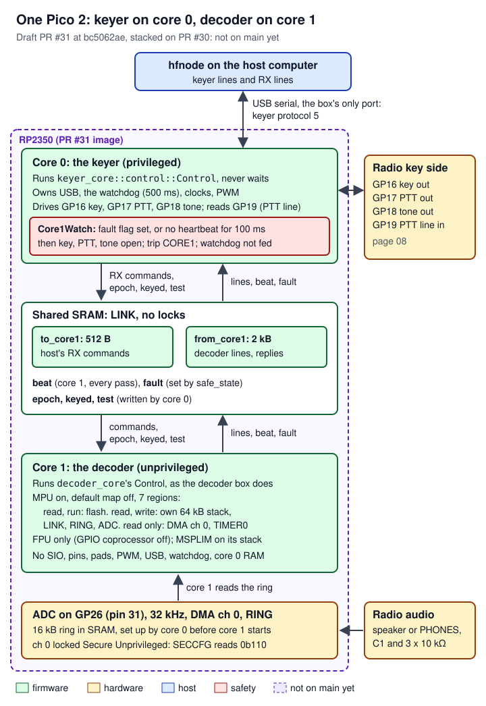

# 11 Decoder box and the one-Pico image (in flight)

> The decoder listens to a radio's audio on a Raspberry Pi Pico 2's analog input, decodes the Morse in it with the same `cw` decoder `hfnode` uses on a computer, and reports what it hears over USB: the letters, the decoder's state, and the level measurements `hfnode`'s sidetone monitor needs. It exists in two images, and neither is on `main` yet. The **decoder box** (PR #30, open, audit-cleared at `3efaf842`) is a Pico 2 of its own that only listens. The **one-Pico image** (PR #31, draft, stacked on #30, cleared to flash only after it merges) runs the keyer on core 0 of the keyer box's Pico 2 (its limits and keying unchanged, keyer protocol 5 added) and the same decoder loop on core 1, walled off by core 1's memory protection unit, and passes the decoder's lines to the host through the keyer's one USB port as `RX` lines (keyer protocol 5). The rules live in one `no_std` crate, `crates/decoder-core`; the two boards are `firmware/pico2-decoder` and `firmware/pico2-keyer/src/core1.rs`; the link between the cores is `keyer_core::cores`. `hfnode` does not use either image yet: PR 4 (written, not opened) adds `[receive] source = "box"`. Nothing on this page has run on real hardware.

| Piece | Where | State at the commits cited |
|---|---|---|
| Decoder loop, protocol v1, standalone decoder firmware, `cw::level` | PR #30, branch `claude/pico-decoder-u9bum5`, `3efaf842` | Open, ready, audit-cleared at `3efaf842`; CI green (16 of 16) |
| One-Pico keyer image: decoder on core 1, keyer protocol 5, `CORE1` trip | PR #31, branch `claude/one-pico-keyer-image-cm9luj`, `bc5062ae` | Draft, stacked on #30; audit-cleared to flash after it merges |
| rustos multicore (`pico2::multicore`) and `Rp2350Usb::room()` | rustos PR #6, `410dffa` | Open; PR #31 pins rustos here |
| `hfnode` hears through the decoder box (`[receive] source = "box"`) | PR 4, a patch in the project files (`design/pico-decoder-pr4.patch`, commit `9e1956a`) | Written, not opened; waits for #30 to merge |
| The keyer rig's sidetone monitor fed from the box's `SL` lines | PR 5 | Planned, not written; needs its own audit review |
| `hfnode` talking to the one-Pico decoder (`source = "keyer"`, wrapping commands in `RX`) | Planned in the design note (`design/spec-pico-decoder.md` §7.4) | Not written: `hfnode` at #31 sends no `RX` lines |

**Terms used here** (the full list is [17 Glossary](17-glossary.md)):

- **CW**: Morse code sent by switching a carrier on and off. **Sidetone**: the tone a radio plays while it transmits CW, so the operator hears their own keying. **Pitch**: the audio frequency a CW signal is heard at (the radio's "CW pitch"; `hfnode` and the box both default to 600 Hz).
- **ADC**: the analog-to-digital converter. The RP2350's is 12 bits; GP26 is its input 0 (ADC0). **ADC_VREF** and **AGND** are the Pico 2's ADC reference and analog ground pins.
- **DMA**: a hardware engine that copies data without the processor; here it copies each ADC result into a ring buffer in RAM.
- **Decimation**: keeping one sample in N after a low-pass filter (the **anti-alias filter**) has removed what would fold back into the kept band.
- **Goertzel**: a cheap way to measure the power of one frequency in a block of samples. **dBFS**: decibels relative to the ADC's full scale.
- **Core 0, core 1**: the RP2350's two Cortex-M33 processors. **MPU**: memory protection unit, a per-core table of which addresses code may read, write or run. **Privileged/unprivileged**: two levels of the processor; unprivileged code cannot change the MPU. **MSPLIM**: a register below which a stack push faults. **HardFault**: the processor's catch-all fault exception.
- **SIO**: the RP2350's single-cycle I/O block, whose `GPIO_OUT_SET`/`GPIO_OUT_CLR` registers drive pins high or low. **GPIO coprocessor**: coprocessor 0 of the RP2350, which can drive pins with no memory store at all. **CPACR**: the register that turns coprocessors on or off.
- **Watchdog**: a hardware timer that resets the chip unless software feeds it in time. **Heartbeat**: a counter core 1 moves on every pass so core 0 can see it is alive.
- **Trip**: a latched fault; a tripped keyer box keys nothing until it is unplugged.
- **K1**: the Quansheng UV-K1 handheld radio with the NR7Y firmware ([10 Quansheng UV-K1 handheld](10-uv-k1-handheld.md)).
- **Key line, keying, PTT**: a radio transmits CW while its key line is closed ("keyed"). **PTT** (push-to-talk) is the line that makes a radio transmit at all; on a handheld it is also what NR7Y reads as the straight key. The keyer box's GP16 drives the key, GP17 the PTT, GP18 a tone, and GP19 reads the PTT line back.
- **Tip, ring, sleeve**: the contacts of a 2.5 mm or 3.5 mm plug, from the point back.
- **UF2**: the firmware file format the Pico 2's bootloader takes by drag and drop. **XIP**: flash mapped into the address space and run in place.
- **PPB** (Private Peripheral Bus): the Cortex-M33's own system registers at `0xE000_0000`, among them each core's MPU, `CPACR` and `MSPLIM`'s neighbours.
- **IO_BANK0, PADS_BANK0**: the RP2350's per-pin function select and pad control. In a pin's `GPIOn_CTRL`, `FUNCSEL` picks what drives it (SIO, PWM, null) and `OUTOVER` can override its output level.
- **SECCFG, Secure Unprivileged**: the RP2350 uses Arm TrustZone; a DMA channel's `SECCFG` register sets which security and privilege level may use the channel. Core 1 runs Secure and unprivileged, so the channel it reads must allow that level.
- **FIR filter**: a finite impulse response filter, a weighted sum of the last N samples. **Acquire/release**: atomic memory orderings; a release store publishes everything written before it to a core that reads it with an acquire load.
- **Mutant build**: a copy of the firmware broken on purpose, which a static check must reject, to show the check can fail.

The glossary has fuller entries for PTT, UF2, MPU, MSPLIM, SECCFG, CP0 (the GPIO coprocessor), DMA, pad and scratch registers.

## Where it lives

PR #30 at `3efaf842` (open, not on main):

| Path | What it holds | Lines |
|---|---|---|
| [`crates/decoder-core/src/lib.rs`](https://github.com/robinonsay/cw-message-gateway/blob/3efaf842e1aab75354e5e19d0384a703d4d786be/crates/decoder-core/src/lib.rs) | Protocol version, name, rates, slice and block sizes, timeouts, default and allowed settings | 84 |
| [`crates/decoder-core/src/control.rs`](https://github.com/robinonsay/cw-message-gateway/blob/3efaf842e1aab75354e5e19d0384a703d4d786be/crates/decoder-core/src/control.rs) | `Control::pass`, the loop against the `Hardware` trait: commands, decoder, monitor, lines, out queue | 678 |
| [`crates/decoder-core/src/control/tests.rs`](https://github.com/robinonsay/cw-message-gateway/blob/3efaf842e1aab75354e5e19d0384a703d4d786be/crates/decoder-core/src/control/tests.rs) | The loop against a board in memory, on synthetic Morse | 700 |
| [`crates/decoder-core/src/frontend.rs`](https://github.com/robinonsay/cw-message-gateway/blob/3efaf842e1aab75354e5e19d0384a703d4d786be/crates/decoder-core/src/frontend.rs) | ADC samples at 32 kHz to decoder samples at 8 kHz: anti-alias filter, decimation, DC removal | 239 |
| [`crates/decoder-core/Cargo.toml`](https://github.com/robinonsay/cw-message-gateway/blob/3efaf842e1aab75354e5e19d0384a703d4d786be/crates/decoder-core/Cargo.toml) | Depends on `cw` (no default features), `keyer-core` (line framing) and `libm` | 20 |
| [`crates/cw/src/level.rs`](https://github.com/robinonsay/cw-message-gateway/blob/3efaf842e1aab75354e5e19d0384a703d4d786be/crates/cw/src/level.rs) | The sidetone monitor's 10 ms measurement, moved into `cw` so the box and `hfnode` share one copy | 97 |
| [`crates/cw/src/math.rs:13-19`](https://github.com/robinonsay/cw-message-gateway/blob/3efaf842e1aab75354e5e19d0384a703d4d786be/crates/cw/src/math.rs#L13-L19), [`crates/cw/src/math.rs:48-54`](https://github.com/robinonsay/cw-message-gateway/blob/3efaf842e1aab75354e5e19d0384a703d4d786be/crates/cw/src/math.rs#L48-L54) | Gains private `cos` and `log10`, in both its `std` and `libm` halves, for `level.rs` | 84 in all |
| [`crates/hfnode/src/keyer/monitor.rs`](https://github.com/robinonsay/cw-message-gateway/blob/3efaf842e1aab75354e5e19d0384a703d4d786be/crates/hfnode/src/keyer/monitor.rs) | `hfnode`'s sidetone monitor drops its own Goertzel and calls `cw::level` (`goertzel_coeff`, `measure`, `db`); same arithmetic ([04 CW decoder and audio](04-cw-decoder-audio.md)) | - |
| [`firmware/pico2-decoder/src/main.rs`](https://github.com/robinonsay/cw-message-gateway/blob/3efaf842e1aab75354e5e19d0384a703d4d786be/firmware/pico2-decoder/src/main.rs) | The decoder box's board: pins held low, ADC stream, USB, watchdog, fault handling | 264 |
| [`firmware/pico2-decoder/check_pins.py`](https://github.com/robinonsay/cw-message-gateway/blob/3efaf842e1aab75354e5e19d0384a703d4d786be/firmware/pico2-decoder/check_pins.py) | Reads the built machine code: GP16-GP18 are never driven high and handlers drive them low first | 1047 |
| [`firmware/pico2-decoder/mutants.py`](https://github.com/robinonsay/cw-message-gateway/blob/3efaf842e1aab75354e5e19d0384a703d4d786be/firmware/pico2-decoder/mutants.py) | Builds seven changed firmwares and shows `check_pins.py` rejects each (not run in CI) | 96 |
| [`firmware/pico2-decoder/build.sh`](https://github.com/robinonsay/cw-message-gateway/blob/3efaf842e1aab75354e5e19d0384a703d4d786be/firmware/pico2-decoder/build.sh), [`firmware/pico2-decoder/Cargo.toml`](https://github.com/robinonsay/cw-message-gateway/blob/3efaf842e1aab75354e5e19d0384a703d4d786be/firmware/pico2-decoder/Cargo.toml), [`firmware/pico2-decoder/README.md`](https://github.com/robinonsay/cw-message-gateway/blob/3efaf842e1aab75354e5e19d0384a703d4d786be/firmware/pico2-decoder/README.md) | Reproducible build, rustos pin (`80bf599`), how to build and check | 39, 34, 44 |
| [`docs/decoder.md`](https://github.com/robinonsay/cw-message-gateway/blob/3efaf842e1aab75354e5e19d0384a703d4d786be/docs/decoder.md) | Wiring, use and the never-transmits rule, for people | 115 |
| [`docs/decoder-protocol.md`](https://github.com/robinonsay/cw-message-gateway/blob/3efaf842e1aab75354e5e19d0384a703d4d786be/docs/decoder-protocol.md) | Decoder protocol version 1, for people | 132 |
| [`.github/workflows/ci.yml:231-298`](https://github.com/robinonsay/cw-message-gateway/blob/3efaf842e1aab75354e5e19d0384a703d4d786be/.github/workflows/ci.yml#L231-L298) | CI job `pico2-decoder`: fmt, clippy, UF2, `check_pins.py`, reproducibility, artifact | - |

PR #31 at `bc5062ae` (draft, stacked on #30, not on main; `decoder-core` is identical to #30's):

| Path | What it holds | Lines |
|---|---|---|
| [`crates/keyer-core/src/cores.rs`](https://github.com/robinonsay/cw-message-gateway/blob/bc5062ae4f56ae1f9949b3b067218c7e675d88f8/crates/keyer-core/src/cores.rs), [`crates/keyer-core/src/cores/tests.rs`](https://github.com/robinonsay/cw-message-gateway/blob/bc5062ae4f56ae1f9949b3b067218c7e675d88f8/crates/keyer-core/src/cores/tests.rs) | `Ring<N>` and `Link`: everything the two cores share | 160, 123 |
| [`crates/keyer-core/src/control.rs`](https://github.com/robinonsay/cw-message-gateway/blob/bc5062ae4f56ae1f9949b3b067218c7e675d88f8/crates/keyer-core/src/control.rs) | Core 0's loop: adds `Core1Watch`, `RX` routing and forwarding (protocol 5 section, lines 46-68) | 664 |
| [`crates/keyer-core/src/control/tests.rs:1163-1581`](https://github.com/robinonsay/cw-message-gateway/blob/bc5062ae4f56ae1f9949b3b067218c7e675d88f8/crates/keyer-core/src/control/tests.rs#L1163-L1581) | The core 1 tests (heartbeat, fault, `RX` routing, forwarding, test hand-off) | 1581 in all |
| [`crates/keyer-core/src/keyer.rs`](https://github.com/robinonsay/cw-message-gateway/blob/bc5062ae4f56ae1f9949b3b067218c7e675d88f8/crates/keyer-core/src/keyer.rs), [`crates/keyer-core/src/lib.rs`](https://github.com/robinonsay/cw-message-gateway/blob/bc5062ae4f56ae1f9949b3b067218c7e675d88f8/crates/keyer-core/src/lib.rs) | `Trip::Core1`, `Core1Test`, `TEST CORE1 …`, `VERSION = 5`, `limits::CORE1_MS` | 1073, 125 |
| [`firmware/pico2-keyer/src/core1.rs`](https://github.com/robinonsay/cw-message-gateway/blob/bc5062ae4f56ae1f9949b3b067218c7e675d88f8/firmware/pico2-keyer/src/core1.rs) | Core 1's board, the shared statics, audio set-up, MPU regions, privilege drop | 454 |
| [`firmware/pico2-keyer/src/main.rs`](https://github.com/robinonsay/cw-message-gateway/blob/bc5062ae4f56ae1f9949b3b067218c7e675d88f8/firmware/pico2-keyer/src/main.rs) | Core 0: launch order, `Hardware`'s `core1_*` methods, `safe_state` setting the fault flag | 407 |
| [`firmware/pico2-keyer/check_core1.py`](https://github.com/robinonsay/cw-message-gateway/blob/bc5062ae4f56ae1f9949b3b067218c7e675d88f8/firmware/pico2-keyer/check_core1.py), [`firmware/pico2-keyer/mutants_core1.py`](https://github.com/robinonsay/cw-message-gateway/blob/bc5062ae4f56ae1f9949b3b067218c7e675d88f8/firmware/pico2-keyer/mutants_core1.py) | Reads core 1's machine code: no store reaches a pin or core 0; eight mutant builds (not run in CI) | 450, 112 |
| [`firmware/pico2-keyer/Cargo.toml:23-31`](https://github.com/robinonsay/cw-message-gateway/blob/bc5062ae4f56ae1f9949b3b067218c7e675d88f8/firmware/pico2-keyer/Cargo.toml#L23-L31) | Adds `decoder-core`; rustos pinned at #6's `410dffa` | - |
| [`crates/keyer-core/src/keyer/tests.rs`](https://github.com/robinonsay/cw-message-gateway/blob/bc5062ae4f56ae1f9949b3b067218c7e675d88f8/crates/keyer-core/src/keyer/tests.rs) | Adds tests that `TEST CORE1` comes due once, at the next element, and that protocol 4's saved trips keep their bits while `CORE1` uses bit 4 | 1417 |
| [`crates/hfnode/src/keyer.rs:380-400`](https://github.com/robinonsay/cw-message-gateway/blob/bc5062ae4f56ae1f9949b3b067218c7e675d88f8/crates/hfnode/src/keyer.rs#L380-L400), [`crates/hfnode/src/keyer/bench.rs:584-616`](https://github.com/robinonsay/cw-message-gateway/blob/bc5062ae4f56ae1f9949b3b067218c7e675d88f8/crates/hfnode/src/keyer/bench.rs#L584-L616) | `hfnode` accepts protocol 4 or 5; `hfnode keyer core1test` | 467, 820 |
| [`crates/hfnode/src/keyer/proto.rs`](https://github.com/robinonsay/cw-message-gateway/blob/bc5062ae4f56ae1f9949b3b067218c7e675d88f8/crates/hfnode/src/keyer/proto.rs), [`crates/hfnode/src/keyer/rig.rs`](https://github.com/robinonsay/cw-message-gateway/blob/bc5062ae4f56ae1f9949b3b067218c7e675d88f8/crates/hfnode/src/keyer/rig.rs), [`crates/hfnode/src/keyer/mock.rs`](https://github.com/robinonsay/cw-message-gateway/blob/bc5062ae4f56ae1f9949b3b067218c7e675d88f8/crates/hfnode/src/keyer/mock.rs) | `TEST CORE1 HANG`/`FAULT` commands and replies; `KeyerRig::test` takes them; the mock box models core 1 | 460, 994, 860 |
| [`crates/hfnode/src/main.rs:322-331`](https://github.com/robinonsay/cw-message-gateway/blob/bc5062ae4f56ae1f9949b3b067218c7e675d88f8/crates/hfnode/src/main.rs#L322-L331) | The `keyer core1test [--fault]` subcommand | 2557 in all |
| [`crates/hfnode/src/keyer/bench/tests.rs`](https://github.com/robinonsay/cw-message-gateway/blob/bc5062ae4f56ae1f9949b3b067218c7e675d88f8/crates/hfnode/src/keyer/bench/tests.rs), [`crates/hfnode/src/keyer/tests.rs`](https://github.com/robinonsay/cw-message-gateway/blob/bc5062ae4f56ae1f9949b3b067218c7e675d88f8/crates/hfnode/src/keyer/tests.rs) | `core1test` passes against the mock box and fails one whose core 1 is unwatched; `hfnode` takes protocol 4 and 5, not 3 or 6 | 370, 270 |
| [`docs/keyer-protocol.md:135-180`](https://github.com/robinonsay/cw-message-gateway/blob/bc5062ae4f56ae1f9949b3b067218c7e675d88f8/docs/keyer-protocol.md#L135-L180) | "The decoder (version 5)", for people | - |
| [`docs/keyer.md:321-330`](https://github.com/robinonsay/cw-message-gateway/blob/bc5062ae4f56ae1f9949b3b067218c7e675d88f8/docs/keyer.md#L321-L330), [`docs/keyer.md:141-150`](https://github.com/robinonsay/cw-message-gateway/blob/bc5062ae4f56ae1f9949b3b067218c7e675d88f8/docs/keyer.md#L141-L150) | Bring-up step 11 (`core1test`) and step 6 (`check` twice before any keying) | - |
| [`firmware/pico2-keyer/README.md`](https://github.com/robinonsay/cw-message-gateway/blob/bc5062ae4f56ae1f9949b3b067218c7e675d88f8/firmware/pico2-keyer/README.md) | `core1.rs`, `check_core1.py` and `mutants_core1.py` described, with how to run them | 91 |
| [`firmware/pico2-keyer/check_faults.py`](https://github.com/robinonsay/cw-message-gateway/blob/bc5062ae4f56ae1f9949b3b067218c7e675d88f8/firmware/pico2-keyer/check_faults.py) (unchanged from `main`) | The CI gate that every handler's first store opens key and PTT; it now covers `safe_state`'s new last step | 158 |
| [`.github/workflows/ci.yml:194-204`](https://github.com/robinonsay/cw-message-gateway/blob/bc5062ae4f56ae1f9949b3b067218c7e675d88f8/.github/workflows/ci.yml#L194-L204) | CI steps "fault handlers open the key first" (`check_faults.py`) and "core 1 never reaches a pin" (`check_core1.py`) | - |

rustos (the rustos handover set, <https://github.com/robinonsay/rustos/blob/claude/handover-docs-us00cn/docs/handover/README.md>, explains these from the driver side: its pages [05 Drivers: GPIO, USB, PWM, ADC, DMA](https://github.com/robinonsay/rustos/blob/claude/handover-docs-us00cn/docs/handover/05-drivers-io.md) for the ADC and DMA, [06 Multicore](https://github.com/robinonsay/rustos/blob/claude/handover-docs-us00cn/docs/handover/06-multicore.md), and [08 Changes made for cw-message-gateway](https://github.com/robinonsay/rustos/blob/claude/handover-docs-us00cn/docs/handover/08-changes-for-cw-gateway.md)):

| Path | What it holds | Lines |
|---|---|---|
| [`firmware/pico2/src/adc.rs`](https://github.com/robinonsay/rustos/blob/80bf5998a60a41b3741041062ff7e9c59caf95b2/firmware/pico2/src/adc.rs) (master `80bf599`) | ADC into an endless DMA ring, the sentinel overrun check, `AdcError` | 765 |
| [`firmware/pico2/src/multicore.rs`](https://github.com/robinonsay/rustos/blob/410dffa091e247e6e7546c7f2ff465f0af499d5a/firmware/pico2/src/multicore.rs) (PR #6 `410dffa`) | `Core1Stack`, `Rp2350Core1::launch`, `core1_start` (sets `MSPLIM`), `core1_run` | 430 |
| [`firmware/pico2/src/usb/mod.rs:482-495`](https://github.com/robinonsay/rustos/blob/410dffa091e247e6e7546c7f2ff465f0af499d5a/firmware/pico2/src/usb/mod.rs#L482-L495) (PR #6) | `Rp2350Usb::room()`: bytes a write would take now | - |

## How it works

### The decoder loop (both images)

`decoder_core::control::Control` is the whole decoder. The board calls `Control::pass` in a loop that never waits ([`firmware/pico2-decoder/src/main.rs:191-194`](https://github.com/robinonsay/cw-message-gateway/blob/3efaf842e1aab75354e5e19d0384a703d4d786be/firmware/pico2-decoder/src/main.rs#L191-L194)); each pass takes what the board has, works on it, and returns. The board is the `Hardware` trait ([`crates/decoder-core/src/control.rs:47-76`](https://github.com/robinonsay/cw-message-gateway/blob/3efaf842e1aab75354e5e19d0384a703d4d786be/crates/decoder-core/src/control.rs#L47-L76)): a clock, USB bytes in and out, ADC samples, a "my own transmitter is keyed" flag, the LED and the watchdog. The tests run the same `Control` against a board in memory ([`crates/decoder-core/src/control/tests.rs`](https://github.com/robinonsay/cw-message-gateway/blob/3efaf842e1aab75354e5e19d0384a703d4d786be/crates/decoder-core/src/control/tests.rs)), so the firmware has almost no logic of its own.

Audio goes in on GP26. The ADC converts at 32 kHz into an 8192-sample ring that DMA fills; each pass reads at most 128 samples ([`crates/decoder-core/src/control.rs:153`](https://github.com/robinonsay/cw-message-gateway/blob/3efaf842e1aab75354e5e19d0384a703d4d786be/crates/decoder-core/src/control.rs#L153)), the frontend filters and decimates them to 8 kHz ([`crates/decoder-core/src/frontend.rs:76-109`](https://github.com/robinonsay/cw-message-gateway/blob/3efaf842e1aab75354e5e19d0384a703d4d786be/crates/decoder-core/src/frontend.rs#L76-L109)), and the 8 kHz samples go to three consumers: the `cw` decoder (unless held), the monitor's 10 ms level measurement, and a block clock that ends a 50 ms block every 400 samples ([`crates/decoder-core/src/control.rs:341-361`](https://github.com/robinonsay/cw-message-gateway/blob/3efaf842e1aab75354e5e19d0384a703d4d786be/crates/decoder-core/src/control.rs#L341-L361)). What they produce goes into a 4096-byte out queue that USB drains.

The box has two modes ([`crates/decoder-core/src/control.rs:7-20`](https://github.com/robinonsay/cw-message-gateway/blob/3efaf842e1aab75354e5e19d0384a703d4d786be/crates/decoder-core/src/control.rs#L7-L20)). From power-up it is in **text mode**: decoded characters as plain text, so any serial terminal shows them. After a framed `HELLO` it is in **hfnode mode**: only framed lines (`CH` characters, `ST` decoder state, `SL` monitor measurements, `GAP` lost audio), each stamped with the number of 8 kHz samples taken so far so the host can place it in time. It goes back to text mode on `TEXT`, when USB goes away, or when no valid line has arrived for 2 s ([`crates/decoder-core/src/lib.rs:61`](https://github.com/robinonsay/cw-message-gateway/blob/3efaf842e1aab75354e5e19d0384a703d4d786be/crates/decoder-core/src/lib.rs#L61)).


*Figure: one pipeline, two exits. The monitor runs on every sample, even while the decoder is held; the level and tone measurements live there, not in the frontend.*

### The standalone decoder box (PR #30)

The decoder box is its own Pico 2 and never transmits. Its firmware is still written for the case where it is flashed onto the keyer box by mistake ([`firmware/pico2-decoder/src/main.rs:10-28`](https://github.com/robinonsay/cw-message-gateway/blob/3efaf842e1aab75354e5e19d0384a703d4d786be/firmware/pico2-decoder/src/main.rs#L10-L28)):

- GP16, GP17 and GP18 (the keyer box's key, PTT and tone pins) are made outputs driven low before anything else ([`firmware/pico2-decoder/src/main.rs:148-150`](https://github.com/robinonsay/cw-message-gateway/blob/3efaf842e1aab75354e5e19d0384a703d4d786be/firmware/pico2-decoder/src/main.rs#L148-L150)), driven low again on every pass with one store to the SIO's `GPIO_OUT_CLR` ([`firmware/pico2-decoder/src/main.rs:210-213`](https://github.com/robinonsay/cw-message-gateway/blob/3efaf842e1aab75354e5e19d0384a703d4d786be/firmware/pico2-decoder/src/main.rs#L210-L213)), and driven low first by the panic and fault handlers ([`firmware/pico2-decoder/src/main.rs:202-204`](https://github.com/robinonsay/cw-message-gateway/blob/3efaf842e1aab75354e5e19d0384a703d4d786be/firmware/pico2-decoder/src/main.rs#L202-L204), [`firmware/pico2-decoder/src/main.rs:258-264`](https://github.com/robinonsay/cw-message-gateway/blob/3efaf842e1aab75354e5e19d0384a703d4d786be/firmware/pico2-decoder/src/main.rs#L258-L264)).
- No code drives any pin high through the SIO. The LED (GP25) and the regulator's mode pin (GP23, high for its low-ripple PWM mode) are driven through their own pins' output overrides instead ([`firmware/pico2-decoder/src/main.rs:218-251`](https://github.com/robinonsay/cw-message-gateway/blob/3efaf842e1aab75354e5e19d0384a703d4d786be/firmware/pico2-decoder/src/main.rs#L218-L251)); a const assert makes it a build error to use that path for GP16-GP18 ([`firmware/pico2-decoder/src/main.rs:222`](https://github.com/robinonsay/cw-message-gateway/blob/3efaf842e1aab75354e5e19d0384a703d4d786be/firmware/pico2-decoder/src/main.rs#L222)). `check_pins.py` checks the built image for exactly this (below).
- The hardware watchdog is **500 ms, never loosen** ([13 Safety rules](13-safety-rules.md); [`firmware/pico2-decoder/src/main.rs:62`](https://github.com/robinonsay/cw-message-gateway/blob/3efaf842e1aab75354e5e19d0384a703d4d786be/firmware/pico2-decoder/src/main.rs#L62)), started before the ADC and USB come up ([`firmware/pico2-decoder/src/main.rs:169`](https://github.com/robinonsay/cw-message-gateway/blob/3efaf842e1aab75354e5e19d0384a703d4d786be/firmware/pico2-decoder/src/main.rs#L169)) and fed once per pass, unless the ADC's DMA has halted: then the box stops feeding it and restarts ([`crates/decoder-core/src/control.rs:317-319`](https://github.com/robinonsay/cw-message-gateway/blob/3efaf842e1aab75354e5e19d0384a703d4d786be/crates/decoder-core/src/control.rs#L317-L319)).

### The one-Pico image (PR #31)

Robin (the project owner) chose one Pico 2 for both jobs. Core 0 runs the keyer exactly as on `main` ([08 Keyer box: firmware](08-keyer-box-firmware.md)) with a few additions; core 1 runs `decoder_core::control::Control` unchanged, on a board whose "USB" is two byte rings in shared RAM ([`firmware/pico2-keyer/src/core1.rs:192-238`](https://github.com/robinonsay/cw-message-gateway/blob/bc5062ae4f56ae1f9949b3b067218c7e675d88f8/firmware/pico2-keyer/src/core1.rs#L192-L238)). The design rule is that nothing core 1 does can hold the key ([`firmware/pico2-keyer/src/core1.rs:1-43`](https://github.com/robinonsay/cw-message-gateway/blob/bc5062ae4f56ae1f9949b3b067218c7e675d88f8/firmware/pico2-keyer/src/core1.rs#L1-L43)):

- **Core 0 sets up everything shared first**, then starts core 1 last: the key and PTT pins driven low before anything else, then its stack limit, the LED and PTT line, clocks, the tone, the timer, the watchdog object and the saved state, USB, the watchdog started, and only then the DMA block, the ADC sampling GP26 into the ring through DMA channel 0 (that channel made readable by unprivileged code), and core 1 ([`firmware/pico2-keyer/src/main.rs:241-311`](https://github.com/robinonsay/cw-message-gateway/blob/bc5062ae4f56ae1f9949b3b067218c7e675d88f8/firmware/pico2-keyer/src/main.rs#L241-L311)).
- **Core 1 walls itself in before it runs anything**: FPU on and every other coprocessor off, its MPU on with seven regions and the default memory map off, then unprivileged for good ([`firmware/pico2-keyer/src/core1.rs:157-170`](https://github.com/robinonsay/cw-message-gateway/blob/bc5062ae4f56ae1f9949b3b067218c7e675d88f8/firmware/pico2-keyer/src/core1.rs#L157-L170)). It can reach only flash, its own stack, the shared `LINK`, the ADC ring, eight ADC registers, and (read-only) DMA channel 0's and TIMER0's registers. A store to a pin, pad, PWM, USB, the watchdog or core 0's RAM faults on core 1.
- **The cores meet only in `LINK`** ([`crates/keyer-core/src/cores.rs:122-137`](https://github.com/robinonsay/cw-message-gateway/blob/bc5062ae4f56ae1f9949b3b067218c7e675d88f8/crates/keyer-core/src/cores.rs#L122-L137)): two single-writer byte rings and five atomic values (the heartbeat, the fault flag, the USB link epoch, the keyed flag and the test request), no locks. Core 0 never waits on core 1.
- **Core 0 watches core 1** every pass ([`crates/keyer-core/src/control.rs:198-234`](https://github.com/robinonsay/cw-message-gateway/blob/bc5062ae4f56ae1f9949b3b067218c7e675d88f8/crates/keyer-core/src/control.rs#L198-L234)): a set fault flag, or a running core 1 whose heartbeat has not moved for 100 ms, trips the box (`CORE1`), opens every output and stops feeding the watchdog.
- **One USB port**, the keyer's. Decoder commands go in as `<id> RX <command>`; the decoder's replies and lines come out as `<id> RX <line>` (keyer protocol 5, [`crates/keyer-core/src/control.rs:46-68`](https://github.com/robinonsay/cw-message-gateway/blob/bc5062ae4f56ae1f9949b3b067218c7e675d88f8/crates/keyer-core/src/control.rs#L46-L68)).



*Figure: the two cores exchange data only through the shared `LINK` box; core 1's one other arrow is the ADC ring it reads. Nothing goes from core 1 to the radio's key side. The purple border marks code that is not on `main`.*

## How it connects

| Neighbour | What passes | Where |
|---|---|---|
| The radio's audio | Line-level audio into GP26 through C1 and three 10 kΩ resistors | Wiring below |
| `crates/cw` decoder | `Decoder::push_with`, `flush_with`, `reset_levels`, `reset_speed`, state getters; same code as the host ([04 CW decoder and audio](04-cw-decoder-audio.md)) | [`crates/cw/src/decoder.rs:167`](https://github.com/robinonsay/cw-message-gateway/blob/44185fa9a00369c379d9d8af40ca307e3867e860/crates/cw/src/decoder.rs#L167) |
| `cw::level` | `goertzel_coeff`, `measure`, `db`, shared with `hfnode`'s sidetone monitor | [`crates/cw/src/level.rs:10-61`](https://github.com/robinonsay/cw-message-gateway/blob/3efaf842e1aab75354e5e19d0384a703d4d786be/crates/cw/src/level.rs#L10-L61) |
| `keyer_core::frame` | The line format `<id> <body>*<cs>`, 96 characters at most, reused unchanged | [`crates/decoder-core/src/lib.rs:35-37`](https://github.com/robinonsay/cw-message-gateway/blob/3efaf842e1aab75354e5e19d0384a703d4d786be/crates/decoder-core/src/lib.rs#L35-L37) |
| rustos `pico2::adc` | `Rp2350AdcStream::read` and its errors | [`firmware/pico2/src/adc.rs:606-637`](https://github.com/robinonsay/rustos/blob/80bf5998a60a41b3741041062ff7e9c59caf95b2/firmware/pico2/src/adc.rs#L606-L637) |
| rustos `pico2::multicore` (#6) | Launching core 1, its stack and `MSPLIM` | [`firmware/pico2/src/multicore.rs:350-430`](https://github.com/robinonsay/rustos/blob/410dffa091e247e6e7546c7f2ff465f0af499d5a/firmware/pico2/src/multicore.rs#L350-L430) |
| Keyer loop on core 0 (#31) | `RX` lines in, decoder lines out, heartbeat, fault flag, keyed flag | [`crates/keyer-core/src/control.rs:494-646`](https://github.com/robinonsay/cw-message-gateway/blob/bc5062ae4f56ae1f9949b3b067218c7e675d88f8/crates/keyer-core/src/control.rs#L494-L646) |
| `hfnode` | Today: nothing (protocol 4 or 5 keyer box, no `RX` lines sent). PR 4: the decoder box as receive. PR 5: `SL` into the keyer rig's monitor ([09 Keyer box: host side](09-keyer-host-side.md)) | [`crates/hfnode/src/keyer.rs:380-386`](https://github.com/robinonsay/cw-message-gateway/blob/bc5062ae4f56ae1f9949b3b067218c7e675d88f8/crates/hfnode/src/keyer.rs#L380-L386) |
| Safety audit | Clears each image by hash before it is flashed ([14 Audit, bench and flashing](14-audit-bench-flashing.md)) | - |

### Audio input wiring

The network is the same in both cases: C1 1 µF in series from the radio's audio contact to R3 10 kΩ, R3 to GP26 (pin 31), R1 10 kΩ from GP26 to ADC_VREF (pin 35), R2 10 kΩ from GP26 to AGND (pin 33) ([`docs/decoder.md:48-79`](https://github.com/robinonsay/cw-message-gateway/blob/3efaf842e1aab75354e5e19d0384a703d4d786be/docs/decoder.md#L48-L79)). R1 and R2 hold GP26 at 1.65 V, half the ADC's range, so the audio swings both ways; R3 against R1 and R2 in parallel passes one third of the audio; C1 with the 15 kΩ behind it blocks DC and passes everything above about 10 Hz.

- **A general radio on the decoder box** (docs/decoder.md): a plain Pico 2, not a Pico 2 W, whose GP23 and GP25 belong to its wireless chip while this firmware drives both ([`docs/decoder.md:37-38`](https://github.com/robinonsay/cw-message-gateway/blob/3efaf842e1aab75354e5e19d0384a703d4d786be/docs/decoder.md#L37-L38)). The radio's PHONES jack, never an external-speaker output, with a stereo plug (tip and sleeve; ring insulated). The sleeve goes to AGND (pin 33) by its own wire ([`docs/decoder.md:41-45`](https://github.com/robinonsay/cw-message-gateway/blob/3efaf842e1aab75354e5e19d0384a703d4d786be/docs/decoder.md#L41-L45), [`docs/decoder.md:58`](https://github.com/robinonsay/cw-message-gateway/blob/3efaf842e1aab75354e5e19d0384a703d4d786be/docs/decoder.md#L58)). docs/decoder.md allows an electrolytic C1 with its + side toward the Pico ([`docs/decoder.md:39-40`](https://github.com/robinonsay/cw-message-gateway/blob/3efaf842e1aab75354e5e19d0384a703d4d786be/docs/decoder.md#L39-L40)). To set the level, turn the radio's volume down, tune a CW signal, and turn it up until letters come; the LED should flash with the signal and stay dark between, and if it stays lit the volume is too high ([`docs/decoder.md:89-93`](https://github.com/robinonsay/cw-message-gateway/blob/3efaf842e1aab75354e5e19d0384a703d4d786be/docs/decoder.md#L89-L93)). The design note aims for band noise around -30 dBFS (`design/spec-pico-decoder.md` §3, project files).
- **The K1 on the keyer box's GP26 (one-Pico image)**: the safety audit's ruling (project files, `audit/req-handheld-nr7y-cw-ruling.md` §2, the "Audio side into the keyer box's GP26" block) keeps the network with one change and one rule. C1 must be film or ceramic, 16 V or more, **never electrolytic**, because the K1's speaker contact has an unknown DC level and could reverse-bias it. And there is **one ground wire, shared**: the key switch's emitter and the Pico's GND (pin 23) keep the existing wire to the 2.5 mm sleeve; R2 goes to AGND (pin 33); AGND reaches that ground through the Pico 2 board itself (inferred: the RP2350 has no separate ADC ground). Before wiring, meter pin 33 to pin 38 (GND) with the Pico unplugged: it should read near 0 Ω; if it reads open, add a short wire from pin 33 to pin 38, never to pin 37 (3V3_EN). A second ground wire to the same contact would make a ground loop. The speaker is on the 2.5 mm tip according to the cable's label, not a measurement; the network is harmless on a wrong contact (DC blocked both ways, current limited by 10 kΩ). The cable then has three wires (key on the 3.5 mm tip, speaker on the 2.5 mm tip, ground on the 2.5 mm sleeve), with one clip-on ferrite on the whole cable at the radio end. The 3.5 mm ring and sleeve (the sleeve is a serial pin, not ground) and the 2.5 mm ring stay cut short and insulated, as on the key cable ([10 Quansheng UV-K1 handheld](10-uv-k1-handheld.md)).


*Figure: drawn from the audit ruling `audit/req-handheld-nr7y-cw-ruling.md` §2 (project files) and checked against the bench drawings `bench/k1-audio-later.svg` and `bench/k1-2n3904-key.svg`; the bench names R1 and R2 "R4" and "R5" because its key drawing already uses R1 and R2. The keyer box and its key switch exist and stay as they are; only the purple parts (C1, R1-R3 and the audio wire) are new. The dashed line inside the Pico box is the board's own AGND-to-GND join, inferred: meter it before wiring.*

Order of work for the K1 audio side (same ruling): wire it only after PR #31 is merged and its cleared image is flashed, then redo the bench's stage 5 (zero-RF watch) and stage 6 (RF on the lead) with the full cable; the Mac's microphone stays the bench's monitor feed until both this image and PR 5 are audited; first check, with no RF, that the K1's speaker still plays with the 2.5 mm plug in. Pico 2 pin numbers above are from the Pico 2 pinout (31 GP26/ADC0, 33 AGND, 35 ADC_VREF, 23 and 38 GND, 37 3V3_EN).

### The host link

| Image | Port | Protocol | Decoder commands | Decoder lines |
|---|---|---|---|---|
| Decoder box (#30) | Its own USB serial port, product `PICO2-DECODER`, serial `2` ([`firmware/pico2-decoder/src/main.rs:71-78`](https://github.com/robinonsay/cw-message-gateway/blob/3efaf842e1aab75354e5e19d0384a703d4d786be/firmware/pico2-decoder/src/main.rs#L71-L78)) | Decoder protocol 1 ([`docs/decoder-protocol.md`](https://github.com/robinonsay/cw-message-gateway/blob/3efaf842e1aab75354e5e19d0384a703d4d786be/docs/decoder-protocol.md)) | `<id> HELLO*<cs>` and the rest, directly | Plain text, or after `HELLO` framed `00 CH …` etc. |
| One-Pico (#31) | The keyer's port, product `PICO2-KEYER`, serial `1` ([`firmware/pico2-keyer/src/main.rs:108-115`](https://github.com/robinonsay/cw-message-gateway/blob/bc5062ae4f56ae1f9949b3b067218c7e675d88f8/firmware/pico2-keyer/src/main.rs#L108-L115)) | Keyer protocol 5 ([`docs/keyer-protocol.md:135-180`](https://github.com/robinonsay/cw-message-gateway/blob/bc5062ae4f56ae1f9949b3b067218c7e675d88f8/docs/keyer-protocol.md#L135-L180)) | `<id> RX <command>*<cs>` | `<id> RX <reply>`; id `00` lines only after `RX HELLO` |

### The RX path through core 0 (PR #31)

On the one-Pico box every decoder command and line passes through core 0's loop ([`crates/keyer-core/src/control.rs:494-646`](https://github.com/robinonsay/cw-message-gateway/blob/bc5062ae4f56ae1f9949b3b067218c7e675d88f8/crates/keyer-core/src/control.rs#L494-L646)). An `RX` line never reaches the keyer: `rx_command` answers `ERR RX OFF` itself while core 1 is not running or the box is tripped `CORE1`, otherwise re-frames the command under the host's id and queues it whole into `to_core1`, or answers `ERR RX BUSY` if it does not fit. Core 1 handles it on its next pass and writes its reply into `from_core1`. Core 0 forwards at most one line a pass from there, and only once the keyer's own replies have gone and USB has room for that line plus a whole keyer reply, so a keyer reply never waits behind the decoder. The steps are listed under "Core 0's pass with a decoder" below.


*Figure: time runs down the page. The red note is the forwarding gate; the dashed reply happens only when the ring to core 1 lacks room. A keyer command sent meanwhile (`08 STATUS`) is answered before the decoder's reply goes out. The purple border marks code that is not on `main`.*

## Interfaces and APIs

### `decoder_core` constants (PR #30)

| Name | Value | Meaning | Line |
|---|---|---|---|
| `VERSION` | `1` | Decoder protocol version, in `HELLO` | [`crates/decoder-core/src/lib.rs:30`](https://github.com/robinonsay/cw-message-gateway/blob/3efaf842e1aab75354e5e19d0384a703d4d786be/crates/decoder-core/src/lib.rs#L30) |
| `NAME` | `"PICO2-DECODER"` | Last field of `HELLO`, USB product name | [`crates/decoder-core/src/lib.rs:33`](https://github.com/robinonsay/cw-message-gateway/blob/3efaf842e1aab75354e5e19d0384a703d4d786be/crates/decoder-core/src/lib.rs#L33) |
| `MAX_LINE` | `keyer_core::MAX_LINE` (96) | Longest line without newline | [`crates/decoder-core/src/lib.rs:37`](https://github.com/robinonsay/cw-message-gateway/blob/3efaf842e1aab75354e5e19d0384a703d4d786be/crates/decoder-core/src/lib.rs#L37) |
| `ADC_RATE` | 32 000 Hz | ADC sample rate | [`crates/decoder-core/src/lib.rs:40`](https://github.com/robinonsay/cw-message-gateway/blob/3efaf842e1aab75354e5e19d0384a703d4d786be/crates/decoder-core/src/lib.rs#L40) |
| `DECIMATE` | 4 | ADC samples per decoder sample | [`crates/decoder-core/src/lib.rs:43`](https://github.com/robinonsay/cw-message-gateway/blob/3efaf842e1aab75354e5e19d0384a703d4d786be/crates/decoder-core/src/lib.rs#L43) |
| `RATE` | 8 000 Hz | Decoder sample rate; every `<n>` counts these | [`crates/decoder-core/src/lib.rs:47`](https://github.com/robinonsay/cw-message-gateway/blob/3efaf842e1aab75354e5e19d0384a703d4d786be/crates/decoder-core/src/lib.rs#L47) |
| `SLICE` | 80 samples (10 ms) | One monitor measurement | [`crates/decoder-core/src/lib.rs:51`](https://github.com/robinonsay/cw-message-gateway/blob/3efaf842e1aab75354e5e19d0384a703d4d786be/crates/decoder-core/src/lib.rs#L51) |
| `SLICES_PER_LINE` | 5 | Measurements per `SL` line (50 ms) | [`crates/decoder-core/src/lib.rs:54`](https://github.com/robinonsay/cw-message-gateway/blob/3efaf842e1aab75354e5e19d0384a703d4d786be/crates/decoder-core/src/lib.rs#L54) |
| `BLOCK` | 400 samples (50 ms) | Samples between `ST` lines | [`crates/decoder-core/src/lib.rs:57`](https://github.com/robinonsay/cw-message-gateway/blob/3efaf842e1aab75354e5e19d0384a703d4d786be/crates/decoder-core/src/lib.rs#L57) |
| `LINK_TIMEOUT_MS` | 2 000 ms | hfnode mode ends after this long with no valid line | [`crates/decoder-core/src/lib.rs:61`](https://github.com/robinonsay/cw-message-gateway/blob/3efaf842e1aab75354e5e19d0384a703d4d786be/crates/decoder-core/src/lib.rs#L61) |
| `NEWLINE_MS` | 2 000 ms | Text mode: new line after this much quiet | [`crates/decoder-core/src/lib.rs:65`](https://github.com/robinonsay/cw-message-gateway/blob/3efaf842e1aab75354e5e19d0384a703d4d786be/crates/decoder-core/src/lib.rs#L65) |
| `DEFAULT_PITCH_HZ` | 600 | Decoder and monitor pitch at power-up | [`crates/decoder-core/src/lib.rs:69`](https://github.com/robinonsay/cw-message-gateway/blob/3efaf842e1aab75354e5e19d0384a703d4d786be/crates/decoder-core/src/lib.rs#L69) |
| `DEFAULT_BANDWIDTH_HZ` | 150 | Decoder filter width at power-up | [`crates/decoder-core/src/lib.rs:73`](https://github.com/robinonsay/cw-message-gateway/blob/3efaf842e1aab75354e5e19d0384a703d4d786be/crates/decoder-core/src/lib.rs#L73) |
| `PITCH_HZ` | 300..=1500 | Pitches `CONFIG` accepts (decoder and monitor) | [`crates/decoder-core/src/lib.rs:78`](https://github.com/robinonsay/cw-message-gateway/blob/3efaf842e1aab75354e5e19d0384a703d4d786be/crates/decoder-core/src/lib.rs#L78) |
| `BANDWIDTH_HZ` | 30..=500 | Widths `CONFIG` accepts | [`crates/decoder-core/src/lib.rs:81`](https://github.com/robinonsay/cw-message-gateway/blob/3efaf842e1aab75354e5e19d0384a703d4d786be/crates/decoder-core/src/lib.rs#L81) |
| `control::ADC_PER_PASS` | 128 | ADC samples read per pass at most (4 ms of audio) | [`crates/decoder-core/src/control.rs:153`](https://github.com/robinonsay/cw-message-gateway/blob/3efaf842e1aab75354e5e19d0384a703d4d786be/crates/decoder-core/src/control.rs#L153) |
| `control::KEYED_HOLD_MS` | 250 ms | Decoder held this long after the box's own key or PTT was last down | [`crates/decoder-core/src/control.rs:157`](https://github.com/robinonsay/cw-message-gateway/blob/3efaf842e1aab75354e5e19d0384a703d4d786be/crates/decoder-core/src/control.rs#L157) |
| `control::OUT_BYTES` | 4 096 | Out queue size | [`crates/decoder-core/src/control.rs:161`](https://github.com/robinonsay/cw-message-gateway/blob/3efaf842e1aab75354e5e19d0384a703d4d786be/crates/decoder-core/src/control.rs#L161) |
| `CH_TEXT` (private) | 60 | Events per `CH` line | [`crates/decoder-core/src/control.rs:164`](https://github.com/robinonsay/cw-message-gateway/blob/3efaf842e1aab75354e5e19d0384a703d4d786be/crates/decoder-core/src/control.rs#L164) |
| `EVENTS` (private) | 600 | Decoded events held between the decoder and the lines | [`crates/decoder-core/src/control.rs:169`](https://github.com/robinonsay/cw-message-gateway/blob/3efaf842e1aab75354e5e19d0384a703d4d786be/crates/decoder-core/src/control.rs#L169) |
| `OWN` (private) | 0 | The id of every line the box sends on its own | [`crates/decoder-core/src/control.rs:172`](https://github.com/robinonsay/cw-message-gateway/blob/3efaf842e1aab75354e5e19d0384a703d4d786be/crates/decoder-core/src/control.rs#L172) |

Const asserts pin `RATE == 8000`, `SLICE == 80`, `BLOCK == 400` and `BLOCK == SLICE * SLICES_PER_LINE` ([`crates/decoder-core/src/lib.rs:83-84`](https://github.com/robinonsay/cw-message-gateway/blob/3efaf842e1aab75354e5e19d0384a703d4d786be/crates/decoder-core/src/lib.rs#L83-L84)).

### `decoder_core::control`

| Item | Signature | Notes | Line |
|---|---|---|---|
| `trait Hardware` | see below | The board | [`crates/decoder-core/src/control.rs:47-76`](https://github.com/robinonsay/cw-message-gateway/blob/3efaf842e1aab75354e5e19d0384a703d4d786be/crates/decoder-core/src/control.rs#L47-L76) |
| `Hardware::now_ms` | `fn now_ms(&self) -> u64` | Milliseconds since start | [`crates/decoder-core/src/control.rs:49`](https://github.com/robinonsay/cw-message-gateway/blob/3efaf842e1aab75354e5e19d0384a703d4d786be/crates/decoder-core/src/control.rs#L49) |
| `Hardware::usb_poll` | `fn usb_poll(&mut self)` | Service USB | [`crates/decoder-core/src/control.rs:51`](https://github.com/robinonsay/cw-message-gateway/blob/3efaf842e1aab75354e5e19d0384a703d4d786be/crates/decoder-core/src/control.rs#L51) |
| `Hardware::link_epoch` | `fn link_epoch(&self) -> u32` | Changes each time the USB link went away; a change ends hfnode mode | [`crates/decoder-core/src/control.rs:55`](https://github.com/robinonsay/cw-message-gateway/blob/3efaf842e1aab75354e5e19d0384a703d4d786be/crates/decoder-core/src/control.rs#L55) |
| `Hardware::keyed` | `fn keyed(&self) -> bool { false }` | Own transmitter keyed (one-Pico: `LINK.keyed`); default false | [`crates/decoder-core/src/control.rs:61-63`](https://github.com/robinonsay/cw-message-gateway/blob/3efaf842e1aab75354e5e19d0384a703d4d786be/crates/decoder-core/src/control.rs#L61-L63) |
| `Hardware::usb_read` | `fn usb_read(&mut self, buf: &mut [u8]) -> usize` | Bytes received | [`crates/decoder-core/src/control.rs:65`](https://github.com/robinonsay/cw-message-gateway/blob/3efaf842e1aab75354e5e19d0384a703d4d786be/crates/decoder-core/src/control.rs#L65) |
| `Hardware::usb_write` | `fn usb_write(&mut self, bytes: &[u8]) -> usize` | Bytes taken, may be fewer | [`crates/decoder-core/src/control.rs:67`](https://github.com/robinonsay/cw-message-gateway/blob/3efaf842e1aab75354e5e19d0384a703d4d786be/crates/decoder-core/src/control.rs#L67) |
| `Hardware::adc_read` | `fn adc_read(&mut self, buf: &mut [u16]) -> Result<usize, AudioLoss>` | Raw ADC FIFO entries, oldest first | [`crates/decoder-core/src/control.rs:70`](https://github.com/robinonsay/cw-message-gateway/blob/3efaf842e1aab75354e5e19d0384a703d4d786be/crates/decoder-core/src/control.rs#L70) |
| `Hardware::hold_outputs_low` | `fn hold_outputs_low(&mut self)` | Drive GP16-GP18 low (no-op on core 1) | [`crates/decoder-core/src/control.rs:73`](https://github.com/robinonsay/cw-message-gateway/blob/3efaf842e1aab75354e5e19d0384a703d4d786be/crates/decoder-core/src/control.rs#L73) |
| `Hardware::set_led`, `feed_watchdog` | `fn set_led(&mut self, on: bool)`, `fn feed_watchdog(&mut self)` | No-ops on core 1 | [`crates/decoder-core/src/control.rs:74-75`](https://github.com/robinonsay/cw-message-gateway/blob/3efaf842e1aab75354e5e19d0384a703d4d786be/crates/decoder-core/src/control.rs#L74-L75) |
| `enum AudioLoss` | `Overrun`, `Fifo`, `Halted` | `GAP` words `OVERRUN`, `FIFO`, `HALTED` | [`crates/decoder-core/src/control.rs:80-98`](https://github.com/robinonsay/cw-message-gateway/blob/3efaf842e1aab75354e5e19d0384a703d4d786be/crates/decoder-core/src/control.rs#L80-L98) |
| `enum Boot` | `Power`, `Watchdog`, `Other` | `HELLO` words `POWER`, `WATCHDOG`, `OTHER` | [`crates/decoder-core/src/control.rs:103-119`](https://github.com/robinonsay/cw-message-gateway/blob/3efaf842e1aab75354e5e19d0384a703d4d786be/crates/decoder-core/src/control.rs#L103-L119) |
| `struct Settings` | `pitch_hz`, `bandwidth_hz`, `monitor_hz: u32` | Default 600, 150, 600 | [`crates/decoder-core/src/control.rs:123-140`](https://github.com/robinonsay/cw-message-gateway/blob/3efaf842e1aab75354e5e19d0384a703d4d786be/crates/decoder-core/src/control.rs#L123-L140) |
| `Control::new` | `pub fn new(boot: Boot, build: &'static str, hw: &impl Hardware) -> Self` | `build` is the `HELLO` build field | [`crates/decoder-core/src/control.rs:220`](https://github.com/robinonsay/cw-message-gateway/blob/3efaf842e1aab75354e5e19d0384a703d4d786be/crates/decoder-core/src/control.rs#L220) |
| `Control::pass` | `pub fn pass(&mut self, hw: &mut impl Hardware)` | One pass; never waits | [`crates/decoder-core/src/control.rs:253`](https://github.com/robinonsay/cw-message-gateway/blob/3efaf842e1aab75354e5e19d0384a703d4d786be/crates/decoder-core/src/control.rs#L253) |
| `Control::is_hfnode`, `samples`, `decoder`, `lost_lines` | `-> bool`, `-> u64`, `-> &Decoder`, `-> u32` | For tests and boards | [`crates/decoder-core/src/control.rs:564-581`](https://github.com/robinonsay/cw-message-gateway/blob/3efaf842e1aab75354e5e19d0384a703d4d786be/crates/decoder-core/src/control.rs#L564-L581) |

### `decoder_core::frontend`

| Item | Signature or value | Line |
|---|---|---|
| `ADC_ERROR` | `1 << 15`: the ADC flagged the conversion as failed | [`crates/decoder-core/src/frontend.rs:23`](https://github.com/robinonsay/cw-message-gateway/blob/3efaf842e1aab75354e5e19d0384a703d4d786be/crates/decoder-core/src/frontend.rs#L23) |
| `ADC_VALUE` | `0x0fff`: the 12-bit result | [`crates/decoder-core/src/frontend.rs:26`](https://github.com/robinonsay/cw-message-gateway/blob/3efaf842e1aab75354e5e19d0384a703d4d786be/crates/decoder-core/src/frontend.rs#L26) |
| `TAPS` | 63 (symmetric, 31-sample delay, about 1 ms at 32 kHz) | [`crates/decoder-core/src/frontend.rs:33`](https://github.com/robinonsay/cw-message-gateway/blob/3efaf842e1aab75354e5e19d0384a703d4d786be/crates/decoder-core/src/frontend.rs#L33) |
| `Frontend::new` | `pub fn new() -> Self` | [`crates/decoder-core/src/frontend.rs:61`](https://github.com/robinonsay/cw-message-gateway/blob/3efaf842e1aab75354e5e19d0384a703d4d786be/crates/decoder-core/src/frontend.rs#L61) |
| `Frontend::push` | `pub fn push(&mut self, raw: u16) -> Option<f32>`: one ADC entry in; every 4th call a sample out, full scale 1.0 | [`crates/decoder-core/src/frontend.rs:76`](https://github.com/robinonsay/cw-message-gateway/blob/3efaf842e1aab75354e5e19d0384a703d4d786be/crates/decoder-core/src/frontend.rs#L76) |
| `Frontend::errors` | `pub fn errors(&self) -> u32`: failed conversions since start (`STATUS <errors>`) | [`crates/decoder-core/src/frontend.rs:112`](https://github.com/robinonsay/cw-message-gateway/blob/3efaf842e1aab75354e5e19d0384a703d4d786be/crates/decoder-core/src/frontend.rs#L112) |

### `cw::level` (PR #30 adds it; `hfnode`'s monitor now calls it)

The box's monitor measures each 10 ms slice with `cw::level` (`goertzel_coeff`, `Level`, `measure`, `db`; [`crates/cw/src/level.rs:9-61`](https://github.com/robinonsay/cw-message-gateway/blob/3efaf842e1aab75354e5e19d0384a703d4d786be/crates/cw/src/level.rs#L9-L61)), the one copy it shares with `hfnode`'s sidetone monitor; the signatures and the Goertzel arithmetic are on [04 CW decoder and audio](04-cw-decoder-audio.md).

### Decoder protocol version 1 (wire format)

USB CDC serial; the baud rate is ignored ([`docs/decoder-protocol.md:10-11`](https://github.com/robinonsay/cw-message-gateway/blob/3efaf842e1aab75354e5e19d0384a703d4d786be/docs/decoder-protocol.md#L10-L11)). Framed lines are the keyer box's format: `<id> <body>*<cs>\n`, `<id>` two uppercase hex digits chosen by the sender of a command and repeated in its reply, `<cs>` two uppercase hex digits, the XOR of every byte before the `*`, at most 96 characters before the newline ([`docs/decoder-protocol.md:31-47`](https://github.com/robinonsay/cw-message-gateway/blob/3efaf842e1aab75354e5e19d0384a703d4d786be/docs/decoder-protocol.md#L31-L47)). The box ends each line with `\n` only ([`crates/decoder-core/src/control.rs:633-638`](https://github.com/robinonsay/cw-message-gateway/blob/3efaf842e1aab75354e5e19d0384a703d4d786be/crates/decoder-core/src/control.rs#L633-L638)). A line that does not decode gets no reply and does not count as hearing from the host.

Commands ([`crates/decoder-core/src/control.rs:454-554`](https://github.com/robinonsay/cw-message-gateway/blob/3efaf842e1aab75354e5e19d0384a703d4d786be/crates/decoder-core/src/control.rs#L454-L554)). `<n>` is the count of 8 kHz samples taken since start, where in the audio the command took effect.

| Command | Reply | Effect |
|---|---|---|
| `HELLO` | `OK HELLO <version=1> <adc rate=32000> <rate=8000> <slice=80> <uptime ms> <POWER\|WATCHDOG\|OTHER> <build> PICO2-DECODER` | Enters hfnode mode. The fields: protocol version, ADC and decoder sample rates in Hz, samples per monitor slice, milliseconds since start, why it started, the build id, the name ([`crates/decoder-core/src/control.rs:465`](https://github.com/robinonsay/cw-message-gateway/blob/3efaf842e1aab75354e5e19d0384a703d4d786be/crates/decoder-core/src/control.rs#L465), [`docs/decoder-protocol.md:64-68`](https://github.com/robinonsay/cw-message-gateway/blob/3efaf842e1aab75354e5e19d0384a703d4d786be/docs/decoder-protocol.md#L64-L68)) |
| `STATUS` | `OK STATUS <TEXT\|HFNODE> <hold 0\|1> <pitch> <bandwidth> <monitor> <n> <lost> <gaps> <errors>` | None. `<lost>` lines dropped, `<gaps>` audio losses, `<errors>` failed conversions. `<hold>` shows `HOLD` only, not the keyed hold |
| `CONFIG <pitch> <bandwidth> <monitor>` | `OK CONFIG <n>` | New settings and a fresh decoder. Out of range, or a pitch and width `DecoderConfig::check` refuses: `ERR CONFIG RANGE`, nothing changes. Not numbers: `ERR CONFIG ARGS` |
| `NEW` | `OK NEW <n>` | Fresh decoder; the word in progress is dropped |
| `FLUSH` | The word in progress (`CH` lines in hfnode mode, plain characters in text mode), then `OK FLUSH <n>` | Decoder flushed ([`crates/decoder-core/src/control.rs:514-518`](https://github.com/robinonsay/cw-message-gateway/blob/3efaf842e1aab75354e5e19d0384a703d4d786be/crates/decoder-core/src/control.rs#L514-L518), which calls `send_events`, [`crates/decoder-core/src/control.rs:427-452`](https://github.com/robinonsay/cw-message-gateway/blob/3efaf842e1aab75354e5e19d0384a703d4d786be/crates/decoder-core/src/control.rs#L427-L452)) |
| `RESET LEVELS` | `OK RESET LEVELS <n>` | Decoder's signal and noise levels forgotten |
| `RESET SPEED` | `OK RESET SPEED <n>` | Speed estimate forgotten |
| `HOLD` | `OK HOLD <n>` | Decoder not fed until `RESUME`; the monitor still runs |
| `RESUME` | `OK RESUME <n>` | Levels forgotten, decoder fed again |
| `TEXT` | `OK TEXT` | Back to text mode (the reply is queued first, framed) |
| a known word with wrong arguments | `ERR <word> ARGS` | None |
| anything else | `ERR <word> UNKNOWN` (word cut to 16 characters) | None |

Lines the box sends on its own in hfnode mode, all with id `00` ([`docs/decoder-protocol.md:92-124`](https://github.com/robinonsay/cw-message-gateway/blob/3efaf842e1aab75354e5e19d0384a703d4d786be/docs/decoder-protocol.md#L92-L124)):

| Line | When | Fields |
|---|---|---|
| `CH <n> <events>` | As characters are decoded | `<n>`: the samples taken when the last of them was decoded. Up to 60 events: a printable character, `_` word gap, `*` unknown pattern ([`crates/decoder-core/src/control.rs:585-595`](https://github.com/robinonsay/cw-message-gateway/blob/3efaf842e1aab75354e5e19d0384a703d4d786be/crates/decoder-core/src/control.rs#L585-L595)) |
| `ST <n> <key> <partial> <idle ms> <wpm>` | End of every 400-sample block | `key` 1 while the tone is heard, `partial` 1 while a word is in progress, `idle ms` how long the tone has been quiet, `wpm` the speed estimate in tenths of a word per minute ([`docs/decoder-protocol.md:109-112`](https://github.com/robinonsay/cw-message-gateway/blob/3efaf842e1aab75354e5e19d0384a703d4d786be/docs/decoder-protocol.md#L109-L112), [`crates/decoder-core/src/control.rs:406-424`](https://github.com/robinonsay/cw-message-gateway/blob/3efaf842e1aab75354e5e19d0384a703d4d786be/crates/decoder-core/src/control.rs#L406-L424)) |
| `SL <n> <tone>,<total> ×5` | Every 5 slices (50 ms) | Five 10 ms measurements, tenths of a dB re full scale; `<n>` is the sample count before the first ([`crates/decoder-core/src/control.rs:365-402`](https://github.com/robinonsay/cw-message-gateway/blob/3efaf842e1aab75354e5e19d0384a703d4d786be/crates/decoder-core/src/control.rs#L365-L402)) |
| `GAP <n> <OVERRUN\|FIFO\|HALTED>` | When `adc_read` fails | Lost samples are not counted in `<n>` |

Text mode ([`docs/decoder-protocol.md:13-29`](https://github.com/robinonsay/cw-message-gateway/blob/3efaf842e1aab75354e5e19d0384a703d4d786be/docs/decoder-protocol.md#L13-L29)): each character as decoded, one space per word gap, `\r\n` once the tone has been quiet for 2 s after something was typed, `*` for an unknown pattern; a character that does not fit the out queue is dropped.

### Decoder box firmware (PR #30)

| Item | Value | Line |
|---|---|---|
| Held-low pins | GP16 (pin 21), GP17 (pin 22), GP18 (pin 24) | [`firmware/pico2-decoder/src/main.rs:47-54`](https://github.com/robinonsay/cw-message-gateway/blob/3efaf842e1aab75354e5e19d0384a703d4d786be/firmware/pico2-decoder/src/main.rs#L47-L54) |
| `SMPS_GPIO`, `LED_GPIO` | GP23 (driven high), GP25 (on while a tone is heard) | [`firmware/pico2-decoder/src/main.rs:58-60`](https://github.com/robinonsay/cw-message-gateway/blob/3efaf842e1aab75354e5e19d0384a703d4d786be/firmware/pico2-decoder/src/main.rs#L58-L60) |
| `WATCHDOG_MS` | **500 ms, never loosen** ([13 Safety rules](13-safety-rules.md)) | [`firmware/pico2-decoder/src/main.rs:62`](https://github.com/robinonsay/cw-message-gateway/blob/3efaf842e1aab75354e5e19d0384a703d4d786be/firmware/pico2-decoder/src/main.rs#L62) |
| USB identity | VID `0x2e8a`, PID `0x0009`, manufacturer `hfnode`, product `PICO2-DECODER`, serial `2` | [`firmware/pico2-decoder/src/main.rs:71-78`](https://github.com/robinonsay/cw-message-gateway/blob/3efaf842e1aab75354e5e19d0384a703d4d786be/firmware/pico2-decoder/src/main.rs#L71-L78) |
| `BUILD` | `DECODER_BUILD_ID` (first 8 characters of the commit) or `-` | [`firmware/pico2-decoder/src/main.rs:82-85`](https://github.com/robinonsay/cw-message-gateway/blob/3efaf842e1aab75354e5e19d0384a703d4d786be/firmware/pico2-decoder/src/main.rs#L82-L85) |
| ADC errors to `AudioLoss` | `Overrun`→`Overrun`, `FifoOverflow`→`Fifo`, anything else→`Halted` | [`firmware/pico2-decoder/src/main.rs:117-124`](https://github.com/robinonsay/cw-message-gateway/blob/3efaf842e1aab75354e5e19d0384a703d4d786be/firmware/pico2-decoder/src/main.rs#L117-L124) |
| rustos pin | master `80bf599` (merge of rustos #5, the ADC and DMA drivers) | [`firmware/pico2-decoder/Cargo.toml:21-25`](https://github.com/robinonsay/cw-message-gateway/blob/3efaf842e1aab75354e5e19d0384a703d4d786be/firmware/pico2-decoder/Cargo.toml#L21-L25) |

### `keyer_core::cores` (PR #31)

| Item | Signature or value | Line |
|---|---|---|
| `Ring<const N: usize>` | One-way byte ring; `N` a power of two, at most 65 536; atomic bytes, `head`/`tail: AtomicU32` counting through `u32` wraps | [`crates/keyer-core/src/cores.rs:24-34`](https://github.com/robinonsay/cw-message-gateway/blob/bc5062ae4f56ae1f9949b3b067218c7e675d88f8/crates/keyer-core/src/cores.rs#L24-L34) |
| `Ring::room` | `pub fn room(&self) -> usize`: writer's free bytes; 0 if the reader's count is impossible | [`crates/keyer-core/src/cores.rs:46-50`](https://github.com/robinonsay/cw-message-gateway/blob/bc5062ae4f56ae1f9949b3b067218c7e675d88f8/crates/keyer-core/src/cores.rs#L46-L50) |
| `Ring::write` | `pub fn write(&self, bytes: &[u8]) -> usize`: as many as fit | [`crates/keyer-core/src/cores.rs:53-57`](https://github.com/robinonsay/cw-message-gateway/blob/bc5062ae4f56ae1f9949b3b067218c7e675d88f8/crates/keyer-core/src/cores.rs#L53-L57) |
| `Ring::write_all` | `pub fn write_all(&self, bytes: &[u8]) -> bool`: all or none | [`crates/keyer-core/src/cores.rs:61-67`](https://github.com/robinonsay/cw-message-gateway/blob/bc5062ae4f56ae1f9949b3b067218c7e675d88f8/crates/keyer-core/src/cores.rs#L61-L67) |
| `Ring::read` | `pub fn read(&self, buf: &mut [u8]) -> usize`: oldest first; an impossible writer count drops the ring's contents and reads nothing | [`crates/keyer-core/src/cores.rs:84-100`](https://github.com/robinonsay/cw-message-gateway/blob/bc5062ae4f56ae1f9949b3b067218c7e675d88f8/crates/keyer-core/src/cores.rs#L84-L100) |
| `TO_CORE1`, `FROM_CORE1` | 512, 2 048 bytes | [`crates/keyer-core/src/cores.rs:111-114`](https://github.com/robinonsay/cw-message-gateway/blob/bc5062ae4f56ae1f9949b3b067218c7e675d88f8/crates/keyer-core/src/cores.rs#L111-L114) |
| `TEST_NONE`, `TEST_HANG`, `TEST_FAULT` | 0, 1, 2 | [`crates/keyer-core/src/cores.rs:117-119`](https://github.com/robinonsay/cw-message-gateway/blob/bc5062ae4f56ae1f9949b3b067218c7e675d88f8/crates/keyer-core/src/cores.rs#L117-L119) |
| `struct Link` | `beat: AtomicU32` (core 1 writes), `fault: AtomicBool` (the handlers write), `epoch: AtomicU32`, `keyed: AtomicBool`, `test: AtomicU32` (core 0 writes), `to_core1: Ring<512>`, `from_core1: Ring<2048>` | [`crates/keyer-core/src/cores.rs:122-137`](https://github.com/robinonsay/cw-message-gateway/blob/bc5062ae4f56ae1f9949b3b067218c7e675d88f8/crates/keyer-core/src/cores.rs#L122-L137) |

### `keyer_core` protocol 5 additions (PR #31)

| Item | Signature or value | Line |
|---|---|---|
| `VERSION` | 5 (main: 4, [`crates/keyer-core/src/lib.rs:26`](https://github.com/robinonsay/cw-message-gateway/blob/44185fa9a00369c379d9d8af40ca307e3867e860/crates/keyer-core/src/lib.rs#L26)) | [`crates/keyer-core/src/lib.rs:25-29`](https://github.com/robinonsay/cw-message-gateway/blob/bc5062ae4f56ae1f9949b3b067218c7e675d88f8/crates/keyer-core/src/lib.rs#L25-L29) |
| `limits::CORE1_MS` | **100 ms, never loosen**: core 1's heartbeat must move at least this often once core 1 runs | [`crates/keyer-core/src/lib.rs:104-110`](https://github.com/robinonsay/cw-message-gateway/blob/bc5062ae4f56ae1f9949b3b067218c7e675d88f8/crates/keyer-core/src/lib.rs#L104-L110) |
| `Trip::Core1` | `CORE1` in `STATUS`; last entry of `Trip::ALL`, so older saved trips keep their numbers | [`crates/keyer-core/src/keyer.rs:194-213`](https://github.com/robinonsay/cw-message-gateway/blob/bc5062ae4f56ae1f9949b3b067218c7e675d88f8/crates/keyer-core/src/keyer.rs#L194-L213) |
| `Saved::encode`/`decode` | Two watchdog scratch words. In the flags byte (bits 8-15 of the first word): trip index in bits 0-2, key in bit 3, the trip index's fourth bit in bit 4, so `CORE1` (index 8) fits | [`crates/keyer-core/src/keyer.rs:262-288`](https://github.com/robinonsay/cw-message-gateway/blob/bc5062ae4f56ae1f9949b3b067218c7e675d88f8/crates/keyer-core/src/keyer.rs#L262-L288) |
| `enum Core1Test` | `Hang`, `Fault` | [`crates/keyer-core/src/keyer.rs:339-346`](https://github.com/robinonsay/cw-message-gateway/blob/bc5062ae4f56ae1f9949b3b067218c7e675d88f8/crates/keyer-core/src/keyer.rs#L339-L346) |
| `Keyer::core1_test` | `pub fn core1_test(&mut self) -> Option<Core1Test>`: a due test, handed over once | [`crates/keyer-core/src/keyer.rs:547-549`](https://github.com/robinonsay/cw-message-gateway/blob/bc5062ae4f56ae1f9949b3b067218c7e675d88f8/crates/keyer-core/src/keyer.rs#L547-L549) |
| `control::LINE_BYTES` | `MAX_LINE + 1` = 97: room kept for a keyer reply; most bytes read from core 1 per pass | [`crates/keyer-core/src/control.rs:133`](https://github.com/robinonsay/cw-message-gateway/blob/bc5062ae4f56ae1f9949b3b067218c7e675d88f8/crates/keyer-core/src/control.rs#L133) |
| `Core1Watch::new` | `pub fn new(now: u64, launched: bool, beat: u32) -> Self` | [`crates/keyer-core/src/control.rs:209-215`](https://github.com/robinonsay/cw-message-gateway/blob/bc5062ae4f56ae1f9949b3b067218c7e675d88f8/crates/keyer-core/src/control.rs#L209-L215) |
| `Core1Watch::check` | `pub fn check(&mut self, now: u64, beat: u32, fault: bool) -> Option<Trip>` | [`crates/keyer-core/src/control.rs:220-228`](https://github.com/robinonsay/cw-message-gateway/blob/bc5062ae4f56ae1f9949b3b067218c7e675d88f8/crates/keyer-core/src/control.rs#L220-L228) |
| `Core1Watch::running` | `pub fn running(&self) -> bool`: launched, or the beat seen to move | [`crates/keyer-core/src/control.rs:231-233`](https://github.com/robinonsay/cw-message-gateway/blob/bc5062ae4f56ae1f9949b3b067218c7e675d88f8/crates/keyer-core/src/control.rs#L231-L233) |
| `Control::starved`, `rx_open` | `pub fn starved(&self) -> bool`, `pub fn rx_open(&self) -> bool` | [`crates/keyer-core/src/control.rs:478-485`](https://github.com/robinonsay/cw-message-gateway/blob/bc5062ae4f56ae1f9949b3b067218c7e675d88f8/crates/keyer-core/src/control.rs#L478-L485) |

`Hardware` gains ([`crates/keyer-core/src/control.rs:107-128`](https://github.com/robinonsay/cw-message-gateway/blob/bc5062ae4f56ae1f9949b3b067218c7e675d88f8/crates/keyer-core/src/control.rs#L107-L128)):

| Method | Meaning | Core 0's board |
|---|---|---|
| `fn usb_room(&self) -> usize` | Bytes `usb_write` would take now | `Rp2350Usb::room()` (rustos #6) |
| `fn core1_launched(&self) -> bool` | Core 1 answered its launch | stored at boot |
| `fn core1_beat(&self) -> u32` | Core 1's heartbeat | `LINK.beat.load(Acquire)` |
| `fn core1_fault(&self) -> bool` | A fault or panic handler ran | `LINK.fault.load(Acquire)` |
| `fn core1_epoch(&mut self, epoch: u32)` | Tell core 1 the USB epoch | `LINK.epoch.store(Release)` |
| `fn core1_keyed(&mut self, down: bool)` | Tell core 1 key or PTT is down | `LINK.keyed.store(Release)` |
| `fn core1_send(&mut self, line: &[u8]) -> bool` | Queue a whole line for core 1 | `to_core1.write_all` |
| `fn core1_read(&mut self, buf: &mut [u8]) -> usize` | Bytes from core 1 | `from_core1.read` |
| `fn core1_test(&mut self, test: Core1Test)` | Have core 1 run a bring-up test | `LINK.test.store(Release)` |

Core 0's implementations: [`firmware/pico2-keyer/src/main.rs:197-235`](https://github.com/robinonsay/cw-message-gateway/blob/bc5062ae4f56ae1f9949b3b067218c7e675d88f8/firmware/pico2-keyer/src/main.rs#L197-L235).

### Keyer protocol 5 additions (wire format)

| Line from host | Reply | Notes |
|---|---|---|
| `<id> RX <decoder command>` | The decoder's reply as `<id> RX <reply>`, or the box's own `ERR RX OFF` (decoder not running, or tripped `CORE1`), `ERR RX BUSY` (the 512-byte ring to core 1 has no room for the whole line: `core1_send` is all or nothing, [`crates/keyer-core/src/control.rs:603-605`](https://github.com/robinonsay/cw-message-gateway/blob/bc5062ae4f56ae1f9949b3b067218c7e675d88f8/crates/keyer-core/src/control.rs#L603-L605)), `ERR RX ARGS` (`RX` alone) | Never reaches the keyer. `RX HELLO` opens forwarding of id-`00` lines; `RX TEXT` closes it ([`crates/keyer-core/src/control.rs:591-612`](https://github.com/robinonsay/cw-message-gateway/blob/bc5062ae4f56ae1f9949b3b067218c7e675d88f8/crates/keyer-core/src/control.rs#L591-L612)) |
| `TEST CORE1 HANG` | `OK TEST CORE1 HANG` | Bring-up only: needs `TEST ARM` within 2 s ([`crates/keyer-core/src/lib.rs:83`](https://github.com/robinonsay/cw-message-gateway/blob/bc5062ae4f56ae1f9949b3b067218c7e675d88f8/crates/keyer-core/src/lib.rs#L83)) and a run; handed to core 1 at once if the key or tone is down, otherwise at the start of the run's next element; `ERR TEST RUN`, `ERR TEST ARM` otherwise ([`crates/keyer-core/src/keyer.rs:886-933`](https://github.com/robinonsay/cw-message-gateway/blob/bc5062ae4f56ae1f9949b3b067218c7e675d88f8/crates/keyer-core/src/keyer.rs#L886-L933)) |
| `TEST CORE1 FAULT` | `OK TEST CORE1 FAULT` | The same; core 1 makes a store its MPU must refuse |

Lines from the box: `00 RX CH …`, `00 RX ST …`, `00 RX SL …`, `00 RX GAP …` only between `RX HELLO` and `RX TEXT`, USB going away, or 2 s with no valid line from the host ([`crates/keyer-core/src/control.rs:540-542`](https://github.com/robinonsay/cw-message-gateway/blob/bc5062ae4f56ae1f9949b3b067218c7e675d88f8/crates/keyer-core/src/control.rs#L540-L542)); replies to other ids always. `STATUS` can report trip `CORE1`. `HELLO` is unchanged except for version `5` ([`docs/keyer-protocol.md:48-53`](https://github.com/robinonsay/cw-message-gateway/blob/bc5062ae4f56ae1f9949b3b067218c7e675d88f8/docs/keyer-protocol.md#L48-L53)).

### `pico2_keyer::core1` (PR #31)

| Item | Signature or value | Line |
|---|---|---|
| `Shared`, `LINK` | `#[repr(C, align(32))] pub struct Shared(pub Link)`; `pub static LINK: Shared` (one MPU region covers it exactly) | [`firmware/pico2-keyer/src/core1.rs:59-62`](https://github.com/robinonsay/cw-message-gateway/blob/bc5062ae4f56ae1f9949b3b067218c7e675d88f8/firmware/pico2-keyer/src/core1.rs#L59-L62) |
| `STACK` | `pub static STACK: Core1Stack<8192>`: 64 kB; the decoder's state, about 11 kB, lives on it | [`firmware/pico2-keyer/src/core1.rs:64-65`](https://github.com/robinonsay/cw-message-gateway/blob/bc5062ae4f56ae1f9949b3b067218c7e675d88f8/firmware/pico2-keyer/src/core1.rs#L64-L65) |
| `RING` | `static mut RING: AdcRing`: 16 kB, aligned to 16 kB | [`firmware/pico2-keyer/src/core1.rs:67-69`](https://github.com/robinonsay/cw-message-gateway/blob/bc5062ae4f56ae1f9949b3b067218c7e675d88f8/firmware/pico2-keyer/src/core1.rs#L67-L69) |
| `DMA_CHANNEL` | 0 | [`firmware/pico2-keyer/src/core1.rs:72`](https://github.com/robinonsay/cw-message-gateway/blob/bc5062ae4f56ae1f9949b3b067218c7e675d88f8/firmware/pico2-keyer/src/core1.rs#L72) |
| `start_audio` | `pub fn start_audio(adc: Rp2350Adc, pin: PinHandle<26>, channel: Rp2350DmaChannel<0>) -> Option<Rp2350AdcStream>`; `None` means no decoder | [`firmware/pico2-keyer/src/core1.rs:88-102`](https://github.com/robinonsay/cw-message-gateway/blob/bc5062ae4f56ae1f9949b3b067218c7e675d88f8/firmware/pico2-keyer/src/core1.rs#L88-L102) |
| `Parts`, `hand_over` | `pub struct Parts { timer: &'static Rp2350Timer, audio: Rp2350AdcStream, boot: Boot }`; `pub fn hand_over(parts: Parts)` | [`firmware/pico2-keyer/src/core1.rs:139-154`](https://github.com/robinonsay/cw-message-gateway/blob/bc5062ae4f56ae1f9949b3b067218c7e675d88f8/firmware/pico2-keyer/src/core1.rs#L139-L154) |
| `main` | `pub fn main(_fifo: Fifo) -> !`: core 1's code | [`firmware/pico2-keyer/src/core1.rs:157-189`](https://github.com/robinonsay/cw-message-gateway/blob/bc5062ae4f56ae1f9949b3b067218c7e675d88f8/firmware/pico2-keyer/src/core1.rs#L157-L189) |
| `regions` | The seven MPU regions | [`firmware/pico2-keyer/src/core1.rs:266-287`](https://github.com/robinonsay/cw-message-gateway/blob/bc5062ae4f56ae1f9949b3b067218c7e675d88f8/firmware/pico2-keyer/src/core1.rs#L266-L287) |
| `CORE1_LAUNCH_US` | 10 000 µs: longest core 0 waits for the launch handshake | [`firmware/pico2-keyer/src/main.rs:100`](https://github.com/robinonsay/cw-message-gateway/blob/bc5062ae4f56ae1f9949b3b067218c7e675d88f8/firmware/pico2-keyer/src/main.rs#L100) |

### rustos interfaces used

| Item | Signature | Line |
|---|---|---|
| `RING_SAMPLES`, `GUARD_SAMPLES`, `SAMPLE_ERROR` | 8192, 512, `1 << 15` | [`firmware/pico2/src/adc.rs:171`](https://github.com/robinonsay/rustos/blob/80bf5998a60a41b3741041062ff7e9c59caf95b2/firmware/pico2/src/adc.rs#L171), [`firmware/pico2/src/adc.rs:182`](https://github.com/robinonsay/rustos/blob/80bf5998a60a41b3741041062ff7e9c59caf95b2/firmware/pico2/src/adc.rs#L182), [`firmware/pico2/src/adc.rs:188`](https://github.com/robinonsay/rustos/blob/80bf5998a60a41b3741041062ff7e9c59caf95b2/firmware/pico2/src/adc.rs#L188) |
| `AdcError` | `NotReady`, `RateOutOfRange { hz, min, max }`, `Overrun`, `FifoOverflow`, `DmaError` | [`firmware/pico2/src/adc.rs:393-421`](https://github.com/robinonsay/rustos/blob/80bf5998a60a41b3741041062ff7e9c59caf95b2/firmware/pico2/src/adc.rs#L393-L421) |
| `Rp2350Adc::stream_from_handle` | GP26, a DMA channel, a `&'static mut AdcRing`, a rate in Hz | [`firmware/pico2/src/adc.rs:477`](https://github.com/robinonsay/rustos/blob/80bf5998a60a41b3741041062ff7e9c59caf95b2/firmware/pico2/src/adc.rs#L477) |
| `AdcRing` | `#[repr(C, align(16384))]`, 8192 `u16` | [`firmware/pico2/src/adc.rs:528-531`](https://github.com/robinonsay/rustos/blob/80bf5998a60a41b3741041062ff7e9c59caf95b2/firmware/pico2/src/adc.rs#L528-L531) |
| `Rp2350AdcStream::read` | `pub fn read(&mut self, out: &mut [u16]) -> Result<usize, AdcError>`; never waits | [`firmware/pico2/src/adc.rs:606-637`](https://github.com/robinonsay/rustos/blob/80bf5998a60a41b3741041062ff7e9c59caf95b2/firmware/pico2/src/adc.rs#L606-L637) |
| `Core1Stack<WORDS>` | `#[repr(C, align(32))]`; `range()` for an MPU region | [`firmware/pico2/src/multicore.rs:269-297`](https://github.com/robinonsay/rustos/blob/410dffa091e247e6e7546c7f2ff465f0af499d5a/firmware/pico2/src/multicore.rs#L269-L297) |
| `Rp2350Core1::launch` | `pub fn launch<const WORDS: usize>(self, stack: &'static Core1Stack<WORDS>, entry: fn(Fifo) -> !, timer: &Rp2350Timer, timeout_us: u64) -> Result<Fifo, LaunchError>` | [`firmware/pico2/src/multicore.rs:350-395`](https://github.com/robinonsay/rustos/blob/410dffa091e247e6e7546c7f2ff465f0af499d5a/firmware/pico2/src/multicore.rs#L350-L395) |
| `Rp2350Usb::room` | `pub fn room(&self) -> usize`; 0 while not configured; transmit buffer 512 bytes | [`firmware/pico2/src/usb/mod.rs:490`](https://github.com/robinonsay/rustos/blob/410dffa091e247e6e7546c7f2ff465f0af499d5a/firmware/pico2/src/usb/mod.rs#L490), [`firmware/pico2/src/usb/mod.rs:254`](https://github.com/robinonsay/rustos/blob/410dffa091e247e6e7546c7f2ff465f0af499d5a/firmware/pico2/src/usb/mod.rs#L254) |

### `hfnode` at PR #31

| Item | What | Line |
|---|---|---|
| `keyer::VERSIONS` | `[4, 5]`: `hfnode` keys a protocol 4 or 5 box; it sends no `RX` lines yet | [`crates/hfnode/src/keyer.rs:380-386`](https://github.com/robinonsay/cw-message-gateway/blob/bc5062ae4f56ae1f9949b3b067218c7e675d88f8/crates/hfnode/src/keyer.rs#L380-L386) |
| `keyer::check_hello` | Name, version in `VERSIONS`, limits no looser than the box's | [`crates/hfnode/src/keyer.rs:391`](https://github.com/robinonsay/cw-message-gateway/blob/bc5062ae4f56ae1f9949b3b067218c7e675d88f8/crates/hfnode/src/keyer.rs#L391) |
| `hfnode keyer --config C core1test [--fault]` | Bring-up step 11: refuses a box below protocol 5; passes only if the key opens within `CORE1_MS` (plus the audio margin) and the box comes back from a watchdog reset tripped `CORE1` | [`crates/hfnode/src/keyer/bench.rs:592-616`](https://github.com/robinonsay/cw-message-gateway/blob/bc5062ae4f56ae1f9949b3b067218c7e675d88f8/crates/hfnode/src/keyer/bench.rs#L592-L616), [`crates/hfnode/src/main.rs:326`](https://github.com/robinonsay/cw-message-gateway/blob/bc5062ae4f56ae1f9949b3b067218c7e675d88f8/crates/hfnode/src/main.rs#L326) |
| `proto::Command::TestCore1Hang`, `TestCore1Fault` | Bodies `TEST CORE1 HANG` and `TEST CORE1 FAULT`, protocol 5 only | [`crates/hfnode/src/keyer/proto.rs:36-42`](https://github.com/robinonsay/cw-message-gateway/blob/bc5062ae4f56ae1f9949b3b067218c7e675d88f8/crates/hfnode/src/keyer/proto.rs#L36-L42), [`crates/hfnode/src/keyer/proto.rs:58-59`](https://github.com/robinonsay/cw-message-gateway/blob/bc5062ae4f56ae1f9949b3b067218c7e675d88f8/crates/hfnode/src/keyer/proto.rs#L58-L59) |
| `proto::answers`, `proto::explain` | `OK TEST CORE1 HANG`/`FAULT` answer them exactly; `(TEST, UNKNOWN)` is explained as "a box of protocol 4 has no decoder core to test" | [`crates/hfnode/src/keyer/proto.rs:112-113`](https://github.com/robinonsay/cw-message-gateway/blob/bc5062ae4f56ae1f9949b3b067218c7e675d88f8/crates/hfnode/src/keyer/proto.rs#L112-L113), [`crates/hfnode/src/keyer/proto.rs:158-160`](https://github.com/robinonsay/cw-message-gateway/blob/bc5062ae4f56ae1f9949b3b067218c7e675d88f8/crates/hfnode/src/keyer/proto.rs#L158-L160) |
| `KeyerRig::test` | `pub fn test(&mut self, cmd: &Command) -> Result<()>`: now also takes the two `TEST CORE1` commands, each after `TEST ARM` during a run | [`crates/hfnode/src/keyer/rig.rs:394-402`](https://github.com/robinonsay/cw-message-gateway/blob/bc5062ae4f56ae1f9949b3b067218c7e675d88f8/crates/hfnode/src/keyer/rig.rs#L394-L402) |
| `bench::core1test` | `pub fn core1test(st: &mut Station<KeyerRig>, id: &str, fault: bool, scale: f32) -> Result<TestReport>`: refuses a box below protocol 5, identifies first, then runs `reset_test` with `opens` = `CORE1_MS`, trip `CORE1` and no minimum tone (the key is down too briefly for the sidetone check) | [`crates/hfnode/src/keyer/bench.rs:592-616`](https://github.com/robinonsay/cw-message-gateway/blob/bc5062ae4f56ae1f9949b3b067218c7e675d88f8/crates/hfnode/src/keyer/bench.rs#L592-L616) |
| `bench::reset_test` (shared with `hangtest`) | Sends the test mid-run; passes only if the box restarted and came back tripped as expected, and the audio showed the key down for at least the minimum and open again within `opens` + 250 ms + the rig's test allowance and within the test's span | [`crates/hfnode/src/keyer/bench.rs:622-720`](https://github.com/robinonsay/cw-message-gateway/blob/bc5062ae4f56ae1f9949b3b067218c7e675d88f8/crates/hfnode/src/keyer/bench.rs#L622-L720) |
| `trip_text(Trip::Core1)` | "the decoder on its second core faulted or stopped, so it opened every output and let its watchdog restart it" | [`crates/hfnode/src/keyer.rs:367-370`](https://github.com/robinonsay/cw-message-gateway/blob/bc5062ae4f56ae1f9949b3b067218c7e675d88f8/crates/hfnode/src/keyer.rs#L367-L370) |
| `check_stage` | `core1test` is a test action: it needs `[keyer] commissioned` at `keying` or later | [`crates/hfnode/src/keyer.rs:181-190`](https://github.com/robinonsay/cw-message-gateway/blob/bc5062ae4f56ae1f9949b3b067218c7e675d88f8/crates/hfnode/src/keyer.rs#L181-L190) |
| `check_build` | With `[keyer] firmware_build` set, refuses a box whose `HELLO` build differs: set it to the flashed image's build id | [`crates/hfnode/src/keyer.rs:455-463`](https://github.com/robinonsay/cw-message-gateway/blob/bc5062ae4f56ae1f9949b3b067218c7e675d88f8/crates/hfnode/src/keyer.rs#L455-L463) |
| Mock box: `BoxState::core1`, `core1_unwatched` | The mock keyer box trips `CORE1` `CORE1_MS` after a hang test, one pass after a fault test, and starves its watchdog; `core1_unwatched` makes `TEST CORE1` do nothing, so `core1test` must fail | [`crates/hfnode/src/keyer/mock.rs:226`](https://github.com/robinonsay/cw-message-gateway/blob/bc5062ae4f56ae1f9949b3b067218c7e675d88f8/crates/hfnode/src/keyer/mock.rs#L226), [`crates/hfnode/src/keyer/mock.rs:246`](https://github.com/robinonsay/cw-message-gateway/blob/bc5062ae4f56ae1f9949b3b067218c7e675d88f8/crates/hfnode/src/keyer/mock.rs#L246), [`crates/hfnode/src/keyer/mock.rs:316-337`](https://github.com/robinonsay/cw-message-gateway/blob/bc5062ae4f56ae1f9949b3b067218c7e675d88f8/crates/hfnode/src/keyer/mock.rs#L316-L337) |

`hfnode` on `main` accepts only protocol 4 ([`crates/hfnode/src/keyer.rs:387`](https://github.com/robinonsay/cw-message-gateway/blob/44185fa9a00369c379d9d8af40ca307e3867e860/crates/hfnode/src/keyer.rs#L387)), so a box flashed with the one-Pico image needs `hfnode` built from a tree that has PR #31. How `hfnode` drives the keyer box, including these bring-up tests, is [09 Keyer box: host side](09-keyer-host-side.md).

## Algorithms and processing

### Frontend: 32 kHz to 8 kHz

`Frontend::push` ([`crates/decoder-core/src/frontend.rs:76-109`](https://github.com/robinonsay/cw-message-gateway/blob/3efaf842e1aab75354e5e19d0384a703d4d786be/crates/decoder-core/src/frontend.rs#L76-L109)), per ADC entry:

1. If bit 15 is set the conversion failed: count it and use the last good value, keeping its place in time. Otherwise take bits 11:0.
2. Scale: `x = (v − 2048) / 2048`, so the 1.65 V bias is 0 and full scale is ±1.
3. Push `x` into a 63-tap history kept twice over, so the newest 63 are always one contiguous slice. The first sample fills the whole history, so the filter does not ring up from silence to the bias.
4. Only on every 4th input, compute the FIR output `y = Σ h[k]·x[k]`. The taps are a windowed sinc with its half-amplitude point at 3 kHz under a Blackman window (`0.42 − 0.5 cos a + 0.08 cos 2a`), scaled to a gain of exactly 1 at 0 Hz ([`crates/decoder-core/src/frontend.rs:125-145`](https://github.com/robinonsay/cw-message-gateway/blob/3efaf842e1aab75354e5e19d0384a703d4d786be/crates/decoder-core/src/frontend.rs#L125-L145)). Tests hold it within 0.1 dB at 300, 600, 900 and 1500 Hz, and more than 70 dB down at 5, 6.5, 7.4, 8.6, 9.5 and 15.4 kHz, frequencies that decimation to 8 kHz would fold onto CW pitches; the test only samples those points ([`crates/decoder-core/src/frontend.rs:179`](https://github.com/robinonsay/cw-message-gateway/blob/3efaf842e1aab75354e5e19d0384a703d4d786be/crates/decoder-core/src/frontend.rs#L179), [`crates/decoder-core/src/frontend.rs:187`](https://github.com/robinonsay/cw-message-gateway/blob/3efaf842e1aab75354e5e19d0384a703d4d786be/crates/decoder-core/src/frontend.rs#L187)).
5. DC high-pass at 8 kHz: `dc += k·(y − dc)` with `k = 1 − exp(−2π·5/8000)`, seeded with the first output; return `y − dc` ([`crates/decoder-core/src/frontend.rs:70`](https://github.com/robinonsay/cw-message-gateway/blob/3efaf842e1aab75354e5e19d0384a703d4d786be/crates/decoder-core/src/frontend.rs#L70) with `DC_HZ` = 5 at [`crates/decoder-core/src/frontend.rs:39`](https://github.com/robinonsay/cw-message-gateway/blob/3efaf842e1aab75354e5e19d0384a703d4d786be/crates/decoder-core/src/frontend.rs#L39), [`crates/decoder-core/src/frontend.rs:103-108`](https://github.com/robinonsay/cw-message-gateway/blob/3efaf842e1aab75354e5e19d0384a703d4d786be/crates/decoder-core/src/frontend.rs#L103-L108)). The monitor's total power is then the audio's alone.

There is no analog anti-alias filter: the firmware samples at 32 kHz and this FIR filters before decimation ([`docs/decoder.md:75-76`](https://github.com/robinonsay/cw-message-gateway/blob/3efaf842e1aab75354e5e19d0384a703d4d786be/docs/decoder.md#L75-L76)). The radio's own audio filter also cuts most of what could alias (design note `design/spec-pico-decoder.md` §3, project files).

### Monitor: one Goertzel per 10 ms

Every decoded sample also goes into an 80-sample slice ([`crates/decoder-core/src/control.rs:365-402`](https://github.com/robinonsay/cw-message-gateway/blob/3efaf842e1aab75354e5e19d0384a703d4d786be/crates/decoder-core/src/control.rs#L365-L402)). When a slice is full, `cw::level::measure` gives `tone`, the power at the monitor pitch (one Goertzel filter), and `total`, the slice's mean square, scaled so that a sine of amplitude A reads A²/2 in each ([`crates/cw/src/level.rs:38-55`](https://github.com/robinonsay/cw-message-gateway/blob/3efaf842e1aab75354e5e19d0384a703d4d786be/crates/cw/src/level.rs#L38-L55); the arithmetic is on [04 CW decoder and audio](04-cw-decoder-audio.md)). Each is converted to tenths of a dB (`round(10·10 log10(p + 1e-12))`). Five slices make one `SL` line in hfnode mode. The monitor runs through `HOLD` and the keyed hold on purpose: the sidetone check needs it most while the node transmits ([`docs/decoder-protocol.md:81-83`](https://github.com/robinonsay/cw-message-gateway/blob/3efaf842e1aab75354e5e19d0384a703d4d786be/docs/decoder-protocol.md#L81-L83)).

### The decoder box's pass

`Control::pass` ([`crates/decoder-core/src/control.rs:253-320`](https://github.com/robinonsay/cw-message-gateway/blob/3efaf842e1aab75354e5e19d0384a703d4d786be/crates/decoder-core/src/control.rs#L253-L320)), in this order:

1. `usb_poll`, read the clock and the link epoch. A changed epoch clears the line reader and returns to text mode.
2. Read every byte USB has, 64 at a time, into the line reader. Each line that frame-decodes counts as hearing from the host and runs as a command; replies are queued.
3. In hfnode mode, 2 s with no valid line returns to text mode.
4. Unless the DMA has halted: read up to 128 ADC entries; then update the keyed hold (after the read, since those samples were heard before the key was last seen). On success, run them through the frontend and into `audio()`; on failure, count a gap, remember a halt, and in hfnode mode queue `GAP <n> <why>`.
5. `audio()` ([`crates/decoder-core/src/control.rs:341-361`](https://github.com/robinonsay/cw-message-gateway/blob/3efaf842e1aab75354e5e19d0384a703d4d786be/crates/decoder-core/src/control.rs#L341-L361)) splits the 8 kHz samples at block boundaries. For each piece: feed the decoder unless `HOLD` or the keyed hold; measure every sample; advance `n`; send any decoded events (`CH` lines in hfnode mode, characters in text mode); at each block end, `ST` (hfnode) or a `\r\n` after 2 s of quiet (text).
6. Send what USB takes from the out queue.
7. `hold_outputs_low`, LED = the decoder hears a tone.
8. Feed the watchdog unless the DMA has halted.

The **keyed hold** ([`crates/decoder-core/src/control.rs:324-337`](https://github.com/robinonsay/cw-message-gateway/blob/3efaf842e1aab75354e5e19d0384a703d4d786be/crates/decoder-core/src/control.rs#L324-L337)): while `Hardware::keyed` is true, and until 250 ms after it was last seen true, the decoder is not fed. When the hold ends, `reset_levels` runs, as on `RESUME`, because the levels learned before the transmission no longer match. So the box never decodes its own sidetone, even if the host's `HOLD` comes late ([`crates/decoder-core/src/control.rs:56-60`](https://github.com/robinonsay/cw-message-gateway/blob/3efaf842e1aab75354e5e19d0384a703d4d786be/crates/decoder-core/src/control.rs#L56-L60)).

The **out queue** ([`crates/decoder-core/src/control.rs:603-660`](https://github.com/robinonsay/cw-message-gateway/blob/3efaf842e1aab75354e5e19d0384a703d4d786be/crates/decoder-core/src/control.rs#L603-L660)) is a 4096-byte ring. A framed line goes in whole with its `\n` or not at all, and a dropped line counts in `STATUS <lost>`; a text-mode character that does not fit is dropped silently. `send` writes contiguous runs until USB takes fewer bytes than offered.

### The ADC ring (rustos)

The ADC fills an 8-entry FIFO, which at 32 kHz is 250 µs of audio, too little to poll beside USB, so DMA channel 0 empties it into a 16 kB ring of 8192 samples (256 ms) ([`firmware/pico2/src/adc.rs:40-48`](https://github.com/robinonsay/rustos/blob/80bf5998a60a41b3741041062ff7e9c59caf95b2/firmware/pico2/src/adc.rs#L40-L48)). The channel runs endlessly with its write address wrapping on the ring's size; software finds the channel's position from `WRITE_ADDR`. Every slot is set to `0xFFFF` before the channel starts and again as soon as it is read; the ADC never writes `0xFFFF`. `read` looks at the slot 512 samples ahead of the channel: if it is not the sentinel, reading has fallen `RING_SAMPLES` − `GUARD_SAMPLES` = 7680 samples (240 ms) behind, and it reports `Overrun` and resyncs ([`firmware/pico2/src/adc.rs:50-88`](https://github.com/robinonsay/rustos/blob/80bf5998a60a41b3741041062ff7e9c59caf95b2/firmware/pico2/src/adc.rs#L50-L88), [`firmware/pico2/src/adc.rs:603-605`](https://github.com/robinonsay/rustos/blob/80bf5998a60a41b3741041062ff7e9c59caf95b2/firmware/pico2/src/adc.rs#L603-L605), [`firmware/pico2/src/adc.rs:606-637`](https://github.com/robinonsay/rustos/blob/80bf5998a60a41b3741041062ff7e9c59caf95b2/firmware/pico2/src/adc.rs#L606-L637)). docs/decoder-protocol.md rounds this to "a whole ring" in its `GAP OVERRUN` entry. The full driver is in the rustos handover set's page [05 Drivers: GPIO, USB, PWM, ADC, DMA](https://github.com/robinonsay/rustos/blob/claude/handover-docs-us00cn/docs/handover/05-drivers-io.md).

### The ring between the cores

`Ring<N>` ([`crates/keyer-core/src/cores.rs:15-101`](https://github.com/robinonsay/cw-message-gateway/blob/bc5062ae4f56ae1f9949b3b067218c7e675d88f8/crates/keyer-core/src/cores.rs#L15-L101)) is single-producer, single-consumer. The writer owns `tail` (bytes ever written), the reader `head` (bytes ever read); both count on through `u32` wraps and a byte's slot is its count modulo `N`. The writer stores the bytes, then publishes `tail` with a release store; the reader loads `tail` with acquire, copies, then frees the slots with a release store of `head`. Every byte is an `AtomicU8`, so reading a byte the other side is writing gives a stale value, not undefined behaviour. The reader trusts nothing: a writer count more than `N` ahead empties the ring, and a reader count more than `N` behind gives the writer no room, so a broken core 1 cannot make core 0 index past the end or stall ([`crates/keyer-core/src/cores.rs:1-11`](https://github.com/robinonsay/cw-message-gateway/blob/bc5062ae4f56ae1f9949b3b067218c7e675d88f8/crates/keyer-core/src/cores.rs#L1-L11)). Tests include two threads moving data through without loss or reordering and an impossible count from the other side ([`crates/keyer-core/src/cores/tests.rs:57`](https://github.com/robinonsay/cw-message-gateway/blob/bc5062ae4f56ae1f9949b3b067218c7e675d88f8/crates/keyer-core/src/cores/tests.rs#L57), [`crates/keyer-core/src/cores/tests.rs:104`](https://github.com/robinonsay/cw-message-gateway/blob/bc5062ae4f56ae1f9949b3b067218c7e675d88f8/crates/keyer-core/src/cores/tests.rs#L104)).

### Core 0's pass with a decoder (protocol 5)

The keyer's pass ([08 Keyer box: firmware](08-keyer-box-firmware.md)) gains these steps ([`crates/keyer-core/src/control.rs:494-587`](https://github.com/robinonsay/cw-message-gateway/blob/bc5062ae4f56ae1f9949b3b067218c7e675d88f8/crates/keyer-core/src/control.rs#L494-L587)):

1. Read core 1's beat and fault flag with the clock, and run `Core1Watch::check` ([`crates/keyer-core/src/control.rs:502`](https://github.com/robinonsay/cw-message-gateway/blob/bc5062ae4f56ae1f9949b3b067218c7e675d88f8/crates/keyer-core/src/control.rs#L502)).
2. On a USB epoch change, besides what `main` already does there (the keyer's link-lost handling, clearing the line reader and the out queue), also close `rx_open` and drop any line waiting to be forwarded. The epoch is published to core 1 on every pass ([`crates/keyer-core/src/control.rs:506-516`](https://github.com/robinonsay/cw-message-gateway/blob/bc5062ae4f56ae1f9949b3b067218c7e675d88f8/crates/keyer-core/src/control.rs#L506-L516)).
3. Route each decoded line: a body that is `RX` or starts with `RX ` goes to `rx_command`, never to the keyer ([`crates/keyer-core/src/control.rs:518-539`](https://github.com/robinonsay/cw-message-gateway/blob/bc5062ae4f56ae1f9949b3b067218c7e675d88f8/crates/keyer-core/src/control.rs#L518-L539)). `rx_command` re-frames `<id> <command>` and queues it whole into `to_core1`.
4. Close `rx_open` after 2 s with no valid line from the host (`limits::LINK_TIMEOUT_MS`).
5. If the clock check or the core 1 check failed: `trip_now`, recompute the pins (all open), set `starved` ([`crates/keyer-core/src/control.rs:554-559`](https://github.com/robinonsay/cw-message-gateway/blob/bc5062ae4f56ae1f9949b3b067218c7e675d88f8/crates/keyer-core/src/control.rs#L554-L559)).
6. After driving the pins, publish `keyed = key || PTT` to core 1 ([`crates/keyer-core/src/control.rs:562`](https://github.com/robinonsay/cw-message-gateway/blob/bc5062ae4f56ae1f9949b3b067218c7e675d88f8/crates/keyer-core/src/control.rs#L562)), and hand over a due `TEST CORE1` ([`crates/keyer-core/src/control.rs:570-572`](https://github.com/robinonsay/cw-message-gateway/blob/bc5062ae4f56ae1f9949b3b067218c7e675d88f8/crates/keyer-core/src/control.rs#L570-L572)).
7. Send the keyer's replies, then `forward_from_core1` ([`crates/keyer-core/src/control.rs:617-646`](https://github.com/robinonsay/cw-message-gateway/blob/bc5062ae4f56ae1f9949b3b067218c7e675d88f8/crates/keyer-core/src/control.rs#L617-L646)): read at most 97 bytes from `from_core1` until one line is complete; drop a line that does not frame-decode, and an id-`00` line while `rx_open` is false; re-frame the rest as `<id> RX <body>` (dropped if that no longer fits 96 characters). Send it only if the keyer's out queue is empty and USB has room for it plus a whole keyer reply (`len + 1 + 97`). So a keyer reply never waits behind the decoder.
8. Feed the watchdog unless `starved` or hung.

`decoder_up()` is `Core1Watch::running() && trip != CORE1` ([`crates/keyer-core/src/control.rs:489-491`](https://github.com/robinonsay/cw-message-gateway/blob/bc5062ae4f56ae1f9949b3b067218c7e675d88f8/crates/keyer-core/src/control.rs#L489-L491)): after any other trip the decoder still runs and `RX` still works.

### Core 1's start and loop

Core 0's boot ([`firmware/pico2-keyer/src/main.rs:238-330`](https://github.com/robinonsay/cw-message-gateway/blob/bc5062ae4f56ae1f9949b3b067218c7e675d88f8/firmware/pico2-keyer/src/main.rs#L238-L330)): key and PTT driven low first, core 0's `MSPLIM` set ([`firmware/pico2-keyer/src/main.rs:363-371`](https://github.com/robinonsay/cw-message-gateway/blob/bc5062ae4f56ae1f9949b3b067218c7e675d88f8/firmware/pico2-keyer/src/main.rs#L363-L371)), LED and PTT line, clocks, tone, the shared `TIMER`, SysTick, the watchdog object, the saved state read back, USB (pull-up off about 10 ms), the boot reason, `watchdog.start(500 ms)`. Then, last, the decoder:

1. `Rp2350Dma::new` resets the DMA block; `Rp2350Adc::new`.
2. `start_audio` ([`firmware/pico2-keyer/src/core1.rs:88-136`](https://github.com/robinonsay/cw-message-gateway/blob/bc5062ae4f56ae1f9949b3b067218c7e675d88f8/firmware/pico2-keyer/src/core1.rs#L88-L136)): write DMA channel 0's `SECCFG_CH0` (at `0x50000480`) to Secure Unprivileged (`S` = `0b010`), then again with `LOCK` (`0b110`), and read it back; anything but `0b110` in bits 2:0 means no decoder. Without this, core 1's unprivileged read of the channel's registers would bus-fault on every boot. Then the ADC stream on GP26 into `RING` at 32 kHz.
3. `hand_over(Parts { timer, audio, boot })`, then `Rp2350Core1::launch(&STACK, core1::main, timer, 10_000 µs)` ([`firmware/pico2-keyer/src/main.rs:291-311`](https://github.com/robinonsay/cw-message-gateway/blob/bc5062ae4f56ae1f9949b3b067218c7e675d88f8/firmware/pico2-keyer/src/main.rs#L291-L311)). If the ADC does not start or `SECCFG` does not read back, core 1 is never started, the keyer runs without a decoder and every `RX` line gets `ERR RX OFF`. If core 1 does not answer the launch in 10 ms (`LaunchError::NoAnswer`), core 0 counts it as not launched, but rustos says a core 1 that was already sent its entry "can still start" ([`firmware/pico2/src/multicore.rs:309-315`](https://github.com/robinonsay/rustos/blob/410dffa091e247e6e7546c7f2ff465f0af499d5a/firmware/pico2/src/multicore.rs#L309-L315)); `Core1Watch` marks it running as soon as its heartbeat moves ([`crates/keyer-core/src/control.rs:221-225`](https://github.com/robinonsay/cw-message-gateway/blob/bc5062ae4f56ae1f9949b3b067218c7e675d88f8/crates/keyer-core/src/control.rs#L221-L225)), and from then `RX` works and the 100 ms watch applies. A decoder that never starts and never beats gets `ERR RX OFF`.

Core 1 ([`firmware/pico2/src/multicore.rs:406-430`](https://github.com/robinonsay/rustos/blob/410dffa091e247e6e7546c7f2ff465f0af499d5a/firmware/pico2/src/multicore.rs#L406-L430), [`firmware/pico2-keyer/src/core1.rs:157-189`](https://github.com/robinonsay/cw-message-gateway/blob/bc5062ae4f56ae1f9949b3b067218c7e675d88f8/firmware/pico2-keyer/src/core1.rs#L157-L189)):

1. `core1_start` (naked, no stack use) loads `CORE1_STACK_LIMIT` and sets `MSPLIM` to the bottom of `STACK`, then branches to `core1_run`, which turns on core 1's FPU and calls `core1::main`.
2. Take `PARTS` (written by core 0 before the launch). If empty, spin: no heartbeat, so core 0 trips.
3. `fpu_only`: `CPACR` = CP10 and CP11 full access, everything else off, so coprocessor 0 (the GPIO coprocessor) faults ([`firmware/pico2-keyer/src/core1.rs:301-308`](https://github.com/robinonsay/cw-message-gateway/blob/bc5062ae4f56ae1f9949b3b067218c7e675d88f8/firmware/pico2-keyer/src/core1.rs#L301-L308)).
4. `mpu::protect(&regions())`: MPU off, `MAIR0` = `0xaa | 0xff << 8 | 0x04 << 16` (Code, SRAM, Device attributes), the seven regions into slots 0-6, slot 7 cleared, then `MPU_CTRL = ENABLE` only: `PRIVDEFENA` = 0 (no default map) and `HFNMIENA` = 0 (the MPU is off inside HardFault) ([`firmware/pico2-keyer/src/core1.rs:338-454`](https://github.com/robinonsay/cw-message-gateway/blob/bc5062ae4f56ae1f9949b3b067218c7e675d88f8/firmware/pico2-keyer/src/core1.rs#L338-L454)).
5. `drop_privilege`: `CONTROL.nPRIV = 1`, then `isb` ([`firmware/pico2-keyer/src/core1.rs:320-332`](https://github.com/robinonsay/cw-message-gateway/blob/bc5062ae4f56ae1f9949b3b067218c7e675d88f8/firmware/pico2-keyer/src/core1.rs#L320-L332)). From here core 1 cannot write the MPU, `MSPLIM`, or anything in the Private Peripheral Bus.
6. Loop ([`firmware/pico2-keyer/src/core1.rs:176-188`](https://github.com/robinonsay/cw-message-gateway/blob/bc5062ae4f56ae1f9949b3b067218c7e675d88f8/firmware/pico2-keyer/src/core1.rs#L176-L188)): if `LINK.test` is `TEST_HANG`, spin forever; if `TEST_FAULT`, `refused_store` (a store of the key and PTT bits to SIO `GPIO_OUT_CLR`, which the MPU must refuse, so the fault handler runs); then `control.pass`, then `beat += 1` with a release store. There is no `else` in the code: neither test returns, so `control.pass` runs on every pass with no test pending.

The seven MPU regions ([`firmware/pico2-keyer/src/core1.rs:249-287`](https://github.com/robinonsay/cw-message-gateway/blob/bc5062ae4f56ae1f9949b3b067218c7e675d88f8/firmware/pico2-keyer/src/core1.rs#L249-L287)):

| Region | Addresses | Access | Memory type |
|---|---|---|---|
| Flash (XIP) | `0x10000000..0x10400000` | read, execute | Code |
| `STACK` | its 64 kB | read, write, never execute | SRAM |
| `LINK` | `size_of::<Shared>()` | read, write, never execute | SRAM |
| `RING` | 16 kB | read, write, never execute | SRAM |
| ADC `CS`..`INTF` | `0x400a0000..0x400a0020` | read, write, never execute | Device |
| DMA channel 0 | `0x50000000..0x50000020` | read only | Device |
| TIMER0 `ARMED`..`INTR` | `0x400b0020..0x400b0040` | read only (not `TIMELR`, whose read latches `TIMEHR`) | Device |

`Region::new` gives a region no access at all if its range is not whole 32-byte blocks, so a bad layout makes core 1 fault and core 0 trip rather than run unprotected ([`firmware/pico2-keyer/src/core1.rs:391-417`](https://github.com/robinonsay/cw-message-gateway/blob/bc5062ae4f56ae1f9949b3b067218c7e675d88f8/firmware/pico2-keyer/src/core1.rs#L391-L417)). The audit's notes record the layout it checked for `bc5062ae`: `LINK` at `0x20004000`, `RING` at `0x20008000`, `STACK` `0x2000c000-0x2001bfff`, core 0's statics from `0x2001c000`; `check_core1.py`'s self-test uses the same model ([`firmware/pico2-keyer/check_core1.py:328-335`](https://github.com/robinonsay/cw-message-gateway/blob/bc5062ae4f56ae1f9949b3b067218c7e675d88f8/firmware/pico2-keyer/check_core1.py#L328-L335)). Not re-checked here: the real addresses come from the linker.

### The fault path, step by step

1. **Core 1 faults** (a store the MPU refuses, `TEST CORE1 FAULT`) or **panics** (the panic handler runs `safe_state`, whose first store, to the SIO, the MPU refuses: a fault). Both cores share one vector table; rustos's `OnHardFault` and `DefaultHandler` call the application's `safe_state` and spin ([`firmware/pico2/src/lib.rs:460-474`](https://github.com/robinonsay/rustos/blob/410dffa091e247e6e7546c7f2ff465f0af499d5a/firmware/pico2/src/lib.rs#L460-L474)).
2. In the handler the MPU is off (`HFNMIENA` = 0) and the core privileged. `safe_state` ([`firmware/pico2-keyer/src/main.rs:347-355`](https://github.com/robinonsay/cw-message-gateway/blob/bc5062ae4f56ae1f9949b3b067218c7e675d88f8/firmware/pico2-keyer/src/main.rs#L347-L355)): open key and PTT with one store to SIO `GPIO_OUT_CLR`; silence every PWM output; hold GP18 low through its output override; set `LINK.fault` (release). `check_faults.py` checks in the built image that the first store of each handler is the one that opens key and PTT.

   A push below `MSPLIM` may instead lock core 1 up before any handler runs: exception entry pushes on the same stack, and rustos leaves `CCR.STKOFHFNMIGN` at 0 (analysis from the Arm rules, not tested on a chip; rustos [06 Multicore](https://github.com/robinonsay/rustos/blob/claude/handover-docs-us00cn/docs/handover/06-multicore.md)). Then no `safe_state` runs and no fault flag is set, and core 0 trips `CORE1` through the hang path (steps 3-4).
3. **Core 1 hangs**: the beat stops moving.
4. Core 0, on its next pass, loads the beat and the fault flag. `Core1Watch::check` ([`crates/keyer-core/src/control.rs:220-228`](https://github.com/robinonsay/cw-message-gateway/blob/bc5062ae4f56ae1f9949b3b067218c7e675d88f8/crates/keyer-core/src/control.rs#L220-L228)): a new beat value marks core 1 running and restarts the 100 ms timer; trip `CORE1` if the fault flag is set, or if core 1 is running and 100 ms have passed without a new beat. A core 1 that was launched but never beats trips too ([`crates/keyer-core/src/control/tests.rs:1238`](https://github.com/robinonsay/cw-message-gateway/blob/bc5062ae4f56ae1f9949b3b067218c7e675d88f8/crates/keyer-core/src/control/tests.rs#L1238)).
5. `trip_now(CORE1)`: key, PTT and tone off and driven open on that pass; `starved = true`; the trip, the key state and the duty budget are saved to two watchdog scratch registers every pass.
6. The watchdog (500 ms) fires and resets the chip; its reset scope `PSM.WDSEL` includes core 1 ([`firmware/pico2/src/multicore.rs:28-34`](https://github.com/robinonsay/rustos/blob/410dffa091e247e6e7546c7f2ff465f0af499d5a/firmware/pico2/src/multicore.rs#L28-L34)).
7. Boot: key and PTT low first; `Keyer::restore` keeps the saved trip `CORE1` ([`crates/keyer-core/src/keyer.rs:464-479`](https://github.com/robinonsay/cw-message-gateway/blob/bc5062ae4f56ae1f9949b3b067218c7e675d88f8/crates/keyer-core/src/keyer.rs#L464-L479)); `HELLO` reports boot `WATCHDOG`, `STATUS` trip `CORE1`; core 1 is started again but `RX` lines get `ERR RX OFF`. The box keys nothing until it is unplugged, which clears the scratch registers ([`docs/keyer-protocol.md:196-215`](https://github.com/robinonsay/cw-message-gateway/blob/bc5062ae4f56ae1f9949b3b067218c7e675d88f8/docs/keyer-protocol.md#L196-L215)).


*Figure: the left path is a fault or panic, the right a hang; a stack overflow that may lock core 1 up (analysis, untested) takes the right path. Both end in the same latched trip, and core 0 never blocks waiting for core 1 on the way.*

Timing bounds: a fault opens the key from core 1's handler at once, except a stack overflow that locks core 1 up, which is caught as a hang; a hang opens it within 100 ms plus one pass; the box restarts within 500 ms of the last feed. Core 0 never waits: one atomic load each for the beat and the flag, ring calls that return at once, at most 97 bytes and one line forwarded per pass, and only the 10 ms launch wait, once, at boot.

### Static checks of the built images

Nothing on a computer can run the firmware, so both PRs read the machine code. `check_pins.py` ([`firmware/pico2-decoder/check_pins.py:2-62`](https://github.com/robinonsay/cw-message-gateway/blob/3efaf842e1aab75354e5e19d0384a703d4d786be/firmware/pico2-decoder/check_pins.py#L2-L62)) disassembles with `llvm-objdump` and works out, at every instruction of every function, what each register can hold (an exact constant, "somewhere in the SIO or IO_BANK0", or unknown), following every branch, jump table and call to a fixed point. It then enforces, for the decoder box image:

1. No store to SIO `GPIO_OUT`, `GPIO_OUT_SET` or `GPIO_OUT_XOR`, including the Non-secure mirror at `0xd002xxxx`.
2. `GPIO16_CTRL`-`GPIO18_CTRL` only with a known value whose `FUNCSEL` is SIO (5) or null (`0x1f`) and `OUTOVER` normal or drive-low; never through their atomic aliases.
3. No store at an unknown address into the SIO or IO_BANK0's 64 kB.
4. The loop drives GP16-GP18 low somewhere outside the handlers (else the check fails rather than pass by not seeing).
5. Every exception handler but reset, and the panic handler, store to `GPIO_OUT_CLR` first, before any other store or branch.
6. No coprocessor instruction but the FPU's (coprocessor 0 toggles pins with no store).
7. No store to `CPACR` turns coprocessor 0 on, and no unknown-address store into the Private Peripheral Bus. A `CPACR` store passes only with a known value whose coprocessor 0 bits are clear, or in the one shape rustos's `enable_fpu` uses: a load from `CPACR`, an `orr` of a constant with those bits clear, and the store, in a straight line ([`firmware/pico2-decoder/check_pins.py:41-48`](https://github.com/robinonsay/cw-message-gateway/blob/3efaf842e1aab75354e5e19d0384a703d4d786be/firmware/pico2-decoder/check_pins.py#L41-L48)).

`check_pins.py` covers every function in the decoder image. **What it does not prove** ([`firmware/pico2-decoder/check_pins.py:50-62`](https://github.com/robinonsay/cw-message-gateway/blob/3efaf842e1aab75354e5e19d0384a703d4d786be/firmware/pico2-decoder/check_pins.py#L50-L62)):

- An address loaded from memory is not followed. The script relies on no code in the firmware or rustos's drivers keeping one there; their register addresses are constants.
- A store through a pointer derived from nothing it watches (the stack, buffers, the ADC ring, the USB controller) is counted, not checked.
- Code `llvm-objdump` cannot decode is not analysed: the check fails on any, rather than pass.
- Other bus masters are not modelled. The firmware programs one DMA channel, whose writes go to the ADC ring.

`check_core1.py` ([`firmware/pico2-keyer/check_core1.py:2-58`](https://github.com/robinonsay/cw-message-gateway/blob/bc5062ae4f56ae1f9949b3b067218c7e675d88f8/firmware/pico2-keyer/check_core1.py#L2-L58)) reuses that analysis on the keyer image, with a narrower scope: not every function, but core 1's code, which is everything reachable from `core1_start`, `core1_run` and `core1::main` (and, at a call through a register it cannot resolve, every function whose address the image takes), stopping at the handlers, which `check_faults.py` covers. Its stores may go only to `LINK`, `RING`, `STACK`, `PARTS`, `CORE1_ENTRY`, `CORE1_STACK_LIMIT`, core 1's own `CPACR` and MPU registers, the ADC's `FCS` (`0x400a0008`), or SIO `GPIO_OUT_CLR` with only the key and PTT bits (the refused test store). No unknown-address store into the SIO, CLOCKS, IO_BANK0, PADS_BANK0, ADC/PWM, TIMER0, watchdog, DMA, USB or the PPB; no coprocessor but the FPU; and core 0's `main` and `Control::pass` must not be reachable from core 1.

Its limits are `check_pins.py`'s. A store through a pointer derived from no watched address is counted, not checked; on core 1 the MPU is what bounds those stores to its own memory. Addresses loaded from memory, undecodable code and other bus masters are as above ([`firmware/pico2-keyer/check_core1.py:48-52`](https://github.com/robinonsay/cw-message-gateway/blob/bc5062ae4f56ae1f9949b3b067218c7e675d88f8/firmware/pico2-keyer/check_core1.py#L48-L52)). It imports `check_pins.py` from the decoder's directory, so a change to that analysis changes both images' checks ([`firmware/pico2-keyer/check_core1.py:68-69`](https://github.com/robinonsay/cw-message-gateway/blob/bc5062ae4f56ae1f9949b3b067218c7e675d88f8/firmware/pico2-keyer/check_core1.py#L68-L69)).

`check_faults.py` (on `main` already, unchanged by #31) reads the keyer image's fault and panic handlers: the first store each makes, other than to the stack, must set the key and PTT bits in SIO `GPIO_OUT_CLR`, with no branch or other store before it ([`firmware/pico2-keyer/check_faults.py:2-23`](https://github.com/robinonsay/cw-message-gateway/blob/bc5062ae4f56ae1f9949b3b067218c7e675d88f8/firmware/pico2-keyer/check_faults.py#L2-L23)). It is the gate for `safe_state`, which #31 changed.

CI runs `check_pins.py` on the decoder image and `check_faults.py` then `check_core1.py` on the keyer image; the two analysis checks run with `--self-test` first, so each is seen to fail ([`.github/workflows/ci.yml:267-270`](https://github.com/robinonsay/cw-message-gateway/blob/3efaf842e1aab75354e5e19d0384a703d4d786be/.github/workflows/ci.yml#L267-L270), [`.github/workflows/ci.yml:194-204`](https://github.com/robinonsay/cw-message-gateway/blob/bc5062ae4f56ae1f9949b3b067218c7e675d88f8/.github/workflows/ci.yml#L194-L204)). `mutants.py` (7 changed builds) and `mutants_core1.py` (8) show each check rejecting real builds; each rebuilds the firmware once per mutant, so CI does not run them. Run them by hand from their directories: `python3 mutants.py [COMMIT]` in firmware/pico2-decoder and `python3 mutants_core1.py [COMMIT]` in firmware/pico2-keyer. What the mutants change ([`firmware/pico2-decoder/mutants.py:6-13`](https://github.com/robinonsay/cw-message-gateway/blob/3efaf842e1aab75354e5e19d0384a703d4d786be/firmware/pico2-decoder/mutants.py#L6-L13), [`firmware/pico2-keyer/mutants_core1.py:6-13`](https://github.com/robinonsay/cw-message-gateway/blob/bc5062ae4f56ae1f9949b3b067218c7e675d88f8/firmware/pico2-keyer/mutants_core1.py#L6-L13)):

| # | `mutants.py` (decoder image, `check_pins.py`) | `mutants_core1.py` (keyer image, `check_core1.py`) |
|---|---|---|
| 1 | GP16 set high at boot (a store to `GPIO_OUT_SET`) | `TEST CORE1 FAULT` stores to `GPIO_OUT_SET` instead of `GPIO_OUT_CLR`: the key down |
| 2 | GP16 following the decoder's tone (set or clear chosen at run time) | Core 1's board writes GP16's pad on every pass |
| 3 | GP18 given its PWM function | Core 1 stores to the SIO at an offset from a byte the host sent |
| 4 | The fault and panic handlers drive the LED before GP16-GP18 | Core 1 writes the PWM's tone slice |
| 5 | A pin's function set to PWM through a pin number known only at run time | Core 1 leaves the GPIO coprocessor on |
| 6 | GP16 toggled through the GPIO coprocessor, with no store | Core 1 sets the key through the GPIO coprocessor |
| 7 | The GPIO coprocessor turned on at boot | Core 1 writes core 0's memory |
| 8 | - | Core 1 stores into the DMA at an offset from a byte the host sent |

## Programming against it

### 1. Read a decoder box from a terminal

Plug the decoder box (a plain Pico 2 with the cleared PR #30 image, nothing plugged into a radio until it is wired as above) into a computer and open its port at any baud rate, for example on a Mac `screen /dev/cu.usbmodem11 115200` with the name `ls /dev/cu.usbmodem*` shows ([`docs/decoder.md:81-93`](https://github.com/robinonsay/cw-message-gateway/blob/3efaf842e1aab75354e5e19d0384a703d4d786be/docs/decoder.md#L81-L93)). Letters appear as decoded, a new line per transmission. The LED lights while it hears the tone.

### 2. A framed session with the decoder box

Every command is `<id> <body>*<cs>` with `cs` the XOR of all bytes before `*` in two uppercase hex digits. Checksums below are computed for these exact lines:

```text
→ 01 HELLO*63
← 01 OK HELLO 1 32000 8000 80 <uptime> POWER <build> PICO2-DECODER*<cs>
→ 02 STATUS*36
← 02 OK STATUS HFNODE 0 600 150 600 <n> 0 0 0*<cs>
→ 01 CONFIG 700 150 700*3F
← 01 OK CONFIG <n>*<cs>
← 00 ST <n> 0 0 <idle ms> <wpm×10>*<cs>        every 50 ms
← 00 SL <n> <t>,<T> <t>,<T> <t>,<T> <t>,<T> <t>,<T>*<cs>
← 00 CH <n> CQ_DE*<cs>                          as characters are decoded
→ 03 HOLD*2C                                    before the node transmits
→ 04 RESUME*3D                                  after the receiver recovers
→ 05 FLUSH*61                                   end of a window: the word in progress
→ 06 NEW*7A                                     start of a window
→ 07 TEXT*3A                                    back to text mode
```

The `HELLO` reply format is fixed by a test: `OK HELLO 1 32000 8000 80 0 POWER abcd1234 PICO2-DECODER` ([`crates/decoder-core/src/control/tests.rs:262-272`](https://github.com/robinonsay/cw-message-gateway/blob/3efaf842e1aab75354e5e19d0384a703d4d786be/crates/decoder-core/src/control/tests.rs#L262-L272)). Send some valid line at least every second or so; after 2 s of silence the box drops to text mode ([`docs/decoder-protocol.md:94-97`](https://github.com/robinonsay/cw-message-gateway/blob/3efaf842e1aab75354e5e19d0384a703d4d786be/docs/decoder-protocol.md#L94-L97)). PR 4 sends `STATUS` every 0.5 s for this.

### 3. The same through the one-Pico keyer box

Wrap each decoder command in `RX`. The keyer's own commands are unchanged and are answered first.

```text
→ 07 RX HELLO*4F
← 07 RX OK HELLO 1 32000 8000 80 <uptime> <boot> <keyer build> PICO2-DECODER*<cs>
← 00 RX ST <n> 0 0 <idle ms> <wpm×10>*<cs>     only after RX HELLO
→ 08 RX STATUS*16                               also keeps the decoder in hfnode mode
→ 09 RX CONFIG 600 150 600*1D
→ 0C RX TEXT*64                                 stops id-00 lines
→ 0D RX*5E
← 0D ERR RX ARGS*<cs>
```

Core 1's `HELLO` names `PICO2-DECODER` and carries the keyer image's build id, because core 1 runs `decoder_core` with `crate::BUILD` ([`firmware/pico2-keyer/src/core1.rs:173`](https://github.com/robinonsay/cw-message-gateway/blob/bc5062ae4f56ae1f9949b3b067218c7e675d88f8/firmware/pico2-keyer/src/core1.rs#L173)). The decoder's own 2 s timeout applies to `RX` lines only, so keep an `RX` line (for example `RX STATUS`) going at least every second while you want its lines.

### 4. Run the decoder loop against your own board

`decoder_core` is `no_std` and needs no allocator, so a test or another board only implements `Hardware`. It is not published; a crate in this repository depends on it by path, as the keyer firmware does: `decoder-core = { path = "../../crates/decoder-core" }` from `firmware/pico2-keyer` ([`firmware/pico2-keyer/Cargo.toml:23`](https://github.com/robinonsay/cw-message-gateway/blob/bc5062ae4f56ae1f9949b3b067218c7e675d88f8/firmware/pico2-keyer/Cargo.toml#L23)), or `{ path = "../decoder-core" }` from another crate under `crates/`.

```rust
use decoder_core::control::{AudioLoss, Boot, Control, Hardware};

struct MemBoard { now: u64, adc: Vec<u16>, rx: Vec<u8>, tx: Vec<u8> }

impl Hardware for MemBoard {
    fn now_ms(&self) -> u64 { self.now }
    fn usb_poll(&mut self) {}
    fn link_epoch(&self) -> u32 { 0 }
    fn usb_read(&mut self, buf: &mut [u8]) -> usize {
        let n = buf.len().min(self.rx.len());
        buf[..n].copy_from_slice(&self.rx[..n]);
        self.rx.drain(..n);
        n
    }
    fn usb_write(&mut self, bytes: &[u8]) -> usize { self.tx.extend_from_slice(bytes); bytes.len() }
    fn adc_read(&mut self, buf: &mut [u16]) -> Result<usize, AudioLoss> {
        let n = buf.len().min(self.adc.len());
        buf[..n].copy_from_slice(&self.adc[..n]);
        self.adc.drain(..n);
        Ok(n)
    }
    fn hold_outputs_low(&mut self) {}
    fn set_led(&mut self, _on: bool) {}
    fn feed_watchdog(&mut self) {}
}

// let mut c = Control::new(Boot::Power, "-", &board);
// loop { c.pass(&mut board); board.now += 4; } // up to 128 samples a pass at 32 kHz = 4 ms
```

The test board in [`crates/decoder-core/src/control/tests.rs:12-132`](https://github.com/robinonsay/cw-message-gateway/blob/3efaf842e1aab75354e5e19d0384a703d4d786be/crates/decoder-core/src/control/tests.rs#L12-L132) is the full version, with helpers that synthesize Morse at a given speed, pitch and SNR as 12-bit ADC samples ([`crates/decoder-core/src/control/tests.rs:134-164`](https://github.com/robinonsay/cw-message-gateway/blob/3efaf842e1aab75354e5e19d0384a703d4d786be/crates/decoder-core/src/control/tests.rs#L134-L164)). That board keeps time from the samples it hands out (each `adc_read` moves its clock on by their length at 32 kHz, [`crates/decoder-core/src/control/tests.rs:116`](https://github.com/robinonsay/cw-message-gateway/blob/3efaf842e1aab75354e5e19d0384a703d4d786be/crates/decoder-core/src/control/tests.rs#L116)), so the 2 s link timeout and the 250 ms keyed hold behave as on the box. CI runs, from the repository root ([`.github/workflows/ci.yml:52-56`](https://github.com/robinonsay/cw-message-gateway/blob/3efaf842e1aab75354e5e19d0384a703d4d786be/.github/workflows/ci.yml#L52-L56)):

```sh
rustup target add thumbv8m.main-none-eabihf     # once; CI does it in the step before
cargo clippy -p decoder-core --target thumbv8m.main-none-eabihf -- -D warnings
cargo build -p decoder-core --target thumbv8m.main-none-eabihf
RUSTFLAGS="--cfg cw_force_libm" cargo test -p decoder-core
```

The last runs the tests with `libm`'s arithmetic, as the box decodes; plain `cargo test -p decoder-core` runs them with `std`'s.

### 5. Build and check the images

Run each from its firmware directory, as CI does. The checks find `llvm-objdump` through `rustc --print sysroot` in the current directory ([`firmware/pico2-decoder/check_pins.py:122-135`](https://github.com/robinonsay/cw-message-gateway/blob/3efaf842e1aab75354e5e19d0384a703d4d786be/firmware/pico2-decoder/check_pins.py#L122-L135)); inside `firmware/pico2-decoder` or `firmware/pico2-keyer`, rustup takes that directory's `rust-toolchain.toml`, which pins the compiler CI uses with `llvm-tools`. From the repository root you get your default toolchain, which usually lacks it, and the scripts stop with "no llvm-objdump" (install `llvm-tools` for your default toolchain, or run them from the firmware directory).

```sh
# from the root of a checkout of PR #30
cd firmware/pico2-decoder
sh build.sh 3efaf842                  # pico2-decoder.uf2, .uf2.sha256, .elf (built at /tmp/pico2-decoder-build)
python3 check_pins.py --self-test
python3 check_pins.py pico2-decoder.elf

# from the root of a checkout of PR #31
cd firmware/pico2-keyer
sh build.sh bc5062ae                  # pico2-keyer.uf2, .uf2.sha256, .elf (built at /tmp/pico2-keyer-build)
python3 check_faults.py pico2-keyer.elf
python3 check_core1.py --self-test
python3 check_core1.py pico2-keyer.elf

# by hand, not in CI: the mutant builds
python3 mutants.py [COMMIT]           # in firmware/pico2-decoder
python3 mutants_core1.py [COMMIT]     # in firmware/pico2-keyer
```

`build.sh` builds what is committed (`git archive` of the commit), at one fixed path, with the commit's first eight characters as the build id, so the UF2 is the same file wherever it is built; two builds at once would share that path, so run one at a time ([`firmware/pico2-decoder/build.sh:1-39`](https://github.com/robinonsay/cw-message-gateway/blob/3efaf842e1aab75354e5e19d0384a703d4d786be/firmware/pico2-decoder/build.sh#L1-L39)). It is for reproducing and checking a file, not for making one to flash.

**Flashing.** Flash only the CI push-run artifact the audit names, after checking its SHA-256 against the audit's report (project files, `audit/report.md` §3), never a local build, and only on Robin's go. The full procedure and the cleared hashes are on [14 Audit, bench and flashing](14-audit-bench-flashing.md).

- Decoder box: `pico2-decoder.uf2` from push run 38142799453 (artifact 11703403073), build `3efaf842`, onto a plain Pico 2 (not a Pico 2 W) with nothing plugged into a radio. Flashed onto the keyer box by mistake it replaces the keyer: flash `eef8c126` back and replug before any keying.
- One-Pico image: `pico2-keyer.uf2` from push run 38146719691 (artifact 11704992501), build `bc5062ae`, only after #31 merges with no new head and `hfnode` is rebuilt from `main`; never the merge commit's own build, which is a different file. Flash it with the box unplugged from the radio, set `[keyer] firmware_build = "bc5062ae"` (`hfnode` refuses a box whose `HELLO` build differs, [`crates/hfnode/src/keyer.rs:455-463`](https://github.com/robinonsay/cw-message-gateway/blob/bc5062ae4f56ae1f9949b3b067218c7e675d88f8/crates/hfnode/src/keyer.rs#L455-L463)), and run `hfnode keyer check` twice before anything keys: both must answer `POWER` with no trip and the uptime growing, or flash `eef8c126` back (bring-up step 6, [`docs/keyer.md:141-150`](https://github.com/robinonsay/cw-message-gateway/blob/bc5062ae4f56ae1f9949b3b067218c7e675d88f8/docs/keyer.md#L141-L150)). Then `core1test` and `core1test --fault` (step 11, [`docs/keyer.md:321-330`](https://github.com/robinonsay/cw-message-gateway/blob/bc5062ae4f56ae1f9949b3b067218c7e675d88f8/docs/keyer.md#L321-L330)), which key the radio briefly, so they run where `hangtest` runs under the audit's on-air bench ruling; unplug the box after each and handle `state_dir/tx-inhibited` as after `hangtest`.

## Changing it

| Change | Touch | Tests and checks | Audit |
|---|---|---|---|
| Decoder behaviour, a command or a line | `crates/decoder-core/src/control.rs`, `docs/decoder-protocol.md`, `VERSION` if the wire format changes; PR 4's `decoder_box/proto.rs` if it is open by then | `control/tests.rs`; CI's `no_std` and `libm` runs | Both images change (the decoder box's and the one-Pico UF2): new hashes, fresh review |
| Filter or rates | `frontend.rs`, `lib.rs` constants (the const asserts tie `RATE`, `SLICE`, `BLOCK`) | `every_cw_pitch_passes_flat`, `what_would_fold_onto_a_pitch_is_cut`, `one_output_per_four_inputs_and_dc_is_removed` | As above |
| The monitor measurement | `crates/cw/src/level.rs` (shared with `hfnode`) | `cw` and `hfnode` monitor tests | Host monitor and both images |
| Core 1's board | `firmware/pico2-keyer/src/core1.rs` | `check_core1.py` (with `--self-test`) must pass unchanged; run `mutants_core1.py`. Widening its allowed stores or core 1's MPU regions weakens the core-1 isolation gate: it needs the safety audit's agreement first and a fresh audit and hash, and is never done to make CI pass | Fresh audit and hash |
| A new peripheral for core 1 | An MPU region (7 of 8 used), `check_core1.py`'s `MEMORY`/`SYSTEM`/`WATCHED`, the core 1 rules in docs/keyer-protocol.md | Any new region or allowed store widens the core-1 isolation gate: the safety audit agrees first, never to make CI pass; `check_core1.py`, its self-test and `mutants_core1.py` | Fresh audit and hash |
| The link | `crates/keyer-core/src/cores.rs`, `control.rs` | `cores/tests.rs`, `control/tests.rs` core 1 tests | Keyer area: fresh audit |
| Fault handlers, `safe_state` | `firmware/pico2-keyer/src/main.rs` (`safe_state`, the panic handler) | `check_faults.py` must pass (first store opens key and PTT), and `check_core1.py`, which CI runs on every keyer image; both cores run these handlers | Fresh audit and hash |
| `check_pins.py`'s analysis | `firmware/pico2-decoder/check_pins.py` | Both images' checks change, because `check_core1.py` imports it: rerun `check_pins.py` and `check_core1.py`, both `--self-test`s, `mutants.py` (7) and `mutants_core1.py` (8) | Fresh audit of both checks |
| Keyer protocol 5: `RX` lines, `TEST CORE1`, `Trip::Core1` | `crates/keyer-core/src/{control,keyer,lib}.rs` (bump `VERSION` if the wire changes), `docs/keyer-protocol.md`; on the host `crates/hfnode/src/keyer.rs` (`VERSIONS`, `check_hello`, `trip_text`) and `keyer/{proto,rig,mock,bench}.rs` | keyer-core's `control/tests.rs` core 1 tests (for example `rx_lines_go_to_core1_and_never_to_the_keyer`, `a_keyer_reply_never_waits_behind_the_decoder`) and `keyer/tests.rs` (saved trips); hfnode's `keyer/tests.rs` (versions) and `keyer/bench/tests.rs` (`core1test`) | Keyer area: fresh audit and hash |
| The mock keyer box's core 1 | `crates/hfnode/src/keyer/mock.rs` (`core1`, `core1_unwatched`) | Must keep matching the firmware's watch (`CORE1_MS` for a hang, one pass for a fault); `keyer/bench/tests.rs` | Changes with the firmware behaviour it models, in the same PR |
| rustos pin | `firmware/*/Cargo.toml` | Rebuild; moving the pin changes the UF2 with no source change ([`firmware/pico2-keyer/Cargo.toml:24-31`](https://github.com/robinonsay/cw-message-gateway/blob/bc5062ae4f56ae1f9949b3b067218c7e675d88f8/firmware/pico2-keyer/Cargo.toml#L24-L31)) | New hash, audit re-check |

Never change, in either image:

- `limits::CORE1_MS` (100 ms), `WATCHDOG_MS` (500 ms), the keyer's link timeout (2 s) or any other keyer limit; these are never-loosen rules, listed in [13 Safety rules](13-safety-rules.md).
- Core 1 must never be able to store to the SIO's set registers, IO_BANK0, PADS_BANK0, PWM, USB, the watchdog, RESETS, CLOCKS or core 0's RAM; it must stay unprivileged with `PRIVDEFENA` = 0, `HFNMIENA` = 0 and the GPIO coprocessor off; only core 0 feeds the watchdog.
- Core 0 must never wait on core 1: no lock, no blocking FIFO call, bounded work per pass.
- The handlers' first store opens key and PTT; the fault flag is set last.
- A new trip goes at the end of `Trip::ALL`, so saved trips keep their numbers.
- The decoder image never drives GP16-GP18 high, and nothing in it uses the SIO set register.
- On the K1, C1 is never an electrolytic, and there is one ground wire.
- Core 1's `Hardware::keyed` only reads `LINK.keyed`; core 1 writes nothing core 0 owns (an audit carry-forward from the decoder box review).

## Known bugs, limits and flakes

- **Doc bug:** `firmware/pico2-decoder/README.md` says `mutants.py` builds the firmware "five times" ([`firmware/pico2-decoder/README.md:36-41`](https://github.com/robinonsay/cw-message-gateway/blob/3efaf842e1aab75354e5e19d0384a703d4d786be/firmware/pico2-decoder/README.md#L36-L41)); the script has seven mutants, including the two GPIO-coprocessor ones ([`firmware/pico2-decoder/mutants.py:2-13`](https://github.com/robinonsay/cw-message-gateway/blob/3efaf842e1aab75354e5e19d0384a703d4d786be/firmware/pico2-decoder/mutants.py#L2-L13)).
- **Citation inconsistency (unverified which is right):** the SIO `GPIO_OUT_CLR` register is cited as "Table 16" in core 1's `refused_store` comment ([`firmware/pico2-keyer/src/core1.rs:241`](https://github.com/robinonsay/cw-message-gateway/blob/bc5062ae4f56ae1f9949b3b067218c7e675d88f8/firmware/pico2-keyer/src/core1.rs#L241)) and as "Table 24, p64" in the decoder firmware ([`firmware/pico2-decoder/src/main.rs:207`](https://github.com/robinonsay/cw-message-gateway/blob/3efaf842e1aab75354e5e19d0384a703d4d786be/firmware/pico2-decoder/src/main.rs#L207)). The address, `0xd0000020`, is the same in both.
- **One-pass window after a core 1 fault:** core 1's handler opens the key at once, but core 0, mid-pass, may drive the key again until it finishes that pass and reads the flag on the next. The bring-up test allows for it ("for the fault, a pass of the loop", [`crates/hfnode/src/keyer/bench.rs:611-613`](https://github.com/robinonsay/cw-message-gateway/blob/bc5062ae4f56ae1f9949b3b067218c7e675d88f8/crates/hfnode/src/keyer/bench.rs#L611-L613)).
- **Silent text-mode drop on the one-Pico box:** `rx_open` on core 0 stays open while any valid line arrives, keyer lines included, but the decoder on core 1 hears only `RX` lines and drops to text mode after 2 s without one. Its plain text is then dropped by core 0 (only framed lines pass), so the host sees no lines and no error. `RX STATUS` shows the mode; a host must keep `RX` lines coming.
- **Bytes back up, lines are dropped whole:** core 1's `usb_write` is a partial `Ring::write`, so when core 0 forwards slowly the 2 kB ring fills, then decoder-core's 4096-byte queue, which drops whole lines and counts them (`STATUS <lost>`).
- **A halted DMA leaves the one-Pico decoder deaf until the next restart, by design:** core 1's `adc_read` maps a halted channel to `Halted`, after which `Control` reads no more audio, and core 1's `feed_watchdog` does nothing ([`firmware/pico2-keyer/src/core1.rs:221-237`](https://github.com/robinonsay/cw-message-gateway/blob/bc5062ae4f56ae1f9949b3b067218c7e675d88f8/firmware/pico2-keyer/src/core1.rs#L221-L237)). Its heartbeat goes on, so there is no trip and no reset: lost audio is not a fault, and keying goes on ([`docs/keyer-protocol.md:176-178`](https://github.com/robinonsay/cw-message-gateway/blob/bc5062ae4f56ae1f9949b3b067218c7e675d88f8/docs/keyer-protocol.md#L176-L178)). The only signs are `STATUS <gaps>` and one `GAP <n> HALTED` line, sent only if the decoder is in hfnode mode. The design note has `hfnode` stop trusting receive on it (§7.3 rule 7, project files); no `hfnode` code reads it yet. The standalone box restarts instead.
- **Same decoder, same noise behaviour:** the box runs the host's `cw` decoder, which prints stray `E`s in plain band noise ([04 CW decoder and audio](04-cw-decoder-audio.md)).
- **ADC noise floor:** the design note puts the RP2350 ADC's own floor at about -60 dBFS, above the default of `hfnode`'s `[keyer] min_level_dbfs`, -65 ([`crates/hfnode/src/config.rs:778-780`](https://github.com/robinonsay/cw-message-gateway/blob/44185fa9a00369c379d9d8af40ca307e3867e860/crates/hfnode/src/config.rs#L778-L780)); PR 5 is to refuse `min_level_dbfs` under -50 with box audio (`design/spec-pico-decoder.md` §4, project files). Not measured yet.
- **GP23 is not driven in the one-Pico image** (inferred from the code, unverified on hardware): the decoder box drives GP23 high to put the Pico 2's regulator in its low-ripple PWM mode for the ADC's supply ([`firmware/pico2-decoder/src/main.rs:55-58`](https://github.com/robinonsay/cw-message-gateway/blob/3efaf842e1aab75354e5e19d0384a703d4d786be/firmware/pico2-decoder/src/main.rs#L55-L58), [`firmware/pico2-decoder/src/main.rs:151`](https://github.com/robinonsay/cw-message-gateway/blob/3efaf842e1aab75354e5e19d0384a703d4d786be/firmware/pico2-decoder/src/main.rs#L151)); neither `firmware/pico2-keyer/src/main.rs` nor `core1.rs` touches GP23 ([`firmware/pico2-keyer/src/main.rs:241-251`](https://github.com/robinonsay/cw-message-gateway/blob/bc5062ae4f56ae1f9949b3b067218c7e675d88f8/firmware/pico2-keyer/src/main.rs#L241-L251)). The one-Pico decoder's noise floor may be higher than the decoder box's. Measure it at the bench before PR 5 relies on its levels.
- **A core 1 fault that recurs at every boot gives a reset loop** (inferred from the code, unverified on hardware): after a `CORE1` trip the box restarts and launches core 1 again ([`firmware/pico2-keyer/src/main.rs:291-311`](https://github.com/robinonsay/cw-message-gateway/blob/bc5062ae4f56ae1f9949b3b067218c7e675d88f8/firmware/pico2-keyer/src/main.rs#L291-L311)); if it faults again, core 0 trips and starves the watchdog again ([`crates/keyer-core/src/control.rs:554-559`](https://github.com/robinonsay/cw-message-gateway/blob/bc5062ae4f56ae1f9949b3b067218c7e675d88f8/crates/keyer-core/src/control.rs#L554-L559)). The box then resets about every 0.5 s, key and PTT open throughout, USB dropping and coming back, until it is unplugged. The audit found this loop by reading an earlier head, `8d5fcf6`, whose core 1 would have faulted on DMA channel 0's `SECCFG` at every boot; `bc5062ae` fixes that cause (audit report §3, project files). If it happens, unplug the box and flash `eef8c126` back.
- **A late launch answer** (inferred from the code, unverified on hardware): when the 10 ms launch handshake times out after core 1 was sent its entry (`LaunchError::NoAnswer`), core 1 may still start. Core 0 recorded it as not launched, so `RX` lines get `ERR RX OFF` until its heartbeat moves; from then `Core1Watch` counts it as running, `RX` works and the 100 ms watch applies ([`crates/keyer-core/src/control.rs:221-225`](https://github.com/robinonsay/cw-message-gateway/blob/bc5062ae4f56ae1f9949b3b067218c7e675d88f8/crates/keyer-core/src/control.rs#L221-L225)).
- **Where the design note differs from the code (the code wins).** The design note (`design/spec-pico-decoder.md` §7, project files) was written before the code; read it for intent, not detail:
  - §7.3 rule 5 says the box comes back tripped `WATCHDOG` after a core 1 failure. The code keeps the saved trip, `CORE1` ([`crates/keyer-core/src/keyer.rs:464-479`](https://github.com/robinonsay/cw-message-gateway/blob/bc5062ae4f56ae1f9949b3b067218c7e675d88f8/crates/keyer-core/src/keyer.rs#L464-L479)), as docs/keyer-protocol.md says ([`docs/keyer-protocol.md:196-215`](https://github.com/robinonsay/cw-message-gateway/blob/bc5062ae4f56ae1f9949b3b067218c7e675d88f8/docs/keyer-protocol.md#L196-L215)); `HELLO`'s boot reason is `WATCHDOG`.
  - §7.1 has core 1 set up the ADC and DMA after its MPU. In the code core 0 does it, before the launch: DMA reset, `SECCFG`, ADC stream ([`firmware/pico2-keyer/src/main.rs:291-311`](https://github.com/robinonsay/cw-message-gateway/blob/bc5062ae4f56ae1f9949b3b067218c7e675d88f8/firmware/pico2-keyer/src/main.rs#L291-L311)).
  - §7.2 says a full ring drops the whole line. Core 1's `usb_write` is a partial `Ring::write` ([`firmware/pico2-keyer/src/core1.rs:217-219`](https://github.com/robinonsay/cw-message-gateway/blob/bc5062ae4f56ae1f9949b3b067218c7e675d88f8/firmware/pico2-keyer/src/core1.rs#L217-L219)); whole lines are dropped only by decoder-core's own queue, as above.
  - §7.2 has id-`00` lines forwarded until the link timeout or USB going away; the code also stops them on `RX TEXT` ([`crates/keyer-core/src/control.rs:606-610`](https://github.com/robinonsay/cw-message-gateway/blob/bc5062ae4f56ae1f9949b3b067218c7e675d88f8/crates/keyer-core/src/control.rs#L606-L610)).
  - §7.3 rule 4 has only core 1 set the fault flag; the code's `safe_state` sets it on either core, and on core 0 nothing reads it ([`firmware/pico2-keyer/src/main.rs:343-355`](https://github.com/robinonsay/cw-message-gateway/blob/bc5062ae4f56ae1f9949b3b067218c7e675d88f8/firmware/pico2-keyer/src/main.rs#L343-L355)).
- **Unverified on hardware:** everything on this page. In particular: the launch handshake and core 1's first heartbeat within 100 ms (an audit bench item); core 0's longest pass with the decoder running (design note §7.3.6); that a MemManage fault from the refused store escalates to HardFault as the comments describe; the `SECCFG` read-back; the K1's speaker contact (cable label only); the AGND-to-GND join on the board (inferred; meter it); that the K1's speaker still plays with the 2.5 mm plug in.

## Work left

The one-Pico image, in the order the project's notes give and [16 Work left and known bugs](16-work-left-known-bugs.md) uses (each step waits on the one before, and every flash waits on Robin's go):

1. Robin merges PR #30 (ready; CI green at `3efaf84`). #31 is then retargeted to `main`; it stays a draft while it changes (see [16 Work left and known bugs](16-work-left-known-bugs.md), "The merge order").
2. Rustos PR #6 merges.
3. #31 moves its rustos pin from `410dffa` to rustos `master`'s merge of #6 ([`firmware/pico2-keyer/Cargo.toml:29`](https://github.com/robinonsay/cw-message-gateway/blob/bc5062ae4f56ae1f9949b3b067218c7e675d88f8/firmware/pico2-keyer/Cargo.toml#L29)). That is a new head: a fresh audit check and a new hash, and the cleared `bc5062ae` file stops being the one to flash.
4. #31 is marked ready and merges; `hfnode` is rebuilt from `main` (the older `hfnode` refuses protocol 5).
5. On Robin's go, flash the file the audit cleared for #31's final head: the `bc5062ae` artifact (push run 38146719691) only if #31 merged with no new head, otherwise the new hash; never the merge commit's own build. Then, in this order:
   - flash with the box unplugged from the radio, and set `[keyer] firmware_build` to that build id;
   - `hfnode keyer check` twice, before anything keys: `POWER`, no trip, uptime growing; otherwise flash `eef8c126` back;
   - measure core 0's longest pass with the decoder running, before anything is keyed (design note §7.3 rule 6, project files), and core 1's first heartbeat within 100 ms (the audit's bench item);
   - `core1test` and `core1test --fault` (bring-up step 11, `commissioned` at `keying`), where `hangtest` runs under the audit's on-air bench ruling, unplugging the box and handling `state_dir/tx-inhibited` after each.

   The full procedure is on [14 Audit, bench and flashing](14-audit-bench-flashing.md).
6. Then the K1 audio wiring (above) and bench stages 5 and 6 again with the full cable.

Not tied to that order:

- **The decoder box's first hardware test.** On Robin's go, flash the cleared `pico2-decoder.uf2`, build `3efaf842` (SHA-256 `9970b5f561d3eabef29426368144070b9d25ee2bca2ca7ecb954ec9a88d7d11d`, push run 38142799453), onto a plain Pico 2, not a Pico 2 W, with nothing plugged into a radio. The design note keeps this image as the decoder's first hardware test, with the keyer image untouched. If it is flashed onto the keyer box by mistake, reflash `eef8c126` and replug before any keying. Any new head on #30 needs the audit's re-check first.
- **PR 4** after #30 merges, rebased onto `main` (below); then **PR 5**, with its own audit review.
- **`hfnode` `source = "keyer"`** after PR 4 and #31: talk to the one-Pico decoder through `RX` lines (design note §7.4). Not started.

The audit cleared two specific CI artifacts: the decoder box's at `3efaf842`, and the one-Pico image's at `bc5062ae`, the latter to flash after #31 merges. A build of any other commit, including the merge commit or the rustos re-pin head, is a different file (its build id differs) and needs its own audit hash. The cleared hashes are on [14 Audit, bench and flashing](14-audit-bench-flashing.md).

### PR 4 and PR 5 (planned, not in the repository)

**PR 4: `hfnode` hears through the decoder box.** Written and committed locally as `9e1956a`; it exists only as a patch in the project files (`design/pico-decoder-pr4.patch`), and nothing in this section can be checked against the repository. Its base is PR #30's earlier head `76c60ef`, not `3efaf842`: the patch's `docs/decoder.md` base blob is `05f0fbc`, which is that file at `76c60ef`, while `3efaf842` changed it. So it needs a rebase onto `main` after #30 merges, and the decoder thread opens it then. It changes no firmware source; in `crates/decoder-core` it touches one comment in `Cargo.toml`.

- **Config.** `[receive] source = "audio"` (the default) or `"box"`, and `[receive] box_port`, the box's serial port (`struct Receive { source: Source, box_port: Option<String> }`, `enum Source { Audio, Box }` in `config.rs`).
- **Validation** (`decoder_box::validate`, called from `Config::validate`): `box_port` only with `source = "box"`, and required then; a `box_port` equal to `station.serial_port` is refused; `station.rig = "keyer"` with `source = "box"` is refused (the keyer rig's sidetone monitor still needs the sound card); `[audio] pitch_hz` must be a whole number in 300-1500 and `bandwidth_hz` in 30-500, decoder-core's own ranges.
- **New code.** `crates/hfnode/src/decoder_box.rs` and `decoder_box/{link,mock,port,proto}.rs`, and `crates/hfnode/tests/decoder_box_e2e.rs`. The node loop becomes generic over `node::Ears`: `AudioEars` is the old path (sound card and host decoder, same arithmetic and order), `BoxEars` the box; `node::run_hearing` runs it.
- **The link** (`decoder_box/link.rs`): a thread owns the port, sends `HELLO` (name, version and rates checked) and `CONFIG` from `[audio]` each time the box connects, `STATUS` every 0.5 s to keep hfnode mode, and the node's commands; it reads every line as it arrives. `SL` lines are dropped for now; at most 400 lines are queued (oldest dropped); a lost box is tried again every second. The node takes one `ST` line (50 ms of box audio) where it took one block of sound-card audio. `HOLD` goes out before every tune and transmission and `RESUME` after the 250 ms recovery; `NEW` at each listening window; `RESET SPEED` after a quiet minute.
- **The port** (`decoder_box/port.rs`): opened only once the system's port list shows a USB device named `PICO2-DECODER` there, with DTR and RTS down, as the keyer box's is; `HELLO`'s name must be `PICO2-DECODER` too. Checking both is an audit carry-forward for this client.
- **CLI.** `hfnode selftest --box` (not with `--sweep`) runs the mock IC-7300 scenarios heard through a mock decoder box, which is decoder-core's own loop on a board in memory, and drops the keyer-rig scenarios; the commit message reports all 85 passing and the end-to-end test running 14. `hfnode listen` prints the box's letters; `hfnode devices` marks the box; `hfnode run` opens the box first and stops if it does not answer within 5 s.
- **Review.** The node-loop refactor is to be flagged to the audit when the PR is opened (project notes).

**PR 5: the keyer rig's sidetone monitor fed from the box.** Planned, not written. `hfnode`'s keyer monitor (`crates/hfnode/src/keyer/monitor.rs`) is to take the box's `SL` slices in place of sound-card samples. Every decision and threshold stays in the audited host code ("heard" after a run, "stuck", the steady-tone refusals, the handheld's mute check); the box only measures (design note §4). With box audio, `hfnode` is to refuse `[keyer] min_level_dbfs` under -50, above the ADC's own floor of about -60 dBFS. It also lifts PR 4's refusal of `rig = "keyer"` with `source = "box"`. It is keyer-area work, so it gets its own audit review, and the Mac's microphone stays the K1 bench's monitor feed until both it and the one-Pico image are audited.

## Sources

- cw-message-gateway PR #30 at `3efaf842`: `crates/decoder-core/` and its tests, `crates/cw/src/{level,math}.rs`, `crates/hfnode/src/keyer/monitor.rs`, `firmware/pico2-decoder/` (`src/main.rs`, `check_pins.py`, `mutants.py`, `build.sh`, `README.md`, `Cargo.toml`), `docs/decoder.md`, `docs/decoder-protocol.md`, `.github/workflows/ci.yml`. Also `76c60ef`, PR #30's earlier head, for PR 4's base.
- cw-message-gateway PR #31 at `bc5062ae`: `crates/keyer-core/src/{cores,control,keyer,lib}.rs` and their tests, `firmware/pico2-keyer/src/{main,core1}.rs`, `check_core1.py`, `check_faults.py`, `mutants_core1.py`, `build.sh`, `README.md`, `Cargo.toml`, `crates/hfnode/src/keyer.rs`, `crates/hfnode/src/keyer/{bench,proto,rig,mock}.rs` and `keyer/{tests,bench/tests}.rs`, `crates/hfnode/src/main.rs`, `docs/keyer-protocol.md`, `docs/keyer.md`, `.github/workflows/ci.yml`.
- cw-message-gateway `main` at `44185fa9`: `crates/cw/src/decoder.rs`, `crates/keyer-core/src/lib.rs`, `crates/hfnode/src/keyer.rs`, `crates/hfnode/src/config.rs`.
- rustos master at `80bf599`: `firmware/pico2/src/adc.rs`. rustos PR #6 at `410dffa`: `firmware/pico2/src/multicore.rs`, `firmware/pico2/src/usb/mod.rs`, `firmware/pico2/src/lib.rs`, `firmware/pico2/src/common/board.rs`. The rustos handover page 06 Multicore ("A stack overflow on core 1") for the `MSPLIM` lockup analysis.
- Project files (not linkable): `design/spec-pico-decoder.md` (§3 front end, §4 monitor, §6 PR 4, §7 the core split, §7.3 rules, §7.4 the work); `design/pico-decoder-pr4.patch` (commit `9e1956a`: its message, its `config.rs`, `decoder_box.rs`, `decoder_box/{link,port}.rs` and `main.rs` hunks, and its base blobs); `audit/report.md` §3 (the PR #30 and #31 entries: cleared files, runs, hashes, flashing steps); `audit/req-handheld-nr7y-cw-ruling.md` §2; `bench/k1-audio-later.svg` and `bench/k1-2n3904-key.svg`; the Raspberry Pi Pico 2 pinout.
- The project's memory notes on the decoder PRs, the two audits and the files to flash (merge order, cleared builds, carry-forward items); checked against the code and the audit report where they overlap.
- Diagrams on this page, drawn for it: `diagrams/11-decoder-dataflow.svg`, `11-one-pico-cores.svg`, `11-audio-input.svg`, `11-rx-sequence.svg`, `11-core1-fault-path.svg`.
