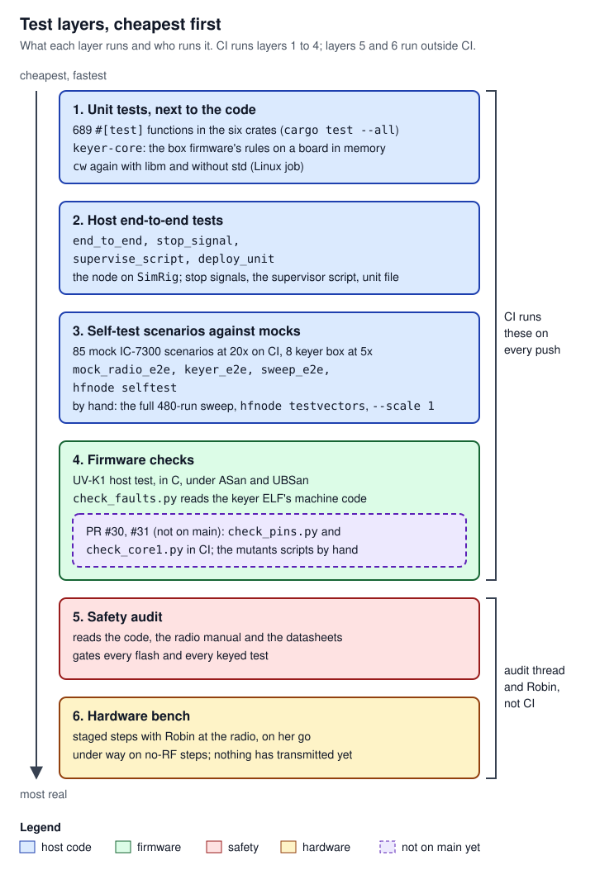

# 12 Testing

> Nothing in this project has transmitted on a real radio yet, so almost everything is proved without hardware. Testing has six layers: unit tests beside the code; host end-to-end tests in `crates/hfnode/tests/`; closed-loop self-test scenarios that run the real node against a byte-level mock IC-7300 or a mock keyer box with a scripted field operator; firmware checks that read the built machine code; and then two layers people run, the safety audit and the hardware bench. CI runs the first four on every push, with the mock radio at 20 times real time. This page explains each layer, the self-test's operator, mocks, checks, time scale and sweep in detail, how to add a test, the known flakes and their causes, and the rules that keep the tests honest.

## Where it lives

| Path | What it holds | Lines |
|---|---|---|
| [`crates/hfnode/src/selftest.rs:1-32`](https://github.com/robinonsay/cw-message-gateway/blob/44185fa9a00369c379d9d8af40ca307e3867e860/crates/hfnode/src/selftest.rs#L1-L32) | The self-test: the scripted operator (`Air`), the mock IC-7300 run, every check, all 85 IC-7300 scenarios, the sweep, the test vectors, 16 unit tests | 5399 |
| [`crates/hfnode/src/selftest/any_radio.rs:1-31`](https://github.com/robinonsay/cw-message-gateway/blob/44185fa9a00369c379d9d8af40ca307e3867e860/crates/hfnode/src/selftest/any_radio.rs#L1-L31) | The keyer-box run: `KeyerAir`, the pause meter, `KeyerFault`, the box safety check, the 8 `keyer-` scenarios | 768 |
| [`crates/hfnode/tests/mock_radio_e2e.rs:1-10`](https://github.com/robinonsay/cw-message-gateway/blob/44185fa9a00369c379d9d8af40ca307e3867e860/crates/hfnode/tests/mock_radio_e2e.rs#L1-L10) | One cargo test per IC-7300 scenario, plus the test-vector decode test | 281 |
| [`crates/hfnode/tests/keyer_e2e.rs:1-12`](https://github.com/robinonsay/cw-message-gateway/blob/44185fa9a00369c379d9d8af40ca307e3867e860/crates/hfnode/tests/keyer_e2e.rs#L1-L12) | One cargo test per `keyer-` scenario, in its own test binary | 93 |
| [`crates/hfnode/tests/end_to_end.rs:1-2`](https://github.com/robinonsay/cw-message-gateway/blob/44185fa9a00369c379d9d8af40ca307e3867e860/crates/hfnode/tests/end_to_end.rs#L1-L2) | The oldest whole-node test: synthesized CW into `node::run` on `civ::sim::SimRig` | 152 |
| [`crates/hfnode/tests/sweep_e2e.rs:1-7`](https://github.com/robinonsay/cw-message-gateway/blob/44185fa9a00369c379d9d8af40ca307e3867e860/crates/hfnode/tests/sweep_e2e.rs#L1-L7) | A six-cell slice of the sweep, plus one cell with RX | 83 |
| [`crates/hfnode/tests/stop_signal.rs:1-6`](https://github.com/robinonsay/cw-message-gateway/blob/44185fa9a00369c379d9d8af40ca307e3867e860/crates/hfnode/tests/stop_signal.rs#L1-L6) | SIGTERM, SIGINT and SIGHUP reach hfnode's own handler (Unix only) | 63 |
| [`crates/hfnode/tests/supervise_script.rs:1-6`](https://github.com/robinonsay/cw-message-gateway/blob/44185fa9a00369c379d9d8af40ca307e3867e860/crates/hfnode/tests/supervise_script.rs#L1-L6) | `deploy/hfnode-supervise.sh` against a fake hfnode, under `sh`, `dash` and `bash` | 262 |
| [`crates/hfnode/tests/deploy_unit.rs:1-2`](https://github.com/robinonsay/cw-message-gateway/blob/44185fa9a00369c379d9d8af40ca307e3867e860/crates/hfnode/tests/deploy_unit.rs#L1-L2) | `deploy/hfnode.service` reads (device access, the stop-time receive check) | 41 |
| [`crates/civ/src/mock.rs:1-66`](https://github.com/robinonsay/cw-message-gateway/blob/44185fa9a00369c379d9d8af40ca307e3867e860/crates/civ/src/mock.rs#L1-L66) | `civ::mock`: the byte-level mock IC-7300 behind a fake serial port, 22 tests of its own | 2249 |
| [`crates/civ/src/sim.rs:6-57`](https://github.com/robinonsay/cw-message-gateway/blob/44185fa9a00369c379d9d8af40ca307e3867e860/crates/civ/src/sim.rs#L6-L57) | `civ::sim::SimRig`: a simpler in-memory radio behind the `Rig` trait, used by `end_to_end.rs`, the station's and the node's unit tests and a few `main.rs` tests | 320 |
| [`crates/hfnode/src/keyer/mock.rs:1-10`](https://github.com/robinonsay/cw-message-gateway/blob/44185fa9a00369c379d9d8af40ca307e3867e860/crates/hfnode/src/keyer/mock.rs#L1-L10) | `keyer::mock`: the keyer box (running `keyer_core`, the firmware's own code) and the radio it keys | 816 |
| [`crates/hfnode/src/keyer/testbench.rs:1-24`](https://github.com/robinonsay/cw-message-gateway/blob/44185fa9a00369c379d9d8af40ca307e3867e860/crates/hfnode/src/keyer/testbench.rs#L1-L24) | The keyer rig on the mock box and radio under a real `Station`, at 5x by default, for the keyer unit tests | 168 |
| [`crates/hfnode/src/handheld/mock.rs:1-6`](https://github.com/robinonsay/cw-message-gateway/blob/44185fa9a00369c379d9d8af40ca307e3867e860/crates/hfnode/src/handheld/mock.rs#L1-L6) | `handheld::mock::MockFirmware`: the UV-K1 firmware's side of the handheld protocol | 652 |
| [`crates/hfnode/src/handheld/tests.rs:740-762`](https://github.com/robinonsay/cw-message-gateway/blob/44185fa9a00369c379d9d8af40ca307e3867e860/crates/hfnode/src/handheld/tests.rs#L740-L762) | The handheld unit tests, including the ID-timing test with its own hold-up meter | 1028 |
| [`crates/cw/examples/sweep.rs:1`](https://github.com/robinonsay/cw-message-gateway/blob/44185fa9a00369c379d9d8af40ca307e3867e860/crates/cw/examples/sweep.rs#L1) | Decoder accuracy against SNR and filter bandwidth, for tuning (run by hand) | 63 |
| [`firmware/pico2-keyer/check_faults.py:1-29`](https://github.com/robinonsay/cw-message-gateway/blob/44185fa9a00369c379d9d8af40ca307e3867e860/firmware/pico2-keyer/check_faults.py#L1-L29) | Reads the keyer ELF: the fault and panic handlers' first store opens the key and the PTT | 158 |
| [`firmware/uv-k1/test/test_hfnode.c:1-13`](https://github.com/robinonsay/cw-message-gateway/blob/44185fa9a00369c379d9d8af40ca307e3867e860/firmware/uv-k1/test/test_hfnode.c#L1-L13) and `test/stubs/` | Host test of the UV-K1 firmware's hfnode part against a fake radio | 907 |
| [`firmware/pico2-decoder/check_pins.py:1-69`](https://github.com/robinonsay/cw-message-gateway/blob/3efaf842e1aab75354e5e19d0384a703d4d786be/firmware/pico2-decoder/check_pins.py#L1-L69) (PR #30, open, not on main) | Fixed-point analysis of the decoder image: GP16-GP18 never driven high | 1047 |
| [`firmware/pico2-decoder/mutants.py:1-20`](https://github.com/robinonsay/cw-message-gateway/blob/3efaf842e1aab75354e5e19d0384a703d4d786be/firmware/pico2-decoder/mutants.py#L1-L20) (PR #30, not on main) | Builds seven broken decoder images and shows `check_pins.py` rejects each | 96 |
| [`firmware/pico2-keyer/check_core1.py:1-58`](https://github.com/robinonsay/cw-message-gateway/blob/bc5062ae4f56ae1f9949b3b067218c7e675d88f8/firmware/pico2-keyer/check_core1.py#L1-L58) (PR #31, draft, not on main) | Core 1's code in the one-Pico keyer image never reaches a pin | 450 |
| [`firmware/pico2-keyer/mutants_core1.py:1-20`](https://github.com/robinonsay/cw-message-gateway/blob/bc5062ae4f56ae1f9949b3b067218c7e675d88f8/firmware/pico2-keyer/mutants_core1.py#L1-L20) (PR #31, draft, not on main) | Builds eight broken one-Pico images and shows `check_core1.py` rejects each | 112 |
| [`.github/workflows/ci.yml:10-47`](https://github.com/robinonsay/cw-message-gateway/blob/44185fa9a00369c379d9d8af40ca307e3867e860/.github/workflows/ci.yml#L10-L47) | CI: which of the above run, where, and at which scale | 271 |
| `reports/cw-sweep-2026-10-04.txt` and two CSVs (project files) | The last full sweep's report, at commit 6a61938 | - |

The other unit tests sit in each crate next to the code they test (see [Unit tests per crate](#unit-tests-per-crate)).

## How it works



*Figure: each layer is slower and closer to the real radio than the one above it; CI runs layers 1 to 4, people do 5 and 6.*

Testing climbs from cheap to real:

1. **Unit tests** check one module against stand-ins: the station against `SimRig`, the keyer rig against the mock box, the session against fake services, the box's rules (`keyer-core`) against a board in memory.
2. **Host end-to-end tests** run the whole node, or a deploy script, as a separate process or thread.
3. **Self-test scenarios** run the whole node as `hfnode run` would, against a mock radio, with a scripted field operator on the other end of the air. This is the heart of the test suite and most of this page.
4. **Firmware checks** cover what cannot run on a computer: the Rust firmware's fault handlers are checked by reading the built ELF's machine code, and the UV-K1's C code is compiled for the computer and run against a fake radio.
5. **The safety audit** is a separate review by people of the code, the radio manual and the datasheets. It gates every flash and every keyed test. See [14 Audit, bench and flashing](14-audit-bench-flashing.md).
6. **The hardware bench** is a staged plan with Robin (the project owner) at the radio, run on her go. No step that transmits has been run yet. See [docs/hardware-test-plan.md](../hardware-test-plan.md) and page 14.

A few radio terms recur on this page; all are in the [17 Glossary](17-glossary.md). The **IC-7300** is the Icom HF radio the node drives. **CW** is Morse code sent by switching a carrier on and off. **CI-V** is Icom's serial command protocol: the bytes the node and the IC-7300 exchange over USB. **PTT** (push-to-talk) is the line that puts a radio on transmit. **Break-in** is the radio switching itself to transmit when keyed and back to receive a set delay after the key goes up. **SWR** (standing-wave ratio) measures how well the antenna takes the power. **MCW** is Morse sent as an audio tone through an FM handheld. **wpm** is Morse speed in words per minute, and **SNR** the signal-to-noise ratio, here in a 2500 Hz bandwidth. A **dit** is the short Morse element. The **sidetone** is the tone a radio plays in its own headphones while it keys, so its operator hears what it sends; the keyer route uses it to confirm that the radio really keyed. An **over** is one transmission, ended by `K` (or `KN`), after which the other side may answer. A **grid square** is a Maidenhead locator such as `DL89`, which names an area by letters and digits; the weather request uses one. **NWS** is the US National Weather Service, the forecast source.

### Unit tests per crate

`cargo test --all` runs 689 `#[test]` functions in the six crates' `src/` directories, plus the 24 in `crates/hfnode/tests/` (one of which a macro expands into 85 tests, so a run reports more). Counts are `#[test]` attributes at main. Some are compiled only on some systems (`audio/alsa.rs` on Linux, `audio/native.rs` on macOS and Windows, `stop_signal.rs` and `supervise_script.rs` on Unix only), so each CI job reports a slightly different count. Unit tests sit in a `#[cfg(test)] mod tests` in the file they test, or, for the larger modules, in a `tests.rs` beside it.

| Crate | Where the tests are | Tests | What they cover |
|---|---|---|---|
| `auth` | `src/lib.rs` (6), `src/store.rs` (4) | 10 | Codes are deterministic, of fixed length and only from the configured alphabet; matching ignores case and the printed grouping; the verifier takes only increasing line numbers; the `last_seq` store round-trips, syncs its directory, and reads a corrupt file as an error, never as zero |
| `civ` | `src/mock.rs` (22), `src/ic7300.rs` (19), `src/preflight.rs` (13), `frame.rs` (3), `ports.rs` (3), `serial.rs` (2), `lib.rs` (1) | 63 | The driver's frames on the wire, with and without echo; a stale or late reply is never taken for the next one; NG (the radio's "not good" refusal) and silence are errors; it never forces transmit on and never sends a frequency outside the radio; the serial port's DTR and RTS lines go down, DTR first, before the driver is returned. The preflight passes a well-set radio and fails each bad item. The mock is tested against the driver (see [`civ::mock`](#civmock-the-byte-level-ic-7300)) |
| `cw` | `src/decoder.rs` (22), `morse.rs` (4), `synth.rs` (2) | 28 | Decoding clean, noisy, hand-keyed and off-frequency CW; staying quiet on noise, a steady carrier and noise steps; surviving non-finite and huge samples. CI runs them twice more, with `--cfg cw_force_libm` (libm's arithmetic) and with `--no-default-features` (no standard library), because the same decoder runs that way on the Pico 2 decoder box ([`.github/workflows/ci.yml:35-47`](https://github.com/robinonsay/cw-message-gateway/blob/44185fa9a00369c379d9d8af40ca307e3867e860/.github/workflows/ci.yml#L35-L47)) |
| `keyer-core` | `src/control/tests.rs` (24), `src/keyer/tests.rs` (39), `frame.rs` (4), `morse.rs` (4) | 71 | The keyer box firmware's own code. `control/tests.rs` runs the control loop on a `Board` in memory: "a clock the test moves on, a USB port, the pins, and a record of every call the loop makes" ([`crates/keyer-core/src/control/tests.rs:26-28`](https://github.com/robinonsay/cw-message-gateway/blob/44185fa9a00369c379d9d8af40ca307e3867e860/crates/keyer-core/src/control/tests.rs#L26-L28)). It checks that the pin guards trip at the key-down and PTT limits whatever the keyer says, the watchdog is fed once a pass, a lost link opens the key, a stopped clock trips, and the saved state survives a restart. `keyer/tests.rs` covers CW and MCW timing, `STOP`, the link timeout, the duty budget, stuck key and PTT trips, and the hang test. `morse.rs` checks the box's Morse table and timing against the `cw` crate's ([`crates/keyer-core/src/morse.rs:191`](https://github.com/robinonsay/cw-message-gateway/blob/44185fa9a00369c379d9d8af40ca307e3867e860/crates/keyer-core/src/morse.rs#L191)) |
| `protocol` | `src/lib.rs` (13), `reply.rs` (3), `fuzzy.rs` (2), `text.rs` (1) | 19 | Parsing the specification's examples, weather grids and presets, decode noise, `NO` and `AGN` needing a line and its code, `AGN K K`, `KN` and over words; reply rendering and chunking on word boundaries; callsign snapping |
| `hfnode` | beside each module, see below | 498 in `src/` | The node, the gateways, the keyer and handheld host sides, the self-test's own logic |

In `hfnode`:

| Module | Tests | What they cover |
|---|---|---|
| `station.rs` | 104 | Keying in pieces, SWR lockouts, tuner faults and time limits, split and ∂TX refusals, setting the radio up each window and each transmission, the inhibit latch and its file; on `SimRig` |
| `session.rs` | 33 | The transaction rules: the specification's examples, idempotent retries, replays and bad codes, the pending timeout, `NO` and `AGN` and their window, RX chunks |
| `node.rs` | 18 | The listening loop: where an over ends, noise after it, windows, a result repeatable after its window, audio from the node's own transmissions skipped |
| `keyer/` | 111: `rig/tests.rs` 38, `monitor/tests.rs` 35, `bench/tests.rs` 19, `tests.rs` 9, `link.rs` 6, `proto.rs` 4 | The keyer rig on `testbench` (mock box and radio at 5x), the sidetone monitor on synthesized headphone audio, the `hfnode keyer` bench commands, keyer config checks, the link |
| `handheld/` | 51: `tests.rs` 31, `proto.rs` 11, `mock.rs` 5, `link.rs` 4 | The handheld rig and link on `MockFirmware`, the line format, the ID-timing tests |
| `gateway/` | 62: `imessage.rs` 19, `email.rs` 11, `filter.rs` 11, `google_voice.rs` 9, `route.rs` 5, `weather.rs` 4, `typedstream.rs` 2, `mod.rs` 1 | Which incoming mail and messages are taken, the content filter's verdicts, routing, the weather text |
| `config.rs`, `main.rs`, `commissioning.rs` | 28, 20, 9 | Config validation; CLI commands (a stop signal puts the radio on receive, `radio rx`, the README lists every command); the bring-up stages and the time-out-timer requirement |
| `selftest.rs` | 16 | The self-test's own judging: code substitution, over matching, station-ID bounds, the "not judged" reruns, sweep classification, the test vectors played in order |
| others | `alert.rs` 11, `storm.rs` 10, `audio.rs` and `audio/` 18, `places.rs` 3, `inbox.rs` 2, `messages.rs` 2 | Owner alerts, the thunderstorm hold, the audio queue, resampling and WAV files |

On open PRs (not on main), more host tests arrive. The decoder box and the one-Pico image they test are on [11 Decoder box and the one-Pico image](11-decoder-box-one-pico.md).

| Where | PR | Tests | What they cover |
|---|---|---|---|
| `crates/decoder-core/src/control/tests.rs` | #30 (open) | 17 | The decoder box's loop on a board in memory, fed synthesized Morse quantized as its ADC reads it: text mode and hfnode mode, the box decoding what the host decoder does, the monitor measurements, the hold while the box's own keying is on, commands and damaged lines, falling back to text mode when hfnode or USB goes quiet, lost audio and a halted DMA, outputs low and the watchdog fed every pass, a full queue dropping whole lines ([`crates/decoder-core/src/control/tests.rs:1-2`](https://github.com/robinonsay/cw-message-gateway/blob/3efaf842e1aab75354e5e19d0384a703d4d786be/crates/decoder-core/src/control/tests.rs#L1-L2)) |
| `crates/decoder-core/src/frontend.rs` | #30 | 5 | The ADC front end: every CW pitch passes flat, what would fold onto a pitch is cut, one output per four inputs with DC removed, a failed conversion keeps the last good value, the filter is symmetric with unity gain ([`crates/decoder-core/src/frontend.rs:1-12`](https://github.com/robinonsay/cw-message-gateway/blob/3efaf842e1aab75354e5e19d0384a703d4d786be/crates/decoder-core/src/frontend.rs#L1-L12)) |
| `crates/cw/src/level.rs` | #30 | 3 | The tone-level measurement the box and hfnode's monitor share: a tone at the pitch reads as its mean square, one off the pitch is not counted, silence has a level |
| `crates/keyer-core/src/cores/tests.rs` | #31 (draft) | 4 | The byte queue between the two cores: order and room, counts wrapping through `u32`, two threads losing and reordering nothing, an impossible count from the other side being harmless |
| `crates/keyer-core/src/control/tests.rs` | #31 | 24 → 37 | Core 1 on the keyer's control loop: a core-1 fault or stall opens the key, a core 1 that never beats trips, nothing from core 1 or `RX` keys anything, keyer replies never wait behind decoder lines, decoder lines reach the host only after `RX HELLO`, without core 1 the keyer keys and `RX` is off |
| `crates/keyer-core/src/keyer/tests.rs` | #31 | 39 → 41 | Core-1 tests come due at the next element once; the saved state's trips under protocol 4 |
| `crates/hfnode/src/keyer/bench/tests.rs` | #31 | 19 → 21 | `hfnode keyer core1test` sees the box open the key and trip for core 1, and fails a box that ignores its decoder core |

CI runs the `decoder-core` tests through libm's arithmetic, as the box decodes: `RUSTFLAGS="--cfg cw_force_libm" cargo test -p decoder-core` (PR #30, [`.github/workflows/ci.yml:49-56`](https://github.com/robinonsay/cw-message-gateway/blob/3efaf842e1aab75354e5e19d0384a703d4d786be/.github/workflows/ci.yml#L49-L56)).

### The end-to-end test files

Each file in `crates/hfnode/tests/` is its own test binary.

- **`end_to_end.rs`**, `field_message_over_the_air_is_sent`: the oldest whole-node test. It keys a TX open on line 42 and its `OK` on 43 with `cw::Keyer` (16 wpm, 6% jitter, 3 dB noise) and feeds them as 50 ms blocks into `node::run` with a real `Station` on `SimRig`. The feeder is paced by the node: it waits while the radio transmits or tunes, so a slow machine changes how long the test takes, not what the node hears ([`crates/hfnode/tests/end_to_end.rs:105-134`](https://github.com/robinonsay/cw-message-gateway/blob/44185fa9a00369c379d9d8af40ca307e3867e860/crates/hfnode/tests/end_to_end.rs#L105-L134)). It asserts the gateway got exactly one message, the radio keyed exactly `DE N0DE R 42 TX MOM RUNNING LATE HOME SUN ? DE N0DE K SENT 43 DE N0DE K`, and `last_seq` is 43 ([`crates/hfnode/tests/end_to_end.rs:139-151`](https://github.com/robinonsay/cw-message-gateway/blob/44185fa9a00369c379d9d8af40ca307e3867e860/crates/hfnode/tests/end_to_end.rs#L139-L151)). `SimRig.time_scale` is `HFNODE_E2E_SCALE` or 100.
- **`mock_radio_e2e.rs`**: one test per IC-7300 scenario. `run(name)` runs it with `selftest::run`, asserts `passed()`, and asserts a `machine` check exists unless the preflight refused the scenario ([`crates/hfnode/tests/mock_radio_e2e.rs:21-33`](https://github.com/robinonsay/cw-message-gateway/blob/44185fa9a00369c379d9d8af40ca307e3867e860/crates/hfnode/tests/mock_radio_e2e.rs#L21-L33)). The `scenario_tests!` macro turns `test_fn => "name"` lines into tests and adds `every_scenario_has_a_test`, which fails unless the macro's names, `NAMES` and the non-keyer `scenarios()` are the same list in the same order ([`crates/hfnode/tests/mock_radio_e2e.rs:124-145`](https://github.com/robinonsay/cw-message-gateway/blob/44185fa9a00369c379d9d8af40ca307e3867e860/crates/hfnode/tests/mock_radio_e2e.rs#L124-L145)). `test_vectors_decode_to_their_manifest_text` writes the vectors at 12, 18 and 25 wpm, clean and at 10 dB, and checks each decodes as the manifest says and that `NOT_THIS_REPLY` marks exactly the files that parse differently ([`crates/hfnode/tests/mock_radio_e2e.rs:235-281`](https://github.com/robinonsay/cw-message-gateway/blob/44185fa9a00369c379d9d8af40ca307e3867e860/crates/hfnode/tests/mock_radio_e2e.rs#L235-L281)).
- **`keyer_e2e.rs`**: one test per `keyer-` scenario, plus `every_keyer_scenario_has_a_test`. It is a binary of its own so cargo runs it apart from the IC-7300 scenarios, which take all the processor they can and would make these miss real time ([`crates/hfnode/tests/keyer_e2e.rs:1-12`](https://github.com/robinonsay/cw-message-gateway/blob/44185fa9a00369c379d9d8af40ca307e3867e860/crates/hfnode/tests/keyer_e2e.rs#L1-L12)). **The 5x cap:** whatever `HFNODE_E2E_SCALE` says, `any_radio::run_inner` clamps the scale to 1..`MAX_SCALE` = 5, because the radio's audio runs on the box's clock in real time and is never held back for the node; the box's 2 s link timeout leaves a busy machine 0.4 s of real time at 5x to send its keep-alive ([`crates/hfnode/src/selftest/any_radio.rs:19-23`](https://github.com/robinonsay/cw-message-gateway/blob/44185fa9a00369c379d9d8af40ca307e3867e860/crates/hfnode/src/selftest/any_radio.rs#L19-L23), [`crates/hfnode/src/selftest/any_radio.rs:47-48`](https://github.com/robinonsay/cw-message-gateway/blob/44185fa9a00369c379d9d8af40ca307e3867e860/crates/hfnode/src/selftest/any_radio.rs#L47-L48), [`crates/hfnode/src/selftest/any_radio.rs:361-362`](https://github.com/robinonsay/cw-message-gateway/blob/44185fa9a00369c379d9d8af40ca307e3867e860/crates/hfnode/src/selftest/any_radio.rs#L361-L362)). So at CI's 20 these run at 5.
- **`sweep_e2e.rs`**: a small slice of the sweep through `selftest::sweep_runs`, first trial of each cell, all at once. Five cells well inside the should-pass region must succeed; machine-keyed 18 wpm at -6 dB must fail gracefully: no hard failure, nothing delivered, at least 3 transmissions (the operator gave up after its tries), and the verdict still passes ([`crates/hfnode/tests/sweep_e2e.rs:39-75`](https://github.com/robinonsay/cw-message-gateway/blob/44185fa9a00369c379d9d8af40ca307e3867e860/crates/hfnode/tests/sweep_e2e.rs#L39-L75)). `sweep_slice_with_rx` runs one cell with the RX exchange ([`crates/hfnode/tests/sweep_e2e.rs:77-83`](https://github.com/robinonsay/cw-message-gateway/blob/44185fa9a00369c379d9d8af40ca307e3867e860/crates/hfnode/tests/sweep_e2e.rs#L77-L83)).
- **`stop_signal.rs`** (Unix only): starts the built binary as `hfnode selftest --scale 1 --jobs 1`, waits for its "stop-signal handler installed" log line, sends SIGTERM, SIGINT and SIGHUP in turn, and expects exit code 130 each time, which shows hfnode's own handler ran rather than the signal killing it ([`crates/hfnode/tests/stop_signal.rs:16-63`](https://github.com/robinonsay/cw-message-gateway/blob/44185fa9a00369c379d9d8af40ca307e3867e860/crates/hfnode/tests/stop_signal.rs#L16-L63)).
- **`supervise_script.rs`** (Unix only): runs `deploy/hfnode-supervise.sh` against a fake `hfnode` shell script that logs its arguments, under each of `sh`, `dash` and `bash` that the machine has. Six tests: a failing node is restarted then given up on, a clean stop is not restarted, a stop signal is passed to the node, a node that ignores it is killed, secrets come from the env file without running it, and a stop before the node starts is not lost; after every exit the script must run `hfnode radio rx` ([`crates/hfnode/tests/supervise_script.rs:1-6`](https://github.com/robinonsay/cw-message-gateway/blob/44185fa9a00369c379d9d8af40ca307e3867e860/crates/hfnode/tests/supervise_script.rs#L1-L6), [`crates/hfnode/tests/supervise_script.rs:137-262`](https://github.com/robinonsay/cw-message-gateway/blob/44185fa9a00369c379d9d8af40ca307e3867e860/crates/hfnode/tests/supervise_script.rs#L137-L262)).
- **`deploy_unit.rs`**: reads `deploy/hfnode.service` (systemd is not run). `DevicePolicy=closed` with `DeviceAllow` for `char-ttyUSB`, `char-ttyACM` and `char-alsa`, so the node can open the IC-7300, the keyer box and the sound card; and exactly one `ExecStopPost` that runs `hfnode radio rx`, with a leading `-` so its failure does not fail the stop ([`crates/hfnode/tests/deploy_unit.rs:15-41`](https://github.com/robinonsay/cw-message-gateway/blob/44185fa9a00369c379d9d8af40ca307e3867e860/crates/hfnode/tests/deploy_unit.rs#L15-L41)).

### The closed loop


*Figure: the operator only knows what actually went on the air, so the node is tested through the same loop a field operator closes by ear. On the IC-7300 path the operator's audio goes straight into the node's audio queue; on the keyer path it goes into the mock radio, whose headphone audio reaches the node. F1 to F6 are where a scenario injects a fault.*

A **scenario** ([`crates/hfnode/src/selftest.rs:394-402`](https://github.com/robinonsay/cw-message-gateway/blob/44185fa9a00369c379d9d8af40ca307e3867e860/crates/hfnode/src/selftest.rs#L394-L402)) is a name, a sentence saying what it proves, the field operator's sending (`Fist`), the node's set-up (`NodeSetup`), the radio's set-up (`RadioSetup`), a script of `Step`s and an `Expect`. One run of a scenario goes like this ([`crates/hfnode/src/selftest.rs:1629-1761`](https://github.com/robinonsay/cw-message-gateway/blob/44185fa9a00369c379d9d8af40ca307e3867e860/crates/hfnode/src/selftest.rs#L1629-L1761)):

1. **Set up a node in a scratch directory.** `config` writes the test key and an hfnode TOML with node call `N0DE`, field call `W5XXX`, 7.030 MHz (144.150 MHz for a handheld on the keyer box), 40 W, contacts MOM and BOB, weather presets 1 and 2, and `last_seq` 41, so the first open uses line 42 ([`crates/hfnode/src/selftest.rs:1364-1444`](https://github.com/robinonsay/cw-message-gateway/blob/44185fa9a00369c379d9d8af40ca307e3867e860/crates/hfnode/src/selftest.rs#L1364-L1444)). Keyer scenarios add `rig = "keyer"` with `max_key_seconds = 50` and `[keyer] commissioned = "done"`; a handheld on the box's PTT also gets `output = "ptt"` and `ptt_contact_volts = 3.3`, at 144.150 MHz ([`crates/hfnode/src/selftest.rs:1419-1437`](https://github.com/robinonsay/cw-message-gateway/blob/44185fa9a00369c379d9d8af40ca307e3867e860/crates/hfnode/src/selftest.rs#L1419-L1437)). A "line" is one row of the field operator's printed code sheet, used once (see [03 Field protocol, codes and sessions](03-field-protocol-auth-session.md)).
2. **Open the radio as `hfnode run` does.** The mock IC-7300 is created with the scenario's settings, and `commissioning::open_for(Stage::Done, Action::Run, ...)` runs the real read-only preflight over the mock's serial port ([`crates/hfnode/src/selftest.rs:1650-1670`](https://github.com/robinonsay/cw-message-gateway/blob/44185fa9a00369c379d9d8af40ca307e3867e860/crates/hfnode/src/selftest.rs#L1650-L1670)). A preflight scenario expects a refusal here and ends with two checks.
3. **Arm faults and wrap the driver.** Faults listed in `RadioSetup.faults` are injected, and the real `Ic7300` driver is wrapped in `TimeScaled` so the station times keying to the mock's sped-up clock ([`crates/hfnode/src/selftest.rs:1671-1674`](https://github.com/robinonsay/cw-message-gateway/blob/44185fa9a00369c379d9d8af40ca307e3867e860/crates/hfnode/src/selftest.rs#L1671-L1674)).
4. **Start the node on its own thread.** A real `Station` (with time constants divided by the scale), a real `Session` (its 10-minute windows divided too) and `FakeServices` go into `node::run_with_clock`, whose listening schedule reads the mock's radio time ([`crates/hfnode/src/selftest.rs:1857-1875`](https://github.com/robinonsay/cw-message-gateway/blob/44185fa9a00369c379d9d8af40ca307e3867e860/crates/hfnode/src/selftest.rs#L1857-L1875)). A pause meter thread starts beside it.
5. **Work the script.** The operator (`Air`) waits out the node's start-up tune and station ID, then performs each step. It keys audio blocks into the node's audio queue, and listens by reading what the mock radio keyed ([`crates/hfnode/src/selftest.rs:1322-1344`](https://github.com/robinonsay/cw-message-gateway/blob/44185fa9a00369c379d9d8af40ca307e3867e860/crates/hfnode/src/selftest.rs#L1322-L1344)). The first failed step ends the script, as a real operator would give up; 10 s of listening follow for anything keyed late.
6. **Close the audio.** That makes `node::run` return with "audio source ended"; the node thread hands back the station, session and fake services within 30 s or the `ended` check fails ([`crates/hfnode/src/selftest.rs:1915-1962`](https://github.com/robinonsay/cw-message-gateway/blob/44185fa9a00369c379d9d8af40ca307e3867e860/crates/hfnode/src/selftest.rs#L1915-L1962)).
7. **Judge.** The checks compare what the mock recorded, what the gateways did, the node's `rx.log`, its alerts and the longest process pause against the scenario's `Expect` ([`crates/hfnode/src/selftest.rs:1697-1760`](https://github.com/robinonsay/cw-message-gateway/blob/44185fa9a00369c379d9d8af40ca307e3867e860/crates/hfnode/src/selftest.rs#L1697-L1760)).

The keyer-box run is the same shape, with `KeyerRig` talking to a `MockBox` and a mock radio whose headphone audio, including the operator's signal, reaches the node's decoder in real time ([`crates/hfnode/src/selftest/any_radio.rs:361-491`](https://github.com/robinonsay/cw-message-gateway/blob/44185fa9a00369c379d9d8af40ca307e3867e860/crates/hfnode/src/selftest/any_radio.rs#L361-L491)). The operator's blocks do not go into the node here: they go into `KeyerAir.field`, which the radio reads through its `feed`, and the radio's headphone audio goes to the node through the audio queue ([`crates/hfnode/src/selftest/any_radio.rs:391-415`](https://github.com/robinonsay/cw-message-gateway/blob/44185fa9a00369c379d9d8af40ca307e3867e860/crates/hfnode/src/selftest/any_radio.rs#L391-L415)). What went on the air is built from the box's own record of its runs and key-downs (or tones, for MCW); the radio adds only `on_air`, false for a run keyed while the radio was off or its key cable out ([`crates/hfnode/src/selftest/any_radio.rs:285-329`](https://github.com/robinonsay/cw-message-gateway/blob/44185fa9a00369c379d9d8af40ca307e3867e860/crates/hfnode/src/selftest/any_radio.rs#L285-L329)). The `keyer-ht-` scenarios put an FM handheld on the box's PTT (push-to-talk) output instead of a radio's key line ([`crates/hfnode/src/selftest/any_radio.rs:14-17`](https://github.com/robinonsay/cw-message-gateway/blob/44185fa9a00369c379d9d8af40ca307e3867e860/crates/hfnode/src/selftest/any_radio.rs#L14-L17)).

### Time scale

Scenarios run faster than real time so 85 of them fit in a CI job. Radio time is real time multiplied by the scale. The scale is chosen per run:

| Where | Default | Range | Source |
|---|---|---|---|
| `hfnode selftest --scale`, `--sweep` | 100 (`DEFAULT_SCALE`) | 1 to 200 (`MAX_SCALE`), else the command fails | [`crates/hfnode/src/selftest.rs:71-77`](https://github.com/robinonsay/cw-message-gateway/blob/44185fa9a00369c379d9d8af40ca307e3867e860/crates/hfnode/src/selftest.rs#L71-L77), [`crates/hfnode/src/main.rs:1764-1766`](https://github.com/robinonsay/cw-message-gateway/blob/44185fa9a00369c379d9d8af40ca307e3867e860/crates/hfnode/src/main.rs#L1764-L1766) |
| cargo tests (`mock_radio_e2e`, `sweep_e2e`, `keyer_e2e`, `end_to_end`) | `HFNODE_E2E_SCALE`, else 100 | parsed as `f32` | [`crates/hfnode/tests/mock_radio_e2e.rs:14-19`](https://github.com/robinonsay/cw-message-gateway/blob/44185fa9a00369c379d9d8af40ca307e3867e860/crates/hfnode/tests/mock_radio_e2e.rs#L14-L19), [`crates/hfnode/tests/end_to_end.rs:91-95`](https://github.com/robinonsay/cw-message-gateway/blob/44185fa9a00369c379d9d8af40ca307e3867e860/crates/hfnode/tests/end_to_end.rs#L91-L95) |
| CI, every OS | 20 | fixed in the workflow | [`.github/workflows/ci.yml:14-16`](https://github.com/robinonsay/cw-message-gateway/blob/44185fa9a00369c379d9d8af40ca307e3867e860/.github/workflows/ci.yml#L14-L16), [`.github/workflows/ci.yml:57-70`](https://github.com/robinonsay/cw-message-gateway/blob/44185fa9a00369c379d9d8af40ca307e3867e860/.github/workflows/ci.yml#L57-L70) |
| any IC-7300 scenario | clamped to 1..200 | | [`crates/hfnode/src/selftest.rs:1633`](https://github.com/robinonsay/cw-message-gateway/blob/44185fa9a00369c379d9d8af40ca307e3867e860/crates/hfnode/src/selftest.rs#L1633) |
| any `keyer-` scenario | clamped to 1..5 (`KEYER_MAX_SCALE`) | | [`crates/hfnode/src/selftest/any_radio.rs:48`](https://github.com/robinonsay/cw-message-gateway/blob/44185fa9a00369c379d9d8af40ca307e3867e860/crates/hfnode/src/selftest/any_radio.rs#L48), [`crates/hfnode/src/selftest/any_radio.rs:362`](https://github.com/robinonsay/cw-message-gateway/blob/44185fa9a00369c379d9d8af40ca307e3867e860/crates/hfnode/src/selftest/any_radio.rs#L362) |
| keyer unit tests (`testbench`) | 5 by default (`SCALE`) | `bench_at` takes another; one rig test runs at 1x | [`crates/hfnode/src/keyer/testbench.rs:17-20`](https://github.com/robinonsay/cw-message-gateway/blob/44185fa9a00369c379d9d8af40ca307e3867e860/crates/hfnode/src/keyer/testbench.rs#L17-L20), [`crates/hfnode/src/keyer/rig/tests.rs:600`](https://github.com/robinonsay/cw-message-gateway/blob/44185fa9a00369c379d9d8af40ca307e3867e860/crates/hfnode/src/keyer/rig/tests.rs#L600) |

**The 20x CI scale is a rule, never lowered.** The workflow comment gives the reason: GitHub's runners can hold a test's threads up for a few hundred milliseconds, and at 100x that is more than the keying watchdog (45 s, 0.45 s real) or the stuck margin (3 s, 30 ms real) allows, so the station would force receive with nothing wrong ([`.github/workflows/ci.yml:59-63`](https://github.com/robinonsay/cw-message-gateway/blob/44185fa9a00369c379d9d8af40ca307e3867e860/.github/workflows/ci.yml#L59-L63)). Do not raise it either without the same analysis.

What the scale divides, and what stays in real time:

| Scaled (divided by the scale) | Where |
|---|---|
| Mock IC-7300 keying, break-in, tuning, all its recorded times | `MockConfig.time_scale`, [`crates/civ/src/mock.rs:85-87`](https://github.com/robinonsay/cw-message-gateway/blob/44185fa9a00369c379d9d8af40ca307e3867e860/crates/civ/src/mock.rs#L85-L87) |
| The station's `max_key`, `swr_delay`, `swr_window`, `stuck_margin`, `tune_timeout`, `poll`, `id_interval`, `duty_window`, `max_transmission` | `station_config`, [`crates/hfnode/src/selftest.rs:1447-1464`](https://github.com/robinonsay/cw-message-gateway/blob/44185fa9a00369c379d9d8af40ca307e3867e860/crates/hfnode/src/selftest.rs#L1447-L1464) |
| The keyer's dot length as the station sees it | `TimeScaled::dot_duration`, [`crates/hfnode/src/selftest.rs:611-613`](https://github.com/robinonsay/cw-message-gateway/blob/44185fa9a00369c379d9d8af40ca307e3867e860/crates/hfnode/src/selftest.rs#L611-L613) |
| The session's pending-commit window and `AGN` window | `node_side`, [`crates/hfnode/src/selftest.rs:1842-1843`](https://github.com/robinonsay/cw-message-gateway/blob/44185fa9a00369c379d9d8af40ca307e3867e860/crates/hfnode/src/selftest.rs#L1842-L1843) |
| `chunk_pause_ms` = 2000 / scale (at least 1) | [`crates/hfnode/src/selftest.rs:1410`](https://github.com/robinonsay/cw-message-gateway/blob/44185fa9a00369c379d9d8af40ca307e3867e860/crates/hfnode/src/selftest.rs#L1410) |
| The operator's block period (50 ms / scale) and its deadline (1800 s / scale + 30 s) | [`crates/hfnode/src/selftest.rs:1889-1891`](https://github.com/robinonsay/cw-message-gateway/blob/44185fa9a00369c379d9d8af40ca307e3867e860/crates/hfnode/src/selftest.rs#L1889-L1891) |
| Box and radio clock, monitor and rig settings in keyer scenarios | [`crates/hfnode/src/keyer/mock.rs:28-55`](https://github.com/robinonsay/cw-message-gateway/blob/44185fa9a00369c379d9d8af40ca307e3867e860/crates/hfnode/src/keyer/mock.rs#L28-L55), [`crates/hfnode/src/keyer/bench.rs:41`](https://github.com/robinonsay/cw-message-gateway/blob/44185fa9a00369c379d9d8af40ca307e3867e860/crates/hfnode/src/keyer/bench.rs#L41), [`crates/hfnode/src/keyer/bench.rs:59`](https://github.com/robinonsay/cw-message-gateway/blob/44185fa9a00369c379d9d8af40ca307e3867e860/crates/hfnode/src/keyer/bench.rs#L59) |

| Real time, not scaled | Where |
|---|---|
| The station's `radio_wait` (how long one call may hold the radio) | comment at [`crates/hfnode/src/selftest.rs:1462`](https://github.com/robinonsay/cw-message-gateway/blob/44185fa9a00369c379d9d8af40ca307e3867e860/crates/hfnode/src/selftest.rs#L1462) |
| The CI-V driver's 500 ms reply timeout | [`crates/civ/src/ic7300.rs:388`](https://github.com/robinonsay/cw-message-gateway/blob/44185fa9a00369c379d9d8af40ca307e3867e860/crates/civ/src/ic7300.rs#L388) |
| The station watchdog's 250 ms tick, and the 100 ms pause between forced-receive attempts | [`crates/hfnode/src/station.rs:332`](https://github.com/robinonsay/cw-message-gateway/blob/44185fa9a00369c379d9d8af40ca307e3867e860/crates/hfnode/src/station.rs#L332), [`crates/hfnode/src/station.rs:400-402`](https://github.com/robinonsay/cw-message-gateway/blob/44185fa9a00369c379d9d8af40ca307e3867e860/crates/hfnode/src/station.rs#L400-L402) |
| `rest_needed` on the rig (already real time) | [`crates/hfnode/src/selftest.rs:653-656`](https://github.com/robinonsay/cw-message-gateway/blob/44185fa9a00369c379d9d8af40ca307e3867e860/crates/hfnode/src/selftest.rs#L653-L656) |
| The Time-Out Timer setting read from the radio (a setting, not a wait) | [`crates/hfnode/src/selftest.rs:666-669`](https://github.com/robinonsay/cw-message-gateway/blob/44185fa9a00369c379d9d8af40ca307e3867e860/crates/hfnode/src/selftest.rs#L666-L669) |

Because those real-time waits last `scale` times longer in radio time, `MAX_SCALE` stops at 200: above it a lost or late CI-V reply would outlast the scaled 10-minute pending window ([`crates/hfnode/src/selftest.rs:73-77`](https://github.com/robinonsay/cw-message-gateway/blob/44185fa9a00369c379d9d8af40ca307e3867e860/crates/hfnode/src/selftest.rs#L73-L77)). `hfnode selftest --scale 1` runs everything at real speed, real-time margins included; the README gives about 23 minutes with `--jobs 100` (not measured for this page).

### Pauses and "not judged" runs

Everything here runs on the wall clock: the station's own code calls `Instant::now()` 21 times at main (50 counting its tests, which start at [`crates/hfnode/src/station.rs:2286`](https://github.com/robinonsay/cw-message-gateway/blob/44185fa9a00369c379d9d8af40ca307e3867e860/crates/hfnode/src/station.rs#L2286)) and has no clock that a test could replace. A busy machine that stops the whole test process therefore looks to the node like its host stopping, and can fail a correct node. The self-test measures this instead of hiding it:

- `PauseMeter` is a thread that sleeps 5 ms at a time and records every gap of 5 ms or more past that ([`crates/hfnode/src/selftest/any_radio.rs:60-112`](https://github.com/robinonsay/cw-message-gateway/blob/44185fa9a00369c379d9d8af40ca307e3867e860/crates/hfnode/src/selftest/any_radio.rs#L60-L112)). Nothing the node does can hold it up; only the machine can.
- Its longest pause becomes the `machine` check. The limit is 1 s of radio time for a keyer scenario (0.2 s real at 5x) ([`crates/hfnode/src/selftest/any_radio.rs:50-55`](https://github.com/robinonsay/cw-message-gateway/blob/44185fa9a00369c379d9d8af40ca307e3867e860/crates/hfnode/src/selftest/any_radio.rs#L50-L55)) and, for an IC-7300 scenario, `pause_limit(scale)` = 500 ms / scale + 20 ms: the least slack the safety check leaves the station to unkey a radio left on transmit. That is 45 ms at 20x, 25 ms at 100x, 520 ms at 1x ([`crates/hfnode/src/selftest.rs:133-142`](https://github.com/robinonsay/cw-message-gateway/blob/44185fa9a00369c379d9d8af40ca307e3867e860/crates/hfnode/src/selftest.rs#L133-L142)).
- `run` calls `judged`, which runs a scenario again when its `machine` check failed, at most `NOT_JUDGED_RERUNS` = 2 times, and lists the runs set aside in `Outcome.not_judged`. The last allowed run stands whatever it says ([`crates/hfnode/src/selftest.rs:1567-1609`](https://github.com/robinonsay/cw-message-gateway/blob/44185fa9a00369c379d9d8af40ca307e3867e860/crates/hfnode/src/selftest.rs#L1567-L1609)).
- For an IC-7300 scenario, `pause_excuses_only_failures` turns a failed `machine` check into a pass when every other check passed, because a pause can only make the node look slow, never make it pass a check it would fail ([`crates/hfnode/src/selftest.rs:1763-1786`](https://github.com/robinonsay/cw-message-gateway/blob/44185fa9a00369c379d9d8af40ca307e3867e860/crates/hfnode/src/selftest.rs#L1763-L1786)). Keyer scenarios do not get this: the keyer run does not call `pause_excuses_only_failures`, so a paused keyer run is set aside as not judged and run again instead ([`crates/hfnode/src/selftest/any_radio.rs:25-31`](https://github.com/robinonsay/cw-message-gateway/blob/44185fa9a00369c379d9d8af40ca307e3867e860/crates/hfnode/src/selftest/any_radio.rs#L25-L31), [`crates/hfnode/src/selftest/any_radio.rs:446-448`](https://github.com/robinonsay/cw-message-gateway/blob/44185fa9a00369c379d9d8af40ca307e3867e860/crates/hfnode/src/selftest/any_radio.rs#L446-L448)).

The check's own limit is never raised to make a run pass: "the check's own limit stays as it is" ([`crates/hfnode/src/selftest.rs:133-139`](https://github.com/robinonsay/cw-message-gateway/blob/44185fa9a00369c379d9d8af40ca307e3867e860/crates/hfnode/src/selftest.rs#L133-L139)).

## How it connects

Each layer exercises code described on another page:

| Test | Code under test | Page |
|---|---|---|
| Self-test operator's audio into the decoder | `crates/cw` decoder, `audio` queue | [04 CW decoder and audio](04-cw-decoder-audio.md) |
| Opens, read-backs, codes, `last_seq`, `AGN`, `NO` | `protocol`, `auth`, `session` | [03 Field protocol, codes and sessions](03-field-protocol-auth-session.md) |
| Safety, station ID, forced receive, inhibit, alerts | `node`, `station` | [05 Node loop and station safety](05-node-loop-station-safety.md) |
| Gateway check (`FakeServices`) | the `Services` trait the gateways implement | [06 Gateways and messages](06-gateways-messages.md) |
| Mock IC-7300, `ci-v` and `settings` checks, preflight scenarios | `civ::ic7300`, `civ::preflight`, `commissioning` | [07 CI-V and the IC-7300](07-civ-ic7300.md) |
| Mock keyer box, `keyer-` scenarios, `check_faults.py` | `keyer_core`, `firmware/pico2-keyer`, `keyer::rig`, `keyer::monitor` | [08 Keyer box: firmware and protocol](08-keyer-box-firmware.md), [09 Keyer box: host side](09-keyer-host-side.md) |
| Handheld mock and UV-K1 host test | `handheld`, `firmware/uv-k1/app` | [10 Quansheng UV-K1 handheld](10-uv-k1-handheld.md) |
| `check_pins.py`, `check_core1.py`, mutants | decoder box and one-Pico images (PR #30, #31) | [11 Decoder box and the one-Pico image](11-decoder-box-one-pico.md) |
| `stop_signal`, `supervise_script`, `deploy_unit` | `main.rs` signal handling, `deploy/` | [15 Config, CLI and deployment](15-config-cli-deployment.md) |
| `hfnode selftest` on the node's own host (bench Step -1) | The whole node, built as it will run: must end `0 failed`, and the clean test vectors must decode to their manifest text, before bench step 4 ([`docs/hardware-test-plan.md:447-449`](https://github.com/robinonsay/cw-message-gateway/blob/44185fa9a00369c379d9d8af40ca307e3867e860/docs/hardware-test-plan.md#L447-L449)) | [14 Audit, bench and flashing](14-audit-bench-flashing.md) |

The safety limits these tests check are listed with their sources in [13 Safety rules](13-safety-rules.md).

### What CI runs

All jobs are in [`.github/workflows/ci.yml:1-271`](https://github.com/robinonsay/cw-message-gateway/blob/44185fa9a00369c379d9d8af40ca307e3867e860/.github/workflows/ci.yml#L1-L271) at main. They run on every push and pull request ([`.github/workflows/ci.yml:3-5`](https://github.com/robinonsay/cw-message-gateway/blob/44185fa9a00369c379d9d8af40ca307e3867e860/.github/workflows/ci.yml#L3-L5)).

| Job | Runs on | Test steps | Lines |
|---|---|---|---|
| `test` "fmt, clippy, test" | ubuntu-latest, `HFNODE_E2E_SCALE=20` | `cargo fmt --all --check`; `cargo clippy --all-targets -- -D warnings`; `cargo test --all`; `cw` built for the RP2350 without std; `cw` tests with `--cfg cw_force_libm` and without default features | [`.github/workflows/ci.yml:11-47`](https://github.com/robinonsay/cw-message-gateway/blob/44185fa9a00369c379d9d8af40ca307e3867e860/.github/workflows/ci.yml#L11-L47) |
| `test-other-os` | macos-latest and windows-latest, scale 20 | clippy; `cargo test --all`; release build; `hfnode selftest --scale 20`; `hfnode devices`; on Windows `deploy/windows/test-supervise.ps1`; on macOS a check for Intel Macs | [`.github/workflows/ci.yml:53-104`](https://github.com/robinonsay/cw-message-gateway/blob/44185fa9a00369c379d9d8af40ca307e3867e860/.github/workflows/ci.yml#L53-L104) |
| `check-pi` | ubuntu-latest | `cargo check` for aarch64 (Raspberry Pi); no tests run | [`.github/workflows/ci.yml:106-136`](https://github.com/robinonsay/cw-message-gateway/blob/44185fa9a00369c379d9d8af40ca307e3867e860/.github/workflows/ci.yml#L106-L136) |
| `pico2-keyer` | ubuntu-latest | fmt, clippy, `build.sh` (UF2 and SHA-256), `python3 check_faults.py pico2-keyer.elf`, the reproducible-build `cmp` | [`.github/workflows/ci.yml:144-217`](https://github.com/robinonsay/cw-message-gateway/blob/44185fa9a00369c379d9d8af40ca307e3867e860/.github/workflows/ci.yml#L144-L217) |
| `firmware-host-test` | ubuntu-latest | the UV-K1 host test compiled with `-Wall -Wextra -Werror -fsanitize=address,undefined` and run | [`.github/workflows/ci.yml:222-235`](https://github.com/robinonsay/cw-message-gateway/blob/44185fa9a00369c379d9d8af40ca307e3867e860/.github/workflows/ci.yml#L222-L235) |
| `firmware-build` | ubuntu-24.04 | builds the UV-K1 image; no tests | [`.github/workflows/ci.yml:242-271`](https://github.com/robinonsay/cw-message-gateway/blob/44185fa9a00369c379d9d8af40ca307e3867e860/.github/workflows/ci.yml#L242-L271) |

So the Linux job runs every scenario through `cargo test` but does not run the `hfnode selftest` binary; macOS and Windows run both. Every job's `cargo test --all` also runs `sweep_e2e`'s slice of the sweep and `test_vectors_decode_to_their_manifest_text`, which writes and decodes the test vectors at 12, 18 and 25 wpm, clean and at 10 dB ([`crates/hfnode/tests/mock_radio_e2e.rs:238-246`](https://github.com/robinonsay/cw-message-gateway/blob/44185fa9a00369c379d9d8af40ca307e3867e860/crates/hfnode/tests/mock_radio_e2e.rs#L238-L246)). CI never runs the full 480-run sweep, the `hfnode testvectors` command (WAV files for use outside the tests), `--scale 1` or the mutants scripts.

PR #30 (open, not on main) adds a `decoder-core` build and libm test step and a `pico2-decoder` job whose step "GP16-GP18 never driven high" runs `check_pins.py --self-test` and then `check_pins.py pico2-decoder.elf` ([`.github/workflows/ci.yml:49-56`](https://github.com/robinonsay/cw-message-gateway/blob/3efaf842e1aab75354e5e19d0384a703d4d786be/.github/workflows/ci.yml#L49-L56), [`.github/workflows/ci.yml:263-270`](https://github.com/robinonsay/cw-message-gateway/blob/3efaf842e1aab75354e5e19d0384a703d4d786be/.github/workflows/ci.yml#L263-L270)). PR #31 (draft, not on main) adds "core 1 never reaches a pin" to the keyer job: `check_core1.py --self-test` and `check_core1.py pico2-keyer.elf`, after `check_faults.py` ([`.github/workflows/ci.yml:191-204`](https://github.com/robinonsay/cw-message-gateway/blob/bc5062ae4f56ae1f9949b3b067218c7e675d88f8/.github/workflows/ci.yml#L191-L204)).

## Interfaces and APIs

### `hfnode selftest` and `hfnode testvectors`

The command-line interface ([`crates/hfnode/src/main.rs:143-221`](https://github.com/robinonsay/cw-message-gateway/blob/44185fa9a00369c379d9d8af40ca307e3867e860/crates/hfnode/src/main.rs#L143-L221)). `selftest` needs no config, radio, sound card or network, and logs nothing by default: it sets the default log level to `off`, which `RUST_LOG` still overrides ([`crates/hfnode/src/main.rs:347-352`](https://github.com/robinonsay/cw-message-gateway/blob/44185fa9a00369c379d9d8af40ca307e3867e860/crates/hfnode/src/main.rs#L347-L352)). To see the node's log while debugging a scenario, set it, for example `RUST_LOG=hfnode=debug`, as `tests/stop_signal.rs` does with `hfnode::signal=debug` ([`crates/hfnode/tests/stop_signal.rs:20`](https://github.com/robinonsay/cw-message-gateway/blob/44185fa9a00369c379d9d8af40ca307e3867e860/crates/hfnode/tests/stop_signal.rs#L20)).

| Flag | Type, default | Meaning |
|---|---|---|
| `--scenario NAME` (repeatable) | none: all | Exact name, or a prefix ending in `-` such as `fault-`; an unknown name fails with "no scenario" ([`crates/hfnode/src/main.rs:1767-1786`](https://github.com/robinonsay/cw-message-gateway/blob/44185fa9a00369c379d9d8af40ca307e3867e860/crates/hfnode/src/main.rs#L1767-L1786)) |
| `--scale X` | `f32`, 100 | Times real time, 1 to 200; `keyer-` scenarios at most 5 |
| `--jobs N` | one per CPU | Scenarios at once; IC-7300 scenarios run first, then keyer ones on their own ([`crates/hfnode/src/main.rs:1806-1834`](https://github.com/robinonsay/cw-message-gateway/blob/44185fa9a00369c379d9d8af40ca307e3867e860/crates/hfnode/src/main.rs#L1806-L1834)) |
| `--list` | | Print names and `about` lines and exit |
| `-v`, `--verbose` | | Print every check and the transcript of each scenario |
| `--sweep` | | Run the sweep instead; conflicts with `--scenario` and `--list` |
| `--wpm` (requires `--sweep`) | `5,8,10,13,15,18,20,25,30,35` | Sweep speeds, each 5 to 40, checked only for a sweep ([`crates/hfnode/src/main.rs:1898-1900`](https://github.com/robinonsay/cw-message-gateway/blob/44185fa9a00369c379d9d8af40ca307e3867e860/crates/hfnode/src/main.rs#L1898-L1900)) |
| `--snr` (requires `--sweep`) | `clean,20,10,6,3,0,-3,-6` | Sweep SNRs in 2500 Hz; `clean` or `none` for no noise ([`crates/hfnode/src/main.rs:1875-1886`](https://github.com/robinonsay/cw-message-gateway/blob/44185fa9a00369c379d9d8af40ca307e3867e860/crates/hfnode/src/main.rs#L1875-L1886)) |
| `--keying` (requires `--sweep`) | `machine,hand` | Sweep keying styles |
| `--trials` (requires `--sweep`) | 3 | Trials per sweep cell |
| `--rx` (requires `--sweep`) | off | Follow each sweep TX exchange with an RX exchange |
| `--csv PATH` (requires `--sweep`) | none | Write one row per sweep run |

The sweep flags carry clap's `requires = "sweep"`, so giving one without `--sweep` is an error ([`crates/hfnode/src/main.rs:169-202`](https://github.com/robinonsay/cw-message-gateway/blob/44185fa9a00369c379d9d8af40ca307e3867e860/crates/hfnode/src/main.rs#L169-L202)).

Exit status: `selftest` fails ("N scenario(s) failed") if any scenario failed, printing each failure's full render ([`crates/hfnode/src/main.rs:1864-1871`](https://github.com/robinonsay/cw-message-gateway/blob/44185fa9a00369c379d9d8af40ca307e3867e860/crates/hfnode/src/main.rs#L1864-L1871)); `--sweep` fails on any hard failure or any failed trial in the should-pass region ([`crates/hfnode/src/main.rs:1982-1989`](https://github.com/robinonsay/cw-message-gateway/blob/44185fa9a00369c379d9d8af40ca307e3867e860/crates/hfnode/src/main.rs#L1982-L1989)).

`hfnode testvectors --out DIR [--wpm 12,18,25] [--snr clean,10] [--jitter 0.03] [--pitch 600]` writes the field side of a session as WAV files; its `--wpm` is also checked to be 5 to 40, and `--snr` takes `clean`, `none` or numbers ([`crates/hfnode/src/main.rs:204-221`](https://github.com/robinonsay/cw-message-gateway/blob/44185fa9a00369c379d9d8af40ca307e3867e860/crates/hfnode/src/main.rs#L204-L221), [`crates/hfnode/src/main.rs:1993-2006`](https://github.com/robinonsay/cw-message-gateway/blob/44185fa9a00369c379d9d8af40ca307e3867e860/crates/hfnode/src/main.rs#L1993-L2006)).

`HFNODE_E2E_SCALE` is the only environment variable that sets the tests' time scale. It sets the scale of `mock_radio_e2e`, `keyer_e2e`, `sweep_e2e` and `end_to_end`. (Other tests touch the environment for their own ends: `supervise_script.rs` reads `PATH` to put a slow `date` in front of it, and `stop_signal.rs` sets `RUST_LOG` for the child it starts: [`crates/hfnode/tests/supervise_script.rs:241`](https://github.com/robinonsay/cw-message-gateway/blob/44185fa9a00369c379d9d8af40ca307e3867e860/crates/hfnode/tests/supervise_script.rs#L241).)

### `hfnode::selftest`: constants

| Item | Value | Source |
|---|---|---|
| `TEST_KEY` | `b"hfnode self-test key: TEST ONLY, never use on the air"`: anyone can compute its codes | [`crates/hfnode/src/selftest.rs:62-64`](https://github.com/robinonsay/cw-message-gateway/blob/44185fa9a00369c379d9d8af40ca307e3867e860/crates/hfnode/src/selftest.rs#L62-L64) |
| `NODE_CALL`, `FIELD_CALL` | `"N0DE"`, `"W5XXX"` | [`crates/hfnode/src/selftest.rs:65-66`](https://github.com/robinonsay/cw-message-gateway/blob/44185fa9a00369c379d9d8af40ca307e3867e860/crates/hfnode/src/selftest.rs#L65-L66) |
| `START_SEQ` | 41: a scenario's first open uses line 42 | [`crates/hfnode/src/selftest.rs:67-68`](https://github.com/robinonsay/cw-message-gateway/blob/44185fa9a00369c379d9d8af40ca307e3867e860/crates/hfnode/src/selftest.rs#L67-L68) |
| `WX_DEFAULT_GRID` | `"DL89"` | [`crates/hfnode/src/selftest.rs:70`](https://github.com/robinonsay/cw-message-gateway/blob/44185fa9a00369c379d9d8af40ca307e3867e860/crates/hfnode/src/selftest.rs#L70) |
| `DEFAULT_SCALE`, `MAX_SCALE` | 100.0, 200.0 | [`crates/hfnode/src/selftest.rs:71-77`](https://github.com/robinonsay/cw-message-gateway/blob/44185fa9a00369c379d9d8af40ca307e3867e860/crates/hfnode/src/selftest.rs#L71-L77) |
| `KEYER_MAX_SCALE` (re-export of `any_radio::MAX_SCALE`) | 5.0 | [`crates/hfnode/src/selftest.rs:36`](https://github.com/robinonsay/cw-message-gateway/blob/44185fa9a00369c379d9d8af40ca307e3867e860/crates/hfnode/src/selftest.rs#L36) |
| `SWEEP_WPM`, `SWEEP_SNR`, `SWEEP_TRIALS` | 10 speeds 5-35 wpm; clean, 20, 10, 6, 3, 0, -3, -6 dB; 3 | [`crates/hfnode/src/selftest.rs:4024-4038`](https://github.com/robinonsay/cw-message-gateway/blob/44185fa9a00369c379d9d8af40ca307e3867e860/crates/hfnode/src/selftest.rs#L4024-L4038) |
| `SWEEP_DEST`, `SWEEP_TEXT` | `"MOM"`, `"RUNNING LATE HOME SUN"` | [`crates/hfnode/src/selftest.rs:4039-4041`](https://github.com/robinonsay/cw-message-gateway/blob/44185fa9a00369c379d9d8af40ca307e3867e860/crates/hfnode/src/selftest.rs#L4039-L4041) |
| `TIMING_NOTE`, `SHOULD_PASS` | the texts printed with every sweep | [`crates/hfnode/src/selftest.rs:4134-4160`](https://github.com/robinonsay/cw-message-gateway/blob/44185fa9a00369c379d9d8af40ca307e3867e860/crates/hfnode/src/selftest.rs#L4134-L4160) |
| `NOT_THIS_REPLY` | manifest text for a noisy vector the node would read differently | [`crates/hfnode/src/selftest.rs:4917-4918`](https://github.com/robinonsay/cw-message-gateway/blob/44185fa9a00369c379d9d8af40ca307e3867e860/crates/hfnode/src/selftest.rs#L4917-L4918) |

Private constants that set the operator's behaviour, all in [`crates/hfnode/src/selftest.rs:79-148`](https://github.com/robinonsay/cw-message-gateway/blob/44185fa9a00369c379d9d8af40ca307e3867e860/crates/hfnode/src/selftest.rs#L79-L148): 8000 Hz audio at a 600 Hz pitch in 400-sample (50 ms) blocks; the node may have 8 blocks queued, or 200 (its 10 s capture queue) while the radio transmits; the operator catches up on a late schedule within 50 ms; it waits 2 s after the frequency goes quiet before keying (`REACTION`); a reply that has not started 15 s after its over is silence (`NO_REPLY`); an over that stops for 8 s without its `DE N0DE K` was cut short (`CUT_AFTER`); it tries 3 times (`TRIES`); it listens 10 s after the script (`TRAIL`); a scenario may take 1800 s of radio time (`BUDGET`). The safety check's copies of the station's 3 s stuck margin and 10-dot break-in delay are deliberate, so the check does not move with the station ([`crates/hfnode/src/selftest.rs:122-144`](https://github.com/robinonsay/cw-message-gateway/blob/44185fa9a00369c379d9d8af40ca307e3867e860/crates/hfnode/src/selftest.rs#L122-L144)).

### `hfnode::selftest`: scenario types

| Type | Fields | Source |
|---|---|---|
| `Fist` | `wpm: f32` (18), `snr_db: Option<f32>` in 2500 Hz (15 dB; `None` is no noise), `jitter: f32` (0.03), `gap_stretch: f32` (1.0), `offset_hz: f32` (0), `seed: u64` | [`crates/hfnode/src/selftest.rs:150-176`](https://github.com/robinonsay/cw-message-gateway/blob/44185fa9a00369c379d9d8af40ca307e3867e860/crates/hfnode/src/selftest.rs#L150-L176) |
| `NodeSetup` | `key_wpm` (18), `chunk_chars` (60), `fail_send`, `no_route`, `weather_error: Option<WxError>`, `inbox: Vec<(contact, text)>`, `schedule: Option<(every_minutes, window_minutes)>` (`None` listens always), `inhibited_at_start`, `check_minutes` (10), `retune_minutes` (60) | [`crates/hfnode/src/selftest.rs:178-216`](https://github.com/robinonsay/cw-message-gateway/blob/44185fa9a00369c379d9d8af40ca307e3867e860/crates/hfnode/src/selftest.rs#L178-L216) |
| `RadioSetup` | `echo` (true), `swr` (1.2), `foldback: Option<Foldback>`, `faults: Vec<Fault>` armed before the node starts, `sidetone`, `dial_nudges`, `keyer` (any radio on the keyer box), `ptt` (a handheld on the box's PTT), `menu: Menu`, `tx_inhibit` | [`crates/hfnode/src/selftest.rs:218-260`](https://github.com/robinonsay/cw-message-gateway/blob/44185fa9a00369c379d9d8af40ca307e3867e860/crates/hfnode/src/selftest.rs#L218-L260) |
| `Step` | see the next table | [`crates/hfnode/src/selftest.rs:262-315`](https://github.com/robinonsay/cw-message-gateway/blob/44185fa9a00369c379d9d8af40ca307e3867e860/crates/hfnode/src/selftest.rs#L262-L315) |
| `Panel` | `Dial(hz)`, `Mode(mode, filter)` as CI-V numbers them, `Split(Option<tx_hz>)`, `DeltaTx(bool)`, `TimeOutTimer(u8)` (00 OFF, 01 3 min, 02 5 min, 03 10 min), `Transmit` (front-panel TRANSMIT) | [`crates/hfnode/src/selftest.rs:317-333`](https://github.com/robinonsay/cw-message-gateway/blob/44185fa9a00369c379d9d8af40ca307e3867e860/crates/hfnode/src/selftest.rs#L317-L333) |
| `Exchange` | `request` (after the code, e.g. `TX MOM HOME SUN`), `read_back` (`{open}` = the open's line), `result` (`{commit}` = the commit's line), `restarts: u32` | [`crates/hfnode/src/selftest.rs:335-351`](https://github.com/robinonsay/cw-message-gateway/blob/44185fa9a00369c379d9d8af40ca307e3867e860/crates/hfnode/src/selftest.rs#L335-L351) |
| `Over` | `Full(text)`, or `Cut(text)`: keyed only a proper prefix of it | [`crates/hfnode/src/selftest.rs:353-359`](https://github.com/robinonsay/cw-message-gateway/blob/44185fa9a00369c379d9d8af40ca307e3867e860/crates/hfnode/src/selftest.rs#L353-L359) |
| `Expect` | `keyed: Vec<Over>`, `sent`, `read`, `weather`, `last_seq`, `tunes`, `forced_receive`, `inhibited`, `ids` (IDs after tunes), `mid_ids` (IDs inside overs), `heard` (text that must be in `rx.log`), `refused: Option<&str>` (the preflight item it must refuse on) | [`crates/hfnode/src/selftest.rs:361-391`](https://github.com/robinonsay/cw-message-gateway/blob/44185fa9a00369c379d9d8af40ca307e3867e860/crates/hfnode/src/selftest.rs#L361-L391) |
| `Scenario` | `name`, `about`, `fist`, `node`, `radio`, `script`, `expect` | [`crates/hfnode/src/selftest.rs:393-402`](https://github.com/robinonsay/cw-message-gateway/blob/44185fa9a00369c379d9d8af40ca307e3867e860/crates/hfnode/src/selftest.rs#L393-L402) |
| `Check` | `name: &'static str`, `pass: bool`, `detail: String` | [`crates/hfnode/src/selftest.rs:404-410`](https://github.com/robinonsay/cw-message-gateway/blob/44185fa9a00369c379d9d8af40ca307e3867e860/crates/hfnode/src/selftest.rs#L404-L410) |
| `Outcome` | `scenario`, `checks`, `wall`, `radio_time`, `transcript`, `facts`, `not_judged`; `passed()` is true only with at least one check and all passing; `summary()`; `render()` | [`crates/hfnode/src/selftest.rs:412-512`](https://github.com/robinonsay/cw-message-gateway/blob/44185fa9a00369c379d9d8af40ca307e3867e860/crates/hfnode/src/selftest.rs#L412-L512) |
| `Facts` | `sent`, `read`, `operator_sent`, `received` (`rx.log`), `exchanges_done`, `wrong_read_backs`, `restarts`, `extra_transmissions`, `script_failures` | [`crates/hfnode/src/selftest.rs:429-451`](https://github.com/robinonsay/cw-message-gateway/blob/44185fa9a00369c379d9d8af40ca307e3867e860/crates/hfnode/src/selftest.rs#L429-L451) |
| `FakeServices` | `sent`, `inbox`, `read`, `weather_calls`, `fail_send` (`SendError::Gateway`), `no_route` (`SendError::NoRoute`), `weather_error`; implements `session::Services`; `pub fn forecast(grid: &str) -> String` gives the canned forecast `"{grid} TDA SUNNY HI 75 TNGT CLEAR LO 50"`, which scenarios use to build the expected result ([`crates/hfnode/src/selftest.rs:531`](https://github.com/robinonsay/cw-message-gateway/blob/44185fa9a00369c379d9d8af40ca307e3867e860/crates/hfnode/src/selftest.rs#L531)) | [`crates/hfnode/src/selftest.rs:515-579`](https://github.com/robinonsay/cw-message-gateway/blob/44185fa9a00369c379d9d8af40ca307e3867e860/crates/hfnode/src/selftest.rs#L515-L579) |
| `TimeScaled<R: Rig>` | `inner: R`, `scale: f32`; passes every `Rig` call through, dividing only `dot_duration` | [`crates/hfnode/src/selftest.rs:581-676`](https://github.com/robinonsay/cw-message-gateway/blob/44185fa9a00369c379d9d8af40ca307e3867e860/crates/hfnode/src/selftest.rs#L581-L676) |

In step texts, `{n}` is the code for line `n`, `{ng}` the same code in the two printed groups of four letters, and a trailing ` ~` keys a lone dit 1.5 s after the over as a noise burst ([`crates/hfnode/src/selftest.rs:262-264`](https://github.com/robinonsay/cw-message-gateway/blob/44185fa9a00369c379d9d8af40ca307e3867e860/crates/hfnode/src/selftest.rs#L262-L264), [`crates/hfnode/src/selftest.rs:721-746`](https://github.com/robinonsay/cw-message-gateway/blob/44185fa9a00369c379d9d8af40ca307e3867e860/crates/hfnode/src/selftest.rs#L721-L746)).

| `Step` | What the operator does | Fails the script when |
|---|---|---|
| `Open { text, read_back }` | Keys the open and waits for the read-back; keys the same open at most 3 times in all (`TRIES`), or once after `FirstTry` | a different read-back comes (it answers `NO` on the next unused line first), or "no read-back ... after 3 tries" |
| `Say { text, expect }` | Keys `text`; with `Some(over)` waits for exactly that answer, keying it at most 3 times in all; with `None` the node must stay silent | wrong answer, "no answer ... after 3 tries", or an answer when silence was expected |
| `Unanswered { text, tries }` | Keys `text` `tries` times; an over cut short is allowed | any complete answer |
| `MissNext` | The node's next over is lost in QRM (interference): not copied | never |
| `Inject(Fault)` | Arms a mock IC-7300 fault from now on | not an IC-7300 scenario |
| `SetSwr(f32)` | Changes the antenna's SWR | not an IC-7300 scenario |
| `ClearStuck` | A hardware PTT timer or power cycle ends a stuck transmit | never |
| `Wait(secs)` | Listens for that many seconds of radio time | never |
| `WaitReceive` | Listens until the radio is back on receive, for at most 300 s of radio time or 5 s real, whichever is longer | still on transmit |
| `NextWindow` | Waits for the node's next window: its tune and its ID | not an IC-7300 scenario |
| `Panel(Panel)` | Someone at the radio changes it | not an IC-7300 scenario |
| `FirstTry` | The next open must get its read-back on the first try | the open needs a repeat |
| `Tunes(n)` | Asserts the tuner has run `n` cycles so far | another count |
| `Exchange(Exchange)` | A whole transaction on the next two unused lines (see below) | no read-back after 3 tries, "no answer" to the `OK` after 3 tries, a wrong result, or too many wrong read-backs |
| `Keyer(KeyerFault)` | A fault at the keyer box or the radio it keys | not a keyer scenario |

The step handlers are at [`crates/hfnode/src/selftest.rs:1127-1319`](https://github.com/robinonsay/cw-message-gateway/blob/44185fa9a00369c379d9d8af40ca307e3867e860/crates/hfnode/src/selftest.rs#L1127-L1319). "Never" above means the step itself cannot fail; any step that sends or waits on audio, the waiting steps included, still fails with "scenario took too long" once the run passes its deadline, `BUDGET` (1800 s of radio time) divided by the scale plus 30 s of real time ([`crates/hfnode/src/selftest.rs:934-938`](https://github.com/robinonsay/cw-message-gateway/blob/44185fa9a00369c379d9d8af40ca307e3867e860/crates/hfnode/src/selftest.rs#L934-L938), [`crates/hfnode/src/selftest.rs:1891`](https://github.com/robinonsay/cw-message-gateway/blob/44185fa9a00369c379d9d8af40ca307e3867e860/crates/hfnode/src/selftest.rs#L1891)).

### `hfnode::selftest`: functions

| Function | Signature | Does |
|---|---|---|
| `run` | `pub fn run(s: &Scenario, scale: f32) -> Outcome` | Runs a scenario, re-running "not judged" runs ([`crates/hfnode/src/selftest.rs:1572-1577`](https://github.com/robinonsay/cw-message-gateway/blob/44185fa9a00369c379d9d8af40ca307e3867e860/crates/hfnode/src/selftest.rs#L1572-L1577)) |
| `scenarios` | `pub fn scenarios() -> Vec<Scenario>` | All scenarios in run order: 85 IC-7300 ones, then 8 keyer ones ([`crates/hfnode/src/selftest.rs:2438-4013`](https://github.com/robinonsay/cw-message-gateway/blob/44185fa9a00369c379d9d8af40ca307e3867e860/crates/hfnode/src/selftest.rs#L2438-L4013)) |
| `scenario` | `pub fn scenario(name: &str) -> Option<Scenario>` | One by exact name ([`crates/hfnode/src/selftest.rs:4015-4018`](https://github.com/robinonsay/cw-message-gateway/blob/44185fa9a00369c379d9d8af40ca307e3867e860/crates/hfnode/src/selftest.rs#L4015-L4018)) |
| `with_codes` | `pub fn with_codes(text: &str, book: &CodeBook) -> String` | Fills `{n}` and `{ng}` placeholders ([`crates/hfnode/src/selftest.rs:721-746`](https://github.com/robinonsay/cw-message-gateway/blob/44185fa9a00369c379d9d8af40ca307e3867e860/crates/hfnode/src/selftest.rs#L721-L746)) |
| `should_pass` | `pub fn should_pass(c: &Cell) -> bool` | The sweep region every trial must pass ([`crates/hfnode/src/selftest.rs:4142-4156`](https://github.com/robinonsay/cw-message-gateway/blob/44185fa9a00369c379d9d8af40ca307e3867e860/crates/hfnode/src/selftest.rs#L4142-L4156)) |
| `sweep_scenario` | `pub fn sweep_scenario(cell: &Cell, trial: u32, rx: bool) -> Scenario` | One sweep trial as a scenario ([`crates/hfnode/src/selftest.rs:4229-4283`](https://github.com/robinonsay/cw-message-gateway/blob/44185fa9a00369c379d9d8af40ca307e3867e860/crates/hfnode/src/selftest.rs#L4229-L4283)) |
| `classify` | `pub fn classify(cell, trial, seed, rx, out: &Outcome) -> TrialResult` | Turns an outcome into a sweep result ([`crates/hfnode/src/selftest.rs:4341-4413`](https://github.com/robinonsay/cw-message-gateway/blob/44185fa9a00369c379d9d8af40ca307e3867e860/crates/hfnode/src/selftest.rs#L4341-L4413)) |
| `run_trial` | `pub fn run_trial(cell, trial, rx, scale) -> (TrialResult, Outcome)` | [`crates/hfnode/src/selftest.rs:4415-4421`](https://github.com/robinonsay/cw-message-gateway/blob/44185fa9a00369c379d9d8af40ca307e3867e860/crates/hfnode/src/selftest.rs#L4415-L4421) |
| `sweep` | `pub fn sweep(spec: &SweepSpec, scale: f32, jobs: usize, each: &(dyn Fn(usize, &TrialResult, &Outcome) + Sync)) -> Vec<TrialResult>` | Every run of `spec` ([`crates/hfnode/src/selftest.rs:4423-4431`](https://github.com/robinonsay/cw-message-gateway/blob/44185fa9a00369c379d9d8af40ca307e3867e860/crates/hfnode/src/selftest.rs#L4423-L4431)) |
| `sweep_runs` | `pub fn sweep_runs(runs: &[(Cell, u32)], rx, scale, jobs, each) -> Vec<TrialResult>` | Any list of runs, slowest speeds started first, results in input order ([`crates/hfnode/src/selftest.rs:4433-4465`](https://github.com/robinonsay/cw-message-gateway/blob/44185fa9a00369c379d9d8af40ca307e3867e860/crates/hfnode/src/selftest.rs#L4433-L4465)) |
| `verdict` | `pub fn verdict(results: &[TrialResult]) -> Verdict<'_>` | Hard failures anywhere and failures in the region: `pub struct Verdict<'a> { pub hard: Vec<&'a TrialResult>, pub region_failures: Vec<&'a TrialResult> }`, and `Verdict::ok()` is true when both are empty ([`crates/hfnode/src/selftest.rs:4540-4562`](https://github.com/robinonsay/cw-message-gateway/blob/44185fa9a00369c379d9d8af40ca307e3867e860/crates/hfnode/src/selftest.rs#L4540-L4562)) |
| `render_sweep`, `sweep_csv` | `(spec, results) -> String`, `(results) -> String` | Matrices and edges; one CSV row per run ([`crates/hfnode/src/selftest.rs:4564-4565`](https://github.com/robinonsay/cw-message-gateway/blob/44185fa9a00369c379d9d8af40ca307e3867e860/crates/hfnode/src/selftest.rs#L4564-L4565), [`crates/hfnode/src/selftest.rs:4778-4814`](https://github.com/robinonsay/cw-message-gateway/blob/44185fa9a00369c379d9d8af40ca307e3867e860/crates/hfnode/src/selftest.rs#L4778-L4814)) |
| `vectors` | `pub fn vectors() -> Vec<Vector>` | The 19 field transmissions of a session ([`crates/hfnode/src/selftest.rs:4829-4897`](https://github.com/robinonsay/cw-message-gateway/blob/44185fa9a00369c379d9d8af40ca307e3867e860/crates/hfnode/src/selftest.rs#L4829-L4897)) |
| `decode_text` | `pub fn decode_text(audio: &[f32], sample_rate: u32, pitch: f32) -> String` | What `hfnode decode` would print ([`crates/hfnode/src/selftest.rs:4899-4905`](https://github.com/robinonsay/cw-message-gateway/blob/44185fa9a00369c379d9d8af40ca307e3867e860/crates/hfnode/src/selftest.rs#L4899-L4905)) |
| `write_vectors` | `pub fn write_vectors(dir, wpms: &[f32], snrs: &[Option<f32>], jitter: f32, pitch: f32) -> Result<Vec<PathBuf>>` | WAV files, `manifest.txt`, `test-only.key` ([`crates/hfnode/src/selftest.rs:4920-4996`](https://github.com/robinonsay/cw-message-gateway/blob/44185fa9a00369c379d9d8af40ca307e3867e860/crates/hfnode/src/selftest.rs#L4920-L4996)) |

Sweep types: `Keying { Machine, Hand }` with `ALL`, `name()`, `about()`, `parse()` ([`crates/hfnode/src/selftest.rs:4061-4105`](https://github.com/robinonsay/cw-message-gateway/blob/44185fa9a00369c379d9d8af40ca307e3867e860/crates/hfnode/src/selftest.rs#L4061-L4105)); `Cell { keying, wpm, snr_db }` ([`crates/hfnode/src/selftest.rs:4107-4114`](https://github.com/robinonsay/cw-message-gateway/blob/44185fa9a00369c379d9d8af40ca307e3867e860/crates/hfnode/src/selftest.rs#L4107-L4114)); `SweepSpec { wpms, snrs, keyings, trials, rx }` with `normalized()`, `cells()`, `runs()` ([`crates/hfnode/src/selftest.rs:4162-4228`](https://github.com/robinonsay/cw-message-gateway/blob/44185fa9a00369c379d9d8af40ca307e3867e860/crates/hfnode/src/selftest.rs#L4162-L4228)); `TrialResult` with `success`, `delivered`, `wrong_delivered`, `transmissions`, `repeats`, `restarts`, `wrong_read_backs`, `receptions`, `decoded_exact`, `decode_mismatches`, `decoded_intact`, `hard`, `timed_out`, `why`, `wall`, `radio_time`, `seed`, and `hard_failure()` ([`crates/hfnode/src/selftest.rs:4285-4339`](https://github.com/robinonsay/cw-message-gateway/blob/44185fa9a00369c379d9d8af40ca307e3867e860/crates/hfnode/src/selftest.rs#L4285-L4339)); `Vector { label, text, reply }` ([`crates/hfnode/src/selftest.rs:4819-4827`](https://github.com/robinonsay/cw-message-gateway/blob/44185fa9a00369c379d9d8af40ca307e3867e860/crates/hfnode/src/selftest.rs#L4819-L4827)).

`sweep_csv` (and `--csv`) writes this header, then one row per run ([`crates/hfnode/src/selftest.rs:4780-4811`](https://github.com/robinonsay/cw-message-gateway/blob/44185fa9a00369c379d9d8af40ca307e3867e860/crates/hfnode/src/selftest.rs#L4780-L4811)):

```text
keying,wpm,snr_db,trial,audio_seed,success,delivered,wrong_delivered,safety_violation,timed_out,transmissions,repeats,restarts,wrong_read_backs,receptions,decoded_exact,decode_mismatches,decoded_intact,should_pass,wall_s,radio_s,why
```

`trial` counts from 1, `audio_seed` is in hex, `snr_db` is `clean` or a number, `wrong_delivered` is a count, and `safety_violation` is true when any check in `HARD_CHECKS` failed (a wrong message delivered shows in `wrong_delivered`, not here). `wall_s` is real seconds and `radio_s` radio seconds; `why` is quoted.

### The checks

Every IC-7300 run that starts the node pushes these checks, in this order ([`crates/hfnode/src/selftest.rs:1698-1760`](https://github.com/robinonsay/cw-message-gateway/blob/44185fa9a00369c379d9d8af40ca307e3867e860/crates/hfnode/src/selftest.rs#L1698-L1760)). A keyer run pushes the same except `ci-v` and `settings`, with `box_safety` as its `safety` ([`crates/hfnode/src/selftest/any_radio.rs:448-478`](https://github.com/robinonsay/cw-message-gateway/blob/44185fa9a00369c379d9d8af40ca307e3867e860/crates/hfnode/src/selftest/any_radio.rs#L448-L478)).

| Check | Passes when | Source |
|---|---|---|
| `setup` | Only pushed, failing, when the run stopped on an error (config, scratch directory, opening the mock, reading state); its detail is the error | [`crates/hfnode/src/selftest.rs:1611-1627`](https://github.com/robinonsay/cw-message-gateway/blob/44185fa9a00369c379d9d8af40ca307e3867e860/crates/hfnode/src/selftest.rs#L1611-L1627) |
| `script` | No step failed | [`crates/hfnode/src/selftest.rs:1934-1942`](https://github.com/robinonsay/cw-message-gateway/blob/44185fa9a00369c379d9d8af40ca307e3867e860/crates/hfnode/src/selftest.rs#L1934-L1942) |
| `ended` | `node::run` returned within 30 s with "audio source ended" | [`crates/hfnode/src/selftest.rs:1944-1961`](https://github.com/robinonsay/cw-message-gateway/blob/44185fa9a00369c379d9d8af40ca307e3867e860/crates/hfnode/src/selftest.rs#L1944-L1961) |
| `machine` | The longest process pause was under the limit (see [Pauses](#pauses-and-not-judged-runs)) | [`crates/hfnode/src/selftest/any_radio.rs:129-151`](https://github.com/robinonsay/cw-message-gateway/blob/44185fa9a00369c379d9d8af40ca307e3867e860/crates/hfnode/src/selftest/any_radio.rs#L129-L151) |
| `keyed` | The node's overs, station IDs aside, match `Expect.keyed` piece by piece | [`crates/hfnode/src/selftest.rs:1964-1977`](https://github.com/robinonsay/cw-message-gateway/blob/44185fa9a00369c379d9d8af40ca307e3867e860/crates/hfnode/src/selftest.rs#L1964-L1977) |
| `station ID` | `DE N0DE` right after every tune that matched (`ids`), `mid_ids` inside overs, and no stretch longer than the ID interval plus slack without one | [`crates/hfnode/src/selftest.rs:2090-2144`](https://github.com/robinonsay/cw-message-gateway/blob/44185fa9a00369c379d9d8af40ca307e3867e860/crates/hfnode/src/selftest.rs#L2090-L2144) |
| `gateway` | Messages sent, ids marked read and weather grids requested equal `Expect` | [`crates/hfnode/src/selftest.rs:1979-2011`](https://github.com/robinonsay/cw-message-gateway/blob/44185fa9a00369c379d9d8af40ca307e3867e860/crates/hfnode/src/selftest.rs#L1979-L2011) |
| `last_seq` | In memory and on disk, equal to `Expect.last_seq` | [`crates/hfnode/src/selftest.rs:2012-2016`](https://github.com/robinonsay/cw-message-gateway/blob/44185fa9a00369c379d9d8af40ca307e3867e860/crates/hfnode/src/selftest.rs#L2012-L2016) |
| `ci-v` | The mock recorded no protocol violation | [`crates/hfnode/src/selftest.rs:1736-1751`](https://github.com/robinonsay/cw-message-gateway/blob/44185fa9a00369c379d9d8af40ca307e3867e860/crates/hfnode/src/selftest.rs#L1736-L1751) |
| `settings` | The radio as the node left it: configured frequency, CW FIL1, power, key speed and 10-dot break-in delay, semi break-in unless inhibited, the radio's TX Inhibit on exactly when the scenario expects the node inhibited (`Expect.inhibited`, which includes a node that started inhibited) | [`crates/hfnode/src/selftest.rs:2152-2211`](https://github.com/robinonsay/cw-message-gateway/blob/44185fa9a00369c379d9d8af40ca307e3867e860/crates/hfnode/src/selftest.rs#L2152-L2211) |
| `forced receive` | The node sent `17 FF` (or the box's `STOP`) at least once exactly when `Expect.forced_receive` | [`crates/hfnode/src/selftest.rs:2020-2031`](https://github.com/robinonsay/cw-message-gateway/blob/44185fa9a00369c379d9d8af40ca307e3867e860/crates/hfnode/src/selftest.rs#L2020-L2031) |
| `safety` | See the next table | [`crates/hfnode/src/selftest.rs:2263-2351`](https://github.com/robinonsay/cw-message-gateway/blob/44185fa9a00369c379d9d8af40ca307e3867e860/crates/hfnode/src/selftest.rs#L2263-L2351) |
| `alert` | The owner was told of an inhibit exactly once when one was expected (at start-up if the node started inhibited), never otherwise | [`crates/hfnode/src/selftest.rs:2221-2261`](https://github.com/robinonsay/cw-message-gateway/blob/44185fa9a00369c379d9d8af40ca307e3867e860/crates/hfnode/src/selftest.rs#L2221-L2261) |
| `heard` | Each `Expect.heard` text is in `rx.log`; only pushed when the list is not empty | [`crates/hfnode/src/selftest.rs:2046-2056`](https://github.com/robinonsay/cw-message-gateway/blob/44185fa9a00369c379d9d8af40ca307e3867e860/crates/hfnode/src/selftest.rs#L2046-L2056) |
| `self-decode` | `rx.log` never contains the node's own `DE N0DE` | [`crates/hfnode/src/selftest.rs:2057-2070`](https://github.com/robinonsay/cw-message-gateway/blob/44185fa9a00369c379d9d8af40ca307e3867e860/crates/hfnode/src/selftest.rs#L2057-L2070) |
| `preflight`, `nothing written` | Preflight scenarios only: the error names the expected item, and only reads went to the radio, nothing keyed, no tune, no violation | [`crates/hfnode/src/selftest.rs:1788-1826`](https://github.com/robinonsay/cw-message-gateway/blob/44185fa9a00369c379d9d8af40ca307e3867e860/crates/hfnode/src/selftest.rs#L1788-L1826) |

**The `safety` check.** These are bounds that hold whatever the scenario. They are test bounds on top of the node's own limits, which [13 Safety rules](13-safety-rules.md) lists; both are never-loosen rules.

| Bound | Limit | Source |
|---|---|---|
| Longest key-down | `station.max_key_seconds` | [`crates/hfnode/src/selftest.rs:2276-2283`](https://github.com/robinonsay/cw-message-gateway/blob/44185fa9a00369c379d9d8af40ca307e3867e860/crates/hfnode/src/selftest.rs#L2276-L2283) |
| Longest transmit | `station.max_key_seconds`, unless the scenario expects an inhibit (a jammed radio is ended by the hardware timer) | [`crates/hfnode/src/selftest.rs:2284-2291`](https://github.com/robinonsay/cw-message-gateway/blob/44185fa9a00369c379d9d8af40ca307e3867e860/crates/hfnode/src/selftest.rs#L2284-L2291) |
| On transmit after the last element | break-in hang + 0.5 s + 20 ms × scale + 3 s stuck margin, unless the scenario expects an inhibit | [`crates/hfnode/src/selftest.rs:2292-2320`](https://github.com/robinonsay/cw-message-gateway/blob/44185fa9a00369c379d9d8af40ca307e3867e860/crates/hfnode/src/selftest.rs#L2292-L2320) |
| Key-down duty over the whole run | at most 50% | [`crates/hfnode/src/selftest.rs:2321-2324`](https://github.com/robinonsay/cw-message-gateway/blob/44185fa9a00369c379d9d8af40ca307e3867e860/crates/hfnode/src/selftest.rs#L2321-L2324) |
| When the node stopped | radio on receive, keyer idle | [`crates/hfnode/src/selftest.rs:2325-2327`](https://github.com/robinonsay/cw-message-gateway/blob/44185fa9a00369c379d9d8af40ca307e3867e860/crates/hfnode/src/selftest.rs#L2325-L2327) |
| Transmit inhibited | exactly as expected | [`crates/hfnode/src/selftest.rs:2328-2333`](https://github.com/robinonsay/cw-message-gateway/blob/44185fa9a00369c379d9d8af40ca307e3867e860/crates/hfnode/src/selftest.rs#L2328-L2333) |
| Tuner cycles | exactly `Expect.tunes` | [`crates/hfnode/src/selftest.rs:2334-2336`](https://github.com/robinonsay/cw-message-gateway/blob/44185fa9a00369c379d9d8af40ca307e3867e860/crates/hfnode/src/selftest.rs#L2334-L2336) |

The keyer's `box_safety` checks each key-down (or tone element) against `keyer_core::limits::KEY_DOWN_MS` (1000 ms), each run against `station.max_key_seconds`, each PTT hold against `PTT_MS` (60 000 ms), that the box never tripped (except a PTT held at the radio in a scenario that expects an inhibit), that it was not keying when the node stopped, duty at most 50%, and the inhibit as expected ([`crates/hfnode/src/selftest/any_radio.rs:493-565`](https://github.com/robinonsay/cw-message-gateway/blob/44185fa9a00369c379d9d8af40ca307e3867e860/crates/hfnode/src/selftest/any_radio.rs#L493-L565), limits at [`crates/keyer-core/src/lib.rs:44-78`](https://github.com/robinonsay/cw-message-gateway/blob/44185fa9a00369c379d9d8af40ca307e3867e860/crates/keyer-core/src/lib.rs#L44-L78)). These limits are never loosened.

### Scenarios on the mock IC-7300

All 85, in run order, each with the line where its name is given at main. The "proves" column is the scenario's own `about` text, shortened. `hfnode selftest --list` prints the full text.

| Scenario | Proves | Line |
|---|---|---|
| `tx` | A TX to a contact: open, read-back, `OK`, `SENT` | [`crates/hfnode/src/selftest.rs:2442`](https://github.com/robinonsay/cw-message-gateway/blob/44185fa9a00369c379d9d8af40ca307e3867e860/crates/hfnode/src/selftest.rs#L2442) |
| `tx-gateway-down` | The gateway fails: `FAIL 43 GATEWAY`, and the codes are still used | [`crates/hfnode/src/selftest.rs:2449`](https://github.com/robinonsay/cw-message-gateway/blob/44185fa9a00369c379d9d8af40ca307e3867e860/crates/hfnode/src/selftest.rs#L2449) |
| `tx-no-route` | No route to the contact yet: `FAIL 43 NO ROUTE` | [`crates/hfnode/src/selftest.rs:2467`](https://github.com/robinonsay/cw-message-gateway/blob/44185fa9a00369c379d9d8af40ca307e3867e860/crates/hfnode/src/selftest.rs#L2467) |
| `rx-empty` | RX with nothing waiting: `0 MSGS`, then `NIL` | [`crates/hfnode/src/selftest.rs:2508`](https://github.com/robinonsay/cw-message-gateway/blob/44185fa9a00369c379d9d8af40ca307e3867e860/crates/hfnode/src/selftest.rs#L2508) |
| `rx-one` | RX of one message, read out and marked read | [`crates/hfnode/src/selftest.rs:2516`](https://github.com/robinonsay/cw-message-gateway/blob/44185fa9a00369c379d9d8af40ca307e3867e860/crates/hfnode/src/selftest.rs#L2516) |
| `rx-several` | Three messages in three 60-character chunks, then `AGN B` and `AGN` | [`crates/hfnode/src/selftest.rs:2527`](https://github.com/robinonsay/cw-message-gateway/blob/44185fa9a00369c379d9d8af40ca307e3867e860/crates/hfnode/src/selftest.rs#L2527) |
| `rx-long` | A message too long for one readout: cut to 26 chunks, `TRUNCATED`, `1 MORE` | [`crates/hfnode/src/selftest.rs:2561`](https://github.com/robinonsay/cw-message-gateway/blob/44185fa9a00369c379d9d8af40ca307e3867e860/crates/hfnode/src/selftest.rs#L2561) |
| `agn-chunk-k` | `AGN K K` asks for chunk K of a 13-chunk readout | [`crates/hfnode/src/selftest.rs:2592`](https://github.com/robinonsay/cw-message-gateway/blob/44185fa9a00369c379d9d8af40ca307e3867e860/crates/hfnode/src/selftest.rs#L2592) |
| `rx-station-id` | A readout longer than the 8-minute ID interval: `DE N0DE` on its own between chunks | [`crates/hfnode/src/selftest.rs:2616`](https://github.com/robinonsay/cw-message-gateway/blob/44185fa9a00369c379d9d8af40ca307e3867e860/crates/hfnode/src/selftest.rs#L2616) |
| `rx-max` | Six messages waiting: five read out, then `1 MORE` | [`crates/hfnode/src/selftest.rs:2650`](https://github.com/robinonsay/cw-message-gateway/blob/44185fa9a00369c379d9d8af40ca307e3867e860/crates/hfnode/src/selftest.rs#L2650) |
| `rx-readout-refused` | The radio answers NG to every CW message after the read-back: nothing keyed, message stays unread | [`crates/hfnode/src/selftest.rs:2662`](https://github.com/robinonsay/cw-message-gateway/blob/44185fa9a00369c379d9d8af40ca307e3867e860/crates/hfnode/src/selftest.rs#L2662) |
| `wx-home` | WX with no place: the configured grid, named in the read-back | [`crates/hfnode/src/selftest.rs:2710`](https://github.com/robinonsay/cw-message-gateway/blob/44185fa9a00369c379d9d8af40ca307e3867e860/crates/hfnode/src/selftest.rs#L2710) |
| `wx-grid` | WX for a grid square | [`crates/hfnode/src/selftest.rs:2717`](https://github.com/robinonsay/cw-message-gateway/blob/44185fa9a00369c379d9d8af40ca307e3867e860/crates/hfnode/src/selftest.rs#L2717) |
| `wx-grid6` | WX for a 6-character grid square | [`crates/hfnode/src/selftest.rs:2724`](https://github.com/robinonsay/cw-message-gateway/blob/44185fa9a00369c379d9d8af40ca307e3867e860/crates/hfnode/src/selftest.rs#L2724) |
| `wx-grid-split` | A grid keyed as two words is rejoined | [`crates/hfnode/src/selftest.rs:2731`](https://github.com/robinonsay/cw-message-gateway/blob/44185fa9a00369c379d9d8af40ca307e3867e860/crates/hfnode/src/selftest.rs#L2731) |
| `wx-preset` | WX for preset 2: the read-back names its number and grid | [`crates/hfnode/src/selftest.rs:2738`](https://github.com/robinonsay/cw-message-gateway/blob/44185fa9a00369c379d9d8af40ca307e3867e860/crates/hfnode/src/selftest.rs#L2738) |
| `wx-last` | WX alone after a preset reuses the last place confirmed | [`crates/hfnode/src/selftest.rs:2746`](https://github.com/robinonsay/cw-message-gateway/blob/44185fa9a00369c379d9d8af40ca307e3867e860/crates/hfnode/src/selftest.rs#L2746) |
| `wx-unknown-preset` | An unknown preset gets silence; then the same line works | [`crates/hfnode/src/selftest.rs:2777`](https://github.com/robinonsay/cw-message-gateway/blob/44185fa9a00369c379d9d8af40ca307e3867e860/crates/hfnode/src/selftest.rs#L2777) |
| `wx-fail` | The forecast cannot be fetched: `FAIL 43 WX` | [`crates/hfnode/src/selftest.rs:2803`](https://github.com/robinonsay/cw-message-gateway/blob/44185fa9a00369c379d9d8af40ca307e3867e860/crates/hfnode/src/selftest.rs#L2803) |
| `wx-no-coverage` | A grid outside NWS coverage: `FAIL 43 WX NO COVERAGE` | [`crates/hfnode/src/selftest.rs:2820`](https://github.com/robinonsay/cw-message-gateway/blob/44185fa9a00369c379d9d8af40ca307e3867e860/crates/hfnode/src/selftest.rs#L2820) |
| `no-abort` | `NO` on the next line after the read-back: `R NO`; an `OK` after it commits nothing; a bare `NO` is ignored | [`crates/hfnode/src/selftest.rs:2838`](https://github.com/robinonsay/cw-message-gateway/blob/44185fa9a00369c379d9d8af40ca307e3867e860/crates/hfnode/src/selftest.rs#L2838) |
| `agn` | `AGN` repeats the last over, a lost repeat is asked for again on the same line; bare and unknown `AGN`s ignored | [`crates/hfnode/src/selftest.rs:2868`](https://github.com/robinonsay/cw-message-gateway/blob/44185fa9a00369c379d9d8af40ca307e3867e860/crates/hfnode/src/selftest.rs#L2868) |
| `pending-timeout` | An `OK` more than 10 minutes after the read-back gets silence; nothing sent | [`crates/hfnode/src/selftest.rs:2899`](https://github.com/robinonsay/cw-message-gateway/blob/44185fa9a00369c379d9d8af40ca307e3867e860/crates/hfnode/src/selftest.rs#L2899) |
| `agn-window` | `AGN` and a repeated `OK` more than 10 minutes after the last over get silence | [`crates/hfnode/src/selftest.rs:2916`](https://github.com/robinonsay/cw-message-gateway/blob/44185fa9a00369c379d9d8af40ca307e3867e860/crates/hfnode/src/selftest.rs#L2916) |
| `lost-result` | `SENT` is lost: a repeated `OK` gets `SENT` again, the message sent once | [`crates/hfnode/src/selftest.rs:2937`](https://github.com/robinonsay/cw-message-gateway/blob/44185fa9a00369c379d9d8af40ca307e3867e860/crates/hfnode/src/selftest.rs#L2937) |
| `lost-result-after-window` | The window ends before the `OK` and `SENT` is lost: the node listens on and repeats it | [`crates/hfnode/src/selftest.rs:2960`](https://github.com/robinonsay/cw-message-gateway/blob/44185fa9a00369c379d9d8af40ca307e3867e860/crates/hfnode/src/selftest.rs#L2960) |
| `listening-ends-after-result` | Past the window's end the node listens while its result can be repeated, then stops | [`crates/hfnode/src/selftest.rs:2970`](https://github.com/robinonsay/cw-message-gateway/blob/44185fa9a00369c379d9d8af40ca307e3867e860/crates/hfnode/src/selftest.rs#L2970) |
| `fresh-lines` | An open on fresh lines replaces the pending one; the old line's `OK` cannot commit it | [`crates/hfnode/src/selftest.rs:2991`](https://github.com/robinonsay/cw-message-gateway/blob/44185fa9a00369c379d9d8af40ca307e3867e860/crates/hfnode/src/selftest.rs#L2991) |
| `code-in-groups` | Codes sent in the two printed groups of four letters | [`crates/hfnode/src/selftest.rs:3022`](https://github.com/robinonsay/cw-message-gateway/blob/44185fa9a00369c379d9d8af40ca307e3867e860/crates/hfnode/src/selftest.rs#L3022) |
| `lost-read-back` | The read-back is lost: the repeated open gets it again, free | [`crates/hfnode/src/selftest.rs:3039`](https://github.com/robinonsay/cw-message-gateway/blob/44185fa9a00369c379d9d8af40ca307e3867e860/crates/hfnode/src/selftest.rs#L3039) |
| `replayed-code` | A used open and a line below `last_seq` are both ignored | [`crates/hfnode/src/selftest.rs:3051`](https://github.com/robinonsay/cw-message-gateway/blob/44185fa9a00369c379d9d8af40ca307e3867e860/crates/hfnode/src/selftest.rs#L3051) |
| `wrong-code` | An open with another line's code is ignored; the right one works | [`crates/hfnode/src/selftest.rs:3068`](https://github.com/robinonsay/cw-message-gateway/blob/44185fa9a00369c379d9d8af40ca307e3867e860/crates/hfnode/src/selftest.rs#L3068) |
| `garbled-callsign` | A callsign one element off is snapped; one far off is ignored | [`crates/hfnode/src/selftest.rs:3084`](https://github.com/robinonsay/cw-message-gateway/blob/44185fa9a00369c379d9d8af40ca307e3867e860/crates/hfnode/src/selftest.rs#L3084) |
| `trailing-noise` | A noise burst after each `K` is not part of the message | [`crates/hfnode/src/selftest.rs:3104`](https://github.com/robinonsay/cw-message-gateway/blob/44185fa9a00369c379d9d8af40ca307e3867e860/crates/hfnode/src/selftest.rs#L3104) |
| `over-word-mid-message` | `SK`, `I` and `AM` in the text do not end it | [`crates/hfnode/src/selftest.rs:3120`](https://github.com/robinonsay/cw-message-gateway/blob/44185fa9a00369c379d9d8af40ca307e3867e860/crates/hfnode/src/selftest.rs#L3120) |
| `final-word-k` | A message whose last word is `K` keeps the word | [`crates/hfnode/src/selftest.rs:3126`](https://github.com/robinonsay/cw-message-gateway/blob/44185fa9a00369c379d9d8af40ca307e3867e860/crates/hfnode/src/selftest.rs#L3126) |
| `kn-over` | Every transmission ends in `KN` keyed run together, with a noise burst after | [`crates/hfnode/src/selftest.rs:3133`](https://github.com/robinonsay/cw-message-gateway/blob/44185fa9a00369c379d9d8af40ca307e3867e860/crates/hfnode/src/selftest.rs#L3133) |
| `agn-read-back` | `AGN` after the read-back repeats it and uses a line | [`crates/hfnode/src/selftest.rs:3159`](https://github.com/robinonsay/cw-message-gateway/blob/44185fa9a00369c379d9d8af40ca307e3867e860/crates/hfnode/src/selftest.rs#L3159) |
| `speed-10wpm` to `speed-30wpm` (5 scenarios) | A TX sent at 10, 15, 20, 25, 30 wpm | [`crates/hfnode/src/selftest.rs:3186-3196`](https://github.com/robinonsay/cw-message-gateway/blob/44185fa9a00369c379d9d8af40ca307e3867e860/crates/hfnode/src/selftest.rs#L3186-L3196) |
| `snr-20db`, `snr-6db`, `snr-3db`, `snr-0db` | A TX at that SNR in 2500 Hz | [`crates/hfnode/src/selftest.rs:3197-3207`](https://github.com/robinonsay/cw-message-gateway/blob/44185fa9a00369c379d9d8af40ca307e3867e860/crates/hfnode/src/selftest.rs#L3197-L3207) |
| `hand-keyed` | A sloppy straight key: 12% jitter, stretched gaps, 25 Hz off pitch, 10 dB | [`crates/hfnode/src/selftest.rs:3210`](https://github.com/robinonsay/cw-message-gateway/blob/44185fa9a00369c379d9d8af40ca307e3867e860/crates/hfnode/src/selftest.rs#L3210) |
| `sidetone` | The radio's own keying in the receive audio is not decoded | [`crates/hfnode/src/selftest.rs:3225`](https://github.com/robinonsay/cw-message-gateway/blob/44185fa9a00369c379d9d8af40ca307e3867e860/crates/hfnode/src/selftest.rs#L3225) |
| `echo-off` | CI-V USB Echo Back OFF (the radio's default) | [`crates/hfnode/src/selftest.rs:3234`](https://github.com/robinonsay/cw-message-gateway/blob/44185fa9a00369c379d9d8af40ca307e3867e860/crates/hfnode/src/selftest.rs#L3234) |
| `fault-high-swr` | SWR 3.5 after the window's tune: the read-back is cut off, nothing more this window | [`crates/hfnode/src/selftest.rs:3247`](https://github.com/robinonsay/cw-message-gateway/blob/44185fa9a00369c379d9d8af40ca307e3867e860/crates/hfnode/src/selftest.rs#L3247) |
| `fault-high-swr-mid-over` | SWR 3.5 once the read-back's first piece is keyed: the second piece is cut off | [`crates/hfnode/src/selftest.rs:3265`](https://github.com/robinonsay/cw-message-gateway/blob/44185fa9a00369c379d9d8af40ca307e3867e860/crates/hfnode/src/selftest.rs#L3265) |
| `fault-foldback` | The radio folds its output back to nothing: no SWR reading, so the node stops | [`crates/hfnode/src/selftest.rs:3284`](https://github.com/robinonsay/cw-message-gateway/blob/44185fa9a00369c379d9d8af40ca307e3867e860/crates/hfnode/src/selftest.rs#L3284) |
| `fault-high-swr-next-window` | High SWR locks out the window; at the next window the node tunes, clears the lockout and works | [`crates/hfnode/src/selftest.rs:3306`](https://github.com/robinonsay/cw-message-gateway/blob/44185fa9a00369c379d9d8af40ca307e3867e860/crates/hfnode/src/selftest.rs#L3306) |
| `tuned-load` | SWR 2.5, above the 2.0 limit: the tuner matches it and the node transmits | [`crates/hfnode/src/selftest.rs:3344`](https://github.com/robinonsay/cw-message-gateway/blob/44185fa9a00369c379d9d8af40ca307e3867e860/crates/hfnode/src/selftest.rs#L3344) |
| `fault-no-match` | SWR 3.5, beyond the tuner's 3:1: the tuner bypasses and the node keys nothing | [`crates/hfnode/src/selftest.rs:3354`](https://github.com/robinonsay/cw-message-gateway/blob/44185fa9a00369c379d9d8af40ca307e3867e860/crates/hfnode/src/selftest.rs#L3354) |
| `fault-stuck-tx` | The radio stays on transmit after the read-back: forced receive, nothing keyed until the next tune | [`crates/hfnode/src/selftest.rs:3389`](https://github.com/robinonsay/cw-message-gateway/blob/44185fa9a00369c379d9d8af40ca307e3867e860/crates/hfnode/src/selftest.rs#L3389) |
| `fault-stuck-key` | The key sticks down after the read-back: forced receive within the stuck margin | [`crates/hfnode/src/selftest.rs:3395`](https://github.com/robinonsay/cw-message-gateway/blob/44185fa9a00369c379d9d8af40ca307e3867e860/crates/hfnode/src/selftest.rs#L3395) |
| `fault-stuck-last-over` | The radio stays on transmit after the last over (`SENT`): forced receive | [`crates/hfnode/src/selftest.rs:3402`](https://github.com/robinonsay/cw-message-gateway/blob/44185fa9a00369c379d9d8af40ca307e3867e860/crates/hfnode/src/selftest.rs#L3402) |
| `fault-jammed-tx` | The radio stays on transmit whatever it is told: transmit inhibited | [`crates/hfnode/src/selftest.rs:3420`](https://github.com/robinonsay/cw-message-gateway/blob/44185fa9a00369c379d9d8af40ca307e3867e860/crates/hfnode/src/selftest.rs#L3420) |
| `fault-status-refused` | NG to status commands after the read-back: the node cannot confirm receive and inhibits | [`crates/hfnode/src/selftest.rs:3455`](https://github.com/robinonsay/cw-message-gateway/blob/44185fa9a00369c379d9d8af40ca307e3867e860/crates/hfnode/src/selftest.rs#L3455) |
| `fault-watchdog` | The radio refuses to unkey until the node has given up: the watchdog takes it off transmit | [`crates/hfnode/src/selftest.rs:3492`](https://github.com/robinonsay/cw-message-gateway/blob/44185fa9a00369c379d9d8af40ca307e3867e860/crates/hfnode/src/selftest.rs#L3492) |
| `fault-civ-ng` | NG to the first CW message: nothing keyed, no fault, the operator repeats | [`crates/hfnode/src/selftest.rs:3529`](https://github.com/robinonsay/cw-message-gateway/blob/44185fa9a00369c379d9d8af40ca307e3867e860/crates/hfnode/src/selftest.rs#L3529) |
| `fault-civ-lost-reply` | The reply to the first CW message is lost: stop, forced receive, a fault counted, silent until the next tune | [`crates/hfnode/src/selftest.rs:3592`](https://github.com/robinonsay/cw-message-gateway/blob/44185fa9a00369c379d9d8af40ca307e3867e860/crates/hfnode/src/selftest.rs#L3592) |
| `fault-civ-late-reply` | An SWR reading arrives 700 ms late: stop, resynchronise, a fault counted | [`crates/hfnode/src/selftest.rs:3599`](https://github.com/robinonsay/cw-message-gateway/blob/44185fa9a00369c379d9d8af40ca307e3867e860/crates/hfnode/src/selftest.rs#L3599) |
| `transceive` | Transceive frames arrive unasked, also during the resynchronisation | [`crates/hfnode/src/selftest.rs:3607`](https://github.com/robinonsay/cw-message-gateway/blob/44185fa9a00369c379d9d8af40ca307e3867e860/crates/hfnode/src/selftest.rs#L3607) |
| `fault-tune-hang` | The tuner never reports done: forced receive, inhibit, the owner told | [`crates/hfnode/src/selftest.rs:3618`](https://github.com/robinonsay/cw-message-gateway/blob/44185fa9a00369c379d9d8af40ca307e3867e860/crates/hfnode/src/selftest.rs#L3618) |
| `fault-tune-lost-reply` | The start-up tune's reply is lost: nothing keyed until it has tuned again | [`crates/hfnode/src/selftest.rs:3636`](https://github.com/robinonsay/cw-message-gateway/blob/44185fa9a00369c379d9d8af40ca307e3867e860/crates/hfnode/src/selftest.rs#L3636) |
| `fault-inhibited-at-start` | Started with `tx-inhibited` present: no tune, no keying, the owner told once | [`crates/hfnode/src/selftest.rs:3656`](https://github.com/robinonsay/cw-message-gateway/blob/44185fa9a00369c379d9d8af40ca307e3867e860/crates/hfnode/src/selftest.rs#L3656) |
| `fault-inhibited-at-start-radio-inhibited` | As above with the radio's TX Inhibit still on: the preflight lets it start so it can tell the owner | [`crates/hfnode/src/selftest.rs:3673`](https://github.com/robinonsay/cw-message-gateway/blob/44185fa9a00369c379d9d8af40ca307e3867e860/crates/hfnode/src/selftest.rs#L3673) |
| `preflight-tot-off` | Time-Out Timer OFF: refuses to start, having only read | [`crates/hfnode/src/selftest.rs:3698`](https://github.com/robinonsay/cw-message-gateway/blob/44185fa9a00369c379d9d8af40ca307e3867e860/crates/hfnode/src/selftest.rs#L3698) |
| `preflight-tot-5-min` | Time-Out Timer 5 min, not 3: refuses to start | [`crates/hfnode/src/selftest.rs:3705`](https://github.com/robinonsay/cw-message-gateway/blob/44185fa9a00369c379d9d8af40ca307e3867e860/crates/hfnode/src/selftest.rs#L3705) |
| `preflight-usb-send-dtr` | USB SEND = DTR: refuses to start | [`crates/hfnode/src/selftest.rs:3712`](https://github.com/robinonsay/cw-message-gateway/blob/44185fa9a00369c379d9d8af40ca307e3867e860/crates/hfnode/src/selftest.rs#L3712) |
| `preflight-vox-on` | VOX ON: refuses to start | [`crates/hfnode/src/selftest.rs:3719`](https://github.com/robinonsay/cw-message-gateway/blob/44185fa9a00369c379d9d8af40ca307e3867e860/crates/hfnode/src/selftest.rs#L3719) |
| `preflight-ptt-start-on` | The tuner's PTT Start ON: refuses to start | [`crates/hfnode/src/selftest.rs:3726`](https://github.com/robinonsay/cw-message-gateway/blob/44185fa9a00369c379d9d8af40ca307e3867e860/crates/hfnode/src/selftest.rs#L3726) |
| `preflight-tx-inhibit-on` | The radio's TX Inhibit ON: refuses to start | [`crates/hfnode/src/selftest.rs:3733`](https://github.com/robinonsay/cw-message-gateway/blob/44185fa9a00369c379d9d8af40ca307e3867e860/crates/hfnode/src/selftest.rs#L3733) |
| `retune` | Listening always: tunes again before a read-back once the last tune is older than `retune_minutes` | [`crates/hfnode/src/selftest.rs:3743`](https://github.com/robinonsay/cw-message-gateway/blob/44185fa9a00369c379d9d8af40ca307e3867e860/crates/hfnode/src/selftest.rs#L3743) |
| `fault-high-swr-retune` | Listening always, a lockout after high SWR clears at the next retune | [`crates/hfnode/src/selftest.rs:3781`](https://github.com/robinonsay/cw-message-gateway/blob/44185fa9a00369c379d9d8af40ca307e3867e860/crates/hfnode/src/selftest.rs#L3781) |
| `fault-retune-lost-reply` | The retune's reply is lost: nothing keyed that try, tunes again before answering | [`crates/hfnode/src/selftest.rs:3825`](https://github.com/robinonsay/cw-message-gateway/blob/44185fa9a00369c379d9d8af40ca307e3867e860/crates/hfnode/src/selftest.rs#L3825) |
| `front-panel-split` | Split switched on at the radio: nothing keyed while it is on | [`crates/hfnode/src/selftest.rs:3870`](https://github.com/robinonsay/cw-message-gateway/blob/44185fa9a00369c379d9d8af40ca307e3867e860/crates/hfnode/src/selftest.rs#L3870) |
| `front-panel-time-out-timer` | Time-Out Timer set to 10 minutes at the radio: nothing keyed until it is 3 again | [`crates/hfnode/src/selftest.rs:3893`](https://github.com/robinonsay/cw-message-gateway/blob/44185fa9a00369c379d9d8af40ca307e3867e860/crates/hfnode/src/selftest.rs#L3893) |
| `front-panel-delta-tx` | ∂TX switched on at the radio: nothing keyed while it is on | [`crates/hfnode/src/selftest.rs:3916`](https://github.com/robinonsay/cw-message-gateway/blob/44185fa9a00369c379d9d8af40ca307e3867e860/crates/hfnode/src/selftest.rs#L3916) |
| `front-panel-idle` | Dial and mode changed while idle: within `check_minutes` the node sets the radio up again | [`crates/hfnode/src/selftest.rs:3939`](https://github.com/robinonsay/cw-message-gateway/blob/44185fa9a00369c379d9d8af40ca307e3867e860/crates/hfnode/src/selftest.rs#L3939) |
| `front-panel-transmit` | TRANSMIT pushed while idle: the idle watch forces receive, sets TX Inhibit and latches the inhibit | [`crates/hfnode/src/selftest.rs:3952`](https://github.com/robinonsay/cw-message-gateway/blob/44185fa9a00369c379d9d8af40ca307e3867e860/crates/hfnode/src/selftest.rs#L3952) |
| `other-stations` | 15 minutes of noise and other stations: all heard, nothing keyed; then an exchange works first time | [`crates/hfnode/src/selftest.rs:3971`](https://github.com/robinonsay/cw-message-gateway/blob/44185fa9a00369c379d9d8af40ca307e3867e860/crates/hfnode/src/selftest.rs#L3971) |

∂TX (transmitting on an offset from the receive frequency), split and TX Inhibit are IC-7300 functions explained on [07 CI-V and the IC-7300](07-civ-ic7300.md).

PR #27 (open, ready, not on main) adds an 86th IC-7300 scenario, `preflight-front-key-memory`: the front panel's [VOX/BK-IN] key set to a keyer memory, so pushing it would transmit, and the node refuses to start ([`crates/hfnode/src/selftest.rs:3739-3745`](https://github.com/robinonsay/cw-message-gateway/blob/3c97427bcf59fcb8223af7a3676eeebdec529f52/crates/hfnode/src/selftest.rs#L3739-L3745)). It adds it to `mock_radio_e2e.rs` too, and seven `Menu` fields for the front and MIC keys to the mock ([`crates/civ/src/mock.rs:175-190`](https://github.com/robinonsay/cw-message-gateway/blob/3c97427bcf59fcb8223af7a3676eeebdec529f52/crates/civ/src/mock.rs#L175-L190)).

### Scenarios on the keyer box

`any_radio::scenarios` builds these from IC-7300 scenarios by `on_keyer` (no tuner, so no start-up tune or ID, and a clean operator signal over the radio's own band noise) or `on_handheld` ([`crates/hfnode/src/selftest/any_radio.rs:567-589`](https://github.com/robinonsay/cw-message-gateway/blob/44185fa9a00369c379d9d8af40ca307e3867e860/crates/hfnode/src/selftest/any_radio.rs#L567-L589)).

| Scenario | Proves | Line |
|---|---|---|
| `keyer-tx` | TX on any radio through the box: every piece heard back in the sidetone | [`crates/hfnode/src/selftest/any_radio.rs:605`](https://github.com/robinonsay/cw-message-gateway/blob/44185fa9a00369c379d9d8af40ca307e3867e860/crates/hfnode/src/selftest/any_radio.rs#L605) |
| `keyer-rx-long` | A 26-chunk readout, one run per piece, IDs between chunks | [`crates/hfnode/src/selftest/any_radio.rs:610`](https://github.com/robinonsay/cw-message-gateway/blob/44185fa9a00369c379d9d8af40ca307e3867e860/crates/hfnode/src/selftest/any_radio.rs#L610) |
| `keyer-agn` | `AGN` repeats the last over; bare and unknown `AGN`s ignored. The operator brings the band noise at 27 dB (see flakes) | [`crates/hfnode/src/selftest/any_radio.rs:616-625`](https://github.com/robinonsay/cw-message-gateway/blob/44185fa9a00369c379d9d8af40ca307e3867e860/crates/hfnode/src/selftest/any_radio.rs#L616-L625) |
| `keyer-cable-out` | Key cable out of the radio: the read-back is not heard in the sidetone, nothing more keyed until the retune; cable back, a fresh exchange works | [`crates/hfnode/src/selftest/any_radio.rs:632`](https://github.com/robinonsay/cw-message-gateway/blob/44185fa9a00369c379d9d8af40ca307e3867e860/crates/hfnode/src/selftest/any_radio.rs#L632) |
| `keyer-stuck-key` | The radio's key sticks as the node keys its result: the sidetone goes on, the node inhibits and alerts | [`crates/hfnode/src/selftest/any_radio.rs:663`](https://github.com/robinonsay/cw-message-gateway/blob/44185fa9a00369c379d9d8af40ca307e3867e860/crates/hfnode/src/selftest/any_radio.rs#L663) |
| `keyer-box-unplugged` | The box's USB cable pulled while listening: the read-back fails without keying or inhibiting; plugged in, it works | [`crates/hfnode/src/selftest/any_radio.rs:693`](https://github.com/robinonsay/cw-message-gateway/blob/44185fa9a00369c379d9d8af40ca307e3867e860/crates/hfnode/src/selftest/any_radio.rs#L693) |
| `keyer-ht-tx` | TX on an FM handheld on the box's PTT: an MCW tone per piece, the node hears the radio go quiet on transmit | [`crates/hfnode/src/selftest/any_radio.rs:725`](https://github.com/robinonsay/cw-message-gateway/blob/44185fa9a00369c379d9d8af40ca307e3867e860/crates/hfnode/src/selftest/any_radio.rs#L725) |
| `keyer-ht-stuck-ptt` | The handheld's PTT sticks at the radio: the box trips, the node inhibits and alerts | [`crates/hfnode/src/selftest/any_radio.rs:733`](https://github.com/robinonsay/cw-message-gateway/blob/44185fa9a00369c379d9d8af40ca307e3867e860/crates/hfnode/src/selftest/any_radio.rs#L733) |

`KeyerFault` ([`crates/hfnode/src/selftest/any_radio.rs:166-178`](https://github.com/robinonsay/cw-message-gateway/blob/44185fa9a00369c379d9d8af40ca307e3867e860/crates/hfnode/src/selftest/any_radio.rs#L166-L178)), applied by `KeyerAir::fault` ([`crates/hfnode/src/selftest/any_radio.rs:331-347`](https://github.com/robinonsay/cw-message-gateway/blob/44185fa9a00369c379d9d8af40ca307e3867e860/crates/hfnode/src/selftest/any_radio.rs#L331-L347)):

| Variant | Effect |
|---|---|
| `CableOut(bool)` | The key cable leaves (or re-enters) the radio's key jack: the box keys and the radio does not; pieces keyed meanwhile are recorded `on_air: false` |
| `KeyStuck { secs: f64 }` | The radio's key sticks down from the start of the node's next run, until a timer at the radio lets go `secs` later |
| `Unplugged(bool)` | The box's USB cable is pulled (the box loses power and opens its outputs) or plugged in |

### `civ::mock`: the byte-level IC-7300

`MockPort` implements the driver's `Port`, so the real `Ic7300<MockPort>` driver sends and parses every byte. `MockRadio` checks each frame against Section 19 of the IC-7300 manual and answers as it describes; anything else gets NG and is recorded as a `Violation` ([`crates/civ/src/mock.rs:1-66`](https://github.com/robinonsay/cw-message-gateway/blob/44185fa9a00369c379d9d8af40ca307e3867e860/crates/civ/src/mock.rs#L1-L66)). The full reference, with how the mock answers each command, is on [07 CI-V and the IC-7300](07-civ-ic7300.md); this is what tests use.

| Item | Fields or signature | Source |
|---|---|---|
| `MockConfig` | `address` (0x94), `echo` (true; the radio's own default is OFF), `time_scale` (1), `tx_on_delay` (10 ms), `tune_time` (2500 ms), `hang_after_stop` (true), `swr` (1.2), `tuned_swr` (1.3), `foldback` (None), `read_timeout` (2 ms real), `transceive` (true), `default_filter` (0x02), `transceiver_id` (0x94), `menu`, `tx_inhibit` (false) | [`crates/civ/src/mock.rs:78-130`](https://github.com/robinonsay/cw-message-gateway/blob/44185fa9a00369c379d9d8af40ca307e3867e860/crates/civ/src/mock.rs#L78-L130), defaults [`crates/civ/src/mock.rs:243-263`](https://github.com/robinonsay/cw-message-gateway/blob/44185fa9a00369c379d9d8af40ca307e3867e860/crates/civ/src/mock.rs#L243-L263) |
| `Menu` | the preflight's menu items as CI-V data bytes: `time_out_timer` (01, 3 min), `civ_usb_port`, `usb_send`, `usb_keying_cw`, `usb_keying_rtty`, `meter_peak_hold`, `keyer_ratio`, `usb_inhibit_timer`, `scope_data_output`, `vox`, `ptt_tune`, `mod_input_data_off`, `mod_input_data`, `civ_output_ant`; defaults are what bring-up asks for, so a preflight passes unless a test changes one. PR #27 (not on main) adds `front_key_vox_bk_in`, `front_key_autotune`, `front_key_up`, `front_key_down`, `mic_key_up`, `mic_key_down` and `mic_up_down_keyer`, their reads in `is_read` (`1A 05 01 65`, `98`, `99` and `1A 05 02 00` to `03`) and the mock test `an_unanswered_key_read_fails_the_preflight`; the preflight then makes 34 reads | [`crates/civ/src/mock.rs:132-196`](https://github.com/robinonsay/cw-message-gateway/blob/44185fa9a00369c379d9d8af40ca307e3867e860/crates/civ/src/mock.rs#L132-L196) |
| `is_read(body: &[u8]) -> bool` | whether a command body only reads | [`crates/civ/src/mock.rs:219-241`](https://github.com/robinonsay/cw-message-gateway/blob/44185fa9a00369c379d9d8af40ca307e3867e860/crates/civ/src/mock.rs#L219-L241) |
| `Foldback { above_swr, fraction }` | output reduced above that SWR | [`crates/civ/src/mock.rs:265-272`](https://github.com/robinonsay/cw-message-gateway/blob/44185fa9a00369c379d9d8af40ca307e3867e860/crates/civ/src/mock.rs#L265-L272) |
| `ReplyFault` | `Drop` (acts, reply lost), `Delay(Duration)` (acts, reply that much later, real time), `Ng` (answers NG, does nothing) | [`crates/civ/src/mock.rs:274-283`](https://github.com/robinonsay/cw-message-gateway/blob/44185fa9a00369c379d9d8af40ca307e3867e860/crates/civ/src/mock.rs#L274-L283) |
| `Fault` | `Reply { cmd, skip, times, kind }`, `StickInTx { skip, carrier, recoverable }`, `TuneNeverFinishes`, `SwrAfter { skip, swr }` | [`crates/civ/src/mock.rs:285-311`](https://github.com/robinonsay/cw-message-gateway/blob/44185fa9a00369c379d9d8af40ca307e3867e860/crates/civ/src/mock.rs#L285-L311) |
| `Violation { at, bytes, reason }` | a frame the manual does not allow, or one the node must never send | [`crates/civ/src/mock.rs:313-322`](https://github.com/robinonsay/cw-message-gateway/blob/44185fa9a00369c379d9d8af40ca307e3867e860/crates/civ/src/mock.rs#L313-L322) |
| `Keyed { text, sent, accepted, start, end, complete, on_air }` | one command-17 keyer message; `sent` is what actually got out | [`crates/civ/src/mock.rs:324-339`](https://github.com/robinonsay/cw-message-gateway/blob/44185fa9a00369c379d9d8af40ca307e3867e860/crates/civ/src/mock.rs#L324-L339) |
| `TxPeriod { start, end, key_down }` | one continuous transmit period | [`crates/civ/src/mock.rs:341-349`](https://github.com/robinonsay/cw-message-gateway/blob/44185fa9a00369c379d9d8af40ca307e3867e860/crates/civ/src/mock.rs#L341-L349) |
| `Report` | `now`, `keyed`, `transmissions`, `total_tx`, `total_key_down`, `max_tx`, `max_key_down`, `violations`, `tunes`, `transmitting`, `keyer_busy` | [`crates/civ/src/mock.rs:351-369`](https://github.com/robinonsay/cw-message-gateway/blob/44185fa9a00369c379d9d8af40ca307e3867e860/crates/civ/src/mock.rs#L351-L369) |
| `Settings` | `frequency_hz`, `mode`, `filter`, `rf_power_level`, `key_speed_level`, `break_in`, `break_in_delay_level`, `tuner`, `echo`, `tx_inhibit` | [`crates/civ/src/mock.rs:371-385`](https://github.com/robinonsay/cw-message-gateway/blob/44185fa9a00369c379d9d8af40ca307e3867e860/crates/civ/src/mock.rs#L371-L385) |

`MockRadio` methods ([`crates/civ/src/mock.rs:1251-1456`](https://github.com/robinonsay/cw-message-gateway/blob/44185fa9a00369c379d9d8af40ca307e3867e860/crates/civ/src/mock.rs#L1251-L1456); `MockRadio` is `Clone` and shares one radio):

| Method | Does |
|---|---|
| `new(cfg: MockConfig) -> MockRadio` | Starts in USB on 14.2 MHz at full power, break-in off ([`crates/civ/src/mock.rs:1252-1282`](https://github.com/robinonsay/cw-message-gateway/blob/44185fa9a00369c379d9d8af40ca307e3867e860/crates/civ/src/mock.rs#L1252-L1282)) |
| `port() -> MockPort` | The serial port for the driver |
| `now() -> Duration`, `epoch() -> Instant`, `time_scale() -> f32` | Radio time since creation, its zero in real time, the scale |
| `inject(fault: Fault)` | Arm a fault ([`crates/civ/src/mock.rs:1307-1309`](https://github.com/robinonsay/cw-message-gateway/blob/44185fa9a00369c379d9d8af40ca307e3867e860/crates/civ/src/mock.rs#L1307-L1309)) |
| `configure(f: impl FnOnce(&mut MockConfig))` | Change behaviour, such as the load's SWR or a menu item |
| `turn_dial(hz)`, `select_mode(mode, filter)` | A change at the radio; with Transceive on, sent unasked as command 00 or 01 |
| `set_split(Option<u64>)`, `set_delta_tx(bool)`, `push_transmit()` | Front-panel split, ∂TX, TRANSMIT |
| `clear_stuck()` | End any stuck transmit, as a hardware timer or a power cycle would |
| `settings() -> Settings`, `report() -> Report`, `commands() -> Vec<(Duration, Vec<u8>)>` | What the radio is set to, everything recorded, every command body with its radio time |
| `busy()`, `transmitting()`, `audible()`, `tunes()` | Live state the operator listens to |
| `keyed_from(from: usize) -> Vec<Keyed>` | Keyer messages from the `from`-th on |
| `key_down_between(from, to)`, `transmit_between(from, to)` | Key-down runs and transmit periods overlapping a radio-time span |

`civ::sim::SimRig` ([`crates/civ/src/sim.rs:6-106`](https://github.com/robinonsay/cw-message-gateway/blob/44185fa9a00369c379d9d8af40ca307e3867e860/crates/civ/src/sim.rs#L6-L106)) is a simpler radio for unit tests: it implements `Rig` directly, with public fault fields (`stuck_key`, `stop_cw_fails`, `tx_jammed`, `tuner_bypassed`, `split_tx_hz`, `keyed_elsewhere`, `time_out_timer`, `power_read_back`, `po_override`) and a `time_scale`. `end_to_end.rs`, the station's and the node's unit tests ([`crates/hfnode/src/node.rs:888`](https://github.com/robinonsay/cw-message-gateway/blob/44185fa9a00369c379d9d8af40ca307e3867e860/crates/hfnode/src/node.rs#L888)) and a few `main.rs` tests use it.

### `keyer::mock`: the keyer box and its radio

The box is `keyer_core::keyer::Keyer`, the same code the firmware runs, behind a fake serial port; the radio keys from the box's key line and produces headphone audio ([`crates/hfnode/src/keyer/mock.rs:1-10`](https://github.com/robinonsay/cw-message-gateway/blob/44185fa9a00369c379d9d8af40ca307e3867e860/crates/hfnode/src/keyer/mock.rs#L1-L10)).

| Item | Fields or signature | Source |
|---|---|---|
| `Clock { epoch, scale }` | `new(scale)`, `secs() -> f64`, `ms() -> u64`, `instant(t) -> Instant`: radio and box time | [`crates/hfnode/src/keyer/mock.rs:28-55`](https://github.com/robinonsay/cw-message-gateway/blob/44185fa9a00369c379d9d8af40ca307e3867e860/crates/hfnode/src/keyer/mock.rs#L28-L55) |
| `Run` | one `CW` or `MCW` run: `text`, `wpm`, `mcw`, `start`, `end`, `ended`; `sent_by(t)`; `morse_start() -> u64` ([`crates/hfnode/src/keyer/mock.rs:88`](https://github.com/robinonsay/cw-message-gateway/blob/44185fa9a00369c379d9d8af40ca307e3867e860/crates/hfnode/src/keyer/mock.rs#L88)) | [`crates/hfnode/src/keyer/mock.rs:71-110`](https://github.com/robinonsay/cw-message-gateway/blob/44185fa9a00369c379d9d8af40ca307e3867e860/crates/hfnode/src/keyer/mock.rs#L71-L110) |
| `PttLine` | how the radio holds the box's PTT sense line: `wired`, `off`, `cable_out`, `held_from`, `held_until`; `of(radio: &RadioSettings) -> PttLine` and `reads(t: u64, ptt: bool) -> bool` (high while nothing holds the contact) ([`crates/hfnode/src/keyer/mock.rs:133-146`](https://github.com/robinonsay/cw-message-gateway/blob/44185fa9a00369c379d9d8af40ca307e3867e860/crates/hfnode/src/keyer/mock.rs#L133-L146)) | [`crates/hfnode/src/keyer/mock.rs:115-153`](https://github.com/robinonsay/cw-message-gateway/blob/44185fa9a00369c379d9d8af40ca307e3867e860/crates/hfnode/src/keyer/mock.rs#L115-L153) |
| `BoxState` | `line`, `lines` (every line the box took), `runs`, `resets`; fault flags `deaf_to_silence` (link timeout never comes), `slow_wpm: Option<u32>` (keys every run at this speed), `hides_watchdog_trip` (`STATUS` hides a watchdog trip, as firmware before the audit's KB-7 did); queries `key_down()`, `ptt()`, `tone()`, `running()`, `ended()`, `trip()`, `connected()` (plugged in and enumerated, [`crates/hfnode/src/keyer/mock.rs:368`](https://github.com/robinonsay/cw-message-gateway/blob/44185fa9a00369c379d9d8af40ca307e3867e860/crates/hfnode/src/keyer/mock.rs#L368)), `downs()`, `ptt_downs()`, `tones()`, `keyed()` | [`crates/hfnode/src/keyer/mock.rs:213-395`](https://github.com/robinonsay/cw-message-gateway/blob/44185fa9a00369c379d9d8af40ca307e3867e860/crates/hfnode/src/keyer/mock.rs#L213-L395) |
| `MockBox { state, clock }` | `new(clock)`, `now()` (state brought up to now), `transport() -> Box<dyn Transport>`, `set_line(PttLine)`, `unplug(bool)` | [`crates/hfnode/src/keyer/mock.rs:399-453`](https://github.com/robinonsay/cw-message-gateway/blob/44185fa9a00369c379d9d8af40ca307e3867e860/crates/hfnode/src/keyer/mock.rs#L399-L453) |
| `RadioSettings` | `sample_rate`, `pitch_hz`, `fm`, `sidetone` (0.3), `noise` (0.02), `floor`, `hang` (0.6 s), `delay`, `latency`; faults `cable_out`, `stuck_from`, `stuck_until`, `sense_open`, `off`, `unplugged`, `carrier`; `new()` and `handheld()` | [`crates/hfnode/src/keyer/mock.rs:591-667`](https://github.com/robinonsay/cw-message-gateway/blob/44185fa9a00369c379d9d8af40ca307e3867e860/crates/hfnode/src/keyer/mock.rs#L591-L667) |
| `pub type Field = Box<dyn FnMut(f64, usize) -> Vec<f32> + Send>` | Receive audio from elsewhere (the field station), added to the band noise: `n` samples at radio time `t` seconds | [`crates/hfnode/src/keyer/mock.rs:670-672`](https://github.com/robinonsay/cw-message-gateway/blob/44185fa9a00369c379d9d8af40ca307e3867e860/crates/hfnode/src/keyer/mock.rs#L670-L672) |
| `MockRadio { pub settings: Arc<Mutex<RadioSettings>>, .. }` | The running radio; a test changes a fault or setting through `settings` | [`crates/hfnode/src/keyer/mock.rs:676-681`](https://github.com/robinonsay/cw-message-gateway/blob/44185fa9a00369c379d9d8af40ca307e3867e860/crates/hfnode/src/keyer/mock.rs#L676-L681) |
| `MockRadio::start(settings, keyer_box, monitor, decoder: Option<BlockSender>, field: Option<Field>)` | Starts the headphone-audio feeder thread; `set(f)` changes settings while it runs | [`crates/hfnode/src/keyer/mock.rs:686-801`](https://github.com/robinonsay/cw-message-gateway/blob/44185fa9a00369c379d9d8af40ca307e3867e860/crates/hfnode/src/keyer/mock.rs#L686-L801) |

`keyer::testbench` puts the real `KeyerRig` and a `Station` on these, at `pub const SCALE: f32 = 5.0` by default ([`crates/hfnode/src/keyer/testbench.rs:17-20`](https://github.com/robinonsay/cw-message-gateway/blob/44185fa9a00369c379d9d8af40ca307e3867e860/crates/hfnode/src/keyer/testbench.rs#L17-L20)); `bench_at` sets another scale. Its functions are `bench(tweak)`, `bench_at(scale, tweak)`, `handheld(tweak)`, `bench_with(scale, output, tweak, before_open)`, `radio_secs(s)`, `cfg_at(scale)`, `tx(segments)` ([`crates/hfnode/src/keyer/testbench.rs:17-168`](https://github.com/robinonsay/cw-message-gateway/blob/44185fa9a00369c379d9d8af40ca307e3867e860/crates/hfnode/src/keyer/testbench.rs#L17-L168)). Each returns a `pub struct Bench { pub station: Station<KeyerRig>, pub keyer_box: MockBox, pub radio: MockRadio, pub dir: tempfile::TempDir }`, with `inhibit_file()` (the `tx-inhibited` path), `now()` (radio seconds) and `cw_lines()` (how many `CW` and `MCW` lines went to the box) ([`crates/hfnode/src/keyer/testbench.rs:61-87`](https://github.com/robinonsay/cw-message-gateway/blob/44185fa9a00369c379d9d8af40ca307e3867e860/crates/hfnode/src/keyer/testbench.rs#L61-L87)). Each bench listens to 2.5 s of radio time of band before returning ([`crates/hfnode/src/keyer/testbench.rs:161`](https://github.com/robinonsay/cw-message-gateway/blob/44185fa9a00369c379d9d8af40ca307e3867e860/crates/hfnode/src/keyer/testbench.rs#L161)). A worked unit-test example on the bench, and how to add a `KeyerFault`, are on [09 Keyer box: host side](09-keyer-host-side.md).

### `handheld::mock::MockFirmware`

The UV-K1 firmware's side of [docs/handheld-protocol.md](../handheld-protocol.md), for the handheld unit tests; the self-test does not use it (the `keyer-ht-` scenarios put a handheld on the keyer box instead). Unlike the firmware, it answers `CW` at once and has no key-down budget ([`crates/hfnode/src/handheld/mock.rs:1-6`](https://github.com/robinonsay/cw-message-gateway/blob/44185fa9a00369c379d9d8af40ca307e3867e860/crates/hfnode/src/handheld/mock.rs#L1-L6)).

| Item | Does | Source |
|---|---|---|
| `new(time_scale)` | 144.060 MHz simplex, CW, power LOW1, break-in on, a 60 s transmit limit, 2 s link timeout, watchdog 3 s after the main loop stops | [`crates/hfnode/src/handheld/mock.rs:275-319`](https://github.com/robinonsay/cw-message-gateway/blob/44185fa9a00369c379d9d8af40ca307e3867e860/crates/hfnode/src/handheld/mock.rs#L275-L319) |
| `set_hello`, `set_frequencies`, `set_tx_hz`, `set_modes`, `set_power`, `set_break_in` | Change what it reports or how the radio is set | [`crates/hfnode/src/handheld/mock.rs:327-333`](https://github.com/robinonsay/cw-message-gateway/blob/44185fa9a00369c379d9d8af40ca307e3867e860/crates/hfnode/src/handheld/mock.rs#L327-L333), [`crates/hfnode/src/handheld/mock.rs:354-379`](https://github.com/robinonsay/cw-message-gateway/blob/44185fa9a00369c379d9d8af40ca307e3867e860/crates/hfnode/src/handheld/mock.rs#L354-L379) |
| Faults: `set_refuse_tx`, `set_watchdog`, `set_busy_for`, `key_by_hand`, `set_deaf`, `set_silent`, `set_lose_cw_reply`, `set_ignore_stop`, `set_endless`, `set_overrun`, `set_no_hang_test`, `set_no_link_watchdog`, `garble_replies(n)` | Each makes the firmware misbehave one way | [`crates/hfnode/src/handheld/mock.rs:380-455`](https://github.com/robinonsay/cw-message-gateway/blob/44185fa9a00369c379d9d8af40ca307e3867e860/crates/hfnode/src/handheld/mock.rs#L380-L455) |
| `transmitting()`, `runs()`, `received()`, `frequencies()`, `hung()`, `wait_receive(within)` | What it did and how it is set | [`crates/hfnode/src/handheld/mock.rs:335-352`](https://github.com/robinonsay/cw-message-gateway/blob/44185fa9a00369c379d9d8af40ca307e3867e860/crates/hfnode/src/handheld/mock.rs#L335-L352), [`crates/hfnode/src/handheld/mock.rs:390-393`](https://github.com/robinonsay/cw-message-gateway/blob/44185fa9a00369c379d9d8af40ca307e3867e860/crates/hfnode/src/handheld/mock.rs#L390-L393), [`crates/hfnode/src/handheld/mock.rs:457-468`](https://github.com/robinonsay/cw-message-gateway/blob/44185fa9a00369c379d9d8af40ca307e3867e860/crates/hfnode/src/handheld/mock.rs#L457-L468) |
| `Off`, `STOP_WATCH` (1 s), `STOP_RESET` (2500 ms) | Why keying ended; its stop watch and reset times | [`crates/hfnode/src/handheld/mock.rs:16-35`](https://github.com/robinonsay/cw-message-gateway/blob/44185fa9a00369c379d9d8af40ca307e3867e860/crates/hfnode/src/handheld/mock.rs#L16-L35) |
| `pub struct Run { pub text: String, pub wpm: u32, pub on: Instant, pub off: Option<(Instant, Off)> }` | One keying run as the firmware made it; `off` is `None` while still keyed | [`crates/hfnode/src/handheld/mock.rs:37-45`](https://github.com/robinonsay/cw-message-gateway/blob/44185fa9a00369c379d9d8af40ca307e3867e860/crates/hfnode/src/handheld/mock.rs#L37-L45) |
| `impl Transport for MockFirmware` | `write_line`, `read_line(deadline)`, `clear_input`, `describe`: how a test plugs the mock into a `Link` | [`crates/hfnode/src/handheld/mock.rs:469-516`](https://github.com/robinonsay/cw-message-gateway/blob/44185fa9a00369c379d9d8af40ca307e3867e860/crates/hfnode/src/handheld/mock.rs#L469-L516) |

How the handheld tests wrap it in a `Link` and a `Handheld`: [10 Quansheng UV-K1 handheld](10-uv-k1-handheld.md).

### Firmware check scripts

Some RP2350 words first (see also [17 Glossary](17-glossary.md)). An **ELF** is the built firmware file with its symbols, from which the UF2 that is flashed is made. **SIO** is the RP2350's single-cycle I/O block; a store to its `GPIO_OUT_CLR` register drives the pins whose bits are set low. **IO_BANK0** holds each pin's function select (which block drives the pin). **CPACR** turns coprocessors on and off; coprocessor 0 (CP0) is the RP2350's GPIO coprocessor, which can drive pins with an instruction and no store at all. A **mutant** is a deliberately broken build that a check must reject, to show the check can fail.

| Script | Usage | Passes when | Exit |
|---|---|---|---|
| `check_faults.py` (main) | `python3 check_faults.py ELF`; needs `llvm-objdump` from rustup's `llvm-tools` or the PATH | `OnHardFault`, `DefaultHandler` and the panic handler each make, as their first store other than to the stack, a store of a value with bits 16 and 17 set to SIO `GPIO_OUT_CLR` (0xd0000020): the key (GP16) and PTT (GP17) driven low first. The audit's KB-9 | 1 if any handler fails ([`firmware/pico2-keyer/check_faults.py:140-154`](https://github.com/robinonsay/cw-message-gateway/blob/44185fa9a00369c379d9d8af40ca307e3867e860/firmware/pico2-keyer/check_faults.py#L140-L154)) |
| `check_pins.py` (PR #30) | `check_pins.py ELF`, `check_pins.py --self-test` | Rules 1 to 7 in its docstring: no store to `GPIO_OUT`, `_SET`, `_XOR`; GP16-GP18 control registers only SIO or null function with normal or drive-low override; no store to an unknown address in the SIO or IO_BANK0; GP16-GP18 driven low outside the handlers; handlers drive them low first; no coprocessor but the FPU; CPACR never turns coprocessor 0 on ([`firmware/pico2-decoder/check_pins.py:10-48`](https://github.com/robinonsay/cw-message-gateway/blob/3efaf842e1aab75354e5e19d0384a703d4d786be/firmware/pico2-decoder/check_pins.py#L10-L48)) | non-zero on failure ([`firmware/pico2-decoder/check_pins.py:1032-1043`](https://github.com/robinonsay/cw-message-gateway/blob/3efaf842e1aab75354e5e19d0384a703d4d786be/firmware/pico2-decoder/check_pins.py#L1032-L1043)) |
| `check_core1.py` (PR #31) | `check_core1.py ELF`, `check_core1.py --self-test`; imports `check_pins.py` | Rules 1 to 4: core 1's stores go only to its own or shared memory and listed registers; no unknown-address store into watched blocks; no coprocessor but the FPU; core 0's code not reachable from core 1 ([`firmware/pico2-keyer/check_core1.py:22-46`](https://github.com/robinonsay/cw-message-gateway/blob/bc5062ae4f56ae1f9949b3b067218c7e675d88f8/firmware/pico2-keyer/check_core1.py#L22-L46)) | non-zero on failure ([`firmware/pico2-keyer/check_core1.py:434-450`](https://github.com/robinonsay/cw-message-gateway/blob/bc5062ae4f56ae1f9949b3b067218c7e675d88f8/firmware/pico2-keyer/check_core1.py#L434-L450)) |
| `mutants.py` (PR #30) | `python3 mutants.py [COMMIT]` | `check_pins.py` rejects all 7 deliberately broken builds of the committed decoder firmware ([`firmware/pico2-decoder/mutants.py:1-19`](https://github.com/robinonsay/cw-message-gateway/blob/3efaf842e1aab75354e5e19d0384a703d4d786be/firmware/pico2-decoder/mutants.py#L1-L19)) | non-zero if any build survives |
| `mutants_core1.py` (PR #31) | `python3 mutants_core1.py [COMMIT]` | `check_core1.py` rejects all 8 broken builds of the committed keyer firmware ([`firmware/pico2-keyer/mutants_core1.py:1-19`](https://github.com/robinonsay/cw-message-gateway/blob/bc5062ae4f56ae1f9949b3b067218c7e675d88f8/firmware/pico2-keyer/mutants_core1.py#L1-L19)) | non-zero if any build survives |

The UV-K1 host test is one C file that `#include`s `app/hfnode.c` so it can reach its static state, with `test/stubs/` standing in for the radio's headers ([`firmware/uv-k1/test/test_hfnode.c:21-29`](https://github.com/robinonsay/cw-message-gateway/blob/44185fa9a00369c379d9d8af40ca307e3867e860/firmware/uv-k1/test/test_hfnode.c#L21-L29)). Its `CHECK(cond)` macro counts failures and `expect(id, body, reply)` sends a line, runs the main loop once and checks the reply ([`firmware/uv-k1/test/test_hfnode.c:232-256`](https://github.com/robinonsay/cw-message-gateway/blob/44185fa9a00369c379d9d8af40ca307e3867e860/firmware/uv-k1/test/test_hfnode.c#L232-L256)). Its 23 tests cover the line format and parser, damaged lines, `CW` refusals, every way a run ends (its text, the link timeout, the transmit limit, `STOP`, a failed stop resetting the radio, a held paddle, switching out of CW), the key-down budget, the watchdog, the hang test, quiet time and replies waiting for the host ([`firmware/uv-k1/test/test_hfnode.c:309-907`](https://github.com/robinonsay/cw-message-gateway/blob/44185fa9a00369c379d9d8af40ca307e3867e860/firmware/uv-k1/test/test_hfnode.c#L309-L907)).

## Algorithms and processing

### The scripted operator

`Air` ([`crates/hfnode/src/selftest.rs:811-856`](https://github.com/robinonsay/cw-message-gateway/blob/44185fa9a00369c379d9d8af40ca307e3867e860/crates/hfnode/src/selftest.rs#L811-L856)) keeps the operator's clock as a count of 50 ms blocks sent. Everything it does is built from four primitives:

- **`tick`** sends one block ([`crates/hfnode/src/selftest.rs:868-926`](https://github.com/robinonsay/cw-message-gateway/blob/44185fa9a00369c379d9d8af40ca307e3867e860/crates/hfnode/src/selftest.rs#L868-L926)). It takes 400 samples of the operator's queued keying (or silence), adds white noise at the fist's SNR, then, for the IC-7300, zeroes every sample that falls while the mock radio was on transmit (the radio receives nothing while it transmits) and optionally mixes in the radio's sidetone. Noise is seeded from (fist seed, transmission number, block within it) while keying and from (fist seed, block count) otherwise, so a transmission's audio does not depend on timing.
- **`pace`** holds the operator to the time scale ([`crates/hfnode/src/selftest.rs:928-972`](https://github.com/robinonsay/cw-message-gateway/blob/44185fa9a00369c379d9d8af40ca307e3867e860/crates/hfnode/src/selftest.rs#L928-L972)). It waits until the next block is due and the node has fewer than 8 blocks queued (200 while the radio transmits). After a late wake-up within 50 ms it catches up, sending blocks back to back but never ahead of schedule; later than that, the schedule restarts from now, so a node slow to take audio slows the operator rather than the other way round. With `dial_nudges` it turns the dial 10 Hz up and back every 10 blocks. On the keyer box it instead keeps at most 4 blocks ahead of the radio's own real-time clock.
- **`key(text)`** ([`crates/hfnode/src/selftest.rs:997-1028`](https://github.com/robinonsay/cw-message-gateway/blob/44185fa9a00369c379d9d8af40ca307e3867e860/crates/hfnode/src/selftest.rs#L997-L1028)) fills in codes, waits for a quiet frequency, idles 2 s, then renders the text with `cw::Keyer` at the fist's speed, pitch offset, jitter and gap stretch, and sends it block by block. A trailing ` ~` adds 1.5 s of silence and a lone `E`.
- **`listen()`** ([`crates/hfnode/src/selftest.rs:1063-1125`](https://github.com/robinonsay/cw-message-gateway/blob/44185fa9a00369c379d9d8af40ca307e3867e860/crates/hfnode/src/selftest.rs#L1063-L1125)) ticks until the node's over is complete. It reads the mock's keyed pieces since the last over, skips a lone `DE N0DE` between chunks, and returns `Over(text)` once every piece is complete and the text ends `DE N0DE K`, `Cut(text)` if sound stopped for 8 s without that ending, or `Nothing` after 15 s with no sound. A carrier with no text (the tuner) is not an answer. After `MissNext` the next over is noted as lost and listening goes on.

`operate` first calls `window_start`, which waits for the node's start-up tune and its `DE N0DE` (not for a node that starts inhibited, nor on the keyer box, which has no tuner), then runs the steps ([`crates/hfnode/src/selftest.rs:1030-1061`](https://github.com/robinonsay/cw-message-gateway/blob/44185fa9a00369c379d9d8af40ca307e3867e860/crates/hfnode/src/selftest.rs#L1030-L1061)).

`Exchange` is how a careful operator works a transaction ([`crates/hfnode/src/selftest.rs:1260-1319`](https://github.com/robinonsay/cw-message-gateway/blob/44185fa9a00369c379d9d8af40ca307e3867e860/crates/hfnode/src/selftest.rs#L1260-L1319)): the open goes on the next unused line `n` and the `OK` on `n + 1`. The open is repeated exactly while no read-back comes (3 tries). A read-back that is not exactly the expected one is answered `NO` on line `n + 1` (twice at most, until `R NO DE N0DE K` is heard) and the operator starts over on two fresh lines, at most `restarts` times. Only an exact read-back is committed. Then `OK` is repeated while no result comes. Every transmission beyond the first open and first `OK` counts as an extra transmission for the sweep.

### Fault injection

Faults enter at six points (F1 to F6 in the loop figure):

| Point | How | Fires |
|---|---|---|
| F1 CI-V faults | `RadioSetup.faults` (armed before the node starts, so its first tune and ID meet them) or `Step::Inject` (armed from that step) | `Reply`: the first `skip` commands whose body starts with `cmd` pass, the next `times` are faulted, then the fault is removed ([`crates/civ/src/mock.rs:844-866`](https://github.com/robinonsay/cw-message-gateway/blob/44185fa9a00369c379d9d8af40ca307e3867e860/crates/civ/src/mock.rs#L844-L866)); an `Ng` short-circuits before the command acts, `Drop` and `Delay` act first ([`crates/civ/src/mock.rs:814-831`](https://github.com/robinonsay/cw-message-gateway/blob/44185fa9a00369c379d9d8af40ca307e3867e860/crates/civ/src/mock.rs#L814-L831)). `StickInTx` and `SwrAfter` count keyer messages: after `skip` more, the next one sticks on transmit or meets the new SWR from its start. `TuneNeverFinishes` reads tuning for ever |
| F2 antenna | `RadioSetup.swr`, `RadioSetup.foldback`, `Step::SetSwr`, `Fault::SwrAfter` | at once, or from the next keyer message |
| F3 front panel | `Step::Panel`, `RadioSetup.menu`, `RadioSetup.tx_inhibit`, `RadioSetup.dial_nudges` | at once; menu and TX Inhibit before the preflight reads them |
| F4 keyer box | `Step::Keyer(KeyerFault)` | `CableOut` and `Unplugged` at once; `KeyStuck` when the box next starts a run ([`crates/hfnode/src/selftest/any_radio.rs:230-247`](https://github.com/robinonsay/cw-message-gateway/blob/44185fa9a00369c379d9d8af40ca307e3867e860/crates/hfnode/src/selftest/any_radio.rs#L230-L247)) |
| F5 the air | `Fist` (speed, SNR, jitter, gaps, pitch offset, seed), `Step::MissNext`, a trailing ` ~` | every transmission |
| F6 the node | `NodeSetup.fail_send`, `no_route`, `weather_error`, `inhibited_at_start` (writes the `tx-inhibited` file before start, [`crates/hfnode/src/selftest.rs:1828-1837`](https://github.com/robinonsay/cw-message-gateway/blob/44185fa9a00369c379d9d8af40ca307e3867e860/crates/hfnode/src/selftest.rs#L1828-L1837)), `schedule`, `check_minutes`, `retune_minutes` | at start |

For example `fault-civ-lost-reply` arms `Fault::Reply { cmd: [0x17], skip: 0, times: 1, kind: Drop }` after the start-up tune, so the reply to the first CW message is lost ([`crates/hfnode/src/selftest.rs:3552-3596`](https://github.com/robinonsay/cw-message-gateway/blob/44185fa9a00369c379d9d8af40ca307e3867e860/crates/hfnode/src/selftest.rs#L3552-L3596)).

### Matching what was keyed

`match_overs` ([`crates/hfnode/src/selftest.rs:1483-1539`](https://github.com/robinonsay/cw-message-gateway/blob/44185fa9a00369c379d9d8af40ca307e3867e860/crates/hfnode/src/selftest.rs#L1483-L1539)) walks the mock's on-air pieces against `Expect.keyed`. For `Over::Full(t)` it joins pieces with spaces until the joined text equals `t`; it fails if a piece was cut short, or if the joined text stops being a word-prefix of `t`. For `Over::Cut(t)` it takes pieces (or the part of a cut piece actually sent) while they stay a proper prefix of `t`. Anything keyed after the last expected over fails the check. `keyed_check` removes lone `DE N0DE` pieces first; the `station ID` check counts those.

`station_id_check` ([`crates/hfnode/src/selftest.rs:2090-2144`](https://github.com/robinonsay/cw-message-gateway/blob/44185fa9a00369c379d9d8af40ca307e3867e860/crates/hfnode/src/selftest.rs#L2090-L2144)) takes the radio times of every `1C 01 02` (tune) command. An ID after a tune is the first on-air piece accepted between that tune and the next, if it is a complete `DE N0DE`. Every other `DE N0DE` is a mid-over ID. It then measures each stretch from the start of a transmission to the end of the next piece that ends with the node's call (an ID, or an over ending `N0DE K` or `N0DE KN`), or to where an over was cut short. The longest stretch must be within the 8-minute `ID_INTERVAL` ([`crates/hfnode/src/station.rs:147`](https://github.com/robinonsay/cw-message-gateway/blob/44185fa9a00369c379d9d8af40ca307e3867e860/crates/hfnode/src/station.rs#L147)) plus 1 s plus 0.02 s × scale, capped at 600 s.

`settings_check` converts the mock's levels back to units the way the manual's end points give them: watts = level × 100 / 255, wpm = 6 + level × 42 / 255, break-in delay dots = 2 + level × 11 / 255. It allows a quarter watt, 0.1 wpm and 0.03 dots ([`crates/hfnode/src/selftest.rs:2161-2194`](https://github.com/robinonsay/cw-message-gateway/blob/44185fa9a00369c379d9d8af40ca307e3867e860/crates/hfnode/src/selftest.rs#L2161-L2194)).

The `safety` overhang bound uses the same conversions: a dot is 1.2 / wpm seconds, the hang is dots × the break-in delay, and the radio may stay on transmit after its last element for hang + 0.5 s + 20 ms × scale + 3 s ([`crates/hfnode/src/selftest.rs:2292-2300`](https://github.com/robinonsay/cw-message-gateway/blob/44185fa9a00369c379d9d8af40ca307e3867e860/crates/hfnode/src/selftest.rs#L2292-L2300)).

### The sweep

The scenarios each check one point and all pass, so they cannot show where the node breaks. The sweep runs a complete TX exchange of `RUNNING LATE HOME SUN` to MOM (with `--rx`, also an RX readout of one message) over speed × SNR × keying, `trials` times each ([`crates/hfnode/src/selftest.rs:4020-4022`](https://github.com/robinonsay/cw-message-gateway/blob/44185fa9a00369c379d9d8af40ca307e3867e860/crates/hfnode/src/selftest.rs#L4020-L4022)):

1. **Grid.** `SweepSpec::normalized` sorts speeds slowest first and SNRs clean first, then strongest first, and drops duplicates. `runs()` lists every (cell, trial) ([`crates/hfnode/src/selftest.rs:4185-4228`](https://github.com/robinonsay/cw-message-gateway/blob/44185fa9a00369c379d9d8af40ca307e3867e860/crates/hfnode/src/selftest.rs#L4185-L4228)). The default is 10 speeds × 8 SNRs × 2 keyings × 3 trials = 480 runs.
2. **Keying.** Machine-keyed: 2% timing jitter, on pitch. Hand-keyed: 12% jitter, gaps stretched 1.4 times, 25 Hz off pitch ([`crates/hfnode/src/selftest.rs:4096-4104`](https://github.com/robinonsay/cw-message-gateway/blob/44185fa9a00369c379d9d8af40ca307e3867e860/crates/hfnode/src/selftest.rs#L4096-L4104)).
3. **Seeds.** Each trial's seed mixes a constant, the keying, speed, SNR and trial number with SplitMix64 ([`crates/hfnode/src/selftest.rs:4243-4249`](https://github.com/robinonsay/cw-message-gateway/blob/44185fa9a00369c379d9d8af40ca307e3867e860/crates/hfnode/src/selftest.rs#L4243-L4249), [`crates/hfnode/src/selftest.rs:700-710`](https://github.com/robinonsay/cw-message-gateway/blob/44185fa9a00369c379d9d8af40ca307e3867e860/crates/hfnode/src/selftest.rs#L700-L710)). It fixes the trial's audio, not its outcome: the node and the mock run on the wall clock, so a trial at an edge can go either way on a re-run ([`crates/hfnode/src/selftest.rs:4134-4139`](https://github.com/robinonsay/cw-message-gateway/blob/44185fa9a00369c379d9d8af40ca307e3867e860/crates/hfnode/src/selftest.rs#L4134-L4139)).
4. **Scenario.** One `Step::Exchange` with one restart allowed (`SWEEP_RESTARTS`), plus an RX exchange with `--rx` ([`crates/hfnode/src/selftest.rs:4252-4282`](https://github.com/robinonsay/cw-message-gateway/blob/44185fa9a00369c379d9d8af40ca307e3867e860/crates/hfnode/src/selftest.rs#L4252-L4282)).
5. **Classify** ([`crates/hfnode/src/selftest.rs:4341-4413`](https://github.com/robinonsay/cw-message-gateway/blob/44185fa9a00369c379d9d8af40ca307e3867e860/crates/hfnode/src/selftest.rs#L4341-L4413)). A **hard failure** is a failed check in `HARD_CHECKS` (`setup`, `ended`, `ci-v`, `settings`, `forced receive`, `safety`, `self-decode`, `station ID`, [`crates/hfnode/src/selftest.rs:4046-4059`](https://github.com/robinonsay/cw-message-gateway/blob/44185fa9a00369c379d9d8af40ca307e3867e860/crates/hfnode/src/selftest.rs#L4046-L4059)) or any wrong message delivered, counting a second copy of the right one as wrong. A **success** is no hard failure, no script failure, every exchange done, the exact message delivered, and with RX exactly message 1 marked read. It also counts operator transmissions decoded exactly and word for word.
6. **Report.** Per keying, a matrix of successes/trials, with `+n.n` extra transmissions per success, `w` for a garbled read-back caught by the operator, `T` for a timeout, `W!` for a wrong message delivered and `S!` for a run with any hard failure (the printed legend calls it a safety violation); cells in the should-pass region are in brackets ([`crates/hfnode/src/selftest.rs:4512-4537`](https://github.com/robinonsay/cw-message-gateway/blob/44185fa9a00369c379d9d8af40ca307e3867e860/crates/hfnode/src/selftest.rs#L4512-L4537)).
7. **Verdict.** The sweep fails on any hard failure anywhere, or any failed trial in the should-pass region: machine-keyed 10 to 30 wpm at 6 dB and above, hand-keyed 10 to 25 wpm at 10 dB and above ([`crates/hfnode/src/selftest.rs:4150-4156`](https://github.com/robinonsay/cw-message-gateway/blob/44185fa9a00369c379d9d8af40ca307e3867e860/crates/hfnode/src/selftest.rs#L4150-L4156)). The region was set well inside the edges measured on 2026-10-04 so that it flags a regression rather than the luck of three trials at an edge ([`crates/hfnode/src/selftest.rs:4141-4149`](https://github.com/robinonsay/cw-message-gateway/blob/44185fa9a00369c379d9d8af40ca307e3867e860/crates/hfnode/src/selftest.rs#L4141-L4149)).

Runs go to `jobs` worker threads, slowest speeds first because they take longest ([`crates/hfnode/src/selftest.rs:4441-4443`](https://github.com/robinonsay/cw-message-gateway/blob/44185fa9a00369c379d9d8af40ca307e3867e860/crates/hfnode/src/selftest.rs#L4441-L4443)).

**The CW sweep reports.** The last full sweep in the project files is `reports/cw-sweep-2026-10-04.txt` with `cw-sweep-2026-10-04.csv`, run at commit 6a61938 on a 4-core machine at 100x, 4 at once: 480 runs, 415 succeeded, 65 failed, 15 garbled read-backs caught by the operator, 0 wrong messages delivered, 0 runs with a safety violation, 0 timed out, verdict PASS, 200 s of wall time. Its reproducibility notes compare five sweeps (one of them `cw-sweep-2026-10-04-7310d55.csv` at commit 7310d55): success counts were identical in 159 of 160 cells; 1 of 480 trials changed outcome; edge cells re-run four times (twice with `--jobs 1`, twice with `--jobs 16`; 36 trials each time) flipped 2 trials in all against the full sweep. Read one count at an edge as give or take one trial. The older CSV names its seed column `seed`; the current code writes `audio_seed` ([`crates/hfnode/src/selftest.rs:4779-4784`](https://github.com/robinonsay/cw-message-gateway/blob/44185fa9a00369c379d9d8af40ca307e3867e860/crates/hfnode/src/selftest.rs#L4779-L4784)). The README summarises the same results, and mentions one more sweep the same day, after the station ID, `NO` and `AGN` on lines and listening past the window were added, with the same counts but for one edge cell ([`README.md:321-343`](https://github.com/robinonsay/cw-message-gateway/blob/44185fa9a00369c379d9d8af40ca307e3867e860/README.md#L321-L343)). No later sweep file is in the project files, and the grid has not been re-measured on main.

`crates/cw/examples/sweep.rs` is a separate, decoder-only sweep: it measures the decoder's accuracy (edit distance) on a fixed message against SNR for a few filter bandwidths ([`crates/cw/examples/sweep.rs:1-30`](https://github.com/robinonsay/cw-message-gateway/blob/44185fa9a00369c379d9d8af40ca307e3867e860/crates/cw/examples/sweep.rs#L1-L30)). Run it with `cargo run --release -p cw --example sweep [bandwidths...]`.

### Test vectors

`vectors()` lists 19 field transmissions covering the grammar in order: TX open and commit, `AGN`, a replayed open, RX, `AGN` for a chunk, WX at home, by grid and by preset, `NO`, a stale line, a wrong code, a garbled call, over words inside a message, and `KN` run together ([`crates/hfnode/src/selftest.rs:4829-4897`](https://github.com/robinonsay/cw-message-gateway/blob/44185fa9a00369c379d9d8af40ca307e3867e860/crates/hfnode/src/selftest.rs#L4829-L4897)). `write_vectors` renders each at every speed and noise level (1 s of silence before and after, 16-bit mono 8000 Hz), reads the WAV back, decodes it, and writes `manifest.txt` with tab-separated `file, wpm, snr_db, text, decodes_as, reply`; for a noisy file whose decode the node would parse differently, `reply` is `NOT_THIS_REPLY` ([`crates/hfnode/src/selftest.rs:4920-4996`](https://github.com/robinonsay/cw-message-gateway/blob/44185fa9a00369c379d9d8af40ca307e3867e860/crates/hfnode/src/selftest.rs#L4920-L4996)). The codes come from `TEST_KEY`, written alongside as `test-only.key`. Never use that key on the air: anyone can compute its codes.

The vectors are for the bench: steps 2, 3 and 11 play them from a second device into a real radio's receive audio, against a scratch config whose settings the manifest header lists (node call `N0DE`, field call `W5XXX`, contacts MOM and BOB, home grid `DL89` with presets 1 = `DL89IG` and 2 = `DL89ME`, key file `test-only.key`, and a scratch state directory with `last_seq` 41) ([`crates/hfnode/src/selftest.rs:4945-4951`](https://github.com/robinonsay/cw-message-gateway/blob/44185fa9a00369c379d9d8af40ca307e3867e860/crates/hfnode/src/selftest.rs#L4945-L4951), [`docs/hardware-test-plan.md:440-445`](https://github.com/robinonsay/cw-message-gateway/blob/44185fa9a00369c379d9d8af40ca307e3867e860/docs/hardware-test-plan.md#L440-L445)).

### The firmware checks

**`check_faults.py`** ([`firmware/pico2-keyer/check_faults.py:95-137`](https://github.com/robinonsay/cw-message-gateway/blob/44185fa9a00369c379d9d8af40ca307e3867e860/firmware/pico2-keyer/check_faults.py#L95-L137)) disassembles each handler with `llvm-objdump` and walks it in a straight line from its first instruction, tracking constants built by `mov`, `movw` and `movt`. It follows a `bl` or `blx` up to two calls deep, forgetting the caller-saved registers after each. Stores to the stack are skipped. The first other store passes only if it is a `str` to `GPIO_OUT_CLR` of a value with bits 16 and 17 set. Any other store first, any branch, a return from the handler itself, a call it cannot follow, or the end of the handler fails it. The panic handler is `rust_begin_unwind` if present, else `core::panicking::panic_fmt` ([`firmware/pico2-keyer/check_faults.py:60-70`](https://github.com/robinonsay/cw-message-gateway/blob/44185fa9a00369c379d9d8af40ca307e3867e860/firmware/pico2-keyer/check_faults.py#L60-L70)).

**`check_pins.py`** (PR #30, not on main) is an abstract interpreter run to a fixed point: at every instruction of every function it works out what each register can hold, following every branch, jump table and call. A register holds a value known exactly, a value known only to point into the SIO or IO_BANK0, or nothing known. Rules 1, 2 and 7 are checked at every store with an exact address; rules 3 and 7 fail every store whose address is only known to be in a watched block ([`firmware/pico2-decoder/check_pins.py:50-63`](https://github.com/robinonsay/cw-message-gateway/blob/3efaf842e1aab75354e5e19d0384a703d4d786be/firmware/pico2-decoder/check_pins.py#L50-L63)). It does not follow an address loaded from memory or other bus masters such as DMA, and fails on any code it cannot disassemble. `--self-test` first checks that it fails made-up images, so CI shows the check can fail ([`.github/workflows/ci.yml:263-270`](https://github.com/robinonsay/cw-message-gateway/blob/3efaf842e1aab75354e5e19d0384a703d4d786be/.github/workflows/ci.yml#L263-L270)).

**`check_core1.py`** (PR #31, draft, not on main) reuses that analysis ([`firmware/pico2-keyer/check_core1.py:68-69`](https://github.com/robinonsay/cw-message-gateway/blob/bc5062ae4f56ae1f9949b3b067218c7e675d88f8/firmware/pico2-keyer/check_core1.py#L68-L69)). Core 1's code is everything reachable from its entry points by direct calls and branches; at a call through an unknown register, every function whose address the image takes. It stops at the exception and panic handlers, which `check_faults.py` covers ([`firmware/pico2-keyer/check_core1.py:13-20`](https://github.com/robinonsay/cw-message-gateway/blob/bc5062ae4f56ae1f9949b3b067218c7e675d88f8/firmware/pico2-keyer/check_core1.py#L13-L20)).

**The mutants scripts** (PR #30, #31) `git archive` the committed tree into a temporary directory, apply one source edit per mutant, build with `cargo build --release --locked`, run the check, and fail if any mutant is not rejected ([`firmware/pico2-decoder/mutants.py:55-92`](https://github.com/robinonsay/cw-message-gateway/blob/3efaf842e1aab75354e5e19d0384a703d4d786be/firmware/pico2-decoder/mutants.py#L55-L92)). They never touch the working tree. Both say "It takes a few minutes; CI does not run it." Each mutant is one breakage the check is shown to catch:

| Script | Mutants (each must be rejected) |
|---|---|
| `mutants.py` (PR #30), against `check_pins.py` | 1. GP16 set high at boot (a store to `GPIO_OUT_SET`). 2. GP16 following the decoder's tone (a level known only at run time). 3. GP18 given its PWM function. 4. The fault and panic handlers driving the LED before GP16-GP18. 5. A pin's function set to PWM through a pin number known only at run time. 6. GP16 toggled through the GPIO coprocessor, with no store. 7. The GPIO coprocessor turned on at boot in CPACR ([`firmware/pico2-decoder/mutants.py:2-13`](https://github.com/robinonsay/cw-message-gateway/blob/3efaf842e1aab75354e5e19d0384a703d4d786be/firmware/pico2-decoder/mutants.py#L2-L13)) |
| `mutants_core1.py` (PR #31), against `check_core1.py` | 1. `TEST CORE1 FAULT` storing to `GPIO_OUT_SET` instead of `GPIO_OUT_CLR`: the key down. 2. Core 1 writing GP16's pad every pass. 3. Core 1 storing to the SIO at an offset from a byte the host sent. 4. Core 1 writing the PWM's tone slice. 5. Core 1 leaving the GPIO coprocessor on. 6. Core 1 setting the key through the coprocessor. 7. Core 1 writing core 0's memory. 8. Core 1 storing into the DMA at an offset from a byte the host sent ([`firmware/pico2-keyer/mutants_core1.py:2-12`](https://github.com/robinonsay/cw-message-gateway/blob/bc5062ae4f56ae1f9949b3b067218c7e675d88f8/firmware/pico2-keyer/mutants_core1.py#L2-L12)) |

A breakage not in these lists is not shown to be caught; a new rule gets its own mutant (see [Changing it](#changing-it)).

## Programming against it

### Everyday commands

```sh
cargo test --all                              # every unit and end-to-end test, at 100x locally
HFNODE_E2E_SCALE=20 cargo test --all          # as CI runs them; use this on a Pi or a busy laptop
cargo test -p hfnode --test mock_radio_e2e fault_stuck_tx   # one IC-7300 scenario as a cargo test
cargo test -p hfnode --test keyer_e2e         # the keyer scenarios (capped at 5x)
cargo run --release -p hfnode -- selftest --list
cargo run --release -p hfnode -- selftest --scenario rx-several -v       # one scenario, every check and the transcript
cargo run --release -p hfnode -- selftest --scenario fault- --scale 20   # a group
cargo run --release -p hfnode -- selftest --sweep --csv sweep.csv        # the full sweep
cargo run --release -p hfnode -- testvectors --out /tmp/vectors
cd firmware/pico2-keyer && sh build.sh && python3 check_faults.py pico2-keyer.elf
cd firmware/uv-k1 && cc -std=c11 -Wall -Wextra -Werror -fsanitize=address,undefined -g \
   -I test/stubs -I . test/test_hfnode.c app/hfnode_line.c -o test_hfnode && ./test_hfnode
```

`build.sh` builds what is committed, never the working tree: `git archive` of HEAD (or `sh build.sh COMMIT`), unpacked at the fixed path `/tmp/pico2-keyer-build` so that the UF2 is reproducible ([`firmware/pico2-keyer/build.sh:2-16`](https://github.com/robinonsay/cw-message-gateway/blob/44185fa9a00369c379d9d8af40ca307e3867e860/firmware/pico2-keyer/build.sh#L2-L16)). So `check_faults.py` on its ELF checks the last commit, not your edits: commit (on your branch) before checking a firmware change, or the check passes on the old code. Two builds at once share that path; run one at a time.

A failed scenario prints its render: each check with `[ok]` or `[FAIL]` and its detail, the operator's transcript with radio-time stamps (`OP` for what the operator keyed, `NODE` for what it heard, `RADIO` for faults and panel changes), and the node's `rx.log`. A keyer scenario also prints the station's `health.csv` events on failure ([`crates/hfnode/src/selftest/any_radio.rs:481-489`](https://github.com/robinonsay/cw-message-gateway/blob/44185fa9a00369c379d9d8af40ca307e3867e860/crates/hfnode/src/selftest/any_radio.rs#L481-L489)). Read the `machine` check first: a long pause means the machine, not the node, may be at fault.

### Adding a scenario on the mock IC-7300

1. **Pick a builder.** Most scenario families are made by a builder that fills in the script and the `Expect` together. The free functions are at [`crates/hfnode/src/selftest.rs:2356-2433`](https://github.com/robinonsay/cw-message-gateway/blob/44185fa9a00369c379d9d8af40ca307e3867e860/crates/hfnode/src/selftest.rs#L2356-L2433); the rest are closures inside `scenarios()`:

   | Builder | Signature | Script it writes | What it sets in `Expect` | Source |
   |---|---|---|---|---|
   | `base` | `fn base(name: &str, about: &str) -> Scenario` | none; the fist's seed comes from the name | `tunes` 1, `ids` 1, `last_seq` 41, everything else empty or false | [`crates/hfnode/src/selftest.rs:2372-2398`](https://github.com/robinonsay/cw-message-gateway/blob/44185fa9a00369c379d9d8af40ca307e3867e860/crates/hfnode/src/selftest.rs#L2372-L2398) |
   | `tx` | `fn tx(name: &str, about: &str, dest: &str, text: &str) -> Scenario` | an `Open` on line 42 and `OK 43` | `keyed` = the read-back and `SENT 43`; `sent` = `(dest, text)`; `last_seq` 43 | [`crates/hfnode/src/selftest.rs:2400-2423`](https://github.com/robinonsay/cw-message-gateway/blob/44185fa9a00369c379d9d8af40ca307e3867e860/crates/hfnode/src/selftest.rs#L2400-L2423) |
   | `with_fist`, `with_radio` | `fn with_fist(s: Scenario, f: impl FnOnce(&mut Fist)) -> Scenario`, likewise for `RadioSetup` | unchanged | unchanged | [`crates/hfnode/src/selftest.rs:2425-2433`](https://github.com/robinonsay/cw-message-gateway/blob/44185fa9a00369c379d9d8af40ca307e3867e860/crates/hfnode/src/selftest.rs#L2425-L2433) |
   | `rx` (closure) | `rx(name, about, inbox: &[(&str, &str)], count: &str, result: &str)` | an RX open and `OK 43`, with `inbox` waiting | `keyed` = `R 42 <count> ?` and `result`; `last_seq` 43 | [`crates/hfnode/src/selftest.rs:2485-2506`](https://github.com/robinonsay/cw-message-gateway/blob/44185fa9a00369c379d9d8af40ca307e3867e860/crates/hfnode/src/selftest.rs#L2485-L2506) |
   | `wx` (closure) | `wx(name, about, place, named, grid)` | a WX open for `place` and `OK 43` | `keyed` = `R 42 WX <named> ?` and the forecast for `grid`; `weather` = `[grid]`; `last_seq` 43 | [`crates/hfnode/src/selftest.rs:2690-2708`](https://github.com/robinonsay/cw-message-gateway/blob/44185fa9a00369c379d9d8af40ca307e3867e860/crates/hfnode/src/selftest.rs#L2690-L2708) |
   | `late` (closure) | `late(name, about)` | `tx` to MOM with a one-minute window every hour, no noise, and a 20 s wait before the `OK` | as `tx` | [`crates/hfnode/src/selftest.rs:2951-2957`](https://github.com/robinonsay/cw-message-gateway/blob/44185fa9a00369c379d9d8af40ca307e3867e860/crates/hfnode/src/selftest.rs#L2951-L2957) |
   | `stuck` (closure) | `stuck(name, about, carrier: bool)` | `Fault::StickInTx` armed, the open, then two unanswered `OK`s | `keyed` = the read-back only; `forced_receive` | [`crates/hfnode/src/selftest.rs:3367-3387`](https://github.com/robinonsay/cw-message-gateway/blob/44185fa9a00369c379d9d8af40ca307e3867e860/crates/hfnode/src/selftest.rs#L3367-L3387) |
   | `civ_fault` (closure) | `civ_fault(name, about, cmd: &[u8], kind: ReplyFault)` | a one-shot `Fault::Reply` on `cmd`, an unanswered open, 600 s, then a first-try exchange on lines 44 and 45 | a cut read-back, then the full one and `SENT 45`; `tunes` 2; `forced_receive`; `last_seq` 45 | [`crates/hfnode/src/selftest.rs:3552-3590`](https://github.com/robinonsay/cw-message-gateway/blob/44185fa9a00369c379d9d8af40ca307e3867e860/crates/hfnode/src/selftest.rs#L3552-L3590) |
   | `refused` (closure) | `refused(name, about, item: &'static str, change: fn(&mut RadioSetup))` | none: the preflight refuses first | `tunes` 0, `ids` 0, `refused` = `item`, so the run takes the `preflight` and `nothing written` path | [`crates/hfnode/src/selftest.rs:3689-3696`](https://github.com/robinonsay/cw-message-gateway/blob/44185fa9a00369c379d9d8af40ca307e3867e860/crates/hfnode/src/selftest.rs#L3689-L3696) |

   The expectation helpers are `rb_tx(seq, dest, text)` (a TX read-back, `R <seq> TX <dest> <text> ? DE N0DE K`), `de(text)` (`<text> DE N0DE K`), `full(&[&String])` (a list of `Over::Full`) and `sent(dest, text)` ([`crates/hfnode/src/selftest.rs:2356-2370`](https://github.com/robinonsay/cw-message-gateway/blob/44185fa9a00369c379d9d8af40ca307e3867e860/crates/hfnode/src/selftest.rs#L2356-L2370)).

   A scenario's audio seed comes from its name ([`crates/hfnode/src/selftest.rs:2377`](https://github.com/robinonsay/cw-message-gateway/blob/44185fa9a00369c379d9d8af40ca307e3867e860/crates/hfnode/src/selftest.rs#L2377)): renaming one re-rolls its noise and keying jitter, which can flip a marginal result. Re-run a renamed scenario at 20x and 100x.
2. **Write the script and the expectations** inside `scenarios()` ([`crates/hfnode/src/selftest.rs:2438-4013`](https://github.com/robinonsay/cw-message-gateway/blob/44185fa9a00369c379d9d8af40ca307e3867e860/crates/hfnode/src/selftest.rs#L2438-L4013)). Put it next to its relatives; the order is the run order. For example:

   ```rust
   v.push({
       let mut s = tx(
           "fault-civ-ng-twice",
           "the radio answers NG to the first two CW messages: nothing keyed, the operator repeats",
           "MOM",
           LONG_TEXT,
       );
       s.script.insert(0, Step::Inject(Fault::Reply {
           cmd: vec![0x17],
           skip: 0,
           times: 2,
           kind: ReplyFault::Ng,
       }));
       // ...adjust s.expect: keyed overs, forced_receive, tunes, ids, last_seq...
       s
   });
   ```

   That name and scenario are an illustration, not code in the repository. State every expectation: `keyed` overs exactly, `sent`, `read`, `weather`, `last_seq`, `tunes`, `ids`, `mid_ids`, `forced_receive`, `inhibited`, and `heard` if the node must have decoded something it does not answer.

   A scenario for a new preflight item is written with `refused`, as PR #27 adds `preflight-front-key-memory` ([`crates/hfnode/src/selftest.rs:3739-3745`](https://github.com/robinonsay/cw-message-gateway/blob/3c97427bcf59fcb8223af7a3676eeebdec529f52/crates/hfnode/src/selftest.rs#L3739-L3745), PR #27, not on main):

   ```rust
   v.push(refused(
       "preflight-xyz",
       "the radio's XYZ is set to ...: the node refuses to start, having only read from the radio",
       "XYZ",                       // must be a substring of the preflight's error
       |r| r.menu.xyz = 0x01,       // the bad value
   ));
   ```

   The third argument is matched with `error.contains(item)` against the preflight's refusal ([`crates/hfnode/src/selftest.rs:1790-1795`](https://github.com/robinonsay/cw-message-gateway/blob/44185fa9a00369c379d9d8af40ca307e3867e860/crates/hfnode/src/selftest.rs#L1790-L1795)), so use the check name the preflight prints, such as `"Time-Out Timer (CI-V)"` or `"USB SEND"`. The `change` needs a matching `civ::mock::Menu` field, answered by `Menu::item` ([`crates/civ/src/mock.rs:198-215`](https://github.com/robinonsay/cw-message-gateway/blob/44185fa9a00369c379d9d8af40ca307e3867e860/crates/civ/src/mock.rs#L198-L215)) and listed in `is_read`, or the read is a `ci-v` violation. `XYZ` and `xyz` are placeholders.
3. **Register it in the cargo tests.** Add the name to `NAMES` and a `test_fn => "name",` line to the `scenario_tests!` invocation in [`crates/hfnode/tests/mock_radio_e2e.rs:35-233`](https://github.com/robinonsay/cw-message-gateway/blob/44185fa9a00369c379d9d8af40ca307e3867e860/crates/hfnode/tests/mock_radio_e2e.rs#L35-L233), in the same position as in `scenarios()`. `every_scenario_has_a_test` fails until both lists match `scenarios()` exactly, in order.
4. **Run it on its own,** verbosely, at the default scale and at 20x: `hfnode selftest --scenario fault-civ-ng-twice -v` and again with `--scale 20`. Then run the whole suite, which must stay green.
5. **Update the README's scenario list** ([`README.md:223-255`](https://github.com/robinonsay/cw-message-gateway/blob/44185fa9a00369c379d9d8af40ca307e3867e860/README.md#L223-L255)) and, if it is a bench-relevant behaviour, the hardware test plan's Step -1 ([`docs/hardware-test-plan.md:316-461`](https://github.com/robinonsay/cw-message-gateway/blob/44185fa9a00369c379d9d8af40ca307e3867e860/docs/hardware-test-plan.md#L316-L461)).

### Adding a scenario on the keyer box

Add it in `any_radio::scenarios` ([`crates/hfnode/src/selftest/any_radio.rs:591-768`](https://github.com/robinonsay/cw-message-gateway/blob/44185fa9a00369c379d9d8af40ca307e3867e860/crates/hfnode/src/selftest/any_radio.rs#L591-L768)), usually by `on_keyer(like("tx"), "keyer-...", "...")` and a script with `Step::Keyer` faults. Add its name to `NAMES` and a `#[test]` function calling `run("keyer-...")` in [`crates/hfnode/tests/keyer_e2e.rs:34-93`](https://github.com/robinonsay/cw-message-gateway/blob/44185fa9a00369c379d9d8af40ca307e3867e860/crates/hfnode/tests/keyer_e2e.rs#L34-L93); `every_keyer_scenario_has_a_test` checks the list. Keyer scenarios hear their radio in real time, so keep them few and short, and give the operator its own noise if the scenario depends on copying a call reliably (as `keyer-agn` does).

### Adding a cargo test

- **A unit test** goes in the module's `#[cfg(test)] mod tests` or its `tests.rs` beside it, using the stand-in that module already uses: `SimRig` or `civ::mock` for the station and driver, `keyer::testbench::bench` for the keyer rig, `MockFirmware` for the handheld link, `FakeServices` for the session. Time any wait in radio time through the scale (`testbench::radio_secs`), never as a bare real-time sleep chosen to pass.
- **A process-level test** goes in `crates/hfnode/tests/`. Use `env!("CARGO_BIN_EXE_hfnode")` to run the binary, as `stop_signal.rs` does, and `tempfile` for scratch directories. Mark Unix-only tests `#![cfg(unix)]`.
- **A firmware rule** in `keyer-core` gets a test in `control/tests.rs` or `keyer/tests.rs`, which run the same code the firmware runs on a board in memory.
- **A UV-K1 firmware rule** gets a `static void test_...(void)` in `firmware/uv-k1/test/test_hfnode.c`, called from `main()` ([`firmware/uv-k1/test/test_hfnode.c:876-900`](https://github.com/robinonsay/cw-message-gateway/blob/44185fa9a00369c379d9d8af40ca307e3867e860/firmware/uv-k1/test/test_hfnode.c#L876-L900)). It uses the file's `CHECK` macro and `expect` helper ([`firmware/uv-k1/test/test_hfnode.c:234-256`](https://github.com/robinonsay/cw-message-gateway/blob/44185fa9a00369c379d9d8af40ca307e3867e860/firmware/uv-k1/test/test_hfnode.c#L234-L256)). Any new radio call the firmware makes needs a stand-in in `test/stubs/` (the fake radio is `test/stubs/fake_radio.h`). Run it with the `cc` command shown above.
- **A wall-clock timing test** must measure the machine as the self-test and the handheld ID test do, and set a run aside rather than widen its limit. There is no shared pause meter to call: `any_radio::PauseMeter` is `pub(super)` and the handheld tests have their own private copy. Copy the pattern from [`crates/hfnode/src/handheld/tests.rs:740-800`](https://github.com/robinonsay/cw-message-gateway/blob/44185fa9a00369c379d9d8af40ca307e3867e860/crates/hfnode/src/handheld/tests.rs#L740-L800) (process pauses of 20 ms or more summed over any 2 s, plus the node's own read-back lag) or [`crates/hfnode/src/selftest/any_radio.rs:60-112`](https://github.com/robinonsay/cw-message-gateway/blob/44185fa9a00369c379d9d8af40ca307e3867e860/crates/hfnode/src/selftest/any_radio.rs#L60-L112).

Run the new test many times, and under load, before relying on it: CI runners pause.

## Changing it

**The rules.** These come from Robin's standing instructions in the project's notes; some are also written into code comments ([`.github/workflows/ci.yml:59-63`](https://github.com/robinonsay/cw-message-gateway/blob/44185fa9a00369c379d9d8af40ca307e3867e860/.github/workflows/ci.yml#L59-L63), [`crates/hfnode/src/selftest.rs:139`](https://github.com/robinonsay/cw-message-gateway/blob/44185fa9a00369c379d9d8af40ca307e3867e860/crates/hfnode/src/selftest.rs#L139)). They are never relaxed to get a green build:

- **Never lower the 20x CI scale** ([`.github/workflows/ci.yml:14-16`](https://github.com/robinonsay/cw-message-gateway/blob/44185fa9a00369c379d9d8af40ca307e3867e860/.github/workflows/ci.yml#L14-L16), [`.github/workflows/ci.yml:57-70`](https://github.com/robinonsay/cw-message-gateway/blob/44185fa9a00369c379d9d8af40ca307e3867e860/.github/workflows/ci.yml#L57-L70)), and never run CI's tests at a different scale to get them through.
- **Never skip, disable or loosen a test.** No `#[ignore]`, no removing a scenario or a check, no weaker expectation, no wider limit in a check, no removing a test from CI.
- **Never widen a timeout to get green.** A check's limit "stays as it is" ([`crates/hfnode/src/selftest.rs:133-139`](https://github.com/robinonsay/cw-message-gateway/blob/44185fa9a00369c379d9d8af40ca307e3867e860/crates/hfnode/src/selftest.rs#L133-L139)); a run the machine paused in is set aside and run again instead.
- **A lone macOS keyer-test flake gets one re-run.** If the same test fails again, treat it as real.
- Never push an empty commit to re-trigger CI.

Which files to touch:

| Change | Also update |
|---|---|
| The node's replies, timing or safety behaviour | The scenarios' `Expect`s that encode the old behaviour; add a scenario for the new one. A changed behaviour shows up as a failing `keyed` or `safety` check, which is the point |
| A station time constant the self-test copies (`STUCK_MARGIN`, the 10-dot break-in delay) | The copies in `selftest.rs` are deliberate ([`crates/hfnode/src/selftest.rs:122-144`](https://github.com/robinonsay/cw-message-gateway/blob/44185fa9a00369c379d9d8af40ca307e3867e860/crates/hfnode/src/selftest.rs#L122-L144)): change the test bound only through the safety audit, never to make a failure go away |
| A new CI-V command in the driver | `civ::mock` must answer it as the manual says, with a manual citation, and its own tests; otherwise every scenario gets a `ci-v` violation. Update `is_read` if it only reads |
| A new `Rig` method | `TimeScaled` must pass it through ([`crates/hfnode/src/selftest.rs:589-676`](https://github.com/robinonsay/cw-message-gateway/blob/44185fa9a00369c379d9d8af40ca307e3867e860/crates/hfnode/src/selftest.rs#L589-L676)); decide whether it is a time the scale divides. `Rig` gives many methods default bodies ([`crates/civ/src/lib.rs:58-186`](https://github.com/robinonsay/cw-message-gateway/blob/44185fa9a00369c379d9d8af40ca307e3867e860/crates/civ/src/lib.rs#L58-L186)), so the compiler will not catch a missing forward: the self-test would quietly run the default instead of `Ic7300`'s code. Add an explicit forward for every new method, defaulted or not. Today `TimeScaled` forwards everything except `receive_settle` and `held_key`, which `Ic7300` leaves at their defaults; forward them too if `Ic7300` ever overrides them |
| A new station time | Decide whether `station_config` divides it ([`crates/hfnode/src/selftest.rs:1447-1464`](https://github.com/robinonsay/cw-message-gateway/blob/44185fa9a00369c379d9d8af40ca307e3867e860/crates/hfnode/src/selftest.rs#L1447-L1464)) |
| A new preflight item | `civ::mock::Menu` and `is_read`, and a `preflight-` scenario |
| `keyer_core` limits or protocol | The limits in [`crates/keyer-core/src/lib.rs:42-78`](https://github.com/robinonsay/cw-message-gateway/blob/44185fa9a00369c379d9d8af40ca307e3867e860/crates/keyer-core/src/lib.rs#L42-L78) are safety limits, never loosened: key-down 1 s, run 60 s, PTT 60 s, link timeout 2 s, watchdog 0.5 s, rest 1 s, duty budget 60 s, and the 24 ms shortest key-up that counts as the key opening. hfnode refuses a box that reports looser ones in `HELLO`. See [13 Safety rules](13-safety-rules.md). A protocol change or a tightening goes through the safety audit, changes the firmware (a new UF2 and hash before anything is flashed) and both ends of the protocol, with `docs/keyer-protocol.md`. The mock box and `box_safety` follow automatically, because they use `keyer_core` itself |
| Firmware fault handlers or pin use | `check_faults.py` (and `check_pins.py`, `check_core1.py` on the PRs) must still pass; run the mutants scripts by hand. `build.sh` builds what is committed, not the working tree, so commit on your branch before checking. `check_faults.py` hard-codes the key and PTT bits, `KEY_BIT` and `PTT_BIT` for GP16 and GP17 ([`firmware/pico2-keyer/check_faults.py:37-40`](https://github.com/robinonsay/cw-message-gateway/blob/44185fa9a00369c379d9d8af40ca307e3867e860/firmware/pico2-keyer/check_faults.py#L37-L40)): a pin change must change them together with `src/main.rs` and `docs/keyer.md`. A new rule in `check_pins.py` or `check_core1.py` gets a `--self-test` case and a mutant that breaks it |
| A test or scenario named in the hardware test plan's "What the software enforces by itself" ([`docs/hardware-test-plan.md:38-148`](https://github.com/robinonsay/cw-message-gateway/blob/44185fa9a00369c379d9d8af40ca307e3867e860/docs/hardware-test-plan.md#L38-L148)) | Renaming or removing one means updating that list: those tests are the evidence the bench steps and the audit rely on |
| The sweep's should-pass region | Only from a new full sweep showing the edges moved, recorded in `should_pass`'s comment and the README; never narrowed to hide a failure |

Any change that touches keying or CI-V goes to the safety audit before it merges, and a firmware change gets a fresh audit and a new hash before anything is flashed ([14 Audit, bench and flashing](14-audit-bench-flashing.md)).

What must never change: the `machine` check judging a paused run as "not judged" rather than failed or passed, the zero-violation `ci-v` check, the `safety` check's bounds, and the requirement that the operator commits only an exactly right read-back.

## Known bugs, limits and flakes

### Flakes and their causes

| Test | Symptom | Cause | Handling |
|---|---|---|---|
| `keyer_e2e`: `keyer_rx_long`, `keyer_agn` on macOS | "the keyer box ended the run early: no line from the node for its link timeout"; or the AGN garbled so `last_seq` is 44, not 45 | The runner stops the whole process; at 5x a 0.5 s pause plays as the host stopping for 2.5 s, past the box's 2 s link timeout. Reproduced with SIGSTOP: 0.5 s and 0.35 s fail, 0.3 s does not (project notes) | The `machine` check and `judged` reruns ([`crates/hfnode/src/selftest/any_radio.rs:25-31`](https://github.com/robinonsay/cw-message-gateway/blob/44185fa9a00369c379d9d8af40ca307e3867e860/crates/hfnode/src/selftest/any_radio.rs#L25-L31)) |
| `keyer-ht-stuck-ptt` on macOS (PR #26) | Step 3 no answer, `last_seq` 43 not 44, with the `machine` check passing at 0.17 s against 0.20 s | A pause just under the limit still broke it (project notes) | One re-run |
| `keyer-agn` after node timing changes | `AGN 45` decoded as `E UGN 45` | The decoder prints stray E's in plain band noise (40 to 86 per 300 s of noise, measured by another thread); with the radio's noise on its own clock, any change in node timing moves the operator's call against them | Fixed for `keyer-agn` by having the operator bring the noise at 27 dB, seeded per call ([`crates/hfnode/src/selftest/any_radio.rs:617-625`](https://github.com/robinonsay/cw-message-gateway/blob/44185fa9a00369c379d9d8af40ca307e3867e860/crates/hfnode/src/selftest/any_radio.rs#L617-L625)). Other keyer scenarios still use the radio's noise and can re-roll the same way |
| `keyer::rig::tests::a_key_closed_at_the_radio_just_before_a_piece_inhibits` on macOS | `Err(Rig("... the band has not been heard long enough yet to key"))` instead of `Err(Inhibited)` | In sidetone mode the monitor measures the band from the last 1 s of audio and needs 0.5 s of it free of the steady tone ([`crates/hfnode/src/keyer/monitor.rs:125-127`](https://github.com/robinonsay/cw-message-gateway/blob/44185fa9a00369c379d9d8af40ca307e3867e860/crates/hfnode/src/keyer/monitor.rs#L125-L127)); a stall of more than about 0.12 s real (0.6 s radio time at 5x) between closing the key and `transmit` leaves too little. Fail-safe: the node still refuses to key; only the inhibit file is not written | No fix opened (project notes, 2026-10-09; not re-checked for this page). The test: [`crates/hfnode/src/keyer/rig/tests.rs:390-401`](https://github.com/robinonsay/cw-message-gateway/blob/44185fa9a00369c379d9d8af40ca307e3867e860/crates/hfnode/src/keyer/rig/tests.rs#L390-L401) |
| `keyer::rig::tests::the_link_test_sees_the_box_open_its_key_on_its_own` | Last assert failed on a slow runner | It needed the box's 1 s rest (0.2 s real) still running | Fixed on main: asserts `duty_rest(allows - 50 ms) > 0` ([`crates/hfnode/src/keyer/rig/tests.rs:57-62`](https://github.com/robinonsay/cw-message-gateway/blob/44185fa9a00369c379d9d8af40ca307e3867e860/crates/hfnode/src/keyer/rig/tests.rs#L57-L62)) |
| `handheld::tests::ids_stay_on_time_*` on macOS | An ID late by a few hundred ms | One thread of the node held up (a virtual CPU preempted); a whole-process pause meter cannot see it | Its own meter: process pauses of 20 ms or more summed over any 2 s, and the node's read-back lag, each limited to 50 ms; a held-up run, pass or fail, runs again up to 2 times ([`crates/hfnode/src/handheld/tests.rs:740-770`](https://github.com/robinonsay/cw-message-gateway/blob/44185fa9a00369c379d9d8af40ca307e3867e860/crates/hfnode/src/handheld/tests.rs#L740-L770)) |
| Mock IC-7300 scenarios on macOS | A `machine` pause of about 50 ms against the 45 ms limit at 20x | Runner pauses | A pause excuses only a failed run ([`crates/hfnode/src/selftest.rs:1763-1786`](https://github.com/robinonsay/cw-message-gateway/blob/44185fa9a00369c379d9d8af40ca307e3867e860/crates/hfnode/src/selftest.rs#L1763-L1786)) |
| `pending-timeout`, `lost-result`, `rx-station-id`, `rx-several` on Windows (before PR #21) | A reply cut at a piece boundary just after a whole piece, "17 FF sent 4 times" (or twice), `machine` at 0.00 s | Not a pause: a real ordering bug. A duty-file write held up after a piece was timed as keying, so the 250 ms watchdog forced receive after a good piece and the station locked out (project notes) | Fixed on main by PR #21 (keying stops counting once receive is confirmed) and PR #22 (the failed piece's or tune's carrier is recorded only after the forced receive). Regression tests, Unix only (`#[cfg(unix)]`): [`crates/hfnode/src/station.rs:3632`](https://github.com/robinonsay/cw-message-gateway/blob/44185fa9a00369c379d9d8af40ca307e3867e860/crates/hfnode/src/station.rs#L3632), [`:3674`](https://github.com/robinonsay/cw-message-gateway/blob/44185fa9a00369c379d9d8af40ca307e3867e860/crates/hfnode/src/station.rs#L3674), [`:3906`](https://github.com/robinonsay/cw-message-gateway/blob/44185fa9a00369c379d9d8af40ca307e3867e860/crates/hfnode/src/station.rs#L3906) |
| `wx-last` on macOS (PR #19's run) | `17 FF` sent twice and the reply never keyed; no pause measured | Not explained, and not reproduced locally (project notes). Fail-safe: nothing was keyed | No fix. If it repeats, treat it as a bug and capture the node's log, because the mock IC-7300 render has no HEALTH lines. Listed on [16 Work left and known bugs](16-work-left-known-bugs.md) |

A failure that repeats, or a new signature, is a bug until shown otherwise: the `pending-timeout` row's failures looked like flakes and were a real ordering bug.

The causes above come from the project's notes, where other threads reproduced them (all but `wx-last`); they were not reproduced for this page.

### Limits of the mocks

- **The mock IC-7300 is written from the same manual as the driver.** It cannot catch a place where the real radio differs from the manual, or a misreading both share. The manual gives only end points for key speed and break-in delay, so both assume linear in between ([`README.md:267-279`](https://github.com/robinonsay/cw-message-gateway/blob/44185fa9a00369c379d9d8af40ca307e3867e860/README.md#L267-L279)).
- **No RF.** Real SWR, power output, the tuner's real timing, RF getting into USB or audio, the serial link, the sound card and the hardware PTT timer are untested. The CW is synthetic and the noise white.
- **No fake clock.** The station's code calls `Instant::now()` 21 times at main (50 with its tests) with no clock to inject, so the tests run on the wall clock and are exposed to machine pauses. Seeds fix audio, not outcomes.
- **The keyer scenarios run at most 5x** and use a clean operator signal (except `keyer-agn`), because their audio arrives on the radio's clock, not the node's ([`crates/hfnode/src/selftest/any_radio.rs:573-580`](https://github.com/robinonsay/cw-message-gateway/blob/44185fa9a00369c379d9d8af40ca307e3867e860/crates/hfnode/src/selftest/any_radio.rs#L573-L580)). Copying weak signals is tested only on the IC-7300 path and in the sweep.
- **`MockFirmware` differs from the UV-K1 firmware:** it answers `CW` at once and has no key-down budget ([`crates/hfnode/src/handheld/mock.rs:4-6`](https://github.com/robinonsay/cw-message-gateway/blob/44185fa9a00369c379d9d8af40ca307e3867e860/crates/hfnode/src/handheld/mock.rs#L4-L6)).
- **The machine-code checks** do not follow an address loaded from memory or other bus masters, and are only as good as their rules; the mutants scripts show they reject the listed breakages, not every possible one.
- **The PauseMeter cannot see a single-thread stall**, only a whole-process one (see the handheld ID test).

### Bugs found while writing this page

- `settings_check` has two stacked doc comments; the first is stale (it says semi break-in always, which the code does not require when inhibited) ([`crates/hfnode/src/selftest.rs:2146-2151`](https://github.com/robinonsay/cw-message-gateway/blob/44185fa9a00369c379d9d8af40ca307e3867e860/crates/hfnode/src/selftest.rs#L2146-L2151)). Cosmetic.
- The README says CI "runs the self-test on all three" systems ([`README.md:86-89`](https://github.com/robinonsay/cw-message-gateway/blob/44185fa9a00369c379d9d8af40ca307e3867e860/README.md#L86-L89)). The Linux job runs every scenario through `cargo test` but not the `hfnode selftest` binary ([`.github/workflows/ci.yml:32-33`](https://github.com/robinonsay/cw-message-gateway/blob/44185fa9a00369c379d9d8af40ca307e3867e860/.github/workflows/ci.yml#L32-L33)). Minor.

## Work left

- **Re-run the full sweep on main** and compare it with the 2026-10-04 report; the should-pass region was set from that commit's measurements. Not found: any sweep after 2026-10-04.
- **Fix the band flake** in `a_key_closed_at_the_radio_just_before_a_piece_inhibits` in the test, without widening any time or lowering the scale (project notes say no fix has been opened).
- **Other keyer scenarios** still take band noise from the radio's own clock and can re-roll against the decoder's stray E's as `keyer-agn` did; giving them per-call operator noise would make them independent of node timing.
- **PR #30 and #31** bring `check_pins.py`, `check_core1.py` and the host tests in the "On open PRs" table above when they merge; the mutants scripts stay manual. Not found: a record of the mutants scripts' last run results in the repository.
- **PR #27** adds the 86th IC-7300 scenario, `preflight-front-key-memory`, and seven more preflight reads. When it merges, this page's counts become 86 IC-7300 scenarios and 34 preflight reads.
- **PR 4 of the decoder plan** is not yet opened; it exists as the project file `design/pico-decoder-pr4.patch` and follows #30. It adds `hfnode selftest --box` (the mock IC-7300 scenarios heard through a mock decoder box), `crates/hfnode/src/decoder_box/mock.rs` and `crates/hfnode/tests/decoder_box_e2e.rs`, which runs 14 of the scenarios through it. This page's command table and test-file list will need those. See [11 Decoder box and the one-Pico image](11-decoder-box-one-pico.md) and [16 Work left and known bugs](16-work-left-known-bugs.md).
- **The hardware bench** has not reached a transmitting step; nothing here proves the real radio, the real box or the real handheld. See [14 Audit, bench and flashing](14-audit-bench-flashing.md) and [16 Work left and known bugs](16-work-left-known-bugs.md).
- Remove the stale doc comment on `settings_check`.

## Sources

- Code at main `44185fa9a00369c379d9d8af40ca307e3867e860`: `crates/hfnode/src/selftest.rs`, `crates/hfnode/src/selftest/any_radio.rs`, `crates/hfnode/tests/*.rs`, `crates/civ/src/mock.rs`, `crates/civ/src/sim.rs`, `crates/hfnode/src/keyer/mock.rs`, `crates/hfnode/src/keyer/testbench.rs`, `crates/hfnode/src/keyer/rig/tests.rs`, `crates/hfnode/src/keyer/monitor.rs`, `crates/hfnode/src/handheld/mock.rs`, `crates/hfnode/src/handheld/tests.rs`, `crates/hfnode/src/main.rs`, `crates/hfnode/src/station.rs`, `crates/civ/src/ic7300.rs`, `crates/keyer-core/src/lib.rs` and its tests, `crates/cw/examples/sweep.rs`, `firmware/pico2-keyer/check_faults.py`, `firmware/uv-k1/test/`, `.github/workflows/ci.yml`, `README.md`, `docs/hardware-test-plan.md`.
- PR #30 at `3efaf842e1aab75354e5e19d0384a703d4d786be`: `firmware/pico2-decoder/check_pins.py`, `firmware/pico2-decoder/mutants.py`, `.github/workflows/ci.yml`.
- PR #31 at `bc5062ae4f56ae1f9949b3b067218c7e675d88f8`: `firmware/pico2-keyer/check_core1.py`, `firmware/pico2-keyer/mutants_core1.py`, `.github/workflows/ci.yml`.
- PR #27 at `3c97427bcf59fcb8223af7a3676eeebdec529f52`: `crates/hfnode/src/selftest.rs`, `crates/civ/src/mock.rs`.
- Project files: `reports/cw-sweep-2026-10-04.txt`, `reports/cw-sweep-2026-10-04.csv`, `reports/cw-sweep-2026-10-04-7310d55.csv`, `bench/quansheng.md`, `bench/ic7300.md`, `design/pico-decoder-pr4.patch`, `handover/outline.md`.
- The project's memory notes on CI keyer pauses, the handheld ID-test flake, the stuck-key band flake, the decoder's stray E's, the duty-file write ordering bug (PRs #21 and #22) and the unexplained `wx-last` failure, and the standing rules (no lowering the 20x scale, no widened timeouts, one re-run for a lone macOS keyer flake).
