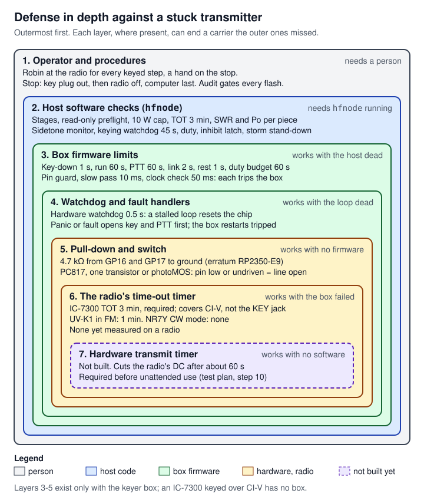
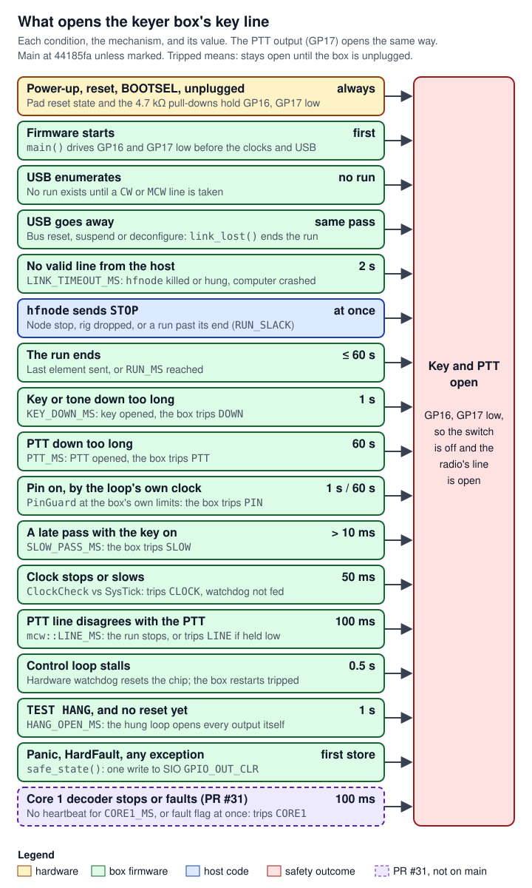

# 13 Safety rules (never loosen)

> This page is the canonical list of every safety limit and gate in `cw-message-gateway`: the keyer box's firmware limits, the wiring rules for the box, the host's checks of the box, the IC-7300's CI-V gates, the station's rules, the handheld rules and the process rules around the safety audit. Each rule is stated exactly as the code (or, for wiring and procedure, the repo docs and the audit) states it, with a permalink and the audit document it comes from, and each is marked **NEVER LOOSEN**. Other pages explain how each part works and link here for the numbers. Nothing on this page, and nothing in this handover, changes any rule: a rule changes only through the safety audit (the last section). All code links are to `main` at [`44185fa`](https://github.com/robinonsay/cw-message-gateway/tree/44185fa9a00369c379d9d8af40ca307e3867e860) unless a row says otherwise. Nothing here has yet transmitted on a real radio: the audit grades every hardware behaviour BENCH (to be measured) until Robin (the project owner) has run the bench steps.

This is a reference page, not a subsystem page, so it adapts the page shape the other handover pages use. "Interfaces and APIs" is the seven rule tables. "Algorithms and processing" is the order in which the rules meet one transmission. "Changing it" is "How a limit could ever change". The other headings keep their usual meaning.

**Terms used here** (the full list is [17 Glossary](17-glossary.md)):

| Term | Meaning here |
|---|---|
| CW, key, key-down | Morse code sent by switching a transmitter on and off. The **key line** is the radio's input for a Morse key: closing it ("key down") makes the radio transmit. |
| Carrier, stuck transmitter | The radio's output while it transmits. A **stuck** transmitter keeps transmitting after it should have stopped; it is the main hazard every rule here guards against (it can overheat the radio and interferes with other stations). |
| PTT, MCW | Push-to-talk: the line that makes an FM handheld transmit while it is held. **MCW** is Morse sent as an audio tone over an FM carrier: the PTT is held for the whole message. |
| Sidetone | The tone a radio plays in its own audio while its key is down. The node listens for it to confirm what the radio is doing. |
| Keyer box, Pico 2, GPIO | The keyer box is a Raspberry Pi Pico 2 (an RP2350 microcontroller) that closes a radio's key line on `hfnode`'s command. A **GPIO** is one of its pins; **GP16** is the key pin, **GP17** the PTT pin. |
| Pull-down, erratum E9 | A **pull-down** is a resistor from a pin to ground that holds it low when nothing drives it. RP2350 **erratum E9** says the chip's own internal pull-down can leave an undriven pin near 2 V, enough to key a radio, so the box needs an external one. |
| Optocoupler, photoMOS | Parts that let a pin close a switch with no electrical connection between the two sides. The box uses a **PC817** optocoupler; a **photoMOS** relay is the alternative for key lines the PC817 cannot take. |
| Watchdog, fault handler, panic | A hardware **watchdog** resets the chip unless the firmware "feeds" it in time, so a stalled program cannot hold an output. A **fault handler** runs when the processor hits an error; a **panic** is Rust's error stop. |
| Trip | The box's latched fault: once tripped it opens everything and keys nothing more until it is unplugged and plugged in again. |
| CI-V, preflight | ICOM's command protocol over the IC-7300's USB serial port ([07 CI-V and the IC-7300](07-civ-ic7300.md)). The **preflight** is the read-only check of the radio's settings before anything is written to it. |
| TOT | The radio's own time-out timer: it ends a transmission after a set time without any software. |
| SWR, Po | Standing-wave ratio (how well the antenna takes the power; high SWR means power comes back into the radio) and the radio's output-power meter. |
| Duty | The share of time the transmitter is on. A transmitter has a duty limit to keep it from overheating. |
| Inhibit, latch | The node's persistent stop: the file `tx-inhibited` in the state directory. Once written ("latched"), nothing is transmitted, across restarts, until a person removes it. |
| Stage, commissioned | The bring-up step that has passed on this radio. Commands that need a later stage are refused. |
| BENCH, GO WITH STEPS, NO-GO | The safety audit's grades: BENCH means not yet measured on hardware; GO WITH STEPS means allowed only with the named procedure; NO-GO means not allowed. |
| UF2, build id | The firmware file copied onto the Pico 2 in its **BOOTSEL** (USB bootloader) mode, and the commit id stamped into it, which the box reports in `HELLO`. |
| SWD | The chip's debug port. A debugger on it can rewrite any register. |
| Break-in | The radio switches itself to transmit when its key closes, and back to receive a set delay after the key opens. |
| Split, ∂TX | Settings that make the radio transmit on a frequency other than the one on its dial. |
| VOX | Voice-operated transmit: the radio transmits when it hears sound at its microphone input. |
| Paddle, Bug | Key modes in which the radio's own keyer reads two contacts; the plug's **ring** is then the dash contact. |
| Scope data output (`27 11`) | The IC-7300 streaming its spectrum display over CI-V, which the node cannot share the port with. |
| dBFS | A sound level relative to the sound card's full scale (0 dBFS is the loudest it can record). |
| QRL? | Morse for "is this frequency in use?", sent and listened for before transmitting. |
| NR7Y, K-plug | **NR7Y** is third-party firmware for the UV-K1 handheld that adds a CW mode. The **K-plug** is the handheld's two-pin headset plug (a 3.5 mm and a 2.5 mm plug side by side). |

Row IDs are stable: other pages cite them. Rows added after the first version take a letter suffix (1.11a) or the next free number, so no existing ID moves.

## Where it lives

The rules are spread over the code that enforces them, the repo docs that describe the wiring, and the safety audit's files.

| Where | What safety it holds | Lines |
|---|---|---|
| [`crates/keyer-core/src/lib.rs:42-115`](https://github.com/robinonsay/cw-message-gateway/blob/44185fa9a00369c379d9d8af40ca307e3867e860/crates/keyer-core/src/lib.rs#L42-L115) | The box's limits (`mod limits`) and the MCW timing (`mod mcw`): the numbers every other layer derives from | 42-115 |
| [`crates/keyer-core/src/keyer.rs:383-1000`](https://github.com/robinonsay/cw-message-gateway/blob/44185fa9a00369c379d9d8af40ca307e3867e860/crates/keyer-core/src/keyer.rs#L383-L1000) | The box's state machine: start refusals, limit events, trips, saved state | 383-1000 |
| [`crates/keyer-core/src/control.rs:1-449`](https://github.com/robinonsay/cw-message-gateway/blob/44185fa9a00369c379d9d8af40ca307e3867e860/crates/keyer-core/src/control.rs#L1-L449) | The firmware's loop, one pass at a time: pin guards, clock check, USB loss, watchdog feeding | 1-449 |
| [`firmware/pico2-keyer/src/main.rs:13-288`](https://github.com/robinonsay/cw-message-gateway/blob/44185fa9a00369c379d9d8af40ca307e3867e860/firmware/pico2-keyer/src/main.rs#L13-L288) | Pins low first, the watchdog, fault and panic handlers | 13-288 |
| [`crates/hfnode/src/keyer.rs:37-451`](https://github.com/robinonsay/cw-message-gateway/blob/44185fa9a00369c379d9d8af40ca307e3867e860/crates/hfnode/src/keyer.rs#L37-L451) | The host's checks of the box and of `[keyer]` settings: bands, maxima, stages, `HELLO` | 37-451 |
| [`crates/hfnode/src/keyer/rig.rs:1-990`](https://github.com/robinonsay/cw-message-gateway/blob/44185fa9a00369c379d9d8af40ca307e3867e860/crates/hfnode/src/keyer/rig.rs#L1-L990) | The host's keyer rig: keep-alive, run deadline, refusals before every run | 1-990 |
| [`crates/hfnode/src/keyer/monitor.rs:56-145`](https://github.com/robinonsay/cw-message-gateway/blob/44185fa9a00369c379d9d8af40ca307e3867e860/crates/hfnode/src/keyer/monitor.rs#L56-L145) | The sidetone and receive-noise thresholds the node judges the radio by | 56-145 |
| [`crates/hfnode/src/station.rs:143-2284`](https://github.com/robinonsay/cw-message-gateway/blob/44185fa9a00369c379d9d8af40ca307e3867e860/crates/hfnode/src/station.rs#L143-L2284) | The station: watchdog thread, forced receive, the inhibit latch, per-piece checks | 143-2284 |
| [`crates/hfnode/src/commissioning.rs:1-225`](https://github.com/robinonsay/cw-message-gateway/blob/44185fa9a00369c379d9d8af40ca307e3867e860/crates/hfnode/src/commissioning.rs#L1-L225) | IC-7300 bring-up stages, the 10 W cap, the `run` keying limits, preflight before write | 1-225 |
| [`crates/civ/src/ic7300.rs:22-33`](https://github.com/robinonsay/cw-message-gateway/blob/44185fa9a00369c379d9d8af40ca307e3867e860/crates/civ/src/ic7300.rs#L22-L33) | The CI-V driver's rules: two transmit frames, no forced transmit | 22-33, 342-437, 764-819 |
| [`crates/civ/src/preflight.rs:1-545`](https://github.com/robinonsay/cw-message-gateway/blob/44185fa9a00369c379d9d8af40ca307e3867e860/crates/civ/src/preflight.rs#L1-L545) | The read-only preflight | 1-545 |
| [`crates/civ/src/preflight.rs:370-426`](https://github.com/robinonsay/cw-message-gateway/blob/3c97427bcf59fcb8223af7a3676eeebdec529f52/crates/civ/src/preflight.rs#L370-L426) | Front-key and MIC Up/Down Keyer refusals (PR #27, open, not on main) | 370-426 |
| [`crates/hfnode/src/config.rs:910-960`](https://github.com/robinonsay/cw-message-gateway/blob/44185fa9a00369c379d9d8af40ca307e3867e860/crates/hfnode/src/config.rs#L910-L960) | Config ranges checked at load | 910-960 |
| [`crates/hfnode/src/storm.rs:1-26`](https://github.com/robinonsay/cw-message-gateway/blob/44185fa9a00369c379d9d8af40ca307e3867e860/crates/hfnode/src/storm.rs#L1-L26) | The storm stand-down | 1-26, 48-68, 343-352 |
| [`crates/hfnode/src/alert.rs:1-13`](https://github.com/robinonsay/cw-message-gateway/blob/44185fa9a00369c379d9d8af40ca307e3867e860/crates/hfnode/src/alert.rs#L1-L13) | The owner alert when the inhibit latches (5.18) | 1-13, 27-38 |
| [`crates/civ/src/lib.rs:58-186`](https://github.com/robinonsay/cw-message-gateway/blob/44185fa9a00369c379d9d8af40ca307e3867e860/crates/civ/src/lib.rs#L58-L186) | The `Rig` trait: what the node needs from any radio, and the defaults a new rig must answer ("Programming against it") | 58-186 |
| [`crates/civ/src/mock.rs:12-19`](https://github.com/robinonsay/cw-message-gateway/blob/44185fa9a00369c379d9d8af40ca307e3867e860/crates/civ/src/mock.rs#L12-L19) | The mock radio: anything the manual does not allow is answered NG and recorded as a violation, which the self-test fails on (4.25) | 12-19, 120-134, 950-958 |
| [`firmware/pico2-keyer/src/core1.rs:1-40`](https://github.com/robinonsay/cw-message-gateway/blob/bc5062ae4f56ae1f9949b3b067218c7e675d88f8/firmware/pico2-keyer/src/core1.rs#L1-L40) | Core 1's confinement and its heartbeat (PR #31, draft, not on main; 1.19-1.19e) | 1-40, 157-170, 266-332 |
| [`crates/hfnode/src/main.rs:436-524`](https://github.com/robinonsay/cw-message-gateway/blob/44185fa9a00369c379d9d8af40ca307e3867e860/crates/hfnode/src/main.rs#L436-L524) | The stop-signal handler and its latch | 436-524 |
| [`deploy/hfnode.service:13-36`](https://github.com/robinonsay/cw-message-gateway/blob/44185fa9a00369c379d9d8af40ca307e3867e860/deploy/hfnode.service#L13-L36) | Restart limits and the forced receive after every stop | 13-36 |
| [`.github/workflows/ci.yml:14-16`](https://github.com/robinonsay/cw-message-gateway/blob/44185fa9a00369c379d9d8af40ca307e3867e860/.github/workflows/ci.yml#L14-L16) | The 20x CI time scale | 14-16, 58-70, 172-196 |
| [docs/keyer.md](../keyer.md) | Wiring, bring-up, per-session settings and stop-by-hand order for the keyer box and the handhelds | whole page |
| [docs/hardware-test-plan.md](../hardware-test-plan.md) | The IC-7300 bring-up, its stop list and the hardware timer step | whole page |
| The safety audit (project files) | `audit/rubric.md`, `audit/report.md`, `audit/final-grades.md` and the rulings `audit/req-*.md`. Not in the repository; named here in plain text. | |

## How it works

Every rule here exists to end a carrier that should not be on. The rules are arranged in layers. Where a route has a layer, it can end a carrier that the layers outside it missed, and each layer depends on less than the one outside it: the person, the host software, the box's firmware, the box's watchdog and fault handlers, the wiring, and the radio's own timer. A seventh layer, a hardware transmit timer that needs no software at all, is required before unattended use and is not built yet. Not every route has every layer: layers 3 to 5 exist only with the keyer box (an IC-7300 keyed over CI-V has no box), and layer 6 does not exist on NR7Y's CW mode or for the IC-7300's KEY jack.



*Figure: the layers, outermost first. The tag on the right says what each layer needs (1-2) or what it still works without (3-7); the dashed innermost layer does not exist yet.*

The layers in words:

1. **The operator.** Robin is at the radio for every keyed step, with a hand on the stop. The audit gates every flash and every keyed test (group 7).
2. **The host software (`hfnode`).** Stages, the read-only preflight, power caps, the radio's settings re-checked before every transmission, SWR and output sampled through every piece, a 45 s keying watchdog, duty limits, the sidetone monitor, the persistent inhibit and the storm stand-down (groups 3, 4 and 5). It needs `hfnode` running.
3. **The box's firmware limits.** Key-down 1 s, run 60 s, PTT 60 s, link timeout 2 s, rest 1 s, duty budget 60 s, and the pin guard, slow-pass and clock checks (group 1). They hold with the host dead or the cable pulled.
4. **The box's watchdog and fault handlers.** A stalled loop resets the chip in 0.5 s; a panic or fault opens the key and the PTT in its first store (groups 1 and 2). They hold with the loop dead.
5. **The pull-down and the switch.** The 4.7 kΩ pull-downs and the optocoupler, transistor or photoMOS make "pin low or undriven" mean "key line open" (group 2). They hold with no firmware running.
6. **The radio's own time-out timer.** 3 min on the IC-7300 for CI-V transmissions, required by the preflight; 1 min on a UV-K1 in FM. Neither is measured on a radio yet; NR7Y's CW mode has none; and the IC-7300's does not cover its KEY jack (audit report §1, criterion B8; [docs/keyer.md](../keyer.md), "Setting up the radio"). Where it exists, it holds with the box failed.
7. **A hardware transmit timer** that ends any transmission after about 60 s with no software (test plan step 10). Not built. Required before unattended use ([docs/hardware-test-plan.md](../hardware-test-plan.md), "Step 10").

The box's key line is the one output that can key any radio, so its rules get a figure of their own. Each row is a condition that forces GP16 and GP17 low, which turns the switch off and leaves the radio's line open, with the mechanism and its value. The tables below give the code for each row, top to bottom: rules 2.1 and 2.3, 2.1, 1.11a, 1.11, 1.10, 3.5 and 3.6, 1.5, 1.1, 1.6, 1.2, 1.4, 1.13, 1.7, 1.12, 1.14, 2.2 and 1.19.



*Figure: what opens the key line. The amber row holds with no firmware, the blue row is the host, the green rows are the box's firmware, and the dashed row is in PR #31 only.*

## How it connects

The same number often appears in several layers. Where it does, the layers are not independent copies:

- **The box's limits live in one place**, `keyer_core::limits` ([`crates/keyer-core/src/lib.rs:44-101`](https://github.com/robinonsay/cw-message-gateway/blob/44185fa9a00369c379d9d8af40ca307e3867e860/crates/keyer-core/src/lib.rs#L44-L101)). The firmware keeps them ([`crates/keyer-core/src/keyer.rs:54-63`](https://github.com/robinonsay/cw-message-gateway/blob/44185fa9a00369c379d9d8af40ca307e3867e860/crates/keyer-core/src/keyer.rs#L54-L63)). The box reports them in `HELLO`, and the host refuses a box that reports anything looser ([`crates/hfnode/src/keyer.rs:376-439`](https://github.com/robinonsay/cw-message-gateway/blob/44185fa9a00369c379d9d8af40ca307e3867e860/crates/hfnode/src/keyer.rs#L376-L439)). The host's maxima are defined from the same constants ([`crates/hfnode/src/keyer.rs:95-116`](https://github.com/robinonsay/cw-message-gateway/blob/44185fa9a00369c379d9d8af40ca307e3867e860/crates/hfnode/src/keyer.rs#L95-L116)): `MAX_KEY_DOWN_LIMIT` is `keyer_core::limits::KEY_DOWN_MS`, and so on. So the host's check catches a box flashed from other code with looser values, but it does not guard the constant itself: a change to `limits` moves the box and the host's check together. The values are pinned by the test `hello_reports_the_limits_and_uptime`, which expects `OK HELLO 4 60 2000 1000 1000 60 60 ...` ([`crates/keyer-core/src/keyer/tests.rs:207-213`](https://github.com/robinonsay/cw-message-gateway/blob/44185fa9a00369c379d9d8af40ca307e3867e860/crates/keyer-core/src/keyer/tests.rs#L207-L213)), and by the audit, which rebuilds the firmware and publishes its hash (group 7).
- **The station's 45 s keying watchdog** is a config default ([`crates/hfnode/src/config.rs:746-748`](https://github.com/robinonsay/cw-message-gateway/blob/44185fa9a00369c379d9d8af40ca307e3867e860/crates/hfnode/src/config.rs#L746-L748)), pinned by the test `the_keying_watchdog_is_45_seconds_unless_set` ([`crates/hfnode/src/config.rs:1453-1468`](https://github.com/robinonsay/cw-message-gateway/blob/44185fa9a00369c379d9d8af40ca307e3867e860/crates/hfnode/src/config.rs#L1453-L1468)); `run` refuses more than 55 s ([`crates/hfnode/src/commissioning.rs:121-125`](https://github.com/robinonsay/cw-message-gateway/blob/44185fa9a00369c379d9d8af40ca307e3867e860/crates/hfnode/src/commissioning.rs#L121-L125)).
- **The CI-V gates** sit in two places: the preflight when a command opens the radio, and the station's re-check before every tune and every transmission ([`crates/hfnode/src/station.rs:1288-1296`](https://github.com/robinonsay/cw-message-gateway/blob/44185fa9a00369c379d9d8af40ca307e3867e860/crates/hfnode/src/station.rs#L1288-L1296)). The PR #27 front-key checks are in the preflight only (PR #27, open, not on main; the audit accepted reading them once at start, report §3).
- **The wiring rules** are not in code. The firmware relies on them ([`firmware/pico2-keyer/src/main.rs:15-18`](https://github.com/robinonsay/cw-message-gateway/blob/44185fa9a00369c379d9d8af40ca307e3867e860/firmware/pico2-keyer/src/main.rs#L15-L18)), and [docs/keyer.md](../keyer.md) and the audit state them.
- **The process rules** sit in the audit's files and in CI: the firmware build is reproducible and checked ([`.github/workflows/ci.yml:172-196`](https://github.com/robinonsay/cw-message-gateway/blob/44185fa9a00369c379d9d8af40ca307e3867e860/.github/workflows/ci.yml#L172-L196)), and the self-test runs at 20x real time ([`.github/workflows/ci.yml:58-70`](https://github.com/robinonsay/cw-message-gateway/blob/44185fa9a00369c379d9d8af40ca307e3867e860/.github/workflows/ci.yml#L58-L70)).

How each part works is on its own page: [05 Node loop and station safety](05-node-loop-station-safety.md), [07 CI-V and the IC-7300](07-civ-ic7300.md), [08 Keyer box: firmware](08-keyer-box-firmware.md), [09 Keyer box: host side](09-keyer-host-side.md), [10 UV-K1 handheld](10-uv-k1-handheld.md), [11 Decoder box and the one-Pico image](11-decoder-box-one-pico.md), [12 Testing](12-testing.md) and [14 Audit, bench and flashing](14-audit-bench-flashing.md).

## Interfaces and APIs: the rules

How to read the tables:

- **#** is this page's ID for the rule, for reference from other pages and reviews.
- **Value** is quoted exactly as the code states it, with the constant's name.
- **Code** links the line that defines or enforces it; a doc link means the rule is wiring or procedure that no code can enforce.
- **Audit source** names the audit file and section that requires or grades it. These files are project files, outside the repository; "report" is `audit/report.md`, "grades" is `audit/final-grades.md`, "KB-n" is a finding in `audit/req-keyer-box-fixes.md`, "Kn" (K1 to K16) in `audit/req-ic7300-fixes.md`, and "KB rules" and "K rules" are the "Rules for the fixes" sections of those two files; "Cn" (C1 to C11) and "R1" are in `audit/req-handheld-generic-route-constraints.md`; "rubric" is `audit/rubric.md`.
- **Mark**: every row is **NEVER LOOSEN**. Do not raise a limit, widen a timeout, weaken a check from fail to warn, remove a refusal, or skip a step.

The audit's standing orders behind every table: "Loosen no existing limit. That covers key-down 1 s, run 60 s, link 2 s and watchdog 0.5 s, the stage gates and the inhibit" (`audit/req-keyer-box-fixes.md`, "Rules for the fixes"); "Loosen no existing gate: stages, the 10 W cap before keying, preflight, tx-inhibited, the 45 s watchdog, 30-character pieces and the TOT requirement for run" (`audit/req-ic7300-fixes.md`, "Rules for the fixes"); and "The run limit, the link timeout and the watchdog must not be loosened" (C3).

### Group 1: the keyer box's firmware limits

These run on the box ([08 Keyer box: firmware](08-keyer-box-firmware.md)) and hold with the host dead.

| # | Rule | Value | Code | Audit source | Mark |
|---|---|---|---|---|---|
| 1.1 | Key-down limit: the key or the tone on this long at once opens the key and trips the box (`DOWN`) until it is power-cycled | 1 s (`KEY_DOWN_MS: u32 = 1_000`) | [`crates/keyer-core/src/lib.rs:45-48`](https://github.com/robinonsay/cw-message-gateway/blob/44185fa9a00369c379d9d8af40ca307e3867e860/crates/keyer-core/src/lib.rs#L45-L48), [`crates/keyer-core/src/keyer.rs:543-548`](https://github.com/robinonsay/cw-message-gateway/blob/44185fa9a00369c379d9d8af40ca307e3867e860/crates/keyer-core/src/keyer.rs#L543-L548), [`crates/keyer-core/src/keyer.rs:574`](https://github.com/robinonsay/cw-message-gateway/blob/44185fa9a00369c379d9d8af40ca307e3867e860/crates/keyer-core/src/keyer.rs#L574) | KB rules; report §1 B2 | **NEVER LOOSEN** |
| 1.2 | Pin guard: the loop times the key and tone pins, and the PTT pin, by its own clock readings, whatever the keyer's timeline says, and trips the box (`PIN`) at the limit. Its limits are never longer than the box's own. | the lower of the keyer's limit and 1 s (`KEY_DOWN_MS`) for key and tone; and 60 s (`PTT_MS`) for the PTT | [`crates/keyer-core/src/control.rs:200-210`](https://github.com/robinonsay/cw-message-gateway/blob/44185fa9a00369c379d9d8af40ca307e3867e860/crates/keyer-core/src/control.rs#L200-L210), [`crates/keyer-core/src/control.rs:336-339`](https://github.com/robinonsay/cw-message-gateway/blob/44185fa9a00369c379d9d8af40ca307e3867e860/crates/keyer-core/src/control.rs#L336-L339) | KB-6 | **NEVER LOOSEN** |
| 1.3 | Minimum gap: a key-up shorter than one dot at 50 wpm does not count as the key opening; the key-down limit goes on timing across it | 24 ms (`MIN_GAP_MS: u32 = 1200 / crate::MAX_WPM`, `MAX_WPM = 50`) | [`crates/keyer-core/src/lib.rs:67-69`](https://github.com/robinonsay/cw-message-gateway/blob/44185fa9a00369c379d9d8af40ca307e3867e860/crates/keyer-core/src/lib.rs#L67-L69), [`crates/keyer-core/src/keyer.rs:642-655`](https://github.com/robinonsay/cw-message-gateway/blob/44185fa9a00369c379d9d8af40ca307e3867e860/crates/keyer-core/src/keyer.rs#L642-L655) | KB-1 | **NEVER LOOSEN** |
| 1.4 | Slow pass: a pass of the loop that comes more than 10 ms after the last, with the key or the tone on (the key guard's slow check), trips the box (`SLOW`) | more than 10 ms (`SLOW_PASS_MS`; the test is `now - last > SLOW_PASS_MS`) | [`crates/keyer-core/src/lib.rs:81-84`](https://github.com/robinonsay/cw-message-gateway/blob/44185fa9a00369c379d9d8af40ca307e3867e860/crates/keyer-core/src/lib.rs#L81-L84), [`crates/keyer-core/src/control.rs:202-208`](https://github.com/robinonsay/cw-message-gateway/blob/44185fa9a00369c379d9d8af40ca307e3867e860/crates/keyer-core/src/control.rs#L202-L208) | KB-6 | **NEVER LOOSEN** |
| 1.5 | Run limit: `CW` text whose Morse is longer is refused (`ERR CW LIMIT`); a run that reaches it is stopped | 60 s (`RUN_MS: u32 = 60_000`) | [`crates/keyer-core/src/lib.rs:49-51`](https://github.com/robinonsay/cw-message-gateway/blob/44185fa9a00369c379d9d8af40ca307e3867e860/crates/keyer-core/src/lib.rs#L49-L51), [`crates/keyer-core/src/keyer.rs:915-917`](https://github.com/robinonsay/cw-message-gateway/blob/44185fa9a00369c379d9d8af40ca307e3867e860/crates/keyer-core/src/keyer.rs#L915-L917), [`crates/keyer-core/src/keyer.rs:560`](https://github.com/robinonsay/cw-message-gateway/blob/44185fa9a00369c379d9d8af40ca307e3867e860/crates/keyer-core/src/keyer.rs#L560), [`crates/keyer-core/src/keyer.rs:577-590`](https://github.com/robinonsay/cw-message-gateway/blob/44185fa9a00369c379d9d8af40ca307e3867e860/crates/keyer-core/src/keyer.rs#L577-L590) | KB rules | **NEVER LOOSEN** |
| 1.6 | PTT limit, no longer than the run limit: `MCW` is refused unless lead + Morse + tail is under both limits; the PTT down this long trips the box (`PTT`) | 60 s (`PTT_MS: u32 = 60_000`); lead 500 ms (`mcw::LEAD_MS`), tail 200 ms (`mcw::TAIL_MS`) | [`crates/keyer-core/src/lib.rs:52-57`](https://github.com/robinonsay/cw-message-gateway/blob/44185fa9a00369c379d9d8af40ca307e3867e860/crates/keyer-core/src/lib.rs#L52-L57), [`crates/keyer-core/src/lib.rs:105-109`](https://github.com/robinonsay/cw-message-gateway/blob/44185fa9a00369c379d9d8af40ca307e3867e860/crates/keyer-core/src/lib.rs#L105-L109), [`crates/keyer-core/src/keyer.rs:906-913`](https://github.com/robinonsay/cw-message-gateway/blob/44185fa9a00369c379d9d8af40ca307e3867e860/crates/keyer-core/src/keyer.rs#L906-L913), [`crates/keyer-core/src/keyer.rs:575`](https://github.com/robinonsay/cw-message-gateway/blob/44185fa9a00369c379d9d8af40ca307e3867e860/crates/keyer-core/src/keyer.rs#L575) | C3 | **NEVER LOOSEN** |
| 1.7 | PTT line check: after each PTT move the sensed line must follow. PTT down and the line still high stops the run (`LINE`); PTT up and the line still low trips the box (`LINE`). `MCW` is refused while the line is low or a move is unchecked. | 100 ms (`mcw::LINE_MS`) | [`crates/keyer-core/src/lib.rs:110-114`](https://github.com/robinonsay/cw-message-gateway/blob/44185fa9a00369c379d9d8af40ca307e3867e860/crates/keyer-core/src/lib.rs#L110-L114), [`crates/keyer-core/src/keyer.rs:591-603`](https://github.com/robinonsay/cw-message-gateway/blob/44185fa9a00369c379d9d8af40ca307e3867e860/crates/keyer-core/src/keyer.rs#L591-L603), [`crates/keyer-core/src/keyer.rs:924-928`](https://github.com/robinonsay/cw-message-gateway/blob/44185fa9a00369c379d9d8af40ca307e3867e860/crates/keyer-core/src/keyer.rs#L924-L928) | C3 ("the same fail-safes as the key line") | **NEVER LOOSEN** |
| 1.8 | Rest: after any run ends, however it ends, the box refuses another (`ERR CW REST`) for this long | 1 s (`REST_MS: u32 = 1_000`) | [`crates/keyer-core/src/lib.rs:63-66`](https://github.com/robinonsay/cw-message-gateway/blob/44185fa9a00369c379d9d8af40ca307e3867e860/crates/keyer-core/src/lib.rs#L63-L66), [`crates/keyer-core/src/keyer.rs:929-931`](https://github.com/robinonsay/cw-message-gateway/blob/44185fa9a00369c379d9d8af40ca307e3867e860/crates/keyer-core/src/keyer.rs#L929-L931) | KB-1 | **NEVER LOOSEN** |
| 1.9 | Duty budget: each ms keyed (key down, or PTT down) spends one, each ms not keyed earns one back, up to the budget. A run is refused (`DUTY`) while the budget holds less than its key-down time (`CW`) or its whole PTT time (`MCW`). That keeps the transmitter keyed at most 55% of any 10 minutes and 50% in the long run. The budget starts full only after a power-up. | 60 s (`DUTY_BUDGET_MS: u32 = 60_000`) | [`crates/keyer-core/src/lib.rs:70-78`](https://github.com/robinonsay/cw-message-gateway/blob/44185fa9a00369c379d9d8af40ca307e3867e860/crates/keyer-core/src/lib.rs#L70-L78), [`crates/keyer-core/src/keyer.rs:398-401`](https://github.com/robinonsay/cw-message-gateway/blob/44185fa9a00369c379d9d8af40ca307e3867e860/crates/keyer-core/src/keyer.rs#L398-L401), [`crates/keyer-core/src/keyer.rs:932-934`](https://github.com/robinonsay/cw-message-gateway/blob/44185fa9a00369c379d9d8af40ca307e3867e860/crates/keyer-core/src/keyer.rs#L932-L934) | KB-1, KB-4 | **NEVER LOOSEN** |
| 1.10 | Link timeout: a run stops when no valid line has arrived for this long (the computer crashed, `hfnode` was killed, the cable came out) | 2 s (`LINK_TIMEOUT_MS: u32 = 2_000`) | [`crates/keyer-core/src/lib.rs:58-60`](https://github.com/robinonsay/cw-message-gateway/blob/44185fa9a00369c379d9d8af40ca307e3867e860/crates/keyer-core/src/lib.rs#L58-L60), [`crates/keyer-core/src/keyer.rs:555-559`](https://github.com/robinonsay/cw-message-gateway/blob/44185fa9a00369c379d9d8af40ca307e3867e860/crates/keyer-core/src/keyer.rs#L555-L559), [`crates/keyer-core/src/keyer.rs:576`](https://github.com/robinonsay/cw-message-gateway/blob/44185fa9a00369c379d9d8af40ca307e3867e860/crates/keyer-core/src/keyer.rs#L576) | KB rules; report §1 B3 | **NEVER LOOSEN** |
| 1.11 | USB gone: a bus reset, suspend (also how a pulled cable looks) or deconfigure ends any run on the same pass. DTR and RTS are never read. | same pass | [`crates/keyer-core/src/control.rs:379-386`](https://github.com/robinonsay/cw-message-gateway/blob/44185fa9a00369c379d9d8af40ca307e3867e860/crates/keyer-core/src/control.rs#L379-L386), [`crates/keyer-core/src/keyer.rs:750-758`](https://github.com/robinonsay/cw-message-gateway/blob/44185fa9a00369c379d9d8af40ca307e3867e860/crates/keyer-core/src/keyer.rs#L750-L758), [`firmware/pico2-keyer/src/main.rs:22-23`](https://github.com/robinonsay/cw-message-gateway/blob/44185fa9a00369c379d9d8af40ca307e3867e860/firmware/pico2-keyer/src/main.rs#L22-L23) | report §1 B3, B7 | **NEVER LOOSEN** |
| 1.11a | USB enumeration: the key and PTT pins are already driven low before USB starts (2.1); the USB pull-up is held off for about 10 ms so the computer sees a fresh attach, before the watchdog starts; the box starts with no run, and none exists until a `CW` or `MCW` line is taken; the link-epoch change seen while first connecting is handled as a link loss (1.11), which ends nothing | no run at start (`run: None`) | [`firmware/pico2-keyer/src/main.rs:177-182`](https://github.com/robinonsay/cw-message-gateway/blob/44185fa9a00369c379d9d8af40ca307e3867e860/firmware/pico2-keyer/src/main.rs#L177-L182), [`firmware/pico2-keyer/src/main.rs:202-204`](https://github.com/robinonsay/cw-message-gateway/blob/44185fa9a00369c379d9d8af40ca307e3867e860/firmware/pico2-keyer/src/main.rs#L202-L204), [`crates/keyer-core/src/keyer.rs:383-388`](https://github.com/robinonsay/cw-message-gateway/blob/44185fa9a00369c379d9d8af40ca307e3867e860/crates/keyer-core/src/keyer.rs#L383-L388), [`crates/keyer-core/src/control.rs:379-386`](https://github.com/robinonsay/cw-message-gateway/blob/44185fa9a00369c379d9d8af40ca307e3867e860/crates/keyer-core/src/control.rs#L379-L386) ("Also seen once while first connecting") | report §1 B1, B3 | **NEVER LOOSEN** |
| 1.12 | Hardware watchdog, fed once at the end of each pass and only then: a stalled loop resets the chip, and the reset puts the pads back in their reset state | 0.5 s (`WATCHDOG_MS: u32 = 500`) | [`crates/keyer-core/src/lib.rs:61-62`](https://github.com/robinonsay/cw-message-gateway/blob/44185fa9a00369c379d9d8af40ca307e3867e860/crates/keyer-core/src/lib.rs#L61-L62), [`firmware/pico2-keyer/src/main.rs:216`](https://github.com/robinonsay/cw-message-gateway/blob/44185fa9a00369c379d9d8af40ca307e3867e860/firmware/pico2-keyer/src/main.rs#L216), [`crates/keyer-core/src/control.rs:432-434`](https://github.com/robinonsay/cw-message-gateway/blob/44185fa9a00369c379d9d8af40ca307e3867e860/crates/keyer-core/src/control.rs#L432-L434) | KB rules; report §1 B4 | **NEVER LOOSEN** |
| 1.13 | Clock check: the loop's clock (TIMER0) against the processor's own count (SysTick). The clock must have run at least half as long as the processor, and the processor at least a quarter as long as the clock, or the box trips (`CLOCK`), opens every output and stops feeding its watchdog. | checked every 50 ms (`CLOCK_CHECK_MS`); rule `clock * 2 < cpu \|\| cpu * 4 < clock` trips | [`crates/keyer-core/src/lib.rs:89-94`](https://github.com/robinonsay/cw-message-gateway/blob/44185fa9a00369c379d9d8af40ca307e3867e860/crates/keyer-core/src/lib.rs#L89-L94), [`crates/keyer-core/src/control.rs:135`](https://github.com/robinonsay/cw-message-gateway/blob/44185fa9a00369c379d9d8af40ca307e3867e860/crates/keyer-core/src/control.rs#L135), [`crates/keyer-core/src/control.rs:408-412`](https://github.com/robinonsay/cw-message-gateway/blob/44185fa9a00369c379d9d8af40ca307e3867e860/crates/keyer-core/src/control.rs#L408-L412) | KB-5 | **NEVER LOOSEN** |
| 1.14 | Hang open: after `TEST HANG` stops the loop, if the watchdog has not reset the chip by then, the loop opens the key and the PTT and stops the tone itself; it does so sooner, as soon as the key or tone has been on for the key-down limit or the PTT down for the PTT limit | 1 s (`HANG_OPEN_MS: u32 = WATCHDOG_MS + 500`) | [`crates/keyer-core/src/lib.rs:85-88`](https://github.com/robinonsay/cw-message-gateway/blob/44185fa9a00369c379d9d8af40ca307e3867e860/crates/keyer-core/src/lib.rs#L85-L88), [`crates/keyer-core/src/control.rs:439-449`](https://github.com/robinonsay/cw-message-gateway/blob/44185fa9a00369c379d9d8af40ca307e3867e860/crates/keyer-core/src/control.rs#L439-L449) | KB-3 | **NEVER LOOSEN** |
| 1.15 | A watchdog restart comes up tripped (`WATCHDOG`), and any start but a power-up starts with an empty duty budget | `Boot::Watchdog` gives `Trip::Watchdog`; budget full only for `Boot::Power` (power-on, RUN pin or debugger reset) | [`crates/keyer-core/src/keyer.rs:398-409`](https://github.com/robinonsay/cw-message-gateway/blob/44185fa9a00369c379d9d8af40ca307e3867e860/crates/keyer-core/src/keyer.rs#L398-L409), [`firmware/pico2-keyer/src/main.rs:205-215`](https://github.com/robinonsay/cw-message-gateway/blob/44185fa9a00369c379d9d8af40ca307e3867e860/firmware/pico2-keyer/src/main.rs#L205-L215) | KB-7 | **NEVER LOOSEN** |
| 1.16 | Saved state: every pass saves the trip, whether the transmitter is keyed, and the duty budget in the watchdog's scratch registers, which a watchdog reset keeps. After such a restart a saved trip stays, the budget is the lower of the new and the saved one, less the restart charge if the key was down, and the box rests before its first run. | restart charge 1 s (`RESTART_CHARGE_MS: u32 = HANG_OPEN_MS`) | [`crates/keyer-core/src/lib.rs:95-100`](https://github.com/robinonsay/cw-message-gateway/blob/44185fa9a00369c379d9d8af40ca307e3867e860/crates/keyer-core/src/lib.rs#L95-L100), [`crates/keyer-core/src/keyer.rs:415-435`](https://github.com/robinonsay/cw-message-gateway/blob/44185fa9a00369c379d9d8af40ca307e3867e860/crates/keyer-core/src/keyer.rs#L415-L435), [`crates/keyer-core/src/control.rs:424`](https://github.com/robinonsay/cw-message-gateway/blob/44185fa9a00369c379d9d8af40ca307e3867e860/crates/keyer-core/src/control.rs#L424) | KB-7 | **NEVER LOOSEN** |
| 1.17 | Test commands: `TEST HANG`, `TEST STUCK` and `TEST HOLD` are taken only once, within 2 s of `TEST ARM`; `TEST HANG` and `TEST STUCK` only during a run, `TEST HOLD` only during an `MCW` run; otherwise `ERR TEST ARM` or `ERR TEST RUN` | 2 s (`ARM_MS`) | [`crates/keyer-core/src/lib.rs:79-80`](https://github.com/robinonsay/cw-message-gateway/blob/44185fa9a00369c379d9d8af40ca307e3867e860/crates/keyer-core/src/lib.rs#L79-L80), [`crates/keyer-core/src/keyer.rs:828-844`](https://github.com/robinonsay/cw-message-gateway/blob/44185fa9a00369c379d9d8af40ca307e3867e860/crates/keyer-core/src/keyer.rs#L828-L844) | KB-3 | **NEVER LOOSEN** |
| 1.18 | Line and text limits: lines of printable ASCII with an id and an XOR checksum; a line longer than 96 bytes or failing its checksum is ignored, with no reply and nothing done; at most 30 characters a run; 5-50 wpm | `MAX_LINE = 96`, `MAX_TEXT = 30`, `MIN_WPM = 5`, `MAX_WPM = 50` | [`crates/keyer-core/src/frame.rs:11-12`](https://github.com/robinonsay/cw-message-gateway/blob/44185fa9a00369c379d9d8af40ca307e3867e860/crates/keyer-core/src/frame.rs#L11-L12), [`crates/keyer-core/src/lib.rs:31-40`](https://github.com/robinonsay/cw-message-gateway/blob/44185fa9a00369c379d9d8af40ca307e3867e860/crates/keyer-core/src/lib.rs#L31-L40), [`crates/keyer-core/src/frame.rs:105-109`](https://github.com/robinonsay/cw-message-gateway/blob/44185fa9a00369c379d9d8af40ca307e3867e860/crates/keyer-core/src/frame.rs#L105-L109), [`crates/keyer-core/src/keyer.rs:891-897`](https://github.com/robinonsay/cw-message-gateway/blob/44185fa9a00369c379d9d8af40ca307e3867e860/crates/keyer-core/src/keyer.rs#L891-L897) | report §1 B7 ("lines are checksummed") | **NEVER LOOSEN** |
| 1.19 | Core 1 heartbeat (PR #31, draft, not on main): the decoder on the second core must move its heartbeat this often, or the box trips (`CORE1`), opens every output and stops feeding its watchdog | 100 ms (`CORE1_MS: u32 = 100`) | [`crates/keyer-core/src/lib.rs:104-110`](https://github.com/robinonsay/cw-message-gateway/blob/bc5062ae4f56ae1f9949b3b067218c7e675d88f8/crates/keyer-core/src/lib.rs#L104-L110), [`crates/keyer-core/src/keyer.rs:194-197`](https://github.com/robinonsay/cw-message-gateway/blob/bc5062ae4f56ae1f9949b3b067218c7e675d88f8/crates/keyer-core/src/keyer.rs#L194-L197) | report §3, "One-Pico keyer image PR #31, checked 2026-10-11 13:55Z at 8d5fcf6", Sound bullet ("no limit changed (only CORE1_MS = 100 added)"); re-checked at `bc5062a`, "cleared to flash, GO WITH STEPS" (report §3, "PR #31 re-checked") | **NEVER LOOSEN** |
| 1.19a | Core 1 confined (PR #31, draft, not on main): before anything else core 1 turns on its memory protection unit with seven regions (its flash, its stack, the shared link, the audio ring, the ADC's registers, and read-only DMA channel 0 and the timer), leaves only the FPU on (the RP2350's GPIO coprocessor, which can set pins with no store, off), then drops to unprivileged mode. Every other address faults on core 1, the SIO, pads, PWM, USB, watchdog and core 0's memory among them, so core 1 never drives GP16-GP18. | 7 regions; `CPACR` = CP10 and CP11 only; `CONTROL.nPRIV` = 1 | [`firmware/pico2-keyer/src/core1.rs:16-27`](https://github.com/robinonsay/cw-message-gateway/blob/bc5062ae4f56ae1f9949b3b067218c7e675d88f8/firmware/pico2-keyer/src/core1.rs#L16-L27), [`firmware/pico2-keyer/src/core1.rs:157-170`](https://github.com/robinonsay/cw-message-gateway/blob/bc5062ae4f56ae1f9949b3b067218c7e675d88f8/firmware/pico2-keyer/src/core1.rs#L157-L170), [`firmware/pico2-keyer/src/core1.rs:266-287`](https://github.com/robinonsay/cw-message-gateway/blob/bc5062ae4f56ae1f9949b3b067218c7e675d88f8/firmware/pico2-keyer/src/core1.rs#L266-L287), [`firmware/pico2-keyer/src/core1.rs:301-308`](https://github.com/robinonsay/cw-message-gateway/blob/bc5062ae4f56ae1f9949b3b067218c7e675d88f8/firmware/pico2-keyer/src/core1.rs#L301-L308), [`firmware/pico2-keyer/src/core1.rs:320-332`](https://github.com/robinonsay/cw-message-gateway/blob/bc5062ae4f56ae1f9949b3b067218c7e675d88f8/firmware/pico2-keyer/src/core1.rs#L320-L332) | report §3, PR #31 entries ("MPU with 7 regions", "CPACR = 0xf00000 (CP0 off)") | **NEVER LOOSEN** |
| 1.19b | Core 0's stack bounded (PR #31): `MSPLIM` is set to the end of the statics right after the pins are driven low, so an overflow faults instead of overwriting them (rustos sets core 1's) | `MSPLIM` = end of `.bss`, rounded up to 8 bytes | [`firmware/pico2-keyer/src/main.rs:42-43`](https://github.com/robinonsay/cw-message-gateway/blob/bc5062ae4f56ae1f9949b3b067218c7e675d88f8/firmware/pico2-keyer/src/main.rs#L42-L43), [`firmware/pico2-keyer/src/main.rs:247`](https://github.com/robinonsay/cw-message-gateway/blob/bc5062ae4f56ae1f9949b3b067218c7e675d88f8/firmware/pico2-keyer/src/main.rs#L247), [`firmware/pico2-keyer/src/main.rs:357-371`](https://github.com/robinonsay/cw-message-gateway/blob/bc5062ae4f56ae1f9949b3b067218c7e675d88f8/firmware/pico2-keyer/src/main.rs#L357-L371), [`firmware/pico2-keyer/src/core1.rs:28-29`](https://github.com/robinonsay/cw-message-gateway/blob/bc5062ae4f56ae1f9949b3b067218c7e675d88f8/firmware/pico2-keyer/src/core1.rs#L28-L29) | report §3, PR #31 entries ("a core 0 stack overflow locks up at MSPLIM") | **NEVER LOOSEN** |
| 1.19c | Core 1 started last (PR #31): after the pins, clocks, USB and the watchdog; if the ADC does not start, the DMA channel's security level does not read back, or core 1 does not answer its launch, the box runs without a decoder and `RX` lines get `ERR RX OFF`. The design note adds that core 1 is started only after a chip or watchdog reset (`design/spec-pico-decoder.md` §7, project files). | launch wait 10 ms (`CORE1_LAUNCH_US`) | [`firmware/pico2-keyer/src/main.rs:285-311`](https://github.com/robinonsay/cw-message-gateway/blob/bc5062ae4f56ae1f9949b3b067218c7e675d88f8/firmware/pico2-keyer/src/main.rs#L285-L311), [`firmware/pico2-keyer/src/main.rs:98-100`](https://github.com/robinonsay/cw-message-gateway/blob/bc5062ae4f56ae1f9949b3b067218c7e675d88f8/firmware/pico2-keyer/src/main.rs#L98-L100), [`crates/keyer-core/src/control.rs:53-55`](https://github.com/robinonsay/cw-message-gateway/blob/bc5062ae4f56ae1f9949b3b067218c7e675d88f8/crates/keyer-core/src/control.rs#L53-L55) | report §3, PR #31 entries ("core 1 launched last after the watchdog") | **NEVER LOOSEN** |
| 1.19d | DMA channel 0 made Secure Unprivileged and locked (PR #31): core 0 writes `SECCFG_CH0` = S, then S and LOCK, and reads it back; anything but `0b110` means no decoder and core 1 is not started | `SECCFG_CH0` must read `0b110` | [`firmware/pico2-keyer/src/core1.rs:88-102`](https://github.com/robinonsay/cw-message-gateway/blob/bc5062ae4f56ae1f9949b3b067218c7e675d88f8/firmware/pico2-keyer/src/core1.rs#L88-L102), [`firmware/pico2-keyer/src/core1.rs:128-136`](https://github.com/robinonsay/cw-message-gateway/blob/bc5062ae4f56ae1f9949b3b067218c7e675d88f8/firmware/pico2-keyer/src/core1.rs#L128-L136) | report §3, "PR #31 re-checked" (item A fixed) | **NEVER LOOSEN** |
| 1.19e | Core 1 tests and checks (PR #31): `TEST CORE1 HANG` and `TEST CORE1 FAULT` are taken only during a run and within 2 s of `TEST ARM`, as in 1.17; `hfnode keyer core1test` (and `--fault`) is keyer bring-up step 11; CI runs `check_core1.py` and its self-test on the built image. `mutants_core1.py` is run by hand ("CI does not run it"). The host takes protocol 4 or 5 (3.2). | `VERSION = 5` | [`crates/keyer-core/src/lib.rs:25-29`](https://github.com/robinonsay/cw-message-gateway/blob/bc5062ae4f56ae1f9949b3b067218c7e675d88f8/crates/keyer-core/src/lib.rs#L25-L29), [`crates/keyer-core/src/keyer.rs:886-901`](https://github.com/robinonsay/cw-message-gateway/blob/bc5062ae4f56ae1f9949b3b067218c7e675d88f8/crates/keyer-core/src/keyer.rs#L886-L901), [`crates/hfnode/src/main.rs:322-332`](https://github.com/robinonsay/cw-message-gateway/blob/bc5062ae4f56ae1f9949b3b067218c7e675d88f8/crates/hfnode/src/main.rs#L322-L332), [`.github/workflows/ci.yml:196-204`](https://github.com/robinonsay/cw-message-gateway/blob/bc5062ae4f56ae1f9949b3b067218c7e675d88f8/.github/workflows/ci.yml#L196-L204), [`firmware/pico2-keyer/mutants_core1.py:1-19`](https://github.com/robinonsay/cw-message-gateway/blob/bc5062ae4f56ae1f9949b3b067218c7e675d88f8/firmware/pico2-keyer/mutants_core1.py#L1-L19) | report §3, PR #31 entries ("TEST CORE1 needs ARM and a run"; "mutants_core1 rejected 8 of 8") | **NEVER LOOSEN** |

### Group 2: the box's hardware rules

These are the box's pin, wiring and handling rules. Rows 2.1 and 2.2 are in the firmware (2.2 is also checked in CI); no code can check the rest, so they are stated in [docs/keyer.md](../keyer.md) and the audit, and the firmware relies on them. The audit's floor is two parts: one switch and the 4.7 kΩ pull-down, and neither is ever optional (`audit/req-handheld-nr7y-cw-ruling.md` §2, "Smallest safe parts set").

| # | Rule | Value | Code or doc | Audit source | Mark |
|---|---|---|---|---|---|
| 2.1 | Key and PTT pins driven low first, before the clocks and USB. Until then, and while the chip resets, the pads' reset state and the pull-downs hold them low. | GP16 (Pico 2 pin 21) key, GP17 (pin 22) PTT | [`firmware/pico2-keyer/src/main.rs:65-69`](https://github.com/robinonsay/cw-message-gateway/blob/44185fa9a00369c379d9d8af40ca307e3867e860/firmware/pico2-keyer/src/main.rs#L65-L69), [`firmware/pico2-keyer/src/main.rs:177-182`](https://github.com/robinonsay/cw-message-gateway/blob/44185fa9a00369c379d9d8af40ca307e3867e860/firmware/pico2-keyer/src/main.rs#L177-L182) | report §1 B1 | **NEVER LOOSEN** |
| 2.2 | Fault and panic handlers open the key and the PTT first: one store to the SIO `GPIO_OUT_CLR` register, before turning off the PWM tone and holding the tone pin low. CI checks this in the built machine code. | address `0xd000_0020`, bits 16 and 17 | [`firmware/pico2-keyer/src/main.rs:60`](https://github.com/robinonsay/cw-message-gateway/blob/44185fa9a00369c379d9d8af40ca307e3867e860/firmware/pico2-keyer/src/main.rs#L60), [`firmware/pico2-keyer/src/main.rs:236-261`](https://github.com/robinonsay/cw-message-gateway/blob/44185fa9a00369c379d9d8af40ca307e3867e860/firmware/pico2-keyer/src/main.rs#L236-L261), [`firmware/pico2-keyer/src/main.rs:279-288`](https://github.com/robinonsay/cw-message-gateway/blob/44185fa9a00369c379d9d8af40ca307e3867e860/firmware/pico2-keyer/src/main.rs#L279-L288), [`.github/workflows/ci.yml:182-186`](https://github.com/robinonsay/cw-message-gateway/blob/44185fa9a00369c379d9d8af40ca307e3867e860/.github/workflows/ci.yml#L182-L186) | KB-9 | **NEVER LOOSEN** |
| 2.3 | A pull-down from GP16 to ground, and from GP17 to ground, is required (erratum RP2350-E9). Raspberry Pi's own fix is 8.2 kΩ or less; with a transistor switch it goes on the pin's side, never from the base, and with a 4.7 kΩ and a 10 kΩ on hand the 4.7 kΩ is the pull-down, never the 10 kΩ | 4.7 kΩ | [docs/keyer.md](../keyer.md), "Wiring the box" and "A one-transistor key"; [`firmware/pico2-keyer/src/main.rs:15-18`](https://github.com/robinonsay/cw-message-gateway/blob/44185fa9a00369c379d9d8af40ca307e3867e860/firmware/pico2-keyer/src/main.rs#L15-L18) | grades, "Your steps: the keyer box" step 1; `audit/req-handheld-nr7y-cw-ruling.md` §2 | **NEVER LOOSEN** |
| 2.4 | A switch always sits between the pin and the radio, so that pin low or undriven means line open: the PC817 with 470 Ω, one transistor (a logic-level N-channel MOSFET, or an NPN with a 4.7-10 kΩ base resistor), or a photoMOS (AQY212GH or AQY211EH). A Pico 2 pin wired straight to the key contact is NO-GO (graded for the UV-K1: the box's safe state is its pin low, and that radio transmits when the contact is pulled low, so a direct wire would key it in every safe state). Any other part goes to the audit first. Floor: one switch plus the 4.7 kΩ pull-down (2.3); the audit says neither is ever optional. | one of the three named switches | [docs/keyer.md](../keyer.md), "Wiring for NR7Y CW" and "Bring-up" | `audit/req-handheld-nr7y-cw-ruling.md` §1, §2 | **NEVER LOOSEN** |
| 2.5 | Stage zero, before the box meets a radio: measure the radio's key or PTT line with a meter and no computer. The PC817 circuit only on a positive line of 17 V or less that carries 1 mA or less; otherwise a photoMOS. A transistor switch only on a line of +2.5 V to +5 V open that carries under 1 mA through 1 kΩ: a negative reading means stop (a MOSFET's body diode would conduct and key the radio), and over 5 V means stop and use the PC817. A MOSFET gets the ruling's static test on the bare part before it is soldered to GP16. | ≤ 17 V, ≤ 1 mA, positive (PC817); +2.5 V to +5 V, < 1 mA (transistor) | [docs/keyer.md](../keyer.md), "Bring-up" and "A one-transistor key" | grades, "Your steps: the keyer box" step 4; KB-14; `audit/req-handheld-nr7y-cw-ruling.md` §2 ("Conditions for option A") | **NEVER LOOSEN** |
| 2.6 | A stereo plug wired tip and sleeve with the ring left open, never a mono plug: a mono plug shorts the ring, which on a radio set to Paddle or Bug is a dash paddle held down | stereo, ring open | [docs/keyer.md](../keyer.md), "Wiring the box" | report §1 D4; KB-14 | **NEVER LOOSEN** |
| 2.7 | Clip-on ferrites on the key lead and the audio cable at the radio end, before the first test with power: RF in GP16 is one of the few things that could key the radio without the node asking | one on each cable | [docs/keyer.md](../keyer.md), "Wiring the box" | report §1 D1; C10 | **NEVER LOOSEN** |
| 2.8 | Never attach an SWD probe or debugger while the box is plugged into the radio: a debugger can rewrite any register, the watchdog's included | never | [docs/keyer.md](../keyer.md), "Wiring the box" | KB-5 | **NEVER LOOSEN** |
| 2.9 | Meter checks on the box alone, before any radio: 0 V tip to sleeve, open both ways on the diode test, 0 V across the 470 Ω with the box plugged in and nothing running | as stated | [docs/keyer.md](../keyer.md), "Wiring the box" | grades, "Your steps: the keyer box" step 3; KB-14 | **NEVER LOOSEN** |
| 2.10 | Flash with no radio connected, then unplug and plug in again: the first boot after flashing reports `OTHER`, and the node keys nothing on a box that reports `OTHER` | replug after every flash | [`crates/hfnode/src/keyer/rig.rs:216-225`](https://github.com/robinonsay/cw-message-gateway/blob/44185fa9a00369c379d9d8af40ca307e3867e860/crates/hfnode/src/keyer/rig.rs#L216-L225) | grades, "Your steps: the keyer box" step 2; KB-7 | **NEVER LOOSEN** |
| 2.11 | With a transistor switch: if the on-air stage shows the radio keying by itself, a key held after the box lets go, box resets or USB drop-outs, change to the PC817 and report it | swap to the PC817 | [docs/keyer.md](../keyer.md), "A one-transistor key" | `audit/req-handheld-nr7y-cw-ruling.md` §2, "Smallest safe parts set" | **NEVER LOOSEN** |

### Group 3: the host's checks of the keyer box

These are in `hfnode` ([09 Keyer box: host side](09-keyer-host-side.md)) and hold while `hfnode` runs.

| # | Rule | Value | Code | Audit source | Mark |
|---|---|---|---|---|---|
| 3.1 | Port identity: the configured port must be among the computer's ports and report the box's USB product name, or it is not opened; it is opened exclusively (on Unix), with DTR not raised on open and DTR and RTS lowered after | product `PICO2-KEYER` (`keyer_core::NAME`) | [`crates/hfnode/src/keyer/link.rs:71-103`](https://github.com/robinonsay/cw-message-gateway/blob/44185fa9a00369c379d9d8af40ca307e3867e860/crates/hfnode/src/keyer/link.rs#L71-L103), [`crates/hfnode/src/keyer/link.rs:111-130`](https://github.com/robinonsay/cw-message-gateway/blob/44185fa9a00369c379d9d8af40ca307e3867e860/crates/hfnode/src/keyer/link.rs#L111-L130), [`crates/keyer-core/src/lib.rs:28-29`](https://github.com/robinonsay/cw-message-gateway/blob/44185fa9a00369c379d9d8af40ca307e3867e860/crates/keyer-core/src/lib.rs#L28-L29) | KB-8 | **NEVER LOOSEN** |
| 3.2 | `HELLO` check: the box's name and protocol version must match, and every limit it reports must be no looser than the box's own. Rest at least 1 s; duty budget 1-60 s; run limit 1-60 s; PTT limit 1-60 s and no longer than the run limit; key-down limit 1-1000 ms; link timeout 1-2 s. | `VERSION = 4`; `MIN_REST`, `MAX_DUTY_BUDGET`, `MAX_RUN_LIMIT`, `MAX_PTT_LIMIT`, `MAX_KEY_DOWN_LIMIT`, `MIN_LINK_TIMEOUT` (1 s), `MAX_LINK_TIMEOUT`. After PR #31 merges: `VERSIONS = [4, 5]` ([`crates/hfnode/src/keyer.rs:386-405`](https://github.com/robinonsay/cw-message-gateway/blob/bc5062ae4f56ae1f9949b3b067218c7e675d88f8/crates/hfnode/src/keyer.rs#L386-L405), PR #31, draft, not on main) | [`crates/hfnode/src/keyer.rs:376-439`](https://github.com/robinonsay/cw-message-gateway/blob/44185fa9a00369c379d9d8af40ca307e3867e860/crates/hfnode/src/keyer.rs#L376-L439), [`crates/hfnode/src/keyer.rs:95-116`](https://github.com/robinonsay/cw-message-gateway/blob/44185fa9a00369c379d9d8af40ca307e3867e860/crates/hfnode/src/keyer.rs#L95-L116), [`crates/keyer-core/src/lib.rs:24-26`](https://github.com/robinonsay/cw-message-gateway/blob/44185fa9a00369c379d9d8af40ca307e3867e860/crates/keyer-core/src/lib.rs#L24-L26) | KB rules | **NEVER LOOSEN** |
| 3.3 | Firmware build: with `[keyer] firmware_build` set, a box reporting any other build is refused; the setting must be 1-12 characters with no spaces, and `"-"` (what any working-tree build reports) is refused | up to 12 characters, never `-` | [`crates/hfnode/src/keyer.rs:330-342`](https://github.com/robinonsay/cw-message-gateway/blob/44185fa9a00369c379d9d8af40ca307e3867e860/crates/hfnode/src/keyer.rs#L330-L342), [`crates/hfnode/src/keyer.rs:441-451`](https://github.com/robinonsay/cw-message-gateway/blob/44185fa9a00369c379d9d8af40ca307e3867e860/crates/hfnode/src/keyer.rs#L441-L451), [`crates/keyer-core/src/keyer.rs:447-457`](https://github.com/robinonsay/cw-message-gateway/blob/44185fa9a00369c379d9d8af40ca307e3867e860/crates/keyer-core/src/keyer.rs#L447-L457) | KB-13 | **NEVER LOOSEN** |
| 3.4 | Boot and trip at open: a box back from its watchdog is a fault (keys nothing, every status read is an error, so the station latches); a box that started other than by power-up must be replugged; a tripped box is a fault; a box still busy after `STOP` is refused | as stated | [`crates/hfnode/src/keyer/rig.rs:204-253`](https://github.com/robinonsay/cw-message-gateway/blob/44185fa9a00369c379d9d8af40ca307e3867e860/crates/hfnode/src/keyer/rig.rs#L204-L253) | KB-7 | **NEVER LOOSEN** |
| 3.5 | Keep-alive: `STATUS` every 250 ms while a run lasts, and only then, so the box's link timeout ends a run soon after the node dies. A run still going past its Morse length plus 1 s is sent `STOP` once, and the transmission fails. | 250 ms (`KEEP_ALIVE`), 1 s (`RUN_SLACK`) | [`crates/hfnode/src/keyer/rig.rs:40-45`](https://github.com/robinonsay/cw-message-gateway/blob/44185fa9a00369c379d9d8af40ca307e3867e860/crates/hfnode/src/keyer/rig.rs#L40-L45), [`crates/hfnode/src/keyer/rig.rs:481-536`](https://github.com/robinonsay/cw-message-gateway/blob/44185fa9a00369c379d9d8af40ca307e3867e860/crates/hfnode/src/keyer/rig.rs#L481-L536), [`crates/hfnode/src/keyer/rig.rs:754-758`](https://github.com/robinonsay/cw-message-gateway/blob/44185fa9a00369c379d9d8af40ca307e3867e860/crates/hfnode/src/keyer/rig.rs#L754-L758) | KB-11 | **NEVER LOOSEN** |
| 3.6 | `STOP` when the rig is dropped | always | [`crates/hfnode/src/keyer/rig.rs:538-546`](https://github.com/robinonsay/cw-message-gateway/blob/44185fa9a00369c379d9d8af40ca307e3867e860/crates/hfnode/src/keyer/rig.rs#L538-L546) | report §1 B3 (link supervision) | **NEVER LOOSEN** |
| 3.7 | Before every run the rig refuses to key: after a fault or a needed replug; with no audio from the radio (no block within `AUDIO_FRESH` = 1 s, [`crates/hfnode/src/keyer/monitor.rs:122-123`](https://github.com/robinonsay/cw-message-gateway/blob/44185fa9a00369c379d9d8af40ca307e3867e860/crates/hfnode/src/keyer/monitor.rs#L122-L123)); with a steady tone at the sidetone pitch on the frequency; before the band level is known or under `min_level_dbfs`; with a handheld, when its receive noise has dropped; unless the audio shows the radio's key open; while a run is under way; when the box is tripped, busy, or (MCW) its PTT line is low; while the box rests or lacks duty budget | each as stated | [`crates/hfnode/src/keyer/rig.rs:614-720`](https://github.com/robinonsay/cw-message-gateway/blob/44185fa9a00369c379d9d8af40ca307e3867e860/crates/hfnode/src/keyer/rig.rs#L614-L720) | KB-2, KB-4 | **NEVER LOOSEN** |
| 3.8 | The rig never puts the radio on transmit: `set_transmit(true)` is refused | always | [`crates/hfnode/src/keyer/rig.rs:865-872`](https://github.com/robinonsay/cw-message-gateway/blob/44185fa9a00369c379d9d8af40ca307e3867e860/crates/hfnode/src/keyer/rig.rs#L865-L872) | report §1 B7 | **NEVER LOOSEN** |
| 3.9 | Sidetone heard: at least 10 dB over the key-up audio, in at least 85% of the key-down slices, of the key-up slices and of the receive slices just before the run (`share_before`), with at least 3 key-down and 3 key-up slices, at an audio lag of up to 500 ms | `MIN_CONTRAST_DB = 10.0`, `MIN_SHARE = 0.85`, `MIN_SLICES = 3`, `MAX_LAG = 500 ms` | [`crates/hfnode/src/keyer/monitor.rs:68-70`](https://github.com/robinonsay/cw-message-gateway/blob/44185fa9a00369c379d9d8af40ca307e3867e860/crates/hfnode/src/keyer/monitor.rs#L68-L70), [`crates/hfnode/src/keyer/monitor.rs:82-86`](https://github.com/robinonsay/cw-message-gateway/blob/44185fa9a00369c379d9d8af40ca307e3867e860/crates/hfnode/src/keyer/monitor.rs#L82-L86), [`crates/hfnode/src/keyer/monitor.rs:87-88`](https://github.com/robinonsay/cw-message-gateway/blob/44185fa9a00369c379d9d8af40ca307e3867e860/crates/hfnode/src/keyer/monitor.rs#L87-L88), [`crates/hfnode/src/keyer/monitor.rs:1343-1348`](https://github.com/robinonsay/cw-message-gateway/blob/44185fa9a00369c379d9d8af40ca307e3867e860/crates/hfnode/src/keyer/monitor.rs#L1343-L1348) | KB-2; report §1 B5 | **NEVER LOOSEN** |
| 3.9a | A carrier now, the refusal before every run (3.7): a steady tone at the pitch in at least 90% of the last 1 s of audio, each slice with at least 60% of its power at the pitch, within 1.5 dB of the slice before, and at least 10 dB over `min_level_dbfs` | `CARRIER_S = 1.0`, `CARRIER_SHARE = 0.9`, `MIN_PURITY = 0.6`, `STEADY_STEP_DB = 1.5`, `OVER_MIN_LEVEL_DB = 10.0` | [`crates/hfnode/src/keyer/monitor.rs:102-114`](https://github.com/robinonsay/cw-message-gateway/blob/44185fa9a00369c379d9d8af40ca307e3867e860/crates/hfnode/src/keyer/monitor.rs#L102-L114), [`crates/hfnode/src/keyer/monitor.rs:951-974`](https://github.com/robinonsay/cw-message-gateway/blob/44185fa9a00369c379d9d8af40ca307e3867e860/crates/hfnode/src/keyer/monitor.rs#L951-L974) | KB-2 | **NEVER LOOSEN** |
| 3.9b | When the radio's key counts as open after a run that was not judged heard: only once the tone at the pitch drops under both the band's level before the run plus 10 dB and the last sidetone heard (or measured by `keyer sidetone`) less 10 dB; before any sidetone is known, a tone must be 10 dB over `min_level_dbfs` to count as the sidetone. A run judged heard uses the midway level between its tone and its gaps. | `OVER_RECEIVE_DB = 10.0`, `BELOW_SIDETONE_DB = 10.0`, `OVER_MIN_LEVEL_DB = 10.0` | [`crates/hfnode/src/keyer/monitor.rs:19-22`](https://github.com/robinonsay/cw-message-gateway/blob/44185fa9a00369c379d9d8af40ca307e3867e860/crates/hfnode/src/keyer/monitor.rs#L19-L22), [`crates/hfnode/src/keyer/monitor.rs:111-117`](https://github.com/robinonsay/cw-message-gateway/blob/44185fa9a00369c379d9d8af40ca307e3867e860/crates/hfnode/src/keyer/monitor.rs#L111-L117), [`crates/hfnode/src/keyer/monitor.rs:646-652`](https://github.com/robinonsay/cw-message-gateway/blob/44185fa9a00369c379d9d8af40ca307e3867e860/crates/hfnode/src/keyer/monitor.rs#L646-L652), [`crates/hfnode/src/keyer/monitor.rs:677-690`](https://github.com/robinonsay/cw-message-gateway/blob/44185fa9a00369c379d9d8af40ca307e3867e860/crates/hfnode/src/keyer/monitor.rs#L677-L690) | KB-2 | **NEVER LOOSEN** |
| 3.10 | Key held at the radio: the tone unbroken 0.5 s after the box opened its key (the tone in at least 90% of the slices after the run); a steady tone at the pitch for 30 s at any time (in at least 95% of that stretch); a steady tone within 10 s after a run. Any of these is a held key: the rig never reads the radio as on receive again and the station latches. | `STUCK_AFTER_RUN = 500 ms`, `HELD_SHARE = 0.9`, `STEADY_TONE = 30 s`, `STEADY_SHARE = 0.95`, `CARRIER_AFTER_RUN = 10 s`; [`crates/hfnode/src/keyer/monitor.rs:95-101`](https://github.com/robinonsay/cw-message-gateway/blob/44185fa9a00369c379d9d8af40ca307e3867e860/crates/hfnode/src/keyer/monitor.rs#L95-L101) | [`crates/hfnode/src/keyer/monitor.rs:89-91`](https://github.com/robinonsay/cw-message-gateway/blob/44185fa9a00369c379d9d8af40ca307e3867e860/crates/hfnode/src/keyer/monitor.rs#L89-L91), [`crates/hfnode/src/keyer/monitor.rs:97-98`](https://github.com/robinonsay/cw-message-gateway/blob/44185fa9a00369c379d9d8af40ca307e3867e860/crates/hfnode/src/keyer/monitor.rs#L97-L98), [`crates/hfnode/src/keyer/monitor.rs:118-120`](https://github.com/robinonsay/cw-message-gateway/blob/44185fa9a00369c379d9d8af40ca307e3867e860/crates/hfnode/src/keyer/monitor.rs#L118-L120), [`crates/hfnode/src/keyer/monitor.rs:654-666`](https://github.com/robinonsay/cw-message-gateway/blob/44185fa9a00369c379d9d8af40ca307e3867e860/crates/hfnode/src/keyer/monitor.rs#L654-L666), [`crates/hfnode/src/keyer/rig.rs:14-18`](https://github.com/robinonsay/cw-message-gateway/blob/44185fa9a00369c379d9d8af40ca307e3867e860/crates/hfnode/src/keyer/rig.rs#L14-L18) | KB-2 | **NEVER LOOSEN** |
| 3.11 | Receive noise (handheld, MCW): transmitting must mute the radio's receive noise by at least 15 dB; it must be back within 1.5 s after the PTT opens; 30 s with no noise is a held PTT or a radio switched off | `MUTE_DB = 15.0`, `RX_BACK = 1500 ms`, `NOISE_GONE = 30 s` | [`crates/hfnode/src/keyer/monitor.rs:135-144`](https://github.com/robinonsay/cw-message-gateway/blob/44185fa9a00369c379d9d8af40ca307e3867e860/crates/hfnode/src/keyer/monitor.rs#L135-L144) | R1 | **NEVER LOOSEN** |
| 3.12 | Bench tests: `sidetone` passes only with the sidetone at least 15 dB over the band noise; a box test must have measured at least 250 ms of unbroken sidetone and take no more than 6 s from its first key-down to the radio's key reading open; every test that holds the key prints the stop-by-hand order first | 15 dB, 250 ms, 6 s | [`crates/hfnode/src/keyer/bench.rs:337-339`](https://github.com/robinonsay/cw-message-gateway/blob/44185fa9a00369c379d9d8af40ca307e3867e860/crates/hfnode/src/keyer/bench.rs#L337-L339), [`crates/hfnode/src/keyer/bench.rs:475-493`](https://github.com/robinonsay/cw-message-gateway/blob/44185fa9a00369c379d9d8af40ca307e3867e860/crates/hfnode/src/keyer/bench.rs#L475-L493) | KB-2 (15 dB), KB-3 | **NEVER LOOSEN** |
| 3.13 | Host duty: `[keyer] max_duty_percent` at most 50 (and at least 10) of `duty_window_secs` at most 600 (and at least 60), and it must allow at least the box's run limit | 50%, 600 s; defaults 50 and 600 | [`crates/hfnode/src/keyer.rs:117-119`](https://github.com/robinonsay/cw-message-gateway/blob/44185fa9a00369c379d9d8af40ca307e3867e860/crates/hfnode/src/keyer.rs#L117-L119), [`crates/hfnode/src/keyer.rs:315-329`](https://github.com/robinonsay/cw-message-gateway/blob/44185fa9a00369c379d9d8af40ca307e3867e860/crates/hfnode/src/keyer.rs#L315-L329), [`crates/hfnode/src/config.rs:784-786`](https://github.com/robinonsay/cw-message-gateway/blob/44185fa9a00369c379d9d8af40ca307e3867e860/crates/hfnode/src/config.rs#L784-L786), [`crates/hfnode/src/config.rs:790-792`](https://github.com/robinonsay/cw-message-gateway/blob/44185fa9a00369c379d9d8af40ca307e3867e860/crates/hfnode/src/config.rs#L790-L792) | KB-4 | **NEVER LOOSEN** |
| 3.14 | Config fit: the frequency in the US amateur bands, MCW only in its segments; `station.max_key_seconds` at most the box's run limit and at least the longest piece plus 2 s (plus 1.5 s with a handheld); every 30-character piece within the run limit (under the PTT limit for MCW); sidetone 300-1200 Hz; `min_level_dbfs` -90 to -20; a recorded PTT contact voltage of 2.5-25 V before anything keys with `output = "ptt"` | as stated | [`crates/hfnode/src/keyer.rs:213-344`](https://github.com/robinonsay/cw-message-gateway/blob/44185fa9a00369c379d9d8af40ca307e3867e860/crates/hfnode/src/keyer.rs#L213-L344), [`crates/hfnode/src/keyer.rs:159-178`](https://github.com/robinonsay/cw-message-gateway/blob/44185fa9a00369c379d9d8af40ca307e3867e860/crates/hfnode/src/keyer.rs#L159-L178) | KB-4; C1, C11 | **NEVER LOOSEN** |
| 3.15 | Keyer stages: `none` allows only commands that key nothing; `listen` allows `keyer key` and `sidetone`; `keying` allows `hangtest`, `stucktest` and `linktest`; only `done` allows `run`. Until `done`, `keyer key` sends at most one 30-character piece at a time. | `none` < `listen` < `keying` < `done` | [`crates/hfnode/src/keyer.rs:121-138`](https://github.com/robinonsay/cw-message-gateway/blob/44185fa9a00369c379d9d8af40ca307e3867e860/crates/hfnode/src/keyer.rs#L121-L138), [`crates/hfnode/src/keyer.rs:180-194`](https://github.com/robinonsay/cw-message-gateway/blob/44185fa9a00369c379d9d8af40ca307e3867e860/crates/hfnode/src/keyer.rs#L180-L194), [`crates/hfnode/src/main.rs:1434-1442`](https://github.com/robinonsay/cw-message-gateway/blob/44185fa9a00369c379d9d8af40ca307e3867e860/crates/hfnode/src/main.rs#L1434-L1442), [`crates/hfnode/src/main.rs:1369-1382`](https://github.com/robinonsay/cw-message-gateway/blob/44185fa9a00369c379d9d8af40ca307e3867e860/crates/hfnode/src/main.rs#L1369-L1382) | report §1 E2; KB-4 | **NEVER LOOSEN** |
| 3.16 | After every stop or crash, `hfnode radio ... rx` runs `keyer rx` for a keyer-box station: the box's key open and no sidetone heard, or the inhibit latches | always | [`crates/hfnode/src/main.rs:963-977`](https://github.com/robinonsay/cw-message-gateway/blob/44185fa9a00369c379d9d8af40ca307e3867e860/crates/hfnode/src/main.rs#L963-L977), [`deploy/hfnode.service:29-33`](https://github.com/robinonsay/cw-message-gateway/blob/44185fa9a00369c379d9d8af40ca307e3867e860/deploy/hfnode.service#L29-L33) | KB-12 | **NEVER LOOSEN** |

### Group 4: the IC-7300's CI-V gates

These are in `crates/civ` and `hfnode` ([07 CI-V and the IC-7300](07-civ-ic7300.md), [05 Node loop and station safety](05-node-loop-station-safety.md)).

| # | Rule | Value | Code | Audit source | Mark |
|---|---|---|---|---|---|
| 4.1 | Only two frames can make the radio transmit: `17` (CW text) and `1C 01 02` (a tuner cycle). Reads are reachable only through named methods. `set_transmit(true)` is refused: the driver never sends `1C 00 01`. | two frames | [`crates/civ/src/ic7300.rs:22-33`](https://github.com/robinonsay/cw-message-gateway/blob/44185fa9a00369c379d9d8af40ca307e3867e860/crates/civ/src/ic7300.rs#L22-L33), [`crates/civ/src/ic7300.rs:781-790`](https://github.com/robinonsay/cw-message-gateway/blob/44185fa9a00369c379d9d8af40ca307e3867e860/crates/civ/src/ic7300.rs#L781-L790) | report §4 | **NEVER LOOSEN** |
| 4.2 | Keyer pieces of at most 30 characters (`17` takes no more) | 30 (`MAX_CW_CHARS`) | [`crates/civ/src/lib.rs:23-24`](https://github.com/robinonsay/cw-message-gateway/blob/44185fa9a00369c379d9d8af40ca307e3867e860/crates/civ/src/lib.rs#L23-L24), [`crates/civ/src/ic7300.rs:764-769`](https://github.com/robinonsay/cw-message-gateway/blob/44185fa9a00369c379d9d8af40ca307e3867e860/crates/civ/src/ic7300.rs#L764-L769) | K rules ("30-character pieces") | **NEVER LOOSEN** |
| 4.3 | Port open: DTR not raised on open, exclusive on Unix; DTR then RTS lowered before the driver is returned, or the port is closed with nothing written | as stated | [`crates/civ/src/ic7300.rs:342-376`](https://github.com/robinonsay/cw-message-gateway/blob/44185fa9a00369c379d9d8af40ca307e3867e860/crates/civ/src/ic7300.rs#L342-L376) | K3; report §4 "Before you connect" | **NEVER LOOSEN** |
| 4.4 | No `flush()` after a write: it has no timeout and could hold the radio's lock against the watchdog and the stop signal; replies time out | reply timeout 500 ms | [`crates/civ/src/ic7300.rs:388`](https://github.com/robinonsay/cw-message-gateway/blob/44185fa9a00369c379d9d8af40ca307e3867e860/crates/civ/src/ic7300.rs#L388), [`crates/civ/src/ic7300.rs:430-437`](https://github.com/robinonsay/cw-message-gateway/blob/44185fa9a00369c379d9d8af40ca307e3867e860/crates/civ/src/ic7300.rs#L430-L437) | K4 | **NEVER LOOSEN** |
| 4.5 | Bring-up stages: at stage `none` only commands that never write run: `radio check`, `radio status`, `listen`, and `radio rx`. `radio setup` needs `link`, `radio tune` needs `setup`, `radio cw` needs `tune`, `run` needs `done`. Checked before the port is opened. | `none` < `link` < `setup` < `tune` < `keying` < `done` | [`crates/hfnode/src/commissioning.rs:24-45`](https://github.com/robinonsay/cw-message-gateway/blob/44185fa9a00369c379d9d8af40ca307e3867e860/crates/hfnode/src/commissioning.rs#L24-L45), [`crates/hfnode/src/commissioning.rs:72-80`](https://github.com/robinonsay/cw-message-gateway/blob/44185fa9a00369c379d9d8af40ca307e3867e860/crates/hfnode/src/commissioning.rs#L72-L80), [`crates/hfnode/src/commissioning.rs:101-110`](https://github.com/robinonsay/cw-message-gateway/blob/44185fa9a00369c379d9d8af40ca307e3867e860/crates/hfnode/src/commissioning.rs#L101-L110) | K rules ("stages") | **NEVER LOOSEN** |
| 4.6 | Power cap until keying is proven: `station.power_watts` above this needs stage `keying` | 10 W (`BENCH_MAX_WATTS`) | [`crates/hfnode/src/commissioning.rs:60-61`](https://github.com/robinonsay/cw-message-gateway/blob/44185fa9a00369c379d9d8af40ca307e3867e860/crates/hfnode/src/commissioning.rs#L60-L61), [`crates/hfnode/src/commissioning.rs:111-117`](https://github.com/robinonsay/cw-message-gateway/blob/44185fa9a00369c379d9d8af40ca307e3867e860/crates/hfnode/src/commissioning.rs#L111-L117) | K rules ("the 10 W cap before keying") | **NEVER LOOSEN** |
| 4.7 | The read-only preflight before anything is written, for every command that writes or transmits; a failure closes the radio with nothing written. `radio rx` is the only exception: it stops the keyer and switches to receive without it. | as stated | [`crates/hfnode/src/commissioning.rs:190-225`](https://github.com/robinonsay/cw-message-gateway/blob/44185fa9a00369c379d9d8af40ca307e3867e860/crates/hfnode/src/commissioning.rs#L190-L225), [`crates/hfnode/src/commissioning.rs:9-14`](https://github.com/robinonsay/cw-message-gateway/blob/44185fa9a00369c379d9d8af40ca307e3867e860/crates/hfnode/src/commissioning.rs#L9-L14) | K rules ("preflight") | **NEVER LOOSEN** |
| 4.7a | Read-only first: `hfnode radio --config C check` runs the preflight with `Purpose::Check` and writes nothing. It is test-plan step 1, after which the stage is set to `link`, and it comes before any command that writes. | `Purpose::Check` | [`crates/hfnode/src/main.rs:284-286`](https://github.com/robinonsay/cw-message-gateway/blob/44185fa9a00369c379d9d8af40ca307e3867e860/crates/hfnode/src/main.rs#L284-L286), [`crates/hfnode/src/main.rs:990-996`](https://github.com/robinonsay/cw-message-gateway/blob/44185fa9a00369c379d9d8af40ca307e3867e860/crates/hfnode/src/main.rs#L990-L996); [docs/hardware-test-plan.md](../hardware-test-plan.md), "Step 1: serial link, read only" | grades, "Your steps: IC-7300" step 1 ("the read-only link check"); report §4 "Before you connect" item 11 | **NEVER LOOSEN** |
| 4.8 | Preflight FAILs: not an IC-7300 at the address; on transmit; USB SEND, USB Keying (CW) or USB Keying (RTTY) not OFF; split on; ∂TX on; VOX on; tuner PTT Start on; CI-V USB Port linked to [REMOTE]; keyer dot/dash ratio not 3.0; scope data output (`27 11`) ON. Warnings only: CI-V Output (for ANT), USB inhibit timer OFF, MOD input from USB, meter peak hold. | as stated | [`crates/civ/src/preflight.rs:232-545`](https://github.com/robinonsay/cw-message-gateway/blob/44185fa9a00369c379d9d8af40ca307e3867e860/crates/civ/src/preflight.rs#L232-L545) | K11; `audit/req-on-air-bench-ruling.md` §4.7 (`27 11` "is never waived") | **NEVER LOOSEN** |
| 4.9 | Time-Out Timer (CI-V) at 3 min, the shortest, required (FAIL) for any command that can transmit; read again before every tune and transmission | 3 min (`1A 05 00 29` = 01; `REQUIRED_TOT = 180 s`) | [`crates/civ/src/preflight.rs:346-367`](https://github.com/robinonsay/cw-message-gateway/blob/44185fa9a00369c379d9d8af40ca307e3867e860/crates/civ/src/preflight.rs#L346-L367), [`crates/hfnode/src/station.rs:350-353`](https://github.com/robinonsay/cw-message-gateway/blob/44185fa9a00369c379d9d8af40ca307e3867e860/crates/hfnode/src/station.rs#L350-L353), [`crates/hfnode/src/station.rs:1314-1330`](https://github.com/robinonsay/cw-message-gateway/blob/44185fa9a00369c379d9d8af40ca307e3867e860/crates/hfnode/src/station.rs#L1314-L1330) | K9, K11; K rules ("the TOT requirement for run") | **NEVER LOOSEN** |
| 4.10 | TX Inhibit (`16 66`) ON FAILs `radio tune`, `radio cw` and `run`. For `run` only, when the node's own `tx-inhibited` is in its state directory, it is a warning, so `run` starts, keys nothing and tells the owner. For `radio check` and `radio setup` it is a warning. | FAIL for `tune`, `cw`, `run` | [`crates/civ/src/preflight.rs:369-389`](https://github.com/robinonsay/cw-message-gateway/blob/44185fa9a00369c379d9d8af40ca307e3867e860/crates/civ/src/preflight.rs#L369-L389), [`crates/hfnode/src/commissioning.rs:210-213`](https://github.com/robinonsay/cw-message-gateway/blob/44185fa9a00369c379d9d8af40ca307e3867e860/crates/hfnode/src/commissioning.rs#L210-L213); test `tx_inhibit_on_refuses_every_command_that_can_transmit_but_setup` ([`crates/hfnode/src/commissioning.rs:470`](https://github.com/robinonsay/cw-message-gateway/blob/44185fa9a00369c379d9d8af40ca307e3867e860/crates/hfnode/src/commissioning.rs#L470)) | K rules ("tx-inhibited") | **NEVER LOOSEN** |
| 4.11 | Front-panel and microphone keys (PR #27, open, not on main): any of the six customizable keys ([VOX/BK-IN], [AUTOTUNE], [▲], [▼], MIC [UP], MIC [DN]) set to a "Voice/Keyer/RTTY Memory" FAILs tune, cw and run, and warns for check and setup; an unread or unknown value fails | `1A 05 01 98` to `1A 05 02 03` | [`crates/civ/src/preflight.rs:370-399`](https://github.com/robinonsay/cw-message-gateway/blob/3c97427bcf59fcb8223af7a3676eeebdec529f52/crates/civ/src/preflight.rs#L370-L399), [`crates/civ/src/ic7300.rs:217-227`](https://github.com/robinonsay/cw-message-gateway/blob/3c97427bcf59fcb8223af7a3676eeebdec529f52/crates/civ/src/ic7300.rs#L217-L227), [`crates/civ/src/ic7300.rs:263-310`](https://github.com/robinonsay/cw-message-gateway/blob/3c97427bcf59fcb8223af7a3676eeebdec529f52/crates/civ/src/ic7300.rs#L263-L310) | report §3, "IC-7300 front-key preflight PR #27" | **NEVER LOOSEN** |
| 4.12 | MIC Up/Down Keyer ON (PR #27, open, not on main): FAILs tune, cw and run, warns for check and setup | `1A 05 01 65` must read OFF | [`crates/civ/src/preflight.rs:401-426`](https://github.com/robinonsay/cw-message-gateway/blob/3c97427bcf59fcb8223af7a3676eeebdec529f52/crates/civ/src/preflight.rs#L401-L426), [`crates/civ/src/ic7300.rs:228-231`](https://github.com/robinonsay/cw-message-gateway/blob/3c97427bcf59fcb8223af7a3676eeebdec529f52/crates/civ/src/ic7300.rs#L228-L231) | report §3, "PR #27 re-checked" | **NEVER LOOSEN** |
| 4.13 | Re-check before every tune and every transmission: on receive (two readings), TOT 3 min, RF power reads back within 1 W of the setting, split and ∂TX off, transmit frequency equals the configured one. The radio found on transmit is never written to. | `RX_READINGS = 2`, `POWER_TOLERANCE_W = 1.0` | [`crates/hfnode/src/station.rs:1288-1375`](https://github.com/robinonsay/cw-message-gateway/blob/44185fa9a00369c379d9d8af40ca307e3867e860/crates/hfnode/src/station.rs#L1288-L1375), [`crates/hfnode/src/station.rs:1737-1745`](https://github.com/robinonsay/cw-message-gateway/blob/44185fa9a00369c379d9d8af40ca307e3867e860/crates/hfnode/src/station.rs#L1737-L1745), [`crates/hfnode/src/station.rs:318-322`](https://github.com/robinonsay/cw-message-gateway/blob/44185fa9a00369c379d9d8af40ca307e3867e860/crates/hfnode/src/station.rs#L318-L322), [`crates/hfnode/src/station.rs:344-348`](https://github.com/robinonsay/cw-message-gateway/blob/44185fa9a00369c379d9d8af40ca307e3867e860/crates/hfnode/src/station.rs#L344-L348) | K8, K9, K12, K15 | **NEVER LOOSEN** |
| 4.14 | Read-back after `radio setup` and `run`'s configure: the radio's settings must read back as set (on receive, CW, semi break-in, no split or ∂TX, power, keyer speed and break-in delay within a small tolerance), since an OK (FB) only says the radio accepted a command, not that it did it | as stated | [`crates/hfnode/src/main.rs:927-953`](https://github.com/robinonsay/cw-message-gateway/blob/44185fa9a00369c379d9d8af40ca307e3867e860/crates/hfnode/src/main.rs#L927-L953), [`crates/civ/src/preflight.rs:14-16`](https://github.com/robinonsay/cw-message-gateway/blob/44185fa9a00369c379d9d8af40ca307e3867e860/crates/civ/src/preflight.rs#L14-L16), [`crates/civ/src/preflight.rs:587-591`](https://github.com/robinonsay/cw-message-gateway/blob/44185fa9a00369c379d9d8af40ca307e3867e860/crates/civ/src/preflight.rs#L587-L591) | report §4 | **NEVER LOOSEN** |
| 4.15 | Po ceiling per piece: output above half as much again as the set power, plus 5 points, stops the piece and counts a fault | `po_limit(watts) = watts * 1.5 + 5.0` (percent of 100 W) | [`crates/hfnode/src/station.rs:198-205`](https://github.com/robinonsay/cw-message-gateway/blob/44185fa9a00369c379d9d8af40ca307e3867e860/crates/hfnode/src/station.rs#L198-L205), [`crates/hfnode/src/station.rs:2145-2161`](https://github.com/robinonsay/cw-message-gateway/blob/44185fa9a00369c379d9d8af40ca307e3867e860/crates/hfnode/src/station.rs#L2145-L2161) | K12; `audit/req-on-air-bench-ruling.md` §4.3 | **NEVER LOOSEN** |
| 4.16 | Receive status with output on the Po meter: the transmit status cannot be trusted, and the inhibit latches | latch | [`crates/hfnode/src/station.rs:2162-2173`](https://github.com/robinonsay/cw-message-gateway/blob/44185fa9a00369c379d9d8af40ca307e3867e860/crates/hfnode/src/station.rs#L2162-L2173) | grades, Section H (IC-7300, H3) | **NEVER LOOSEN** |
| 4.17 | SWR sampled through every piece: above `swr_limit` stops the piece and locks the node out until the next tune; measured only once Po is at least a quarter of the set power, and at least 2% (`before.min(after) >= min_po`) | `swr_limit` default 2.0, range 1.1-3.0; `swr_min_po = (watts * 0.25).max(2.0)` | [`crates/hfnode/src/station.rs:2162`](https://github.com/robinonsay/cw-message-gateway/blob/44185fa9a00369c379d9d8af40ca307e3867e860/crates/hfnode/src/station.rs#L2162), [`crates/hfnode/src/station.rs:2174-2187`](https://github.com/robinonsay/cw-message-gateway/blob/44185fa9a00369c379d9d8af40ca307e3867e860/crates/hfnode/src/station.rs#L2174-L2187), [`crates/hfnode/src/station.rs:161-163`](https://github.com/robinonsay/cw-message-gateway/blob/44185fa9a00369c379d9d8af40ca307e3867e860/crates/hfnode/src/station.rs#L161-L163), [`crates/hfnode/src/config.rs:749-751`](https://github.com/robinonsay/cw-message-gateway/blob/44185fa9a00369c379d9d8af40ca307e3867e860/crates/hfnode/src/config.rs#L749-L751), [`crates/hfnode/src/config.rs:953-955`](https://github.com/robinonsay/cw-message-gateway/blob/44185fa9a00369c379d9d8af40ca307e3867e860/crates/hfnode/src/config.rs#L953-L955) | K1; grades, Section H (IC-7300, H3) | **NEVER LOOSEN** |
| 4.18 | No output while keying: 40 samples in a row showing no output, over at least `swr_window`, stop the transmission; so does a first piece with no output measured | `NO_OUTPUT_SAMPLES = 40`, `swr_window = 1 s` | [`crates/hfnode/src/station.rs:159-160`](https://github.com/robinonsay/cw-message-gateway/blob/44185fa9a00369c379d9d8af40ca307e3867e860/crates/hfnode/src/station.rs#L159-L160), [`crates/hfnode/src/station.rs:363-373`](https://github.com/robinonsay/cw-message-gateway/blob/44185fa9a00369c379d9d8af40ca307e3867e860/crates/hfnode/src/station.rs#L363-L373), [`crates/hfnode/src/station.rs:2189-2198`](https://github.com/robinonsay/cw-message-gateway/blob/44185fa9a00369c379d9d8af40ca307e3867e860/crates/hfnode/src/station.rs#L2189-L2198), [`crates/hfnode/src/station.rs:2217-2220`](https://github.com/robinonsay/cw-message-gateway/blob/44185fa9a00369c379d9d8af40ca307e3867e860/crates/hfnode/src/station.rs#L2217-L2220) | grades, Section H (IC-7300, H3) | **NEVER LOOSEN** |
| 4.19 | Stuck: still transmitting past a piece's keying time, break-in delay and the stuck margin forces receive and counts a fault | `STUCK_MARGIN = 3 s`, `BREAK_IN_DELAY_DOTS = 10.0` | [`crates/hfnode/src/station.rs:181-187`](https://github.com/robinonsay/cw-message-gateway/blob/44185fa9a00369c379d9d8af40ca307e3867e860/crates/hfnode/src/station.rs#L181-L187), [`crates/hfnode/src/station.rs:2208-2214`](https://github.com/robinonsay/cw-message-gateway/blob/44185fa9a00369c379d9d8af40ca307e3867e860/crates/hfnode/src/station.rs#L2208-L2214), [`crates/hfnode/src/station.rs:1707-1711`](https://github.com/robinonsay/cw-message-gateway/blob/44185fa9a00369c379d9d8af40ca307e3867e860/crates/hfnode/src/station.rs#L1707-L1711) | K7 | **NEVER LOOSEN** |
| 4.20 | Idle watch: while the node is not keying, `1C 00` is read every second; transmit read twice with nothing from the node keying it forces receive and latches ("Stop hfnode before using the radio by hand"); five failed reads in a row force receive | `WATCHDOG_TICK = 250 ms`, `IDLE_POLL_TICKS = 4`, `IDLE_ERRORS = 5` | [`crates/hfnode/src/station.rs:331-342`](https://github.com/robinonsay/cw-message-gateway/blob/44185fa9a00369c379d9d8af40ca307e3867e860/crates/hfnode/src/station.rs#L331-L342), [`crates/hfnode/src/station.rs:1171-1232`](https://github.com/robinonsay/cw-message-gateway/blob/44185fa9a00369c379d9d8af40ca307e3867e860/crates/hfnode/src/station.rs#L1171-L1232) | K9; grades, Section H (IC-7300, H7) | **NEVER LOOSEN** |
| 4.21 | Forced receive: `17 FF` and `1C 00 00`, each sent whether or not the other worked, until two receive readings in a row, for at least 3 attempts and until the longer of the longest break-in delay and the rig's receive settle time; if not confirmed, break-in off (`16 47 00`) and TX Inhibit on (`16 66 01`) | `FORCE_RX_ATTEMPTS = 3`, `MAX_BREAK_IN_DOTS = 13.0`; deadline `dot * 13.0`, at least `receive_settle` | [`crates/hfnode/src/station.rs:316`](https://github.com/robinonsay/cw-message-gateway/blob/44185fa9a00369c379d9d8af40ca307e3867e860/crates/hfnode/src/station.rs#L316), [`crates/hfnode/src/station.rs:357`](https://github.com/robinonsay/cw-message-gateway/blob/44185fa9a00369c379d9d8af40ca307e3867e860/crates/hfnode/src/station.rs#L357), [`crates/hfnode/src/station.rs:409`](https://github.com/robinonsay/cw-message-gateway/blob/44185fa9a00369c379d9d8af40ca307e3867e860/crates/hfnode/src/station.rs#L409), [`crates/hfnode/src/station.rs:375-437`](https://github.com/robinonsay/cw-message-gateway/blob/44185fa9a00369c379d9d8af40ca307e3867e860/crates/hfnode/src/station.rs#L375-L437), [`crates/civ/src/ic7300.rs:811-819`](https://github.com/robinonsay/cw-message-gateway/blob/44185fa9a00369c379d9d8af40ca307e3867e860/crates/civ/src/ic7300.rs#L811-L819) | K15; grades, Section H (IC-7300, H4) | **NEVER LOOSEN** |
| 4.22 | Tune: a tune longer than the timeout plus the stuck margin is cut off by the watchdog; a tuner that cannot match, or a tune that fails, locks out and counts a fault; a tuner still reading tuning after forced receive latches | `tune_timeout = 20 s` | [`crates/hfnode/src/station.rs:166-168`](https://github.com/robinonsay/cw-message-gateway/blob/44185fa9a00369c379d9d8af40ca307e3867e860/crates/hfnode/src/station.rs#L166-L168), [`crates/hfnode/src/station.rs:1099-1101`](https://github.com/robinonsay/cw-message-gateway/blob/44185fa9a00369c379d9d8af40ca307e3867e860/crates/hfnode/src/station.rs#L1099-L1101), [`crates/hfnode/src/station.rs:1488-1511`](https://github.com/robinonsay/cw-message-gateway/blob/44185fa9a00369c379d9d8af40ca307e3867e860/crates/hfnode/src/station.rs#L1488-L1511), [`crates/hfnode/src/station.rs:1526-1562`](https://github.com/robinonsay/cw-message-gateway/blob/44185fa9a00369c379d9d8af40ca307e3867e860/crates/hfnode/src/station.rs#L1526-L1562) | K2, K16 | **NEVER LOOSEN** |
| 4.23 | Driver discipline: every set command must be acknowledged with OK (`FB`) or it counts as failed; input left over from an earlier command is drained before each command (after a timeout, until the link has been quiet for a whole reply timeout, at most four timeouts); every reply must have exactly its documented length and values, and anything else is an error, never a guess: a `1C 00` value other than `00` or `01` is an error, never "receive" | as stated | [`crates/civ/src/ic7300.rs:22-28`](https://github.com/robinonsay/cw-message-gateway/blob/44185fa9a00369c379d9d8af40ca307e3867e860/crates/civ/src/ic7300.rs#L22-L28), [`crates/civ/src/ic7300.rs:400-417`](https://github.com/robinonsay/cw-message-gateway/blob/44185fa9a00369c379d9d8af40ca307e3867e860/crates/civ/src/ic7300.rs#L400-L417), [`crates/civ/src/ic7300.rs:775-779`](https://github.com/robinonsay/cw-message-gateway/blob/44185fa9a00369c379d9d8af40ca307e3867e860/crates/civ/src/ic7300.rs#L775-L779) | K rules; report §4 | **NEVER LOOSEN** |
| 4.24 | The radio's menu settings (`1A 05`) are read, never written: the preflight only reads, and every write the driver can send goes through its `set`, used only for frequency, mode, RF power, key speed, break-in and its delay, the tuner cycle, `17`, `17 FF`, `1C 00 00` and TX Inhibit (`16 66`) | read only | [`crates/civ/src/preflight.rs:1-12`](https://github.com/robinonsay/cw-message-gateway/blob/44185fa9a00369c379d9d8af40ca307e3867e860/crates/civ/src/preflight.rs#L1-L12), [`crates/civ/src/ic7300.rs:29-32`](https://github.com/robinonsay/cw-message-gateway/blob/44185fa9a00369c379d9d8af40ca307e3867e860/crates/civ/src/ic7300.rs#L29-L32), [`crates/civ/src/ic7300.rs:483`](https://github.com/robinonsay/cw-message-gateway/blob/44185fa9a00369c379d9d8af40ca307e3867e860/crates/civ/src/ic7300.rs#L483) (`set`, the one write path), [`crates/civ/src/mock.rs:950-958`](https://github.com/robinonsay/cw-message-gateway/blob/44185fa9a00369c379d9d8af40ca307e3867e860/crates/civ/src/mock.rs#L950-L958) | report §4, criterion E1 ("There is no menu (1A 05), memory or band-stack write") | **NEVER LOOSEN** |
| 4.25 | The mock IC-7300 records as a violation any frame the manual does not allow, any write to a menu item or VOX, any `1C 00 01`, and any `17` or `1C 01 02` sent while it reads TX Inhibit ON; the self-test's `ci-v` check fails on any violation | zero violations | [`crates/civ/src/mock.rs:12-19`](https://github.com/robinonsay/cw-message-gateway/blob/44185fa9a00369c379d9d8af40ca307e3867e860/crates/civ/src/mock.rs#L12-L19), [`crates/civ/src/mock.rs:120-130`](https://github.com/robinonsay/cw-message-gateway/blob/44185fa9a00369c379d9d8af40ca307e3867e860/crates/civ/src/mock.rs#L120-L130), [`crates/civ/src/mock.rs:132-134`](https://github.com/robinonsay/cw-message-gateway/blob/44185fa9a00369c379d9d8af40ca307e3867e860/crates/civ/src/mock.rs#L132-L134), [`crates/civ/src/mock.rs:950-958`](https://github.com/robinonsay/cw-message-gateway/blob/44185fa9a00369c379d9d8af40ca307e3867e860/crates/civ/src/mock.rs#L950-L958), [`crates/civ/src/mock.rs:969-972`](https://github.com/robinonsay/cw-message-gateway/blob/44185fa9a00369c379d9d8af40ca307e3867e860/crates/civ/src/mock.rs#L969-L972), [`crates/hfnode/src/selftest.rs:1736-1750`](https://github.com/robinonsay/cw-message-gateway/blob/44185fa9a00369c379d9d8af40ca307e3867e860/crates/hfnode/src/selftest.rs#L1736-L1750); [12 Testing](12-testing.md) | report §4 (E1); [07 CI-V and the IC-7300](07-civ-ic7300.md), "What must never change" | **NEVER LOOSEN** |

### Group 5: the station's rules

These apply to every radio the station drives ([05 Node loop and station safety](05-node-loop-station-safety.md), [15 Config, CLI and deployment](15-config-cli-deployment.md)).

| # | Rule | Value | Code | Audit source | Mark |
|---|---|---|---|---|---|
| 5.1 | Software keying watchdog: keying longer than `max_key_seconds` forces receive; a radio it cannot reach within `radio_wait` latches the inhibit | default 45 s, range 1-120 s; `radio_wait = 10 s` | [`crates/hfnode/src/config.rs:70-73`](https://github.com/robinonsay/cw-message-gateway/blob/44185fa9a00369c379d9d8af40ca307e3867e860/crates/hfnode/src/config.rs#L70-L73), [`crates/hfnode/src/config.rs:746-748`](https://github.com/robinonsay/cw-message-gateway/blob/44185fa9a00369c379d9d8af40ca307e3867e860/crates/hfnode/src/config.rs#L746-L748), [`crates/hfnode/src/config.rs:945-947`](https://github.com/robinonsay/cw-message-gateway/blob/44185fa9a00369c379d9d8af40ca307e3867e860/crates/hfnode/src/config.rs#L945-L947), [`crates/hfnode/src/station.rs:1124-1142`](https://github.com/robinonsay/cw-message-gateway/blob/44185fa9a00369c379d9d8af40ca307e3867e860/crates/hfnode/src/station.rs#L1124-L1142), [`crates/hfnode/src/station.rs:176`](https://github.com/robinonsay/cw-message-gateway/blob/44185fa9a00369c379d9d8af40ca307e3867e860/crates/hfnode/src/station.rs#L176) | K rules ("the 45 s watchdog") | **NEVER LOOSEN** |
| 5.2 | `run` keying limits: `max_key_seconds` at most 55 (below the hardware timer's 60 s), at least one character at the configured speed, and the longest reply within one transmission's cap | 55 s (`RUN_MAX_KEY_SECONDS`) | [`crates/hfnode/src/commissioning.rs:121-168`](https://github.com/robinonsay/cw-message-gateway/blob/44185fa9a00369c379d9d8af40ca307e3867e860/crates/hfnode/src/commissioning.rs#L121-L168) | K rules; K14 | **NEVER LOOSEN** |
| 5.3 | Pieces: each text split into keyer pieces of at most 30 characters, split again while a piece could outlast the watchdog | ≤ 30 characters; fits `max_key` | [`crates/hfnode/src/station.rs:1953-1968`](https://github.com/robinonsay/cw-message-gateway/blob/44185fa9a00369c379d9d8af40ca307e3867e860/crates/hfnode/src/station.rs#L1953-L1968), [`crates/hfnode/src/station.rs:1989-1998`](https://github.com/robinonsay/cw-message-gateway/blob/44185fa9a00369c379d9d8af40ca307e3867e860/crates/hfnode/src/station.rs#L1989-L1998) | K14; K rules ("30-character pieces") | **NEVER LOOSEN** |
| 5.4 | One transmission's keying cap | 30 min (`MAX_TRANSMISSION`) | [`crates/hfnode/src/station.rs:218-222`](https://github.com/robinonsay/cw-message-gateway/blob/44185fa9a00369c379d9d8af40ca307e3867e860/crates/hfnode/src/station.rs#L218-L222), [`crates/hfnode/src/station.rs:1749-1754`](https://github.com/robinonsay/cw-message-gateway/blob/44185fa9a00369c379d9d8af40ca307e3867e860/crates/hfnode/src/station.rs#L1749-L1754) | K13; grades, Section H (IC-7300, H6) | **NEVER LOOSEN** |
| 5.5 | Station duty: the key down at most this share of any 10 minutes: half up to 50 W, falling to a quarter at 100 W | `duty_for_power(watts) = (25.0 / watts).min(0.5)`, `DUTY_WINDOW = 10 min` | [`crates/hfnode/src/station.rs:207-216`](https://github.com/robinonsay/cw-message-gateway/blob/44185fa9a00369c379d9d8af40ca307e3867e860/crates/hfnode/src/station.rs#L207-L216), [`crates/hfnode/src/station.rs:1834-1848`](https://github.com/robinonsay/cw-message-gateway/blob/44185fa9a00369c379d9d8af40ca307e3867e860/crates/hfnode/src/station.rs#L1834-L1848) | K13; grades, Section H (IC-7300, H6) | **NEVER LOOSEN** |
| 5.6 | Power range | 1-100 W (default 40) | [`crates/hfnode/src/config.rs:942-944`](https://github.com/robinonsay/cw-message-gateway/blob/44185fa9a00369c379d9d8af40ca307e3867e860/crates/hfnode/src/config.rs#L942-L944), [`crates/hfnode/src/config.rs:740-742`](https://github.com/robinonsay/cw-message-gateway/blob/44185fa9a00369c379d9d8af40ca307e3867e860/crates/hfnode/src/config.rs#L740-L742) | report §4 | **NEVER LOOSEN** |
| 5.7 | Keying speed and chunk size, from which the stuck-key timing is computed | 6-48 wpm (default 18); `chunk_chars` 10-60 (default 60) | [`crates/hfnode/src/config.rs:950-952`](https://github.com/robinonsay/cw-message-gateway/blob/44185fa9a00369c379d9d8af40ca307e3867e860/crates/hfnode/src/config.rs#L950-L952), [`crates/hfnode/src/config.rs:956-960`](https://github.com/robinonsay/cw-message-gateway/blob/44185fa9a00369c379d9d8af40ca307e3867e860/crates/hfnode/src/config.rs#L956-L960), [`crates/hfnode/src/config.rs:743-745`](https://github.com/robinonsay/cw-message-gateway/blob/44185fa9a00369c379d9d8af40ca307e3867e860/crates/hfnode/src/config.rs#L743-L745), [`crates/hfnode/src/config.rs:752-754`](https://github.com/robinonsay/cw-message-gateway/blob/44185fa9a00369c379d9d8af40ca307e3867e860/crates/hfnode/src/config.rs#L752-L754) | K13 (chunk_chars); report §4 | **NEVER LOOSEN** |
| 5.8 | IC-7300 frequency inside the radio's amateur transmit coverage | the table `TX_COVERAGE_HZ` | [`crates/hfnode/src/config.rs:842-858`](https://github.com/robinonsay/cw-message-gateway/blob/44185fa9a00369c379d9d8af40ca307e3867e860/crates/hfnode/src/config.rs#L842-L858), [`crates/hfnode/src/config.rs:961-970`](https://github.com/robinonsay/cw-message-gateway/blob/44185fa9a00369c379d9d8af40ca307e3867e860/crates/hfnode/src/config.rs#L961-L970) | report §4 | **NEVER LOOSEN** |
| 5.9 | Faults latch: high SWR, no output, too much output, keying not heard, a radio left on transmit, a failed tune or a tuner with no match each lock out until the next tune; the second in a row with no good transmission between latches the inhibit | `FAULTS_TO_LATCH = 2` | [`crates/hfnode/src/station.rs:324-329`](https://github.com/robinonsay/cw-message-gateway/blob/44185fa9a00369c379d9d8af40ca307e3867e860/crates/hfnode/src/station.rs#L324-L329), [`crates/hfnode/src/station.rs:1935-1951`](https://github.com/robinonsay/cw-message-gateway/blob/44185fa9a00369c379d9d8af40ca307e3867e860/crates/hfnode/src/station.rs#L1935-L1951) | K10; grades, Section H (H4) | **NEVER LOOSEN** |
| 5.10 | The inhibit file: while `tx-inhibited` is in the state directory nothing is transmitted, across restarts; anything at that name, or a file that cannot be looked for, counts as there; only a person removes it, with the node stopped | file `tx-inhibited` | [`crates/hfnode/src/station.rs:528-532`](https://github.com/robinonsay/cw-message-gateway/blob/44185fa9a00369c379d9d8af40ca307e3867e860/crates/hfnode/src/station.rs#L528-L532), [`crates/hfnode/src/station.rs:559-598`](https://github.com/robinonsay/cw-message-gateway/blob/44185fa9a00369c379d9d8af40ca307e3867e860/crates/hfnode/src/station.rs#L559-L598), [`crates/hfnode/src/station.rs:663-702`](https://github.com/robinonsay/cw-message-gateway/blob/44185fa9a00369c379d9d8af40ca307e3867e860/crates/hfnode/src/station.rs#L663-L702) | K rules ("tx-inhibited"); K6 | **NEVER LOOSEN** |
| 5.11 | The state directory: a path from the root (a leading `~` is expanded first; on Windows a root-relative path such as `\hfnode` is let through), checked writable before any port is opened; a node that cannot write the inhibit there keys nothing | `has_root()`, writable | [`crates/hfnode/src/config.rs:910-924`](https://github.com/robinonsay/cw-message-gateway/blob/44185fa9a00369c379d9d8af40ca307e3867e860/crates/hfnode/src/config.rs#L910-L924), [`crates/hfnode/src/station.rs:600-633`](https://github.com/robinonsay/cw-message-gateway/blob/44185fa9a00369c379d9d8af40ca307e3867e860/crates/hfnode/src/station.rs#L600-L633), [`crates/hfnode/src/main.rs:1219-1221`](https://github.com/robinonsay/cw-message-gateway/blob/44185fa9a00369c379d9d8af40ca307e3867e860/crates/hfnode/src/main.rs#L1219-L1221) | K6 | **NEVER LOOSEN** |
| 5.12 | The radio's TX Inhibit is turned off again (`radio setup`) only once the inhibit file is gone from the state directory and the standard ones. Whenever the node latches on the bench, record the TX Inhibit and break-in lines of `radio check` first, before clearing anything. | as stated | [`crates/hfnode/src/main.rs:1056-1069`](https://github.com/robinonsay/cw-message-gateway/blob/44185fa9a00369c379d9d8af40ca307e3867e860/crates/hfnode/src/main.rs#L1056-L1069) | `audit/req-on-air-bench-ruling.md` §4.5 | **NEVER LOOSEN** |
| 5.13 | Stop signal (Ctrl-C, SIGTERM, SIGHUP): put the radio on receive first and exit while holding it; a stop that cannot confirm receive, or cannot reach the radio within 10 s, latches; exit codes 0 (receive confirmed), 1 (not confirmed), 130 (no radio in use). `STOP_WAIT`, the receive check and `STOP_ALERT_WAIT` must fit inside the service's 20 s stop timeout (5.15), so the inhibit is written before the kill. | `STOP_WAIT = 10 s`, `STOP_ALERT_WAIT = 5 s` | [`crates/hfnode/src/main.rs:450-524`](https://github.com/robinonsay/cw-message-gateway/blob/44185fa9a00369c379d9d8af40ca307e3867e860/crates/hfnode/src/main.rs#L450-L524), [`crates/hfnode/src/main.rs:477-487`](https://github.com/robinonsay/cw-message-gateway/blob/44185fa9a00369c379d9d8af40ca307e3867e860/crates/hfnode/src/main.rs#L477-L487) | K5; KB-2 | **NEVER LOOSEN** |
| 5.14 | `hfnode radio rx` latches the inhibit if it cannot confirm receive | latch | [`crates/hfnode/src/main.rs:891-897`](https://github.com/robinonsay/cw-message-gateway/blob/44185fa9a00369c379d9d8af40ca307e3867e860/crates/hfnode/src/main.rs#L891-L897) | K5 | **NEVER LOOSEN** |
| 5.15 | Service: at most 3 starts an hour, restart 30 s after a failure only, and `hfnode radio ... rx` after every stop or crash; the supervise script does the same on macOS | `StartLimitBurst=3` in `StartLimitIntervalSec=3600`, `RestartSec=30`, `TimeoutStopSec=20` (`HFNODE_STOP_TIMEOUT` in the supervise script) | [`deploy/hfnode.service:36`](https://github.com/robinonsay/cw-message-gateway/blob/44185fa9a00369c379d9d8af40ca307e3867e860/deploy/hfnode.service#L36), [`deploy/hfnode.service:13-18`](https://github.com/robinonsay/cw-message-gateway/blob/44185fa9a00369c379d9d8af40ca307e3867e860/deploy/hfnode.service#L13-L18), [`deploy/hfnode.service:29-35`](https://github.com/robinonsay/cw-message-gateway/blob/44185fa9a00369c379d9d8af40ca307e3867e860/deploy/hfnode.service#L29-L35), [`deploy/hfnode-supervise.sh:1-20`](https://github.com/robinonsay/cw-message-gateway/blob/44185fa9a00369c379d9d8af40ca307e3867e860/deploy/hfnode-supervise.sh#L1-L20) | grades, Section H (IC-7300, H5) | **NEVER LOOSEN** |
| 5.16 | Storm stand-down: `run` refuses to start without a `[storm]` section; the hold is on until the first check clears; a failed check, or no finished check for three intervals or `lookahead_hours`, whichever is shorter, holds again; a hold ends only after `clear_minutes` without thunder; while held nothing is tuned or keyed. `[storm] enabled = false` runs `run` without the stand-down (logged as a warning only). Never set `enabled = false`, raise the intervals or lower `clear_minutes` to make the node transmit. See [05](05-node-loop-station-safety.md) for how it works. | `storm.enabled` default true; `lookahead_hours` 1-12 (default 2), `check_minutes` 1-30 (default 5), `clear_minutes` 0-240 (default 30); `latitude`, `longitude` and `user_agent` (or `weather.user_agent`) required when enabled; forecast no older than 12 h (`MAX_FORECAST_AGE`) | [`crates/hfnode/src/config.rs:517-521`](https://github.com/robinonsay/cw-message-gateway/blob/44185fa9a00369c379d9d8af40ca307e3867e860/crates/hfnode/src/config.rs#L517-L521), [`crates/hfnode/src/config.rs:1123-1151`](https://github.com/robinonsay/cw-message-gateway/blob/44185fa9a00369c379d9d8af40ca307e3867e860/crates/hfnode/src/config.rs#L1123-L1151), [`crates/hfnode/src/storm.rs:349-350`](https://github.com/robinonsay/cw-message-gateway/blob/44185fa9a00369c379d9d8af40ca307e3867e860/crates/hfnode/src/storm.rs#L349-L350), [`crates/hfnode/src/main.rs:1108-1121`](https://github.com/robinonsay/cw-message-gateway/blob/44185fa9a00369c379d9d8af40ca307e3867e860/crates/hfnode/src/main.rs#L1108-L1121), [`crates/hfnode/src/storm.rs:18-26`](https://github.com/robinonsay/cw-message-gateway/blob/44185fa9a00369c379d9d8af40ca307e3867e860/crates/hfnode/src/storm.rs#L18-L26), [`crates/hfnode/src/storm.rs:48-68`](https://github.com/robinonsay/cw-message-gateway/blob/44185fa9a00369c379d9d8af40ca307e3867e860/crates/hfnode/src/storm.rs#L48-L68), [`crates/hfnode/src/storm.rs:343-350`](https://github.com/robinonsay/cw-message-gateway/blob/44185fa9a00369c379d9d8af40ca307e3867e860/crates/hfnode/src/storm.rs#L343-L350), [`crates/hfnode/src/storm.rs:213-215`](https://github.com/robinonsay/cw-message-gateway/blob/44185fa9a00369c379d9d8af40ca307e3867e860/crates/hfnode/src/storm.rs#L213-L215), [`crates/hfnode/src/config.rs:722-730`](https://github.com/robinonsay/cw-message-gateway/blob/44185fa9a00369c379d9d8af40ca307e3867e860/crates/hfnode/src/config.rs#L722-L730) | K16 (the hold inside the tune loop) | **NEVER LOOSEN** |
| 5.17 | Station ID: at most this long without the callsign, well inside the 10 minutes of 47 CFR 97.119(a) | 8 min (`ID_INTERVAL`) | [`crates/hfnode/src/station.rs:143-147`](https://github.com/robinonsay/cw-message-gateway/blob/44185fa9a00369c379d9d8af40ca307e3867e860/crates/hfnode/src/station.rs#L143-L147) | report §1 G (flag only) | **NEVER LOOSEN** |
| 5.18 | Owner alert: when the inhibit latches, the station sends one `InhibitNotice`, and `hfnode run` emails `[email] alert_to` once, and once more at every start while `tx-inhibited` is there. Without `alert_to` the inhibit is only logged. A stop signal waits up to `STOP_ALERT_WAIT` for a queued alert; on exit `run` waits up to `EXIT_GRACE`; a failed send is tried again after 60 s, 300 s and 900 s, then given up and logged. The email goes from its own thread, so it never holds up decoding or keying. How it works: [05](05-node-loop-station-safety.md). | `alert_to` (default none); `EXIT_GRACE = 30 s`; `RETRY_AFTER = [60 s, 300 s, 900 s]`; `STOP_ALERT_WAIT = 5 s` | [`crates/hfnode/src/alert.rs:1-13`](https://github.com/robinonsay/cw-message-gateway/blob/44185fa9a00369c379d9d8af40ca307e3867e860/crates/hfnode/src/alert.rs#L1-L13), [`crates/hfnode/src/alert.rs:27-38`](https://github.com/robinonsay/cw-message-gateway/blob/44185fa9a00369c379d9d8af40ca307e3867e860/crates/hfnode/src/alert.rs#L27-L38), [`crates/hfnode/src/config.rs:278-281`](https://github.com/robinonsay/cw-message-gateway/blob/44185fa9a00369c379d9d8af40ca307e3867e860/crates/hfnode/src/config.rs#L278-L281), [`crates/hfnode/src/station.rs:1058-1063`](https://github.com/robinonsay/cw-message-gateway/blob/44185fa9a00369c379d9d8af40ca307e3867e860/crates/hfnode/src/station.rs#L1058-L1063), [`crates/hfnode/src/main.rs:1224-1229`](https://github.com/robinonsay/cw-message-gateway/blob/44185fa9a00369c379d9d8af40ca307e3867e860/crates/hfnode/src/main.rs#L1224-L1229), [`crates/hfnode/src/main.rs:1307-1309`](https://github.com/robinonsay/cw-message-gateway/blob/44185fa9a00369c379d9d8af40ca307e3867e860/crates/hfnode/src/main.rs#L1307-L1309); [docs/raspberry-pi-setup.md](../raspberry-pi-setup.md), "10. systemd service" ("If it stops transmitting") | grades, Section H (UV-K1 H4, H7; IC-7300 H4, H7) | **NEVER LOOSEN** |
| 5.19 | Operator rule: stop `hfnode` before using the radio by hand, and run no other radio program on its port. The radio found on transmit while idle with nothing from the node keying it (`1C 00` read transmit twice) forces receive and latches the inhibit. | as stated | [`crates/hfnode/src/station.rs:1202-1216`](https://github.com/robinonsay/cw-message-gateway/blob/44185fa9a00369c379d9d8af40ca307e3867e860/crates/hfnode/src/station.rs#L1202-L1216); [docs/raspberry-pi-setup.md](../raspberry-pi-setup.md), "10. systemd service" ("If it stops transmitting"); [docs/handheld.md](../handheld.md) | grades, Section H (IC-7300, H7) | **NEVER LOOSEN** |
| 5.20 | Force receive before any write: no health-log, duty-file or inhibit-file write between a fault and the forced receive; what was found is held back and written by `report()` once the radio is back on receive (or not confirmed there) | as stated | [`crates/hfnode/src/station.rs:1683-1693`](https://github.com/robinonsay/cw-message-gateway/blob/44185fa9a00369c379d9d8af40ca307e3867e860/crates/hfnode/src/station.rs#L1683-L1693), [`crates/hfnode/src/station.rs:928-930`](https://github.com/robinonsay/cw-message-gateway/blob/44185fa9a00369c379d9d8af40ca307e3867e860/crates/hfnode/src/station.rs#L928-L930); [05](05-node-loop-station-safety.md), "Deferred writes: forced receive first" | report, "Requirements handed to owner threads" (the PR #21 and PR #22 reviews); grades, "Your steps: IC-7300" step 2 ("#19, #21 and #22") | **NEVER LOOSEN** |
| 5.21 | The tune flag and the keying timer move together: `tuning` is set before `keying_since` as a tune starts and cleared only while `keying_since` is held, and the watchdog reads the two with `keying_since` held, so a tick never times a tune's keying against `max_key` | as stated | [`crates/hfnode/src/station.rs:931-935`](https://github.com/robinonsay/cw-message-gateway/blob/44185fa9a00369c379d9d8af40ca307e3867e860/crates/hfnode/src/station.rs#L931-L935), [`crates/hfnode/src/station.rs:1111-1120`](https://github.com/robinonsay/cw-message-gateway/blob/44185fa9a00369c379d9d8af40ca307e3867e860/crates/hfnode/src/station.rs#L1111-L1120), [`crates/hfnode/src/station.rs:1466-1476`](https://github.com/robinonsay/cw-message-gateway/blob/44185fa9a00369c379d9d8af40ca307e3867e860/crates/hfnode/src/station.rs#L1466-L1476), [`crates/hfnode/src/station.rs:1577-1578`](https://github.com/robinonsay/cw-message-gateway/blob/44185fa9a00369c379d9d8af40ca307e3867e860/crates/hfnode/src/station.rs#L1577-L1578) | report, "Requirements handed to owner threads" (the PR #19 review); grades, "Your steps: IC-7300" step 2 | **NEVER LOOSEN** |

### Group 6: handheld rules

The UV-K1 runs NR7Y firmware with the keyer box on the attended bench; how is on [10 UV-K1 handheld](10-uv-k1-handheld.md) and in [docs/keyer.md](../keyer.md). No code can read a handheld's settings: these rules are procedure, checked by Robin at the radio each session.

| # | Rule | Value | Code or doc | Audit source | Mark |
|---|---|---|---|---|---|
| 6.1 | NR7Y CW route: the box's **key** output (`[keyer] output = "key"`, the 1 s key-down limit) wired to the radio's PTT contact and its true ground. Never `output = "ptt"` with the radio in CW: it would hold a steady carrier for each whole piece. | `output = "key"` | [docs/keyer.md](../keyer.md), "Wiring for NR7Y CW" and "Configuration for NR7Y CW" | `audit/req-handheld-nr7y-cw-ruling.md` §2 | **NEVER LOOSEN** |
| 6.2 | NR7Y CW settings every session: `Mode` CW; `CWkin` `PTT HandKey`, never a Port, USB Port, iambic or bug mode; `CWbkin` OFF for every zero-RF stage; `CWvol` 1 to 6, never 0; never play, repeat or record a CW message; side keys `NONE`; `VOX` OFF; `Power` LOW 1, never higher without the audit | as stated | [docs/keyer.md](../keyer.md), "Setting up NR7Y, every session" | `audit/req-handheld-nr7y-cw-ruling.md` §3 | **NEVER LOOSEN** |
| 6.3 | NR7Y CW has no radio time-out (NR7Y zeroes it with the key held) and the key output has no line sense: unattended use needs an independent hardware timer, and is not cleared | hardware timer required | [docs/keyer.md](../keyer.md), "What stops a stuck key on NR7Y CW" | `audit/req-handheld-nr7y-cw-ruling.md` §1 | **NEVER LOOSEN** |
| 6.4 | MCW route (FM, `output = "ptt"`): the PTT contact identified and its voltage measured first (2.5-25 V, recorded in the config), the serial contact never connected, VOX OFF and the keypad locked, AL-MOD SITE, PTT-ID and ROGER OFF, TOT 1 min, Power L | as stated; `PTT_CONTACT_VOLTS = (2.5, 25.0)` | [`crates/hfnode/src/keyer.rs:89-93`](https://github.com/robinonsay/cw-message-gateway/blob/44185fa9a00369c379d9d8af40ca307e3867e860/crates/hfnode/src/keyer.rs#L89-L93), [`crates/hfnode/src/keyer.rs:159-178`](https://github.com/robinonsay/cw-message-gateway/blob/44185fa9a00369c379d9d8af40ca307e3867e860/crates/hfnode/src/keyer.rs#L159-L178); [docs/keyer.md](../keyer.md), "Setting up the radio, every session" | C1, C2, C4, C5, C8; `audit/req-handheld-nr7y-ruling.md` §2 on NR7Y | **NEVER LOOSEN** |
| 6.5 | MCW only where it is allowed | 144.1-148 MHz on 2 m (and the other `MCW_BANDS_HZ` segments) | [`crates/hfnode/src/keyer.rs:57-67`](https://github.com/robinonsay/cw-message-gateway/blob/44185fa9a00369c379d9d8af40ca307e3867e860/crates/hfnode/src/keyer.rs#L57-L67), [`crates/hfnode/src/keyer.rs:233-244`](https://github.com/robinonsay/cw-message-gateway/blob/44185fa9a00369c379d9d8af40ca307e3867e860/crates/hfnode/src/keyer.rs#L233-L244) | C11 | **NEVER LOOSEN** |
| 6.6 | Battery only while keying: no USB-C cable and no charging base; the blue charging light off. No firmware senses charging, so this is procedure. | battery only | [docs/keyer.md](../keyer.md), "Setting up the radio, every session" | C6 | **NEVER LOOSEN** |
| 6.7 | The radio's own antenna screwed straight on (or a 2 m dummy load), never coax, an adapter cable or an external antenna; at least 30 cm from the box and the key lead; nothing reads SWR on this route | own antenna, ≥ 30 cm, Power LOW 1 | [docs/keyer.md](../keyer.md), "Setting up NR7Y, every session"; "What the node cannot see" (no SWR or power reading) | `audit/req-on-air-bench-ruling.md` §3; grades, Section H (UV-K1, H3: FAIL on coax) | **NEVER LOOSEN** |
| 6.8 | Never write calibration: stay out of the hidden menu, `SetVol` and `MUTE` | never | [docs/keyer.md](../keyer.md), "Setting up NR7Y, every session" (the calibration paragraph) | `audit/req-handheld-nr7y-ruling.md` §3 | **NEVER LOOSEN** |
| 6.9 | Never flash the radio for this route. The hfnode-firmware route (`crates/hfnode/src/handheld.rs`, `firmware/uv-k1`) is parked: "Safe to flash: NO-GO". Its own host limits stay as written: link timeout 1-3 s, firmware transmit limit at most 60 s, duty at most 150 s, a run stopped by the node past `max_key_seconds` plus 5 s, 2 m, 1.25 m and 70 cm only. | as stated | [`crates/hfnode/src/handheld.rs:56-81`](https://github.com/robinonsay/cw-message-gateway/blob/44185fa9a00369c379d9d8af40ca307e3867e860/crates/hfnode/src/handheld.rs#L56-L81), [`crates/hfnode/src/handheld.rs:95-102`](https://github.com/robinonsay/cw-message-gateway/blob/44185fa9a00369c379d9d8af40ca307e3867e860/crates/hfnode/src/handheld.rs#L95-L102); [docs/handheld.md](../handheld.md) | grades ("Flash: n/a. Stock firmware; never flash the radio."); report §2 | **NEVER LOOSEN** |

### Group 7: process rules

These hold for every change and every session ([14 Audit, bench and flashing](14-audit-bench-flashing.md), [12 Testing](12-testing.md)).

| # | Rule | Value | Code or doc | Audit source | Mark |
|---|---|---|---|---|---|
| 7.1 | Nothing transmits, is flashed or is keyed until the audit has posted the file's hash and Robin has said go | audit first, then Robin | [14 Audit, bench and flashing](14-audit-bench-flashing.md) | rubric (preamble); grades | **NEVER LOOSEN** |
| 7.2 | The flashed file is byte-identical to the audited one: check its SHA-256 before copying, and flash nothing whose hash differs. The keyer box file today: the audited CI build of `main`'s merge commit `eef8c12` (CI push run 37778418801), build id `eef8c126`, SHA-256 `f548596b7d7160cbe3bf65bb79904511b40db15c0aac9030b149ae9338371ef9`. Flash only that file, never a local build or a build of another commit: the build id is baked from the commit, so a build of `main` at any other commit is a different, uncleared file. Never a `pull_request` run's artifact (CI builds the PR's merge there; the audit checks push runs). The one-Pico image (build `bc5062ae`, SHA-256 `9ea00c58716152e12d28a8a54f31628dd709d31b77ec301a40c4eff1f4ff51a7`) replaces it only once PR #31 has merged, with `hfnode` built from main after that merge; then `hfnode keyer check` twice, a few seconds apart, before any keying (both `POWER`, no trip, uptime growing; otherwise flash `eef8c126` back). The decoder-box image (PR #30, build `3efaf842`, SHA-256 `9970b5f561d3eabef29426368144070b9d25ee2bca2ca7ecb954ec9a88d7d11d`) is for a separate plain Pico 2 with nothing plugged into a radio; flashed onto the keyer box by mistake, flash `eef8c126` back and replug before any keying. The full table is on [14](14-audit-bench-flashing.md). | SHA-256 match | [`.github/workflows/ci.yml:172-196`](https://github.com/robinonsay/cw-message-gateway/blob/44185fa9a00369c379d9d8af40ca307e3867e860/.github/workflows/ci.yml#L172-L196) | grades, "The file to flash"; report §3 (the PR #30 entries: "The PR run's merge-ref artifact was not checked", "reflash eef8c126 and replug before any keying"; "PR #31 re-checked": step 6) | **NEVER LOOSEN** |
| 7.3 | Every firmware change (code, a rustos pin move, a toolchain change) is a new build id and a new hash, and goes back to the audit before it is flashed | new build, new audit | [`.github/workflows/ci.yml:138-143`](https://github.com/robinonsay/cw-message-gateway/blob/44185fa9a00369c379d9d8af40ca307e3867e860/.github/workflows/ci.yml#L138-L143) | KB-13; report §1 A5 | **NEVER LOOSEN** |
| 7.4 | Unattended use is not cleared on any route. It needs every rubric criterion H1-H7 met, with each BENCH item measured on Robin's hardware: bench proven, two independent stops, bad load stopped without a person, faults latch, restart safe, long-run thermal, supervision. Part 97 is outside the audit. Do not enable the `hfnode` service until the test plan has been worked through. | not cleared | [docs/hardware-test-plan.md](../hardware-test-plan.md); [`deploy/hfnode.service:6`](https://github.com/robinonsay/cw-message-gateway/blob/44185fa9a00369c379d9d8af40ca307e3867e860/deploy/hfnode.service#L6) | rubric §H; grades, Section H; `audit/req-on-air-bench-ruling.md` §1 | **NEVER LOOSEN** |
| 7.5 | Before every keyed step: the frequency checked on the display; listen; `QRL? DE <call>` and listen again; the step with a hand on the stop; identify after each group of steps and at least every 10 minutes; stop at once on a report of interference | as stated | [docs/hardware-test-plan.md](../hardware-test-plan.md), "Stop immediately if" | `audit/req-on-air-bench-ruling.md` §2 | **NEVER LOOSEN** |
| 7.6 | Bench power: the IC-7300 at 5 W on the antenna (10 W at most, never above 10 W on this bench); test-plan step 8 only into the 100 Ω or 150 Ω load; until it passes, Robin is the SWR stop, stopping above 2:1; step 6 passes on the antenna only with the node's SWR 1.5 or less and within about 0.3 of the radio's meter; steps 9, 11 and 13 and the hardware timer are not part of this bench | 5 W, ≤ 10 W | [`crates/hfnode/src/commissioning.rs:60-61`](https://github.com/robinonsay/cw-message-gateway/blob/44185fa9a00369c379d9d8af40ca307e3867e860/crates/hfnode/src/commissioning.rs#L60-L61) | `audit/req-on-air-bench-ruling.md` §4.2, §4.4 | **NEVER LOOSEN** |
| 7.7 | IC-7300 hand checks before the USB cable goes in: USB SEND and both USB Keying items OFF, Inhibit Timer at USB Connection ON, Time-Out Timer 3 min, PTT Start OFF, VOX off; the antenna's untuned SWR 3:1 or less at 10 W or less in RTTY (TRANSMIT toggles: push again to stop); tuned 1.5:1 or less; then CW mode at RF POWER 0%. Never set USB SEND or Keying to DTR or RTS to "test" the check. | ≤ 3:1 untuned, ≤ 1.5:1 tuned | [docs/hardware-test-plan.md](../hardware-test-plan.md), "Before you start" (the menu items) | `audit/req-on-air-bench-ruling.md` §4.1 (the SWR steps); report §4 "Before you connect" items 2 and 4 (the menu items) | **NEVER LOOSEN** |
| 7.8 | Scope data output `27 11` reading ON is never waived: power cycle, or the other program turns its own scope off and quits; still ON means stop and report (a write would be a code change, audited first) | FAIL stays FAIL | [`crates/civ/src/preflight.rs:531-545`](https://github.com/robinonsay/cw-message-gateway/blob/44185fa9a00369c379d9d8af40ca307e3867e860/crates/civ/src/preflight.rs#L531-L545) | `audit/req-on-air-bench-ruling.md` §4.7 | **NEVER LOOSEN** |
| 7.9 | Stop by hand, keyer box: pull the key plug out of the radio, then switch the radio off, then the box's USB cable, and only then the computer. IC-7300 on CI-V: turn the radio off (hold POWER 2 s, or remove its DC), then Ctrl-C. Never disconnect the DC negative while USB is connected. Handheld: pull the K-plug out of the radio, then switch the radio off, then the box's USB cable, then the computer. NR7Y CW: pull the plug out of the radio's 3.5 mm jack first, then the same order. | that order | [docs/keyer.md](../keyer.md), "Stopping it by hand", "Stopping a handheld by hand", "Stopping NR7Y CW by hand"; [docs/hardware-test-plan.md](../hardware-test-plan.md), "Stop immediately if" | report §1 B8; report §4 "Before you connect" item 6 | **NEVER LOOSEN** |
| 7.10 | `tx-inhibited`: look for it in every state directory before any command that can transmit, and do not delete it until you know why it was written; remove it only with the node stopped | as stated | [`crates/hfnode/src/station.rs:528-532`](https://github.com/robinonsay/cw-message-gateway/blob/44185fa9a00369c379d9d8af40ca307e3867e860/crates/hfnode/src/station.rs#L528-L532) | report §4 "Before you connect" item 14 | **NEVER LOOSEN** |
| 7.11 | CI runs the mock radio and the self-test at 20x real time. Never lower it, widen a test's timing limit, or push an empty commit to get a green run. | `HFNODE_E2E_SCALE: 20`; `scale: 20` | [`.github/workflows/ci.yml:14-16`](https://github.com/robinonsay/cw-message-gateway/blob/44185fa9a00369c379d9d8af40ca307e3867e860/.github/workflows/ci.yml#L14-L16), [`.github/workflows/ci.yml:58-70`](https://github.com/robinonsay/cw-message-gateway/blob/44185fa9a00369c379d9d8af40ca307e3867e860/.github/workflows/ci.yml#L58-L70), [`.github/workflows/ci.yml:89-90`](https://github.com/robinonsay/cw-message-gateway/blob/44185fa9a00369c379d9d8af40ca307e3867e860/.github/workflows/ci.yml#L89-L90) | project rule (memory notes); [12 Testing](12-testing.md) | **NEVER LOOSEN** |
| 7.12 | The rubric changes only by adding criteria | add only | not code | rubric (preamble) | **NEVER LOOSEN** |
| 7.13 | IC-7300 link-loss test, needed before unattended use: at 6 wpm with `max_key_seconds = 45`, start `hfnode radio --config $C cw "0000000000"` and `kill -9` hfnode a few seconds in; then repeat, pulling the radio's USB cable instead. Pass: each time the radio stops at the end of the zeros (about 44 s), returns to receive and stays there. Fail: turn the radio off and do not continue. On the air, never wait out the zeros. | the radio ends the text alone | [docs/hardware-test-plan.md](../hardware-test-plan.md), "Step 7: software watchdog", the "Link loss" paragraph | `audit/req-on-air-bench-ruling.md` §4.2 (step 7), §4.4; grades, "Your steps: IC-7300", "Unattended still waits on" (H1) | **NEVER LOOSEN** |
| 7.14 | Keyer box bring-up at stage `keying`, before `commissioned = "done"`: `hfnode keyer --config C hangtest` (the hardware watchdog resets the box and opens the key within 0.5 s; the box comes back tripped, `WATCHDOG`), `stucktest` (the 1 s key-down limit opens the key and trips the box), `linktest` (the box opens its key by itself within its 2 s link timeout and reports the run ended `LINK`). Each identifies first. Replug the box after `hangtest` and `stucktest`; read `tx-inhibited`, then remove it with the node stopped. Into the dummy load at minimum power, or for the UV-K1 on its own antenna at LOW 1 under the on-air ruling | 0.5 s, 1 s, 2 s | [docs/keyer.md](../keyer.md), "Bring-up", steps 8-10 | grades, "Your steps: Quansheng UV-K1" step 2, and Section H (keyer box with the UV-K1), H2 and H7 BENCH; `audit/req-on-air-bench-ruling.md` §3 (stage 7) | **NEVER LOOSEN** |
| 7.15 | The hardware transmit timer (not built yet), when it is built: sense transmit through 100 kΩ or more into an input that cannot pull the line low when the timer is unpowered or failed, with the timer's own pull-up; never power it from ACC pin 8; act by cutting the radio's DC, never by switching the antenna or RF path; before any transmit test, check the radio stays on receive with the timer connected unpowered and then powered (ACC pin 3, if used, above 2.0 V on receive); take the SD card out of the radio before any test that cuts its DC. Pass: at a 30 s test setting the transmission ends within 2 s of it, by the timer alone. Then about 60 s, with `max_key_seconds` below it | ≥ 100 kΩ; about 60 s | [docs/hardware-test-plan.md](../hardware-test-plan.md), "Step 10: hardware PTT timer" (procedure, no code) | grades, "Your steps: IC-7300", "Unattended still waits on" (H2); `audit/req-on-air-bench-ruling.md` §4.2 (step 10: blocked) | **NEVER LOOSEN** |
| 7.16 | IC-7300 item-number check (report §4 step 12): flip Time-Out Timer (00 29), Echo Back (00 75) and Meter Peak Hold (00 84) and confirm each `radio check` line; CI-V USB Port (00 74) by photo. Inhibit Timer (01 97) only in this order: the three flips pass and `radio check` shows USB SEND and both USB Keying items OFF; Inhibit Timer OFF, and `radio check` reads OFF (a warning, expected); while it is OFF, plug or unplug no USB cable or device and do not restart the Mac; back ON at once, and `radio check` reads ON | that order | [`crates/civ/src/preflight.rs:442-458`](https://github.com/robinonsay/cw-message-gateway/blob/44185fa9a00369c379d9d8af40ca307e3867e860/crates/civ/src/preflight.rs#L442-L458) (OFF is a warning) | `audit/req-on-air-bench-ruling.md` §4.6; report §4 "Before you connect" item 12 | **NEVER LOOSEN** |

## Algorithms and processing

The rules meet one transmission in a fixed order. This is the order on `main`; the details of each step are on the pages linked.

**IC-7300 on CI-V** ([05](05-node-loop-station-safety.md), [07](07-civ-ic7300.md)):

1. At start: the state directory is checked writable (5.11), then the storm watch starts (5.16).
2. Opening the radio: the stage, the 10 W cap and the `run` keying limits are checked before the port opens (4.5, 4.6, 5.2); the port opens with DTR and RTS lowered (4.3); the read-only preflight must pass (4.7-4.12). The first connection to a radio is `radio check`, which only reads (4.7a).
3. At a window start and before every transmission: inhibit and lockout (5.9, 5.10), storm (5.16), the radio set up again and re-checked (4.9, 4.13).
4. The transmission is checked against its cap (5.4), split into pieces (5.3), and each piece waits for the duty budget (5.5).
5. While a piece keys, the station samples Po, SWR, output and transmit status (4.15-4.19), and the watchdog thread watches the keying time (5.1).
6. Any failure forces receive (4.21) before anything is written (5.20); faults lock out until the next tune and latch at the second in a row (5.9); a latch sends the owner one alert (5.18).
7. Between transmissions the watchdog reads `1C 00` every second (4.20); the radio found on transmit with nothing from the node keying it latches the inhibit, which is why no one uses the radio by hand while `hfnode` runs (5.19). On any stop, receive is forced and the inhibit latches if it cannot be confirmed (5.13-5.15).

**Any radio on the keyer box** ([08](08-keyer-box-firmware.md), [09](09-keyer-host-side.md)):

1. At plug-in the box starts with its key and PTT open and no run (2.1, 1.11a). The host checks the port's identity, then `HELLO`: version, limits and build (3.1-3.4).
2. Before each run: the rig's refusals (3.7), the box's rest and duty budget and the node's duty window (1.8, 1.9, 3.13).
3. The box keys the run under its own limits (1.1-1.7, 1.10-1.13); the host keeps it alive and stops it past its deadline (3.5).
4. After each run, the sidetone monitor judges the radio (3.9-3.11, 3.9a, 3.9b); a held key latches the inhibit (3.10).
5. If the host dies, the box ends the run by its link timeout (1.10) or USB loss (1.11); if the box stalls, its watchdog resets it (1.12) and it comes back tripped (1.15).

## Programming against it

Rules for writing code that keys a radio, drawn from how the code is built today:

- **Open the radio only through the existing gates.** Every IC-7300 command that writes or transmits goes through `commissioning::open_for` ([`crates/hfnode/src/commissioning.rs:190-225`](https://github.com/robinonsay/cw-message-gateway/blob/44185fa9a00369c379d9d8af40ca307e3867e860/crates/hfnode/src/commissioning.rs#L190-L225)). Every keyer command goes through `open_keyer`, which calls `keyer::check_stage` and `keyer::check_ptt_cable` before it opens the box ([`crates/hfnode/src/main.rs:1348-1355`](https://github.com/robinonsay/cw-message-gateway/blob/44185fa9a00369c379d9d8af40ca307e3867e860/crates/hfnode/src/main.rs#L1348-L1355); `check_stage` is at [`crates/hfnode/src/keyer.rs:180-194`](https://github.com/robinonsay/cw-message-gateway/blob/44185fa9a00369c379d9d8af40ca307e3867e860/crates/hfnode/src/keyer.rs#L180-L194)). A new command that can key adds itself to `Action` and gets the stage it needs; it does not open a port another way.
- **Key only through `Station`.** It is where the watchdog, the pieces, the duty, the per-piece checks and the latch live ([`crates/hfnode/src/station.rs:1667-1735`](https://github.com/robinonsay/cw-message-gateway/blob/44185fa9a00369c379d9d8af40ca307e3867e860/crates/hfnode/src/station.rs#L1667-L1735)).
- **Use the named constants.** The host's limits are defined from `keyer_core::limits` ([`crates/hfnode/src/keyer.rs:95-116`](https://github.com/robinonsay/cw-message-gateway/blob/44185fa9a00369c379d9d8af40ca307e3867e860/crates/hfnode/src/keyer.rs#L95-L116)); write `keyer_core::limits::RUN_MS`, never `60_000`. A second copy of a number is a second place to get it wrong.
- **A new `Rig` must refuse `set_transmit(true)`**, as all three rigs do: the IC-7300 ([`crates/civ/src/ic7300.rs:783-790`](https://github.com/robinonsay/cw-message-gateway/blob/44185fa9a00369c379d9d8af40ca307e3867e860/crates/civ/src/ic7300.rs#L783-L790)), the keyer box ([`crates/hfnode/src/keyer/rig.rs:865-872`](https://github.com/robinonsay/cw-message-gateway/blob/44185fa9a00369c379d9d8af40ca307e3867e860/crates/hfnode/src/keyer/rig.rs#L865-L872)) and the handheld ([`crates/hfnode/src/handheld.rs:1050-1055`](https://github.com/robinonsay/cw-message-gateway/blob/44185fa9a00369c379d9d8af40ca307e3867e860/crates/hfnode/src/handheld.rs#L1050-L1055)). If the radio has any command that stops it transmitting again, the rig overrides `inhibit_transmit` to send it; of the real radios only the IC-7300 does (break-in off, then TX Inhibit on, [`crates/civ/src/ic7300.rs:815-819`](https://github.com/robinonsay/cw-message-gateway/blob/44185fa9a00369c379d9d8af40ca307e3867e860/crates/civ/src/ic7300.rs#L815-L819)). `force_receive` calls `inhibit_transmit` when it cannot confirm receive ([`crates/hfnode/src/station.rs:430-436`](https://github.com/robinonsay/cw-message-gateway/blob/44185fa9a00369c379d9d8af40ca307e3867e860/crates/hfnode/src/station.rs#L430-L436)).
- **Answer every `Rig` default you can.** The trait ([`crates/civ/src/lib.rs:58`](https://github.com/robinonsay/cw-message-gateway/blob/44185fa9a00369c379d9d8af40ca307e3867e860/crates/civ/src/lib.rs#L58)) gives defaults that suit a radio which cannot tell, and several of them quietly leave a station check out. A new rig overrides each one its radio can answer, and goes to the safety audit before it touches a radio:

| Default (`crates/civ/src/lib.rs`) | Answers | What the station then leaves out |
|---|---|---|
| `tuner_matched` ([`crates/civ/src/lib.rs:83`](https://github.com/robinonsay/cw-message-gateway/blob/44185fa9a00369c379d9d8af40ca307e3867e860/crates/civ/src/lib.rs#L83)) | `true` | a tune that could not match is caught only by the first transmission's SWR check ([`crates/hfnode/src/station.rs:1451`](https://github.com/robinonsay/cw-message-gateway/blob/44185fa9a00369c379d9d8af40ca307e3867e860/crates/hfnode/src/station.rs#L1451)) |
| `transmit_frequency` ([`crates/civ/src/lib.rs:89`](https://github.com/robinonsay/cw-message-gateway/blob/44185fa9a00369c379d9d8af40ca307e3867e860/crates/civ/src/lib.rs#L89)) | the operating frequency | the band check sees the set frequency, not where the radio would transmit ([`crates/hfnode/src/station.rs:1354`](https://github.com/robinonsay/cw-message-gateway/blob/44185fa9a00369c379d9d8af40ca307e3867e860/crates/hfnode/src/station.rs#L1354)) |
| `split_or_delta_tx` ([`crates/civ/src/lib.rs:94`](https://github.com/robinonsay/cw-message-gateway/blob/44185fa9a00369c379d9d8af40ca307e3867e860/crates/civ/src/lib.rs#L94)) | `false` | the split and ∂TX refusal ([`crates/hfnode/src/station.rs:1351`](https://github.com/robinonsay/cw-message-gateway/blob/44185fa9a00369c379d9d8af40ca307e3867e860/crates/hfnode/src/station.rs#L1351)) |
| `has_tuner` ([`crates/civ/src/lib.rs:112`](https://github.com/robinonsay/cw-message-gateway/blob/44185fa9a00369c379d9d8af40ca307e3867e860/crates/civ/src/lib.rs#L112)) | `true` | nothing; a rig without a tuner must answer `false` ([`crates/hfnode/src/station.rs:1429`](https://github.com/robinonsay/cw-message-gateway/blob/44185fa9a00369c379d9d8af40ca307e3867e860/crates/hfnode/src/station.rs#L1429)) |
| `has_meters` ([`crates/civ/src/lib.rs:118`](https://github.com/robinonsay/cw-message-gateway/blob/44185fa9a00369c379d9d8af40ca307e3867e860/crates/civ/src/lib.rs#L118)) | `true` | nothing while `true`; a rig that answers `false` gets no SWR or Po check through its pieces ([`crates/hfnode/src/station.rs:2039`](https://github.com/robinonsay/cw-message-gateway/blob/44185fa9a00369c379d9d8af40ca307e3867e860/crates/hfnode/src/station.rs#L2039), [`crates/hfnode/src/station.rs:2053-2054`](https://github.com/robinonsay/cw-message-gateway/blob/44185fa9a00369c379d9d8af40ca307e3867e860/crates/hfnode/src/station.rs#L2053-L2054)) |
| `rest_needed` ([`crates/civ/src/lib.rs:126`](https://github.com/robinonsay/cw-message-gateway/blob/44185fa9a00369c379d9d8af40ca307e3867e860/crates/civ/src/lib.rs#L126)) | zero | any rest before a run ([`crates/hfnode/src/station.rs:1830`](https://github.com/robinonsay/cw-message-gateway/blob/44185fa9a00369c379d9d8af40ca307e3867e860/crates/hfnode/src/station.rs#L1830)) |
| `keying_confirmed` ([`crates/civ/src/lib.rs:135`](https://github.com/robinonsay/cw-message-gateway/blob/44185fa9a00369c379d9d8af40ca307e3867e860/crates/civ/src/lib.rs#L135)) | `None` | for a rig without meters, the check that the radio really keyed |
| `transmit_detail` ([`crates/civ/src/lib.rs:141`](https://github.com/robinonsay/cw-message-gateway/blob/44185fa9a00369c379d9d8af40ca307e3867e860/crates/civ/src/lib.rs#L141)) | `None` | detail in the inhibit's reason |
| `receive_settle` ([`crates/civ/src/lib.rs:148`](https://github.com/robinonsay/cw-message-gateway/blob/44185fa9a00369c379d9d8af40ca307e3867e860/crates/civ/src/lib.rs#L148)) | zero | any wait beyond the break-in delay before receive is judged |
| `held_key` ([`crates/civ/src/lib.rs:155`](https://github.com/robinonsay/cw-message-gateway/blob/44185fa9a00369c379d9d8af40ca307e3867e860/crates/civ/src/lib.rs#L155)) | `None` | the idle held-key check ([`crates/hfnode/src/station.rs:1166`](https://github.com/robinonsay/cw-message-gateway/blob/44185fa9a00369c379d9d8af40ca307e3867e860/crates/hfnode/src/station.rs#L1166)) |
| `polls_status_while_idle` ([`crates/civ/src/lib.rs:162`](https://github.com/robinonsay/cw-message-gateway/blob/44185fa9a00369c379d9d8af40ca307e3867e860/crates/civ/src/lib.rs#L162)) | `false` | the idle `1C 00` watch ([`crates/hfnode/src/station.rs:1171`](https://github.com/robinonsay/cw-message-gateway/blob/44185fa9a00369c379d9d8af40ca307e3867e860/crates/hfnode/src/station.rs#L1171)) |
| `time_out_timer` ([`crates/civ/src/lib.rs:168`](https://github.com/robinonsay/cw-message-gateway/blob/44185fa9a00369c379d9d8af40ca307e3867e860/crates/civ/src/lib.rs#L168)) | `None` | the TOT check passes ([`crates/hfnode/src/station.rs:1318-1330`](https://github.com/robinonsay/cw-message-gateway/blob/44185fa9a00369c379d9d8af40ca307e3867e860/crates/hfnode/src/station.rs#L1318-L1330)) |
| `rf_power_watts` ([`crates/civ/src/lib.rs:174`](https://github.com/robinonsay/cw-message-gateway/blob/44185fa9a00369c379d9d8af40ca307e3867e860/crates/civ/src/lib.rs#L174)) | `None` | the power read-back check passes ([`crates/hfnode/src/station.rs:1335-1343`](https://github.com/robinonsay/cw-message-gateway/blob/44185fa9a00369c379d9d8af40ca307e3867e860/crates/hfnode/src/station.rs#L1335-L1343)) |
| `inhibit_transmit` ([`crates/civ/src/lib.rs:183`](https://github.com/robinonsay/cw-message-gateway/blob/44185fa9a00369c379d9d8af40ca307e3867e860/crates/civ/src/lib.rs#L183)) | does nothing | anything beyond stopping the keyer and forcing receive when the inhibit latches |

- **Fail closed.** An unreadable value is a failure, not a pass: the preflight fails an unread required item, the inhibit counts a file it cannot look for as there, and the storm hold counts a failed check as a storm.
- **When a safety test fails, fix the code, not the test.** Do not widen a timing limit or lower the CI scale (7.11). See [12 Testing](12-testing.md).

**Seeing the rules at run time.** Three commands show them without keying:

- `hfnode radio --config C check` runs the IC-7300's read-only preflight and prints each item with PASS, WARN or FAIL ([`crates/hfnode/src/main.rs:990-996`](https://github.com/robinonsay/cw-message-gateway/blob/44185fa9a00369c379d9d8af40ca307e3867e860/crates/hfnode/src/main.rs#L990-L996)).
- `hfnode selftest --scale 20` runs the whole node against the mock radio at the speed CI uses ([`.github/workflows/ci.yml:89-90`](https://github.com/robinonsay/cw-message-gateway/blob/44185fa9a00369c379d9d8af40ca307e3867e860/.github/workflows/ci.yml#L89-L90), with the matrix's `scale: 20` at [`.github/workflows/ci.yml:58-70`](https://github.com/robinonsay/cw-message-gateway/blob/44185fa9a00369c379d9d8af40ca307e3867e860/.github/workflows/ci.yml#L58-L70)).
- `hfnode keyer --config C check` asks the box for `HELLO` and prints its limits ([docs/keyer.md](../keyer.md), "Bring-up"; [`crates/hfnode/src/keyer/bench.rs:143-171`](https://github.com/robinonsay/cw-message-gateway/blob/44185fa9a00369c379d9d8af40ca307e3867e860/crates/hfnode/src/keyer/bench.rs#L143-L171)). With the box at build `eef8c126` it prints:

```text
box: PICO2-KEYER protocol 4, run limit 60 s, PTT limit 60 s, key-down limit 1000 ms, link timeout 2000 ms
box: rest 1000 ms between runs, duty budget 60 s, build eef8c126
box: up N s, last started by POWER
```

On the wire, the reply is one framed line, `<id>` and `*<cs>` as in [`crates/keyer-core/src/frame.rs:4-10`](https://github.com/robinonsay/cw-message-gateway/blob/44185fa9a00369c379d9d8af40ca307e3867e860/crates/keyer-core/src/frame.rs#L4-L10):

```text
<id> OK HELLO 4 60 2000 1000 1000 60 60 <uptime ms> <boot> <build> PICO2-KEYER*<cs>
```

The fields after `HELLO` are the protocol version, the run limit in seconds, the link timeout in ms, the key-down limit in ms, the rest in ms, the duty budget in seconds, the PTT limit in seconds, the uptime, how the box last started, its build and its name ([`crates/keyer-core/src/keyer.rs:24`](https://github.com/robinonsay/cw-message-gateway/blob/44185fa9a00369c379d9d8af40ca307e3867e860/crates/keyer-core/src/keyer.rs#L24)). The test pins the body: `OK HELLO 4 60 2000 1000 1000 60 60 5230 POWER - PICO2-KEYER` for a box with no build stamped ([`crates/keyer-core/src/keyer/tests.rs:207-213`](https://github.com/robinonsay/cw-message-gateway/blob/44185fa9a00369c379d9d8af40ca307e3867e860/crates/keyer-core/src/keyer/tests.rs#L207-L213)).

## Changing it: how a limit could ever change

Only through the safety audit. This handover changes nothing: no limit, gate, timeout or procedure on this page was changed to write it, and no page in this set proposes a change.

- Any change that touches keying, CI-V, the box's firmware or its wiring goes to the safety audit thread before Robin merges it. The audit grades it against its rubric with primary evidence (code, manual, datasheet), grades anything unmeasured on hardware BENCH, and posts its result on the PR ([14 Audit, bench and flashing](14-audit-bench-flashing.md)).
- The audit's standing orders are to loosen no existing limit and no existing gate (`audit/req-keyer-box-fixes.md` and `audit/req-ic7300-fixes.md`, "Rules for the fixes"), and its rubric changes only by adding criteria (`audit/rubric.md`).
- A firmware change is a new build id and a new UF2 hash, which the audit rebuilds and publishes before anything is flashed (7.2, 7.3).
- A change to `keyer_core::limits` moves the box and the host's `HELLO` check together, because the host's maxima are defined from those constants. The host check is therefore not an independent guard of the constants' values: the guards are the pinned test (`hello_reports_the_limits_and_uptime`), the config test for the 45 s watchdog, and the audit's review.
- Robin (the project owner) says go after the audit, and not before.

A new, tighter rule gets a row here, a test that fails without it, and the audit's review before merge. The tests that hold the rules today, by group (how to run them: [12 Testing](12-testing.md)):

| Group | Tests |
|---|---|
| 1 Box limits | `crates/keyer-core/src/keyer/tests.rs`: `whatever_arrives_the_key_never_stays_down_past_the_limit` ([`crates/keyer-core/src/keyer/tests.rs:476`](https://github.com/robinonsay/cw-message-gateway/blob/44185fa9a00369c379d9d8af40ca307e3867e860/crates/keyer-core/src/keyer/tests.rs#L476)), `the_link_timeout_ends_a_run_when_the_node_goes_quiet` ([`crates/keyer-core/src/keyer/tests.rs:307`](https://github.com/robinonsay/cw-message-gateway/blob/44185fa9a00369c379d9d8af40ca307e3867e860/crates/keyer-core/src/keyer/tests.rs#L307)), `a_run_must_wait_out_the_rest_after_the_last` ([`crates/keyer-core/src/keyer/tests.rs:580`](https://github.com/robinonsay/cw-message-gateway/blob/44185fa9a00369c379d9d8af40ca307e3867e860/crates/keyer-core/src/keyer/tests.rs#L580)), `the_duty_budget_holds_the_key_to_half_the_time` ([`crates/keyer-core/src/keyer/tests.rs:641`](https://github.com/robinonsay/cw-message-gateway/blob/44185fa9a00369c379d9d8af40ca307e3867e860/crates/keyer-core/src/keyer/tests.rs#L641)), `tests_are_taken_only_just_after_test_arm_and_once` ([`crates/keyer-core/src/keyer/tests.rs:799`](https://github.com/robinonsay/cw-message-gateway/blob/44185fa9a00369c379d9d8af40ca307e3867e860/crates/keyer-core/src/keyer/tests.rs#L799)), `hello_reports_the_limits_and_uptime` ([`crates/keyer-core/src/keyer/tests.rs:208`](https://github.com/robinonsay/cw-message-gateway/blob/44185fa9a00369c379d9d8af40ca307e3867e860/crates/keyer-core/src/keyer/tests.rs#L208)). `crates/keyer-core/src/control/tests.rs`: the pin guards, slow pass, lost link and hang, for example `a_lost_link_opens_the_key_on_the_same_pass` ([`crates/keyer-core/src/control/tests.rs:346`](https://github.com/robinonsay/cw-message-gateway/blob/44185fa9a00369c379d9d8af40ca307e3867e860/crates/keyer-core/src/control/tests.rs#L346)) and `whatever_the_host_sends_the_pins_stay_within_their_limits` ([`crates/keyer-core/src/control/tests.rs:683`](https://github.com/robinonsay/cw-message-gateway/blob/44185fa9a00369c379d9d8af40ca307e3867e860/crates/keyer-core/src/control/tests.rs#L683)). CI reads the fault handlers from the built ELF with `check_faults.py` ([`.github/workflows/ci.yml:185-186`](https://github.com/robinonsay/cw-message-gateway/blob/44185fa9a00369c379d9d8af40ca307e3867e860/.github/workflows/ci.yml#L185-L186)) |
| 2 Box hardware | none in code: the bench measurements (2.4, 2.5) |
| 3 Host checks of the box | `crates/hfnode/src/keyer/rig/tests.rs`, for example `a_box_that_trips_inhibits_transmitting` ([`crates/hfnode/src/keyer/rig/tests.rs:510`](https://github.com/robinonsay/cw-message-gateway/blob/44185fa9a00369c379d9d8af40ca307e3867e860/crates/hfnode/src/keyer/rig/tests.rs#L510)); `crates/hfnode/src/keyer/monitor/tests.rs`, for example `a_key_stuck_during_the_run_is_caught_after_it` ([`crates/hfnode/src/keyer/monitor/tests.rs:341`](https://github.com/robinonsay/cw-message-gateway/blob/44185fa9a00369c379d9d8af40ca307e3867e860/crates/hfnode/src/keyer/monitor/tests.rs#L341)) |
| 4 IC-7300 gates | `crates/hfnode/src/commissioning.rs`: `each_command_needs_the_stage_before_it` ([`crates/hfnode/src/commissioning.rs:233`](https://github.com/robinonsay/cw-message-gateway/blob/44185fa9a00369c379d9d8af40ca307e3867e860/crates/hfnode/src/commissioning.rs#L233)), `power_stays_at_bench_level_until_keying_has_passed` ([`crates/hfnode/src/commissioning.rs:307`](https://github.com/robinonsay/cw-message-gateway/blob/44185fa9a00369c379d9d8af40ca307e3867e860/crates/hfnode/src/commissioning.rs#L307)), `nothing_is_written_after_a_failed_preflight` ([`crates/hfnode/src/commissioning.rs:403`](https://github.com/robinonsay/cw-message-gateway/blob/44185fa9a00369c379d9d8af40ca307e3867e860/crates/hfnode/src/commissioning.rs#L403)), `tx_inhibit_on_refuses_every_command_that_can_transmit_but_setup` ([`crates/hfnode/src/commissioning.rs:470`](https://github.com/robinonsay/cw-message-gateway/blob/44185fa9a00369c379d9d8af40ca307e3867e860/crates/hfnode/src/commissioning.rs#L470)); the self-test fails on any CI-V protocol violation the mock radio records ([`crates/hfnode/src/selftest.rs:1736-1750`](https://github.com/robinonsay/cw-message-gateway/blob/44185fa9a00369c379d9d8af40ca307e3867e860/crates/hfnode/src/selftest.rs#L1736-L1750)) |
| 5 Station | `the_keying_watchdog_is_45_seconds_unless_set` ([`crates/hfnode/src/config.rs:1454`](https://github.com/robinonsay/cw-message-gateway/blob/44185fa9a00369c379d9d8af40ca307e3867e860/crates/hfnode/src/config.rs#L1454)); the station's own tests, for example `a_second_fault_in_a_row_latches_the_inhibit` ([`crates/hfnode/src/station.rs:2994`](https://github.com/robinonsay/cw-message-gateway/blob/44185fa9a00369c379d9d8af40ca307e3867e860/crates/hfnode/src/station.rs#L2994)) and `an_inhibit_that_cannot_be_checked_counts_as_there` ([`crates/hfnode/src/station.rs:3094`](https://github.com/robinonsay/cw-message-gateway/blob/44185fa9a00369c379d9d8af40ca307e3867e860/crates/hfnode/src/station.rs#L3094)) |
| 6 Handheld | mostly procedure; the PTT contact on record (6.4): `nothing_keys_a_handheld_until_its_ptt_contact_is_on_record` ([`crates/hfnode/src/keyer/tests.rs:231`](https://github.com/robinonsay/cw-message-gateway/blob/44185fa9a00369c379d9d8af40ca307e3867e860/crates/hfnode/src/keyer/tests.rs#L231)) |
| 7 Process | procedure, checked on the bench and by the audit |

## Known bugs, limits and flakes

No code bug was found while writing this page. One comment is out of date, and some text outside the code disagrees with it. What is known:

- **Unmeasured on hardware.** Nothing has transmitted on a real radio. Every hardware behaviour here is BENCH: the pads' state at power-up, the key line's voltage and current, the PC817's ratings, the DTR/RTS pulse at port open, the IC-7300's TOT, the UV-K1's TOT through the jack, the Po and SWR readings, `NO_OUTPUT_SAMPLES` against a real Po meter ([`crates/hfnode/src/station.rs:363-373`](https://github.com/robinonsay/cw-message-gateway/blob/44185fa9a00369c379d9d8af40ca307e3867e860/crates/hfnode/src/station.rs#L363-L373) says so).
- **The IC-7300's TOT is not proven to cover CW keyed with `17`**; the audit says not to rely on it (report §4, open item H11), and it does not cover the KEY jack (report §1 B8).
- **Whether `17 FF` stops a front-panel keyer memory** is BENCH (PR #27, report §3).
- **The PR #27 key checks are read once at start**, not before each tune; the audit accepted that, since a person must push the key and the idle `1C 00` watch latches a transmission the node did not start (report §3).
- **The US band tables are from memory**, not checked against the eCFR, as the code says ([`crates/hfnode/src/keyer.rs:37-40`](https://github.com/robinonsay/cw-message-gateway/blob/44185fa9a00369c379d9d8af40ca307e3867e860/crates/hfnode/src/keyer.rs#L37-L40), [`crates/hfnode/src/keyer.rs:57-61`](https://github.com/robinonsay/cw-message-gateway/blob/44185fa9a00369c379d9d8af40ca307e3867e860/crates/hfnode/src/keyer.rs#L57-L61)).
- **No hardware transmit timer exists** (layer 7). Unattended use waits on it.
- **The host's `HELLO` maxima share the box's constants** (see "How it connects").
- **A stale doc comment.** `ARM_MS`'s comment names only `TEST HANG` and `TEST STUCK` ([`crates/keyer-core/src/lib.rs:79-80`](https://github.com/robinonsay/cw-message-gateway/blob/44185fa9a00369c379d9d8af40ca307e3867e860/crates/keyer-core/src/lib.rs#L79-L80)), but the arming check also covers `TEST HOLD` ([`crates/keyer-core/src/keyer.rs:838-844`](https://github.com/robinonsay/cw-message-gateway/blob/44185fa9a00369c379d9d8af40ca307e3867e860/crates/keyer-core/src/keyer.rs#L838-L844)). The behaviour is right and tested (1.17; [`crates/keyer-core/src/keyer/tests.rs:1042-1044`](https://github.com/robinonsay/cw-message-gateway/blob/44185fa9a00369c379d9d8af40ca307e3867e860/crates/keyer-core/src/keyer/tests.rs#L1042-L1044)); only the comment is short. Fixing it is a firmware change, so it is a new build and goes through the audit (7.3).
- **`mutants_core1.py` is not in CI** (PR #31). CI runs only `check_core1.py`, with its self-test ([`.github/workflows/ci.yml:196-204`](https://github.com/robinonsay/cw-message-gateway/blob/bc5062ae4f56ae1f9949b3b067218c7e675d88f8/.github/workflows/ci.yml#L196-L204)); `mutants_core1.py` says "CI does not run it" ([`firmware/pico2-keyer/mutants_core1.py:17`](https://github.com/robinonsay/cw-message-gateway/blob/bc5062ae4f56ae1f9949b3b067218c7e675d88f8/firmware/pico2-keyer/mutants_core1.py#L17)) and is run by hand. Any text that says both run in CI is wrong.
- **CI flake that the 20x scale exists for:** GitHub's runners can hold a test's threads up for a few hundred ms, which at 100x is more than the 45 s watchdog or the 3 s stuck margin allows ([`.github/workflows/ci.yml:58-62`](https://github.com/robinonsay/cw-message-gateway/blob/44185fa9a00369c379d9d8af40ca307e3867e860/.github/workflows/ci.yml#L58-L62)).
- **Places where other text disagrees with the code** (the code wins): a memory note says the preflight only warns on `27 11` ON, but it fails ([`crates/civ/src/preflight.rs:535-544`](https://github.com/robinonsay/cw-message-gateway/blob/44185fa9a00369c379d9d8af40ca307e3867e860/crates/civ/src/preflight.rs#L535-L544)); memory notes give the protocol version as 2 or 3 and the code says 4 ([`crates/keyer-core/src/lib.rs:24-26`](https://github.com/robinonsay/cw-message-gateway/blob/44185fa9a00369c379d9d8af40ca307e3867e860/crates/keyer-core/src/lib.rs#L24-L26)); memory notes call the duty limit "60 s per 10 min", while the code keeps a 60 s budget earned back 1 ms per ms, which allows at most 55% of any 10 minutes and 50% in the long run ([`crates/keyer-core/src/lib.rs:70-78`](https://github.com/robinonsay/cw-message-gateway/blob/44185fa9a00369c379d9d8af40ca307e3867e860/crates/keyer-core/src/lib.rs#L70-L78)); memory notes and a CI comment ([`.github/workflows/ci.yml:174-176`](https://github.com/robinonsay/cw-message-gateway/blob/44185fa9a00369c379d9d8af40ca307e3867e860/.github/workflows/ci.yml#L174-L176)) say `HELLO` carries an 8-character build, while the box takes up to 12 ([`crates/keyer-core/src/keyer.rs:447-457`](https://github.com/robinonsay/cw-message-gateway/blob/44185fa9a00369c379d9d8af40ca307e3867e860/crates/keyer-core/src/keyer.rs#L447-L457); CI stamps 8). The audit report's stuck-carrier drill (report §1, written at an earlier commit) starts with the USB cable; [docs/keyer.md](../keyer.md), "Stopping it by hand", added after the audit's KB-14, starts with the key plug. This page follows docs/keyer.md.

## Work left

Nothing here is work to loosen anything. What is left is measuring and adding:

- The bench steps on each route, with Robin at the radio, under the audit's rulings (H1).
- The hardware transmit timer of test-plan step 10, for both radios (and the faster one the NR7Y CW route needs), built to the rules in 7.15.
- IC-7300 test-plan step 8 waits on the non-inductive 100 Ω or 150 Ω load, and step 9 on an independent wattmeter. Until step 8 passes, the stage stays `tune`, which keeps power at 10 W or less ([`crates/hfnode/src/commissioning.rs:39-42`](https://github.com/robinonsay/cw-message-gateway/blob/44185fa9a00369c379d9d8af40ca307e3867e860/crates/hfnode/src/commissioning.rs#L39-L42), [`crates/hfnode/src/commissioning.rs:60-61`](https://github.com/robinonsay/cw-message-gateway/blob/44185fa9a00369c379d9d8af40ca307e3867e860/crates/hfnode/src/commissioning.rs#L60-L61)); the audit keeps power above 10 W closed until a wattmeter has measured it (`audit/req-on-air-bench-ruling.md` §4.2, §4.3).
- The decoder plan's later steps change where the sidetone monitor (3.9-3.11) gets its audio. PR 4 (receive only, the project file `design/pico-decoder-pr4.patch`) lets the node hear through the decoder box, and refuses `rig = "keyer"` with `source = "box"`; PR 5 is to feed the keyer rig's monitor from the box, and as keyer-area work it gets its own review by the audit (design note `design/spec-pico-decoder.md` §6). On `main` the monitor listens to the radio through the computer's audio input.
- PR #27 (front-key checks) and PR #31 (one-Pico image, with the core 1 limit) are open; their rows here are marked. When they merge, the rows' links move to main.
- The full list of open work is [16 Work left and known bugs](16-work-left-known-bugs.md).

## Sources

Code at `main` `44185fa9a00369c379d9d8af40ca307e3867e860`, PR #27 at `3c97427bcf59fcb8223af7a3676eeebdec529f52` and PR #31 at `bc5062ae4f56ae1f9949b3b067218c7e675d88f8`: the files in "Where it lives". Repo docs: [docs/keyer.md](../keyer.md), [docs/hardware-test-plan.md](../hardware-test-plan.md), [docs/handheld.md](../handheld.md), [docs/keyer-protocol.md](../keyer-protocol.md), [docs/raspberry-pi-setup.md](../raspberry-pi-setup.md). Project files (not in the repository): the safety audit's `audit/rubric.md`, `audit/report.md`, `audit/final-grades.md`, `audit/req-keyer-box-fixes.md`, `audit/req-ic7300-fixes.md`, `audit/req-handheld-generic-route-constraints.md`, `audit/req-handheld-no-tx-while-charging.md`, `audit/req-handheld-nr7y-ruling.md`, `audit/req-handheld-nr7y-cw-ruling.md` and `audit/req-on-air-bench-ruling.md`; the design note `design/spec-pico-decoder.md` and `design/pico-decoder-pr4.patch`; the project's memory notes (checked against the code). Related pages: [01 System overview](01-system-overview.md), [05](05-node-loop-station-safety.md), [07](07-civ-ic7300.md), [08](08-keyer-box-firmware.md), [09](09-keyer-host-side.md), [10](10-uv-k1-handheld.md), [11](11-decoder-box-one-pico.md), [12](12-testing.md), [14](14-audit-bench-flashing.md), [15](15-config-cli-deployment.md), [16](16-work-left-known-bugs.md), [17 Glossary](17-glossary.md), and the rustos set's [08 Changes for the CW gateway](https://github.com/robinonsay/rustos/blob/claude/handover-docs-us00cn/docs/handover/08-changes-for-cw-gateway.md) for the drivers the firmware runs on.
