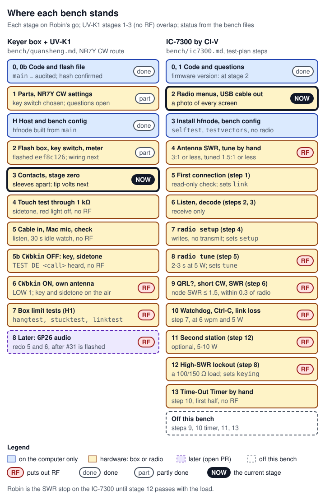

# 14 Audit, bench and flashing

> How a change reaches a real radio. Every change that can affect keying, what is written to a radio, a limit, gate or timeout, or a firmware image passes one gate in a fixed order: a review by an independent safety audit against a fixed rubric; its verdict, posted with (for firmware) the SHA-256 of the one file cleared to flash; CI green on that head; Robin's merge; a download of CI's own file checked against the audit's hash; Robin's go; the flash; `hfnode keyer check` twice; and then bench stages run one at a time with Robin (the project owner) at the radio. The bench results go back to the audit, which grades unattended use only from them. One exception: the stand-alone decoder box image (PR #30) is cleared from its pull request's head, for a plain Pico 2 that is never plugged into a radio. **Nothing in this project has keyed or transmitted on a real radio yet**: one keyer box has been flashed and checked on the computer, and nothing is wired to a radio. This is a process page, not a subsystem page: it keeps the usual headings, but its "interfaces" are the documents, records, commands and config keys the process uses.

Every limit and gate mentioned is listed, with its code, in [13 Safety rules](13-safety-rules.md). The terms below recur; most are also in [17 Glossary](17-glossary.md).

| Term | Meaning here |
|---|---|
| CW, keying, key line | CW is Morse code sent by switching a carrier on and off. Keying a radio makes it transmit; its key line is the contact that does it |
| wpm | Words per minute, the Morse speed |
| PTT | Push-to-talk: the line that puts a radio on transmit |
| RF, zero-RF | Radio-frequency power from a transmitter. A zero-RF stage is one in which nothing can be transmitted |
| PA | The transmitter's power amplifier, its final stage |
| CI-V | Icom's serial command protocol, used here over the IC-7300's USB cable |
| SWR | Standing-wave ratio: how well the antenna takes the power. A high SWR reflects power back into the radio |
| Dummy load | A resistor that absorbs a transmitter's power without radiating it |
| Tuner, TUNE | The IC-7300's internal antenna tuner, which matches the antenna and transmits briefly while it tunes |
| RTTY | Radioteletype mode. The IC-7300's TRANSMIT button gives a steady carrier in it, which is why the hand SWR check uses it |
| TOT | The Time-Out Timer, a radio's own limit on one transmission |
| QRL?, VVV | `QRL?` asks "is this frequency in use?". `VVV` is a conventional Morse test string |
| Clip-on ferrite | A ferrite choke clipped round a cable to keep RF off it |
| IC-7300, UV-K1 | The Icom HF radio the node drives, and a Quansheng 2 m handheld |
| Keyer box | A Raspberry Pi Pico 2 (a board with the RP2350 microcontroller) that closes a radio's key line |
| PC817 | An optocoupler: a light-coupled switch that isolates the Pico from the radio's key line |
| UF2, BOOTSEL | The firmware image format the Pico's built-in boot loader takes when the file is copied onto its USB drive; BOOTSEL is the button that starts that boot loader |
| OTP, `picotool` | The RP2350's one-time-programmable fuses, and the Raspberry Pi command-line tool whose `otp` commands can change them permanently |
| Push run, pull_request run | CI's run for a push to a branch, built from that exact commit; and CI's run for a pull request, built from GitHub's merge of the PR with its base branch, which is a different commit |
| Artifact | A zip of files CI keeps from a run, for download |
| GO with steps | The audit's verdict: safe if Robin does the listed steps, in order, herself, at the radio |
| `CWbkin` | NR7Y's CW break-in setting on the UV-K1: ON lets a key-down put the radio on transmit; OFF gives only the sidetone |
| `C`, `$C` | Your config file's path. The keyer docs write a bare `C`; the IC-7300 bench sets it as a shell variable in every window (`C=~/ic7300-bench.toml`) and writes `$C` |

## Where it lives

The process is spread over the safety audit's files and the two bench plans (project files, not in the repository), two repository documents, the firmware build script and CI job, and the stage gates in `hfnode`.

| Where | What it holds | Size or lines |
|---|---|---|
| `audit/rubric.md` (project files) | The grading scale, the evidence rules and criteria A to H the audit grades every implementation against | 136 lines |
| `audit/final-grades.md` (project files) | The verdict per route, the keyer box file to flash with its SHA-256, and the owner's steps per radio | 254 lines |
| `audit/report.md` (project files) | The detail behind each verdict: §1 keyer box, §2 UV-K1 with the project's own firmware (parked), §3 UV-K1 as a plain radio on the keyer box (with every later PR re-check, the decoder box included), §4 IC-7300 | 849 lines |
| `audit/req-*.md` (project files) | Requirements the audit handed to the threads that write code (`req-keyer-box-fixes.md`, `req-ic7300-fixes.md`, `req-handheld-generic-route-constraints.md`, `req-handheld-no-tx-while-charging.md`) and its rulings (`req-handheld-nr7y-ruling.md`, `req-handheld-nr7y-cw-ruling.md`, `req-on-air-bench-ruling.md`) | 7 files |
| `bench/quansheng.md`, `bench/ic7300.md` (project files) | The two bench plans: rules, a status table per stage, each stage's steps, and the results recorded so far | 746 and 410 lines |
| [docs/hardware-test-plan.md](../hardware-test-plan.md) | The IC-7300 bring-up plan, steps -1 to 13, the stop list and how to stop | 1186 lines |
| [docs/keyer.md](../keyer.md) | The keyer box: "Flashing the firmware", "Bring-up", "Bring-up on NR7Y CW", "Stopping it by hand" | 1529 lines |
| [`firmware/pico2-keyer/build.sh:1-40`](https://github.com/robinonsay/cw-message-gateway/blob/44185fa9a00369c379d9d8af40ca307e3867e860/firmware/pico2-keyer/build.sh#L1-L40) | The reproducible build of a commit's UF2 file, the way CI and the audit build it | 40 lines |
| [`.github/workflows/ci.yml:138-217`](https://github.com/robinonsay/cw-message-gateway/blob/44185fa9a00369c379d9d8af40ca307e3867e860/.github/workflows/ci.yml#L138-L217) | The keyer firmware job: build, fault-handler check, second build from another path, summary, artifact | 80 lines |
| [`crates/hfnode/src/commissioning.rs:24-125`](https://github.com/robinonsay/cw-message-gateway/blob/44185fa9a00369c379d9d8af40ca307e3867e860/crates/hfnode/src/commissioning.rs#L24-L125) | The IC-7300 bring-up stages, what each allows, the 10 W bench cap and the 55 s `run` cap | 102 lines |
| [`crates/hfnode/src/keyer.rs:121-194`](https://github.com/robinonsay/cw-message-gateway/blob/44185fa9a00369c379d9d8af40ca307e3867e860/crates/hfnode/src/keyer.rs#L121-L194) | The keyer box bring-up stages and what each allows | 74 lines |
| [`crates/hfnode/src/keyer.rs:379-451`](https://github.com/robinonsay/cw-message-gateway/blob/44185fa9a00369c379d9d8af40ca307e3867e860/crates/hfnode/src/keyer.rs#L379-L451) | `check_hello` (the box's name, protocol version and limits) and `check_build` (the box must run the build named in `[keyer] firmware_build`) | 73 lines |
| [`crates/hfnode/src/keyer/bench.rs:136-272`](https://github.com/robinonsay/cw-message-gateway/blob/44185fa9a00369c379d9d8af40ca307e3867e860/crates/hfnode/src/keyer/bench.rs#L136-L272) | `hfnode keyer check`: every line it prints and what fails it | 137 lines |

## How it works

### Who does what

Four roles take part, and they are kept separate on purpose. In this project each was a separate Claude session ("thread") in one project, with a coordinator passing messages between them; the separation is the point, not the tooling. Who takes each role once human engineers join is not decided (see Work left).

- **Robin (the project owner)** decides. She merges pull requests, says "go" for every flash and every bench stage that connects, writes to or keys a radio, and is at the radio for every keyed step with her hand on the stop.
- **The safety audit** is an independent reviewer. It owns the `audit/` files, grades each implementation against `audit/rubric.md`, posts its verdict and (for firmware) the hash of the file it cleared, and reviews every fix. It never writes fixes: "The auditor does not write fixes; owner threads do, and the audit reviews them" (`audit/report.md`, opening lines).
- **Owner threads** (the engineers who write the code) build the feature or the fix, and send the pull request number and its head commit to the audit every time the head changes.
- **Bench threads** walk Robin through a bench plan one stage at a time, record every reading in the plan's results, send any "is this safe?" question to the audit, and change no code.

CI (GitHub Actions) builds and tests every push and keeps the firmware files as downloadable artifacts. It is the only source of a file that may be flashed.

### The gate, in order


*Figure: every red diamond must answer yes before the next box; a "no" either stops or sends the work back for a new head, and any new head starts the whole gate again. When the file is built from `main`'s merge commit, as `eef8c126` was, the audit checks and posts that hash after the merge (box 3 follows box 4). A change to host code only (no firmware) skips box 5, the hash check, box 6, box 7 and its check: hfnode is rebuilt from `main` instead; Robin's go is still needed before every bench stage.*

In words, gate by gate (this list numbers every gate; the figure numbers only its boxes):

1. **A pull request with head commit H.** A change goes to the audit if it can change what keys a radio, what is written to a radio, a limit, gate or timeout, or a firmware image. When in doubt, send it: the audit classifies it. For example, it classified PR #28 (the `cw` crate building without Rust's standard library) and rustos PR #5 as needing no hardware-safety review, and said rustos #5 would be reviewed with whichever firmware image pins it (`audit/report.md` §3).
2. **The audit reviews H** against the rubric (see [The audit's review](#the-audits-review) below). Anything that depends on hardware behaviour nobody has measured is graded BENCH, never PASS. CI need not be green for the review itself: the audit cleared PR #30 at `76c60ef` noting "CI red on a clippy 1.99 lint in decoder-core tests (not safety)", and cleared PR #27 at `3c97427` while a macOS test was failing, adding "CI must be green" (`audit/report.md` §3). For firmware it does need the push run on H to have built the file, because it matches its own two rebuilds against that run's log and names that run's artifact.
3. **The verdict.** A NO-GO, or anything blocking, goes back to the owner thread as a `req-*.md` requirement or a PR review. The fix is a new head, and the gate starts again.
4. **The audit posts its verdict and the hash** as a comment on the PR and in `audit/report.md` §3; the keyer box images are also at the top of `audit/final-grades.md` (see [The clearance record](#the-clearance-record)). When the file to flash is built from `main`'s merge commit, this comes after the merge: for `eef8c126` the audit rebuilt `main`'s merge commit `eef8c12` and posted that hash (`audit/final-grades.md`, "The file to flash (checked on main, 2026-10-08 12:50Z)").
5. **CI green on H, before the merge.** A known timing flake (see [12 Testing](12-testing.md)) gets one re-run, as PR #27's macOS job did (the project's memory note `front-key-preflight-pr.md`); if the same test fails again, treat it as real. Never widen a timing limit, lower the 20x scale of CI's mock tests or push an empty commit to get a green run ([13 Safety rules](13-safety-rules.md), rule 7.11). The push run that carries today's keyer file shows a red X from a Windows test while its firmware job passed (see Known bugs); what the audit cleared is that run's firmware artifact.
6. **Robin merges.** Host code (hfnode) is rebuilt from `main` after the merge. The firmware file is never rebuilt: it is downloaded.
7. **Download CI's artifact** from the push run the audit named, and check its SHA-256 and size against the audit's. A different hash means stop: never flash that file.
8. **Robin says go.** Without it nothing is flashed, connected or keyed.
9. **Flash** with the box unplugged from the radio, then replug.
10. **`hfnode keyer check`, twice**, a few seconds apart, with the box on the computer only: both must answer with the audited build, `last started by POWER`, no trip, and the uptime growing. Otherwise do not key: flash the file the audit cleared before.
11. **Bench stages**, each on Robin's go: zero-RF stages before keyed ones, the on-air routine before each keyed step, identification after.
12. **Results to the audit**, which grades unattended use (rubric H1) per route, only from measured results.

**The exception: the decoder box image.** The stand-alone decoder box image (PR #30, cleared at head `3efaf84`) is cleared to flash from its PR head onto a separate plain Pico 2 (not a Pico 2 W) with nothing plugged into a radio, following docs/keyer.md flashing steps 1-4. It keys nothing and has no merge condition. Flashed onto the keyer box instead, it replaces the keyer: flash `eef8c126` back and replug before any keying (`audit/report.md` §3, "PR #30 re-checked 2026-10-11 13:25Z at 3efaf84"; memory note `decoder-box-audit.md`).

### What counts as a new head

The firmware stamps the first eight characters of the commit it was built from into its `HELLO` reply (the box's greeting) as its build id ([`firmware/pico2-keyer/build.sh:21-22`](https://github.com/robinonsay/cw-message-gateway/blob/44185fa9a00369c379d9d8af40ca307e3867e860/firmware/pico2-keyer/build.sh#L21-L22), [`firmware/pico2-keyer/src/main.rs:95-101`](https://github.com/robinonsay/cw-message-gateway/blob/44185fa9a00369c379d9d8af40ca307e3867e860/firmware/pico2-keyer/src/main.rs#L95-L101)). So every commit builds to a different file, even when no code changed. Any of these is a new head that needs a fresh audit and a new hash before anything is flashed:

- a new commit on the PR branch, including a merge of `main` into it;
- a re-pin of rustos (for PR #31, moving from rustos PR #6's head to rustos master's merge of it: `audit/report.md` §3, "PR #31 re-checked");
- a build of a different commit of the same code. When rustos was re-pinned on `main` (PR #24), `main`'s own build differed from the cleared file in 28 bytes of layout and was "Not audited for flashing"; the cleared file stayed the one to flash (`audit/report.md` §3, "Firmware pin bump PR #24").

## How it connects


*Figure: each column is a role; the audit sees every head before Robin merges or flashes it, and the bench results go back to it; where each record is written is at the bottom.*

| From | To | What passes | Where it is written |
|---|---|---|---|
| Owner thread | Safety audit (through the coordinator) | PR number and head commit, on every head change | PR, thread messages |
| CI | Everyone | For firmware: the `pico2-keyer-firmware` artifact (`pico2-keyer.uf2` and `pico2-keyer.uf2.sha256`), and the log line `build id <id>, <n> bytes, UF2 SHA-256 <hash>` ([`firmware/pico2-keyer/build.sh:40`](https://github.com/robinonsay/cw-message-gateway/blob/44185fa9a00369c379d9d8af40ca307e3867e860/firmware/pico2-keyer/build.sh#L40)) | GitHub Actions run page and step summary |
| Safety audit | Owner thread | Requirements (`KB-1`..., `K1`..., `C1`...) and rulings | `audit/req-*.md`, PR reviews |
| Safety audit | Robin, bench threads | Verdict per action, file to flash, hash, size, build id, run and artifact, steps | PR comment, `audit/report.md` §3; keyer images also `audit/final-grades.md` |
| Robin | GitHub | The merge | `main` |
| Robin | Bench thread | "go" for one stage | Thread; the bench file's status table |
| Keyer box | hfnode | `HELLO`: name, protocol version, limits, build id, uptime, boot reason | Checked by `check_hello`, [`crates/hfnode/src/keyer.rs:379-439`](https://github.com/robinonsay/cw-message-gateway/blob/44185fa9a00369c379d9d8af40ca307e3867e860/crates/hfnode/src/keyer.rs#L379-L439), and `check_build`, [`crates/hfnode/src/keyer.rs:441-451`](https://github.com/robinonsay/cw-message-gateway/blob/44185fa9a00369c379d9d8af40ca307e3867e860/crates/hfnode/src/keyer.rs#L441-L451) |
| Bench thread | Safety audit | Measured results (rubric H1), safety questions | The bench file's "Results" section |
| Bench thread | Coordinator | Bugs and doc gaps, for a thread of their own | Thread messages |

The keyer box itself is described in [08 Keyer box: firmware and protocol](08-keyer-box-firmware.md) and [09 Keyer box: host side](09-keyer-host-side.md); the IC-7300 driver and its preflight in [07 CI-V and the IC-7300](07-civ-ic7300.md); the UV-K1 in [10 UV-K1 handheld](10-uv-k1-handheld.md); the one-Pico image (keyer and decoder on one Pico 2) in [11 Decoder box and the one-Pico image](11-decoder-box-one-pico.md); CI's jobs and `build.sh` step by step in [02 Codebase, build and CI](02-codebase-build-ci.md); the test layers below the audit in [12 Testing](12-testing.md); every config key and command in [15 Config, CLI and deployment](15-config-cli-deployment.md).

## Interfaces and APIs

### The rubric

`audit/rubric.md` is the contract every review uses. It may be changed "only by adding criteria".

**Evidence rules** (rubric, "Evidence rules"):

1. Only primary evidence counts: the code itself (`file:line`), the radio's manual (path and line), a chip datasheet (file and page or section), a vendor tool's source, or a binary that was disassembled. A PR description, a doc in the repo, a code comment, a thread message or a test's name is a claim, not evidence.
2. Every finding cites where it comes from. A statement with no citation is marked **inferred**, and an inferred statement can never earn a PASS.
3. Anything that depends on how the hardware behaves and has not been measured on Robin's hardware is graded **BENCH**, never PASS, however good the code looks.
4. "Nobody has run this on a radio" is stated outright wherever it is true.

**Grades**, one per criterion, each with a confidence:

| Grade | Meaning |
|---|---|
| PASS | Verified from primary evidence; holds without a hardware measurement |
| BENCH | Logic verified, but the outcome depends on hardware not yet measured. Names the bench step that settles it, and that step must itself be safe with Robin at the radio |
| RISK | Not a defect in the code, but a hazard Robin handles by procedure (a setting, a cable, a backup). Names the procedure |
| FAIL | A defect or missing protection. Blocks the action it applies to until fixed |
| N/A | Does not apply |

| Confidence | Meaning |
|---|---|
| High | The code path read end to end, and the source of truth |
| Medium | The code read, one link inferred |
| Low | Mostly inferred |

**Actions** (the verdicts Robin gets; rubric, "Actions"):

| Action | What it means |
|---|---|
| Safe to flash | "Installing the firmware cannot leave the device unrecoverable or lose its factory data, given the stated backup." |
| Safe to connect | "Plugging it into the computer and radio, powered, with nothing sent, cannot key the transmitter or damage either side." |
| Safe to key (bench) | "Transmitting with Robin at the radio, into a dummy load or a matched antenna, at the stated power, cannot leave a carrier on past a hard limit or damage the PA." |
| Safe unattended | "Transmitting with nobody present. Out of scope until the Part 97 automatic-control question is answered; graded only to list what is missing." |

An action is **GO** only if every criterion that applies to it is PASS, or BENCH or RISK with the named step done first. One FAIL in an applicable criterion makes it **NO-GO**. "GO with steps" means safe if Robin does the listed steps, in order, herself, at the radio (`audit/final-grades.md`).

**Criteria:**

| Group | Criteria | Graded for |
|---|---|---|
| A Installing firmware | A1 bootloader untouched; A2 image accepted; A3 recovery independent of the image; A4 factory data preserved; A5 provenance (reproducible build, checksum published and checked before flashing); A6 right device | Safe to flash |
| B Transmitter control | B1 off at power-up and reset; B2 hard key-down limit independent of the host; B3 host loss; B4 hang (hardware watchdog); B5 stop verified; B6 duty limit; B7 no other keying path; B8 operator backstop | Connect, key |
| C RF and heat | C1 power bounded; C2 bad load (high SWR, no output, cut coax); C3 thermal | Key |
| D Electrical interface | D1 isolation and grounding; D2 key-line rating; D3 audio levels; D4 cable pinout | Connect |
| E Data and configuration | E1 no unintended writes; E2 staged gates hold | not tied to one action |
| F Evidence | F1 tests cover each limit; F2 a bench test exists for every BENCH item; F3 nothing claims hardware testing that did not happen | not tied to one action |
| G Regulatory | Station ID timing, control-operator presence, emission type: flagged, not graded | - |
| H Unattended | H1 bench proven; H2 two independent stops; H3 bad load without a person; H4 faults latch; H5 restart is safe; H6 long-run thermal; H7 supervision | Safe unattended |

Section H is "Graded for hardware safety only. Whether unattended operation is allowed under Part 97 (automatic control, 97.109(d)) is Robin's call and stays under G." H1 is the criterion the bench exists for: "Every BENCH item for keying has been measured on Robin's own hardware and passed, with the result written down ... Code alone never satisfies this."

### The verdicts today

From `audit/final-grades.md` ("Verdicts" and "Section H, per route"), `audit/report.md` §2 and §3, and the on-air ruling `audit/req-on-air-bench-ruling.md`:

| Route | Flash | Connect, zero RF | Key on the bench | Unattended |
|---|---|---|---|---|
| Keyer box (Pico 2), file `eef8c126` | GO with steps | GO with steps | GO with steps | Not yet: graded after the bench results (H1) |
| UV-K1 on the keyer box (NR7Y CW, the box as a straight key) | n/a: never flash the radio. The project's own UV-K1 image is NO-GO (`audit/report.md` §2, A4) | GO with steps, with a zero-RF stage at break-in OFF | GO with steps: its own antenna screwed straight on, Power LOW 1, never coax, the on-air routine (ruling §3) | Not yet. RISK at best after the bench, only on its own antenna at LOW 1; needs an independent hardware timer, because NR7Y has no time-out in CW; FAIL on coax (H3) |
| IC-7300 by CI-V | n/a | GO with steps | GO with steps at `power_watts = 5`, never above 10 W, after the antenna check by hand (ruling §4.1): test-plan steps 1-7 and 12; step 8 only with the 100 Ω or 150 Ω load | Not yet. Needs its BENCH items measured, the link-loss test among them (H1), and test-plan step 10's hardware timer (H2) |

Two more images are cleared to flash, each GO with steps (`audit/report.md` §3): the decoder box image (PR #30, build `3efaf842`), on a plain Pico 2 with nothing plugged into a radio; and the one-Pico keyer image (PR #31, build `bc5062ae`), only after #31 merges and hfnode is rebuilt from `main`.

Section H, per route, in one line each:

- **Keyer box with the UV-K1.** H2: the box's limits and 0.5 s watchdog, which work with the host dead (code PASS), and the radio's own time-out, which `audit/final-grades.md` gives as the stock firmware's 1 minute; on NR7Y CW the radio has none, so the route needs an independent hardware timer (`audit/req-handheld-nr7y-cw-ruling.md`). H3: the box sees no SWR and the radio describes no protection: RISK on its own antenna at LOW 1, checked each session; FAIL on coax.
- **IC-7300.** H2: the host's watchdog and lockouts (code PASS), and on the radio side its keyer sends at most the 30 characters it was given and its TOT is 3 minutes; BENCH: the link-loss test and step 10, and step 10's hardware timer is the test plan's own gate. H3: SWR, output power and the transmit state (`1C 00`) are sampled through every piece and two faults in a row latch (code PASS); BENCH: step 8.

### The clearance record

When the audit clears a firmware image it posts these fields as a comment on the PR and in `audit/report.md` §3; for the keyer box images, also at the top of `audit/final-grades.md`:

| Field | Keyer box file on `main` today | One-Pico keyer image (PR #31) |
|---|---|---|
| File and artifact | `pico2-keyer.uf2` in the `pico2-keyer-firmware` artifact | the same names |
| CI run | push run 37778418801 on `main`, commit `eef8c12`, artifact 11551506672 | push run 38146719691 on the PR branch, commit `bc5062a`, artifact 11704992501 |
| SHA-256 | `f548596b7d7160cbe3bf65bb79904511b40db15c0aac9030b149ae9338371ef9` | `9ea00c58716152e12d28a8a54f31628dd709d31b77ec301a40c4eff1f4ff51a7` |
| Size | 124,928 bytes | 214,016 bytes |
| Build id (`[keyer] firmware_build`) | `eef8c126` | `bc5062ae` |
| How the audit checked it | rebuilt `main`'s merge commit with `build.sh` on Linux and got CI's hash; `check_faults.py` passes; `main`'s code is exactly the audited tree | rebuilt byte for byte from two paths and matched CI's log; `mutants_core1.py` rejected 8 of 8 (at `bc5062a`); `check_faults.py`, `check_core1.py` and its self-test passed at the previous head `8d5fcf6`, and CI runs `check_faults.py` and `check_core1.py` on every push |
| Conditions | none beyond the steps | flash only after #31 is merged and hfnode is rebuilt from `main` after that merge; then `hfnode keyer check` twice before any keying; `eef8c126` stays the fallback |

The links in `audit/final-grades.md` use the repository's old name (`ic-7300-hf-server`); the run and artifact numbers are what identify the file.

### The files cleared today, and the ones never to flash

As of the project's memory note `flash-files.md` (2026-10-11 14:35Z), checked against `audit/final-grades.md` and `audit/report.md` §3:

| Image | For | Status |
|---|---|---|
| `pico2-keyer.uf2`, build `eef8c126`, SHA-256 `f548596b…71ef9` | The keyer box, both radios | **The file to flash today.** The audit re-checked it after PR #24: `main` at `76f35d1` built with id `eef8c126` gives `f548596b…`, byte for byte (`audit/report.md` §3, "Firmware pin bump PR #24"). Nothing in `firmware/pico2-keyer` or `crates/keyer-core` changed between `76f35d1` and `44185fa` (`git diff 76f35d1 44185fa -- firmware/pico2-keyer crates/keyer-core` is empty), so a build with this id should still give the same file; no rebuild since #24 is recorded (unverified). The memory note says "up to #28"; it is not an audit record. `main`'s own build ids are different files and are not cleared |
| `pico2-keyer.uf2`, build `bc5062ae`, SHA-256 `9ea00c58…51a7` | The keyer box, keyer on core 0 and Morse decoder on core 1 | Cleared at PR #31's head `bc5062a`; not merged, not flashed, Robin has not said go. Any new head on #31 makes this entry stale; the planned rustos #6 re-pin is such a head |
| `pico2-decoder.uf2`, build `3efaf842`, SHA-256 `9970b5f561d3eabef29426368144070b9d25ee2bca2ca7ecb954ec9a88d7d11d`, 129,024 bytes, push run 38142799453, artifact 11703403073 | A separate plain Pico 2 as a stand-alone decoder box (PR #30) | Cleared at `3efaf84`, with no merge condition: a plain Pico 2 (not a Pico 2 W), nothing plugged into a radio. If flashed onto the keyer box it replaces the keyer: flash `eef8c126` back and replug before any keying (`audit/report.md` §3) |

Never flash:

- a file whose SHA-256 differs from the audit's, by even one character;
- a pull_request run's artifact: CI builds the PR's merge with its base branch there (for #31, `claude/pico-decoder-u9bum5`), so the build id and the hash differ. The audit checks push runs: "The PR run's merge-ref artifact was not checked" (`audit/report.md` §3);
- a local build, `build.sh` included: a rebuild checks the hash, it never replaces the download ([`docs/keyer.md:151-166`](https://github.com/robinonsay/cw-message-gateway/blob/44185fa9a00369c379d9d8af40ca307e3867e860/docs/keyer.md#L151-L166));
- the `uv-k1-firmware` artifact, onto anything. The UV-K1 route with the project's own firmware is parked and its "Safe to flash" is **NO-GO**: A4 FAIL, because with this firmware on the radio, UVTools2 dumps and restores channel memory instead of calibration, so calibration cannot be verified or restored after flashing, and the README has no backup step (`audit/report.md` §2, Q2-8 and Q2-9; a dump taken under the stock firmware before flashing reads the right bytes, Q2-7, graded BENCH). The UV-K1 is used with its own NR7Y firmware, never flashed.

### What CI publishes, and how `build.sh` reproduces it

[02 Codebase, build and CI](02-codebase-build-ci.md) goes through CI's firmware job and `build.sh` step by step. What the flashing procedure relies on:

- The keyer firmware job ([`.github/workflows/ci.yml:138-217`](https://github.com/robinonsay/cw-message-gateway/blob/44185fa9a00369c379d9d8af40ca307e3867e860/.github/workflows/ci.yml#L138-L217)) runs on every push and every pull request ([`.github/workflows/ci.yml:3-5`](https://github.com/robinonsay/cw-message-gateway/blob/44185fa9a00369c379d9d8af40ca307e3867e860/.github/workflows/ci.yml#L3-L5)). It sets the build id to the commit's first eight characters and runs `build.sh` ([`.github/workflows/ci.yml:177-180`](https://github.com/robinonsay/cw-message-gateway/blob/44185fa9a00369c379d9d8af40ca307e3867e860/.github/workflows/ci.yml#L177-L180)), writes the build id, size and SHA-256 into the run's summary ([`.github/workflows/ci.yml:198-209`](https://github.com/robinonsay/cw-message-gateway/blob/44185fa9a00369c379d9d8af40ca307e3867e860/.github/workflows/ci.yml#L198-L209)), and keeps `pico2-keyer.uf2` and `pico2-keyer.uf2.sha256` as the `pico2-keyer-firmware` artifact ([`.github/workflows/ci.yml:211-217`](https://github.com/robinonsay/cw-message-gateway/blob/44185fa9a00369c379d9d8af40ca307e3867e860/.github/workflows/ci.yml#L211-L217)). The log line is `build id <id>, <n> bytes, UF2 SHA-256 <hash>` ([`firmware/pico2-keyer/build.sh:40`](https://github.com/robinonsay/cw-message-gateway/blob/44185fa9a00369c379d9d8af40ca307e3867e860/firmware/pico2-keyer/build.sh#L40)). On PR #31 (draft, not on `main`) the job also runs `check_core1.py --self-test` and `check_core1.py pico2-keyer.elf` ([`.github/workflows/ci.yml:197-204`](https://github.com/robinonsay/cw-message-gateway/blob/bc5062ae4f56ae1f9949b3b067218c7e675d88f8/.github/workflows/ci.yml#L197-L204)).
- The `.sha256` file in the zip and the hash in the log only show that the download is intact, because they come from the same run. The check that matters is against the audit's hash.
- `sh firmware/pico2-keyer/build.sh COMMIT` (COMMIT defaults to HEAD) builds the committed tree with that commit's build id at one fixed path, `/tmp/pico2-keyer-build` ([`firmware/pico2-keyer/build.sh:21-34`](https://github.com/robinonsay/cw-message-gateway/blob/44185fa9a00369c379d9d8af40ca307e3867e860/firmware/pico2-keyer/build.sh#L21-L34)), because cargo mixes the absolute path of `keyer-core` into every symbol's hash ([`firmware/pico2-keyer/build.sh:7-14`](https://github.com/robinonsay/cw-message-gateway/blob/44185fa9a00369c379d9d8af40ca307e3867e860/firmware/pico2-keyer/build.sh#L7-L14)). It writes `pico2-keyer.uf2`, `.uf2.sha256` and `.elf` next to the script, in `firmware/pico2-keyer/` ([`firmware/pico2-keyer/build.sh:36-40`](https://github.com/robinonsay/cw-message-gateway/blob/44185fa9a00369c379d9d8af40ca307e3867e860/firmware/pico2-keyer/build.sh#L36-L40)). **Those files are for comparing hashes; never flash them.**
- On Linux, `build.sh` gives CI's file byte for byte ([`firmware/pico2-keyer/README.md:45-55`](https://github.com/robinonsay/cw-message-gateway/blob/44185fa9a00369c379d9d8af40ca307e3867e860/firmware/pico2-keyer/README.md#L45-L55)). The README says a Mac build "has never been compared with CI's build"; one has since matched (see Known bugs). Either way, the file to flash is CI's download.

### Config keys the gate uses

Each key's full description is on [15 Config, CLI and deployment](15-config-cli-deployment.md).

| Key | Values | What it gates | Code |
|---|---|---|---|
| `station.rig` | `ic7300` (default), `keyer`, `handheld` | Which radio path, and so which stage key applies: `station.commissioned` for the IC-7300, `[keyer] commissioned` for the keyer box, `[handheld] commissioned` for a handheld. `hfnode keyer` refuses unless it is `keyer` | [`crates/hfnode/src/config.rs:45`](https://github.com/robinonsay/cw-message-gateway/blob/44185fa9a00369c379d9d8af40ca307e3867e860/crates/hfnode/src/config.rs#L45), [`crates/hfnode/src/config.rs:59-63`](https://github.com/robinonsay/cw-message-gateway/blob/44185fa9a00369c379d9d8af40ca307e3867e860/crates/hfnode/src/config.rs#L59-L63), [`crates/hfnode/src/config.rs:85-93`](https://github.com/robinonsay/cw-message-gateway/blob/44185fa9a00369c379d9d8af40ca307e3867e860/crates/hfnode/src/config.rs#L85-L93), [`crates/hfnode/src/main.rs:1384-1392`](https://github.com/robinonsay/cw-message-gateway/blob/44185fa9a00369c379d9d8af40ca307e3867e860/crates/hfnode/src/main.rs#L1384-L1392) |
| `station.commissioned` | `none` (default), `link`, `setup`, `tune`, `keying`, `done` | The IC-7300 bring-up stage passed; later commands are refused | [`crates/hfnode/src/commissioning.rs:24-45`](https://github.com/robinonsay/cw-message-gateway/blob/44185fa9a00369c379d9d8af40ca307e3867e860/crates/hfnode/src/commissioning.rs#L24-L45), [`crates/hfnode/src/commissioning.rs:101-119`](https://github.com/robinonsay/cw-message-gateway/blob/44185fa9a00369c379d9d8af40ca307e3867e860/crates/hfnode/src/commissioning.rs#L101-L119) |
| `[keyer] commissioned` | `none` (default), `listen`, `keying`, `done` | The keyer box bring-up stage passed | [`crates/hfnode/src/keyer.rs:121-138`](https://github.com/robinonsay/cw-message-gateway/blob/44185fa9a00369c379d9d8af40ca307e3867e860/crates/hfnode/src/keyer.rs#L121-L138), [`crates/hfnode/src/keyer.rs:180-194`](https://github.com/robinonsay/cw-message-gateway/blob/44185fa9a00369c379d9d8af40ca307e3867e860/crates/hfnode/src/keyer.rs#L180-L194) |
| `[handheld] commissioned` | the handheld route's own stages | The parked route with the project's own UV-K1 firmware ([10 UV-K1 handheld](10-uv-k1-handheld.md)); neither bench uses it | [`crates/hfnode/src/config.rs:167-170`](https://github.com/robinonsay/cw-message-gateway/blob/44185fa9a00369c379d9d8af40ca307e3867e860/crates/hfnode/src/config.rs#L167-L170) |
| `[keyer] firmware_build` | The build id of the checked file, 1 to 12 characters, no spaces, never `-` | hfnode refuses a box reporting any other build | [`crates/hfnode/src/keyer.rs:330-342`](https://github.com/robinonsay/cw-message-gateway/blob/44185fa9a00369c379d9d8af40ca307e3867e860/crates/hfnode/src/keyer.rs#L330-L342), [`crates/hfnode/src/keyer.rs:441-451`](https://github.com/robinonsay/cw-message-gateway/blob/44185fa9a00369c379d9d8af40ca307e3867e860/crates/hfnode/src/keyer.rs#L441-L451), [`crates/hfnode/src/keyer/bench.rs:115-119`](https://github.com/robinonsay/cw-message-gateway/blob/44185fa9a00369c379d9d8af40ca307e3867e860/crates/hfnode/src/keyer/bench.rs#L115-L119) |
| `station.power_watts` | 1-100; above `BENCH_MAX_WATTS` = 10 only from stage `keying`. **Never loosen.** | The IC-7300's RF power | [`crates/hfnode/src/config.rs:942-943`](https://github.com/robinonsay/cw-message-gateway/blob/44185fa9a00369c379d9d8af40ca307e3867e860/crates/hfnode/src/config.rs#L942-L943), [`crates/hfnode/src/commissioning.rs:60-61`](https://github.com/robinonsay/cw-message-gateway/blob/44185fa9a00369c379d9d8af40ca307e3867e860/crates/hfnode/src/commissioning.rs#L60-L61), [`crates/hfnode/src/commissioning.rs:111-117`](https://github.com/robinonsay/cw-message-gateway/blob/44185fa9a00369c379d9d8af40ca307e3867e860/crates/hfnode/src/commissioning.rs#L111-L117) |
| `station.max_key_seconds` (IC-7300) | 1-120 (default 45) for bench commands; `run` needs `RUN_MAX_KEY_SECONDS` = 55 or less, below the hardware timer's 60 s. **Never loosen.** | The node's keying watchdog | [`crates/hfnode/src/config.rs:945-946`](https://github.com/robinonsay/cw-message-gateway/blob/44185fa9a00369c379d9d8af40ca307e3867e860/crates/hfnode/src/config.rs#L945-L946), [`crates/hfnode/src/config.rs:746-748`](https://github.com/robinonsay/cw-message-gateway/blob/44185fa9a00369c379d9d8af40ca307e3867e860/crates/hfnode/src/config.rs#L746-L748), [`crates/hfnode/src/commissioning.rs:121-145`](https://github.com/robinonsay/cw-message-gateway/blob/44185fa9a00369c379d9d8af40ca307e3867e860/crates/hfnode/src/commissioning.rs#L121-L145) |
| `station.max_key_seconds` (keyer box) | At most 60 (`MAX_RUN_LIMIT`, the box's run limit), and at least the longest 30-character piece at `key_speed_wpm` plus `KEY_SECONDS_SPARE` = 2 s (plus the time to hear the receive noise back, with `output = "ptt"`). **Never loosen.** | The node's keying watchdog | [`crates/hfnode/src/keyer.rs:96`](https://github.com/robinonsay/cw-message-gateway/blob/44185fa9a00369c379d9d8af40ca307e3867e860/crates/hfnode/src/keyer.rs#L96), [`crates/hfnode/src/keyer.rs:211`](https://github.com/robinonsay/cw-message-gateway/blob/44185fa9a00369c379d9d8af40ca307e3867e860/crates/hfnode/src/keyer.rs#L211), [`crates/hfnode/src/keyer.rs:254-260`](https://github.com/robinonsay/cw-message-gateway/blob/44185fa9a00369c379d9d8af40ca307e3867e860/crates/hfnode/src/keyer.rs#L254-L260), [`crates/hfnode/src/keyer.rs:288-304`](https://github.com/robinonsay/cw-message-gateway/blob/44185fa9a00369c379d9d8af40ca307e3867e860/crates/hfnode/src/keyer.rs#L288-L304) |
| `station.swr_limit` | 1.1-3.0, default 2.0. **Never loosen.** | IC-7300: above this SWR the node stops transmitting for the rest of the window | [`crates/hfnode/src/config.rs:74-76`](https://github.com/robinonsay/cw-message-gateway/blob/44185fa9a00369c379d9d8af40ca307e3867e860/crates/hfnode/src/config.rs#L74-L76), [`crates/hfnode/src/config.rs:953-955`](https://github.com/robinonsay/cw-message-gateway/blob/44185fa9a00369c379d9d8af40ca307e3867e860/crates/hfnode/src/config.rs#L953-L955), [`crates/hfnode/src/config.rs:749-751`](https://github.com/robinonsay/cw-message-gateway/blob/44185fa9a00369c379d9d8af40ca307e3867e860/crates/hfnode/src/config.rs#L749-L751) |
| `[keyer] min_level_dbfs` | default -65 | `keyer check` fails when the band's audio level is below it | [`crates/hfnode/src/config.rs:108-109`](https://github.com/robinonsay/cw-message-gateway/blob/44185fa9a00369c379d9d8af40ca307e3867e860/crates/hfnode/src/config.rs#L108-L109), [`crates/hfnode/src/config.rs:778-780`](https://github.com/robinonsay/cw-message-gateway/blob/44185fa9a00369c379d9d8af40ca307e3867e860/crates/hfnode/src/config.rs#L778-L780) |

The IC-7300 stages ([`crates/hfnode/src/commissioning.rs:72-80`](https://github.com/robinonsay/cw-message-gateway/blob/44185fa9a00369c379d9d8af40ca307e3867e860/crates/hfnode/src/commissioning.rs#L72-L80)); "step" means a step of [docs/hardware-test-plan.md](../hardware-test-plan.md):

| `station.commissioned` | Set after | Allows, in addition | Transmits? |
|---|---|---|---|
| `none` | | `radio check`, `radio status`, `radio rx`, `listen` | Never |
| `link` | step 1 | `radio setup` (writes settings) | Never |
| `setup` | step 4 | `radio tune` | A 2-3 s tuner carrier |
| `tune` | step 5 | `radio cw` | CW at 10 W or less |
| `keying` | steps 6, 7 and 8 | `power_watts` above 10 | CW at the configured power |
| `done` | steps 9 and 10 | `run` | Unattended |

The keyer box stages ([`crates/hfnode/src/keyer.rs:181-186`](https://github.com/robinonsay/cw-message-gateway/blob/44185fa9a00369c379d9d8af40ca307e3867e860/crates/hfnode/src/keyer.rs#L181-L186)):

| `[keyer] commissioned` | Set after | Allows, in addition |
|---|---|---|
| `none` | | `keyer check`, `keyer rx`, `listen`, `record`; nothing keys |
| `listen` | `hfnode listen` decoded the band through the sound card | `keyer key`, `keyer sidetone` |
| `keying` | short transmissions heard as sent, the sidetone check passed | `keyer hangtest`, `keyer stucktest`, `keyer linktest` (and, on PR #31, `keyer core1test`) |
| `done` | the box tests showed the box opening the key by itself | `run` |

Set the stage back to `none` and start again from step 1 if the radio's firmware, the cable or the computer changes ([`docs/hardware-test-plan.md:34-36`](https://github.com/robinonsay/cw-message-gateway/blob/44185fa9a00369c379d9d8af40ca307e3867e860/docs/hardware-test-plan.md#L34-L36)).

### What `hfnode keyer check` reports

`hfnode keyer --config C check` keys nothing ([`crates/hfnode/src/keyer/bench.rs:136-272`](https://github.com/robinonsay/cw-message-gateway/blob/44185fa9a00369c379d9d8af40ca307e3867e860/crates/hfnode/src/keyer/bench.rs#L136-L272)). Before it prints anything, opening the box refuses, with an `Error:` line, a box that is not `PICO2-KEYER`, speaks another protocol version or reports limits looser than hfnode allows ([`crates/hfnode/src/keyer.rs:379-439`](https://github.com/robinonsay/cw-message-gateway/blob/44185fa9a00369c379d9d8af40ca307e3867e860/crates/hfnode/src/keyer.rs#L379-L439)), runs another build than `firmware_build` ([`crates/hfnode/src/keyer/bench.rs:115-119`](https://github.com/robinonsay/cw-message-gateway/blob/44185fa9a00369c379d9d8af40ca307e3867e860/crates/hfnode/src/keyer/bench.rs#L115-L119), [`crates/hfnode/src/keyer.rs:441-451`](https://github.com/robinonsay/cw-message-gateway/blob/44185fa9a00369c379d9d8af40ca307e3867e860/crates/hfnode/src/keyer.rs#L441-L451)), or still reads its key or PTT down after a STOP ([`crates/hfnode/src/keyer/rig.rs:251-252`](https://github.com/robinonsay/cw-message-gateway/blob/44185fa9a00369c379d9d8af40ca307e3867e860/crates/hfnode/src/keyer/rig.rs#L251-L252)). Then it prints, in this order:

| Line | Printed | What to look for | Code |
|---|---|---|---|
| `box: PICO2-KEYER protocol 4, run limit 60 s, PTT limit 60 s, key-down limit 1000 ms, link timeout 2000 ms` | always | The box's limits, exactly as below | [`crates/hfnode/src/keyer/bench.rs:143-153`](https://github.com/robinonsay/cw-message-gateway/blob/44185fa9a00369c379d9d8af40ca307e3867e860/crates/hfnode/src/keyer/bench.rs#L143-L153) |
| `box: rest 1000 ms between runs, duty budget 60 s, build <id>` | always | The build equals `firmware_build` and the audit's record | [`crates/hfnode/src/keyer/bench.rs:154-160`](https://github.com/robinonsay/cw-message-gateway/blob/44185fa9a00369c379d9d8af40ca307e3867e860/crates/hfnode/src/keyer/bench.rs#L154-L160) |
| `box: up <s> s, last started by <POWER, WATCHDOG or OTHER>` | always; `WATCHDOG` adds "(its control loop stalled: if this was not a hang test, report it)" | `POWER`, and the second check's `up` larger by about the wait | [`crates/hfnode/src/keyer/bench.rs:161-171`](https://github.com/robinonsay/cw-message-gateway/blob/44185fa9a00369c379d9d8af40ca307e3867e860/crates/hfnode/src/keyer/bench.rs#L161-L171) |
| `box: <why>` | only when hfnode refuses to key this box: after an `OTHER` or `WATCHDOG` boot, or a trip | Absent. "the keyer box last started other than by being plugged in ... unplug it and plug it in again before keying" (always so after a flash) means replug; the watchdog and trip texts mean look at the radio and the box first, then replug. The check fails | [`crates/hfnode/src/keyer/bench.rs:174-177`](https://github.com/robinonsay/cw-message-gateway/blob/44185fa9a00369c379d9d8af40ca307e3867e860/crates/hfnode/src/keyer/bench.rs#L174-L177), [`crates/hfnode/src/keyer/rig.rs:204-250`](https://github.com/robinonsay/cw-message-gateway/blob/44185fa9a00369c379d9d8af40ca307e3867e860/crates/hfnode/src/keyer/rig.rs#L204-L250), [`crates/hfnode/src/keyer/rig.rs:288-292`](https://github.com/robinonsay/cw-message-gateway/blob/44185fa9a00369c379d9d8af40ca307e3867e860/crates/hfnode/src/keyer/rig.rs#L288-L292) |
| `box: key up, PTT up, idle, last run ended <reason>` | always | No `, TRIPPED (<what>): unplug the box and plug it in again` at its end | [`crates/hfnode/src/keyer/bench.rs:178-196`](https://github.com/robinonsay/cw-message-gateway/blob/44185fa9a00369c379d9d8af40ca307e3867e860/crates/hfnode/src/keyer/bench.rs#L178-L196) |
| `box: <n> ms of rest to go, <n> s of duty budget` | always | A key, PTT or run still down (`DOWN`, `keying a run` in the line above) fails the check | [`crates/hfnode/src/keyer/bench.rs:197-203`](https://github.com/robinonsay/cw-message-gateway/blob/44185fa9a00369c379d9d8af40ca307e3867e860/crates/hfnode/src/keyer/bench.rs#L197-L203) |
| `box: PTT line high (the PTT contact open): ok`, or `box: PTT line LOW: ...` | only with `output = "ptt"` | High | [`crates/hfnode/src/keyer/bench.rs:204-215`](https://github.com/robinonsay/cw-message-gateway/blob/44185fa9a00369c379d9d8af40ca307e3867e860/crates/hfnode/src/keyer/bench.rs#L204-L215) |
| `box: STATUS failed: <error>` | only if the box did not answer STATUS | Absent | [`crates/hfnode/src/keyer/bench.rs:217-220`](https://github.com/robinonsay/cw-message-gateway/blob/44185fa9a00369c379d9d8af40ca307e3867e860/crates/hfnode/src/keyer/bench.rs#L217-L220) |
| `audio: ...` | as found, after up to 5 s of listening | No audio arriving, a band level under `min_level_dbfs`, no level yet, a steady carrier at the pitch, or a held key each fail the check; a dropped receive noise (PTT only) is a note | [`crates/hfnode/src/keyer/bench.rs:222-270`](https://github.com/robinonsay/cw-message-gateway/blob/44185fa9a00369c379d9d8af40ca307e3867e860/crates/hfnode/src/keyer/bench.rs#L222-L270) |
| `bring-up stage passed (keyer.commissioned): <stage>` | always | The stage you expect | [`crates/hfnode/src/main.rs:1419-1427`](https://github.com/robinonsay/cw-message-gateway/blob/44185fa9a00369c379d9d8af40ca307e3867e860/crates/hfnode/src/main.rs#L1419-L1427) |
| `all ok; nothing was keyed`, or `Error: check failed: fix the lines above before keying` | last | See below | [`crates/hfnode/src/main.rs:1428-1433`](https://github.com/robinonsay/cw-message-gateway/blob/44185fa9a00369c379d9d8af40ca307e3867e860/crates/hfnode/src/main.rs#L1428-L1433) |

**With no radio connected, judge only the `box:` lines.** The `audio:` lines then say nothing about the box: with a sound card and no radio they fail and the command ends in `check failed` (`bench/quansheng.md` stage 2 calls this expected); with a computer's built-in microphone they can pass on room noise (the band read -47 dBFS that way on 2026-10-09). A `box:` refusal line after a flash means replug and check again.

The box's limits, as `keyer-core` defines them and the box reports them in `HELLO` ([`crates/keyer-core/src/lib.rs:42-78`](https://github.com/robinonsay/cw-message-gateway/blob/44185fa9a00369c379d9d8af40ca307e3867e860/crates/keyer-core/src/lib.rs#L42-L78)). **Never loosen any of them**; they are what the audit graded. The full list with every other limit is in [13 Safety rules](13-safety-rules.md).

| Limit | Value | Code |
|---|---|---|
| Key-down at once | 1,000 ms; past it the key opens and the box trips until replugged | [`crates/keyer-core/src/lib.rs:48`](https://github.com/robinonsay/cw-message-gateway/blob/44185fa9a00369c379d9d8af40ca307e3867e860/crates/keyer-core/src/lib.rs#L48) |
| One run | 60,000 ms | [`crates/keyer-core/src/lib.rs:51`](https://github.com/robinonsay/cw-message-gateway/blob/44185fa9a00369c379d9d8af40ca307e3867e860/crates/keyer-core/src/lib.rs#L51) |
| PTT down at once | 60,000 ms | [`crates/keyer-core/src/lib.rs:57`](https://github.com/robinonsay/cw-message-gateway/blob/44185fa9a00369c379d9d8af40ca307e3867e860/crates/keyer-core/src/lib.rs#L57) |
| Link timeout | 2,000 ms with no valid line ends a run | [`crates/keyer-core/src/lib.rs:60`](https://github.com/robinonsay/cw-message-gateway/blob/44185fa9a00369c379d9d8af40ca307e3867e860/crates/keyer-core/src/lib.rs#L60) |
| Hardware watchdog | 500 ms | [`crates/keyer-core/src/lib.rs:62`](https://github.com/robinonsay/cw-message-gateway/blob/44185fa9a00369c379d9d8af40ca307e3867e860/crates/keyer-core/src/lib.rs#L62) |
| Rest after a run | 1,000 ms | [`crates/keyer-core/src/lib.rs:66`](https://github.com/robinonsay/cw-message-gateway/blob/44185fa9a00369c379d9d8af40ca307e3867e860/crates/keyer-core/src/lib.rs#L66) |
| Minimum gap | `1200 / MAX_WPM` = 24 ms; a shorter key-up does not reset the key-down timer | [`crates/keyer-core/src/lib.rs:69`](https://github.com/robinonsay/cw-message-gateway/blob/44185fa9a00369c379d9d8af40ca307e3867e860/crates/keyer-core/src/lib.rs#L69) |
| Duty budget | 60,000 ms: keyed at most half of any stretch plus 30 s | [`crates/keyer-core/src/lib.rs:70-78`](https://github.com/robinonsay/cw-message-gateway/blob/44185fa9a00369c379d9d8af40ca307e3867e860/crates/keyer-core/src/lib.rs#L70-L78) |

On PR #31 (draft, not on `main`) the box speaks protocol 5 ([`crates/keyer-core/src/lib.rs:29`](https://github.com/robinonsay/cw-message-gateway/blob/bc5062ae4f56ae1f9949b3b067218c7e675d88f8/crates/keyer-core/src/lib.rs#L29)), adds `CORE1_MS` = 100 (core 1's heartbeat must move at least this often, or the box trips `CORE1`; [`crates/keyer-core/src/lib.rs:104-110`](https://github.com/robinonsay/cw-message-gateway/blob/bc5062ae4f56ae1f9949b3b067218c7e675d88f8/crates/keyer-core/src/lib.rs#L104-L110)), and hfnode accepts protocol 4 or 5 ([`crates/hfnode/src/keyer.rs:386`](https://github.com/robinonsay/cw-message-gateway/blob/bc5062ae4f56ae1f9949b3b067218c7e675d88f8/crates/hfnode/src/keyer.rs#L386)). `main`'s hfnode accepts only protocol 4 ([`crates/hfnode/src/keyer.rs:387-394`](https://github.com/robinonsay/cw-message-gateway/blob/44185fa9a00369c379d9d8af40ca307e3867e860/crates/hfnode/src/keyer.rs#L387-L394)), which is why the one-Pico image needs hfnode rebuilt from `main` after #31 merges.

### Commands used on the bench

| Command | Keys? | Needs stage | Used for |
|---|---|---|---|
| `hfnode devices` | no | - | Lists serial ports and audio inputs and marks the box (or radio); opens nothing, needs no config ([`crates/hfnode/src/main.rs:90-92`](https://github.com/robinonsay/cw-message-gateway/blob/44185fa9a00369c379d9d8af40ca307e3867e860/crates/hfnode/src/main.rs#L90-L92)) |
| `hfnode codes --config C --count 1` | no | - | Loads and validates the config (and the node's key) and prints one line of the code table; the benches use it to check a new config parses ([`crates/hfnode/src/main.rs:36-45`](https://github.com/robinonsay/cw-message-gateway/blob/44185fa9a00369c379d9d8af40ca307e3867e860/crates/hfnode/src/main.rs#L36-L45), [`crates/hfnode/src/config.rs:889-897`](https://github.com/robinonsay/cw-message-gateway/blob/44185fa9a00369c379d9d8af40ca307e3867e860/crates/hfnode/src/config.rs#L889-L897)) |
| `hfnode selftest [--scenario <name>]` | no | - | The closed-loop scenarios against a mock IC-7300 or a mock keyer box; no radio or config. Test-plan step -1 and IC-7300 bench stage 3; the UV-K1 bench's host stage ran `--scenario keyer-ht-tx --scenario keyer-ht-stuck-ptt` ([`crates/hfnode/src/main.rs:143-203`](https://github.com/robinonsay/cw-message-gateway/blob/44185fa9a00369c379d9d8af40ca307e3867e860/crates/hfnode/src/main.rs#L143-L203)) |
| `hfnode testvectors --out <dir>` | no | - | WAV files of a test session with their expected decodes; IC-7300 bench stage 3 ([`crates/hfnode/src/main.rs:204-220`](https://github.com/robinonsay/cw-message-gateway/blob/44185fa9a00369c379d9d8af40ca307e3867e860/crates/hfnode/src/main.rs#L204-L220)) |
| `hfnode decode <file.wav>` | no | - | Decodes CW from a WAV file; test-plan step 3 ([`crates/hfnode/src/main.rs:54-59`](https://github.com/robinonsay/cw-message-gateway/blob/44185fa9a00369c379d9d8af40ca307e3867e860/crates/hfnode/src/main.rs#L54-L59)) |
| `hfnode record --config C --out <file.wav>` | no | none | Records the radio's audio as the node hears it; IC-7300 bench stage 6 ([`crates/hfnode/src/main.rs:81-89`](https://github.com/robinonsay/cw-message-gateway/blob/44185fa9a00369c379d9d8af40ca307e3867e860/crates/hfnode/src/main.rs#L81-L89)) |
| `hfnode keyer --config C check` | no | none | The box's limits, build, boot reason, uptime; the band level |
| `hfnode keyer --config C rx` | no | none | Stops the box and confirms the key open; latches the transmit inhibit if it cannot |
| `hfnode listen --config C` | no | none | Decodes the band |
| `hfnode keyer --config C key "<text>"` | yes | `listen` | Short keyed text, checked by the node hearing its own sidetone |
| `hfnode keyer --config C sidetone` | yes | `listen` | Keys `DE <call>`, measures the sidetone's delay, level and pitch |
| `hfnode keyer --config C hangtest` / `stucktest` | yes | `keying` | The box's watchdog and key-down limit, each tripping the box |
| `hfnode keyer --config C linktest` | yes | `keying` | The box's 2 s link timeout |
| `hfnode keyer --config C core1test [--fault]` (PR #31, draft, not on `main`) | yes, at most about 0.1 s | `keying` (bring-up step 11) | Core 1 stopped mid-run, or with `--fault` made to fault by a store its memory protection refuses. The box must open the key, trip `CORE1` and come back from its watchdog reset tripped. Unplug and replug after each; handle `tx-inhibited` as after `hangtest` ([`crates/hfnode/src/main.rs:322-331`](https://github.com/robinonsay/cw-message-gateway/blob/bc5062ae4f56ae1f9949b3b067218c7e675d88f8/crates/hfnode/src/main.rs#L322-L331), [`docs/keyer.md:321-330`](https://github.com/robinonsay/cw-message-gateway/blob/bc5062ae4f56ae1f9949b3b067218c7e675d88f8/docs/keyer.md#L321-L330)) |
| `hfnode radio --config $C check` / `status` | no | none | The IC-7300's read-only preflight; transmit state, frequency |
| `hfnode radio --config $C rx` | stops | none | `17 FF` then `1C 00 00` with no preflight, so it can unkey a radio the preflight would refuse ([`crates/hfnode/src/commissioning.rs:9-14`](https://github.com/robinonsay/cw-message-gateway/blob/44185fa9a00369c379d9d8af40ca307e3867e860/crates/hfnode/src/commissioning.rs#L9-L14)) |
| `hfnode radio --config $C setup` / `tune` / `cw "<text>"` | setup no; tune and cw yes | `link` / `setup` / `tune` | Steps 4 to 8 |

`key` and `sidetone` need stage `listen`; `hangtest`, `stucktest` and `linktest` need `keying` ([`crates/hfnode/src/main.rs:1434-1442`](https://github.com/robinonsay/cw-message-gateway/blob/44185fa9a00369c379d9d8af40ca307e3867e860/crates/hfnode/src/main.rs#L1434-L1442)); on PR #31, `core1test` joins the second group. Until `[keyer] commissioned = "done"`, `keyer key` sends at most 30 characters (`MAX_TEXT`) at a time, checked before the box's port is opened ([`crates/hfnode/src/main.rs:1369-1382`](https://github.com/robinonsay/cw-message-gateway/blob/44185fa9a00369c379d9d8af40ca307e3867e860/crates/hfnode/src/main.rs#L1369-L1382), [`crates/keyer-core/src/lib.rs:36`](https://github.com/robinonsay/cw-message-gateway/blob/44185fa9a00369c379d9d8af40ca307e3867e860/crates/keyer-core/src/lib.rs#L36)). The `--config C` must come straight after `keyer` (or `listen`); typed the other way round, hfnode refuses it (`bench/quansheng.md`, "Rules for every stage"). `hfnode handheld ...` ([`crates/hfnode/src/main.rs:108-115`](https://github.com/robinonsay/cw-message-gateway/blob/44185fa9a00369c379d9d8af40ca307e3867e860/crates/hfnode/src/main.rs#L108-L115)) belongs to the parked route with the project's own UV-K1 firmware and is used on neither bench. What each command does inside is on pages [07](07-civ-ic7300.md) and [09](09-keyer-host-side.md); every option is on [15](15-config-cli-deployment.md).

## Algorithms and processing

### The audit's review

Read from what the audit recorded in `audit/report.md` and `audit/final-grades.md`, a review of one head goes like this:

1. **Read the code path end to end**, citing `file:line`, and the source of truth for every hardware claim: the IC-7300 manual by line, the RP2350 datasheet by page, the UV-K1 manual, NR7Y's source at a tagged commit.
2. **Revert checks.** For every fix or limit, edit the code to undo it and confirm some test fails. At `8e25bf3`, 34 such edits were run and every one was caught except two that another fix covers, three agreed low-priority gaps and one nit (`audit/final-grades.md`, "What the audit checked"). A limit with no failing test is an F1 FAIL.
3. **Run the whole workspace's tests**, with the mock radio at 20 times real time (716 at `8e25bf3`). The 20x scale is never relaxed.
4. **Trial merge** the PRs in the order Robin will merge them and compare the resulting tree with the reviewed one (for the 2026-10-08 stack: tree `6f81819d` = `8e25bf3`).
5. **Firmware:** rebuild with `build.sh` from two paths, compare byte for byte with each other and with the hash in CI's push-run log, and run the machine-code checks: `check_faults.py` (every fault handler's first store opens the key and the PTT), and for images with a decoder `check_pins.py` or `check_core1.py` with their mutant images.
6. **Grade** every criterion, with confidence, and give each action its verdict.
7. **Post** the verdict, the steps and the hash; hand anything to fix to the owner thread as a requirement file or review; re-check every new head the same way.

The audit does not write fixes, does not measure hardware, and does not treat anything it could not read or measure as passed.

### The flash procedure

For the keyer box, combining [docs/keyer.md](../keyer.md) "Flashing the firmware", `audit/final-grades.md` "Your steps: the keyer box", and `bench/quansheng.md` stage 2. Each step is done in order; any failure is a stop.

1. **Preconditions.** The audit has posted the file, hash, size and build id. Robin has merged the PR the audit named and said go. For a protocol change (the one-Pico image), hfnode has been rebuilt from `main` after the merge.
2. **Download** only the named artifact (`pico2-keyer-firmware`) from the named push run, and keep it in a folder of its own, never in `firmware/pico2-keyer/`, where `build.sh` writes a file with the same name. Ignore other artifacts in the same run.
3. **Check the hash and size of the exact file you will copy:** `sha256sum pico2-keyer.uf2` on Linux, `shasum -a 256 pico2-keyer.uf2` on a Mac, against the audit's SHA-256, and the size against the audit's byte count. Write down what it printed. Any difference: stop, do not copy it.
4. **Unplug the box from the radio.** Nothing of the radio's is connected while flashing.
5. **Confirm the device:** a Pico 2 (RP2350), not a Pico 2 W or an older Pico. Hold BOOTSEL while plugging it into the computer; it appears as a drive called `RP2350`, whose `INFO_UF2.TXT` must say `Board-ID: RP2350`.
6. **Copy** that `pico2-keyer.uf2` onto the drive. If the `RP2350` drive comes back, the copy did not take: copy again. Never run `picotool` OTP or partition commands on this Pico.
7. **Unplug and replug.** The first boot after flashing reports `OTHER`, and the node will not key a box that reports `OTHER`.
8. **Set `[keyer] firmware_build`** to the audited build id.
9. **`hfnode devices`, then `hfnode keyer --config C check` twice**, a few seconds apart, the box on the computer only. Both must answer, with the audited build, `last started by POWER`, no trip and no refusal line, and the second uptime larger than the first by about the time between them; judge the `box:` lines only, since the `audio:` lines may fail with no radio connected. A box that does not answer the second time, says `WATCHDOG` or `TRIPPED`, or whose uptime went down is restarting by itself: do not key with it, and flash the file the audit cleared before. This step is written into docs/keyer.md as step 6 on PR #31 ([`docs/keyer.md:141-150`](https://github.com/robinonsay/cw-message-gateway/blob/bc5062ae4f56ae1f9949b3b067218c7e675d88f8/docs/keyer.md#L141-L150), not yet on `main`); the UV-K1 bench already runs `check` in stage 2. On a box with the decoder on core 1, it is the one check of that core that needs no keying: a core 1 that cannot run should trip the box (`CORE1`) within a fraction of a second of every boot (untested on hardware; the audit grades core 1's first heartbeat within 100 ms as BENCH: `audit/report.md` §3, "PR #31 re-checked").
10. **Box meter checks** before any wiring to a radio (`audit/final-grades.md` step 3, for the PC817 build): 0 V across the 470 Ω, open both ways on the key plug and the PTT wires, and no beep on tip-sleeve through a flash, a restart and `hfnode keyer check`. A transistor key, as on the UV-K1 bench, has its own meter checks ([docs/keyer.md](../keyer.md), "A one-transistor key").
11. **Keep the file and its hash** as the known-good image to go back to.

### The IC-7300 test plan

[docs/hardware-test-plan.md](../hardware-test-plan.md) is the repository's staged plan for the IC-7300, driven over CI-V. Do the steps in order; do not move on until the current one passes. The audit's on-air ruling changes which steps run on today's bench (last column; details below).

| Step | What | Sets stage | Transmits | On the current on-air bench |
|---|---|---|---|---|
| -1 | `hfnode selftest` against the mock radio | | no | yes |
| 0 | Desk check of every CI-V command against the manual | | no | yes |
| 1 | Serial link, read only: `radio check`, `radio status` | `link` | no | yes, RF POWER 0% |
| 2, 3 | Live audio and decoding; decode a recording | | no | yes |
| 4 | `radio setup`: writes and reads back mode, frequency, power, speed, break-in | `setup` | no | yes, sets 5 W |
| 5 | `radio tune`: a 2-3 s tuner carrier | `tune` | yes | yes, 5 W |
| 6 | Short CW and the SWR reading | | yes | yes, 5 W, pass at SWR 1.5 or less |
| 7 | Software watchdog, Ctrl-C, and the link-loss test | | yes | yes, 5 W, 6 wpm |
| 8 | High-SWR lockout into a 100 Ω or 150 Ω load | `keying` (with 6, 7) | yes | only with that load |
| 9 | Power calibration with a wattmeter | | yes | no: no wattmeter |
| 10 | The radio's 3-minute Time-Out Timer by hand; the hardware PTT timer | `done` (with 9) | TOT check: no; timer test: yes | TOT by hand yes; the timer does not exist yet |
| 11 | Full exchange into dummy loads (optional) | | yes | no: needs `run` |
| 12 | On the air, low power, with a second station | | yes | yes, after step 7, 5-10 W |
| 13 | End-to-end exchange on the air | | yes | no: needs `run` |

**Step 10, the hardware PTT timer** ([`docs/hardware-test-plan.md:876-956`](https://github.com/robinonsay/cw-message-gateway/blob/44185fa9a00369c379d9d8af40ca307e3867e860/docs/hardware-test-plan.md#L876-L956)). The design calls for a timer that ends any transmission after about 60 s whatever the software does. Because the node keys CW with CI-V command `17` through the radio's internal keyer, a timer in series with the KEY jack or a PTT line would not stop it: the timer must sense transmit in a way that works for CI-V keying and act without software. The plan's rules: sense the rear SEND jack or ACC pin 3 through 100 kΩ or more into an input that cannot pull the line down (ACC pin 3 below +0.8 V makes the radio transmit); act by cutting the radio's DC supply, never by switching the antenna or RF path; first check it with the timer unpowered and powered that the radio stays on receive. The test sets the timer to about 30 s, `key_speed_wpm = 6`, `max_key_seconds = 120` so the node's watchdog does not act first, sends ten zeros (about 44 s) and passes if the transmission ends within 2 s of the timer setting by the timer alone. Then the timer goes to about 60 s and `max_key_seconds` back to 45; `run` refuses more than 55 ([`crates/hfnode/src/commissioning.rs:121-125`](https://github.com/robinonsay/cw-message-gateway/blob/44185fa9a00369c379d9d8af40ca307e3867e860/crates/hfnode/src/commissioning.rs#L121-L125)). Two instructions come first ([`docs/hardware-test-plan.md:881-889`](https://github.com/robinonsay/cw-message-gateway/blob/44185fa9a00369c379d9d8af40ca307e3867e860/docs/hardware-test-plan.md#L881-L889)): a timer that cuts the radio's DC during an hfnode command leaves `tx-inhibited` behind, which is expected there, so check the radio and `hfnode radio --config $C status` before removing it; and take the SD card out of the radio before any test that cuts its DC (manual p. 8-2). The same step checks the radio's own Time-Out Timer (TOT): in CW with nothing on KEY, push TRANSMIT (no carrier with the key up) and confirm the radio returns to receive by itself after 3 minutes. The node refuses `tune`, `cw` and `run` unless the TOT reads 3 minutes ([`crates/civ/src/preflight.rs:346-367`](https://github.com/robinonsay/cw-message-gateway/blob/44185fa9a00369c379d9d8af40ca307e3867e860/crates/civ/src/preflight.rs#L346-L367)). **Never loosen.** The hardware timer does not exist yet, so `done`, `run` and unattended use wait on it.

**The link-loss test** ([`docs/hardware-test-plan.md:801-822`](https://github.com/robinonsay/cw-message-gateway/blob/44185fa9a00369c379d9d8af40ca307e3867e860/docs/hardware-test-plan.md#L801-L822)), added by the audit, part of step 7, required for unattended use. The node only keys text the radio's own keyer sends, at most 30 characters, and the driver refuses to force transmit on (`1C 00 01`, [`crates/civ/src/ic7300.rs:781-790`](https://github.com/robinonsay/cw-message-gateway/blob/44185fa9a00369c379d9d8af40ca307e3867e860/crates/civ/src/ic7300.rs#L781-L790)). At 6 wpm with `max_key_seconds = 45`, start `hfnode radio --config $C cw "0000000000"` and `kill -9` hfnode a few seconds in; then repeat, pulling the radio's USB cable instead. Pass: each time the radio stops at the end of the zeros (about 44 s), returns to receive and stays there. Fail: it goes on transmitting; turn it off and do not continue. On the air, the audit's ruling adds: do not wait out the zeros on a fail, turn the radio off; a pulled cable will likely leave `tx-inhibited`, so check the radio and `status`, clear it, then identify.

### The keyer box bring-up

For any radio on the keyer box ([docs/keyer.md](../keyer.md), "Bring-up"; for the UV-K1, "Bring-up on NR7Y CW"):

1. **Stage zero**, no computer: measure the radio's own key line. For the PC817 optocoupler: positive, 17 V or less, 1 mA or less shorted. For a transistor key on the UV-K1: +2.5 V to +5 V open and under 1 mA through 1 kΩ; a negative reading means stop (a MOSFET's body diode would conduct and key the radio), and over 5 V means use the PC817 ([13 Safety rules](13-safety-rules.md), row 2.5). Outside those, do not use that circuit. Then the box's own meter checks.
2. **Stage none** (keys nothing): `hfnode devices`, `keyer check`, `listen`. Then `commissioned = "listen"`.
3. **Stage listen, with no RF first** where the radio allows it (on the UV-K1, break-in set OFF with `CWbkin`: a key-down gives only the sidetone, the radio's own monitor tone; on other radios, minimum power into a dummy load and any transmit-inhibit the radio has): `key "TEST"` must report `heard` and `sidetone` must pass (15 dB or more over the band). Then with RF, lowest power first, keying `key "TEST DE <call>"` so that every transmission identifies (the on-air routine, item 5). Then `commissioned = "keying"`.
4. **Stage keying:** `hangtest` (the box's hardware watchdog must open the key within half a second), `stucktest` (the 1 s key-down limit must open it), `linktest` (the 2 s link timeout must end the run). After each, replug the box, read `state_dir/tx-inhibited`, and remove it with the node stopped. On PR #31 (draft, not on `main`) this stage adds step 11: `core1test`, then `core1test --fault`, run where `hangtest` runs ([`docs/keyer.md:321-330`](https://github.com/robinonsay/cw-message-gateway/blob/bc5062ae4f56ae1f9949b3b067218c7e675d88f8/docs/keyer.md#L321-L330)). Then `commissioned = "done"`.

The 4.7 kΩ pull-down on GP16 and GP17 is required, never optional (RP2350 erratum E9 needs 8.2 kΩ or less), and the key must go through a switch that holds the key open when the Pico's pin is low: keying a radio that keys on a low line straight from a Pico pin is NO-GO, because the pin's safe state would key the radio (`audit/report.md` §3). Both are in [13 Safety rules](13-safety-rules.md).

### The two bench plans, and where each stands



*Figure: status from the two bench files as last recorded (UV-K1 2026-10-11, IC-7300 2026-10-09); stages that put out RF carry a red RF tag, and none of them has been run.*

**Keyer box with the UV-K1** (`bench/quansheng.md`). The UV-K1 is a Quansheng 2 m FM handheld running NR7Y v1.3, a third-party firmware with a CW mode; the box keys it as a straight key through the radio's PTT contact on the 3.5 mm tip of its two-pin headset jack (the K-plug), after NR7Y's paddle rework. Every keyed stage is at Power LOW 1, the lowest setting, on the radio's own antenna screwed straight on, never coax.

| Stage | What | RF? | State |
|---|---|---|---|
| 0, 0b | `main` = the audited code; the flash file confirmed by CI's log, the audit's build and the bench thread's own build | no | done |
| 1 | Parts (key switch: a 2N3904 with the 4.7 kΩ pull-down, the audit's option C) and the NR7Y CW settings with `CWbkin` OFF | no | partly: four questions about the rework are open |
| H | Host and config: hfnode built from `main`, `output = "key"`, `pitch_hz = 600` | no | done |
| 2 | Flash the Pico 2, wire the key output, box meter checks | no | steps 1-4 done: the box reports build `eef8c126` and the audited limits; wiring and meter checks next |
| 3 | Identify the K-plug contacts; key-line stage zero on the 3.5 mm tip | no | **current**: the two sleeves measured as not connected; stage zero (DC volts, tip to 2.5 mm sleeve, expect +2.5 to +5 V) next |
| 4 | Touch test: tip to ground through 1 kΩ for 1 s, sidetone, red transmit light off | no | not started |
| 5 | Cable in; the computer's built-in microphone set up; `check`, `listen`, a 30 s idle watch | no | not started |
| 5b | `CWbkin` OFF: `key "TEST DE <call>"` heard, `sidetone` passes, red light off throughout | no | not started |
| 6 | `CWbkin` ON, LOW 1, own antenna, the on-air routine: `key "TEST DE <call>"`, then `sidetone` | yes | cleared by the audit; waits for 1-5b and Robin's go |
| 7 | The routine, then `hangtest`, `stucktest`, `linktest`; replug, read and remove `tx-inhibited` (records for H1) | yes | cleared; waits for 6 and her go |
| 8 | Later, one-Pico image only: receive audio into GP26, then stages 5 and 6 again | 6 again: yes | waits for #31's merge and the flash of the file cleared for its final head (`bc5062ae` only if #31 merges with no new head; the planned rustos re-pin gives it one) |

When `[keyer] commissioned` goes up on this bench, from docs/keyer.md "Bring-up on NR7Y CW" ([`docs/keyer.md:1356-1391`](https://github.com/robinonsay/cw-message-gateway/blob/44185fa9a00369c379d9d8af40ca307e3867e860/docs/keyer.md#L1356-L1391)): to `listen` once stage 5's `check`, `listen` and idle watch pass (stages 5b and 6 need it); to `keying` after stage 6; to `done` after stage 7. `bench/quansheng.md` does not record this mapping, and its bench config `bench/k1-bench.toml` is at `none`.

**IC-7300 by CI-V** (`bench/ic7300.md`). The stage numbers are the bench file's own; the test-plan step is in brackets.

| Stage | What | RF? | State |
|---|---|---|---|
| 0, 1 | Code = `main` with #19, #21 and #22; questions answered | no | done, except the firmware version (read at stage 2, item 14) |
| 2 | Radio menus with the USB cable out; a photo of every screen | no | **current**: sent to Robin, results not yet recorded |
| 3 | Install hfnode, `selftest`, test vectors, bench config | no | not started |
| 4 | Antenna SWR and tune by hand (ruling §4.1) | yes, by hand | not started |
| 5 | First connection, read only (step 1) → `link` | no, RF POWER 0% | not started |
| 6 | Listen and decode a recording (steps 2, 3) | no | not started |
| 7 | `radio setup` (step 4, step 0 first) → `setup` | no | not started |
| 8 | `radio tune` (step 5) → `tune` | yes, 2-3 s at 5 W | not started |
| 9 | QRL?, short CW, SWR (step 6) | yes, 5 W | not started |
| 10 | Watchdog, Ctrl-C, link loss (step 7) | yes, 5 W, 6 wpm | not started |
| 11 | Second station (step 12), optional | yes, 5-10 W | not started |
| 12 | High-SWR lockout (step 8) → `keying` | yes | needs the 100/150 Ω load |
| 13 | Time-Out Timer by hand (step 10, first half) | no, key up | not started |
| - | Power calibration (step 9), the hardware timer (step 10), steps 11 and 13 | | off this bench |

Without the 100/150 Ω load this bench ends at stage `tune` (10 W or less). Stage `done`, and with it `run` and unattended use, also needs step 9 and the hardware timer.

**Rules for every IC-7300 stage** (`bench/ic7300.md`, "Rules for every stage" and stage 5 step 0):

- Run every hfnode command as yourself, never with sudo (`audit/report.md` §4, "Before you connect" step 9).
- In every terminal window used for the bench, first `C=~/ic7300-bench.toml`. The stop command written out is `hfnode radio --config ~/ic7300-bench.toml rx`.
- Only three cables on the radio: DC, the antenna's coax, USB. Nothing on KEY, MIC (its PTT transmits), ACC or REMOTE; no amplifier, antenna switch or relay in the line; the keyer box unplugged from the computer.
- While the radio's USB cable is in, plug in or pull no other USB device on the computer: the manual lists that as a moment an unintended SEND or keying signal can be sent (manual lines 6930-6941; harmless only while USB SEND and both USB Keying items are OFF).
- After any DC cut or power-off, look at the USB SEND, both USB Keying and Time-Out Timer screens again before the USB cable goes back in. The manual says the radio keeps its settings when turned off with POWER; what a DC cut keeps is not stated.
- Front panel, never: push TRANSMIT (except stage 4's SWR measurement and stage 13's timer check), hold TUNER (except stage 4's hand tune), touch M1-M8 on the KEYER screen, or load or unload a PRESET.
- Before the USB cable first goes in (stage 5 step 0): unplug the keyer box and any USB device the bench does not need; quit (not just close) the IC-7300 macOS app and every digital-mode, logging, panadapter and rig-control program; then `pgrep -fil 'hfnode|wsjtx|jtdx|fldigi|flrig|rigctld|7300'` and `launchctl list | grep -i hfnode` print nothing. A CI-V program can key the radio with `1C 00 01` whatever USB SEND says (manual 9319-9323). Once the cable is in and its port found, `lsof <port path>` prints nothing.
- Stop hfnode before using the radio by hand.

### The on-air bench ruling

Robin decided to skip the dummy load and the wattmeter and test on the air, accepting the risk. The audit's ruling `audit/req-on-air-bench-ruling.md` says how each bench runs on the air; it replaces the dummy-load lines of the test plan and the final grades. Its rules:

**Before every keyed step, both radios** (ruling §2; on `main` also in [`docs/keyer.md:1400-1414`](https://github.com/robinonsay/cw-message-gateway/blob/44185fa9a00369c379d9d8af40ca307e3867e860/docs/keyer.md#L1400-L1414), for the UV-K1):

1. **Frequency** inside the operator's licence privileges, set on the radio and checked on its display (UV-K1: 144.1-148.0 MHz).
2. **Listen** until sure the frequency is clear: the radio's speaker, or `hfnode listen`.
3. **`QRL? DE <call>`** (`<call>` is the station's call sign), then listen again; go on only if still clear. UV-K1: `hfnode keyer --config C key "QRL? DE <call>"` with `CWbkin` ON. IC-7300: `hfnode radio --config $C cw "QRL? DE <call>"`, from stage `tune` (before that, for the tune itself: listen, then tune).
4. Run the step with a hand on the stop: the K-plug for the UV-K1, the DC switch for the IC-7300.
5. **Identify** with `DE <call>` at the end of each group of steps and at least every 10 minutes. `sidetone`, `hangtest`, `stucktest` and `linktest` send it already; `radio tune`, the step-7 zeros and a bare `key "TEST"` do not.
6. Stop at once if anyone reports interference.

**Power.** UV-K1: Power LOW 1, nothing higher. IC-7300: `power_watts = 5`; if test-plan step 6 (bench stage 9) stops with `no output while keying` at 5 W, record and report it, and 10 W is the fallback (ruling §4.4). **Never above 10 W on this bench** (the code's own cap until stage `keying` is 10 W: [`crates/hfnode/src/commissioning.rs:60-61`](https://github.com/robinonsay/cw-message-gateway/blob/44185fa9a00369c379d9d8af40ca307e3867e860/crates/hfnode/src/commissioning.rs#L60-L61)).

**Antenna and SWR.**
- UV-K1, each session before stage 6: its own antenna screwed fully on and undamaged, nothing metal touching it, never coax, an adapter cable or an external antenna; the radio on its back, the antenna pointing away from the operator, the box, the key lead and the computer, at least 30 cm from the box and the key lead; a clip-on ferrite on the key lead at the radio end. Nothing in the radio or the box would notice a bad load, so H3 is RISK on the bench and FAIL on coax.
- IC-7300, before the USB cable goes in (ruling §4.1, by hand, hfnode not running): stage 2's menu list first; measure the antenna's own SWR on the bench frequency with the tuner off, in RTTY mode at 10 W or less, pushing TRANSMIT once to start and again to stop (it toggles), and stopping at once above 3:1; it must read 3:1 or less. Then tuner on, tune by hand: TUNE must stay lit and the SWR read 1.5:1 or less. Identify as for any hand tune-up; back to CW, RF POWER 0%, meter on SWR; clip-on ferrites on the USB cable recommended. Redo whenever the frequency changes by more than a little, the antenna moves, or the weather changes.
- **Robin is the SWR stop on the IC-7300** until test-plan step 8 has passed with the 100 Ω or 150 Ω load: the radio's meter on SWR during every keyed step, stop above 2:1. Step 8 is never run into an open, a short or an unmeasured antenna. The audit allows an antenna variant of step 8 (tuner off, a frequency where the radio's meter reads between about 2.2 and 3.0, 5 W, `radio cw "VVV"` once) for its records only; it never sets `keying`.

**IC-7300 menu item numbers and the Inhibit Timer** (ruling §4.6). Before relying on `radio check`, the bench confirms that hfnode's CI-V menu item numbers match the radio's firmware by changing items at the radio and reading them back. It flips Time-Out Timer (`1A 05 00 29`, set to 5 minutes), Echo Back (`00 75`) and Meter Peak Hold (`00 84`), each put back afterwards. CI-V USB Port (`00 74`) is compared with the stage 2 photo only, never flipped: flipping it to Link moves the port to another bus and speed, so the read could fail and prove nothing. The Inhibit Timer at USB Connection (`01 97`) is the only item of this check on the `1A 05 01` page, so no other flip brackets it, and the keyer ratio (`01 61`) and the Front Key Customize reads (from `01 98`) depend on that page's numbering; so it is flipped too, in this order: (1) the three other flips pass and `radio check` shows USB SEND and both USB Keying items OFF, matching the stage 2 photo; (2) Inhibit Timer OFF on the radio, and `radio check` shows it OFF (a warning, expected); (3) while it is OFF, no USB cable or device is plugged or unplugged and the computer is not restarted; (4) Inhibit Timer back ON at once, and `radio check` shows ON. The preflight warns, not fails, when it reads OFF ([`crates/civ/src/preflight.rs:442-458`](https://github.com/robinonsay/cw-message-gateway/blob/44185fa9a00369c379d9d8af40ca307e3867e860/crates/civ/src/preflight.rs#L442-L458)). This runs at IC-7300 bench stage 5 item 8 (test-plan step 1, passes 3-4; `audit/report.md` §4, "Before you connect" step 12).

**Scope data output** (ruling §4.7). If the first `radio check` FAILs on scope data output (`27 11` ON, which a panadapter program can leave set), the preflight stays as it is: it is never waived ([`crates/civ/src/preflight.rs:531-545`](https://github.com/robinonsay/cw-message-gateway/blob/44185fa9a00369c379d9d8af40ca307e3867e860/crates/civ/src/preflight.rs#L531-L545)). In order: (1) power-cycle the radio (hold POWER 2 s, wait 10 s), only if it has not been off since the other program ran; (2) otherwise, on Robin's go, let that program turn its own scope off, with hfnode not running, RF POWER 0%, touching none of its transmit, tune or power controls, quitting it properly; then `lsof <port path>` must print nothing, stage 2's photo list is redone (the program can write menu items), and `radio check` must show `27 11` OFF; (3) still ON: stop and report. `bench/ic7300.md` stage 2 item 15 already power-cycles the radio, so if stage 5 finds `27 11` ON, go straight to (2). Write down whether `27 11` survived the power-off. Writing `27 11 00` would be a code change, in its own thread, reviewed by the audit before it touches the radio.

**If the node latches during the bench** (ruling §4.5), before clearing anything: `hfnode radio --config $C check` and record the TX Inhibit and break-in lines; then, hfnode stopped, CW mode, nothing on KEY, push TRANSMIT once and record whether the radio shows "TX Inhibit" and stays on receive (push again if it went to transmit). Then clear it: remove the file with hfnode stopped, then `radio setup`.

**Receive audio by microphone on the UV-K1 bench** (ruling §5): the computer's built-in microphone may stand in for the wired speaker feed, for the attended bench only, with fixed placement, a quiet room, fixed volumes, and `sidetone` re-run after any change. It weakens the node's own held-key checks but not the box's limits, which do not use audio. Before any unattended grade, the node-side results are repeated on the wired feed.

### How to stop, fastest first

- **IC-7300** ([`docs/hardware-test-plan.md:189-216`](https://github.com/robinonsay/cw-message-gateway/blob/44185fa9a00369c379d9d8af40ca307e3867e860/docs/hardware-test-plan.md#L189-L216)): switch off the radio's DC, or hold POWER 2 s until "POWER OFF..." shows; then Ctrl-C hfnode, which (once its preflight has passed) sends `17 FF` then `1C 00 00` and exits only once the radio reads receive, or with an error if it does not. Always stop hfnode before switching the radio back on. Never disconnect the DC negative while USB is connected (`audit/report.md` §4, "Before you connect" step 6, repeated in `bench/ic7300.md`).
- **UV-K1 on the box** (`bench/quansheng.md`): the K-plug out of the radio first, then the radio off, then the box's USB, Ctrl-C last.

Stop the stage on anything in the test plan's "Stop immediately if" list, any unexpected `Error`, `tx-inhibited` appearing, or a USB or audio drop-out, reset or distorted audio while keying (RF getting into the cables). Before any command that can transmit, look for `tx-inhibited` in the state directory, and never delete it until you know why it was written; the two benches share a state directory, so an inhibit from either stops both.

## Programming against it

### Check a download against the audit's hash

```sh
# in the folder you downloaded to, never firmware/pico2-keyer/
# Linux
sha256sum pico2-keyer.uf2
# Mac
shasum -a 256 pico2-keyer.uf2
wc -c pico2-keyer.uf2
```

For today's keyer file the hash command must print `f548596b7d7160cbe3bf65bb79904511b40db15c0aac9030b149ae9338371ef9` and `wc -c` must print 124928. Compare every character, not the first few, and copy that same file.

### Rebuild a commit to cross-check CI (Linux)

```sh
sh firmware/pico2-keyer/build.sh eef8c12
# writes pico2-keyer.uf2/.sha256/.elf into firmware/pico2-keyer/: never flash these; compare hashes only
# prints: build id eef8c126, 124928 bytes, UF2 SHA-256 f548596b... (the full hash above)
```

A match tells you the download is what that commit builds to. The file you flash is still CI's download. Without the commit argument, `build.sh` builds HEAD with HEAD's id, which is a different, unaudited file.

### Config for a flashed box

A fragment with only the keys this page relies on; the rest of the file is on [15 Config, CLI and deployment](15-config-cli-deployment.md).

```toml
[station]
rig = "keyer"                 # hfnode keyer refuses anything else
serial_port = "<the port hfnode devices marks '<- the keyer box'>"

[keyer]
output = "key"                # the box's key output, as on the UV-K1 bench
firmware_build = "eef8c126"   # the audited build id; after #31 merges, the id cleared for its final head
commissioned = "none"         # raise one stage at a time, only after the stage passes
```

### The check after every flash

```sh
hfnode devices                       # the box is listed and marked "<- the keyer box"
hfnode keyer --config C check        # box: lines: build = firmware_build, last started by POWER, no TRIPPED, no refusal line
# wait a few seconds
hfnode keyer --config C check        # answers again, the same, and "up" larger by about the wait
# audio: lines may fail with no radio connected; they say nothing about the box
```

### Sending a change to the audit

What the audit needs, from how past reviews went: the PR number and head commit; what changed and why; which limits, gates or timeouts the change touches (normally none, and the audit checks); the tests that fail if the change is reverted; for firmware, the push run on that head. Expect the audit to rebuild the firmware, run revert checks and a trial merge, and to answer on the PR. Every later push is a new head and goes to the audit again.

### One keyed step on the UV-K1 bench (stage 6), as a command sequence

```sh
# precondition: [keyer] commissioned = "listen" (stage 5 passed), 5b passed
# Robin's go given; the radio's own antenna on, LOW 1, frequency checked on the display
hfnode listen --config C                       # until sure it is clear; Ctrl-C
hfnode keyer --config C key "QRL? DE <call>"   # CWbkin ON; then listen again
hfnode keyer --config C key "TEST DE <call>"   # hand on the K-plug
hfnode keyer --config C sidetone               # identifies itself
# write down: heard?, a clean unkey every time?, red light off between?
```

### One keyed step on the IC-7300 bench (stage 9), as a command sequence

```sh
# precondition: station.commissioned = "tune" (stage 8 passed), power_watts = 5
# Robin's go given; frequency checked on the display; radio meter on SWR; her hand on the DC switch
C=~/ic7300-bench.toml
ls "<state_dir>/tx-inhibited"                  # must not exist
hfnode listen --config $C                      # or the radio's speaker: until sure it is clear; Ctrl-C
hfnode radio --config $C cw "QRL? DE <call>"   # then listen again; go on only if still clear
hfnode radio --config $C cw "VVV DE <call>"
# write down: the node's SWR, the radio's meter, back on receive?
```

Pass: the node's SWR is 1.5 or less and within about 0.3 of the radio's meter, and the radio is back on receive. Stop above 2:1 on the meter. If it stops with `no output while keying` at 5 W, record and report it; 10 W is the fallback, never more (`bench/ic7300.md` stage 9; ruling §4.2 and §4.4).

## Changing it

**Code that goes through the audit.** Anything in the firmware (`firmware/pico2-keyer`, `firmware/pico2-decoder`, the rustos pin, `firmware/pico2-keyer/rust-toolchain.toml`), `crates/keyer-core`, `crates/civ`, and the parts of `hfnode` that key, stop, write to a radio, gate a stage or latch the inhibit; the deploy scripts that stop a radio; `.github/workflows/ci.yml` (the firmware jobs, which make the file that is flashed, and the 20x scale); and any limit, gate or timeout anywhere. A change to the toolchain or the CI job changes provenance (rubric A5) and the hash. Send the PR and head to the audit before anyone flashes or keys it. Pages [08](08-keyer-box-firmware.md), [09](09-keyer-host-side.md), [07](07-civ-ic7300.md) and [05](05-node-loop-station-safety.md) say which tests each limit has; a change that removes a limit's failing test is an F1 FAIL.

**Tests that guard the gates on this page** (all at `main`):

| Test | What it holds |
|---|---|
| [`crates/hfnode/src/commissioning.rs:233`](https://github.com/robinonsay/cw-message-gateway/blob/44185fa9a00369c379d9d8af40ca307e3867e860/crates/hfnode/src/commissioning.rs#L233) `each_command_needs_the_stage_before_it` | The IC-7300 stage order |
| [`crates/hfnode/src/commissioning.rs:255`](https://github.com/robinonsay/cw-message-gateway/blob/44185fa9a00369c379d9d8af40ca307e3867e860/crates/hfnode/src/commissioning.rs#L255) `run_keeps_the_watchdog_below_the_hardware_timer_and_above_one_character` | `RUN_MAX_KEY_SECONDS` |
| [`crates/hfnode/src/commissioning.rs:307`](https://github.com/robinonsay/cw-message-gateway/blob/44185fa9a00369c379d9d8af40ca307e3867e860/crates/hfnode/src/commissioning.rs#L307) `power_stays_at_bench_level_until_keying_has_passed` | The 10 W bench cap |
| [`crates/hfnode/src/commissioning.rs:379`](https://github.com/robinonsay/cw-message-gateway/blob/44185fa9a00369c379d9d8af40ca307e3867e860/crates/hfnode/src/commissioning.rs#L379) `a_refused_stage_or_power_opens_nothing_and_sends_nothing` | A refusal comes before the port is opened |
| [`crates/hfnode/src/commissioning.rs:445`](https://github.com/robinonsay/cw-message-gateway/blob/44185fa9a00369c379d9d8af40ca307e3867e860/crates/hfnode/src/commissioning.rs#L445) `every_command_that_can_transmit_needs_the_time_out_timer_at_3_min` | The TOT requirement |
| [`crates/hfnode/src/commissioning.rs:470`](https://github.com/robinonsay/cw-message-gateway/blob/44185fa9a00369c379d9d8af40ca307e3867e860/crates/hfnode/src/commissioning.rs#L470) `tx_inhibit_on_refuses_every_command_that_can_transmit_but_setup` | The radio's TX Inhibit |
| [`crates/hfnode/src/keyer/tests.rs:46`](https://github.com/robinonsay/cw-message-gateway/blob/44185fa9a00369c379d9d8af40ca307e3867e860/crates/hfnode/src/keyer/tests.rs#L46) `keyer_settings_are_checked` | The keyer config bounds, `max_key_seconds` 60 or less among them |
| [`crates/hfnode/src/keyer/tests.rs:91`](https://github.com/robinonsay/cw-message-gateway/blob/44185fa9a00369c379d9d8af40ca307e3867e860/crates/hfnode/src/keyer/tests.rs#L91) `each_keying_command_needs_its_bring_up_stage` | The keyer box stage order |
| [`crates/hfnode/src/keyer/tests.rs:108`](https://github.com/robinonsay/cw-message-gateway/blob/44185fa9a00369c379d9d8af40ca307e3867e860/crates/hfnode/src/keyer/tests.rs#L108) `a_box_with_looser_limits_than_the_node_is_refused` | `check_hello`, and `check_build` |
| [`crates/hfnode/src/keyer/tests.rs:147-173`](https://github.com/robinonsay/cw-message-gateway/blob/44185fa9a00369c379d9d8af40ca307e3867e860/crates/hfnode/src/keyer/tests.rs#L147-L173) `the_keyer_duty_window_is_no_looser_than_half_of_ten_minutes` | The duty window, and `firmware_build` validation (no spaces, never `-`) |

**The procedure documents.** [docs/hardware-test-plan.md](../hardware-test-plan.md) and [docs/keyer.md](../keyer.md) are repository docs, changed by PR; the audit checks docs PRs that word safety steps (it checked #25 and #26). The test plan still says "dummy load" for steps 1 and 4-11; the ruling makes rewording it optional, for a docs thread only if Robin wants it. The `audit/` files belong to the audit and the `bench/` files to their bench threads; an engineer does not edit them, and sends findings to their owners instead.

**The bench.** A bench thread may reorder nothing and skip nothing: zero-RF stages come before keyed ones, each stage needs Robin's go, and results are written down as they are measured. Any question of whether something is safe on the hardware goes to the audit.

**What must never change:**

- Never loosen a limit, gate or timeout to get a step to pass: not the stage, the power cap, the preflight, `max_key_seconds`, `swr_limit`, the radio's Time-Out Timer, the box's limits, or the 20x scale of CI's mock tests.
- Never flash anything but the audited file, checked against its hash; never flash a local build or a PR run's artifact.
- Never flash, connect, write to or key a radio without Robin's go, and never key without her at the radio.
- Never skip the second `keyer check` after a flash, or key a box that reports `OTHER`, `WATCHDOG` or a trip.
- Never key the UV-K1 through coax, an adapter cable or an external antenna, and never put anything in its USB-C socket.
- Never run unattended (`run` with nobody at the radio) on any route until the audit grades it from the bench results.

## Known bugs, limits and flakes

- **No BENCH item has been measured, and nothing has been keyed or transmitted on either bench.** The only hardware steps done are flashing one box with `eef8c126` and checking that it reports that build and the audited limits (`bench/quansheng.md`, stage 2: "steps 1-4 DONE 16:19Z (box reports build eef8c126, limits as audited)"), and a continuity reading on the UV-K1's jack (stage 3, 2026-10-11 12:41Z: the 3.5 mm and 2.5 mm sleeves not connected). Nothing is wired to a radio.
- **One flash went outside the procedure** (`bench/quansheng.md`, results 2026-10-09). At 16:00Z the bench thread rebuilt the file with `build.sh eef8c12` and offered it as an alternative to CI's download. At 16:04Z a Mac `build.sh` with no commit argument produced build `7f91ed67` (SHA-256 `95495c39…`), not the audited file. At 16:08Z a local `firmware/pico2-keyer/pico2-keyer.uf2` was copied onto the bare Pico with no hash check. At 16:10Z the box was re-flashed; the hash recorded is the one the Mac's `build.sh eef8c12` printed, equal to `f548596b…`, and at 16:19Z the box reported build `eef8c126`. So the bench box runs a file with the audited hash, but the record suggests a local build rather than CI's download. Nothing was wired to a radio, and `firmware_build = "eef8c126"` would have refused the unaudited build. The lesson is in the flash procedure: keep the CI download in its own folder, never in `firmware/pico2-keyer/` (where `build.sh` writes its own `pico2-keyer.uf2`, [`firmware/pico2-keyer/build.sh:36-40`](https://github.com/robinonsay/cw-message-gateway/blob/44185fa9a00369c379d9d8af40ca307e3867e860/firmware/pico2-keyer/build.sh#L36-L40)), and hash the exact file you copy.
- **The push run carrying today's keyer file shows a red X**: one IC-7300 test failed on Windows in run 37778418801; the firmware job passed (`bench/quansheng.md` stage 2 step 1). Download only the named artifact.
- **docs/keyer.md says to take the file "for the commit on `main` that the safety audit names"** ([`docs/keyer.md:123-126`](https://github.com/robinonsay/cw-message-gateway/blob/44185fa9a00369c379d9d8af40ca307e3867e860/docs/keyer.md#L123-L126)), which held for `eef8c126`. The one-Pico file `bc5062ae` comes from a push run on the PR branch at `bc5062a`, cleared to flash after the merge; `main`'s merge commit will build a different, uncleared file. Follow the audit's record, which names the run.
- **docs/keyer.md (on `main`) points to `audit/report.md` for the hash** ([`docs/keyer.md:129-133`](https://github.com/robinonsay/cw-message-gateway/blob/44185fa9a00369c379d9d8af40ca307e3867e860/docs/keyer.md#L129-L133)); the per-route summary and steps are in `audit/final-grades.md`. Both carry the keyer hash.
- **The check-twice step is only on PR #31's docs/keyer.md**; on `main` the flash procedure ends at the replug.
- **firmware/uv-k1/README.md gives flashing steps with no warning** ([`firmware/uv-k1/README.md:107-123`](https://github.com/robinonsay/cw-message-gateway/blob/44185fa9a00369c379d9d8af40ca307e3867e860/firmware/uv-k1/README.md#L107-L123)), and CI's comment calls `uv-k1-firmware` "the .bin to flash with UVTools2" ([`.github/workflows/ci.yml:237-241`](https://github.com/robinonsay/cw-message-gateway/blob/44185fa9a00369c379d9d8af40ca307e3867e860/.github/workflows/ci.yml#L237-L241)), while the audit graded flashing that image NO-GO (`audit/report.md` §2, A4 FAIL).
- **Out-of-date lines in the project files.** `audit/final-grades.md` says the test plan "does not have" the link-loss step; it does now ([`docs/hardware-test-plan.md:801-822`](https://github.com/robinonsay/cw-message-gateway/blob/44185fa9a00369c379d9d8af40ca307e3867e860/docs/hardware-test-plan.md#L801-L822)). `audit/report.md` §4 ("Before you connect", written at `2e39996`) says `radio tune` and `radio cw` only warn when the Time-Out Timer is OFF; the code now fails them on any setting but 3 minutes ([`crates/civ/src/preflight.rs:350-367`](https://github.com/robinonsay/cw-message-gateway/blob/44185fa9a00369c379d9d8af40ca307e3867e860/crates/civ/src/preflight.rs#L350-L367)). `audit/report.md` §1's build steps (a plain `cargo build` and "CI uses an unpinned toolchain") predate `build.sh` and the pinned 1.97.0. The code wins in each case.
- **Two stage numberings for the IC-7300 bench.** The ruling's §6 maps "stage 4 = step 1 ... stages 7-9 = steps 5-7 ... stage 10 waits for the load ... stage 12 TOT by hand", while `bench/ic7300.md`, which added a hand antenna stage, has stage 5 = step 1, stages 8-10 = steps 5-7, stage 12 = step 8 and stage 13 = the TOT. This page uses the bench file's numbers; the test-plan step numbers are the same in both.
- **A Mac build has matched CI's once.** The Mac's `build.sh eef8c12` printed the audited SHA-256 (`bench/quansheng.md`, results 2026-10-09 16:10Z: "first Mac reproduction of the CI/audit build"). [`firmware/pico2-keyer/README.md:51-55`](https://github.com/robinonsay/cw-message-gateway/blob/44185fa9a00369c379d9d8af40ca307e3867e860/firmware/pico2-keyer/README.md#L51-L55), [`docs/keyer.md:161-163`](https://github.com/robinonsay/cw-message-gateway/blob/44185fa9a00369c379d9d8af40ca307e3867e860/docs/keyer.md#L161-L163) and [02 Codebase, build and CI](02-codebase-build-ci.md) still say a Mac build has never been compared; that is a docs fix. Either way, only the download's hash against the audit's decides what is flashed.
- **`mutants_core1.py` is not run in CI** on PR #31: CI runs `check_core1.py` and its self-test only ([`.github/workflows/ci.yml:197-204`](https://github.com/robinonsay/cw-message-gateway/blob/bc5062ae4f56ae1f9949b3b067218c7e675d88f8/.github/workflows/ci.yml#L197-L204)); the audit ran the mutants itself (8 of 8 rejected). The project's memory notes say both run in CI; the code at `bc5062a` says otherwise.
- **Unverified: how long the cleared artifacts stay downloadable.** `ci.yml` sets no `retention-days` for the artifacts, so the repository's retention setting applies. What to do once a cleared file can no longer be downloaded is not decided; ask the audit.
- **Open: whether the `eef8c126` bench results count for H1 on `bc5062ae`** (`bench/quansheng.md`, results 2026-10-11 14:34Z).

## Work left

The project-wide list is [16 Work left and known bugs](16-work-left-known-bugs.md). For this process:

- **After the handover:** who takes the independent-audit role, how engineers read `audit/` and `bench/` (project files, not in the repository), and where new rulings are recorded. Not decided; ask Robin (the project owner). Until then, nothing is flashed or keyed without the audit's posted hash and her go.
- **UV-K1 bench:** finish stage 1's rework questions, stage 2's wiring and meter checks, stage 3's stage zero, then stages 4, 5, 5b (zero RF) and 6, 7 (keyed, on Robin's go), raising `[keyer] commissioned` as above and recording each result for H1.
- **IC-7300 bench:** stage 2's photos, then stages 3 to 11 and 13; a non-inductive 100 Ω or 150 Ω load rated for 10 W for stage 12 (`keying`); a wattmeter for step 9; the hardware PTT timer, which does not exist yet, for step 10. Without them the bench ends at `tune`.
- **The one-Pico image**, in the order on [16 Work left and known bugs](16-work-left-known-bugs.md) ("The merge order"):
  - merge #30, after which #31's base moves to `main` and it stays a draft while it changes;
  - merge rustos #6;
  - move #31's rustos pin to `master`'s merge of #6. That is a new head, so it needs the audit's fresh review and a new hash, and `bc5062ae` stops being the file to flash (`audit/report.md` §3: "The rustos #6 re-pin needs a new hash");
  - mark #31 ready and merge it (a trial merge of today's head `bc5062a` into `main` at `44185fa` is clean);
  - rebuild hfnode from `main`;
  - on Robin's go, flash the file the audit cleared for #31's final head, never the merge commit's own build, with `[keyer] firmware_build` set to its build id;
  - `keyer check` twice;
  - bring-up step 11 (`core1test`, then `core1test --fault`) where `hangtest` runs, under the audit's on-air bench ruling (`audit/req-on-air-bench-ruling.md`);
  - then the GP26 audio wiring and UV-K1 stages 5 and 6 again.
- **Unattended use** on any route waits for the H1 results, the audit's grading of them, and a hardware timer (for the UV-K1 in CW, which has no time-out of its own, and for the IC-7300, test-plan step 10). The UV-K1 route is RISK at best afterwards, only on its own antenna at LOW 1, never on coax.
- **Docs fixes** listed under "Known bugs": the flash source wording in docs/keyer.md, the Mac lines in firmware/pico2-keyer/README.md and docs/keyer.md, the UV-K1 README's flashing section, and optionally the test plan's on-air wording.

## Sources

- Code and docs at `main` `44185fa9a00369c379d9d8af40ca307e3867e860`: `firmware/pico2-keyer/build.sh`, `firmware/pico2-keyer/README.md`, `firmware/pico2-keyer/src/main.rs`, `.github/workflows/ci.yml`, `crates/hfnode/src/main.rs`, `crates/hfnode/src/commissioning.rs`, `crates/hfnode/src/config.rs`, `crates/hfnode/src/keyer.rs`, `crates/hfnode/src/keyer/bench.rs`, `crates/hfnode/src/keyer/rig.rs`, `crates/hfnode/src/keyer/tests.rs`, `crates/keyer-core/src/lib.rs`, `crates/civ/src/preflight.rs`, `crates/civ/src/ic7300.rs`, `firmware/uv-k1/README.md`, `docs/hardware-test-plan.md`, `docs/keyer.md`; `git diff 76f35d1 44185fa -- firmware/pico2-keyer crates/keyer-core`.
- PR #31 at `bc5062ae4f56ae1f9949b3b067218c7e675d88f8`: `docs/keyer.md` (flashing step 6, bring-up step 11), `.github/workflows/ci.yml`, `crates/keyer-core/src/lib.rs`, `crates/hfnode/src/keyer.rs`, `crates/hfnode/src/main.rs`.
- Project files: `audit/rubric.md`, `audit/final-grades.md`, `audit/report.md` (§1, §2, §3, §4), `audit/req-on-air-bench-ruling.md`, `audit/req-handheld-nr7y-cw-ruling.md`, `bench/quansheng.md`, `bench/ic7300.md`, `bench/k1-bench.toml`.
- The project's memory notes `flash-files.md`, `hardware-safety-audit.md`, `front-key-preflight-pr.md` and `decoder-box-audit.md` (point-in-time; checked against the files above).
