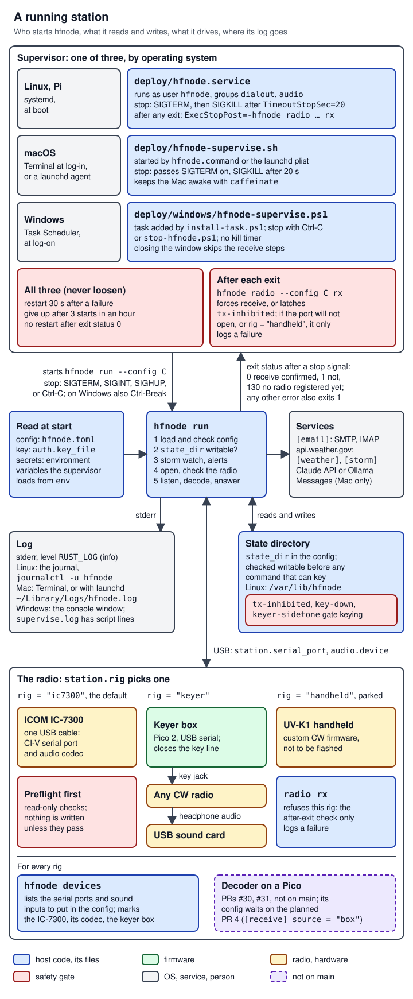
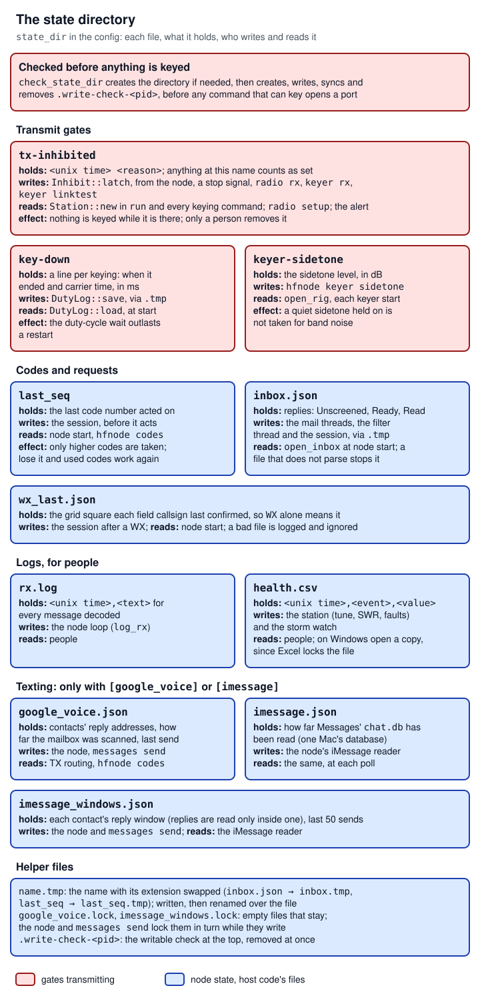

# 15 Config, CLI and deployment

> Everything an operator or a new engineer touches from outside the code: the one TOML file `hfnode` reads (every section and key, its default, its range and the code that checks it), the state directory where the node keeps what must survive a restart (and which of those files stop it transmitting), every `hfnode` subcommand (whether it opens the radio and whether it can transmit), and how the node is kept running on Linux (systemd), macOS (a shell supervisor started from Terminal or launchd) and Windows (a PowerShell supervisor started by Task Scheduler), including how a stop signal reaches the node and where its log goes. The code is in `crates/hfnode/src/config.rs` and `crates/hfnode/src/main.rs`; the start-up files are in `deploy/`. Radio and Morse terms are explained in [17 Glossary](17-glossary.md).

This page cites `main` at `44185fa9a00369c379d9d8af40ca307e3867e860` unless a link says otherwise. The canonical list of every safety limit is [13 Safety rules](13-safety-rules.md); this page cites the limits that live in the config checks and the deployment files and marks them **never loosen**.

**Terms used on this page.** CW is Morse code sent by switching a transmitter's carrier on and off ("keying"). CI-V is ICOM's command protocol, which the IC-7300 speaks over its USB serial port. Tuning runs the radio's antenna tuner, which transmits a steady carrier for a few seconds that does not identify the station. SWR (standing-wave ratio) says how well the antenna takes the power; a high SWR means power is reflected back into the radio. PTT (push-to-talk) is the line that switches a radio to transmit. MCW is Morse sent as an audio tone on an FM carrier, keyed with the PTT. The sidetone is the radio's own audio copy of the Morse it is sending. Break-in is the radio switching itself to transmit when the key closes, and back to receive after a short delay. DTR is a serial-port control line: opening a port can raise it, and some radios transmit while it is raised. The IC-7300's TX Inhibit is a setting in the radio that stops it transmitting; it is separate from hfnode's `tx-inhibited` file in the state directory, although the station sets both when it latches on a fault ([`crates/hfnode/src/station.rs:484-496`](https://github.com/robinonsay/cw-message-gateway/blob/44185fa9a00369c379d9d8af40ca307e3867e860/crates/hfnode/src/station.rs#L484-L496)). dBFS is a sound level in decibels below the loudest a sound card can record. A Maidenhead grid square is the map-square code radio amateurs use for a place (two letters, two digits, and optionally two more letters). E.164 is the international form of a phone number: `+`, the country code and the number, no spaces. The [17 Glossary](17-glossary.md) has more.

## Where it lives

| Path | What it holds | Lines |
|---|---|---|
| `crates/hfnode/src/config.rs` | `Config` and one struct per TOML section, defaults, `Config::load`, `Config::validate`, `Config::warnings`, phone and handle parsing | [`crates/hfnode/src/config.rs:1-1288`](https://github.com/robinonsay/cw-message-gateway/blob/44185fa9a00369c379d9d8af40ca307e3867e860/crates/hfnode/src/config.rs#L1-L1288), tests [`crates/hfnode/src/config.rs:1289-2043`](https://github.com/robinonsay/cw-message-gateway/blob/44185fa9a00369c379d9d8af40ca307e3867e860/crates/hfnode/src/config.rs#L1289-L2043) |
| `crates/hfnode/src/main.rs` | The clap command line, `main`, the stop-signal handler, one function per subcommand | [`crates/hfnode/src/main.rs:22-342`](https://github.com/robinonsay/cw-message-gateway/blob/44185fa9a00369c379d9d8af40ca307e3867e860/crates/hfnode/src/main.rs#L22-L342) (clap), [`crates/hfnode/src/main.rs:344-2006`](https://github.com/robinonsay/cw-message-gateway/blob/44185fa9a00369c379d9d8af40ca307e3867e860/crates/hfnode/src/main.rs#L344-L2006) (code), tests from [`crates/hfnode/src/main.rs:2008-2540`](https://github.com/robinonsay/cw-message-gateway/blob/44185fa9a00369c379d9d8af40ca307e3867e860/crates/hfnode/src/main.rs#L2008-L2540) |
| `crates/hfnode/src/commissioning.rs` | IC-7300 bring-up stages (`station.commissioned`), the bench power cap, `run`'s keying limits | [`crates/hfnode/src/commissioning.rs:24-225`](https://github.com/robinonsay/cw-message-gateway/blob/44185fa9a00369c379d9d8af40ca307e3867e860/crates/hfnode/src/commissioning.rs#L24-L225) |
| `crates/hfnode/src/keyer.rs` | `[keyer]` checks, the keyer bring-up stages, `[keyer] output` | [`crates/hfnode/src/keyer.rs:37-344`](https://github.com/robinonsay/cw-message-gateway/blob/44185fa9a00369c379d9d8af40ca307e3867e860/crates/hfnode/src/keyer.rs#L37-L344) |
| `crates/hfnode/src/handheld.rs` | `[handheld]` checks and its bring-up stages | [`crates/hfnode/src/handheld.rs:95-249`](https://github.com/robinonsay/cw-message-gateway/blob/44185fa9a00369c379d9d8af40ca307e3867e860/crates/hfnode/src/handheld.rs#L95-L249) |
| `crates/hfnode/src/station.rs` | `check_state_dir`, `tx-inhibited`, `key-down`, `health.csv` | [`crates/hfnode/src/station.rs:528-822`](https://github.com/robinonsay/cw-message-gateway/blob/44185fa9a00369c379d9d8af40ca307e3867e860/crates/hfnode/src/station.rs#L528-L822), [`crates/hfnode/src/station.rs:952-968`](https://github.com/robinonsay/cw-message-gateway/blob/44185fa9a00369c379d9d8af40ca307e3867e860/crates/hfnode/src/station.rs#L952-L968) |
| `crates/hfnode/src/node.rs` | `load_codebook`, `session_config`, `build_session_with`, `open_inbox`, `live_services` (what `run` builds from the config before it opens a radio) and the node loop | [`crates/hfnode/src/node.rs:1-770`](https://github.com/robinonsay/cw-message-gateway/blob/44185fa9a00369c379d9d8af40ca307e3867e860/crates/hfnode/src/node.rs#L1-L770), tests from [`crates/hfnode/src/node.rs:771-1519`](https://github.com/robinonsay/cw-message-gateway/blob/44185fa9a00369c379d9d8af40ca307e3867e860/crates/hfnode/src/node.rs#L771-L1519) |
| `crates/hfnode/src/inbox.rs`, `crates/hfnode/src/places.rs` | `inbox.json` and `wx_last.json` in the state directory | [`crates/hfnode/src/inbox.rs:1-182`](https://github.com/robinonsay/cw-message-gateway/blob/44185fa9a00369c379d9d8af40ca307e3867e860/crates/hfnode/src/inbox.rs#L1-L182), [`crates/hfnode/src/places.rs:1-91`](https://github.com/robinonsay/cw-message-gateway/blob/44185fa9a00369c379d9d8af40ca307e3867e860/crates/hfnode/src/places.rs#L1-L91) |
| `crates/hfnode/src/keyer/bench.rs` | `keyer-sidetone`, `open_rig`, the keyer bench commands (`rx`, `linktest`, ...) | [`crates/hfnode/src/keyer/bench.rs:1-749`](https://github.com/robinonsay/cw-message-gateway/blob/44185fa9a00369c379d9d8af40ca307e3867e860/crates/hfnode/src/keyer/bench.rs#L1-L749) |
| `crates/hfnode/src/alert.rs` | The alert thread that emails `[email] alert_to` when transmitting is inhibited | [`crates/hfnode/src/alert.rs:1-412`](https://github.com/robinonsay/cw-message-gateway/blob/44185fa9a00369c379d9d8af40ca307e3867e860/crates/hfnode/src/alert.rs#L1-L412) |
| `crates/hfnode/src/gateway/google_voice.rs`, `crates/hfnode/src/gateway/imessage.rs` | The texting state files and their `.lock` files in the state directory | [`crates/hfnode/src/gateway/google_voice.rs:230-372`](https://github.com/robinonsay/cw-message-gateway/blob/44185fa9a00369c379d9d8af40ca307e3867e860/crates/hfnode/src/gateway/google_voice.rs#L230-L372), [`crates/hfnode/src/gateway/imessage.rs:775-920`](https://github.com/robinonsay/cw-message-gateway/blob/44185fa9a00369c379d9d8af40ca307e3867e860/crates/hfnode/src/gateway/imessage.rs#L775-L920) |
| `crates/civ/src/preflight.rs` | The IC-7300's read-only preflight that every IC-7300 command that writes runs first | [`crates/civ/src/preflight.rs:1-409`](https://github.com/robinonsay/cw-message-gateway/blob/44185fa9a00369c379d9d8af40ca307e3867e860/crates/civ/src/preflight.rs#L1-L409) |
| `README.md`, "Commands" | The table of every command; `the_readme_lists_every_command` fails if a top-level, `radio` or `keyer` command has no row ([`crates/hfnode/src/main.rs:2494-2514`](https://github.com/robinonsay/cw-message-gateway/blob/44185fa9a00369c379d9d8af40ca307e3867e860/crates/hfnode/src/main.rs#L2494-L2514)) | [`README.md:353-391`](https://github.com/robinonsay/cw-message-gateway/blob/44185fa9a00369c379d9d8af40ca307e3867e860/README.md#L353-L391) |
| `crates/auth/src/store.rs` | `last_seq` and the durable `replace_file` every JSON store uses | [`crates/auth/src/store.rs:1-106`](https://github.com/robinonsay/cw-message-gateway/blob/44185fa9a00369c379d9d8af40ca307e3867e860/crates/auth/src/store.rs#L1-L106) |
| `hfnode.example.toml` | The annotated example config, parsed and validated by a unit test | [`hfnode.example.toml:1-208`](https://github.com/robinonsay/cw-message-gateway/blob/44185fa9a00369c379d9d8af40ca307e3867e860/hfnode.example.toml#L1-L208) |
| `deploy/hfnode.service` | systemd unit (Linux, Raspberry Pi) | [`deploy/hfnode.service:1-81`](https://github.com/robinonsay/cw-message-gateway/blob/44185fa9a00369c379d9d8af40ca307e3867e860/deploy/hfnode.service#L1-L81) |
| `deploy/hfnode-supervise.sh` | POSIX `sh` supervisor (macOS, or Unix without systemd) | [`deploy/hfnode-supervise.sh:1-170`](https://github.com/robinonsay/cw-message-gateway/blob/44185fa9a00369c379d9d8af40ca307e3867e860/deploy/hfnode-supervise.sh#L1-L170) |
| `deploy/macos/hfnode.command` | Double-click starter for Terminal | [`deploy/macos/hfnode.command:1-11`](https://github.com/robinonsay/cw-message-gateway/blob/44185fa9a00369c379d9d8af40ca307e3867e860/deploy/macos/hfnode.command#L1-L11) |
| `deploy/macos/io.github.robinonsay.hfnode.plist` | launchd agent (no window) | [`deploy/macos/io.github.robinonsay.hfnode.plist:1-57`](https://github.com/robinonsay/cw-message-gateway/blob/44185fa9a00369c379d9d8af40ca307e3867e860/deploy/macos/io.github.robinonsay.hfnode.plist#L1-L57) |
| `deploy/windows/hfnode-supervise.ps1` | PowerShell supervisor | [`deploy/windows/hfnode-supervise.ps1:1-119`](https://github.com/robinonsay/cw-message-gateway/blob/44185fa9a00369c379d9d8af40ca307e3867e860/deploy/windows/hfnode-supervise.ps1#L1-L119) |
| `deploy/windows/install-task.ps1` | Registers the `hfnode` scheduled task | [`deploy/windows/install-task.ps1:1-45`](https://github.com/robinonsay/cw-message-gateway/blob/44185fa9a00369c379d9d8af40ca307e3867e860/deploy/windows/install-task.ps1#L1-L45) |
| `deploy/windows/stop-hfnode.ps1` | Ends task, supervisors and node, then checks receive | [`deploy/windows/stop-hfnode.ps1:1-40`](https://github.com/robinonsay/cw-message-gateway/blob/44185fa9a00369c379d9d8af40ca307e3867e860/deploy/windows/stop-hfnode.ps1#L1-L40) |
| `deploy/windows/test-supervise.ps1` | CI test of the PowerShell supervisor with a stand-in node | [`deploy/windows/test-supervise.ps1:1-95`](https://github.com/robinonsay/cw-message-gateway/blob/44185fa9a00369c379d9d8af40ca307e3867e860/deploy/windows/test-supervise.ps1#L1-L95) |
| `crates/hfnode/tests/deploy_unit.rs` | Checks on the systemd unit's text | [`crates/hfnode/tests/deploy_unit.rs:1-41`](https://github.com/robinonsay/cw-message-gateway/blob/44185fa9a00369c379d9d8af40ca307e3867e860/crates/hfnode/tests/deploy_unit.rs#L1-L41) |
| `crates/hfnode/tests/supervise_script.rs` | Runs `hfnode-supervise.sh` under `sh`, `dash` and `bash` with a stand-in node | [`crates/hfnode/tests/supervise_script.rs:1-262`](https://github.com/robinonsay/cw-message-gateway/blob/44185fa9a00369c379d9d8af40ca307e3867e860/crates/hfnode/tests/supervise_script.rs#L1-L262) |
| `crates/hfnode/tests/stop_signal.rs` | SIGTERM, SIGINT and SIGHUP reach the node's handler (Unix) | [`crates/hfnode/tests/stop_signal.rs:1-63`](https://github.com/robinonsay/cw-message-gateway/blob/44185fa9a00369c379d9d8af40ca307e3867e860/crates/hfnode/tests/stop_signal.rs#L1-L63) |

The setup guides are [docs/raspberry-pi-setup.md](../raspberry-pi-setup.md), [docs/macos-setup.md](../macos-setup.md) and [docs/windows-setup.md](../windows-setup.md); they are summarised under [Setup guides](#setup-guides) below.

## How it works

`hfnode` is one binary with many subcommands. Every subcommand that needs the station's settings takes `--config FILE`, and every one of them first runs `Config::load` on it: read, parse with serde (unknown keys are errors), expand a leading `~`, then check every value ([`crates/hfnode/src/config.rs:889-897`](https://github.com/robinonsay/cw-message-gateway/blob/44185fa9a00369c379d9d8af40ca307e3867e860/crates/hfnode/src/config.rs#L889-L897)). Nothing is opened before that check passes. There is no separate "check the config" subcommand (not found in the code at `44185fa`). Every `--config` command runs the checks above, but some keys and files are read only when the part that uses them is built: `hfnode codes --config C` also reads the key file, checks `[auth] alphabet` and reads `last_seq`, and opens neither a radio nor the network ([`crates/hfnode/src/main.rs:552-555`](https://github.com/robinonsay/cw-message-gateway/blob/44185fa9a00369c379d9d8af40ca307e3867e860/crates/hfnode/src/main.rs#L552-L555)). The two secrets and `email.from_address` are read by each command that uses them, not only by `run`, so set the environment variables before running any of these by hand:

- `run`, `sim` without `--offline` and `messages send` build the mailer when `[email]` is set ([`crates/hfnode/src/node.rs:349-352`](https://github.com/robinonsay/cw-message-gateway/blob/44185fa9a00369c379d9d8af40ca307e3867e860/crates/hfnode/src/node.rs#L349-L352)). It reads the email password and parses `email.from_address` ([`crates/hfnode/src/gateway/email.rs:33-34`](https://github.com/robinonsay/cw-message-gateway/blob/44185fa9a00369c379d9d8af40ca307e3867e860/crates/hfnode/src/gateway/email.rs#L33-L34), [`crates/hfnode/src/gateway/email.rs:43`](https://github.com/robinonsay/cw-message-gateway/blob/44185fa9a00369c379d9d8af40ca307e3867e860/crates/hfnode/src/gateway/email.rs#L43)); `messages send` reaches it through [`crates/hfnode/src/messages.rs:355`](https://github.com/robinonsay/cw-message-gateway/blob/44185fa9a00369c379d9d8af40ca307e3867e860/crates/hfnode/src/messages.rs#L355). A missing variable or a bad address stops the command with `environment variable ... is not set` or `email.from_address`.
- `messages check` reads the email password when it logs in to IMAP ([`crates/hfnode/src/gateway/email.rs:732-733`](https://github.com/robinonsay/cw-message-gateway/blob/44185fa9a00369c379d9d8af40ca307e3867e860/crates/hfnode/src/gateway/email.rs#L732-L733), called from [`crates/hfnode/src/messages.rs:127`](https://github.com/robinonsay/cw-message-gateway/blob/44185fa9a00369c379d9d8af40ca307e3867e860/crates/hfnode/src/messages.rs#L127) and [`crates/hfnode/src/messages.rs:230`](https://github.com/robinonsay/cw-message-gateway/blob/44185fa9a00369c379d9d8af40ca307e3867e860/crates/hfnode/src/messages.rs#L230)). It does not stop: it prints the error on its `mailbox:` line and goes on ([`crates/hfnode/src/messages.rs:88-97`](https://github.com/robinonsay/cw-message-gateway/blob/44185fa9a00369c379d9d8af40ca307e3867e860/crates/hfnode/src/messages.rs#L88-L97)). `messages send` logs in the same way, with the same printed-not-fatal handling, when it looks up a contact's Google Voice reply address first ([`crates/hfnode/src/messages.rs:382-399`](https://github.com/robinonsay/cw-message-gateway/blob/44185fa9a00369c379d9d8af40ca307e3867e860/crates/hfnode/src/messages.rs#L382-L399)).
- `filter test` and `filter screen` read the Claude API key named by `filter.api_key_env` when `filter.provider = "claude"`, the default ([`crates/hfnode/src/gateway/filter.rs:285-286`](https://github.com/robinonsay/cw-message-gateway/blob/44185fa9a00369c379d9d8af40ca307e3867e860/crates/hfnode/src/gateway/filter.rs#L285-L286), through [`crates/hfnode/src/main.rs:1161`](https://github.com/robinonsay/cw-message-gateway/blob/44185fa9a00369c379d9d8af40ca307e3867e860/crates/hfnode/src/main.rs#L1161)); a missing key stops them. `run` reads the same key in its screening thread, where a missing key holds inbound messages instead of stopping the node ([`crates/hfnode/src/node.rs:310-321`](https://github.com/robinonsay/cw-message-gateway/blob/44185fa9a00369c379d9d8af40ca307e3867e860/crates/hfnode/src/node.rs#L310-L321)).

`hfnode storm --config C` is not a general check: it fails without a `[storm]` section ([`crates/hfnode/src/main.rs:1134-1138`](https://github.com/robinonsay/cw-message-gateway/blob/44185fa9a00369c379d9d8af40ca307e3867e860/crates/hfnode/src/main.rs#L1134-L1138)), and otherwise only asks the weather service whether a storm hold would be on.

The long-running command is `hfnode run --config C`. It is never started by hand in normal use: a supervisor starts it, stops it, runs `hfnode radio --config C rx` after every exit to put the radio on receive or latch `tx-inhibited` (that check can only log a failure when the port will not open, or with `station.rig = "handheld"`: see below), and restarts it after a failure, at most three starts an hour. There is one supervisor per operating system, and all three follow the same rules.



*Figure: the supervisor owns the node's life cycle on every OS; the node itself reads the config, key and secrets at start, keeps its state in one directory, logs to stderr, and drives one of three radio routes over USB.*

### What `hfnode run` does at start

1. `Config::load` parses and checks the file ([`crates/hfnode/src/main.rs:383`](https://github.com/robinonsay/cw-message-gateway/blob/44185fa9a00369c379d9d8af40ca307e3867e860/crates/hfnode/src/main.rs#L383)).
2. `check_state_dir` proves the state directory can be written before anything else, whichever radio it is ([`crates/hfnode/src/main.rs:1219-1221`](https://github.com/robinonsay/cw-message-gateway/blob/44185fa9a00369c379d9d8af40ca307e3867e860/crates/hfnode/src/main.rs#L1219-L1221), [`crates/hfnode/src/station.rs:600-633`](https://github.com/robinonsay/cw-message-gateway/blob/44185fa9a00369c379d9d8af40ca307e3867e860/crates/hfnode/src/station.rs#L600-L633)).
3. The storm watch starts; `run` refuses to start without a `[storm]` section ([`crates/hfnode/src/main.rs:1110-1132`](https://github.com/robinonsay/cw-message-gateway/blob/44185fa9a00369c379d9d8af40ca307e3867e860/crates/hfnode/src/main.rs#L1110-L1132)).
4. The alert thread starts (it emails `[email] alert_to` if transmitting is inhibited) ([`crates/hfnode/src/main.rs:1224-1225`](https://github.com/robinonsay/cw-message-gateway/blob/44185fa9a00369c379d9d8af40ca307e3867e860/crates/hfnode/src/main.rs#L1224-L1225), [`crates/hfnode/src/alert.rs:105-134`](https://github.com/robinonsay/cw-message-gateway/blob/44185fa9a00369c379d9d8af40ca307e3867e860/crates/hfnode/src/alert.rs#L105-L134)).
5. `run_node` opens `inbox.json`, builds the session (reads the key file named by `auth.key_file`, checks `[auth] alphabet`, reads `last_seq`), and builds the mail and texting services with `live_services`, whose mailer needs the email password from the environment and parses `email.from_address` ([`crates/hfnode/src/main.rs:1233-1246`](https://github.com/robinonsay/cw-message-gateway/blob/44185fa9a00369c379d9d8af40ca307e3867e860/crates/hfnode/src/main.rs#L1233-L1246), [`crates/hfnode/src/node.rs:68-95`](https://github.com/robinonsay/cw-message-gateway/blob/44185fa9a00369c379d9d8af40ca307e3867e860/crates/hfnode/src/node.rs#L68-L95), [`crates/hfnode/src/node.rs:343-365`](https://github.com/robinonsay/cw-message-gateway/blob/44185fa9a00369c379d9d8af40ca307e3867e860/crates/hfnode/src/node.rs#L343-L365), [`crates/hfnode/src/gateway/email.rs:33-34`](https://github.com/robinonsay/cw-message-gateway/blob/44185fa9a00369c379d9d8af40ca307e3867e860/crates/hfnode/src/gateway/email.rs#L33-L34), [`crates/hfnode/src/gateway/email.rs:43`](https://github.com/robinonsay/cw-message-gateway/blob/44185fa9a00369c379d9d8af40ca307e3867e860/crates/hfnode/src/gateway/email.rs#L43)). A failure here stops `run` before any radio is opened.
6. It opens the radio for `station.rig`: the IC-7300 through `open_for` (bring-up stage and read-only preflight), the keyer box through `open_keyer`, or the handheld ([`crates/hfnode/src/main.rs:1247-1265`](https://github.com/robinonsay/cw-message-gateway/blob/44185fa9a00369c379d9d8af40ca307e3867e860/crates/hfnode/src/main.rs#L1247-L1265)).
7. `serve` starts the inbound mail threads, builds the `Station` (which reads `tx-inhibited` and `key-down`), registers it with the stop handler, waits up to 60 s for the first storm answer, sets the radio up, checks it, starts the audio capture and enters the node loop ([`crates/hfnode/src/main.rs:1281-1333`](https://github.com/robinonsay/cw-message-gateway/blob/44185fa9a00369c379d9d8af40ca307e3867e860/crates/hfnode/src/main.rs#L1281-L1333)).

The node loop itself is [05 Node loop and station safety](05-node-loop-station-safety.md).

### How a stop reaches the node

`main` installs one handler for every stop signal once it has parsed the command line and started the logger, before it runs any command ([`crates/hfnode/src/main.rs:345-353`](https://github.com/robinonsay/cw-message-gateway/blob/44185fa9a00369c379d9d8af40ca307e3867e860/crates/hfnode/src/main.rs#L345-L353)). The `ctrlc` crate is built with its `termination` feature ([`crates/hfnode/Cargo.toml:16`](https://github.com/robinonsay/cw-message-gateway/blob/44185fa9a00369c379d9d8af40ca307e3867e860/crates/hfnode/Cargo.toml#L16)), so the handler runs on SIGINT, SIGTERM and SIGHUP on Unix, and on a console Ctrl-C or Ctrl-Break on Windows ([`crates/hfnode/src/main.rs:450-459`](https://github.com/robinonsay/cw-message-gateway/blob/44185fa9a00369c379d9d8af40ca307e3867e860/crates/hfnode/src/main.rs#L450-L459)).

The handler (`stop_guarded`, [`crates/hfnode/src/main.rs:461-475`](https://github.com/robinonsay/cw-message-gateway/blob/44185fa9a00369c379d9d8af40ca307e3867e860/crates/hfnode/src/main.rs#L461-L475)):

1. Looks for a radio registered by `guard_station` ([`crates/hfnode/src/main.rs:446-448`](https://github.com/robinonsay/cw-message-gateway/blob/44185fa9a00369c379d9d8af40ca307e3867e860/crates/hfnode/src/main.rs#L446-L448)). Commands register it only once they may write to the radio. With none, it exits **130**. So 130 means no radio was registered, not that no port was open: a stop during `open_for`'s read-only preflight, with the port already open, also exits 130.
2. `stop_radio` takes the radio within `STOP_WAIT` = 10 s ([`crates/hfnode/src/main.rs:477-480`](https://github.com/robinonsay/cw-message-gateway/blob/44185fa9a00369c379d9d8af40ca307e3867e860/crates/hfnode/src/main.rs#L477-L480)), stops the keyer and confirms receive with `force_receive_or_latch`. If it cannot get the radio in time, or receive is not confirmed, it latches `tx-inhibited` ([`crates/hfnode/src/main.rs:489-524`](https://github.com/robinonsay/cw-message-gateway/blob/44185fa9a00369c379d9d8af40ca307e3867e860/crates/hfnode/src/main.rs#L489-L524)).
3. It waits at most `STOP_ALERT_WAIT` = 5 s for a queued inhibit alert to be emailed ([`crates/hfnode/src/main.rs:482-487`](https://github.com/robinonsay/cw-message-gateway/blob/44185fa9a00369c379d9d8af40ca307e3867e860/crates/hfnode/src/main.rs#L482-L487)).
4. It exits **0** if receive was confirmed and **1** if not, still holding the radio when it got it, so nothing else can key it in between. If it could not get the radio within `STOP_WAIT`, it has latched `tx-inhibited` and exits 1 without it.

Any other error also exits 1, because `main` returns a `Result`: a `1` in the supervisor's log does not by itself mean that a stop failed to confirm receive.

The supervisor then runs `hfnode radio --config C rx` (for `station.rig = "keyer"` this is `hfnode keyer rx`, [`crates/hfnode/src/main.rs:963-977`](https://github.com/robinonsay/cw-message-gateway/blob/44185fa9a00369c379d9d8af40ca307e3867e860/crates/hfnode/src/main.rs#L963-L977)), which checks receive again from a fresh process. That check forces nothing and latches nothing when it cannot open the port (the radio off, or the cable out), or when `station.rig = "handheld"`, which `radio_route` refuses: it then only fails, and the supervisor logs it ([`crates/hfnode/src/main.rs:973-975`](https://github.com/robinonsay/cw-message-gateway/blob/44185fa9a00369c379d9d8af40ca307e3867e860/crates/hfnode/src/main.rs#L973-L975), [`crates/hfnode/src/main.rs:1003-1006`](https://github.com/robinonsay/cw-message-gateway/blob/44185fa9a00369c379d9d8af40ca307e3867e860/crates/hfnode/src/main.rs#L1003-L1006), [`crates/hfnode/src/main.rs:1397-1401`](https://github.com/robinonsay/cw-message-gateway/blob/44185fa9a00369c379d9d8af40ca307e3867e860/crates/hfnode/src/main.rs#L1397-L1401)).

**Never loosen: the stop budget.** The service kills the node 20 s after asking it to stop (`TimeoutStopSec=20`, [`deploy/hfnode.service:36`](https://github.com/robinonsay/cw-message-gateway/blob/44185fa9a00369c379d9d8af40ca307e3867e860/deploy/hfnode.service#L36); `HFNODE_STOP_TIMEOUT` default 20, [`deploy/hfnode-supervise.sh:32`](https://github.com/robinonsay/cw-message-gateway/blob/44185fa9a00369c379d9d8af40ca307e3867e860/deploy/hfnode-supervise.sh#L32)). `STOP_WAIT` + 3 s for the receive check + `STOP_ALERT_WAIT` must fit inside it, so that the inhibit is latched and the node gone before the kill (the safety audit's m02). The test `a_stop_ends_before_the_service_kills_the_node` reads both files and enforces it ([`crates/hfnode/src/main.rs:2446-2471`](https://github.com/robinonsay/cw-message-gateway/blob/44185fa9a00369c379d9d8af40ca307e3867e860/crates/hfnode/src/main.rs#L2446-L2471)). Never lengthen `STOP_WAIT` or `STOP_ALERT_WAIT`, and never shorten `TimeoutStopSec` or `HFNODE_STOP_TIMEOUT`; `a_stop_ends_before_the_service_kills_the_node` enforces the sum.

### Where the log goes

`hfnode` logs through `env_logger` to stderr. The default level is `info` (`off` for `selftest`), and `RUST_LOG` replaces it ([`crates/hfnode/src/main.rs:346-352`](https://github.com/robinonsay/cw-message-gateway/blob/44185fa9a00369c379d9d8af40ca307e3867e860/crates/hfnode/src/main.rs#L346-L352)). The README gives the useful settings, for example `RUST_LOG=info,civ=trace` to see every CI-V frame (README.md, the logging paragraph under "Commands", [`README.md:393-400`](https://github.com/robinonsay/cw-message-gateway/blob/44185fa9a00369c379d9d8af40ca307e3867e860/README.md#L393-L400)).

| Supervisor | Where the node's log goes | Where the supervisor's own lines go |
|---|---|---|
| systemd | The journal: `journalctl -u hfnode -f`. The unit sets `RUST_LOG=info` ([`deploy/hfnode.service:27`](https://github.com/robinonsay/cw-message-gateway/blob/44185fa9a00369c379d9d8af40ca307e3867e860/deploy/hfnode.service#L27)). | The journal (`ExecStopPost` output too). |
| `hfnode.command` in Terminal | The Terminal window. | The same window (`log` prints to stdout, [`deploy/hfnode-supervise.sh:34-36`](https://github.com/robinonsay/cw-message-gateway/blob/44185fa9a00369c379d9d8af40ca307e3867e860/deploy/hfnode-supervise.sh#L34-L36)). |
| launchd agent | `~/Library/Logs/hfnode.log`, stdout and stderr both ([`deploy/macos/io.github.robinonsay.hfnode.plist:52-55`](https://github.com/robinonsay/cw-message-gateway/blob/44185fa9a00369c379d9d8af40ca307e3867e860/deploy/macos/io.github.robinonsay.hfnode.plist#L52-L55)). | The same file. |
| Task Scheduler | The console window only; it stays open after the supervisor ends (`-NoExit`, [`deploy/windows/install-task.ps1:31-33`](https://github.com/robinonsay/cw-message-gateway/blob/44185fa9a00369c379d9d8af40ca307e3867e860/deploy/windows/install-task.ps1#L31-L33)). | The window, and appended to `supervise.log` in the node's folder ([`deploy/windows/hfnode-supervise.ps1:49-53`](https://github.com/robinonsay/cw-message-gateway/blob/44185fa9a00369c379d9d8af40ca307e3867e860/deploy/windows/hfnode-supervise.ps1#L49-L53)). The node's own lines are **not** in `supervise.log`. |

The node also keeps two logs of its own in the state directory: `rx.log` (every decoded message) and `health.csv` (tunes, SWR, faults, storm holds). See [The state directory](#the-state-directory).

## How it connects

The [deployment figure above](#how-it-works) shows the node's neighbours: the supervisor that starts and stops it, the config, key file and secrets it reads, the network services it calls, its log, its state directory and the radio route it drives. The table below says which part of the code reads each config section.

| Config section | Read by | Page |
|---|---|---|
| top level `state_dir` | `check_state_dir`, the station, the session, the gateways | this page, [05](05-node-loop-station-safety.md) |
| top level `pending_timeout_secs` | `session_config` ([`crates/hfnode/src/node.rs:48-61`](https://github.com/robinonsay/cw-message-gateway/blob/44185fa9a00369c379d9d8af40ca307e3867e860/crates/hfnode/src/node.rs#L48-L61)) | [03 Field protocol, auth and session](03-field-protocol-auth-session.md) |
| `[station]` | `StationConfig::from_config` ([`crates/hfnode/src/station.rs:149-178`](https://github.com/robinonsay/cw-message-gateway/blob/44185fa9a00369c379d9d8af40ca307e3867e860/crates/hfnode/src/station.rs#L149-L178)), `commissioning::open_for`, the CI-V driver | [05](05-node-loop-station-safety.md), [07 CI-V and the IC-7300](07-civ-ic7300.md) |
| `[audio]` | the capture and the decoder (`decoder_config`, [`crates/hfnode/src/config.rs:1197-1202`](https://github.com/robinonsay/cw-message-gateway/blob/44185fa9a00369c379d9d8af40ca307e3867e860/crates/hfnode/src/config.rs#L1197-L1202)) | [04 CW decoder and audio](04-cw-decoder-audio.md) |
| `[auth]` | `load_codebook` ([`crates/hfnode/src/node.rs:36-46`](https://github.com/robinonsay/cw-message-gateway/blob/44185fa9a00369c379d9d8af40ca307e3867e860/crates/hfnode/src/node.rs#L36-L46)) | [03](03-field-protocol-auth-session.md) |
| `[schedule]` | the node loop | [05](05-node-loop-station-safety.md) |
| `[email]`, `[google_voice]`, `[imessage]`, `[[contacts]]` | the gateways, the alert thread | [06 Gateways and messages](06-gateways-messages.md) |
| `[weather]` | the session (`WX`) and the weather gateway | [06](06-gateways-messages.md), [03](03-field-protocol-auth-session.md) |
| `[storm]` | the storm watch | [05](05-node-loop-station-safety.md) |
| `[filter]` | the reply filter | [06](06-gateways-messages.md) |
| `[keyer]` | the keyer host side | [09 Keyer box: host side](09-keyer-host-side.md) |
| `[handheld]` | the handheld route (parked) | [10 UV-K1 handheld](10-uv-k1-handheld.md) |

Outside the config, the node reads two secrets from environment variables named in the config, a key file named in the config, and writes only in the state directory (and in files named on the command line: `keygen --out`, `record --out`, `synth --out`, `testvectors --out`, `messages check --save-raw`, `selftest --csv`).

## Interfaces and APIs

### Loading the config

| Item | Signature | What it does |
|---|---|---|
| `Config::load` | `pub fn load(path: &Path) -> Result<Self>` ([`crates/hfnode/src/config.rs:889-897`](https://github.com/robinonsay/cw-message-gateway/blob/44185fa9a00369c379d9d8af40ca307e3867e860/crates/hfnode/src/config.rs#L889-L897)) | Read, `toml::from_str`, `expand_paths`, `validate`. Read and parse errors name the file; check errors name the key. |
| `expand_paths` | private ([`crates/hfnode/src/config.rs:899-908`](https://github.com/robinonsay/cw-message-gateway/blob/44185fa9a00369c379d9d8af40ca307e3867e860/crates/hfnode/src/config.rs#L899-L908)) | Expands a leading `~` in `state_dir`, `auth.key_file` and `imessage.db`, and nowhere else. |
| `expand_home`, `expand_home_from`, `home_dir` | ([`crates/hfnode/src/config.rs:860-886`](https://github.com/robinonsay/cw-message-gateway/blob/44185fa9a00369c379d9d8af40ca307e3867e860/crates/hfnode/src/config.rs#L860-L886)) | `~` is `HOME` (`USERPROFILE` on Windows); a path starting with `~` and no known home is an error; `~op/x` is not expanded. |
| `Config::validate` | `pub fn validate(&self) -> Result<()>` ([`crates/hfnode/src/config.rs:910-1178`](https://github.com/robinonsay/cw-message-gateway/blob/44185fa9a00369c379d9d8af40ca307e3867e860/crates/hfnode/src/config.rs#L910-L1178)) | The `[station]`, contact, texting, `alert_to`, `[weather]` and `[storm]` checks below, then `[filter]`, `[schedule]`, the decoder's audio check, `keyer::validate` and `handheld::validate`. First failure wins. |
| `Config::warnings` | `pub fn warnings(&self) -> Vec<String>` ([`crates/hfnode/src/config.rs:1217-1256`](https://github.com/robinonsay/cw-message-gateway/blob/44185fa9a00369c379d9d8af40ca307e3867e860/crates/hfnode/src/config.rs#L1217-L1256)) | Settings that work but are probably wrong; logged by the node at start ([`crates/hfnode/src/node.rs:161-163`](https://github.com/robinonsay/cw-message-gateway/blob/44185fa9a00369c379d9d8af40ca307e3867e860/crates/hfnode/src/node.rs#L161-L163)) and printed by `messages check`. |
| `Config::storm_user_agent` | ([`crates/hfnode/src/config.rs:1180-1195`](https://github.com/robinonsay/cw-message-gateway/blob/44185fa9a00369c379d9d8af40ca307e3867e860/crates/hfnode/src/config.rs#L1180-L1195)) | `storm.user_agent`, else `weather.user_agent`, ignoring blank ones. |
| `Config::decoder_config` | ([`crates/hfnode/src/config.rs:1197-1202`](https://github.com/robinonsay/cw-message-gateway/blob/44185fa9a00369c379d9d8af40ca307e3867e860/crates/hfnode/src/config.rs#L1197-L1202)) | `[audio]` as a `cw::DecoderConfig`. |
| `Config::weather_presets` | ([`crates/hfnode/src/config.rs:1208-1215`](https://github.com/robinonsay/cw-message-gateway/blob/44185fa9a00369c379d9d8af40ca307e3867e860/crates/hfnode/src/config.rs#L1208-L1215)) | `(number, UPPERCASED grid)` pairs. |
| `Config::contact_names` | `pub fn contact_names(&self) -> Vec<String>` ([`crates/hfnode/src/config.rs:1204-1206`](https://github.com/robinonsay/cw-message-gateway/blob/44185fa9a00369c379d9d8af40ca307e3867e860/crates/hfnode/src/config.rs#L1204-L1206)) | The contacts' names, in config order: the session's vocabulary for `TX`. |
| `Schedule::is_open` | `pub fn is_open(&self, unix_secs: u64) -> bool` ([`crates/hfnode/src/config.rs:244-255`](https://github.com/robinonsay/cw-message-gateway/blob/44185fa9a00369c379d9d8af40ca307e3867e860/crates/hfnode/src/config.rs#L244-L255)) | Whether the node listens at that time; see [The listening schedule](#the-listening-schedule). |
| `Filter::model`, `Filter::base_url`, `Filter::timeout_secs` | `-> Option<&str>`, `-> String`, `-> u64` ([`crates/hfnode/src/config.rs:603-631`](https://github.com/robinonsay/cw-message-gateway/blob/44185fa9a00369c379d9d8af40ca307e3867e860/crates/hfnode/src/config.rs#L603-L631)) | The `[filter]` values with the provider's defaults filled in (the model is `None` for Ollama without one; the URL loses a trailing `/`). |
| `Filter::validate` | `pub fn validate(&self) -> Result<()>` ([`crates/hfnode/src/config.rs:633-705`](https://github.com/robinonsay/cw-message-gateway/blob/44185fa9a00369c379d9d8af40ca307e3867e860/crates/hfnode/src/config.rs#L633-L705)) | The `[filter]` checks; called by `Config::validate`. |
| `Provider` | `enum Provider { Claude, Ollama }`, lowercase in TOML ([`crates/hfnode/src/config.rs:579-585`](https://github.com/robinonsay/cw-message-gateway/blob/44185fa9a00369c379d9d8af40ca307e3867e860/crates/hfnode/src/config.rs#L579-L585)) | `filter.provider`. |
| `Phone` | `struct Phone(String)`: `parse`, `as_str`, `is_nanp`, `Display`, `Deserialize` ([`crates/hfnode/src/config.rs:306-341`](https://github.com/robinonsay/cw-message-gateway/blob/44185fa9a00369c379d9d8af40ca307e3867e860/crates/hfnode/src/config.rs#L306-L341)) | A phone number held in E.164 form; `is_nanp` is "+1 and 10 digits". A config value that does not parse is a load error naming the value. |
| `Handle` | `enum Handle { Phone(Phone), Email(String) }`: `parse`, `as_str`, `Display` ([`crates/hfnode/src/config.rs:343-376`](https://github.com/robinonsay/cw-message-gateway/blob/44185fa9a00369c379d9d8af40ca307e3867e860/crates/hfnode/src/config.rs#L343-L376)) | An iMessage handle; an email is lowercased; a leading `-` is refused. See [06](06-gateways-messages.md). |
| `canonical_phone` | `pub fn canonical_phone(s: &str) -> Option<String>` ([`crates/hfnode/src/config.rs:406-425`](https://github.com/robinonsay/cw-message-gateway/blob/44185fa9a00369c379d9d8af40ca307e3867e860/crates/hfnode/src/config.rs#L406-L425)) | The E.164 rules described under `[[contacts]]` below. |
| `handle_key` | `pub fn handle_key(id: &str) -> Option<String>` ([`crates/hfnode/src/config.rs:430-437`](https://github.com/robinonsay/cw-message-gateway/blob/44185fa9a00369c379d9d8af40ca307e3867e860/crates/hfnode/src/config.rs#L430-L437)) | How a Messages handle is compared with contacts' handles: email lowercased, phone in E.164, only equal keys match. See [06](06-gateways-messages.md). |
| `GOOGLE_VOICE_DOMAIN` | `pub const GOOGLE_VOICE_DOMAIN: &str = "txt.voice.google.com"` ([`crates/hfnode/src/config.rs:448`](https://github.com/robinonsay/cw-message-gateway/blob/44185fa9a00369c379d9d8af40ca307e3867e860/crates/hfnode/src/config.rs#L448)) | The domain Google Voice relays texts from; a contact's `address` may not be on it. See [06](06-gateways-messages.md). |

Every section struct carries `#[serde(deny_unknown_fields)]` (for example [`crates/hfnode/src/config.rs:8`](https://github.com/robinonsay/cw-message-gateway/blob/44185fa9a00369c379d9d8af40ca307e3867e860/crates/hfnode/src/config.rs#L8)), so a misspelt key stops the load instead of being ignored. The test `example_config_parses` parses and validates `hfnode.example.toml` ([`crates/hfnode/src/config.rs:1317-1330`](https://github.com/robinonsay/cw-message-gateway/blob/44185fa9a00369c379d9d8af40ca307e3867e860/crates/hfnode/src/config.rs#L1317-L1330)), so the example cannot drift into an invalid file.

### Top level

| Key | Type | Default | Range and check | Notes |
|---|---|---|---|---|
| `state_dir` | path | required | Must be a full path, or start with `~` ([`crates/hfnode/src/config.rs:911-924`](https://github.com/robinonsay/cw-message-gateway/blob/44185fa9a00369c379d9d8af40ca307e3867e860/crates/hfnode/src/config.rs#L911-L924)). | **Never loosen:** a relative path would put `tx-inhibited` in two places depending on where a command is started, and an inhibit latched by one would not stop the other (the safety audit's K6). On Windows `\hfnode` (root of the current drive) is let through. Test: `state_dir_must_be_a_full_path` ([`crates/hfnode/src/config.rs:1708-1737`](https://github.com/robinonsay/cw-message-gateway/blob/44185fa9a00369c379d9d8af40ca307e3867e860/crates/hfnode/src/config.rs#L1708-L1737)). |
| `pending_timeout_secs` | u64 | 600 ([`crates/hfnode/src/config.rs:731-733`](https://github.com/robinonsay/cw-message-gateway/blob/44185fa9a00369c379d9d8af40ca307e3867e860/crates/hfnode/src/config.rs#L731-L733)) | No range check found in `validate`. | How long an open transaction waits for its commit; the repeat window is `max(this, 600)` s ([`crates/hfnode/src/node.rs:51-54`](https://github.com/robinonsay/cw-message-gateway/blob/44185fa9a00369c379d9d8af40ca307e3867e860/crates/hfnode/src/node.rs#L51-L54)). See [03](03-field-protocol-auth-session.md). |

Sections `[station]`, `[audio]` and `[auth]` are required; `[schedule]` and `[filter]` default when left out; `[email]`, `[google_voice]`, `[imessage]`, `[weather]`, `[storm]`, `[keyer]` and `[handheld]` are optional, and `[[contacts]]` may be empty ([`crates/hfnode/src/config.rs:7-36`](https://github.com/robinonsay/cw-message-gateway/blob/44185fa9a00369c379d9d8af40ca307e3867e860/crates/hfnode/src/config.rs#L7-L36)). `run` needs `[storm]` even so ([`crates/hfnode/src/main.rs:1110-1117`](https://github.com/robinonsay/cw-message-gateway/blob/44185fa9a00369c379d9d8af40ca307e3867e860/crates/hfnode/src/main.rs#L1110-L1117)).

### `[station]`

Struct [`crates/hfnode/src/config.rs:38-83`](https://github.com/robinonsay/cw-message-gateway/blob/44185fa9a00369c379d9d8af40ca307e3867e860/crates/hfnode/src/config.rs#L38-L83). Defaults [`crates/hfnode/src/config.rs:734-757`](https://github.com/robinonsay/cw-message-gateway/blob/44185fa9a00369c379d9d8af40ca307e3867e860/crates/hfnode/src/config.rs#L734-L757).

| Key | Type | Default | Range and check | Notes |
|---|---|---|---|---|
| `rig` | `"ic7300"`, `"keyer"`, `"handheld"` | `"ic7300"` ([`crates/hfnode/src/config.rs:84-93`](https://github.com/robinonsay/cw-message-gateway/blob/44185fa9a00369c379d9d8af40ca307e3867e860/crates/hfnode/src/config.rs#L84-L93)) | serde enum | Picks the radio route. `"keyer"` needs `[keyer]`, `"handheld"` needs `[handheld]`. |
| `node_call` | string | required | Not blank ([`crates/hfnode/src/config.rs:926-928`](https://github.com/robinonsay/cw-message-gateway/blob/44185fa9a00369c379d9d8af40ca307e3867e860/crates/hfnode/src/config.rs#L926-L928)); letters, digits and `/` only ([`crates/hfnode/src/config.rs:932-938`](https://github.com/robinonsay/cw-message-gateway/blob/44185fa9a00369c379d9d8af40ca307e3867e860/crates/hfnode/src/config.rs#L932-L938)). | Sent as `DE <call>`. |
| `field_calls` | list of strings | required | At least one; same character rule. | Callsigns allowed to open transactions. |
| `frequency_hz` | u64 | required | IC-7300: inside its transmit coverage `TX_COVERAGE_HZ`, 12 ranges from 1.8 to 70.5 MHz ([`crates/hfnode/src/config.rs:842-858`](https://github.com/robinonsay/cw-message-gateway/blob/44185fa9a00369c379d9d8af40ca307e3867e860/crates/hfnode/src/config.rs#L842-L858), [`crates/hfnode/src/config.rs:961-970`](https://github.com/robinonsay/cw-message-gateway/blob/44185fa9a00369c379d9d8af40ca307e3867e860/crates/hfnode/src/config.rs#L961-L970)). Keyer: inside the US bands `BANDS_HZ`, 160 m to 70 cm without 60 m ([`crates/hfnode/src/keyer.rs:37-55`](https://github.com/robinonsay/cw-message-gateway/blob/44185fa9a00369c379d9d8af40ca307e3867e860/crates/hfnode/src/keyer.rs#L37-L55), [`crates/hfnode/src/keyer.rs:223-232`](https://github.com/robinonsay/cw-message-gateway/blob/44185fa9a00369c379d9d8af40ca307e3867e860/crates/hfnode/src/keyer.rs#L223-L232)); with `output = "ptt"` also inside `MCW_BANDS_HZ` ([`crates/hfnode/src/keyer.rs:57-67`](https://github.com/robinonsay/cw-message-gateway/blob/44185fa9a00369c379d9d8af40ca307e3867e860/crates/hfnode/src/keyer.rs#L57-L67)). Handheld: 144-148, 222-225 or 420-450 MHz, with a warning outside the weak-signal ends ([`crates/hfnode/src/handheld.rs:95-111`](https://github.com/robinonsay/cw-message-gateway/blob/44185fa9a00369c379d9d8af40ca307e3867e860/crates/hfnode/src/handheld.rs#L95-L111), [`crates/hfnode/src/handheld.rs:187-204`](https://github.com/robinonsay/cw-message-gateway/blob/44185fa9a00369c379d9d8af40ca307e3867e860/crates/hfnode/src/handheld.rs#L187-L204)). | The keyer's `BANDS_HZ` and `MCW_BANDS_HZ` and the handheld's `BANDS_HZ` are marked in the code as "from memory, not checked against the eCFR" ([`crates/hfnode/src/keyer.rs:37-38`](https://github.com/robinonsay/cw-message-gateway/blob/44185fa9a00369c379d9d8af40ca307e3867e860/crates/hfnode/src/keyer.rs#L37-L38), [`crates/hfnode/src/keyer.rs:57-58`](https://github.com/robinonsay/cw-message-gateway/blob/44185fa9a00369c379d9d8af40ca307e3867e860/crates/hfnode/src/keyer.rs#L57-L58), [`crates/hfnode/src/handheld.rs:95-96`](https://github.com/robinonsay/cw-message-gateway/blob/44185fa9a00369c379d9d8af40ca307e3867e860/crates/hfnode/src/handheld.rs#L95-L96)); the IC-7300 table is from its manual's frequency coverage table ([`crates/hfnode/src/config.rs:842-844`](https://github.com/robinonsay/cw-message-gateway/blob/44185fa9a00369c379d9d8af40ca307e3867e860/crates/hfnode/src/config.rs#L842-L844)). |
| `serial_port` | string | required | Keyer and handheld: not blank. | `hfnode devices` lists ports. macOS wants `/dev/cu.*`; a `tty.*` dial-in name only warns ([`crates/hfnode/src/main.rs:899-905`](https://github.com/robinonsay/cw-message-gateway/blob/44185fa9a00369c379d9d8af40ca307e3867e860/crates/hfnode/src/main.rs#L899-L905)). |
| `baud` | u32 | 115200 | One of 4800, 9600, 19200, 38400, 57600, 115200 ([`crates/civ/src/ic7300.rs:81-83`](https://github.com/robinonsay/cw-message-gateway/blob/44185fa9a00369c379d9d8af40ca307e3867e860/crates/civ/src/ic7300.rs#L81-L83), [`crates/hfnode/src/config.rs:939-941`](https://github.com/robinonsay/cw-message-gateway/blob/44185fa9a00369c379d9d8af40ca307e3867e860/crates/hfnode/src/config.rs#L939-L941)) | Used only by the IC-7300, but checked on every route, so a bad value also stops a keyer or handheld config. |
| `civ_address` | u8 | `0x94` | `0x02..=0xDF` ([`crates/civ/src/ic7300.rs:72-74`](https://github.com/robinonsay/cw-message-gateway/blob/44185fa9a00369c379d9d8af40ca307e3867e860/crates/civ/src/ic7300.rs#L72-L74)) | Used only by the IC-7300, but checked on every route (the same check as `baud`). |
| `commissioned` | `none`, `link`, `setup`, `tune`, `keying`, `done` | `none` ([`crates/hfnode/src/commissioning.rs:24-45`](https://github.com/robinonsay/cw-message-gateway/blob/44185fa9a00369c379d9d8af40ca307e3867e860/crates/hfnode/src/commissioning.rs#L24-L45)) | serde enum | IC-7300 bring-up stage. See [Bring-up stage keys](#bring-up-stage-keys). |
| `power_watts` | u32 | 40 | 1-100 ([`crates/hfnode/src/config.rs:942-944`](https://github.com/robinonsay/cw-message-gateway/blob/44185fa9a00369c379d9d8af40ca307e3867e860/crates/hfnode/src/config.rs#L942-L944)) | **Never loosen:** above `BENCH_MAX_WATTS` = 10 W is refused before stage `keying` ([`crates/hfnode/src/commissioning.rs:60-61`](https://github.com/robinonsay/cw-message-gateway/blob/44185fa9a00369c379d9d8af40ca307e3867e860/crates/hfnode/src/commissioning.rs#L60-L61), [`crates/hfnode/src/commissioning.rs:111-117`](https://github.com/robinonsay/cw-message-gateway/blob/44185fa9a00369c379d9d8af40ca307e3867e860/crates/hfnode/src/commissioning.rs#L111-L117)). Never sent to the radio on the keyer and handheld routes (the power is set by hand there: the keyer box's rig ignores the value, [`crates/hfnode/src/keyer/rig.rs:567-570`](https://github.com/robinonsay/cw-message-gateway/blob/44185fa9a00369c379d9d8af40ca307e3867e860/crates/hfnode/src/keyer/rig.rs#L567-L570), and the handheld's checks `[handheld] power` instead, [`crates/hfnode/src/handheld.rs:896-898`](https://github.com/robinonsay/cw-message-gateway/blob/44185fa9a00369c379d9d8af40ca307e3867e860/crates/hfnode/src/handheld.rs#L896-L898)), but every route's station duty share comes from it: `duty_for_power` = 25/W, at most 50 % of the 10 min `DUTY_WINDOW`, kept across restarts in `key-down` ([`crates/hfnode/src/station.rs:173`](https://github.com/robinonsay/cw-message-gateway/blob/44185fa9a00369c379d9d8af40ca307e3867e860/crates/hfnode/src/station.rs#L173), [`crates/hfnode/src/station.rs:207-216`](https://github.com/robinonsay/cw-message-gateway/blob/44185fa9a00369c379d9d8af40ca307e3867e860/crates/hfnode/src/station.rs#L207-L216), [`crates/hfnode/src/station.rs:1827-1848`](https://github.com/robinonsay/cw-message-gateway/blob/44185fa9a00369c379d9d8af40ca307e3867e860/crates/hfnode/src/station.rs#L1827-L1848)). Above 50 W this is stricter than the `[keyer]` or `[handheld]` duty. On the IC-7300 it also sets the RF power and the Po meter limit. |
| `key_speed_wpm` | u32 | 18 | 6-48, the radio keyer's range ([`crates/hfnode/src/config.rs:956-960`](https://github.com/robinonsay/cw-message-gateway/blob/44185fa9a00369c379d9d8af40ca307e3867e860/crates/hfnode/src/config.rs#L956-L960)) | **Never loosen:** the stuck-key timing is computed from it. Keyer: must be fast enough that 30 characters fit the box's 60 s run limit ([`crates/hfnode/src/keyer.rs:261-287`](https://github.com/robinonsay/cw-message-gateway/blob/44185fa9a00369c379d9d8af40ca307e3867e860/crates/hfnode/src/keyer.rs#L261-L287)). |
| `max_key_seconds` | u64 | 45 | 1-120 ([`crates/hfnode/src/config.rs:945-947`](https://github.com/robinonsay/cw-message-gateway/blob/44185fa9a00369c379d9d8af40ca307e3867e860/crates/hfnode/src/config.rs#L945-L947)) | **Never loosen:** the software keying watchdog. `run` on the IC-7300 needs 55 or less (`RUN_MAX_KEY_SECONDS`, below the 60 s hardware timer) and at least one character's time ([`crates/hfnode/src/commissioning.rs:121-152`](https://github.com/robinonsay/cw-message-gateway/blob/44185fa9a00369c379d9d8af40ca307e3867e860/crates/hfnode/src/commissioning.rs#L121-L152)). Keyer: 60 or less and at least the longest 30-character piece + 2 s, and 1.5 s more (`RX_BACK`, [`crates/hfnode/src/keyer/monitor.rs:140`](https://github.com/robinonsay/cw-message-gateway/blob/44185fa9a00369c379d9d8af40ca307e3867e860/crates/hfnode/src/keyer/monitor.rs#L140)) with `output = "ptt"`; so the default 45 is too short with the keyer box at 18 wpm, where 46 is needed, as the example config says ([`hfnode.example.toml:56-57`](https://github.com/robinonsay/cw-message-gateway/blob/44185fa9a00369c379d9d8af40ca307e3867e860/hfnode.example.toml#L56-L57)) ([`crates/hfnode/src/keyer.rs:254-260`](https://github.com/robinonsay/cw-message-gateway/blob/44185fa9a00369c379d9d8af40ca307e3867e860/crates/hfnode/src/keyer.rs#L254-L260), [`crates/hfnode/src/keyer.rs:288-304`](https://github.com/robinonsay/cw-message-gateway/blob/44185fa9a00369c379d9d8af40ca307e3867e860/crates/hfnode/src/keyer.rs#L288-L304)). Handheld: 60 or less ([`crates/hfnode/src/handheld.rs:211-217`](https://github.com/robinonsay/cw-message-gateway/blob/44185fa9a00369c379d9d8af40ca307e3867e860/crates/hfnode/src/handheld.rs#L211-L217)). Test: `the_keying_watchdog_is_45_seconds_unless_set` ([`crates/hfnode/src/config.rs:1453-1470`](https://github.com/robinonsay/cw-message-gateway/blob/44185fa9a00369c379d9d8af40ca307e3867e860/crates/hfnode/src/config.rs#L1453-L1470)). |
| `swr_limit` | f32 | 2.0 | 1.1-3.0 ([`crates/hfnode/src/config.rs:953-955`](https://github.com/robinonsay/cw-message-gateway/blob/44185fa9a00369c379d9d8af40ca307e3867e860/crates/hfnode/src/config.rs#L953-L955)) | **Never loosen.** See [05](05-node-loop-station-safety.md). |
| `chunk_chars` | usize | 60 | 10-60 ([`crates/hfnode/src/config.rs:948-952`](https://github.com/robinonsay/cw-message-gateway/blob/44185fa9a00369c379d9d8af40ca307e3867e860/crates/hfnode/src/config.rs#L948-L952)) | **Never loosen** (the safety audit's K13; test `chunk_chars_is_bounded`, [`crates/hfnode/src/config.rs:1389-1398`](https://github.com/robinonsay/cw-message-gateway/blob/44185fa9a00369c379d9d8af40ca307e3867e860/crates/hfnode/src/config.rs#L1389-L1398)). `run` on the IC-7300 also checks that 26 chunks of this size fit the 30 min transmission limit at the configured speed ([`crates/hfnode/src/commissioning.rs:153-166`](https://github.com/robinonsay/cw-message-gateway/blob/44185fa9a00369c379d9d8af40ca307e3867e860/crates/hfnode/src/commissioning.rs#L153-L166)). |
| `chunk_pause_ms` | u64 | 2000 | No range check found in `validate`. | Pause between read-back chunks ([`crates/hfnode/src/station.rs:157`](https://github.com/robinonsay/cw-message-gateway/blob/44185fa9a00369c379d9d8af40ca307e3867e860/crates/hfnode/src/station.rs#L157)). |

### `[audio]`

Struct [`crates/hfnode/src/config.rs:173-192`](https://github.com/robinonsay/cw-message-gateway/blob/44185fa9a00369c379d9d8af40ca307e3867e860/crates/hfnode/src/config.rs#L173-L192).

| Key | Type | Default | Range and check | Notes |
|---|---|---|---|---|
| `device` | string | `"plughw:CARD=CODEC,DEV=0"` on Linux; `"USB Audio CODEC"` on macOS and Windows ([`crates/hfnode/src/config.rs:758-765`](https://github.com/robinonsay/cw-message-gateway/blob/44185fa9a00369c379d9d8af40ca307e3867e860/crates/hfnode/src/config.rs#L758-L765)) | none | Linux: an ALSA name as `arecord -D` takes. macOS and Windows: the input's name, or a part of it matching no other input. With the keyer box, the sound card the radio's headphone audio goes into. |
| `sample_rate` | u32 | 8000 | 8000-192000 ([`crates/cw/src/decoder.rs:84-86`](https://github.com/robinonsay/cw-message-gateway/blob/44185fa9a00369c379d9d8af40ca307e3867e860/crates/cw/src/decoder.rs#L84-L86)) | Checked through `decoder_config().validate()`; errors are prefixed `audio.` ([`crates/hfnode/src/config.rs:1171-1174`](https://github.com/robinonsay/cw-message-gateway/blob/44185fa9a00369c379d9d8af40ca307e3867e860/crates/hfnode/src/config.rs#L1171-L1174)). |
| `pitch_hz` | f32 | 600.0 | 100 to below half `sample_rate` ([`crates/cw/src/decoder.rs:87-89`](https://github.com/robinonsay/cw-message-gateway/blob/44185fa9a00369c379d9d8af40ca307e3867e860/crates/cw/src/decoder.rs#L87-L89)) | The radio's CW pitch setting. |
| `bandwidth_hz` | f32 | 150.0 | 10 to below half `sample_rate` ([`crates/cw/src/decoder.rs:90-92`](https://github.com/robinonsay/cw-message-gateway/blob/44185fa9a00369c379d9d8af40ca307e3867e860/crates/cw/src/decoder.rs#L90-L92)) | Decoder filter width. |
| `end_of_message_ms` | u64 | 3000 | No range check found in `validate`. | Silence that ends a field transmission. |

### `[auth]`

Struct [`crates/hfnode/src/config.rs:194-201`](https://github.com/robinonsay/cw-message-gateway/blob/44185fa9a00369c379d9d8af40ca307e3867e860/crates/hfnode/src/config.rs#L194-L201).

| Key | Type | Default | Range and check | Notes |
|---|---|---|---|---|
| `key_file` | path | required | Expanded for `~`. At load of the code book: readable, at least 16 bytes ([`crates/hfnode/src/node.rs:36-41`](https://github.com/robinonsay/cw-message-gateway/blob/44185fa9a00369c379d9d8af40ca307e3867e860/crates/hfnode/src/node.rs#L36-L41)). | `hfnode keygen` writes 32 random bytes, mode 0600 on Unix ([`crates/hfnode/src/main.rs:526-550`](https://github.com/robinonsay/cw-message-gateway/blob/44185fa9a00369c379d9d8af40ca307e3867e860/crates/hfnode/src/main.rs#L526-L550)). |
| `alphabet` | string | all 26 letters (`DEFAULT_ALPHABET`, [`crates/auth/src/lib.rs:30`](https://github.com/robinonsay/cw-message-gateway/blob/44185fa9a00369c379d9d8af40ca307e3867e860/crates/auth/src/lib.rs#L30)) | At least 16 different uppercase letters (`MIN_ALPHABET_LEN`, [`crates/auth/src/lib.rs:32-33`](https://github.com/robinonsay/cw-message-gateway/blob/44185fa9a00369c379d9d8af40ca307e3867e860/crates/auth/src/lib.rs#L32-L33); [`crates/auth/src/lib.rs:80-99`](https://github.com/robinonsay/cw-message-gateway/blob/44185fa9a00369c379d9d8af40ca307e3867e860/crates/auth/src/lib.rs#L80-L99)). Checked when the code book loads ([`crates/hfnode/src/node.rs:42-45`](https://github.com/robinonsay/cw-message-gateway/blob/44185fa9a00369c379d9d8af40ca307e3867e860/crates/hfnode/src/node.rs#L42-L45)), not by `Config::validate`. | Changing it, even only the order, changes every code: print a new table ([`hfnode.example.toml:70-73`](https://github.com/robinonsay/cw-message-gateway/blob/44185fa9a00369c379d9d8af40ca307e3867e860/hfnode.example.toml#L70-L73)). The test `the_example_config_shows_the_default_alphabet` keeps the example's comment equal to the default ([`crates/hfnode/src/main.rs:2516-2526`](https://github.com/robinonsay/cw-message-gateway/blob/44185fa9a00369c379d9d8af40ca307e3867e860/crates/hfnode/src/main.rs#L2516-L2526)). |

### `[schedule]`

Struct [`crates/hfnode/src/config.rs:203-229`](https://github.com/robinonsay/cw-message-gateway/blob/44185fa9a00369c379d9d8af40ca307e3867e860/crates/hfnode/src/config.rs#L203-L229); default when left out [`crates/hfnode/src/config.rs:231-242`](https://github.com/robinonsay/cw-message-gateway/blob/44185fa9a00369c379d9d8af40ca307e3867e860/crates/hfnode/src/config.rs#L231-L242).

| Key | Type | Default | Range and check | Notes |
|---|---|---|---|---|
| `always` | bool | `true` | none | Listen all the time; the three window keys are then ignored. |
| `every_minutes` | u32 | 60 | must exceed `offset_minutes` and be at least `window_minutes` | Window period, aligned to the top of the UTC hour. |
| `offset_minutes` | u32 | 0 | less than `every_minutes` ([`crates/hfnode/src/config.rs:1160-1162`](https://github.com/robinonsay/cw-message-gateway/blob/44185fa9a00369c379d9d8af40ca307e3867e860/crates/hfnode/src/config.rs#L1160-L1162)) | |
| `window_minutes` | u32 | 10 | at least 1 and at most `every_minutes` ([`crates/hfnode/src/config.rs:1154-1159`](https://github.com/robinonsay/cw-message-gateway/blob/44185fa9a00369c379d9d8af40ca307e3867e860/crates/hfnode/src/config.rs#L1154-L1159)) | |
| `check_minutes` | u32 | 10 | 1-1440 ([`crates/hfnode/src/config.rs:1163-1165`](https://github.com/robinonsay/cw-message-gateway/blob/44185fa9a00369c379d9d8af40ca307e3867e860/crates/hfnode/src/config.rs#L1163-L1165)) | While idle, set the radio up again this often (no transmit). |
| `retune_minutes` | u32 | 60 | 10-1440 ([`crates/hfnode/src/config.rs:1166-1170`](https://github.com/robinonsay/cw-message-gateway/blob/44185fa9a00369c379d9d8af40ca307e3867e860/crates/hfnode/src/config.rs#L1166-L1170)) | **Never loosen** the lower bound: each tune is a carrier that does not identify the station. |

### `[email]`

Struct [`crates/hfnode/src/config.rs:257-282`](https://github.com/robinonsay/cw-message-gateway/blob/44185fa9a00369c379d9d8af40ca307e3867e860/crates/hfnode/src/config.rs#L257-L282).

| Key | Type | Default | Range and check | Notes |
|---|---|---|---|---|
| `smtp_host` | string | required | none | |
| `smtp_port` | u16 | 465 | none | 465 means implicit TLS, anything else STARTTLS ([`crates/hfnode/src/gateway/email.rs:35-40`](https://github.com/robinonsay/cw-message-gateway/blob/44185fa9a00369c379d9d8af40ca307e3867e860/crates/hfnode/src/gateway/email.rs#L35-L40)). |
| `imap_host` | string | required | none | |
| `imap_port` | u16 | 993 | warning if not 993 ([`crates/hfnode/src/config.rs:1247-1253`](https://github.com/robinonsay/cw-message-gateway/blob/44185fa9a00369c379d9d8af40ca307e3867e860/crates/hfnode/src/config.rs#L1247-L1253)) | |
| `username` | string | required | none | |
| `password_env` | string | `"HFNODE_EMAIL_PASSWORD"` | none | Name of the environment variable holding the password; never the password itself. Missing variable: the mailer cannot be built, so `run`, `sim` without `--offline` and `messages send` stop at start; `messages check` prints the error and goes on (see [How it works](#how-it-works)) ([`crates/hfnode/src/gateway/email.rs:21-24`](https://github.com/robinonsay/cw-message-gateway/blob/44185fa9a00369c379d9d8af40ca307e3867e860/crates/hfnode/src/gateway/email.rs#L21-L24), [`crates/hfnode/src/gateway/email.rs:33-34`](https://github.com/robinonsay/cw-message-gateway/blob/44185fa9a00369c379d9d8af40ca307e3867e860/crates/hfnode/src/gateway/email.rs#L33-L34)). |
| `from_address` | string | required | Parsed only when the mailer is built ([`crates/hfnode/src/gateway/email.rs:43`](https://github.com/robinonsay/cw-message-gateway/blob/44185fa9a00369c379d9d8af40ca307e3867e860/crates/hfnode/src/gateway/email.rs#L43)), not by `validate`. | |
| `poll_secs` | u64 | 300 | No range check; the IMAP thread uses at least 30 s ([`crates/hfnode/src/node.rs:172-174`](https://github.com/robinonsay/cw-message-gateway/blob/44185fa9a00369c379d9d8af40ca307e3867e860/crates/hfnode/src/node.rs#L172-L174)). | |
| `authserv_id` | string | unset | warning if unset with `[google_voice]` ([`crates/hfnode/src/config.rs:1240-1246`](https://github.com/robinonsay/cw-message-gateway/blob/44185fa9a00369c379d9d8af40ca307e3867e860/crates/hfnode/src/config.rs#L1240-L1246)) | The mail server's name in `Authentication-Results` (Gmail: `mx.google.com`). |
| `alert_to` | string | unset | A bare email address ([`crates/hfnode/src/config.rs:1079-1088`](https://github.com/robinonsay/cw-message-gateway/blob/44185fa9a00369c379d9d8af40ca307e3867e860/crates/hfnode/src/config.rs#L1079-L1088)) | Emailed when transmitting is inhibited, and at each start while it is. Unset: only logged ([`crates/hfnode/src/alert.rs:105-127`](https://github.com/robinonsay/cw-message-gateway/blob/44185fa9a00369c379d9d8af40ca307e3867e860/crates/hfnode/src/alert.rs#L105-L127)). |

### `[google_voice]` and `[imessage]`

Structs [`crates/hfnode/src/config.rs:450-480`](https://github.com/robinonsay/cw-message-gateway/blob/44185fa9a00369c379d9d8af40ca307e3867e860/crates/hfnode/src/config.rs#L450-L480). Texting is described in [06](06-gateways-messages.md) and [docs/texting.md](../texting.md).

| Key | Type | Default | Range and check |
|---|---|---|---|
| `google_voice.number` | phone | required | Needs `[email]`; a US or Canadian number (+1 and 10 digits); not any contact's `phone` ([`crates/hfnode/src/config.rs:1027-1051`](https://github.com/robinonsay/cw-message-gateway/blob/44185fa9a00369c379d9d8af40ca307e3867e860/crates/hfnode/src/config.rs#L1027-L1051)). |
| `google_voice.tag` | string | `"{call} via HF radio, replies are read on air:"` ([`crates/hfnode/src/config.rs:829-831`](https://github.com/robinonsay/cw-message-gateway/blob/44185fa9a00369c379d9d8af40ca307e3867e860/crates/hfnode/src/config.rs#L829-L831)) | Contains `{call}`, one line, at most 60 characters (`check_tag`, [`crates/hfnode/src/config.rs:1280-1287`](https://github.com/robinonsay/cw-message-gateway/blob/44185fa9a00369c379d9d8af40ca307e3867e860/crates/hfnode/src/config.rs#L1280-L1287)). |
| `imessage.db` | path | `"~/Library/Messages/chat.db"` | macOS only; full path or `~` ([`crates/hfnode/src/config.rs:1054-1076`](https://github.com/robinonsay/cw-message-gateway/blob/44185fa9a00369c379d9d8af40ca307e3867e860/crates/hfnode/src/config.rs#L1054-L1076)). |
| `imessage.poll_secs` | u64 | 60 | 15-3600 ([`crates/hfnode/src/config.rs:1061-1063`](https://github.com/robinonsay/cw-message-gateway/blob/44185fa9a00369c379d9d8af40ca307e3867e860/crates/hfnode/src/config.rs#L1061-L1063)) |
| `imessage.reply_hours` | u64 | 48 | 1-336 ([`crates/hfnode/src/config.rs:1064-1066`](https://github.com/robinonsay/cw-message-gateway/blob/44185fa9a00369c379d9d8af40ca307e3867e860/crates/hfnode/src/config.rs#L1064-L1066)) |
| `imessage.tag` | string | as `google_voice.tag` | `check_tag` ([`crates/hfnode/src/config.rs:1077`](https://github.com/robinonsay/cw-message-gateway/blob/44185fa9a00369c379d9d8af40ca307e3867e860/crates/hfnode/src/config.rs#L1077)) |

`[imessage]` in a config loaded on Linux or Windows is an error ([`crates/hfnode/src/config.rs:1055-1060`](https://github.com/robinonsay/cw-message-gateway/blob/44185fa9a00369c379d9d8af40ca307e3867e860/crates/hfnode/src/config.rs#L1055-L1060)). Under the launchd agent, which sets `HFNODE_LAUNCHD=1` ([`deploy/macos/io.github.robinonsay.hfnode.plist:36-40`](https://github.com/robinonsay/cw-message-gateway/blob/44185fa9a00369c379d9d8af40ca307e3867e860/deploy/macos/io.github.robinonsay.hfnode.plist#L36-L40)), the node treats iMessage as not available ([`crates/hfnode/src/gateway/imessage.rs:93-99`](https://github.com/robinonsay/cw-message-gateway/blob/44185fa9a00369c379d9d8af40ca307e3867e860/crates/hfnode/src/gateway/imessage.rs#L93-L99)).

### `[[contacts]]`

Struct [`crates/hfnode/src/config.rs:284-304`](https://github.com/robinonsay/cw-message-gateway/blob/44185fa9a00369c379d9d8af40ca307e3867e860/crates/hfnode/src/config.rs#L284-L304). Each entry is one person the field operator can name in `TX`.

| Key | Type | Default | Check |
|---|---|---|---|
| `name` | string | required | Uppercase letters and digits only ([`crates/hfnode/src/config.rs:971-983`](https://github.com/robinonsay/cw-message-gateway/blob/44185fa9a00369c379d9d8af40ca307e3867e860/crates/hfnode/src/config.rs#L971-L983)); no two contacts share a name ([`crates/hfnode/src/config.rs:985-987`](https://github.com/robinonsay/cw-message-gateway/blob/44185fa9a00369c379d9d8af40ca307e3867e860/crates/hfnode/src/config.rs#L985-L987)). |
| `address` | email | unset | A bare address, not a Google Voice relay address ([`crates/hfnode/src/config.rs:992-1002`](https://github.com/robinonsay/cw-message-gateway/blob/44185fa9a00369c379d9d8af40ca307e3867e860/crates/hfnode/src/config.rs#L992-L1002)). |
| `phone` | phone | unset | US or Canadian only, since Google Voice texts only those ([`crates/hfnode/src/config.rs:1003-1010`](https://github.com/robinonsay/cw-message-gateway/blob/44185fa9a00369c379d9d8af40ca307e3867e860/crates/hfnode/src/config.rs#L1003-L1010)). |
| `imessage` | a handle or a list of handles | empty | Each a phone number or an Apple ID email; a leading `-` is refused ([`crates/hfnode/src/config.rs:350-361`](https://github.com/robinonsay/cw-message-gateway/blob/44185fa9a00369c379d9d8af40ca307e3867e860/crates/hfnode/src/config.rs#L350-L361), [`crates/hfnode/src/config.rs:378-401`](https://github.com/robinonsay/cw-message-gateway/blob/44185fa9a00369c379d9d8af40ca307e3867e860/crates/hfnode/src/config.rs#L378-L401)). TX goes to the first; replies from any are read. |

A contact needs at least one of the three routes ([`crates/hfnode/src/config.rs:989-991`](https://github.com/robinonsay/cw-message-gateway/blob/44185fa9a00369c379d9d8af40ca307e3867e860/crates/hfnode/src/config.rs#L989-L991)). No phone number, handle or address may belong to two contacts, or a reply could be read out as from the wrong person ([`crates/hfnode/src/config.rs:1012-1026`](https://github.com/robinonsay/cw-message-gateway/blob/44185fa9a00369c379d9d8af40ca307e3867e860/crates/hfnode/src/config.rs#L1012-L1026), keys from `Contact::keys`, [`crates/hfnode/src/config.rs:1259-1273`](https://github.com/robinonsay/cw-message-gateway/blob/44185fa9a00369c379d9d8af40ca307e3867e860/crates/hfnode/src/config.rs#L1259-L1273)). A carrier email-to-SMS `address` also adds its number as a `+1` phone key, so it cannot share a number with another contact's `phone`.

Phone numbers are written freely and stored in E.164 form by `canonical_phone` ([`crates/hfnode/src/config.rs:403-425`](https://github.com/robinonsay/cw-message-gateway/blob/44185fa9a00369c379d9d8af40ca307e3867e860/crates/hfnode/src/config.rs#L403-L425)): spaces, dashes, dots and brackets are dropped; `+` and 8-15 digits is taken as is; 10 digits get `+1`; 11 digits starting with 1 get `+`; anything else is not a phone number. An email handle is lowercased ([`crates/hfnode/src/config.rs:357-358`](https://github.com/robinonsay/cw-message-gateway/blob/44185fa9a00369c379d9d8af40ca307e3867e860/crates/hfnode/src/config.rs#L357-L358)).

Warnings (not errors) for contacts: a carrier email-to-SMS address next to a `phone` is never used for TX; an iMessage-only contact with Google Voice set can reply only inside an iMessage reply window ([`crates/hfnode/src/config.rs:1221-1237`](https://github.com/robinonsay/cw-message-gateway/blob/44185fa9a00369c379d9d8af40ca307e3867e860/crates/hfnode/src/config.rs#L1221-L1237)).

### `[weather]` and `[[weather.presets]]`

Structs [`crates/hfnode/src/config.rs:482-511`](https://github.com/robinonsay/cw-message-gateway/blob/44185fa9a00369c379d9d8af40ca307e3867e860/crates/hfnode/src/config.rs#L482-L511). The `WX` request is described in [03](03-field-protocol-auth-session.md) and [06](06-gateways-messages.md).

| Key | Type | Default | Check |
|---|---|---|---|
| `default_grid` | string | required | A 4- or 6-character Maidenhead grid square (`protocol::is_grid`, [`crates/protocol/src/lib.rs:368-379`](https://github.com/robinonsay/cw-message-gateway/blob/44185fa9a00369c379d9d8af40ca307e3867e860/crates/protocol/src/lib.rs#L368-L379); [`crates/hfnode/src/config.rs:1090-1095`](https://github.com/robinonsay/cw-message-gateway/blob/44185fa9a00369c379d9d8af40ca307e3867e860/crates/hfnode/src/config.rs#L1090-L1095)). |
| `user_agent` | string | required | Not blank; api.weather.gov refuses requests without one ([`crates/hfnode/src/config.rs:1096-1100`](https://github.com/robinonsay/cw-message-gateway/blob/44185fa9a00369c379d9d8af40ca307e3867e860/crates/hfnode/src/config.rs#L1096-L1100)). |
| `periods` | usize | 2 | 1-6 forecast periods ([`crates/hfnode/src/config.rs:1101-1103`](https://github.com/robinonsay/cw-message-gateway/blob/44185fa9a00369c379d9d8af40ca307e3867e860/crates/hfnode/src/config.rs#L1101-L1103)). |
| `presets[].number` | u32 | required | 1-99, unique ([`crates/hfnode/src/config.rs:1104-1110`](https://github.com/robinonsay/cw-message-gateway/blob/44185fa9a00369c379d9d8af40ca307e3867e860/crates/hfnode/src/config.rs#L1104-L1110)). Asked for as `WX <number>`. |
| `presets[].grid` | string | required | A grid square ([`crates/hfnode/src/config.rs:1111-1117`](https://github.com/robinonsay/cw-message-gateway/blob/44185fa9a00369c379d9d8af40ca307e3867e860/crates/hfnode/src/config.rs#L1111-L1117)). |
| `presets[].name` | string | `""` | One line ([`crates/hfnode/src/config.rs:1118-1120`](https://github.com/robinonsay/cw-message-gateway/blob/44185fa9a00369c379d9d8af40ca307e3867e860/crates/hfnode/src/config.rs#L1118-L1120)). Printed under the code table only; never sent. |

`hfnode codes` prints the presets in number order under the table, then "WX alone: the last place you confirmed, `<default_grid>` until then" ([`crates/hfnode/src/main.rs:577-588`](https://github.com/robinonsay/cw-message-gateway/blob/44185fa9a00369c379d9d8af40ca307e3867e860/crates/hfnode/src/main.rs#L577-L588), [`crates/hfnode/src/main.rs:631-651`](https://github.com/robinonsay/cw-message-gateway/blob/44185fa9a00369c379d9d8af40ca307e3867e860/crates/hfnode/src/main.rs#L631-L651)).

### `[storm]`

Struct [`crates/hfnode/src/config.rs:513-537`](https://github.com/robinonsay/cw-message-gateway/blob/44185fa9a00369c379d9d8af40ca307e3867e860/crates/hfnode/src/config.rs#L513-L537); checked only when `enabled` ([`crates/hfnode/src/config.rs:1123-1151`](https://github.com/robinonsay/cw-message-gateway/blob/44185fa9a00369c379d9d8af40ca307e3867e860/crates/hfnode/src/config.rs#L1123-L1151)). See [05](05-node-loop-station-safety.md).

| Key | Type | Default | Check |
|---|---|---|---|
| `enabled` | bool | `true` | `false` runs `run` without the stand-down (logged as a warning, [`crates/hfnode/src/main.rs:1118-1121`](https://github.com/robinonsay/cw-message-gateway/blob/44185fa9a00369c379d9d8af40ca307e3867e860/crates/hfnode/src/main.rs#L1118-L1121)). Not shown as a key in the example, only in its comment. |
| `latitude`, `longitude` | f64 | required when enabled | -90 to 90 and -180 to 180. The station's antenna, not the field spot. |
| `lookahead_hours` | u32 | 2 | 1-12 |
| `check_minutes` | u64 | 5 | 1-30 |
| `clear_minutes` | u64 | 30 | 0-240 |
| `user_agent` | string | `weather.user_agent` | One of the two must be set. |

**Never loosen** these ranges, and never set `enabled = false`, raise `check_minutes`, or lower `lookahead_hours` or `clear_minutes` to make the node transmit: the stand-down is a safety gate ([13 Safety rules](13-safety-rules.md)).

### `[filter]`

Struct [`crates/hfnode/src/config.rs:539-585`](https://github.com/robinonsay/cw-message-gateway/blob/44185fa9a00369c379d9d8af40ca307e3867e860/crates/hfnode/src/config.rs#L539-L585); checks [`crates/hfnode/src/config.rs:633-705`](https://github.com/robinonsay/cw-message-gateway/blob/44185fa9a00369c379d9d8af40ca307e3867e860/crates/hfnode/src/config.rs#L633-L705). See [06](06-gateways-messages.md) and [docs/reply-filter.md](../reply-filter.md).

| Key | Type | Default | Check |
|---|---|---|---|
| `enabled` | bool | `true` | `false` transmits third-party text unreviewed. |
| `provider` | `"claude"`, `"ollama"` | `"claude"` | |
| `api_key_env` | string | `"ANTHROPIC_API_KEY"` | Claude only. |
| `model` | string | `claude-opus-5-5` for Claude ([`crates/hfnode/src/config.rs:604-611`](https://github.com/robinonsay/cw-message-gateway/blob/44185fa9a00369c379d9d8af40ca307e3867e860/crates/hfnode/src/config.rs#L604-L611)); required for Ollama | Not blank or padded; a `claude-` model with Ollama is refused ([`crates/hfnode/src/config.rs:634-652`](https://github.com/robinonsay/cw-message-gateway/blob/44185fa9a00369c379d9d8af40ca307e3867e860/crates/hfnode/src/config.rs#L634-L652)). |
| `base_url` | string | `https://api.anthropic.com` or `http://localhost:11434` ([`crates/hfnode/src/config.rs:613-624`](https://github.com/robinonsay/cw-message-gateway/blob/44185fa9a00369c379d9d8af40ca307e3867e860/crates/hfnode/src/config.rs#L613-L624)) | Scheme, host and port only; Claude over plain `http` only to this machine ([`crates/hfnode/src/config.rs:685-717`](https://github.com/robinonsay/cw-message-gateway/blob/44185fa9a00369c379d9d8af40ca307e3867e860/crates/hfnode/src/config.rs#L685-L717)). |
| `threads` | u32 | unset | Ollama only, 1-256 ([`crates/hfnode/src/config.rs:656-663`](https://github.com/robinonsay/cw-message-gateway/blob/44185fa9a00369c379d9d8af40ca307e3867e860/crates/hfnode/src/config.rs#L656-L663)). |
| `think` | bool | unset | Ollama only ([`crates/hfnode/src/config.rs:664-666`](https://github.com/robinonsay/cw-message-gateway/blob/44185fa9a00369c379d9d8af40ca307e3867e860/crates/hfnode/src/config.rs#L664-L666)). |
| `timeout_secs` | u64 | 120 Claude, 600 Ollama ([`crates/hfnode/src/config.rs:626-631`](https://github.com/robinonsay/cw-message-gateway/blob/44185fa9a00369c379d9d8af40ca307e3867e860/crates/hfnode/src/config.rs#L626-L631)) | 1-3600 ([`crates/hfnode/src/config.rs:667-669`](https://github.com/robinonsay/cw-message-gateway/blob/44185fa9a00369c379d9d8af40ca307e3867e860/crates/hfnode/src/config.rs#L667-L669)). |
| `extra_policy` | string | `""` | With Ollama, short enough to leave the model room for a whole RX ([`crates/hfnode/src/config.rs:670-680`](https://github.com/robinonsay/cw-message-gateway/blob/44185fa9a00369c379d9d8af40ca307e3867e860/crates/hfnode/src/config.rs#L670-L680)). |

### `[keyer]`

Struct [`crates/hfnode/src/config.rs:94-135`](https://github.com/robinonsay/cw-message-gateway/blob/44185fa9a00369c379d9d8af40ca307e3867e860/crates/hfnode/src/config.rs#L94-L135); checked by `keyer::validate` only when `station.rig = "keyer"` ([`crates/hfnode/src/keyer.rs:213-344`](https://github.com/robinonsay/cw-message-gateway/blob/44185fa9a00369c379d9d8af40ca307e3867e860/crates/hfnode/src/keyer.rs#L213-L344)). See [09](09-keyer-host-side.md) and [docs/keyer.md](../keyer.md).

| Key | Type | Default | Range and check | Notes |
|---|---|---|---|---|
| `sidetone_hz` | f32 | `audio.pitch_hz` | 300-1200 Hz and below `sample_rate / 2.5` ([`crates/hfnode/src/keyer.rs:305-311`](https://github.com/robinonsay/cw-message-gateway/blob/44185fa9a00369c379d9d8af40ca307e3867e860/crates/hfnode/src/keyer.rs#L305-L311)) | |
| `min_level_dbfs` | f32 | -65.0 ([`crates/hfnode/src/config.rs:778-780`](https://github.com/robinonsay/cw-message-gateway/blob/44185fa9a00369c379d9d8af40ca307e3867e860/crates/hfnode/src/config.rs#L778-L780)) | -90 to -20 ([`crates/hfnode/src/keyer.rs:312-314`](https://github.com/robinonsay/cw-message-gateway/blob/44185fa9a00369c379d9d8af40ca307e3867e860/crates/hfnode/src/keyer.rs#L312-L314)) | **Never loosen:** quieter band noise than this means the radio is off or unplugged, and nothing is keyed. |
| `commissioned` | `none`, `listen`, `keying`, `done` | `none` ([`crates/hfnode/src/keyer.rs:121-138`](https://github.com/robinonsay/cw-message-gateway/blob/44185fa9a00369c379d9d8af40ca307e3867e860/crates/hfnode/src/keyer.rs#L121-L138)) | serde enum | Keyer bring-up stage. |
| `max_duty_percent` | u32 | 50 | 10-50 (`MAX_DUTY_PERCENT`, [`crates/hfnode/src/keyer.rs:117-119`](https://github.com/robinonsay/cw-message-gateway/blob/44185fa9a00369c379d9d8af40ca307e3867e860/crates/hfnode/src/keyer.rs#L117-L119); [`crates/hfnode/src/keyer.rs:315-317`](https://github.com/robinonsay/cw-message-gateway/blob/44185fa9a00369c379d9d8af40ca307e3867e860/crates/hfnode/src/keyer.rs#L315-L317)) | **Never loosen.** |
| `duty_window_secs` | u64 | 600 ([`crates/hfnode/src/config.rs:790-792`](https://github.com/robinonsay/cw-message-gateway/blob/44185fa9a00369c379d9d8af40ca307e3867e860/crates/hfnode/src/config.rs#L790-L792)) | 60-600 ([`crates/hfnode/src/keyer.rs:318-320`](https://github.com/robinonsay/cw-message-gateway/blob/44185fa9a00369c379d9d8af40ca307e3867e860/crates/hfnode/src/keyer.rs#L318-L320)) | **Never loosen.** The share of the window must allow at least the box's 60 s run limit ([`crates/hfnode/src/keyer.rs:321-329`](https://github.com/robinonsay/cw-message-gateway/blob/44185fa9a00369c379d9d8af40ca307e3867e860/crates/hfnode/src/keyer.rs#L321-L329)). |
| `firmware_build` | string | unset | 1-12 characters, no spaces, not `"-"` ([`crates/hfnode/src/keyer.rs:330-342`](https://github.com/robinonsay/cw-message-gateway/blob/44185fa9a00369c379d9d8af40ca307e3867e860/crates/hfnode/src/keyer.rs#L330-L342)) | If set, a box reporting another build is refused. |
| `output` | `"key"`, `"ptt"` | `"key"` ([`crates/hfnode/src/keyer.rs:69-78`](https://github.com/robinonsay/cw-message-gateway/blob/44185fa9a00369c379d9d8af40ca307e3867e860/crates/hfnode/src/keyer.rs#L69-L78)) | serde enum | `"ptt"` keys an FM handheld's PTT with an MCW tone. Not in the example config. |
| `ptt_contact_volts` | f32 | unset | 2.5-25 V (`PTT_CONTACT_VOLTS`, [`crates/hfnode/src/keyer.rs:89-93`](https://github.com/robinonsay/cw-message-gateway/blob/44185fa9a00369c379d9d8af40ca307e3867e860/crates/hfnode/src/keyer.rs#L89-L93); [`crates/hfnode/src/keyer.rs:245-250`](https://github.com/robinonsay/cw-message-gateway/blob/44185fa9a00369c379d9d8af40ca307e3867e860/crates/hfnode/src/keyer.rs#L245-L250)) | **Never loosen:** high enough for the box's sense line to read it, and inside the box's diode (30 V) and optocoupler (80 V) ratings ([`crates/hfnode/src/keyer.rs:89-93`](https://github.com/robinonsay/cw-message-gateway/blob/44185fa9a00369c379d9d8af40ca307e3867e860/crates/hfnode/src/keyer.rs#L89-L93)). With `output = "ptt"`, nothing is keyed until it is recorded ([`crates/hfnode/src/keyer.rs:159-178`](https://github.com/robinonsay/cw-message-gateway/blob/44185fa9a00369c379d9d8af40ca307e3867e860/crates/hfnode/src/keyer.rs#L159-L178)). Not in the example config. |

With the keyer route the operator sets the radio's frequency, mode and power by hand ([`hfnode.example.toml:50-57`](https://github.com/robinonsay/cw-message-gateway/blob/44185fa9a00369c379d9d8af40ca307e3867e860/hfnode.example.toml#L50-L57)). `baud` and `civ_address` are not used there (but are still checked), and `power_watts` is never sent to the radio, but it still sets the station's duty share on this route: `duty_for_power` = 25/W, at most 50 % of 10 min ([`crates/hfnode/src/station.rs:173`](https://github.com/robinonsay/cw-message-gateway/blob/44185fa9a00369c379d9d8af40ca307e3867e860/crates/hfnode/src/station.rs#L173), [`crates/hfnode/src/station.rs:207-216`](https://github.com/robinonsay/cw-message-gateway/blob/44185fa9a00369c379d9d8af40ca307e3867e860/crates/hfnode/src/station.rs#L207-L216)). Above 50 W that is stricter than `[keyer]`'s own duty.

### `[handheld]` (parked route)

Struct [`crates/hfnode/src/config.rs:137-171`](https://github.com/robinonsay/cw-message-gateway/blob/44185fa9a00369c379d9d8af40ca307e3867e860/crates/hfnode/src/config.rs#L137-L171); checked by `handheld::validate` only when `station.rig = "handheld"` ([`crates/hfnode/src/handheld.rs:177-249`](https://github.com/robinonsay/cw-message-gateway/blob/44185fa9a00369c379d9d8af40ca307e3867e860/crates/hfnode/src/handheld.rs#L177-L249)). See [10](10-uv-k1-handheld.md).

| Key | Type | Default | Range and check |
|---|---|---|---|
| `baud` | u32 | 38400 ([`crates/hfnode/src/config.rs:781-783`](https://github.com/robinonsay/cw-message-gateway/blob/44185fa9a00369c379d9d8af40ca307e3867e860/crates/hfnode/src/config.rs#L781-L783)) | 9600, 19200, 38400, 57600 or 115200 ([`crates/hfnode/src/handheld.rs:208-210`](https://github.com/robinonsay/cw-message-gateway/blob/44185fa9a00369c379d9d8af40ca307e3867e860/crates/hfnode/src/handheld.rs#L208-L210)). Not in the example config. |
| `power` | `"low"`, `"mid"`, `"high"` | `"low"` | Checked against the radio, never set. |
| `max_duty_percent` | u32 | 50 | 10-50: the firmware keeps the transmitter to about half the time ([`crates/hfnode/src/handheld.rs:218-221`](https://github.com/robinonsay/cw-message-gateway/blob/44185fa9a00369c379d9d8af40ca307e3867e860/crates/hfnode/src/handheld.rs#L218-L221)). **Never loosen.** |
| `duty_window_secs` | u64 | 300 ([`crates/hfnode/src/config.rs:787-789`](https://github.com/robinonsay/cw-message-gateway/blob/44185fa9a00369c379d9d8af40ca307e3867e860/crates/hfnode/src/config.rs#L787-L789)) | 60-3600 ([`crates/hfnode/src/handheld.rs:222-224`](https://github.com/robinonsay/cw-message-gateway/blob/44185fa9a00369c379d9d8af40ca307e3867e860/crates/hfnode/src/handheld.rs#L222-L224)); the share at most 150 s (`MAX_DUTY_BUDGET`, [`crates/hfnode/src/handheld.rs:77-81`](https://github.com/robinonsay/cw-message-gateway/blob/44185fa9a00369c379d9d8af40ca307e3867e860/crates/hfnode/src/handheld.rs#L77-L81)) and at least `max_key_seconds` ([`crates/hfnode/src/handheld.rs:227-241`](https://github.com/robinonsay/cw-message-gateway/blob/44185fa9a00369c379d9d8af40ca307e3867e860/crates/hfnode/src/handheld.rs#L227-L241)). **Never loosen.** |
| `busy_quiet_ms` | u64 | 1000 | 0-10000 ([`crates/hfnode/src/handheld.rs:242-244`](https://github.com/robinonsay/cw-message-gateway/blob/44185fa9a00369c379d9d8af40ca307e3867e860/crates/hfnode/src/handheld.rs#L242-L244)). |
| `busy_max_wait_secs` | u64 | 30 | 1-600 ([`crates/hfnode/src/handheld.rs:245-247`](https://github.com/robinonsay/cw-message-gateway/blob/44185fa9a00369c379d9d8af40ca307e3867e860/crates/hfnode/src/handheld.rs#L245-L247)). |
| `commissioned` | `none`, `listen`, `keying`, `done` | `none` ([`crates/hfnode/src/handheld.rs:121-140`](https://github.com/robinonsay/cw-message-gateway/blob/44185fa9a00369c379d9d8af40ca307e3867e860/crates/hfnode/src/handheld.rs#L121-L140)) | Handheld bring-up stage. |

### Bring-up stage keys

Three keys record how far the hardware test plan has got on this exact radio and computer. A command that needs a later stage is refused before any port is opened. **Never skip a stage by editing the file**: the stages are the audit's gate ([14 Audit, bench and flashing](14-audit-bench-flashing.md)).

| Key | Stages, in order | What each command needs |
|---|---|---|
| `station.commissioned` (IC-7300) | `none`, `link`, `setup`, `tune`, `keying`, `done` | `radio setup` needs `link`, `radio tune` needs `setup`, `radio cw` needs `tune`, `run` needs `done`; power above 10 W needs `keying` ([`crates/hfnode/src/commissioning.rs:72-80`](https://github.com/robinonsay/cw-message-gateway/blob/44185fa9a00369c379d9d8af40ca307e3867e860/crates/hfnode/src/commissioning.rs#L72-L80), [`crates/hfnode/src/commissioning.rs:101-119`](https://github.com/robinonsay/cw-message-gateway/blob/44185fa9a00369c379d9d8af40ca307e3867e860/crates/hfnode/src/commissioning.rs#L101-L119)). |
| `keyer.commissioned` | `none`, `listen`, `keying`, `done` | `keyer key` and `keyer sidetone` need `listen`; `hangtest`, `stucktest` and `linktest` need `keying`; `run` needs `done` ([`crates/hfnode/src/keyer.rs:180-194`](https://github.com/robinonsay/cw-message-gateway/blob/44185fa9a00369c379d9d8af40ca307e3867e860/crates/hfnode/src/keyer.rs#L180-L194), [`crates/hfnode/src/main.rs:1439-1442`](https://github.com/robinonsay/cw-message-gateway/blob/44185fa9a00369c379d9d8af40ca307e3867e860/crates/hfnode/src/main.rs#L1439-L1442)). Until `done`, `keyer key` takes at most 30 characters ([`crates/hfnode/src/main.rs:1369-1382`](https://github.com/robinonsay/cw-message-gateway/blob/44185fa9a00369c379d9d8af40ca307e3867e860/crates/hfnode/src/main.rs#L1369-L1382)). |
| `handheld.commissioned` | `none`, `listen`, `keying`, `done` | `handheld key` and `linktest` need `listen`; `hangtest` needs `keying`; `run` needs `done` ([`crates/hfnode/src/handheld.rs:161-175`](https://github.com/robinonsay/cw-message-gateway/blob/44185fa9a00369c379d9d8af40ca307e3867e860/crates/hfnode/src/handheld.rs#L161-L175)). |

### Keys in the code but not in the example

Cross-checking `hfnode.example.toml` against the structs: every key appears in the example (some commented out) except `keyer.output`, `keyer.ptt_contact_volts`, `handheld.baud`, and `storm.enabled`, which the example mentions only in a comment ([`hfnode.example.toml:166-167`](https://github.com/robinonsay/cw-message-gateway/blob/44185fa9a00369c379d9d8af40ca307e3867e860/hfnode.example.toml#L166-L167)). The example's comments agree with the checks: `max_key_seconds` with the keyer must leave room for 30 characters ([`hfnode.example.toml:56-57`](https://github.com/robinonsay/cw-message-gateway/blob/44185fa9a00369c379d9d8af40ca307e3867e860/hfnode.example.toml#L56-L57)), the keyer duty is at most 50 % of 600 s ([`hfnode.example.toml:63-64`](https://github.com/robinonsay/cw-message-gateway/blob/44185fa9a00369c379d9d8af40ca307e3867e860/hfnode.example.toml#L63-L64)), and the handheld's 150 s ([`hfnode.example.toml:202-203`](https://github.com/robinonsay/cw-message-gateway/blob/44185fa9a00369c379d9d8af40ca307e3867e860/hfnode.example.toml#L202-L203)).

### The state directory

`state_dir` holds everything the node must remember across a restart. It is whatever the config says; the setup guides use `/var/lib/hfnode` on Linux (created by systemd's `StateDirectory=hfnode`, [`deploy/hfnode.service:38-43`](https://github.com/robinonsay/cw-message-gateway/blob/44185fa9a00369c379d9d8af40ca307e3867e860/deploy/hfnode.service#L38-L43)), `~/Library/Application Support/hfnode/state` on macOS and `~\AppData\Local\hfnode\state` on Windows. Those three are `STANDARD_STATE_DIRS`, which `radio setup` also searches for a `tx-inhibited` file ([`crates/hfnode/src/main.rs:1048-1054`](https://github.com/robinonsay/cw-message-gateway/blob/44185fa9a00369c379d9d8af40ca307e3867e860/crates/hfnode/src/main.rs#L1048-L1054)).



*Figure: the three red files and the writable-directory check stop or limit keying; the blue ones hold the code sequence, messages, logs and texting state, and the helper files at the bottom include two empty `.lock` files that stay.*

| File | Format | Written by | Read by | Gates transmitting? |
|---|---|---|---|---|
| (the directory) | must be writable | `check_state_dir` creates the directory, then creates, writes, syncs and removes `.write-check-<pid>` ([`crates/hfnode/src/station.rs:600-633`](https://github.com/robinonsay/cw-message-gateway/blob/44185fa9a00369c379d9d8af40ca307e3867e860/crates/hfnode/src/station.rs#L600-L633)) | | **Yes.** Every command that can key calls it before it opens any port, because opening a port can itself pulse DTR on Linux and a node that cannot write `tx-inhibited` must not key. Test: `every_keying_command_needs_a_state_directory_it_can_write_first` ([`crates/hfnode/src/main.rs:2156-2223`](https://github.com/robinonsay/cw-message-gateway/blob/44185fa9a00369c379d9d8af40ca307e3867e860/crates/hfnode/src/main.rs#L2156-L2223)). |
| `tx-inhibited` (`INHIBIT_FILE`, [`crates/hfnode/src/station.rs:532`](https://github.com/robinonsay/cw-message-gateway/blob/44185fa9a00369c379d9d8af40ca307e3867e860/crates/hfnode/src/station.rs#L532)); not the IC-7300's own TX Inhibit setting | `<unix time> <reason>\n` ([`crates/hfnode/src/station.rs:676`](https://github.com/robinonsay/cw-message-gateway/blob/44185fa9a00369c379d9d8af40ca307e3867e860/crates/hfnode/src/station.rs#L676)) | `Inhibit::latch` ([`crates/hfnode/src/station.rs:663-702`](https://github.com/robinonsay/cw-message-gateway/blob/44185fa9a00369c379d9d8af40ca307e3867e860/crates/hfnode/src/station.rs#L663-L702)): the station on faults, a stop signal, `radio rx`, `keyer rx`, `keyer linktest` | `inhibit_on_disk` when a `Station` or `InhibitLatch::in_dir` is made ([`crates/hfnode/src/station.rs:448-455`](https://github.com/robinonsay/cw-message-gateway/blob/44185fa9a00369c379d9d8af40ca307e3867e860/crates/hfnode/src/station.rs#L448-L455), [`crates/hfnode/src/station.rs:567-598`](https://github.com/robinonsay/cw-message-gateway/blob/44185fa9a00369c379d9d8af40ca307e3867e860/crates/hfnode/src/station.rs#L567-L598)); `radio setup` ([`crates/hfnode/src/main.rs:1083-1106`](https://github.com/robinonsay/cw-message-gateway/blob/44185fa9a00369c379d9d8af40ca307e3867e860/crates/hfnode/src/main.rs#L1083-L1106)); the start-up alert | **Yes, hard.** Anything at that name, or a name that cannot be checked, counts as set. Only a person removes it, with the node stopped. Details in [05](05-node-loop-station-safety.md). |
| `key-down` (`DUTY_FILE`, [`crates/hfnode/src/station.rs:732`](https://github.com/robinonsay/cw-message-gateway/blob/44185fa9a00369c379d9d8af40ca307e3867e860/crates/hfnode/src/station.rs#L732)) | one line per keying, `<unix ms it ended> <ms of carrier>` ([`crates/hfnode/src/station.rs:729-732`](https://github.com/robinonsay/cw-message-gateway/blob/44185fa9a00369c379d9d8af40ca307e3867e860/crates/hfnode/src/station.rs#L729-L732)) | `DutyLog::save`, through `key-down.tmp` and a rename ([`crates/hfnode/src/station.rs:805-822`](https://github.com/robinonsay/cw-message-gateway/blob/44185fa9a00369c379d9d8af40ca307e3867e860/crates/hfnode/src/station.rs#L805-L822)) | `DutyLog::load` in `Station::new`, entries older than the 10 min duty window dropped ([`crates/hfnode/src/station.rs:743-767`](https://github.com/robinonsay/cw-message-gateway/blob/44185fa9a00369c379d9d8af40ca307e3867e860/crates/hfnode/src/station.rs#L743-L767)) | **Yes.** The duty-cycle wait outlasts a restart. Every command that builds a `Station` rewrites it at once, through `key-down.tmp` ([`crates/hfnode/src/station.rs:764-765`](https://github.com/robinonsay/cw-message-gateway/blob/44185fa9a00369c379d9d8af40ca307e3867e860/crates/hfnode/src/station.rs#L764-L765)). |
| `keyer-sidetone` (`SIDETONE_FILE`, [`crates/hfnode/src/keyer/bench.rs:89`](https://github.com/robinonsay/cw-message-gateway/blob/44185fa9a00369c379d9d8af40ca307e3867e860/crates/hfnode/src/keyer/bench.rs#L89)) | the measured sidetone level in dB, one number ([`crates/hfnode/src/keyer/bench.rs:85-97`](https://github.com/robinonsay/cw-message-gateway/blob/44185fa9a00369c379d9d8af40ca307e3867e860/crates/hfnode/src/keyer/bench.rs#L85-L97)) | `hfnode keyer sidetone` ([`crates/hfnode/src/main.rs:1477-1484`](https://github.com/robinonsay/cw-message-gateway/blob/44185fa9a00369c379d9d8af40ca307e3867e860/crates/hfnode/src/main.rs#L1477-L1484)) | `bench::open_rig`, every time the keyer box is opened ([`crates/hfnode/src/keyer/bench.rs:99-114`](https://github.com/robinonsay/cw-message-gateway/blob/44185fa9a00369c379d9d8af40ca307e3867e860/crates/hfnode/src/keyer/bench.rs#L99-L114)) | **Yes.** A tone within 10 dB of it counts as the key held at the radio, so a quiet sidetone held on is not taken for band noise (the safety audit's KB-2(ii)). |
| `last_seq` | a decimal number | `SeqStore::save` before the session acts on a code; synced and replaced durably ([`crates/auth/src/store.rs:42-55`](https://github.com/robinonsay/cw-message-gateway/blob/44185fa9a00369c379d9d8af40ca307e3867e860/crates/auth/src/store.rs#L42-L55), [`crates/hfnode/src/session.rs:337-341`](https://github.com/robinonsay/cw-message-gateway/blob/44185fa9a00369c379d9d8af40ca307e3867e860/crates/hfnode/src/session.rs#L337-L341)) | `build_session_with` at start ([`crates/hfnode/src/node.rs:68-72`](https://github.com/robinonsay/cw-message-gateway/blob/44185fa9a00369c379d9d8af40ca307e3867e860/crates/hfnode/src/node.rs#L68-L72)); `hfnode codes` ([`crates/hfnode/src/main.rs:554-555`](https://github.com/robinonsay/cw-message-gateway/blob/44185fa9a00369c379d9d8af40ca307e3867e860/crates/hfnode/src/main.rs#L554-L555)). Missing is 0 ([`crates/auth/src/store.rs:29-40`](https://github.com/robinonsay/cw-message-gateway/blob/44185fa9a00369c379d9d8af40ca307e3867e860/crates/auth/src/store.rs#L29-L40)). | Not for keying, but for authentication: only codes above it are accepted, and if the save fails the node does not act. Losing it re-enables used codes. |
| `inbox.json` | `{next_id, messages}`; each message `Unscreened`, `Ready` or `Read` ([`crates/hfnode/src/inbox.rs:12-45`](https://github.com/robinonsay/cw-message-gateway/blob/44185fa9a00369c379d9d8af40ca307e3867e860/crates/hfnode/src/inbox.rs#L12-L45)) | the IMAP and iMessage threads, the screening thread, the session; through `inbox.tmp` ([`crates/hfnode/src/inbox.rs:75-92`](https://github.com/robinonsay/cw-message-gateway/blob/44185fa9a00369c379d9d8af40ca307e3867e860/crates/hfnode/src/inbox.rs#L75-L92)). Read messages pruned after 30 days ([`crates/hfnode/src/inbox.rs:50-51`](https://github.com/robinonsay/cw-message-gateway/blob/44185fa9a00369c379d9d8af40ca307e3867e860/crates/hfnode/src/inbox.rs#L50-L51)). | `open_inbox` at start ([`crates/hfnode/src/node.rs:91-95`](https://github.com/robinonsay/cw-message-gateway/blob/44185fa9a00369c379d9d8af40ca307e3867e860/crates/hfnode/src/node.rs#L91-L95)); a file that does not parse stops `run` ([`crates/hfnode/src/inbox.rs:54-63`](https://github.com/robinonsay/cw-message-gateway/blob/44185fa9a00369c379d9d8af40ca307e3867e860/crates/hfnode/src/inbox.rs#L54-L63)). | No. A message that never passed the filter is never keyed. |
| `wx_last.json` | JSON map, field callsign to grid square | the session after a `WX` whose place was confirmed ([`crates/hfnode/src/session.rs:454-461`](https://github.com/robinonsay/cw-message-gateway/blob/44185fa9a00369c379d9d8af40ca307e3867e860/crates/hfnode/src/session.rs#L454-L461)); through `.tmp` ([`crates/hfnode/src/places.rs:74-88`](https://github.com/robinonsay/cw-message-gateway/blob/44185fa9a00369c379d9d8af40ca307e3867e860/crates/hfnode/src/places.rs#L74-L88)) | `build_session_with` ([`crates/hfnode/src/node.rs:87`](https://github.com/robinonsay/cw-message-gateway/blob/44185fa9a00369c379d9d8af40ca307e3867e860/crates/hfnode/src/node.rs#L87)); a bad file is logged and ignored ([`crates/hfnode/src/places.rs:23-40`](https://github.com/robinonsay/cw-message-gateway/blob/44185fa9a00369c379d9d8af40ca307e3867e860/crates/hfnode/src/places.rs#L23-L40)) | No. Delete it with the node stopped to forget the places ([`hfnode.example.toml:141-143`](https://github.com/robinonsay/cw-message-gateway/blob/44185fa9a00369c379d9d8af40ca307e3867e860/hfnode.example.toml#L141-L143)). |
| `rx.log` | `<unix time>,<text>` per decoded message ([`crates/hfnode/src/node.rs:509-515`](https://github.com/robinonsay/cw-message-gateway/blob/44185fa9a00369c379d9d8af40ca307e3867e860/crates/hfnode/src/node.rs#L509-L515)) | the node loop ([`crates/hfnode/src/node.rs:555-556`](https://github.com/robinonsay/cw-message-gateway/blob/44185fa9a00369c379d9d8af40ca307e3867e860/crates/hfnode/src/node.rs#L555-L556)) | people | No. |
| `health.csv` | `<unix time>,<event>,<value>` ([`crates/hfnode/src/station.rs:952-968`](https://github.com/robinonsay/cw-message-gateway/blob/44185fa9a00369c379d9d8af40ca307e3867e860/crates/hfnode/src/station.rs#L952-L968)) | the station, and the storm watch ([`crates/hfnode/src/storm.rs:345`](https://github.com/robinonsay/cw-message-gateway/blob/44185fa9a00369c379d9d8af40ca307e3867e860/crates/hfnode/src/storm.rs#L345)) | people; on Windows open a copy, since Excel locks the file ([docs/windows-setup.md](../windows-setup.md), section 8) | No. |
| `google_voice.json` (`GV_FILE`, [`crates/hfnode/src/gateway/google_voice.rs:253`](https://github.com/robinonsay/cw-message-gateway/blob/44185fa9a00369c379d9d8af40ca307e3867e860/crates/hfnode/src/gateway/google_voice.rs#L253)) | contacts' learned reply addresses, mailbox scan point, last send ([`crates/hfnode/src/gateway/google_voice.rs:230-253`](https://github.com/robinonsay/cw-message-gateway/blob/44185fa9a00369c379d9d8af40ca307e3867e860/crates/hfnode/src/gateway/google_voice.rs#L230-L253)) | the node and `hfnode messages send`, under `google_voice.lock` ([`crates/hfnode/src/gateway/google_voice.rs:326-344`](https://github.com/robinonsay/cw-message-gateway/blob/44185fa9a00369c379d9d8af40ca307e3867e860/crates/hfnode/src/gateway/google_voice.rs#L326-L344)) | TX routing, `hfnode codes` ([`crates/hfnode/src/messages.rs:404-405`](https://github.com/robinonsay/cw-message-gateway/blob/44185fa9a00369c379d9d8af40ca307e3867e860/crates/hfnode/src/messages.rs#L404-L405)); unreadable is treated as empty ([`crates/hfnode/src/gateway/google_voice.rs:262-275`](https://github.com/robinonsay/cw-message-gateway/blob/44185fa9a00369c379d9d8af40ca307e3867e860/crates/hfnode/src/gateway/google_voice.rs#L262-L275)) | No. |
| `imessage.json` (`CURSOR_FILE`, [`crates/hfnode/src/gateway/imessage.rs:901`](https://github.com/robinonsay/cw-message-gateway/blob/44185fa9a00369c379d9d8af40ca307e3867e860/crates/hfnode/src/gateway/imessage.rs#L901)) | how far Messages' database has been read ([`crates/hfnode/src/gateway/imessage.rs:884-920`](https://github.com/robinonsay/cw-message-gateway/blob/44185fa9a00369c379d9d8af40ca307e3867e860/crates/hfnode/src/gateway/imessage.rs#L884-L920)) | the iMessage reader | the iMessage reader; belongs to one Mac | No. |
| `imessage_windows.json` (`WINDOWS_FILE`, [`crates/hfnode/src/gateway/imessage.rs:786`](https://github.com/robinonsay/cw-message-gateway/blob/44185fa9a00369c379d9d8af40ca307e3867e860/crates/hfnode/src/gateway/imessage.rs#L786)) | each contact's reply window, last 50 sends ([`crates/hfnode/src/gateway/imessage.rs:775-792`](https://github.com/robinonsay/cw-message-gateway/blob/44185fa9a00369c379d9d8af40ca307e3867e860/crates/hfnode/src/gateway/imessage.rs#L775-L792)) | the node and `messages send`, under `imessage_windows.lock` ([`crates/hfnode/src/gateway/imessage.rs:822-832`](https://github.com/robinonsay/cw-message-gateway/blob/44185fa9a00369c379d9d8af40ca307e3867e860/crates/hfnode/src/gateway/imessage.rs#L822-L832)) | the iMessage reader | No. |
| `<name>.tmp`: the file's name with its extension swapped (`inbox.json` → `inbox.tmp`, `last_seq` → `last_seq.tmp`, `key-down` → `key-down.tmp`) | the new contents | the saves above (`with_extension("tmp")`, for example [`crates/auth/src/store.rs:45`](https://github.com/robinonsay/cw-message-gateway/blob/44185fa9a00369c379d9d8af40ca307e3867e860/crates/auth/src/store.rs#L45), [`crates/hfnode/src/gateway/google_voice.rs:362`](https://github.com/robinonsay/cw-message-gateway/blob/44185fa9a00369c379d9d8af40ca307e3867e860/crates/hfnode/src/gateway/google_voice.rs#L362)), then renamed over the real file | nothing | No. Left behind only if a save fails part-way. |
| `google_voice.lock`, `imessage_windows.lock` | empty files, created on first use and never removed | `lock()` opens them with `create(true)` and takes an exclusive OS lock, released when the handle drops ([`crates/hfnode/src/gateway/google_voice.rs:347-358`](https://github.com/robinonsay/cw-message-gateway/blob/44185fa9a00369c379d9d8af40ca307e3867e860/crates/hfnode/src/gateway/google_voice.rs#L347-L358); used at [`crates/hfnode/src/gateway/google_voice.rs:329`](https://github.com/robinonsay/cw-message-gateway/blob/44185fa9a00369c379d9d8af40ca307e3867e860/crates/hfnode/src/gateway/google_voice.rs#L329), [`crates/hfnode/src/gateway/imessage.rs:826`](https://github.com/robinonsay/cw-message-gateway/blob/44185fa9a00369c379d9d8af40ca307e3867e860/crates/hfnode/src/gateway/imessage.rs#L826)) | the node and `hfnode messages send`, which lock them in turn while they write | No. Their being there is normal: a leftover `.lock` file is not a stale lock, and must not be deleted while the node runs. |
| `.write-check-<pid>` | a few bytes | `check_state_dir`, which removes it at once ([`crates/hfnode/src/station.rs:600-633`](https://github.com/robinonsay/cw-message-gateway/blob/44185fa9a00369c379d9d8af40ca307e3867e860/crates/hfnode/src/station.rs#L600-L633)) | nothing | No (the check itself gates; see the first row). |

`last_seq`, `inbox.json`, `wx_last.json` and the texting JSON files are written to the `.tmp` file named above, synced, and put in place with `auth::replace_file`, which returns only once the rename is on disk: a directory sync on Unix, `MoveFileExW` with `MOVEFILE_WRITE_THROUGH` on Windows ([`crates/auth/src/store.rs:57-106`](https://github.com/robinonsay/cw-message-gateway/blob/44185fa9a00369c379d9d8af40ca307e3867e860/crates/auth/src/store.rs#L57-L106)). `key-down` uses a plain rename, `keyer-sidetone` and `tx-inhibited` a plain write (see [Known bugs](#known-bugs-limits-and-flakes)).

### The command line

Definitions: `Cli` and `Cmd` ([`crates/hfnode/src/main.rs:22-221`](https://github.com/robinonsay/cw-message-gateway/blob/44185fa9a00369c379d9d8af40ca307e3867e860/crates/hfnode/src/main.rs#L22-L221)), with sub-enums `MessagesCmd`, `ViaArg`, `FilterCmd`, `RadioCmd`, `KeyerCmd`, `HandheldCmd` ([`crates/hfnode/src/main.rs:223-342`](https://github.com/robinonsay/cw-message-gateway/blob/44185fa9a00369c379d9d8af40ca307e3867e860/crates/hfnode/src/main.rs#L223-L342)). `--config` belongs to the parent command, so it goes before the child: `hfnode radio --config C rx`, not `hfnode radio rx --config C`. `hfnode --version` and `hfnode --help` (and `--help` on every subcommand) come from clap ([`crates/hfnode/src/main.rs:23`](https://github.com/robinonsay/cw-message-gateway/blob/44185fa9a00369c379d9d8af40ca307e3867e860/crates/hfnode/src/main.rs#L23)).

"Opens" says what the command connects to. "Can transmit" is whether it can put RF on the air. A command that fails exits 1 (Rust's standard behaviour for `main` returning an error).

#### Commands without a radio

| Command | Options | Opens | Can transmit | Writes | Code |
|---|---|---|---|---|---|
| `hfnode keygen --out FILE` | | nothing | no | `FILE`, 32 random bytes; refuses to overwrite; mode 0600 on Unix | [`crates/hfnode/src/main.rs:526-550`](https://github.com/robinonsay/cw-message-gateway/blob/44185fa9a00369c379d9d8af40ca307e3867e860/crates/hfnode/src/main.rs#L526-L550) |
| `hfnode codes --config C` | `--from N` (default `last_seq + 1`), `--count N` (default 100) | nothing | no | nothing; prints a title line, the two sheet rules, the table in three columns, the weather presets and each contact's route kind (see [Printing the code table](#printing-the-code-table)) | [`crates/hfnode/src/main.rs:552-597`](https://github.com/robinonsay/cw-message-gateway/blob/44185fa9a00369c379d9d8af40ca307e3867e860/crates/hfnode/src/main.rs#L552-L597) |
| `hfnode sim --config C` | `--offline` (no email or web services) | network unless `--offline` | no | **`last_seq`**, `inbox.json`, `wx_last.json` in the configured `state_dir`, like the real node. Without `--offline` it really sends, and a text it sends writes the texting files (`google_voice.json`, `imessage_windows.json`) in that `state_dir` as the node does. Commands inside: `/code N`, `/msg NAME TEXT`, `/quit`. | [`crates/hfnode/src/main.rs:660-716`](https://github.com/robinonsay/cw-message-gateway/blob/44185fa9a00369c379d9d8af40ca307e3867e860/crates/hfnode/src/main.rs#L660-L716) |
| `hfnode decode FILE` | `--pitch` (600) | nothing | no | nothing | [`crates/hfnode/src/main.rs:736-747`](https://github.com/robinonsay/cw-message-gateway/blob/44185fa9a00369c379d9d8af40ca307e3867e860/crates/hfnode/src/main.rs#L736-L747) |
| `hfnode synth TEXT --out F` | `--wpm` (18), `--pitch` (600), `--snr` (none: clean), `--jitter` (0.0; the help text gives 0-0.2, which the code does not check) | nothing | no | an 8 kHz WAV with 1 s lead | [`crates/hfnode/src/main.rs:749-774`](https://github.com/robinonsay/cw-message-gateway/blob/44185fa9a00369c379d9d8af40ca307e3867e860/crates/hfnode/src/main.rs#L749-L774) |
| `hfnode listen --config C` | | `audio.device` | no | nothing | [`crates/hfnode/src/main.rs:776-794`](https://github.com/robinonsay/cw-message-gateway/blob/44185fa9a00369c379d9d8af40ca307e3867e860/crates/hfnode/src/main.rs#L776-L794) |
| `hfnode record --config C --out F` | `--seconds` (10, 1-3600) | `audio.device` | no | a WAV; warns on clipping or silence | [`crates/hfnode/src/main.rs:796-832`](https://github.com/robinonsay/cw-message-gateway/blob/44185fa9a00369c379d9d8af40ca307e3867e860/crates/hfnode/src/main.rs#L796-L832) |
| `hfnode devices` | | nothing (lists serial ports and audio inputs, marks the IC-7300, its codec and the keyer box) | no | nothing | [`crates/hfnode/src/main.rs:834-889`](https://github.com/robinonsay/cw-message-gateway/blob/44185fa9a00369c379d9d8af40ca307e3867e860/crates/hfnode/src/main.rs#L834-L889) |
| `hfnode storm --config C` | | api.weather.gov | no | nothing; prints `storm: <why>` or `clear: ...`; an error means `run` would hold | [`crates/hfnode/src/main.rs:1134-1157`](https://github.com/robinonsay/cw-message-gateway/blob/44185fa9a00369c379d9d8af40ca307e3867e860/crates/hfnode/src/main.rs#L1134-L1157) |
| `hfnode messages --config C check` | `--since H` (24), `--save-raw DIR`, `--dump ROWID` | IMAP read-only, Messages' database on a Mac | no | nothing in `state_dir`; `--save-raw` writes `.eml` files with private texts to `DIR` | [`crates/hfnode/src/main.rs:230-241`](https://github.com/robinonsay/cw-message-gateway/blob/44185fa9a00369c379d9d8af40ca307e3867e860/crates/hfnode/src/main.rs#L230-L241), [`crates/hfnode/src/main.rs:599-606`](https://github.com/robinonsay/cw-message-gateway/blob/44185fa9a00369c379d9d8af40ca307e3867e860/crates/hfnode/src/main.rs#L599-L606) |
| `hfnode messages --config C send NAME TEXT` | `--via imessage\|google-voice\|email`, `--call CALL` (default the first field call) | SMTP, Messages | no (sends a real text or email) | `google_voice.json`, `imessage_windows.json`. Exits 0 sent, 1 route failed, 2 no route. | [`crates/hfnode/src/main.rs:242-255`](https://github.com/robinonsay/cw-message-gateway/blob/44185fa9a00369c379d9d8af40ca307e3867e860/crates/hfnode/src/main.rs#L242-L255), [`crates/hfnode/src/main.rs:607-621`](https://github.com/robinonsay/cw-message-gateway/blob/44185fa9a00369c379d9d8af40ca307e3867e860/crates/hfnode/src/main.rs#L607-L621) |
| `hfnode filter --config C test` | | the Claude API (one paid call per sample) or Ollama | no | nothing; non-zero exit unless every sample comes out as expected | [`crates/hfnode/src/main.rs:1174-1215`](https://github.com/robinonsay/cw-message-gateway/blob/44185fa9a00369c379d9d8af40ca307e3867e860/crates/hfnode/src/main.rs#L1174-L1215) |
| `hfnode filter --config C screen TEXT` | `--from NAME` (`TEST`) | the same | no | nothing | [`crates/hfnode/src/main.rs:1167-1173`](https://github.com/robinonsay/cw-message-gateway/blob/44185fa9a00369c379d9d8af40ca307e3867e860/crates/hfnode/src/main.rs#L1167-L1173) |
| `hfnode selftest` | `--scenario NAME` (repeatable; a name ending in `-` is a prefix), `--scale` (100, 1-200; `keyer-` scenarios at most 5), `--jobs N`, `--list`, `-v` | nothing (mock radios) | no | nothing; non-zero exit on any failure | [`crates/hfnode/src/main.rs:143-162`](https://github.com/robinonsay/cw-message-gateway/blob/44185fa9a00369c379d9d8af40ca307e3867e860/crates/hfnode/src/main.rs#L143-L162), [`crates/hfnode/src/main.rs:1750-1873`](https://github.com/robinonsay/cw-message-gateway/blob/44185fa9a00369c379d9d8af40ca307e3867e860/crates/hfnode/src/main.rs#L1750-L1873) |
| `hfnode selftest --sweep` | `--wpm` (5,8,10,13,15,18,20,25,30,35), `--snr` (clean,20,10,6,3,0,-3,-6), `--keying` (machine,hand), `--trials` (3), `--rx`, `--csv F`; the sweep options need `--sweep`, which conflicts with `--scenario` and `--list` | nothing | no | the CSV if asked | [`crates/hfnode/src/main.rs:163-202`](https://github.com/robinonsay/cw-message-gateway/blob/44185fa9a00369c379d9d8af40ca307e3867e860/crates/hfnode/src/main.rs#L163-L202), [`crates/hfnode/src/main.rs:1888-1991`](https://github.com/robinonsay/cw-message-gateway/blob/44185fa9a00369c379d9d8af40ca307e3867e860/crates/hfnode/src/main.rs#L1888-L1991) |
| `hfnode testvectors --out DIR` | `--wpm` (12,18,25), `--snr` (clean,10), `--jitter` (0.03), `--pitch` (600) | nothing | no | WAV files, `manifest.txt` and a public test-only key in `DIR`; never use that key on the air | [`crates/hfnode/src/main.rs:204-220`](https://github.com/robinonsay/cw-message-gateway/blob/44185fa9a00369c379d9d8af40ca307e3867e860/crates/hfnode/src/main.rs#L204-L220), [`crates/hfnode/src/main.rs:1993-2006`](https://github.com/robinonsay/cw-message-gateway/blob/44185fa9a00369c379d9d8af40ca307e3867e860/crates/hfnode/src/main.rs#L1993-L2006) |

#### Commands that open a radio

| Command | Opens | Can transmit | Needs | Writes in `state_dir` | Code |
|---|---|---|---|---|---|
| `hfnode radio --config C status` | IC-7300 port | no (reads frequency and TX state) | rig `ic7300` | nothing | [`crates/hfnode/src/main.rs:985-989`](https://github.com/robinonsay/cw-message-gateway/blob/44185fa9a00369c379d9d8af40ca307e3867e860/crates/hfnode/src/main.rs#L985-L989) |
| `hfnode radio --config C check` | IC-7300 port | no (read-only preflight, never writes) | rig `ic7300` | nothing | [`crates/hfnode/src/main.rs:990-1002`](https://github.com/robinonsay/cw-message-gateway/blob/44185fa9a00369c379d9d8af40ca307e3867e860/crates/hfnode/src/main.rs#L990-L1002) |
| `hfnode radio --config C rx` | IC-7300 port; with rig `keyer` runs `keyer rx` instead; with rig `handheld` it refuses | no (stops the keyer, forces receive) | nothing | `tx-inhibited` if receive is not confirmed | [`crates/hfnode/src/main.rs:891-897`](https://github.com/robinonsay/cw-message-gateway/blob/44185fa9a00369c379d9d8af40ca307e3867e860/crates/hfnode/src/main.rs#L891-L897), [`crates/hfnode/src/main.rs:963-983`](https://github.com/robinonsay/cw-message-gateway/blob/44185fa9a00369c379d9d8af40ca307e3867e860/crates/hfnode/src/main.rs#L963-L983), [`crates/hfnode/src/main.rs:1003-1006`](https://github.com/robinonsay/cw-message-gateway/blob/44185fa9a00369c379d9d8af40ca307e3867e860/crates/hfnode/src/main.rs#L1003-L1006) |
| `hfnode radio --config C setup` | IC-7300 port | no (writes settings) | stage `link`; the [IC-7300 preflight](#ic-7300-preflight-before-anything-is-written) for setting up (Time-Out Timer and TX Inhibit only warn); turns the radio's TX Inhibit off only if no `tx-inhibited` is in `state_dir` or any standard state directory | `key-down` (rewritten when the station is built, [`crates/hfnode/src/station.rs:764-765`](https://github.com/robinonsay/cw-message-gateway/blob/44185fa9a00369c379d9d8af40ca307e3867e860/crates/hfnode/src/station.rs#L764-L765)); `tx-inhibited` if a stop or fault cannot confirm receive; the radio's settings are written and read back | [`crates/hfnode/src/main.rs:1007-1030`](https://github.com/robinonsay/cw-message-gateway/blob/44185fa9a00369c379d9d8af40ca307e3867e860/crates/hfnode/src/main.rs#L1007-L1030), [`crates/hfnode/src/main.rs:1056-1106`](https://github.com/robinonsay/cw-message-gateway/blob/44185fa9a00369c379d9d8af40ca307e3867e860/crates/hfnode/src/main.rs#L1056-L1106) |
| `hfnode radio --config C tune` | IC-7300 port | **yes** (tuner carrier, not identified) | stage `setup`; the [IC-7300 preflight](#ic-7300-preflight-before-anything-is-written) for transmitting passes (**never loosen**) | `key-down`, `health.csv`, `tx-inhibited` on a fault | [`crates/hfnode/src/main.rs:1031-1034`](https://github.com/robinonsay/cw-message-gateway/blob/44185fa9a00369c379d9d8af40ca307e3867e860/crates/hfnode/src/main.rs#L1031-L1034) |
| `hfnode radio --config C cw TEXT` | IC-7300 port | **yes** | stage `tune`; the [IC-7300 preflight](#ic-7300-preflight-before-anything-is-written) for transmitting passes (**never loosen**) | as `tune` | [`crates/hfnode/src/main.rs:1035-1042`](https://github.com/robinonsay/cw-message-gateway/blob/44185fa9a00369c379d9d8af40ca307e3867e860/crates/hfnode/src/main.rs#L1035-L1042) |
| `hfnode keyer --config C check` | keyer box, `audio.device` | no | rig `keyer` | nothing | [`crates/hfnode/src/main.rs:1419-1433`](https://github.com/robinonsay/cw-message-gateway/blob/44185fa9a00369c379d9d8af40ca307e3867e860/crates/hfnode/src/main.rs#L1419-L1433) |
| `hfnode keyer --config C rx` | keyer box, `audio.device` | no | rig `keyer` | `tx-inhibited` if the key is not confirmed open | [`crates/hfnode/src/main.rs:1394-1412`](https://github.com/robinonsay/cw-message-gateway/blob/44185fa9a00369c379d9d8af40ca307e3867e860/crates/hfnode/src/main.rs#L1394-L1412) |
| `hfnode keyer --config C key TEXT` | keyer box, `audio.device` | **yes** | stage `listen`; at most 30 characters until `done` | `key-down`, `health.csv`, `tx-inhibited` on a fault | [`crates/hfnode/src/main.rs:1434-1469`](https://github.com/robinonsay/cw-message-gateway/blob/44185fa9a00369c379d9d8af40ca307e3867e860/crates/hfnode/src/main.rs#L1434-L1469) |
| `hfnode keyer --config C sidetone` | the same | **yes** (`DE <call>`) | stage `listen`; not with `output = "ptt"` | `keyer-sidetone` | [`crates/hfnode/src/main.rs:1470-1486`](https://github.com/robinonsay/cw-message-gateway/blob/44185fa9a00369c379d9d8af40ca307e3867e860/crates/hfnode/src/main.rs#L1470-L1486) |
| `hfnode keyer --config C hangtest`, `stucktest` | the same | **yes** | stage `keying` | as `key` | [`crates/hfnode/src/main.rs:1498-1518`](https://github.com/robinonsay/cw-message-gateway/blob/44185fa9a00369c379d9d8af40ca307e3867e860/crates/hfnode/src/main.rs#L1498-L1518) |
| `hfnode keyer --config C linktest` | the same | **yes** | stage `keying` | as `key` | [`crates/hfnode/src/main.rs:1487-1497`](https://github.com/robinonsay/cw-message-gateway/blob/44185fa9a00369c379d9d8af40ca307e3867e860/crates/hfnode/src/main.rs#L1487-L1497) |
| `hfnode keyer --config C core1test [--fault]` (PR #31, draft, not on main) | the same | **yes** | stage `keying` (`keyer::Action::Test`) | as `key` | [`crates/hfnode/src/main.rs:322-331`](https://github.com/robinonsay/cw-message-gateway/blob/bc5062ae4f56ae1f9949b3b067218c7e675d88f8/crates/hfnode/src/main.rs#L322-L331), [`crates/hfnode/src/main.rs:1445-1453`](https://github.com/robinonsay/cw-message-gateway/blob/bc5062ae4f56ae1f9949b3b067218c7e675d88f8/crates/hfnode/src/main.rs#L1445-L1453) |
| `hfnode handheld --config C check` | handheld port | no | rig `handheld` | nothing | [`crates/hfnode/src/main.rs:1548-1565`](https://github.com/robinonsay/cw-message-gateway/blob/44185fa9a00369c379d9d8af40ca307e3867e860/crates/hfnode/src/main.rs#L1548-L1565) |
| `hfnode handheld --config C rx` | handheld port | no | rig `handheld` | nothing (does not latch: see Known bugs) | [`crates/hfnode/src/main.rs:1566-1570`](https://github.com/robinonsay/cw-message-gateway/blob/44185fa9a00369c379d9d8af40ca307e3867e860/crates/hfnode/src/main.rs#L1566-L1570) |
| `hfnode handheld --config C key TEXT`, `linktest` | handheld port | **yes** | stage `listen` | `key-down`, `health.csv`, `tx-inhibited` on a fault | [`crates/hfnode/src/main.rs:1571-1607`](https://github.com/robinonsay/cw-message-gateway/blob/44185fa9a00369c379d9d8af40ca307e3867e860/crates/hfnode/src/main.rs#L1571-L1607) |
| `hfnode handheld --config C hangtest` | handheld port | **yes** | stage `keying` | as `key`; it keys before the stop handler has a radio (see Known bugs) | [`crates/hfnode/src/main.rs:1662-1748`](https://github.com/robinonsay/cw-message-gateway/blob/44185fa9a00369c379d9d8af40ca307e3867e860/crates/hfnode/src/main.rs#L1662-L1748) |
| `hfnode run --config C` | the configured radio, audio, network | **yes** | stage `done` on the configured route; `[storm]` present; on the IC-7300, the keying limits of `check_keying` ([`crates/hfnode/src/commissioning.rs:121-168`](https://github.com/robinonsay/cw-message-gateway/blob/44185fa9a00369c379d9d8af40ca307e3867e860/crates/hfnode/src/commissioning.rs#L121-L168)) and the [IC-7300 preflight](#ic-7300-preflight-before-anything-is-written) for transmitting (TX Inhibit only warns while `tx-inhibited` is there) (**never loosen**) | all of the state directory | [`crates/hfnode/src/main.rs:1219-1333`](https://github.com/robinonsay/cw-message-gateway/blob/44185fa9a00369c379d9d8af40ca307e3867e860/crates/hfnode/src/main.rs#L1219-L1333) |

#### IC-7300 preflight before anything is written

`commissioning::open_for` checks the bring-up stage and, for `run`, the keying limits before it opens the port; then it runs the read-only preflight and closes the radio again, with nothing written, if any check fails ([`crates/hfnode/src/commissioning.rs:190-225`](https://github.com/robinonsay/cw-message-gateway/blob/44185fa9a00369c379d9d8af40ca307e3867e860/crates/hfnode/src/commissioning.rs#L190-L225)). The preflight only reads ([`crates/civ/src/preflight.rs:1-12`](https://github.com/robinonsay/cw-message-gateway/blob/44185fa9a00369c379d9d8af40ca307e3867e860/crates/civ/src/preflight.rs#L1-L12)). It fails, for every purpose, if the radio does not answer as an IC-7300, is transmitting, has USB SEND or USB Keying (the menu items that let the serial port's DTR or RTS line key it) set to anything but OFF, has split or ∂TX on, VOX on, the tuner's PTT Start on, or its CI-V USB port linked to [REMOTE], among the other read-only checks that [07](07-civ-ic7300.md) lists ([`crates/civ/src/preflight.rs:227-576`](https://github.com/robinonsay/cw-message-gateway/blob/44185fa9a00369c379d9d8af40ca307e3867e860/crates/civ/src/preflight.rs#L227-L576); [`crates/civ/src/preflight.rs:235-345`](https://github.com/robinonsay/cw-message-gateway/blob/44185fa9a00369c379d9d8af40ca307e3867e860/crates/civ/src/preflight.rs#L235-L345), [`crates/civ/src/preflight.rs:391-409`](https://github.com/robinonsay/cw-message-gateway/blob/44185fa9a00369c379d9d8af40ca307e3867e860/crates/civ/src/preflight.rs#L391-L409)). For `radio tune`, `radio cw` and `run` (`Purpose::Transmit`) it also fails unless the radio's own Time-Out Timer (CI-V) is 3 min, a backstop the audit says not to rely on for CW keyed with `17` (the safety audit's `audit/report.md` §4, H11, in the project files; it does not cover the KEY jack, §1 B8), and unless the radio's TX Inhibit is OFF; for `run` with `tx-inhibited` already in `state_dir` a TX Inhibit that is ON only warns, so the node starts, transmits nothing and tells the owner ([`crates/civ/src/preflight.rs:346-389`](https://github.com/robinonsay/cw-message-gateway/blob/44185fa9a00369c379d9d8af40ca307e3867e860/crates/civ/src/preflight.rs#L346-L389), [`crates/hfnode/src/commissioning.rs:93-98`](https://github.com/robinonsay/cw-message-gateway/blob/44185fa9a00369c379d9d8af40ca307e3867e860/crates/hfnode/src/commissioning.rs#L93-L98)). `radio setup` runs it as `Purpose::Setup` and `radio check` as `Purpose::Check`, where the Time-Out Timer and TX Inhibit only warn. **Never loosen** any of these checks; [07 CI-V and the IC-7300](07-civ-ic7300.md) has the details and [13](13-safety-rules.md) the canonical list. Open PR #27 adds more reads to it (see [Work left](#work-left)).

The bench commands (`radio tune`, `radio cw`, the `keyer` and `handheld` keying commands) do not check the storm stand-down; only `run` does (README.md, the `storm` row of "Commands", [`README.md:390`](https://github.com/robinonsay/cw-message-gateway/blob/44185fa9a00369c379d9d8af40ca307e3867e860/README.md#L390)).

### Deployment files

#### systemd: `deploy/hfnode.service`

| Setting | Value | Why | Line |
|---|---|---|---|
| `StartLimitIntervalSec`, `StartLimitBurst` | 3600, 3 | Give up after 3 starts in an hour, rather than re-tuning (which transmits) forever against a broken radio. **Never loosen.** | [`deploy/hfnode.service:13-18`](https://github.com/robinonsay/cw-message-gateway/blob/44185fa9a00369c379d9d8af40ca307e3867e860/deploy/hfnode.service#L13-L18) |
| `User`, `Group`, `SupplementaryGroups` | `hfnode`, `hfnode`, `dialout audio` | Serial port and sound card access without root. | [`deploy/hfnode.service:22-24`](https://github.com/robinonsay/cw-message-gateway/blob/44185fa9a00369c379d9d8af40ca307e3867e860/deploy/hfnode.service#L22-L24) |
| `EnvironmentFile` | `/etc/hfnode/env` | Secrets, `KEY=value` lines, mode 0600, read by systemd as root. | [`deploy/hfnode.service:25-26`](https://github.com/robinonsay/cw-message-gateway/blob/44185fa9a00369c379d9d8af40ca307e3867e860/deploy/hfnode.service#L25-L26) |
| `Environment` | `RUST_LOG=info` | | [`deploy/hfnode.service:27`](https://github.com/robinonsay/cw-message-gateway/blob/44185fa9a00369c379d9d8af40ca307e3867e860/deploy/hfnode.service#L27) |
| `ExecStart` | `/usr/local/bin/hfnode run --config /etc/hfnode/hfnode.toml` | | [`deploy/hfnode.service:28`](https://github.com/robinonsay/cw-message-gateway/blob/44185fa9a00369c379d9d8af40ca307e3867e860/deploy/hfnode.service#L28) |
| `ExecStopPost` | `-/usr/local/bin/hfnode radio --config /etc/hfnode/hfnode.toml rx` | After any stop or crash, force receive (or latch). The leading `-` makes a failure here not an error. **Never remove.** Test: `every_stop_ends_with_a_receive_check` ([`crates/hfnode/tests/deploy_unit.rs:28-41`](https://github.com/robinonsay/cw-message-gateway/blob/44185fa9a00369c379d9d8af40ca307e3867e860/crates/hfnode/tests/deploy_unit.rs#L28-L41)). | [`deploy/hfnode.service:29-33`](https://github.com/robinonsay/cw-message-gateway/blob/44185fa9a00369c379d9d8af40ca307e3867e860/deploy/hfnode.service#L29-L33) |
| `Restart`, `RestartSec`, `TimeoutStopSec` | `on-failure`, 30, 20 | No restart after exit 0; 20 s from SIGTERM to SIGKILL (see the stop budget above). | [`deploy/hfnode.service:34-36`](https://github.com/robinonsay/cw-message-gateway/blob/44185fa9a00369c379d9d8af40ca307e3867e860/deploy/hfnode.service#L34-L36) |
| `StateDirectory`, `StateDirectoryMode`, `WorkingDirectory`, `UMask` | `hfnode`, 0750, `/var/lib/hfnode`, 0027 | systemd creates `/var/lib/hfnode`. | [`deploy/hfnode.service:38-43`](https://github.com/robinonsay/cw-message-gateway/blob/44185fa9a00369c379d9d8af40ca307e3867e860/deploy/hfnode.service#L38-L43) |
| Hardening | `ProtectSystem=strict`, `ProtectHome=yes`, `NoNewPrivileges`, no capabilities, `AF_INET AF_INET6 AF_UNIX` only, `@system-service` syscalls | The node writes only its state directory. | [`deploy/hfnode.service:45-70`](https://github.com/robinonsay/cw-message-gateway/blob/44185fa9a00369c379d9d8af40ca307e3867e860/deploy/hfnode.service#L45-L70) |
| `DevicePolicy`, `DeviceAllow` | `closed`; `char-ttyUSB rw`, `char-ttyACM rw`, `char-alsa rw` | ttyUSB is the IC-7300's CP210x, ttyACM the keyer box. Never `PrivateDevices=`, which hides them. Test: `the_unit_lets_the_node_open_either_serial_device_and_the_sound_card` ([`crates/hfnode/tests/deploy_unit.rs:15-26`](https://github.com/robinonsay/cw-message-gateway/blob/44185fa9a00369c379d9d8af40ca307e3867e860/crates/hfnode/tests/deploy_unit.rs#L15-L26)). | [`deploy/hfnode.service:71-78`](https://github.com/robinonsay/cw-message-gateway/blob/44185fa9a00369c379d9d8af40ca307e3867e860/deploy/hfnode.service#L71-L78) |

The unit has no `KillMode=` line, so systemd's default applies (see [Known bugs](#known-bugs-limits-and-flakes)).

#### `deploy/hfnode-supervise.sh` (macOS, or Unix without systemd)

Usage: `hfnode-supervise.sh HFNODE_BINARY CONFIG_FILE [ENV_FILE]` ([`deploy/hfnode-supervise.sh:17-26`](https://github.com/robinonsay/cw-message-gateway/blob/44185fa9a00369c379d9d8af40ca307e3867e860/deploy/hfnode-supervise.sh#L17-L26)).

| Part | Behaviour | Line |
|---|---|---|
| Limits | `HFNODE_RESTART_SEC` (30), `HFNODE_START_LIMIT_BURST` (3), `HFNODE_START_LIMIT_INTERVAL` (3600), `HFNODE_STOP_TIMEOUT` (20): the same as the unit, overridable for tests only. **Never loosen the defaults.** | [`deploy/hfnode-supervise.sh:28-32`](https://github.com/robinonsay/cw-message-gateway/blob/44185fa9a00369c379d9d8af40ca307e3867e860/deploy/hfnode-supervise.sh#L28-L32) |
| Env file | `KEY=value` lines read without running the file: blank and `#` lines skipped, a trailing CR dropped, keys must match `[A-Za-z_][A-Za-z0-9_]*`, other lines skipped with a log line; an unreadable file exits 1. | [`deploy/hfnode-supervise.sh:38-65`](https://github.com/robinonsay/cw-message-gateway/blob/44185fa9a00369c379d9d8af40ca307e3867e860/deploy/hfnode-supervise.sh#L38-L65) |
| Staying awake | `caffeinate -i -s -w $$` if present. | [`deploy/hfnode-supervise.sh:67-70`](https://github.com/robinonsay/cw-message-gateway/blob/44185fa9a00369c379d9d8af40ca307e3867e860/deploy/hfnode-supervise.sh#L67-L70) |
| Stop | `trap on_stop TERM INT HUP`: marks stopping and sends SIGTERM to the node. | [`deploy/hfnode-supervise.sh:72-83`](https://github.com/robinonsay/cw-message-gateway/blob/44185fa9a00369c379d9d8af40ca307e3867e860/deploy/hfnode-supervise.sh#L72-L83) |
| Kill timer | Once stopping, SIGKILL the node if it has not exited within `stop_timeout`. | [`deploy/hfnode-supervise.sh:95-117`](https://github.com/robinonsay/cw-message-gateway/blob/44185fa9a00369c379d9d8af40ca307e3867e860/deploy/hfnode-supervise.sh#L95-L117) |
| Receive check | `$bin radio --config $cfg rx` after every exit; a failure is logged, not fatal. | [`deploy/hfnode-supervise.sh:85-93`](https://github.com/robinonsay/cw-message-gateway/blob/44185fa9a00369c379d9d8af40ca307e3867e860/deploy/hfnode-supervise.sh#L85-L93), [`deploy/hfnode-supervise.sh:148-151`](https://github.com/robinonsay/cw-message-gateway/blob/44185fa9a00369c379d9d8af40ca307e3867e860/deploy/hfnode-supervise.sh#L148-L151) |
| Restart | Count starts in the last `interval`; at `burst` log "gave up" and exit 1; exit 0 after a stop or a clean (status 0) exit; else sleep `restart_sec` and start again. A stop that arrives between the check and the start is passed on. | [`deploy/hfnode-supervise.sh:119-170`](https://github.com/robinonsay/cw-message-gateway/blob/44185fa9a00369c379d9d8af40ca307e3867e860/deploy/hfnode-supervise.sh#L119-L170) |

Tests run it under `sh`, `dash` and `bash` with a stand-in node: `a_failing_node_is_restarted_then_given_up_on`, `a_clean_stop_is_not_restarted`, `a_stop_signal_is_passed_to_the_node`, `a_node_that_ignores_the_stop_is_killed`, `secrets_come_from_the_env_file_without_running_it`, `a_stop_before_the_node_starts_is_not_lost` ([`crates/hfnode/tests/supervise_script.rs:137-261`](https://github.com/robinonsay/cw-message-gateway/blob/44185fa9a00369c379d9d8af40ca307e3867e860/crates/hfnode/tests/supervise_script.rs#L137-L261)).

#### macOS

| File | Behaviour | Line |
|---|---|---|
| `deploy/macos/hfnode.command` | `exec /bin/sh "$dir/hfnode-supervise.sh" "$HOME/.cargo/bin/hfnode" "$dir/hfnode.toml" "$dir/env"` with `dir="$HOME/Library/Application Support/hfnode"`. It needs `hfnode-supervise.sh` copied next to it in that folder ([docs/macos-setup.md](../macos-setup.md), section 2). Double-click it, or add it to Login Items. Running in Terminal makes the microphone permission (needed for the radio's USB sound card) and the Messages permissions Terminal's. Stop with Ctrl-C. | [`deploy/macos/hfnode.command:1-11`](https://github.com/robinonsay/cw-message-gateway/blob/44185fa9a00369c379d9d8af40ca307e3867e860/deploy/macos/hfnode.command#L1-L11) |
| `deploy/macos/io.github.robinonsay.hfnode.plist` | launchd agent: installed by `sed "s|__HOME__|$HOME|g"` into `~/Library/LaunchAgents` and `launchctl bootstrap gui/$(id -u)`; runs the same script; `RUST_LOG=info`, `HFNODE_LAUNCHD=1` (no iMessage); `RunAtLoad` true; `KeepAlive` false (the script restarts, not launchd); `ProcessType Interactive`; `ExitTimeOut` 45 s; log to `~/Library/Logs/hfnode.log`. Stop with `launchctl bootout gui/$(id -u)/io.github.robinonsay.hfnode` ([docs/macos-setup.md](../macos-setup.md), section 7). | [`deploy/macos/io.github.robinonsay.hfnode.plist:9-55`](https://github.com/robinonsay/cw-message-gateway/blob/44185fa9a00369c379d9d8af40ca307e3867e860/deploy/macos/io.github.robinonsay.hfnode.plist#L9-L55) |

Never run it as a LaunchDaemon: a daemon cannot be given microphone access ([docs/macos-setup.md](../macos-setup.md), section 7).

#### Windows

| File | Behaviour | Line |
|---|---|---|
| `deploy/windows/hfnode-supervise.ps1` | Parameters `-Hfnode`, `-Config` (required), `-EnvFile`, `-LogFile`, `-RestartSec` (30), `-StartLimitBurst` (3), `-StartLimitIntervalSec` (3600). Reads the env file without running it, keeps the PC awake (`SetThreadExecutionState(ES_CONTINUOUS \| ES_SYSTEM_REQUIRED)`), runs the node in the foreground, and in a `finally` block runs `hfnode radio ... rx` after every exit, also on Ctrl-C. Same restart rules. No kill timer. | [`deploy/windows/hfnode-supervise.ps1:34-119`](https://github.com/robinonsay/cw-message-gateway/blob/44185fa9a00369c379d9d8af40ca307e3867e860/deploy/windows/hfnode-supervise.ps1#L34-L119) |
| `deploy/windows/install-task.ps1` | Registers task `hfnode` for the current user: at log-on, `powershell.exe -NoExit ... -LogFile supervise.log`, no time limit, runs on battery, `MultipleInstances IgnoreNew`, priority 4 (normal; the default 7 would run the timed decoder and keying below normal), interactive log-on. Running as a Windows service is not supported. | [`deploy/windows/install-task.ps1:1-45`](https://github.com/robinonsay/cw-message-gateway/blob/44185fa9a00369c379d9d8af40ca307e3867e860/deploy/windows/install-task.ps1#L1-L45) |
| `deploy/windows/stop-hfnode.ps1` | Stops the task, force-ends every `hfnode-supervise.ps1` (matched by command line) and every `hfnode` process, waits 1 s, then runs `hfnode radio ... rx`. Exits 1 if a supervisor is still running or receive is not confirmed. The node is ended without its own stop, so the radio may first finish the text already in its keyer. | [`deploy/windows/stop-hfnode.ps1:1-40`](https://github.com/robinonsay/cw-message-gateway/blob/44185fa9a00369c379d9d8af40ca307e3867e860/deploy/windows/stop-hfnode.ps1#L1-L40) |

Closing the console window, logging off or a Windows restart ends the node and the script together, without either receive step; run `stop-hfnode.ps1` afterwards ([`deploy/windows/hfnode-supervise.ps1:17-20`](https://github.com/robinonsay/cw-message-gateway/blob/44185fa9a00369c379d9d8af40ca307e3867e860/deploy/windows/hfnode-supervise.ps1#L17-L20)). CI runs `test-supervise.ps1` on Windows ([`.github/workflows/ci.yml:95-98`](https://github.com/robinonsay/cw-message-gateway/blob/44185fa9a00369c379d9d8af40ca307e3867e860/.github/workflows/ci.yml#L95-L98)).

### Environment variables

| Variable | Read by | Meaning |
|---|---|---|
| `HFNODE_EMAIL_PASSWORD` (or the name in `email.password_env`) | the mailer (`run`, `sim` without `--offline`, `messages send`), every IMAP login (`run`'s mail check, `messages check`, Google Voice address lookups), the alert thread ([`crates/hfnode/src/alert.rs:220`](https://github.com/robinonsay/cw-message-gateway/blob/44185fa9a00369c379d9d8af40ca307e3867e860/crates/hfnode/src/alert.rs#L220)) | The mailbox password (an app password). |
| `ANTHROPIC_API_KEY` (or `filter.api_key_env`) | the Claude filter (`run`'s screening thread, `filter test`, `filter screen`) | Not needed with Ollama. |
| `RUST_LOG` | `env_logger` | Replaces the default level. |
| `HOME`, `USERPROFILE` | `home_dir` ([`crates/hfnode/src/config.rs:866-871`](https://github.com/robinonsay/cw-message-gateway/blob/44185fa9a00369c379d9d8af40ca307e3867e860/crates/hfnode/src/config.rs#L866-L871)) | What `~` means. |
| `HFNODE_LAUNCHD` | `under_launchd` ([`crates/hfnode/src/gateway/imessage.rs:96-99`](https://github.com/robinonsay/cw-message-gateway/blob/44185fa9a00369c379d9d8af40ca307e3867e860/crates/hfnode/src/gateway/imessage.rs#L96-L99)) | `1` turns iMessage off. |
| `HFNODE_RESTART_SEC`, `HFNODE_START_LIMIT_BURST`, `HFNODE_START_LIMIT_INTERVAL`, `HFNODE_STOP_TIMEOUT` | `hfnode-supervise.sh` | Test overrides of the supervisor's limits. |
| `HFNODE_E2E_SCALE` | the end-to-end tests | Time scale. CI sets 20 on every job: Linux ([`.github/workflows/ci.yml:14-16`](https://github.com/robinonsay/cw-message-gateway/blob/44185fa9a00369c379d9d8af40ca307e3867e860/.github/workflows/ci.yml#L14-L16)) and macOS and Windows ([`.github/workflows/ci.yml:59-70`](https://github.com/robinonsay/cw-message-gateway/blob/44185fa9a00369c379d9d8af40ca307e3867e860/.github/workflows/ci.yml#L59-L70)). **Never lower the 20x CI scale.** |

### Exit codes

| Command | Codes |
|---|---|
| `--help`, `--version` | 0 |
| a command line clap cannot parse (an unknown option, or `--config` after the child) | 2 (clap's usage error) |
| any command that returns an error | 1 |
| any command stopped by a signal with a radio registered | 0 receive confirmed, 1 not confirmed ([`crates/hfnode/src/main.rs:450-459`](https://github.com/robinonsay/cw-message-gateway/blob/44185fa9a00369c379d9d8af40ca307e3867e860/crates/hfnode/src/main.rs#L450-L459)) |
| any command stopped by a signal before a radio is registered | 130 |
| `messages send` | 0 sent, 1 route failed, 2 no route ([`crates/hfnode/src/main.rs:242-244`](https://github.com/robinonsay/cw-message-gateway/blob/44185fa9a00369c379d9d8af40ca307e3867e860/crates/hfnode/src/main.rs#L242-L244)) |
| `hfnode-supervise.sh` | 0 after a stop or a clean node exit; 1 after giving up, or when the env file cannot be read |
| `hfnode-supervise.ps1` | 0 after a clean node exit; 1 after giving up, or when the env file does not exist ([`deploy/windows/hfnode-supervise.ps1:55-59`](https://github.com/robinonsay/cw-message-gateway/blob/44185fa9a00369c379d9d8af40ca307e3867e860/deploy/windows/hfnode-supervise.ps1#L55-L59)). Ctrl-C ends it once its `finally` receive check has run; it has no stop flag of its own. |
| `stop-hfnode.ps1` | 0 stopped and receive confirmed; 1 otherwise |

## Algorithms and processing

### Config loading

1. `std::fs::read_to_string(path)`; then `toml::from_str` into `Config`. serde fills defaults from the `default_*` functions and rejects unknown keys and wrong types, naming the file.
2. `expand_paths`: a first path component of exactly `~` becomes the home directory; no home is an error.
3. `validate`, in this order: `state_dir` full path, callsigns, CI-V link settings, power, watchdog, chunk size, SWR, speed, IC-7300 coverage, contacts (names, duplicates, routes, address and phone rules, unique keys), Google Voice, iMessage, `alert_to`, weather, storm, filter, schedule, audio (through the decoder's own check), `[keyer]`, `[handheld]` ([`crates/hfnode/src/config.rs:910-1178`](https://github.com/robinonsay/cw-message-gateway/blob/44185fa9a00369c379d9d8af40ca307e3867e860/crates/hfnode/src/config.rs#L910-L1178)). The first failure is returned.
4. `[auth] alphabet`, `email.from_address` and the existence of the key file and secrets are checked later, when the code book, the mailer, an IMAP login, the filter or the session is built; [How it works](#how-it-works) lists which commands do that.

### The listening schedule

`Schedule::is_open(unix_secs)` ([`crates/hfnode/src/config.rs:244-255`](https://github.com/robinonsay/cw-message-gateway/blob/44185fa9a00369c379d9d8af40ca307e3867e860/crates/hfnode/src/config.rs#L244-L255)): with `always` it is always open. Otherwise `minute = (unix_secs / 60) % 1440` (UTC minute of the day), `into = (minute + every * 1440 - offset) % every`, open while `into < window`. With the defaults (60, 0, 10) the window is the first 10 minutes of every UTC hour. The `+ every * 1440` keeps the subtraction from going below zero.

### Supervisor restart rule

Both scripts keep the start times of the last `interval` seconds. Before each start they drop older ones; if `burst` remain they give up with exit 1. After an exit they run the receive check, then:

- `hfnode-supervise.sh` (Linux without systemd, macOS): a stop signal sets a stop flag and is passed on to the node with SIGTERM; a kill timer sends SIGKILL after `stop_timeout`. After the check, a stop requested or a node exit of 0 ends the script with 0; otherwise it waits `restart_sec` and loops ([`deploy/hfnode-supervise.sh:119-170`](https://github.com/robinonsay/cw-message-gateway/blob/44185fa9a00369c379d9d8af40ca307e3867e860/deploy/hfnode-supervise.sh#L119-L170)).
- `hfnode-supervise.ps1` (Windows): nothing is passed on. A console Ctrl-C reaches the node directly, which runs its own stop; the script's `finally` block then runs the receive check, and Ctrl-C ends the script. There is no stop flag and no kill timer. A node exit of 0 ends the script with 0; any other exit waits `restart_sec` and loops ([`deploy/windows/hfnode-supervise.ps1:93-119`](https://github.com/robinonsay/cw-message-gateway/blob/44185fa9a00369c379d9d8af40ca307e3867e860/deploy/windows/hfnode-supervise.ps1#L93-L119)). `stop-hfnode.ps1` force-ends the node without its own stop, then runs `radio rx` ([`deploy/windows/stop-hfnode.ps1:5-11`](https://github.com/robinonsay/cw-message-gateway/blob/44185fa9a00369c379d9d8af40ca307e3867e860/deploy/windows/stop-hfnode.ps1#L5-L11)): use it after the window was closed, or when Ctrl-C is not possible.

systemd does the same with `StartLimitBurst`, `StartLimitIntervalSec`, `RestartSec` and `Restart=on-failure`. Under systemd, `sudo systemctl reset-failed hfnode` clears a give-up ([docs/raspberry-pi-setup.md](../raspberry-pi-setup.md), section 10).

### Stop timing

```
SIGTERM ──► handler ──► lock radio (≤ STOP_WAIT 10 s) ──► stop keyer, confirm receive (~3 s budget)
        ──► wait for inhibit alert (≤ STOP_ALERT_WAIT 5 s) ──► exit 0/1
        ... service kills at 20 s (TimeoutStopSec / HFNODE_STOP_TIMEOUT)
        ──► supervisor: hfnode radio --config C rx (fresh process)
```

10 + 3 + 5 = 18 s, inside 20 s. The launchd agent allows 45 s (`ExitTimeOut`) for the script's 20 s plus its receive check ([`deploy/macos/io.github.robinonsay.hfnode.plist:49-51`](https://github.com/robinonsay/cw-message-gateway/blob/44185fa9a00369c379d9d8af40ca307e3867e860/deploy/macos/io.github.robinonsay.hfnode.plist#L49-L51)). The Windows script has no kill timer.

### `radio rx` routing

`radio_route` ([`crates/hfnode/src/main.rs:955-977`](https://github.com/robinonsay/cw-message-gateway/blob/44185fa9a00369c379d9d8af40ca307e3867e860/crates/hfnode/src/main.rs#L955-L977)): rig `ic7300` runs the IC-7300 path; rig `keyer` runs `keyer rx` for `rx` only and refuses every other `radio` action; rig `handheld` refuses everything. This is what lets the same `ExecStopPost` line serve the IC-7300 and the keyer box. Test: `radio_rx_checks_the_keyer_box` ([`crates/hfnode/src/main.rs:2087-2100`](https://github.com/robinonsay/cw-message-gateway/blob/44185fa9a00369c379d9d8af40ca307e3867e860/crates/hfnode/src/main.rs#L2087-L2100)).

### Releasing the radio's TX Inhibit

`radio setup` reads the IC-7300's TX Inhibit. If it is on, it looks for `tx-inhibited` in `state_dir` and in each of `STANDARD_STATE_DIRS` expanded for this user; one that exists or cannot be read leaves the inhibit on. Only when none is found does it turn the radio's TX Inhibit off ([`crates/hfnode/src/main.rs:1056-1106`](https://github.com/robinonsay/cw-message-gateway/blob/44185fa9a00369c379d9d8af40ca307e3867e860/crates/hfnode/src/main.rs#L1056-L1106)). This stops a bench config with a different `state_dir` from undoing the node's inhibit. Test: `radio_setup_looks_in_the_standard_state_directories` ([`crates/hfnode/src/main.rs:2338-2353`](https://github.com/robinonsay/cw-message-gateway/blob/44185fa9a00369c379d9d8af40ca307e3867e860/crates/hfnode/src/main.rs#L2338-L2353)).

### Printing the code table

`codes` loads the code book and `last_seq` and starts at `--from` or `last_seq + 1`. It prints the title line `<node_call> code table, sequence <from>-<to>`, then the two `SHEET_RULES` and a blank line, then `count` codes as `seq  XXXX XXXX` in three columns read down, then the weather presets and each contact's route kind without numbers or addresses ([`crates/hfnode/src/main.rs:552-597`](https://github.com/robinonsay/cw-message-gateway/blob/44185fa9a00369c379d9d8af40ca307e3867e860/crates/hfnode/src/main.rs#L552-L597), [`crates/hfnode/src/main.rs:625-629`](https://github.com/robinonsay/cw-message-gateway/blob/44185fa9a00369c379d9d8af40ca307e3867e860/crates/hfnode/src/main.rs#L625-L629)). How the codes are derived is [03](03-field-protocol-auth-session.md).

## Programming against it

### Load and use the config from Rust

`hfnode::config` is public in the `hfnode` library crate. A program using it needs `hfnode` (a path dependency on `crates/hfnode`), `anyhow` and `log` in its `Cargo.toml`:

```rust
use hfnode::config::{Config, RigKind};
use std::path::Path;

fn main() -> anyhow::Result<()> {
    let cfg = Config::load(Path::new("/etc/hfnode/hfnode.toml"))?; // parsed, ~ expanded, validated
    for w in cfg.warnings() {
        log::warn!("{w}");
    }
    if cfg.station.rig == RigKind::Keyer {
        let k = cfg.keyer.as_ref().expect("validate() requires [keyer] for rig = keyer");
        println!("duty {} % of {} s", k.max_duty_percent, k.duty_window_secs);
    }
    Ok(())
}
```

Never build a `Config` with `toml::from_str` alone outside tests: that skips `expand_paths` and `validate`.

### Add a config key

1. Add the field to the section struct with a doc comment and `#[serde(default = "default_x")]` (or `#[serde(default)]`, or no default if required), and the `default_x` function next to the others ([`crates/hfnode/src/config.rs:719-840`](https://github.com/robinonsay/cw-message-gateway/blob/44185fa9a00369c379d9d8af40ca307e3867e860/crates/hfnode/src/config.rs#L719-L840)).
2. Add the range check to `Config::validate` (or to `keyer::validate` / `handheld::validate` for those sections) with an error naming `section.key` and the allowed range.
3. Add it to `hfnode.example.toml` with a comment; `example_config_parses` will fail if the example no longer validates.
4. Add a test in `config.rs` that the default holds and that each bound is refused, following `chunk_chars_is_bounded` ([`crates/hfnode/src/config.rs:1389-1398`](https://github.com/robinonsay/cw-message-gateway/blob/44185fa9a00369c379d9d8af40ca307e3867e860/crates/hfnode/src/config.rs#L1389-L1398)).
5. Update this page's table and the setup guide that tells operators to set it.

### Add a subcommand

1. Add a variant with a `///` doc line to `Cmd` (or to `RadioCmd`, `KeyerCmd`, ...), and a `match` arm in `main` that loads the config.
2. If it can key or write to a radio: call `check_state_dir` before opening any port; open the radio only through `open_for` (IC-7300: stage, keying limits and read-only preflight), `open_keyer` or `open_handheld`, which check the bring-up stage before the port is opened; build a `Station` on it and register it with `guard_station` before the first write, so a stop signal puts it on receive or latches `tx-inhibited`. Never key a radio outside a guarded `Station`: `handheld hangtest` does, and that is a bug (see Known bugs). Add the command to `every_keying_command_needs_a_state_directory_it_can_write_first` ([`crates/hfnode/src/main.rs:2156-2223`](https://github.com/robinonsay/cw-message-gateway/blob/44185fa9a00369c379d9d8af40ca307e3867e860/crates/hfnode/src/main.rs#L2156-L2223)) and, for a stage check, to the pattern of `a_keying_command_is_refused_before_the_port_is_opened` ([`crates/hfnode/src/main.rs:2065-2085`](https://github.com/robinonsay/cw-message-gateway/blob/44185fa9a00369c379d9d8af40ca307e3867e860/crates/hfnode/src/main.rs#L2065-L2085)).
3. A command that can key or write to a radio is a change for the safety audit: it is not merged without the audit's review and a test that a stop signal during it forces receive or latches ([13 Safety rules](13-safety-rules.md), [14 Audit, bench and flashing](14-audit-bench-flashing.md)).
4. Add a row to the README's Commands table: `the_readme_lists_every_command` fails for a missing top-level, `radio` or `keyer` row ([`crates/hfnode/src/main.rs:2494-2514`](https://github.com/robinonsay/cw-message-gateway/blob/44185fa9a00369c379d9d8af40ca307e3867e860/crates/hfnode/src/main.rs#L2494-L2514)).

### Operator command sequences

First start on a Pi, after the hardware test plan has passed (from [docs/raspberry-pi-setup.md](../raspberry-pi-setup.md)):

```sh
sudo -u hfnode /usr/local/bin/hfnode storm --config /etc/hfnode/hfnode.toml   # needs [storm]; prints clear: or storm: (an error means run would hold)
sudo -u hfnode hfnode codes --config /etc/hfnode/hfnode.toml --count 100      # print the first table
sudo cp deploy/hfnode.service /etc/systemd/system/hfnode.service
sudo systemctl daemon-reload
sudo systemctl enable --now hfnode
journalctl -u hfnode -f
```

Clear a transmit inhibit with `station.rig = "ic7300"` ([docs/raspberry-pi-setup.md](../raspberry-pi-setup.md), section 10; check the radio first):

```sh
sudo systemctl stop hfnode
sudo -u hfnode hfnode radio --config /etc/hfnode/hfnode.toml check   # read-only; must pass
sudo cat /var/lib/hfnode/tx-inhibited                                # the time and the reason
sudo rm /var/lib/hfnode/tx-inhibited
sudo -u hfnode hfnode radio --config /etc/hfnode/hfnode.toml setup   # TX Inhibit off again
sudo systemctl reset-failed hfnode                                   # only if systemd gave up
sudo systemctl start hfnode
```

Clear a transmit inhibit with `station.rig = "keyer"`. `radio check` and `radio setup` refuse on this route ([`crates/hfnode/src/main.rs:963-977`](https://github.com/robinonsay/cw-message-gateway/blob/44185fa9a00369c379d9d8af40ca307e3867e860/crates/hfnode/src/main.rs#L963-L977)), and there is no radio TX Inhibit to release: the box keys only the radio's key jack. A box that has tripped keys nothing until it is unplugged and plugged in again ([docs/keyer.md](../keyer.md), "What stops a stuck key"):

```sh
sudo systemctl stop hfnode
sudo -u hfnode hfnode keyer --config /etc/hfnode/hfnode.toml check   # read-only; must pass
sudo cat /var/lib/hfnode/tx-inhibited                                # the time and the reason
sudo rm /var/lib/hfnode/tx-inhibited
# if the box tripped (the check or the file says so): unplug its USB cable and plug it in again
sudo systemctl reset-failed hfnode                                   # only if systemd gave up
sudo systemctl start hfnode
```

Try the protocol without the radio, on a scratch state directory and key (the README warns that `sim` burns codes in `last_seq`):

```sh
mkdir -p /tmp/hf && hfnode keygen --out /tmp/hf/node.key
# copy hfnode.example.toml to /tmp/hf/hfnode.toml; set state_dir = "/tmp/hf/state" and key_file = "/tmp/hf/node.key"
hfnode sim --config /tmp/hf/hfnode.toml --offline
```

### Operating rules

1. **Stop hfnode before using the radio by hand, and start it again afterwards.** While it runs, the node owns the radio: it puts its frequency, mode, power and keyer settings back every `schedule.check_minutes` and before every transmission, and reads the transmit status every second, so a transmission it did not start (someone keying the radio) latches `tx-inhibited` ([`hfnode.example.toml:76`](https://github.com/robinonsay/cw-message-gateway/blob/44185fa9a00369c379d9d8af40ca307e3867e860/hfnode.example.toml#L76); [docs/raspberry-pi-setup.md](../raspberry-pi-setup.md), section 10; [docs/macos-setup.md](../macos-setup.md) and [docs/windows-setup.md](../windows-setup.md), section 8).
2. **Reprint the code sheet after on-air protocol fixes.** This is Robin's rule from the project notes. The printed sheet carries more than the codes: the two usage rules (`SHEET_RULES`, which `docs/operating.md` must show word for word, test [`crates/hfnode/src/main.rs:2483-2492`](https://github.com/robinonsay/cw-message-gateway/blob/44185fa9a00369c379d9d8af40ca307e3867e860/crates/hfnode/src/main.rs#L2483-L2492)), the weather presets and each contact's route. A change to the field protocol can change how lines are used, and a change to the key or `[auth] alphabet` changes every code ([`hfnode.example.toml:70-72`](https://github.com/robinonsay/cw-message-gateway/blob/44185fa9a00369c379d9d8af40ca307e3867e860/hfnode.example.toml#L70-L72)). Separately, [docs/operating.md](../operating.md) says to print a fresh table before every trip and check its first line is above the last code used, and to make a new key and table if a table is lost.
3. **Remove `tx-inhibited` only with the node stopped, after checking the radio.** The node reads it only at start; deleting it while the node runs changes nothing.
4. **Move `last_seq` with the node.** Copy it at the moment of the move, not from a backup; before the first `run`, check it is at least the last line crossed off the table. Then set `commissioned = "none"` and redo the hardware test plan, since the computer changed ([docs/macos-setup.md](../macos-setup.md), section 8).
5. **Do not set any start-up item before the hardware test plan has passed.** The unit, both supervisor scripts, the plist and `install-task.ps1` say so ([`deploy/hfnode.service:6`](https://github.com/robinonsay/cw-message-gateway/blob/44185fa9a00369c379d9d8af40ca307e3867e860/deploy/hfnode.service#L6), [`deploy/hfnode-supervise.sh:19-20`](https://github.com/robinonsay/cw-message-gateway/blob/44185fa9a00369c379d9d8af40ca307e3867e860/deploy/hfnode-supervise.sh#L19-L20), [`deploy/macos/io.github.robinonsay.hfnode.plist:18`](https://github.com/robinonsay/cw-message-gateway/blob/44185fa9a00369c379d9d8af40ca307e3867e860/deploy/macos/io.github.robinonsay.hfnode.plist#L18), [`deploy/windows/hfnode-supervise.ps1:25-26`](https://github.com/robinonsay/cw-message-gateway/blob/44185fa9a00369c379d9d8af40ca307e3867e860/deploy/windows/hfnode-supervise.ps1#L25-L26), [`deploy/windows/install-task.ps1:16`](https://github.com/robinonsay/cw-message-gateway/blob/44185fa9a00369c379d9d8af40ca307e3867e860/deploy/windows/install-task.ps1#L16)), and `run` refuses before stage `done` anyway.

### Setup guides

| Guide | Platform | What it covers | Checked how |
|---|---|---|---|
| [docs/raspberry-pi-setup.md](../raspberry-pi-setup.md) | Raspberry Pi OS or other Linux | OS and clock, the binary, the `hfnode` user and `/etc/hfnode`, serial port (`ttyUSB`, by-id names), ALSA device, IC-7300 menu settings (section 6, used by the other two guides), config, secrets in `/etc/hfnode/env`, printing the first table, the systemd unit, stopping, clearing an inhibit, updating. | Nothing has yet run against a real IC-7300. |
| [docs/macos-setup.md](../macos-setup.md) | macOS, Apple Silicon or Intel | Building with cargo, the node's folder under `~/Library/Application Support/hfnode`, `/dev/cu.*` ports, the microphone permission, secrets in `env`, `hfnode.command` in Terminal (recommended) or the launchd agent, staying awake, stopping, moving the node. | Builds, tests and self-test run in CI on macOS; nothing in it has been run with an IC-7300 connected (its lines 7-13). |
| [docs/windows-setup.md](../windows-setup.md) | Windows 10 or 11 | Building, `%LOCALAPPDATA%\hfnode`, single-quoted TOML paths, COM ports, the microphone setting, secrets, `install-task.ps1`, Ctrl-C versus closing the window, `stop-hfnode.ps1`, `health.csv` in Excel, updates and active hours. | Builds, tests, self-test and the supervisor (with a stand-in node) run in CI on Windows; nothing has been run with an IC-7300, and what Ctrl-C does in a console comes from documentation (its lines 6-12). |
| [docs/hardware-test-plan.md](../hardware-test-plan.md) | all | The bring-up stages that set `station.commissioned`, step by step. | See [14](14-audit-bench-flashing.md). |
| [docs/keyer.md](../keyer.md) | keyer box | Wiring, flashing, radio setup, its `[keyer]` configuration, bring-up, stopping by hand. | See [08](08-keyer-box-firmware.md), [09](09-keyer-host-side.md). |
| [docs/handheld.md](../handheld.md), [docs/handheld-protocol.md](../handheld-protocol.md) | UV-K1 handheld (parked) | The parked handheld route and its custom firmware's serial commands; nothing there is to be flashed. | See [10](10-uv-k1-handheld.md). |
| [docs/keyer-protocol.md](../keyer-protocol.md) | keyer box | The serial protocol between hfnode and the box. | See [08](08-keyer-box-firmware.md), [09](09-keyer-host-side.md). |
| [docs/civ-audit.md](../civ-audit.md) | IC-7300 | The review of every CI-V byte the driver sends against the manual. | See [07](07-civ-ic7300.md). |
| [docs/texting.md](../texting.md), [docs/reply-filter.md](../reply-filter.md) | all | Google Voice, iMessage, `hfnode messages`; the Claude or Ollama filter. | Not run on a real Google Voice account or Mac (see [06](06-gateways-messages.md)). |
| [docs/operating.md](../operating.md) | field operator | The code table, exchanges, formats, timing. | |

## Changing it

| Change | Files to touch | Tests to update or add |
|---|---|---|
| A config key | `config.rs` (struct, default, `validate`), `hfnode.example.toml`, this page, the guide that mentions it | a bounds test in `config.rs`; `example_config_parses` must still pass |
| Tightening a keyer or handheld limit (never loosen) | `keyer.rs` or `handheld.rs` `validate` | their own tests; [13 Safety rules](13-safety-rules.md); the safety audit |
| A subcommand | `main.rs` (`Cmd`, `main`, the function), `README.md` Commands table | `the_readme_lists_every_command`; for keying commands the two refusal tests named above, a stop-signal test, and the safety audit |
| `STANDARD_STATE_DIRS` ([`crates/hfnode/src/main.rs:1048-1054`](https://github.com/robinonsay/cw-message-gateway/blob/44185fa9a00369c379d9d8af40ca307e3867e860/crates/hfnode/src/main.rs#L1048-L1054)) | `main.rs` and the three setup guides together | `radio_setup_looks_in_the_standard_state_directories` ([`crates/hfnode/src/main.rs:2338-2353`](https://github.com/robinonsay/cw-message-gateway/blob/44185fa9a00369c379d9d8af40ca307e3867e860/crates/hfnode/src/main.rs#L2338-L2353)) |
| The sheet rules | `SHEET_RULES` in `main.rs` and `docs/operating.md` together | `the_operating_guide_shows_the_code_sheet_as_printed` |
| The stop path (its timeouts are fixed: see the stop budget) | `main.rs` (`stop_guarded`, `stop_radio`), `deploy/hfnode.service`, `deploy/hfnode-supervise.sh`, the plist | `a_stop_ends_before_the_service_kills_the_node`, `tests/stop_signal.rs`, `tests/supervise_script.rs` |
| The systemd unit | `deploy/hfnode.service`, the Pi guide section 10 | `tests/deploy_unit.rs` |
| The Windows scripts | `deploy/windows/*.ps1`, the Windows guide | `deploy/windows/test-supervise.ps1` (CI, Windows only) |
| A state file | the module that owns it, this page's table, the README "state" paragraph, the setup guides' lists, `docs/texting.md` for texting files | the module's tests |

Never loosen any of these. Any change to them, even one that tightens, goes through the safety audit (cite [13](13-safety-rules.md), see [14](14-audit-bench-flashing.md)):

- `state_dir` must stay a full path, and `check_state_dir` must run before any port is opened by a command that can key.
- `ExecStopPost=-... radio ... rx` in the unit and the after-exit receive check in both scripts.
- The start limit (3 starts per 3600 s, 30 s apart) in all three supervisors, and no restart after exit 0.
- The stop budget: `STOP_WAIT` + 3 s + `STOP_ALERT_WAIT` within `TimeoutStopSec` and `HFNODE_STOP_TIMEOUT`.
- The config ranges marked **never loosen** above: `max_key_seconds` (1-120; 55 for IC-7300 `run`; 60 for the keyer and handheld), `power_watts` (1-100; 10 W before stage `keying`), `swr_limit` (1.1-3.0), `key_speed_wpm` (6-48), `chunk_chars` (10-60), `retune_minutes` (at least 10), the keyer duty (at most 50 % of at most 600 s), `keyer.min_level_dbfs` (-90 to -20), `keyer.ptt_contact_volts` (2.5-25 V), the handheld `max_duty_percent` (at most 50) and duty budget (at most 150 s), and the `[storm]` ranges.
- The IC-7300 preflight before anything is written, and its stricter checks for commands that transmit.
- `#[serde(deny_unknown_fields)]` on every config struct: a mistyped safety key must stop the load, not be ignored.
- Any command that keys: no merge without the safety audit's review and a test that a stop signal during it forces receive or latches.
- The bring-up stage gates.
- `DevicePolicy=closed` with only ttyUSB, ttyACM and ALSA allowed.
- The 20x time scale in CI.

## Known bugs, limits and flakes

Found while writing this page; none is fixed here.

- **`radio rx` refuses with `station.rig = "handheld"`** ([`crates/hfnode/src/main.rs:973-975`](https://github.com/robinonsay/cw-message-gateway/blob/44185fa9a00369c379d9d8af40ca307e3867e860/crates/hfnode/src/main.rs#L973-L975)). The unit's `ExecStopPost` and both supervisors' after-exit check therefore do nothing for a handheld config (they log a failure). The handheld route is parked.
- **`handheld rx` does not latch the inhibit** when receive is not confirmed: it calls `force_receive`, where `radio rx` and `keyer rx` latch ([`crates/hfnode/src/main.rs:1566-1570`](https://github.com/robinonsay/cw-message-gateway/blob/44185fa9a00369c379d9d8af40ca307e3867e860/crates/hfnode/src/main.rs#L1566-L1570)).
- **`tx-inhibited` is written without a sync** (`std::fs::write`, [`crates/hfnode/src/station.rs:671-676`](https://github.com/robinonsay/cw-message-gateway/blob/44185fa9a00369c379d9d8af40ca307e3867e860/crates/hfnode/src/station.rs#L671-L676)), while `last_seq` and the JSON files are synced and renamed durably. A power cut just after a latch might lose the file. Not tested. `key-down` uses a rename without a sync ([`crates/hfnode/src/station.rs:819-821`](https://github.com/robinonsay/cw-message-gateway/blob/44185fa9a00369c379d9d8af40ca307e3867e860/crates/hfnode/src/station.rs#L819-L821)) and `keyer-sidetone` a plain write ([`crates/hfnode/src/keyer/bench.rs:92-97`](https://github.com/robinonsay/cw-message-gateway/blob/44185fa9a00369c379d9d8af40ca307e3867e860/crates/hfnode/src/keyer/bench.rs#L92-L97)).
- **Some keys are checked late or not at all.** A bad `[auth] alphabet` ([`crates/hfnode/src/node.rs:42-45`](https://github.com/robinonsay/cw-message-gateway/blob/44185fa9a00369c379d9d8af40ca307e3867e860/crates/hfnode/src/node.rs#L42-L45)) or `email.from_address` ([`crates/hfnode/src/gateway/email.rs:43`](https://github.com/robinonsay/cw-message-gateway/blob/44185fa9a00369c379d9d8af40ca307e3867e860/crates/hfnode/src/gateway/email.rs#L43)) makes `run` stop at start, before the radio is opened ([`crates/hfnode/src/main.rs:1240-1242`](https://github.com/robinonsay/cw-message-gateway/blob/44185fa9a00369c379d9d8af40ca307e3867e860/crates/hfnode/src/main.rs#L1240-L1242)); they are only checked by commands that build the code book or the mailer (`run`, `codes`, `sim`, and `messages send` for `email.from_address`), never by the bench keying commands. `email.poll_secs` is raised to at least 30 s at use ([`crates/hfnode/src/node.rs:174`](https://github.com/robinonsay/cw-message-gateway/blob/44185fa9a00369c379d9d8af40ca307e3867e860/crates/hfnode/src/node.rs#L174)). `pending_timeout_secs`, `station.chunk_pause_ms` and `audio.end_of_message_ms` have no bounds and are used as given ([`crates/hfnode/src/node.rs:51`](https://github.com/robinonsay/cw-message-gateway/blob/44185fa9a00369c379d9d8af40ca307e3867e860/crates/hfnode/src/node.rs#L51), [`crates/hfnode/src/station.rs:157`](https://github.com/robinonsay/cw-message-gateway/blob/44185fa9a00369c379d9d8af40ca307e3867e860/crates/hfnode/src/station.rs#L157), [`crates/hfnode/src/node.rs:559`](https://github.com/robinonsay/cw-message-gateway/blob/44185fa9a00369c379d9d8af40ca307e3867e860/crates/hfnode/src/node.rs#L559)).
- **`hfnode codes --from 0 --count 0`** computes `from + count - 1` in `u64` ([`crates/hfnode/src/main.rs:559`](https://github.com/robinonsay/cw-message-gateway/blob/44185fa9a00369c379d9d8af40ca307e3867e860/crates/hfnode/src/main.rs#L559)), which underflows: the workspace sets no release-profile override ([`Cargo.toml:1-8`](https://github.com/robinonsay/cw-message-gateway/blob/44185fa9a00369c379d9d8af40ca307e3867e860/Cargo.toml#L1-L8)), so it wraps to 18446744073709551615 in the title line of a release build and panics in a debug build. Harmless: nothing is keyed.
- **`handheld hangtest` keys before the stop handler has a radio.** It keys the handheld through `rig.hang_test` before any `Station` is built and passed to `guard_station` ([`crates/hfnode/src/main.rs:1664-1686`](https://github.com/robinonsay/cw-message-gateway/blob/44185fa9a00369c379d9d8af40ca307e3867e860/crates/hfnode/src/main.rs#L1664-L1686)), so a stop signal during the test exits 130 without forcing receive or latching `tx-inhibited`, and the after-exit `radio rx` does nothing for this rig (the first bug above). Only the handheld firmware's own limits end that transmission. Fix this (key inside a guarded `Station`) before the handheld route is un-parked; see [16](16-work-left-known-bugs.md).
- **Windows log.** The node's own log lines go only to the console window; `supervise.log` holds the script's lines ([`deploy/windows/hfnode-supervise.ps1:22-23`](https://github.com/robinonsay/cw-message-gateway/blob/44185fa9a00369c379d9d8af40ca307e3867e860/deploy/windows/hfnode-supervise.ps1#L22-L23)). The PowerShell supervisor has no kill timer. Closing the window skips both receive steps (documented).
- **The plist's `ExitTimeOut` (45 s) is not checked by any test**; `a_stop_ends_before_the_service_kills_the_node` reads only the unit and the shell script.
- **Doc drift.**
  - [docs/raspberry-pi-setup.md](../raspberry-pi-setup.md), section 10, says the unit allows only `ttyUSB` and ALSA devices; the unit also allows `ttyACM`, the keyer box ([`deploy/hfnode.service:75-78`](https://github.com/robinonsay/cw-message-gateway/blob/44185fa9a00369c379d9d8af40ca307e3867e860/deploy/hfnode.service#L75-L78)).
  - The state-file lists in the README, the Pi guide (section 7), the macOS guide (section 2) and the unit's comment ([`deploy/hfnode.service:38-39`](https://github.com/robinonsay/cw-message-gateway/blob/44185fa9a00369c379d9d8af40ca307e3867e860/deploy/hfnode.service#L38-L39)) leave out `key-down` and `keyer-sidetone`.
  - The Pi guide, section 8, shows running `hfnode sim` as the service user on `/etc/hfnode/hfnode.toml`, while the README says `sim` writes `last_seq` and should use a scratch `state_dir` and key. Codes typed in that `sim` are burned.
  - [`hfnode.example.toml:55-56`](https://github.com/robinonsay/cw-message-gateway/blob/44185fa9a00369c379d9d8af40ca307e3867e860/hfnode.example.toml#L55-L56), [docs/keyer.md](../keyer.md) (the `[keyer]` configuration section) and [docs/handheld.md](../handheld.md) (its configuration list) say `power_watts` is not used with the keyer box or the handheld, while the code still sets every route's station duty share from it ([`crates/hfnode/src/station.rs:173`](https://github.com/robinonsay/cw-message-gateway/blob/44185fa9a00369c379d9d8af40ca307e3867e860/crates/hfnode/src/station.rs#L173)).
  - [docs/keyer.md](../keyer.md), "Stopping it by hand", step 4, says `systemctl --user stop hfnode`; the shipped `deploy/hfnode.service` is a system unit, stopped with `sudo systemctl stop hfnode`.

Unverified:

- **Linux stop with the keyer box.** The unit has no `KillMode=`, so systemd's default sends SIGTERM to every process in the service, `arecord` included, and `arecord` is spawned in the node's own process group ([`crates/hfnode/src/audio/alsa.rs:26-33`](https://github.com/robinonsay/cw-message-gateway/blob/44185fa9a00369c379d9d8af40ca307e3867e860/crates/hfnode/src/audio/alsa.rs#L26-L33)), so a Ctrl-C in a terminal reaches it too. The keyer rig confirms its key open partly by the sidetone going quiet in that audio ([09](09-keyer-host-side.md)). Whether the stop handler's receive check still passes once `arecord` is gone, or latches `tx-inhibited` on every stop, has not been tested. macOS and Windows capture in-process and are not affected.
- **Windows Ctrl-C ordering.** Whether PowerShell waits for `hfnode.exe` to finish its own stop before running the `finally` receive check is not tested; if not, the second check could find the port still held and log "could not confirm".
- **None of the three supervisors has run with real radio hardware.**

## Work left

- Decide whether `tx-inhibited`, `key-down` and `keyer-sidetone` should use the same synced `replace_file` as `last_seq` (a code change for the safety audit).
- Make `radio rx` do something sensible for `station.rig = "handheld"`, or say in the unit and scripts that the handheld route has no after-exit check, if the route is ever un-parked.
- Test the systemd stop with the keyer box, or set a `KillMode` that leaves `arecord` to the node, after the audit has looked at it.
- Add a test that the plist's `ExitTimeOut` covers the script's stop timeout plus its receive check.
- Fix the doc drift listed above.
- A `hfnode check-config` (or similar) that only loads and validates would save operators from using `storm` for it: not found in the code at `44185fa`.
- The decoder box (PRs #30 and #31, not on main) has no config key on main; the planned PR 4 adds a `[receive]` section (`source = "audio"` or `"box"`, `box_port`) and `selftest --box` (project files, `design/pico-decoder-pr4.patch`, not opened). This page will need those keys when it lands. See [11 Decoder box (one Pico)](11-decoder-box-one-pico.md).
- PR #31 (draft) adds `hfnode keyer core1test [--fault]` and its README row.
- PR #27 (open, ready, audit-cleared) adds read-only preflight reads of the front-panel keys, the microphone keys and MIC Up/Down Keyer, which `radio tune`, `radio cw` and `run` will then require ([`crates/civ/src/preflight.rs:10-13`](https://github.com/robinonsay/cw-message-gateway/blob/3c97427bcf59fcb8223af7a3676eeebdec529f52/crates/civ/src/preflight.rs#L10-L13)), and edits section 6 of [docs/raspberry-pi-setup.md](../raspberry-pi-setup.md). When it merges, the [IC-7300 preflight](#ic-7300-preflight-before-anything-is-written) paragraph and the "Needs" column above change with it.

The project-wide list is [16 Work left and known bugs](16-work-left-known-bugs.md). The rustos side is in the rustos handover set, page [09 Work left and known issues](https://github.com/robinonsay/rustos/blob/claude/handover-docs-us00cn/docs/handover/09-work-left-known-issues.md).

## Sources

- Code at `44185fa`: `crates/hfnode/src/config.rs`, `main.rs`, `commissioning.rs`, `keyer.rs`, `keyer/bench.rs`, `handheld.rs`, `station.rs`, `node.rs`, `inbox.rs`, `places.rs`, `session.rs`, `alert.rs`, `storm.rs`, `messages.rs`, `gateway/email.rs`, `gateway/google_voice.rs`, `gateway/imessage.rs`, `audio/alsa.rs`; `crates/auth/src/lib.rs`, `store.rs`; `crates/civ/src/ic7300.rs`, `preflight.rs`; `crates/cw/src/decoder.rs`, `synth.rs`; `crates/hfnode/src/keyer/rig.rs`, `keyer/monitor.rs`, `gateway/mod.rs`; `Cargo.toml`; `crates/protocol/src/lib.rs`; `crates/hfnode/Cargo.toml`; the tests named above; `.github/workflows/ci.yml`.
- PR #31 at `bc5062a`: `crates/hfnode/src/main.rs`, `README.md`.
- PR #27 at `3c97427`: `crates/civ/src/preflight.rs`, `docs/raspberry-pi-setup.md`.
- `hfnode.example.toml`, every file in `deploy/`.
- Repo docs: `README.md` (Commands, logging and state paragraphs), `docs/raspberry-pi-setup.md`, `docs/macos-setup.md`, `docs/windows-setup.md`, `docs/operating.md`, `docs/texting.md`, `docs/keyer.md`, `docs/handheld.md`, `docs/handheld-protocol.md`, `docs/keyer-protocol.md`, `docs/civ-audit.md`.
- Project files: `design/pico-decoder-pr4.patch` (planned PR 4); the project's memory notes for the two operating rules (stop hfnode before using the radio by hand; reprint the code sheet after on-air protocol fixes).
