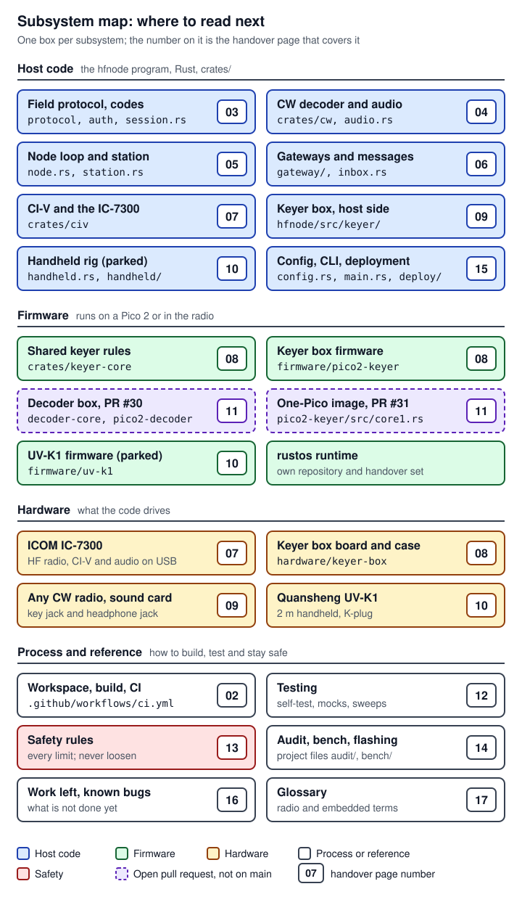

# cw-message-gateway handover

`cw-message-gateway` is a home-station node, the program `hfnode`, that lets a field operator with a small Morse code (CW) radio and a printed sheet of one-time letter codes send texts and email, hear the replies, and get a short weather forecast, all over one agreed HF (shortwave) frequency ([`README.md:3-16`](https://github.com/robinonsay/cw-message-gateway/blob/44185fa9a00369c379d9d8af40ca307e3867e860/README.md#L3-L16)). The node runs on a Raspberry Pi, a Mac or a Windows PC. It drives an ICOM IC-7300 over CI-V (ICOM's serial control protocol) on the radio's USB cable, or any CW radio through a small USB keyer box: a Raspberry Pi Pico 2 that closes the radio's key line, running firmware built on rustos, Robin's bare-metal Rust OS for the Pico 2. The keyer box is also the chosen route for the Quansheng UV-K1 handhelds; a third radio kind, the UV-K1 running the project's own firmware, is parked ([`crates/hfnode/src/config.rs:85-93`](https://github.com/robinonsay/cw-message-gateway/blob/44185fa9a00369c379d9d8af40ca307e3867e860/crates/hfnode/src/config.rs#L85-L93)). The node decodes the Morse, checks the codes, reads every request back, and acts only after a second code confirms it. **Nothing in this project has transmitted on a real radio yet**, and an independent safety audit gates every flash and every keyed test.

These pages are for the engineers Robin (the project owner) is bringing onto the project: experienced software engineers who know Rust but may know nothing about amateur radio, Morse code, ICOM's CI-V protocol or the RP2350 microcontroller. Each page explains radio and embedded terms on first use, and [17 Glossary](17-glossary.md) collects them all. This page is the index, so it does not follow the subsystem page shape the numbered pages share.

**Before you change anything, read [13 Safety rules](13-safety-rules.md).** It is the canonical list of every limit and gate, each stated as the code states it, with its permalink. Among them are the keyer box's firmware limits in `keyer_core::limits`: key-down 1 s ([`crates/keyer-core/src/lib.rs:48`](https://github.com/robinonsay/cw-message-gateway/blob/44185fa9a00369c379d9d8af40ca307e3867e860/crates/keyer-core/src/lib.rs#L48)), run 60 s ([`:51`](https://github.com/robinonsay/cw-message-gateway/blob/44185fa9a00369c379d9d8af40ca307e3867e860/crates/keyer-core/src/lib.rs#L51)), PTT 60 s ([`:57`](https://github.com/robinonsay/cw-message-gateway/blob/44185fa9a00369c379d9d8af40ca307e3867e860/crates/keyer-core/src/lib.rs#L57)), link timeout 2 s ([`:60`](https://github.com/robinonsay/cw-message-gateway/blob/44185fa9a00369c379d9d8af40ca307e3867e860/crates/keyer-core/src/lib.rs#L60)), watchdog 0.5 s ([`:62`](https://github.com/robinonsay/cw-message-gateway/blob/44185fa9a00369c379d9d8af40ca307e3867e860/crates/keyer-core/src/lib.rs#L62)), rest 1 s ([`:66`](https://github.com/robinonsay/cw-message-gateway/blob/44185fa9a00369c379d9d8af40ca307e3867e860/crates/keyer-core/src/lib.rs#L66)) and a 60 s duty budget ([`:78`](https://github.com/robinonsay/cw-message-gateway/blob/44185fa9a00369c379d9d8af40ca307e3867e860/crates/keyer-core/src/lib.rs#L78)). The box's key pin needs its external 4.7 kΩ pull-down because of erratum RP2350-E9 ([`docs/keyer.md:59-65`](https://github.com/robinonsay/cw-message-gateway/blob/44185fa9a00369c379d9d8af40ca307e3867e860/docs/keyer.md#L59-L65)), and a bare Pico 2 pin must never drive a radio that keys on a low line: the box's safe state is its key pin low, so wired straight to the key contact every safe state would key the radio. A switch between them (the PC817 optocoupler, one transistor, or a named photoMOS) turns "pin low" into "line open" (the audit's NO-GO on a direct wire, [`docs/keyer.md:966-980`](https://github.com/robinonsay/cw-message-gateway/blob/44185fa9a00369c379d9d8af40ca307e3867e860/docs/keyer.md#L966-L980)). CI runs the mock IC-7300 tests at 20 times real time ([`.github/workflows/ci.yml:16`](https://github.com/robinonsay/cw-message-gateway/blob/44185fa9a00369c379d9d8af40ca307e3867e860/.github/workflows/ci.yml#L16)). **NEVER LOOSEN** any limit, gate or timeout, never lower the 20x scale, and never send a change round the audit; a rule changes only through the audit, as page 13's "Changing it" section describes.

## Start here

Everyone reads the first row. Then pick the rows for your work.

| If you work on | Read first | Then, as needed |
|---|---|---|
| Anything (everyone new) | [01 System overview](01-system-overview.md): what the node does, its three radio paths, one `TX` transaction end to end, the design decisions and the subsystem map. [13 Safety rules](13-safety-rules.md): every limit and gate. [16 Work left and known bugs](16-work-left-known-bugs.md): what is open, in what order, and who decides. | [17 Glossary](17-glossary.md) for any radio, Morse or chip term; "Sources outside the repository" below for the documents the pages name |
| The host program: protocol, decoding, the node loop, messages, config | [03 Field protocol, codes and sessions](03-field-protocol-auth-session.md), [04 CW decoder and audio](04-cw-decoder-audio.md), [05 Node loop and station safety](05-node-loop-station-safety.md), [06 Gateways and messages](06-gateways-messages.md), [15 Config, CLI and deployment](15-config-cli-deployment.md) | [02 Codebase, build and CI](02-codebase-build-ci.md) for the commands; [12 Testing](12-testing.md) for the tests a change needs |
| Radio control: the IC-7300 over CI-V | [07 CI-V and the IC-7300](07-civ-ic7300.md) | [05 Node loop and station safety](05-node-loop-station-safety.md) for `Station`, the one path through which `hfnode run` keys any radio, through the `Rig` trait; group 4 (the CI-V gates) on [13](13-safety-rules.md); the IC-7300 bench plan on [14](14-audit-bench-flashing.md) |
| The keyer box and its firmware | [08 Keyer box: firmware and protocol](08-keyer-box-firmware.md), [09 Keyer box: host side](09-keyer-host-side.md), [11 Decoder box and the one-Pico image](11-decoder-box-one-pico.md), and the [rustos handover set](https://github.com/robinonsay/rustos/blob/claude/handover-docs-us00cn/docs/handover/README.md), starting with its [08 Changes made for cw-message-gateway](https://github.com/robinonsay/rustos/blob/claude/handover-docs-us00cn/docs/handover/08-changes-for-cw-gateway.md) | [02](02-codebase-build-ci.md) for the reproducible firmware build; groups 1 to 3 (box firmware, box hardware, the host's checks of the box) on [13](13-safety-rules.md); [14](14-audit-bench-flashing.md) for flashing |
| Handhelds: the Quansheng UV-K1 | [10 Quansheng UV-K1 handheld](10-uv-k1-handheld.md) | [08](08-keyer-box-firmware.md) and [09](09-keyer-host-side.md), because routes B and C (route C is Robin's) key the radio through the keyer box; group 6 (handheld rules) on [13](13-safety-rules.md); the UV-K1 bench plan on [14](14-audit-bench-flashing.md) |
| Testing and CI | [02 Codebase, build and CI](02-codebase-build-ci.md), [12 Testing](12-testing.md) | [16](16-work-left-known-bugs.md) for the known flakes and how to triage a red CI run; [13](13-safety-rules.md) for the timeouts and the 20x scale no test change may loosen |
| The bench and the safety audit | [14 Audit, bench and flashing](14-audit-bench-flashing.md) | [13](13-safety-rules.md) for every rule the bench keeps; [15](15-config-cli-deployment.md) for the config keys and commands used on the bench; [16](16-work-left-known-bugs.md) for what each bench result unblocks |

Every numbered subsystem page answers the same questions under the same headings, in this order, so you can jump straight to what you need on any of them:

| Question | Heading |
|---|---|
| Where is the code? | Where it lives |
| How does it work? | How it works |
| How does it connect to the rest? | How it connects |
| What are its interfaces, in full? | Interfaces and APIs |
| What are the algorithms, and how is the processing done? | Algorithms and processing |
| How do I program against it? | Programming against it |
| How do I change it, and what must never change? | Changing it |
| What bugs, limits and flakes are known? | Known bugs, limits and flakes |
| What work is left? | Work left |
| What was the page written from? | Sources |

The overview, safety, process, status and glossary pages (01, 13, 14, 16, 17) adapt this shape and say how at their top.

## The pages

| Page | What it answers |
|---|---|
| [01 System overview](01-system-overview.md) | What the node is for, its three radio paths, one `TX` transaction end to end, the design decisions, and where each subsystem lives. |
| [02 Codebase, build and CI](02-codebase-build-ci.md) | How the Cargo workspace and the firmware builds beside it are laid out, which toolchain and commands to use, what each CI job proves, and how the keyer box's firmware file (a UF2) is built reproducibly and identified by its build id and SHA-256. |
| [03 Field protocol, codes and sessions](03-field-protocol-auth-session.md) | How the one-time codes are made and checked, what the field operator keys and what the node keys back (the exact wire format), and how the session reads every request back and acts only on a second code. |
| [04 CW decoder and audio](04-cw-decoder-audio.md) | How the radio's audio is captured on Linux, macOS and Windows and turned into letters: the mixer and filter, the key-down decision, speed learning, the test-signal synthesizer, and how well it decodes in noise. |
| [05 Node loop and station safety](05-node-loop-station-safety.md) | How `hfnode run` listens, decodes and answers, and how every transmission goes through `Station`: the tune, SWR and output watching, the software watchdog, the duty budget, station ID timing, the transmit inhibit latch, storm stand-down, owner alerts and stopping. |
| [06 Gateways and messages](06-gateways-messages.md) | How a `TX` message reaches a contact by iMessage, Google Voice or email; how replies are collected, screened by the reply filter and kept in the inbox until `RX`; and how `WX` becomes a short forecast. |
| [07 CI-V and the IC-7300](07-civ-ic7300.md) | The `Rig` trait every radio driver implements, the CI-V frame codec, every IC-7300 command with its manual citation, the read-only preflight and the read-back, the mock IC-7300, the bring-up stages, and PR #27's front and microphone key checks. |
| [08 Keyer box: firmware and protocol](08-keyer-box-firmware.md) | How the Pico 2 box keys a radio: `keyer-core`'s limits and state machine, the firmware's never-waiting loop, the fault handlers, keyer protocol version 4, the wiring and the printed enclosure. |
| [09 Keyer box: host side](09-keyer-host-side.md) | How `hfnode` drives the box: the `[keyer]` settings and their checks, the serial link, `KeyerRig`, the sidetone monitor that confirms from the radio's audio that it keyed and unkeyed, the bring-up stages, the bench commands and the mock box. |
| [10 Quansheng UV-K1 handheld](10-uv-k1-handheld.md) | The three ways the project can drive a UV-K1 (route A, the project's own radio firmware, parked; route B, the box holds PTT and keys a tone; route C, NR7Y's CW firmware keyed as a straight key, Robin's route), their code and wiring, and where the bench stands. |
| [11 Decoder box and the one-Pico image](11-decoder-box-one-pico.md) | The Morse decoder on a Pico 2 of its own (PR #30) and on the keyer box's second core (PR #31): `decoder-core`, the audio input wiring, keyer protocol 5, the core 1 fault path, and the planned PRs 4 and 5. Neither image is on `main`. |
| [12 Testing](12-testing.md) | The six test layers, the self-test with its mock radios and scripted field operator, time scaling and pause meters, the sweep and test vectors, how to add a test, and the known flakes and their causes. |
| [13 Safety rules (never loosen)](13-safety-rules.md) | Every limit and gate in seven groups (box firmware, box hardware, the host's checks of the box, CI-V gates, the station, handhelds, process), each with its value, permalink and audit source, the layers of protection against a stuck transmitter, and how a limit could ever change. |
| [14 Audit, bench and flashing](14-audit-bench-flashing.md) | How a change reaches a real radio: the audit's review and the hash it posts, the files cleared to flash, the flash procedure and the check after it, the two bench plans and where each stands, and how to stop a transmission fastest. |
| [15 Config, CLI and deployment](15-config-cli-deployment.md) | Every `hfnode.toml` key with its default, range and check; the state directory and which files stop the node transmitting; every subcommand and whether it can transmit; and how the node is kept running on Linux, macOS and Windows. |
| [16 Work left and known bugs](16-work-left-known-bugs.md) | The open pull requests and their merge order, the planned work, what is not yet done on hardware, and the known bugs, flakes, unchecked assumptions and out-of-date documents, each with its evidence, what it blocks and who decides. |
| [17 Glossary](17-glossary.md) | Radio, Morse, RP2350 and project words in plain terms, each with where the code defines it and the page that covers it. |

The figures are hand-written SVG files in [`diagrams/`](diagrams/), each named after the page that owns it (`NN-name.svg`).

The repository's own documents were written before this set, mostly for operators and builders; the pages cite them where they are the source:

| Document | What it is |
|---|---|
| [README.md](../../README.md) | The repository's front page: what the node does, the self-test against a mock radio, the sweep, and what the mock cannot prove |
| [docs/operating.md](../operating.md) | The field operator's guide: what to carry, what to send, what the node sends back |
| [docs/keyer.md](../keyer.md) | The keyer box: parts, wiring, flashing, radio set-up, configuration, bring-up, what stops a stuck key, and the UV-K1 routes through the box |
| [docs/keyer-protocol.md](../keyer-protocol.md) | The keyer box's serial protocol |
| [docs/hardware-test-plan.md](../hardware-test-plan.md) | The staged IC-7300 bring-up plan, including the hardware transmit timer (step 10) |
| [docs/civ-audit.md](../civ-audit.md) | A review of every CI-V byte the driver sends against the IC-7300 manual |
| [docs/handheld.md](../handheld.md), [docs/handheld-protocol.md](../handheld-protocol.md) | The parked UV-K1 firmware route (route A) and its serial protocol |
| [docs/texting.md](../texting.md), [docs/reply-filter.md](../reply-filter.md) | Texting by Google Voice and iMessage; the reply filter |
| [docs/raspberry-pi-setup.md](../raspberry-pi-setup.md), [docs/macos-setup.md](../macos-setup.md), [docs/windows-setup.md](../windows-setup.md) | Setting up each kind of host computer |

## Subsystem map

*Figure: where to read next. The number on each box is its page. Blue is host code, green firmware, amber hardware, red the safety rules, and white the process and reference pages; the dashed purple boxes are on open pull requests, not on `main`.*

## How these docs cite the code

**Every claim about code is a permalink** to the exact lines at a fixed commit. The link text is the repository-relative path and line numbers; the URL carries the full 40-character SHA, so the link always shows the lines the sentence was written from, even after the file changes. The pages never link `blob/main` or `blob/master`, which move. For example, the box's key-down limit is [`crates/keyer-core/src/lib.rs:48`](https://github.com/robinonsay/cw-message-gateway/blob/44185fa9a00369c379d9d8af40ca307e3867e860/crates/keyer-core/src/lib.rs#L48).

The commits the pages cite:

| What | Repository | Commit | Full SHA | Notes |
|---|---|---|---|---|
| `main` (merged code) | cw-message-gateway | `44185fa` | `44185fa9a00369c379d9d8af40ca307e3867e860` | PRs #1 to #26, #28 and #29 merged. Every cw-message-gateway link unless the sentence says otherwise. |
| PR #27, front-key preflight (open, ready, audit-cleared) | cw-message-gateway | `3c97427` | `3c97427bcf59fcb8223af7a3676eeebdec529f52` | Branch `claude/ic7300-front-key-preflight-2mqta3`, base `main` |
| PR #30, decoder box (open, audit-cleared) | cw-message-gateway | `3efaf84` | `3efaf842e1aab75354e5e19d0384a703d4d786be` | Branch `claude/pico-decoder-u9bum5`, base `main` |
| PR #31, one-Pico keyer image (draft, audit-cleared to flash only after it merges) | cw-message-gateway | `bc5062a` | `bc5062ae4f56ae1f9949b3b067218c7e675d88f8` | Branch `claude/one-pico-keyer-image-cm9luj`, stacked on #30 |
| `master` (merged code) | rustos | `80bf599` | `80bf5998a60a41b3741041062ff7e9c59caf95b2` | rustos PRs #1 to #5 merged |
| rustos PR #6, multicore and `Rp2350Usb::room()` (open) | rustos | `410dffa` | `410dffa091e247e6e7546c7f2ff465f0af499d5a` | Branch `claude/pico-decoder-u9bum5`, base `master` |

Rules the pages follow:

- **Code that exists only on an open pull request is labelled in the sentence**, for example "(PR #31, draft, not on main)", and cited at that PR's head.
- **Sources outside the repository are named, not linked** (next section).
- **Pages link sibling pages, not headings on them**, because headings may change. Links to the rustos set use the docs branch, `claude/handover-docs-us00cn`, the one moving link allowed.
- **Where the code and a note or document disagree, the code wins**, and the page says so.

**How to re-check the links.** Run `python3 docs/handover/tools/citecheck.py docs/handover/*.md` from the repository root (add `--quiet` to see only problems). For each permalink it checks that the commit, the file and the line range exist, and prints the cited lines so you can compare them with the sentence. It needs the cited commits in your clones: a commit that only an open pull request holds may need `git fetch origin <full-sha>`, and links into rustos are checked against a rustos clone beside this one, or wherever `RUSTOS_DIR` points. A permalink never breaks, because it points at a fixed commit, so a stale one does not show as an error: it keeps showing the old lines. Reading the printed lines against the sentence is how you catch it.

**Diagram colours.** Every figure in this set and in the rustos set uses the same colours, and each figure with more than one colour has its own legend:

| Colour | Fill and border | Means |
|---|---|---|
| Blue | `#dbeafe`, `#1e40af` | Host code: `hfnode` and the crates that run on a computer |
| Green | `#dcfce7`, `#166534` | Firmware: code that runs on a Pico 2 or inside a radio |
| Amber | `#fef3c7`, `#92400e` | A radio or other hardware: the IC-7300, the UV-K1, any CW radio, the box's board and wiring |
| Red | `#fee2e2`, `#991b1b` | A safety limit, gate or rule (never loosened) |
| Grey | `#f3f4f6`, `#374151` | An external service or a person: Robin, the field operator, the safety audit, mail and text services, the weather service |
| Purple, dashed border | `#ede9fe`, `#5b21b6` | Not on `main` yet: an open pull request or a planned change |

White boxes with a grey border are notes or, in the subsystem map, process and reference pages. A few figures add a mark of their own and explain it in their legend.

## Sources outside the repository

The repository is public. The design spec, the safety audit's files, the bench plans and the radio manuals are not in it: they are kept with the project, in Robin's project files. So the pages restate what an engineer needs from them (each rule, value or wiring detail) and name the file and section in plain text, for example "`audit/req-on-air-bench-ruling.md` §4 (project files)". No page copies them, and none carries their personal or station details. The safety audit owns `audit/`, and each bench plan belongs to its bench; engineers read them and never edit them. If you need one of the files itself, ask Robin.

| File | What it holds | Named on |
|---|---|---|
| `design/spec.md` | The design spec, the only copy: purpose, architecture, data flow, authentication, the protocol grammar, reliability, the inbound compliance filter, station safety for unattended operation, antenna and lightning, open items, and later additions. Parts of it are out of date; [16](16-work-left-known-bugs.md) lists them. | 01, 03, 05, 06, 16, 17 |
| `design/spec-any-radio.md` | The any-radio design: the keyer box, the radio's headphone audio into the computer, and the handheld's PTT with a keyed tone | 01, 08 |
| `design/spec-handheld.md` | The design of the parked UV-K1 firmware route (route A) | 01, 10 |
| `design/spec-always-listening.md` | The change from scheduled listening windows to listening all the time | 01 |
| `design/spec-pico-decoder.md` | Morse decoding on the Pico 2: the crate split, the decoder box, the audio front end (§3), where the sidetone monitor's check lives (§4), the decoder protocol (§5), `hfnode` taking letters from the box (§6), the one-Pico core split (§7) and the list of planned PRs | 01, 04, 09, 11, 13, 16, 17 |
| `design/pico-decoder-pr4.patch` | PR 4, `[receive] source = "box"`, written as a patch and not yet opened | 02, 03, 04, 05, 09, 11, 12, 13, 15, 16 |
| `audit/rubric.md` | The audit's evidence rules, grades, verdicts and criteria (section H: hardware) | 10, 13, 14, 16, 17 |
| `audit/report.md` | The full safety audit report: §1 the keyer box, §2 the parked UV-K1 firmware, §3 the UV-K1 on the keyer box followed by the reviews of later pull requests, §4 the IC-7300 CI-V driver and guards | 02, 05, 07, 08, 10, 11, 13, 14, 16, 17 |
| `audit/final-grades.md` | The final grades: the file to flash and its hash, the verdicts per route, the firmware, the steps per radio, and section H per route | 01, 02, 07, 08, 10, 13, 14, 16, 17 |
| `audit/req-keyer-box-fixes.md`, `audit/req-ic7300-fixes.md` | The fixes the audit required before the keyer box and the IC-7300 path could connect or key | 07, 08, 09, 13, 14, 16 |
| `audit/req-on-air-bench-ruling.md` | The ruling for the bench on the air with no dummy load and no wattmeter: before every keyed step (§2), the UV-K1 on its own antenna (§3), the IC-7300 (§4) | 07, 09, 10, 13, 14, 16, 17 |
| `audit/req-handheld-nr7y-cw-ruling.md` | The ruling for the UV-K1 in NR7Y's CW mode keyed as a straight key: verdict, the key-switch wiring and the one-Pico audio input (§2), radio settings, bench stages, parts | 10, 11, 13, 14, 16, 17 |
| `audit/req-handheld-nr7y-ruling.md`, `audit/req-handheld-generic-route-constraints.md`, `audit/req-handheld-no-tx-while-charging.md` | The earlier UV-K1 rulings: the K-plug route on NR7Y v1.3, the constraints for the UV-K1 as a plain radio on the keyer box, and the parked no-transmit-while-charging requirement | 10, 13, 14, 16 |
| `bench/quansheng.md` | The UV-K1 bench plan: rules, status, stages and recorded results | 04, 08, 09, 10, 12, 14, 16, 17 |
| `bench/ic7300.md` | The IC-7300 bench plan: rules for every stage, status, stages 1 to 13 and results | 05, 07, 12, 14, 16, 17 |
| `bench/k1-bench.toml`, `bench/k1-2n3904-key.svg`, `bench/k1-audio-later.svg` | The UV-K1 bench config, and the two image-checked wiring drawings: the one-transistor key switch and the later audio input into the box | 10, 11, 14, 16 |
| `reference/IC-7300_ENG_FM_12b.txt` | ICOM's *IC-7300 Full Manual* as text. Section 19, the CI-V control commands, starts at line 8531; the code's comments, [docs/civ-audit.md](../civ-audit.md) and page 07 cite it by line | 07, 17 |
| `reference/K1_EN.txt` | The UV-K1 user's manual as text | 10 |
| `handover/outline.md` | The outline this set was written from | 01, 12 |

Some "Sources" sections also name the project notes (`MEMORY.md` and its detail files, cited as "project note" with the file name): the working notes of the Claude sessions that did the work. They are point-in-time and outside both repositories. The pages restate what they took from them, checked against the code; where a note and the code disagree, the code wins.

## Status at the time of writing

As of 2026-10-14, from [16 Work left and known bugs](16-work-left-known-bugs.md) and the bench table on [14](14-audit-bench-flashing.md) (the pull requests and branch heads were checked again on GitHub that day and had not moved):

- **Code:** `main` is `44185fa` (PRs #1 to #26, #28 and #29 merged); rustos `master` is `80bf599` (rustos #1 to #5 merged).
- **Open:** #27 (ready, audit-cleared) can merge at any point. #30 (audit-cleared) and rustos #6 (untested on hardware) come next, in either order. #31 (draft, stacked on #30) stays a draft while it changes: it moves its rustos pin to rustos `master`'s merge of #6, which makes a new head that needs a fresh audit and a new hash before anything is flashed. See [16 Work left and known bugs](16-work-left-known-bugs.md), "The merge order".
- **Hardware:** nothing has transmitted, `hfnode` has never been connected to a real IC-7300, and one keyer box, flashed with the audited build `eef8c126`, has answered `hfnode keyer check` with nothing wired to a radio.
- **Benches:** as the bench files last recorded, the UV-K1 bench is at stage 3 (finding the radio's K-plug contacts, no RF) and the IC-7300 bench at stage 2 (radio menus, USB cable out); every stage runs on Robin's go and its results go to the audit.
- **Unattended use:** not cleared on any route; it waits on the measured bench results (the audit's H1), a hardware transmit timer that is not built yet, the IC-7300's link-loss test, and the audit's review.

## Keeping these docs right

- **When the code changes, update the page with it.** Re-read every sentence that cites a changed file, move its permalinks to the new commit (the full 40-character SHA, with the line numbers checked at that commit; `git diff <old> <new> -- <path>` shows what moved), and update the commit table above. Then run `citecheck.py` until it reports 0 broken.
- **When a pull request merges**, re-cite its items at `main`'s merge commit, drop the "open, not on main" labels, turn its dashed purple boxes in the figures into their merged colour, and update [16](16-work-left-known-bugs.md) and "Status at the time of writing" above. Do the same in the rustos set when rustos #6 merges.
- **When a figure's subject changes, re-render it.** Edit the SVG in `diagrams/` by hand, keep the colours above and the house style (a white background rectangle drawn first, a `<title>` that matches the alt text, text no smaller than 13 px), run `svgcheck.cjs`, and look at every image it writes, desktop, dark page, phone and zoom tiles, until nothing overlaps or is cut off and it reads well at phone width.
- **Keep [13 Safety rules](13-safety-rules.md) canonical.** A limit, gate or rule changes in these pages only when the code changes, after the safety audit has reviewed it, and never by loosening. Update page 13 first, then the pages that cite the same code.
- **Keep the house rules.** Robin is "she" and "her" everywhere; no personal details; no time estimates, only the work and what it waits on; anything not checked on hardware is labelled as such.

The two tools are in [`tools/`](tools/). Run both from the repository root.

| Tool | Command | What it does |
|---|---|---|
| `citecheck.py` | `python3 docs/handover/tools/citecheck.py docs/handover/*.md` (add `--quiet` to see only problems) | Checks every link. For each permalink: the commit, the file and the line range exist, and the cited lines are printed beside the link. It flags links to `blob/main` or `blob/master`, missing relative targets and missing heading anchors. Exit status 1 if anything is broken. |
| `svgcheck.cjs` | `node docs/handover/tools/svgcheck.cjs docs/handover/diagrams/NN-name.svg` | Renders the SVG the way GitHub shows it, at desktop width on a light and a dark page and at phone width, cuts zoom tiles, and lints the layout (text outside the canvas, overlapping text, text under 13 px, lines through text, a missing background). It writes PNGs to `docs/handover/.render/`, which git ignores, and prints a JSON report. Needs Node 18 or later and Playwright with Chromium (`npm install playwright`, then `npx playwright install chromium`). Fix every error, then look at the images: the lint does not catch everything that reads badly. |

## The rustos handover set

rustos is a separate repository with its own handover set: the Pico 2 boot code, the drivers this project added (clocks, timer, SysTick, watchdog, USB serial, PWM, ADC, DMA, and multicore on rustos PR #6, open), how to write a driver, and every change made for this project. The keyer box firmware pins one rustos commit, and moving that pin "can change the UF2 with no source change" ([`firmware/pico2-keyer/Cargo.toml:27-29`](https://github.com/robinonsay/cw-message-gateway/blob/44185fa9a00369c379d9d8af40ca307e3867e860/firmware/pico2-keyer/Cargo.toml#L27-L29)), so a pin move goes back through the safety audit like any firmware change ([16](16-work-left-known-bugs.md)). Start at <https://github.com/robinonsay/rustos/blob/claude/handover-docs-us00cn/docs/handover/README.md>.

## Sources

- The seventeen pages of this set, `01-system-overview.md` to `17-glossary.md`, and the figure `diagrams/01-subsystem-map.svg`.
- cw-message-gateway at `44185fa`: `README.md`, `crates/hfnode/src/config.rs` (`RigKind`), `crates/keyer-core/src/lib.rs` (`limits`), `firmware/pico2-keyer/Cargo.toml` (the rustos pin), `docs/keyer.md` (its headings and the wiring rules), `.github/workflows/ci.yml`, and the first lines of each document in `docs/`.
- The rustos handover set's index on the docs branch, for the shared colours and the cross-links.
- The project files named above (their headings, read for this page) and the writers' brief for this handover set.
- GitHub REST API on 2026-10-14: PRs #27 (`3c97427`), #30 (`3efaf84`) and #31 (draft, `bc5062a`) open; rustos PR #6 open at `410dffa`; `main` at `44185fa` and rustos `master` at `80bf599`.
- `docs/handover/tools/citecheck.py` and `svgcheck.cjs` (their usage notes).
