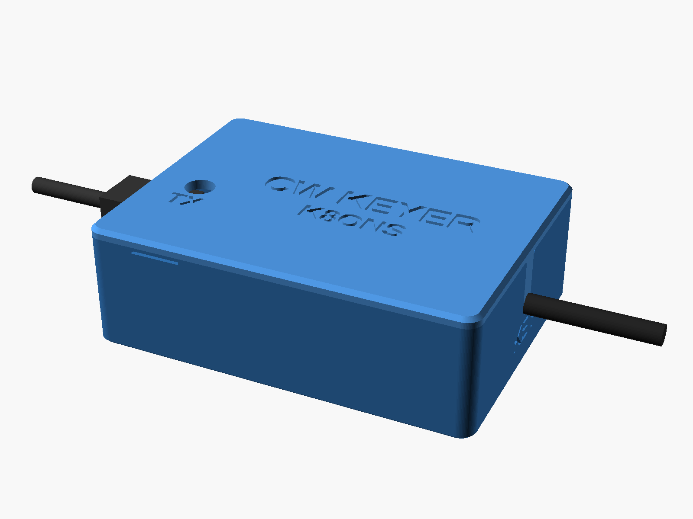

# Keyer box enclosure

A 3D-printed box and snap-on lid for the keyer box's 70 × 50 mm perfboard (the
Pico 2 keyer of [docs/keyer.md](../../docs/keyer.md)). Written in OpenSCAD, so every
size is a number you can change. It holds the board on printed pegs: no screws,
inserts or glue.

Outside size with the defaults: 75.7 × 55.6 × 24.6 mm.

## Files

- `keyer-box.scad`: the design. Open it in [OpenSCAD](https://openscad.org/)
  (2021.01 or newer), then **Window > Customizer** for sliders and menus.
- `images/`: renders of the default design.
- `render.sh` (optional): remakes the images and runs the fit checks.

To make the STL files: set **part** to `box`, press **F6** (fn+F6 on a Mac, or
**Design > Render**), then **File > Export > Export as STL**. Do the same with
`lid`. Both come out already turned the way they print.

## Before you print

The board's numbers come from a photo of the board, with its 2.54 mm hole grid as
the ruler (measured four independent ways and cross-checked, to about ±0.1 mm):

- Size: 70.0 × 50.0 mm across the top face, about 70.3 × 50.2 mm over the cut edges.
  The box is built around 70.5 × 50.4 (`board_l`, `board_w`), so the edge ribs never
  pinch it.
- Corner holes: 2.18 mm across at the top edge. The plated bore inside may be a
  little narrower (1.95 to 2.2), so the model uses 2 mm (`hole_d`, the M2 size these
  boards are sold with) and makes the pegs 1.5 mm (`pin_clear` 0.5). That allows for
  PETG shrinking slightly and small pegs printing a little fat.
- Hole spacing: 65.95 × 46.09 mm centre to centre. The pegs are 66.0 × 46.1 apart
  (`hole_inset_x` 2.25, `hole_inset_y` 2.15 from the model's outline).
- The hole grid sits within 0.2 mm of the board's centre, as the model assumes.
- Thickness can't be seen from above: `board_t` is the standard 1.6 mm.

Print `part = "peg_test"` first (a thin frame with the four pegs, about ten minutes)
and try the board on it. It should drop on and lift off easily. If it is tight,
raise `pin_clear` to 0.6; if it rattles a lot, lower it to 0.4.

The cables:

- USB: the plug's moulded body goes into the wall. Yours measured 10.5 mm wide in
  the photo (the USB spec allows up to 10.6). The opening is 13 × 10 mm
  (`usb_hole_w`, `usb_hole_h`). For a different cable, set `usb_plug_w` and
  `usb_plug_h` to its body and the fit check tells you if it clears.
- Key lead: its diameter goes in `o1_w` (4.0 mm). It wasn't in the photo.

## Printing (PETG, Bambu Lab H2C)

- Box: opening up. Lid: top face down (the STLs are already this way round).
- No supports, no brim. 0.2 mm layers, 4 or more wall loops, 15 % or more infill.
- Generic PETG profile, textured PEI plate (or glue stick on a smooth plate).
- If the lid is too tight or too loose, change `fit` (0.2 mm per side) by
  0.05 mm and print the lid again.

## Laying out the board

The box assumes this layout, and the USB opening and LED window follow the Pico:

- **Pico 2** with its USB socket facing the **left** wall, pin 1 in the first hole
  column from the left edge, row 6 from the front edge (so the Pico sits in the
  middle), on pin headers 2.5 mm above the board. OpenSCAD's console says where
  pin 1 lands whenever you change it. To move it, use the **Pico 2 position** tab:
  `pico_usb_wall`, `pico_inset_holes` or `pico_inset`, `pico_center` and
  `pico_height`.
  - On a 70 × 50 board the USB can face only the left or right wall. The other
    openings do not move with the Pico: if the USB goes to the right wall, move the
    key lead (`o1_wall`) to the left.
  - In sockets (`pico_height` 8.5), set `above` to 17.5 or more. Soldered flat
    (`pico_height` 0), the Pico's USB end has to sit at the board's edge, or the
    plug hits the board.
- **Key lead** out of the **right** wall, 4 mm above the board's top, in a slot
  that the lid's tongue closes over. The tongue holds the lead in its slot; tie a
  loose overhand knot in the lead just inside the wall as well, so that a tug never
  reaches the solder joints. The switch parts (the 2N3904 and its two resistors) go
  in the free columns near that wall.
- Keep the four corners clear: pegs come up through the corner holes, and the
  lid's posts come down to just over the board there, so it cannot lift off the
  pegs.
- Parts may stand up to 14 mm above the board (`above`), and solder joints and
  wires may hang 5 mm below it (`below`).

Small ribs on the walls sit 0.2 mm from the board's edges (`edge_stops`), so
pushing the USB plug in leans the board on the wall, not on the pegs.

**Opening 2** is a spare round hole for a 3.5 mm panel jack (6.2 mm, for the audio
input that comes later), switched off. With it on, the lid's skirt is cut back to
clear a jack body up to 10 × 10 mm (`o2_body_w`, `o2_body_h`), and `check_jacks`
tells you if that body hits anything. **Opening 3** is another spare. Each opening
has a wall, a position along it (mm from the board's left or front edge), a height
above the board, a size and a shape: `cable` (slot closed by the lid's tongue),
`round` or `rect`. OpenSCAD's console warns when two openings overlap, when one
reaches the rim, or when one cuts a snap ridge.

## Putting it together

1. Lay the key lead in its slot and the board on the pegs, solder side down.
2. Press the lid on until it clicks. It only fits one way round (the tongue goes
   over the key lead).
3. Plug the USB cable into the left wall.

To open: fingernail in the notch at the front edge, lift.

The window in the lid shows the Pico 2's own LED, which lights while the key is
closed and flashes after a trip. Its position on the Pico (`pico_led_p`,
`pico_led_q`) is an estimate from photos, so the window is a generous 6 mm.

## Nothing electrical changes

The box only holds the board. The wiring stays as the safety audit ruled it. A panel
jack on the key line instead of the lead is a wiring change: ask the audit first.

## Options

- `mount = "screws"`: posts with 1.6 mm pilot holes for M2 self-tapping screws
  instead of pegs (the lid's posts are left off).
- `bootsel_hole`: a hole over the BOOTSEL button (off: take the lid off to
  re-flash, which also follows the rule to unplug the radio first). Its position
  is an estimate too: check it against your Pico before turning it on.
- `lid_label`, `lid_label2`, `led_label`, `wall_labels`: the text cut into it.
- `snap`, `pry_notch`, `edge_stops`, `led_window`: each can be turned off.
- `lid_holes` and `extra_openings` (in the file, not the Customizer): more holes
  in the lid, and more than three wall openings.
- `part = "section"` and `"section_corner"`: cutaway pictures for checking fit.

## Fit checks

Pick one in the **part** menu and press F6: `check_lid_box`, `check_board`,
`check_pico`, `check_plug`, `check_cable` and `check_jacks`. Each should leave the
view empty, and the console should say `Current top level object is empty.` All
six do with the defaults.
